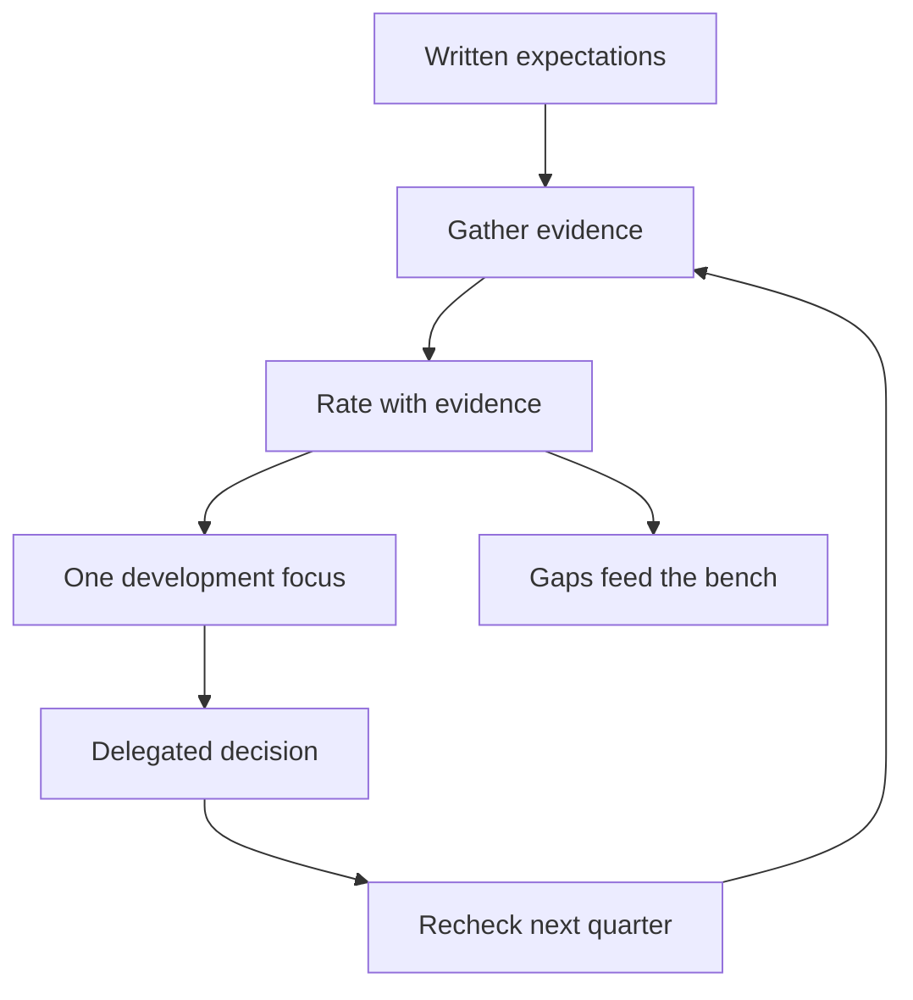
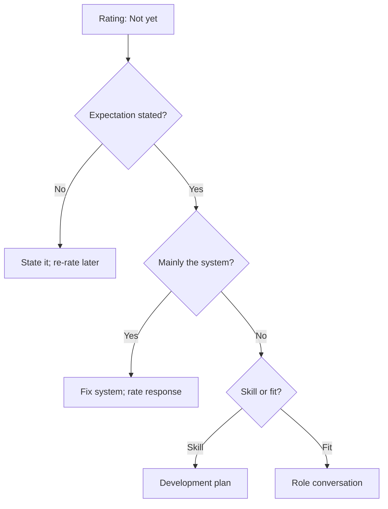

# Chapter 41 — Managing and Developing Engineering Managers

A director's main product is the managers. This chapter covers assessing an engineering manager
against a rubric with observable evidence. It covers coaching managers through skip-levels, reviews of
managers' work artifacts, and delegated decisions, and building a bench for every management seat.
Measuring managerial effectiveness in general is in Chapter 4, and coaching an individual in Chapter
5; here the individual is a manager and the coach is the director. The running example is the end of quarter 2 at Northstar
Technologies, the fictional company in the [case study](../../case-studies/northstar/index.md), where
the director assesses the six managers for the first time.

## Why This Matters

At team scale, a manager decides most of what an engineer experiences: what they work on, whether they
grow, whether their concerns travel anywhere. A director who cannot tell a strong manager from a busy
one rewards the busy one. At Northstar's baseline, managers were reviewed once a year on roadmap
delivery only, against a one-line job description. On that basis Daniel Cho (Customer Experience
manager), whose team deployed most,
looked strongest, and nothing measured showed that his mobile engineers felt like pawns.

At organization scale, the managers are the director's leverage. The director's product is the system
(Chapter 40), and a director reaches that system almost entirely through six or eight people.

At executive scale, the question is whether managers are ready when needed. At Northstar each of the six
managers is a [single point of failure](../../glossary.md#single-point-of-knowledge-failure), and under the
flat-headcount rule a new manager can come only from
an engineering seat that is not backfilled. The bench is built from current engineers or not at all.

## Learning Objectives

After this chapter you will be able to:

- Assess an engineering manager on six dimensions, with dated, observable evidence behind every rating
  and an explicit "No evidence" where there is none.
- Separate what a manager controls from what the system controls, and decide what a "Not yet" calls for.
- Run skip-level conversations that inform coaching without undermining the manager.
- Develop managers through manager artifact reviews and delegated decisions, with a one-quarter plan and a check.
- Build a leadership bench for each management seat from the people the organization already has.

## The Mental Model

> **Mental model:** A rating without evidence is an opinion; development without a rating is drift.
> Make the manager's work observable, rate it against expectations the manager knew, pick one thing to
> develop, and give them a real decision to practice it on.

A manager's results arrive late, mixed with the system's, and through other people (Chapter 2's slow,
noisy loop). The director's answer is more ways of observing, not more reporting: the manager's
artifacts, metrics read in context, skip-level themes, and what peers and staff engineers see.

The loop starts with written expectations, because a rating against an unstated expectation says more
about the director than the manager. It ends with a recheck, because an unchecked plan becomes a
document. The second idea: developing managers and building the bench are the same work. A manager
strong on people growth has people who could take more of the job; a seat with no such person is both a
development gap and a succession gap.

## Deep Conceptual Explanation

### The rubric: six dimensions of observable evidence

Chapter 4 measures a manager across four areas (unit outcomes, team health, people growth, leverage)
over at least two quarters ([Chapter 4](../01-foundations/04-the-leadership-ladder.md)). For assessment
and development this book splits them into six, separating out two things engineering managers most
often differ on: owning production and running the role itself. The rubric is **this book's
recommendation**, not a validated instrument; the Engineering Manager performance rubric template in
Part XIV uses the same dimensions and levels.

| Dimension | Observable evidence | Not evidence |
|---|---|---|
| 1. Outcomes in context | Commitments as made and as delivered; reliability trend; the manager's account of causes, checked | Activity counts; renegotiated targets |
| 2. Operational ownership | On-call load by person; corrective actions closed; [tier 1 minimums](../../glossary.md#tier-1-operational-minimums) (owner, alerts, runbook, on-call) on owned components | "A quiet quarter" |
| 3. People growth | Work delegated with a named level; career conversations; gaps addressed; a named successor | One-on-ones held |
| 4. Team health | Regretted attrition; skip-level themes; health checks; concentration of pages and knowledge | Survey scores without comments |
| 5. Cross-team leverage | Dependencies resolved; ownership clarified; help to peers, confirmed by them | Self-reported heroics |
| 6. Running the role | Time allocation; delegation; escalation timing; bad news reported early | Hours worked |

Each dimension gets **Not yet**, **Solid**, **Strong**, or **No evidence**. The fourth matters most: a
director who has not seen a dimension tends to rate it "Solid", turning ignorance into judgment. "No
evidence" is a finding about the director's information, and it sets an action: go and look. ("Not
yet" here is a rating on one dimension, not the declined-promotion plan of Chapter 8.)

Three rules (**this book's recommendation**):

1. Every rating cites a dated evidence item and its source.
2. Rate Not yet only against an expectation the manager knew before the behavior rated, using
   evidence from the rating window; older facts are context. Where no expectation was stated, the
   cell reads **Expectation not set** and carries no rating. That gap is the director's too. It may
   shape the development plan, but it must not affect this cycle's pay or performance rating.
3. There is no composite. Ratings are not averaged and managers are not ranked, because their teams
   sit in different parts of the system.

### Why the evidence rule exists

Ratings say more about the rater than the rated. In two large samples of managers rated by seven
raters each, the raters' individual quirks explained more than half of the spread in ratings (62 and
53 percent), more than twice the effect of the managers' actual performance
([Scullen, Mount, and Goff, 2000](../../references/bibliography.md#scullen2000latent)). That
**research finding** concerns developmental ratings (Chapter 9 treats rating error). Its consequence:
a rating should be traceable to something another person could check.

Feedback alone changes managers little. A [meta-analysis](../../glossary.md#meta-analysis) (a study pooling
many studies) of 24 longitudinal studies found that improvement after multisource feedback (ratings
from the manager's boss, peers, and reports) was generally small. The authors suggest it is likelier
when the feedback shows change is needed, the recipient believes change is feasible, sets goals, and
acts
([Smither, London, and Reilly, 2005](../../references/bibliography.md#smither2005multisource)). Hence the
loop does not stop at the rating: one focus, a goal, a real decision to practice on.

Retention has the strongest evidence. At one large technology firm, managers with better
survey-measured people skills had markedly lower turnover on their teams, with designs supporting a
causal reading, but did not consistently improve other outcomes
([Hoffman and Tadelis, 2021](../../references/bibliography.md#hoffman2021people)). Google reports a
similar pattern (**documented practice**, one company, method not published)
([Google re:Work](../../references/bibliography.md#rework-great-managers)). Team health carries real
weight; outcomes need context before they carry any.

### Coaching managers through three channels

**[Skip-levels](../../glossary.md#skip-level).** The director's conversations with engineers two levels
down check what the manager's channel carries; they must not replace it. They follow the skip-level
rule in [Chapter 40](40-the-directors-job.md#building-your-own-signal-sources); its core is that themes
go back to the manager, quotes never. A skip-level that yields a director's decision has bypassed the
manager. For coaching, four questions travel well: Which decision did you
wait on longest, and who made it? What would you tell your manager if you were sure it was safe? What
can you do now that you could not two quarters ago? What should the director stop doing? The second
probes safety toward the manager (Chapter 11); the third is evidence for people growth.

**Manager artifact reviews.** In the weekly leadership team meeting (Chapter 37), one slot goes to one
manager presenting one artifact (a quarter plan, an incident review, a promotion packet) for peers to
question. Peers see each other's work, and the artifact becomes rubric evidence. Keep the question
"what would you change?", not "who got it wrong?".

**Delegated decisions.** The strongest tool is a real decision handed over at an explicit level of
control. Chapter 2's five levels
([delegating with an explicit level of control](../01-foundations/02-from-individual-contributor-to-leader.md#delegating-by-outcome-with-an-explicit-level-of-control))
work for managers too:

| Level | Who decides | The delegate says |
|---|---|---|
| 1. Direct | The director | "Here is what I found" |
| 2. Recommend | The director, from the manager's options | "I recommend X, because" |
| 3. Intent | The manager, after telling the director | "I intend to do X on Thursday" |
| 4. Act and inform | The manager | "I did X; here is why" |
| 5. Own | The manager; the director hears by exception | Reports outcomes in the regular review |

David Marquet argues for moving decisions to the people with the
information ([Marquet, 2012](../../references/bibliography.md#marquet2013turn)). Liz Wiseman argues
that some leaders amplify others' capability while others diminish it
([Wiseman, 2010](../../references/bibliography.md#wiseman2010multipliers)). Both are **expert
opinion**. Research is sobering: managers say they delegate to develop people, yet many hold back
important decisions from those they see as inexperienced ([Yukl and Fu, 1999](../../references/bibliography.md#yukl1999determinants)).
So hand over a decision that matters at level 2 or 3, not a trivial one at level 5.

### What the research on manager development says

Leadership training works better than once thought, when it is designed well. A meta-analysis of 335
samples found moderate to large improvements in reactions, learning, on-the-job behavior, and
results, largest in on-the-job behavior. Training worked better with a needs analysis, feedback,
several methods (especially practice), spaced sessions, on-site location, and face-to-face delivery
([Lacerenza et al., 2017](../../references/bibliography.md#lacerenza2017leadership)). That **research
finding**, as the abstract reports it, concerns formal programs, not a director's coaching. It still
argues against one off-site course from a catalog. The rubric is the needs analysis, real decisions
are the practice, quarterly rechecks are the spacing.

Management is learned mostly on the job, and the research on how is young
([Day et al., 2014](../../references/bibliography.md#day2014advances);
[Hill, 2019](../../references/bibliography.md#hill2019becoming)); practitioner guides agree
([Fournier, 2017](../../references/bibliography.md#fournier2017manager);
[Zhuo, 2019](../../references/bibliography.md#zhuo2019making)). None of it says which manager will
grow, so recheck every quarter.

### Building the bench

The succession table, readiness scale, and coverage rule are in
[Chapter 36](../07-organization-design/36-reorganizations-evolution-and-succession.md#succession-coverage);
this chapter adds how to grow the names in it. Select on evidence of managerial work, not engineering
excellence: firms tend to promote on current performance even when other traits predict managerial
success better ([Benson, Li, and Shue, 2019](../../references/bibliography.md#benson2019promotions)).
Create that evidence with trial assignments that are real management work: running planning, leading an
incident review, owning a hiring loop, facilitating a health check. And sponsor, not just mentor:
sponsorship means a senior person using influence on the candidate's behalf, and survey research found
high-potential women over-mentored and under-sponsored
([Ibarra, Carter, and Silva, 2010](../../references/bibliography.md#ibarra2010promotions)). Every
people-growth rating therefore asks: who on your team is doing a piece of your job this quarter?

## Engineering Organization Example

What running this for six managers costs a director. The figures are **illustrative**, for Northstar
after week 10 (77 engineers in teams; the staff engineers are managed separately).

| Activity | Assumption | Hours per quarter |
|---|---|---|
| One-on-ones with managers | 6 × 45 minutes × 13 weeks | 58.5 |
| Skip-levels | Chapter 40's rotation: two groups of three a week, 45 minutes, 13 weeks | 19.5 |
| Rubric assessment | 4 hours per manager every two quarters, spread over both | 12 |
| **Total** | | **90** |

That is about 7 hours a week, about 15 percent of the director's 47-hour week. The artifact-review
slot is not counted: it sits inside the weekly leadership team meeting.

What it can buy: at baseline eight engineers left in a year, with a median 15 weeks to a replacement's
first day. Catching one avoidable departure a year saves about 15 engineer-weeks, roughly $53,000 at
the book's planning rate of $3,558 per engineer-week (a
[fully loaded cost](../../glossary.md#fully-loaded-cost) of $185,000 a year ÷ 52), before ramp-up. It is a plausibility check, not a forecast.

The more telling number: in the first Northstar rubric (Case Study), drafted before any group
skip-level, 5 of 36 cells are "No evidence". Rating all 36 from impression would have produced a tidy
table and no idea where to look.

## Decision Framework

A rating is the start of a decision. The flow for "Not yet" separates four causes, because each calls
for a different response.

| Pattern | Likely meaning | Response |
|---|---|---|
| "Not yet" on one dimension, expectation stated | Skill gap | One-quarter plan with a delegated decision and a check |
| "Not yet" caused by the system ([release train](../../glossary.md#release-train), span, ownership) | The director's problem | Fix the system; rate the manager's response |
| "Not yet" on several dimensions for two quarters despite a plan | Possible role fit | Chapter 9's expectations process, including a return to engineering |
| "No evidence" anywhere | Information gap | Go and look; do not rate |
| "Expectation not set" | The director's gap | State the expectation; rate next cycle |
| "Strong" on people growth and leverage | Ready for more scope | Stretch decision at level 3 or 4 (the manager decides); bench for a larger role |
| "Strong" everywhere, team runs without them | Ready now, or about to leave | Career conversation this month |

Two more criteria (**this book's recommendation**). Weigh dimensions by the team's situation: outcomes
weigh more for a team carrying a renewal commitment, operational ownership and health for a team with
concentrated on-call load. And treat the manager's response to a "Not yet" (curiosity, a draft plan,
changed behavior within weeks) as evidence in its own right.

### When a manager is not working out

Moving a manager out of the role is a decision about fit, made only after the system and the
director's own part are ruled out (**this book's recommendation**). Before deciding, check three
things: the expectations were written and known, a one-quarter plan with a real decision was tried,
and the "Not yet" pattern held across several dimensions for two quarters. If any is missing, the
problem is still partly yours.

The options, in order of preference:

- **Return to engineering.** Many good engineers try management and go back. Offer the senior
  engineering level the person's skills support, with no cut in pay where the ladder allows, and say
  publicly that it is a normal path. Under a flat headcount, the returning manager fills an engineering
  seat, so plan the seat.
- **Smaller scope.** A smaller team or one without on-call can suit someone strong on people growth
  and weak on running a large operation.
- **Exit** through the formal process of Chapter 9, when neither fits.

Then run the transition in this order:

1. Agree the decision and the wording with HR, and settle interim cover from the bench.
2. Tell the manager privately, with the evidence file, and let them choose how their move is described
   where you can.
3. Tell the team the same day, after the manager, with the interim lead in the room. Give the change and
   the next steps, never the reasons; the reasons belong to the manager.
4. Watch the team for six weeks through one-on-ones and skip-levels; a sudden change of manager raises
   flight risk.
5. Write down what the director should have seen or set earlier, and fix it for the next manager.

## Trade-offs

**Consistency against context.** One rubric makes comparison fair to read, and also invites comparing a
team on the shared Core release train with one that deploys at will. Keep dimensions common, evidence local, and never rank.

**Real decisions against risk.** A delegated decision that matters can go wrong and the director owns the
result; a trivial one develops nobody. The level of control, not the size of the decision, is the valve.

**Transparency against candor.** Showing managers their ratings and evidence makes the process checkable;
it also makes peers more careful about what they tell the director. Share evidence items, never who said
what in a skip-level.

**Bench development against delivery.** A senior engineer running planning engineers less, a real cost
under flat headcount; a vacancy with no cover costs more, without warning.

## Failure Modes

**The halo from outcomes.** The team hit its numbers, so everything is "Strong". Detection: ratings move
together, and five cells cite the same delivery result.

**"No evidence" rated "Solid".** Detection: the evidence for a "Solid" is a sentence about the manager,
not a dated item.

**Judging against unset expectations.** Detection: the manager is surprised by the dimension, not just
the rating. Northstar's one-line job description made this the default.

**The skip-level shadow channel.** The director acts on issues that never reached the manager. Detection:
the manager learns of a decision about their team from the team.

**The director as super-manager.** Coaching becomes doing the manager's job. Detection: the manager's
artifacts improve only when the director touched them.

**Development plans without stretch.** Detection: nothing in the plan is a decision the manager will make
that they could not make before.

**Bench on paper.** Named successors who do no management work. Detection: ask the named person.

## Enterprise Application

With 50 to 150 engineers there are usually six to fifteen managers and often two directors. Three things
change. **Calibrate manager ratings** across directors twice a year on evidence items, as Chapter 8 does
for engineers; with several raters the rater-effect research applies directly. **Run a cohort, not a
catalog:** with ten or more managers, run an internal program of a few spaced, face-to-face sessions
built on practice (a difficult conversation, an incident review chaired, a plan defended). Follow
each with a real decision on the job; the training research's conditions are the design brief. **Keep the bench
organization-wide:** the best candidate for one team's seat may sit in another, and trial assignments can
cross teams. New managers get the rubric on day one, so expectations are stated before they are judged.

## CTO Perspective

The CTO manages managers of managers. Ask each director twice a year: Which of your managers would you hire
again, and on what evidence? Who could do each manager's job in six months? What did you delegate to a
manager this half that you used to decide yourself? A CTO who finds every manager rated
"Solid" has found a measurement problem. Funding a course without protecting the director's coaching
hours buys the visible half of manager development.

## Practical Playbook

1. Write each manager's expectations on the six dimensions, including the decisions they own, before
   any rating.
2. Keep an evidence file per manager: artifacts, metrics in context, peer observations, the manager's
   self-assessment.
3. Run Chapter 40's skip-level rotation, once a quarter in groups of three, under its written rule, with
   the four questions above.
4. Draft ratings with one dated evidence item per cell; mark "No evidence" and close the gaps before the
   conversation.
5. Run every "Not yet" through the decision flow.
6. In the conversation, hear the manager's self-assessment first, then agree one development focus.
7. Write a one-quarter plan: focus, one delegated decision with its level, one bench action, and a dated
   check naming the evidence.
8. Put each manager's key artifact in the artifact-review slot at least twice a quarter.
9. Recheck the development plan quarterly; re-rate every two quarters.
10. Update each seat in Chapter 36's succession table with what the quarter added.

## Case Study

!!! info "Northstar so far"
    Week 24 of the director's first year, late in quarter 2.
    [Sev1 and Sev2](../../glossary.md#severity-sev1-sev2-sev3) incidents (the two most serious levels)
    fell from 30 to 21 in quarter 1. Of the two
    [renewal commitments](../../glossary.md#renewal-commitments), the accounting integration has been
    live since week 19 and bulk ordering is due in week 26. See the
    [timeline](../../case-studies/northstar/timeline.md). New to Northstar? Read
    [the year in brief](../../case-studies/northstar/year-in-brief.md) and the
    [cast](../../case-studies/northstar/cast.md).

This case is **fictional**. The director drafts the assessment in week 24, holds the conversations in
weeks 25 and 26, and finalizes it in week 27, the first week of quarter 3. The rating window is
quarter 2 (weeks 14 to 26); earlier facts are context. The ratings are fictional judgments; the
quarter 3 outcomes are open.

**Where the director started.** Expectations existed only in pieces: prevention allocations, tier 1
minimums, incident commander training, manager ownership of corrective actions. Nobody had set Daniel
expectations for leading across sites, or told Farah Haddad (Data and Analytics manager) which of her
two roles, manager or data architect, came first. In week 22 the director wrote the six dimensions
into a one-page expectation.

**The thin channel.** The director held no skip-levels in weeks 1 to 15. From week 16 there were
individual skip-level conversations, four a week for 30 minutes, 36 by week 24. They inform the
ratings below, but one person at a time is not a team's view. The "No evidence" cells are partly that
gap. Group skip-levels covering all 77 team engineers start in quarter 3, and the checks below get
their evidence there.

**The draft ratings, week 24.**

| Manager | Outcomes | Operational | People growth | Team health | Leverage | Running the role |
|---|---|---|---|---|---|---|
| Priya Raman (Orders) | No evidence (bulk ordering due week 26) | Solid | Solid | No evidence | Solid | Not yet |
| Marcus Oyelaran (Billing) | Solid | Not yet | No evidence | Not yet | Solid | Not yet |
| Elena Sokolova (Payments and Integrations) | Strong | Strong | Solid | Strong | Strong | Solid |
| Daniel Cho (Customer Experience) | Solid | Not yet* | Not yet | Expectation not set | No evidence | Solid |
| Farah Haddad (Data and Analytics) | Solid | Solid | Not yet | No evidence | Solid | Expectation not set |
| Tom Becker (Platform Operations) | Solid | Solid | Not yet* | Not yet* | Solid | Solid |

Of 36 cells: 16 Solid, 4 Strong, 9 Not yet, 5 No evidence, and 2 Expectation not set. The three
starred cells rest only on facts from before the window, which the rule treats as context. Before
week 27 the director must find quarter 2 evidence for each or change it to No evidence.

**One manager in full.** Marcus Oyelaran's row shows how each rating traces to one dated item and
its source.

| Dimension | Dated evidence | Source | Rating |
|---|---|---|---|
| Outcomes | Weeks 14–16: Billing built the ledger export the accounting integration needed, on time. Most baseline Billing incidents came through shared releases (context) | Quarter 2 plan | Solid |
| Operational ownership | Asked to skip incident commander training while three engineers still carry most pages | Training records | Not yet |
| People growth | A ledger knowledge map exists; nobody new can yet answer ledger incidents alone | Knowledge map | No evidence |
| Team health | Weeks 14–15: ledger engineers' stay interviews named after-hours load | Stay interviews | Not yet |
| Leverage | Reviewed contract tests on a shared boundary for meaning; raised the tax service's risk himself | Review records | Solid |
| Running the role | "No capacity" was his first answer on testing, flaky tests, and runbooks; once prevention was budgeted, Billing deleted 15 and rewrote 23 of 38 quarantined tests | Standards threads | Not yet |

**The rules at work.** Daniel Cho's team has 17 reports: nine web engineers, six mobile engineers in
Bogotá, and, since week 10, two [quality engineers](../../glossary.md#quality-engineer) (former QA engineers). Three of his cells:

| Dimension | Dated evidence | Rating |
|---|---|---|
| People growth | Weeks 14–19: 84 of 90 one-on-ones held, 55 mainly status; 9 of 15 engineers had no career conversation | Not yet |
| Team health | Week 16: mobile rated four areas red in a health check, but nobody had set an expectation for leading across sites | Expectation not set |
| Operational ownership | Two mobile-boundary Sev2 incidents at baseline; nothing yet from quarter 2 | Not yet* (needs window evidence) |

The other four, in one line each:

- *Priya Raman.* Hands-on time of 8, 10, and 12 hours a week at the week 16, 20, and 24 checks,
  against a cap of 8 she agreed in week 2 (running the role: Not yet). Aisha Bello, a senior
  engineer, leads bulk ordering as delegated.
- *Elena Sokolova.* Built the payment [SLI](../../glossary.md#sli-slo-and-sla) (the measured success
  rate of payments) in two weeks; has run a weekly operations review with a near-miss log for two
  years. People growth is Solid, not Strong: her informal tech lead is the only cover for her seat.
- *Farah Haddad.* One promotion to Senior in two years (people growth: Not yet). About 45 percent of
  her time is technical; which of her two roles comes first was never set.
- *Tom Becker.* For nine months he moved 31 of Bram Verhoeven's 74 tickets to others without saying
  why and wrote "meets expectations" (a baseline pattern, so starred). His quarter 2 plan for Bram is
  a strong response; the decision on it is open.

**Quarter 3 plans (proposed, outcomes open).**

Every delegated decision below is at level 3: the person decides after telling their manager.

| Manager | Focus | Delegated decision | Bench action | Check |
|---|---|---|---|---|
| Priya | Running the role | Aisha Bello runs Orders' quarter 3 planning | Aisha as interim cover | Hands-on hours at most 8, weeks 32 and 38 |
| Marcus | Operational ownership | A senior ledger engineer leads a pairing plan to spread ledger knowledge; Marcus joins ledger incidents only as commander | A senior engineer takes one piece of his job | Knowledge map recount, week 38 |
| Elena | Wider leverage | Chairs a monthly artifact review on operational readiness | Her tech lead joins cross-team planning | Peer managers asked, week 38 |
| Daniel | People growth | A career conversation with every engineer; sponsorship for the informal web and mobile leads | Those two leads as half-team covers | One-on-one recode, weeks 32–37 |
| Farah | Running the role | A senior engineer leads one warehouse design decision | That engineer on the architecture half | Technical share of her week 38 calendar |
| Tom | People growth | Raises any performance gap with the person within two weeks | None yet | Skip-level group: is work moved silently? |

The director's own line: written expectations for every manager by week 27, answering or explicitly
deferring the leading-across-sites and dual-role questions.

The open choice: how these plans hold up against the decisions still pending, such as Customer
Experience's structure and Bram's plan.

## Exercises

Solutions are in [chapter 41 solutions](../../solutions/ch41-solutions.md). Northstar data is on the
[baseline page](../../case-studies/northstar/baseline-data.md) and in [the year 1 record](../../case-studies/northstar/first-quarter.md).

### Foundational

**F1.** A director's draft assessment says: "Marcus is defensive about capacity", "Elena is the best
manager we have", "Daniel really cares about his people", and "Farah is too technical". Rewrite each into
dated, observable evidence from this chapter's case, name the dimension it bears on, and say which
statement you could not rewrite without new evidence and what you would collect.

**F2.** Priya Raman's monthly checks show hands-on time of 8, 10, and 12 hours a week as the bulk-ordering
date approaches. She argues the renewal feature is the company's most important deliverable and the rise
is temporary. Decide how to rate running the role, what else you would look at first, and what you would
agree with her for weeks 25 and 26.

**F3.** Design the next skip-level round for Customer Experience: nine web engineers and two quality
engineers in Minneapolis and remote, six mobile engineers in Bogotá, with the team's structure still
undecided. Specify groups, questions, what goes back to Daniel Cho, and what you will not do with what you hear.

### Applied Leadership

**A1.** The accounting integration went live in week 19 (Chapter 39). Suppose instead it had landed two
weeks late, in week 21, because the ledger export took longer than Billing's reserved weeks. Rate Elena
Sokolova's and Marcus Oyelaran's outcomes in both cases, and explain what evidence separates each
manager's contribution from the system's.

**A2.** Marcus Oyelaran accepts his operational ownership rating but says he cannot spread ledger
knowledge in quarter 3: two of the three experts are critical to every incident and one has an outside
offer. Write the quarter 3 plan you would agree with him, including the delegated decision, and say what
you would do if he declines it.

**A3.** Tom Becker says his "Not yet" on people growth is unfair: he has already drafted a fair plan for
Bram Verhoeven, and HR will read the rating in his file. Decide whether to change the rating, how to
record the evidence, and what Tom needs to show by week 38.

**A4.** A hypothetical manager of eight engineers has had written expectations and a one-quarter
development plan, and after two quarters is rated Not yet on people growth, team health, and running
the role. Two engineers have asked to move teams. The manager says they miss writing code. Choose
among the options in "When a manager is not working out", plan the first two weeks of the transition,
and write the three sentences you would say to the team.

### Executive Decision-Making

**X1.** Victor Lindqvist (CTO) asks you for a single ranking of the six managers for year-end pay, and
separately asks who would run Payments and Integrations if Elena Sokolova were promoted. Respond to both
using the rubric's rules and the bench evidence, and say what you would refuse to produce.

**X2.** An HR partner proposes sending all six managers to an external leadership program: five days
off-site in one block, at an illustrative $8,000 per person. The alternative is an internal cohort of four
half-day sessions spaced three weeks apart in Minneapolis, built on the rubric gaps, with about four
director-days of preparation. Decide, using the training research and Northstar's constraints, and say how
you would know in two quarters whether it worked.

## Reflection Questions

- Which of your managers would you rate "Solid" on a dimension where you have never seen their work?
- When a manager's team does well, how much do you credit to them, and on what evidence?
- Who has done a manager's job this quarter without the title, and who knows it?
- What decision did you hand a manager this quarter that you would have preferred to make yourself?
- If your skip-levels stopped tomorrow, what would you no longer know, and does any manager know it?
- Which "Not yet" on your managers is really about an expectation you never stated?

## Key Takeaways

- Rate managers on six dimensions with a dated, observable evidence item behind every rating.
- Treat "No evidence" as a finding about your information, and go and look before rating.
- Rate Not yet only against an expectation the manager knew, on evidence from the rating window.
  Where none was stated, write "Expectation not set": the gap is yours, and it does not touch pay.
- Never average the dimensions or rank managers whose teams sit in different parts of the system.
- Separate what the manager controls from what the system does, and rate the manager's response.
- Use skip-levels to check the manager's channel; themes always go back to the manager, quotes never.
- Develop managers through real decisions at an explicit level of control, one focus per quarter.
- Make development needs-based, practiced, spaced, and checked, as the training research suggests.
- Grow the bench through trial management work and sponsorship, and keep Chapter 36's table current.

## References and Further Reading

- [Lacerenza et al., 2017](../../references/bibliography.md#lacerenza2017leadership) and
  [Day et al., 2014](../../references/bibliography.md#day2014advances). What makes leadership
  development work, and how young the research is.
- [Smither, London, and Reilly, 2005](../../references/bibliography.md#smither2005multisource) and
  [Scullen, Mount, and Goff, 2000](../../references/bibliography.md#scullen2000latent). Limits of
  feedback and ratings.
- [Hoffman and Tadelis, 2021](../../references/bibliography.md#hoffman2021people),
  [Google re:Work](../../references/bibliography.md#rework-great-managers), and
  [Hill, 2019](../../references/bibliography.md#hill2019becoming). Managers, retention, and the first year.
- [Yukl and Fu, 1999](../../references/bibliography.md#yukl1999determinants),
  [Benson, Li, and Shue, 2019](../../references/bibliography.md#benson2019promotions), and
  [Ibarra, Carter, and Silva, 2010](../../references/bibliography.md#ibarra2010promotions). Delegating,
  selecting, and sponsoring.
- [Marquet, 2012](../../references/bibliography.md#marquet2013turn),
  [Wiseman, 2010](../../references/bibliography.md#wiseman2010multipliers),
  [Fournier, 2017](../../references/bibliography.md#fournier2017manager), and
  [Zhuo, 2019](../../references/bibliography.md#zhuo2019making). Practitioner accounts of delegation,
  amplifying others, and the management path.
