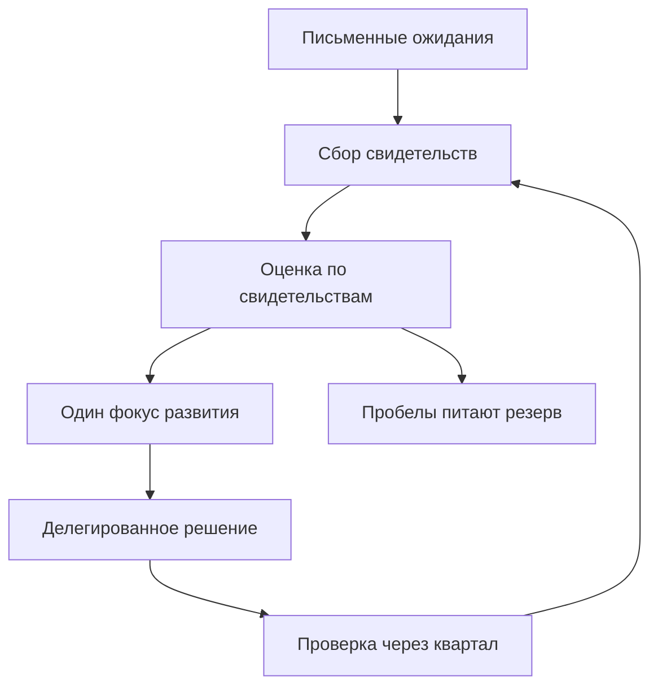
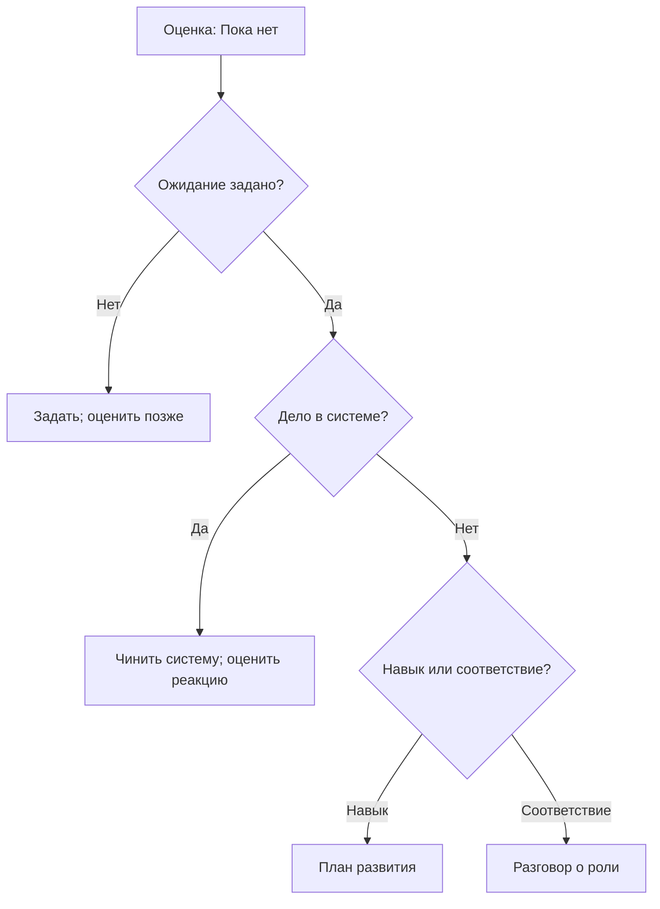

# Глава 41 — Управление руководителями разработки и их развитие { #chapter-41-managing-and-developing-engineering-managers }

Главный продукт директора — его руководители. Эта глава о том, как оценивать руководителя разработки
(engineering manager, EM) по рубрике (листу критериев оценки), опираясь на наблюдаемые свидетельства.
Ещё в ней разобрано, как вести коучинг руководителей (встречи через уровень, разборы их рабочих артефактов,
делегированные решения) и как построить резерв на каждое управленческое место. Об измерении
эффективности руководителя в целом рассказывает глава 4, о коучинге отдельного человека — глава 5;
здесь этот человек — руководитель, а коуч — директор. Сквозной пример — конец квартала 2 в Northstar
Technologies, вымышленной компании из [кейса](../../case-studies/northstar/index.md): директор впервые
оценивает шестерых руководителей.

## Почему это важно { #why-this-matters }

**Для команды** руководитель определяет большую часть того, с чем сталкивается инженер: над чем он
работает, растёт ли он, доходят ли куда-нибудь его опасения. Директор, который не отличает сильного
руководителя от просто занятого, вознаграждает занятого. В исходном квартале Northstar руководителей
оценивали раз в год и только по выполнению дорожной карты, а мерилом служило описание должности в одну
строку. По этой мерке лучше всех выглядел Daniel Cho (руководитель Customer Experience): его команда
развёртывалась чаще других. И ни один показатель не сообщал, что его мобильные инженеры чувствуют себя
пешками.

**Для организации** руководители — рычаг директора. Продукт директора — система (глава 40), а до этой
системы он дотягивается почти исключительно через шесть–восемь человек.

**Для высшего руководства** вопрос в том, найдутся ли готовые руководители, когда они понадобятся. В
Northstar каждый из шести руководителей — [единая точка отказа](../../glossary.md#single-point-of-knowledge-failure),
а по правилу «без роста численности» новый руководитель может появиться, только если чьё-то инженерное
место останется без замены. Резерв строится из нынешних инженеров — или не строится вообще.

## Цели главы { #learning-objectives }

После этой главы вы сможете:

- Оценивать руководителя разработки по шести измерениям так, чтобы за каждой оценкой стояли
  датированные наблюдаемые свидетельства, а там, где их нет, было явно написано «Нет данных».
- Отделять то, что контролирует руководитель, от того, что контролирует система, и решать, чего требует
  оценка «Пока нет».
- Проводить встречи через уровень так, чтобы они давали материал для коучинга и не подрывали авторитет
  руководителя.
- Развивать руководителей через разборы их артефактов и делегированные решения, с планом на квартал и
  проверкой.
- Строить резерв руководителей на каждое управленческое место из людей, которые уже работают в
  организации.

## Ментальная модель { #the-mental-model }

> **Ментальная модель:** оценка без свидетельств — это мнение; развитие без оценки — дрейф. Сделайте
> работу руководителя наблюдаемой, оцените её по ожиданиям, известным руководителю, выберите одну вещь
> для развития и дайте ему реальное решение, на котором её можно отработать.

Результаты руководителя проявляются поздно, перемешаны с результатами системы и достигаются руками
других людей (медленная и шумная петля из главы 2). Поэтому директору нужно не больше отчётности, а
больше способов наблюдать: артефакты руководителя, метрики, прочитанные в контексте, темы со встреч через
уровень и то, что видят коллеги-руководители и staff-инженеры.

Петля начинается с письменных ожиданий: оценка по ожиданию, которое никто не высказал, говорит больше о
директоре, чем о руководителе. Заканчивается она перепроверкой, потому что план без проверки остаётся
просто документом. Вторая идея: развивать руководителей и строить резерв — одна и та же работа. Если
руководитель силён в росте людей, рядом с ним есть те, кто способен брать на себя всё больше его работы.
Если такого человека нет, это сразу два пробела: в развитии и в преемственности.

## Подробный разбор { #deep-conceptual-explanation }

### Рубрика: шесть измерений наблюдаемых свидетельств { #the-rubric-six-dimensions-of-observable-evidence }

Глава 4 измеряет руководителя по четырём областям (результаты подразделения, здоровье команды, рост
людей, рычаг) как минимум за два квартала ([глава 4](../01-foundations/04-the-leadership-ladder.md)).
Для оценки и развития книга делит их на шесть измерений и выделяет отдельно две вещи, в которых
руководители разработки различаются чаще всего: ответственность за продакшн и исполнение самой роли.
Рубрика — **рекомендация книги**, а не валидированный инструмент; те же измерения и уровни использует
шаблон рубрики результативности руководителя разработки в части XIV.

| Измерение | Наблюдаемые свидетельства | Не свидетельства |
|---|---|---|
| 1. Результаты в контексте | Обязательства: какими их дали и как выполнили; тренд надёжности; объяснение причин от руководителя, проверенное | Подсчёты активности; пересмотренные цели |
| 2. Ответственность за эксплуатацию | Нагрузка дежурств по людям; закрытые корректирующие действия; [операционные минимумы tier 1](../../glossary.md#tier-1-operational-minimums) (владелец, алерты, ранбук, дежурство) на компонентах команды | «Спокойный квартал» |
| 3. Рост людей | Работа, делегированная с названным уровнем; разговоры о карьере; закрытые пробелы; названный преемник | Проведённые встречи один на один |
| 4. Здоровье команды | Нежелательная текучесть; темы со встреч через уровень; проверки здоровья команды; концентрация вызовов и знаний | Баллы опросов без комментариев |
| 5. Межкомандный рычаг | Решённые зависимости; прояснённое владение; помощь коллегам, которую подтвердили они сами | Самоотчёты о подвигах |
| 6. Исполнение роли | Распределение времени; делегирование; своевременность эскалаций; плохие новости, о которых сообщили рано | Отработанные часы |

Каждое измерение получает оценку **Пока нет**, **Уверенно**, **Сильно** или **Нет данных**. Четвёртая
важнее всех. Директор, который не видел руководителя в деле по какому-то измерению, склонен ставить
«Уверенно» и тем самым выдаёт незнание за суждение. «Нет данных» — вывод о собственной осведомлённости
директора, и из него следует действие: пойти и посмотреть. («Пока нет» здесь — оценка по одному измерению, а не план после отказа в повышении из
главы 8.)

Три правила (**рекомендация книги**):

1. Каждая оценка ссылается на датированное свидетельство и его источник.
2. «Пока нет» ставят только по ожиданию, которое руководитель знал до оцениваемого поведения, и только
   по свидетельствам из окна оценки; более ранние факты — контекст. Если ожидание не было высказано, в
   ячейке пишут **Ожидание не задано**, и оценки там нет. Это пробел и самого директора: он может
   повлиять на план развития, но не должен влиять на оплату или оценку результативности в этом цикле.
3. Сводной оценки нет. Оценки не усредняют, а руководителей не ранжируют, потому что их команды
   работают в разных частях системы.

### Зачем нужно правило свидетельств { #why-the-evidence-rule-exists }

Оценки говорят больше об оценщике, чем об оцениваемом. В двух больших выборках каждого руководителя
оценивали семь человек, и индивидуальные особенности оценщиков объяснили
больше половины разброса оценок (62 и 53 процента), то есть более чем вдвое больше, чем реальная
результативность руководителей ([Scullen, Mount, and Goff, 2000](../../references/bibliography.md#scullen2000latent)).
Этот **научный результат** относится к оценкам для развития (ошибки оценивания разбирает глава 9). Вывод
из него: каждую оценку должно быть можно возвести к тому, что способен проверить другой человек.

Сама по себе обратная связь мало меняет руководителей. [Метаанализ](../../glossary.md#meta-analysis)
(так называют исследование, которое объединяет результаты многих исследований) по 24 лонгитюдным
работам показал, что улучшение после обратной связи из нескольких источников (оценок от руководителя,
коллег и подчинённых) обычно невелико. По мнению авторов, оно вероятнее, когда обратная связь показывает, что
меняться нужно, а получатель верит, что перемены возможны, ставит цели и действует
([Smither, London, and Reilly, 2005](../../references/bibliography.md#smither2005multisource)). Поэтому
петля не останавливается на оценке: дальше идут один фокус, цель и реальное решение для практики.

Самые сильные доказательства касаются удержания. В одной крупной технологической компании у
руководителей с лучшими навыками работы с людьми (по данным опросов) текучесть в командах была заметно
ниже, а дизайн исследования позволяет толковать эту связь как причинную. Но другие результаты такие
руководители устойчиво не улучшали
([Hoffman and Tadelis, 2021](../../references/bibliography.md#hoffman2021people)). Google сообщает о
похожей картине (**задокументированная практика**, одна компания, метод не опубликован)
([Google re:Work](../../references/bibliography.md#rework-great-managers)). Значит, здоровье команды
имеет реальный вес, а результаты обретают вес только в контексте.

### Коучинг руководителей по трём каналам { #coaching-managers-through-three-channels }

**[Встречи через уровень (skip-level)](../../glossary.md#skip-level).** Разговоры директора с
инженерами на два уровня ниже проверяют, что передаёт канал руководителя, но заменять этот канал не
должны. Они подчиняются правилу встреч через уровень из
[главы 40](40-the-directors-job.md#building-your-own-signal-sources): темы возвращаются к руководителю,
цитаты — никогда. Если встреча через уровень заканчивается решением
директора, руководителя обошли. Для коучинга хорошо подходят четыре вопроса. Какого решения вы ждали
дольше всего и кто его принял? Что бы вы сказали своему руководителю, если бы были уверены, что это
безопасно? Что вы умеете сейчас, чего не умели два квартала назад? Что директору стоит перестать делать?
Второй вопрос проверяет психологическую безопасность в отношениях с руководителем (глава 11), а ответ на
третий — свидетельство о росте людей.

**Разборы артефактов руководителей.** На еженедельной встрече команды руководителей (глава 37) одно окно
получает один руководитель. Он представляет один артефакт (план на квартал, разбор инцидента, заявку на
повышение), а коллеги задают вопросы. Так руководители видят работу друг друга, а артефакт становится
свидетельством для рубрики. Спрашивайте «что бы вы изменили?», а не «кто ошибся?».

**Делегированные решения.** Самый сильный инструмент — реальное решение, переданное на явно названном
уровне контроля. Пять уровней из главы 2
([делегирование с явным уровнем контроля](../01-foundations/02-from-individual-contributor-to-leader.md#delegating-by-outcome-with-an-explicit-level-of-control))
подходят и для руководителей:

| Уровень | Кто решает | Исполнитель говорит |
|---|---|---|
| 1. Указание | Директор | «Вот что я выяснил» |
| 2. Рекомендация | Директор, из вариантов руководителя | «Рекомендую X, потому что» |
| 3. Намерение | Руководитель, предупредив директора | «Собираюсь сделать X в четверг» |
| 4. Действие и информирование | Руководитель | «Я сделал X; вот почему» |
| 5. Владение | Руководитель; директор узнаёт только об исключениях | Сообщает о результатах на регулярном обзоре |

David Marquet призывает передавать решения тем, у кого есть информация
([Marquet, 2012](../../references/bibliography.md#marquet2013turn)). Liz Wiseman утверждает, что одни
лидеры умножают способности других, а другие их подавляют
([Wiseman, 2010](../../references/bibliography.md#wiseman2010multipliers)). Оба взгляда — **мнение
эксперта**. Исследования же отрезвляют: руководители говорят, что делегируют ради развития людей, но
многие придерживают важные решения, если считают подчинённого неопытным
([Yukl and Fu, 1999](../../references/bibliography.md#yukl1999determinants)). Поэтому передавайте
значимое решение на уровне 2 или 3, а не пустяковое на уровне 5.

### Что говорят исследования о развитии руководителей { #what-the-research-on-manager-development-says }

Обучение лидерству работает лучше, чем считалось раньше, если программа хорошо спроектирована.
Метаанализ 335 выборок обнаружил улучшения от умеренных до больших: в реакции участников, в усвоенном
материале, в поведении на работе и в результатах. Сильнее всего менялось поведение на работе. Обучение
работало лучше, когда ему предшествовал анализ потребностей, когда в программу входили обратная связь и
несколько методов (особенно практика), а занятия разносили во времени и проводили очно, на территории
компании ([Lacerenza et al., 2017](../../references/bibliography.md#lacerenza2017leadership)). Этот
**научный результат** (в изложении аннотации) касается формальных программ, а не коучинга со стороны
директора. Но и он говорит против того, чтобы ограничиться одним выездным курсом из каталога. Рубрика
здесь служит анализом потребностей, реальные решения — практикой, квартальные перепроверки — разнесением
во времени.

Руководить учатся в основном на работе, а исследования этого процесса ещё молоды
([Day et al., 2014](../../references/bibliography.md#day2014advances);
[Hill, 2019](../../references/bibliography.md#hill2019becoming)). Практические руководства с этим
согласны ([Fournier, 2017](../../references/bibliography.md#fournier2017manager);
[Zhuo, 2019](../../references/bibliography.md#zhuo2019making)). Но ни один из этих источников не
подскажет, какой именно руководитель вырастет, поэтому перепроверяйте каждый квартал.

### Как строить резерв { #building-the-bench }

Таблица преемников, шкала готовности и правило покрытия описаны в
[главе 36](../07-organization-design/36-reorganizations-evolution-and-succession.md#succession-coverage);
здесь речь о том, как вырастить людей, чьи имена стоят в этой таблице. Отбирайте по свидетельствам
управленческой работы, а не инженерного мастерства. Компании склонны повышать за текущие результаты,
даже когда другие качества лучше предсказывают успех в управлении
([Benson, Li, and Shue, 2019](../../references/bibliography.md#benson2019promotions)). Получайте такие
свидетельства через пробные задания, которые сами и есть управленческая работа: провести планирование,
вести разбор инцидента, отвечать за цикл интервью, провести проверку здоровья команды. И спонсируйте, а
не только наставляйте. Спонсор — старший по положению человек, который пускает в ход своё влияние в
интересах кандидата. Исследование на основе опросов показало, что у женщин с высоким
потенциалом много менторов и мало спонсоров
([Ibarra, Carter, and Silva, 2010](../../references/bibliography.md#ibarra2010promotions)). Поэтому при
каждой оценке роста людей задавайте вопрос: кто в вашей команде делает часть вашей работы в этом квартале?

## Пример из инженерной организации { #engineering-organization-example }

Посчитаем, во что директору обходится такая работа с шестью руководителями. Цифры — **иллюстрация**
для Northstar после недели 10 (77 инженеров в командах; staff-инженерами руководят отдельно).

| Активность | Допущение | Часов за квартал |
|---|---|---|
| Встречи один на один с руководителями | 6 × 45 минут × 13 недель | 58.5 |
| Встречи через уровень | Ротация из главы 40: две группы по три человека в неделю, 45 минут, 13 недель | 19.5 |
| Оценка по рубрике | 4 часа на руководителя раз в два квартала, с распределением на оба | 12 |
| **Итого** | | **90** |

Это около 7 часов в неделю, примерно 15% от 47-часовой рабочей недели директора. Окно для разбора
артефактов не учтено: оно входит в еженедельную встречу команды руководителей.

Что это может дать? В исходном состоянии за год уходили восемь инженеров, а до первого рабочего дня
замены проходило по медиане 15 недель. Если удастся избежать одного предотвратимого ухода в год, это
сэкономит около 15 инженеро-недель, примерно $53 000 по плановой ставке книги $3 558 за
инженеро-неделю ([полная стоимость сотрудника](../../glossary.md#fully-loaded-cost) $185 000 в год ÷ 52),
и это ещё без учёта вхождения в работу. Это проверка правдоподобия, а не прогноз.

Показательнее другая цифра. В первой рубрике Northstar (см. кейс), составленной ещё до групповых встреч
через уровень, 5 из 36 ячеек — «Нет данных». Если бы все 36 оценили по впечатлению, получилась бы
аккуратная таблица и никакого понимания, куда смотреть.

## Как принимать решение { #decision-framework }

Оценка — лишь отправная точка для решения. Схема для «Пока нет» различает четыре причины, потому что
каждая требует своего ответа.

| Картина | Вероятный смысл | Ответ |
|---|---|---|
| «Пока нет» по одному измерению, ожидание задано | Пробел в навыке | План на квартал с делегированным решением и проверкой |
| «Пока нет» из-за системы ([релизный поезд](../../glossary.md#release-train), охват, владение) | Проблема директора | Исправить систему; оценить реакцию руководителя |
| «Пока нет» по нескольким измерениям два квартала подряд, несмотря на план | Возможно, не подходит роль | Процесс ожиданий из главы 9, включая возврат в инженеры |
| «Нет данных» где угодно | Пробел в информации | Пойти и посмотреть; не оценивать |
| «Ожидание не задано» | Пробел директора | Задать ожидание; оценить в следующем цикле |
| «Сильно» по росту людей и рычагу | Готов к большей области ответственности | Решение на вырост на уровне 3 или 4 (решает руководитель); резерв на более крупную роль |
| «Сильно» везде, команда работает и без руководителя | Готов сейчас или скоро уйдёт | Разговор о карьере в этом месяце |

Ещё два критерия (**рекомендация книги**). Взвешивайте измерения по ситуации команды: если на команде
обязательство по продлению, больше весят результаты; если нагрузка дежурств сосредоточена на немногих —
ответственность за эксплуатацию и здоровье команды. И считайте отдельным свидетельством реакцию
руководителя на «Пока нет»: любопытство, черновик плана, перемены в поведении за несколько недель.

### Когда руководитель не справляется { #when-a-manager-is-not-working-out }

Снять руководителя с роли — значит решить, что роль ему не подходит. Такое решение принимают, только
когда исключены и система, и доля вины самого директора (**рекомендация книги**). Перед этим проверьте
три вещи: ожидания были записаны и известны руководителю; план на квартал с реальным решением опробовали;
«Пока нет» держалось по нескольким измерениям два квартала. Если чего-то не хватает, проблема отчасти всё ещё ваша.

Варианты в порядке предпочтения:

- **Возврат в инженеры.** Многие хорошие инженеры пробуют руководить и возвращаются. Предложите тот
  старший инженерный уровень, на который тянут навыки человека, без снижения оплаты, если лестница это
  позволяет, и открыто скажите, что это нормальный путь. При неизменной численности вернувшийся
  руководитель занимает инженерное место, поэтому это место нужно заложить в план.
- **Меньшая область ответственности.** Команда поменьше или команда без дежурств может подойти тому, кто
  силён в росте людей, но слаб в управлении большим операционным хозяйством.
- **Увольнение** по формальному процессу из главы 9, если не подходит ни то ни другое.

Затем проведите переход в таком порядке:

1. Согласуйте решение и формулировки с HR и договоритесь о временной замене из резерва.
2. Сообщите руководителю наедине, с папкой свидетельств на руках. Где можно, дайте ему выбрать, как
   будет описан его переход.
3. Сообщите команде в тот же день, после руководителя, в присутствии временного руководителя. Расскажите
   об изменении и следующих шагах, но никогда о причинах: говорить о них вправе только сам руководитель.
4. Шесть недель наблюдайте за командой через встречи один на один и встречи через уровень: внезапная
   смена руководителя повышает риск, что люди уйдут.
5. Запишите, что директору следовало увидеть или задать раньше, и исправьте это к приходу следующего
   руководителя.

## Компромиссы { #trade-offs }

**Единообразие против контекста.** Единая рубрика делает сравнение честным, но она же подталкивает
сравнивать команду на общем релизном поезде Core с командой, которая развёртывается когда захочет.
Держите измерения общими, свидетельства — местными и никогда не ранжируйте.

**Реальные решения против риска.** Значимое делегированное решение может пойти не так, и за результат
отвечает директор; пустяковое не развивает никого. Риском управляют через уровень контроля, а не через
масштаб решения.

**Прозрачность против откровенности.** Если показывать руководителям их оценки и свидетельства, процесс
становится проверяемым. Но тогда и коллеги осторожнее выбирают, что рассказать директору. Делитесь
свидетельствами, но никогда не говорите, кто что сказал на встрече через уровень.

**Развитие резерва против поставки.** Senior-инженер, который ведёт планирование, меньше занимается
инженерной работой, и без роста численности это реальная цена. Но место, оставшееся без замены,
обходится дороже, и освобождается оно без предупреждения.

## Типичные провалы { #failure-modes }

**Ореол от результатов.** Команда выполнила план по цифрам, поэтому везде «Сильно». Как заметить: оценки
движутся вместе, и пять ячеек ссылаются на один и тот же результат поставки.

**«Нет данных», оценённое как «Уверенно».** Как заметить: за «Уверенно» стоит фраза о руководителе, а не
датированный факт.

**Оценка по незаданным ожиданиям.** Как заметить: руководителя удивляет само измерение, а не только
оценка. В Northstar, где описание должности умещалось в одну строку, это было нормой.

**Теневой канал встреч через уровень.** Директор принимает меры по проблемам, о которых руководитель так
и не узнал. Как заметить: руководитель узнаёт о решении по своей команде от самой команды.

**Директор как сверхруководитель.** Коучинг превращается в выполнение работы руководителя. Как заметить:
артефакты руководителя становятся лучше, только когда к ним приложил руку директор.

**Планы развития без задач на вырост.** Как заметить: в плане нет ни одного решения, которое руководитель
примет, хотя раньше принять не мог.

**Резерв на бумаге.** Названные преемники не делают никакой управленческой работы. Как заметить:
спросите самого преемника.

## Применение в крупной организации { #enterprise-application }

В организации из 50–150 инженеров обычно от шести до пятнадцати руководителей и нередко два директора.
Здесь меняются три вещи. **Калибруйте оценки руководителей** между директорами дважды в год по
свидетельствам, как это делается для инженеров в главе 8; когда оценщиков несколько, исследования
эффектов оценщика применимы напрямую.
**Ведите когорту, а не каталог:** если руководителей десять или больше, проведите внутреннюю программу из
нескольких очных занятий, разнесённых во времени и построенных на практике (трудный разговор, проведённый
разбор инцидента, защищённый план). За каждым занятием должно следовать реальное решение на работе, а
техническим заданием служат условия из исследований обучения. **Держите резерв общим для всей
организации:** лучший кандидат на место в одной команде может работать в другой, и пробные задания могут
выходить за границы команд. Новые руководители получают рубрику в первый же день, чтобы ожидания были
высказаны раньше, чем по ним начнут судить.

## Взгляд CTO { #cto-perspective }

CTO (технический директор) руководит руководителями руководителей. Дважды в год спрашивайте каждого
директора: кого из своих руководителей вы наняли бы снова и на каких свидетельствах? Кто через шесть
месяцев смог бы выполнять работу каждого из руководителей? Что из того, что раньше решали сами, вы в этом
полугодии делегировали руководителю? Если CTO обнаруживает, что все руководители оценены «Уверенно», значит, он нашёл
проблему измерения. Тот, кто финансирует курс, но не защищает часы директора на коучинг, покупает лишь
видимую половину развития руководителей.

## Практический плейбук { #practical-playbook }

1. До любой оценки запишите ожидания к каждому руководителю по шести измерениям, включая решения,
   которыми он владеет.
2. Ведите папку свидетельств на каждого руководителя: артефакты, метрики в контексте, наблюдения
   коллег, самооценка руководителя.
3. Проводите ротацию встреч через уровень из главы 40: раз в квартал, группами по три человека, по
   письменному правилу из той же главы и с четырьмя вопросами, приведёнными выше.
4. Набросайте оценки, по одному датированному свидетельству на ячейку; отметьте «Нет данных» и закройте
   пробелы до разговора.
5. Пропускайте каждое «Пока нет» через схему решения.
6. В разговоре сначала выслушайте самооценку руководителя, потом договоритесь об одном фокусе развития.
7. Напишите план на квартал: фокус, одно делегированное решение с его уровнем, одно действие по резерву
   и проверка с датой и указанием свидетельств.
8. Выносите ключевой артефакт каждого руководителя на разбор артефактов не реже двух раз за квартал.
9. Перепроверяйте план развития раз в квартал, а переоценивайте раз в два квартала.
10. Вносите в таблицу преемников из главы 36 всё, что квартал добавил по каждому месту.

## Кейс { #case-study }

!!! info "Northstar: что уже известно"
    Неделя 24 первого года директора, ближе к концу квартала 2.
    Число инцидентов [Sev1 и Sev2](../../glossary.md#severity-sev1-sev2-sev3) (два самых серьёзных
    уровня) в квартале 1 упало с 30 до 21. Из двух
    [обязательств по продлению](../../glossary.md#renewal-commitments) интеграция с бухгалтерской
    системой работает с недели 19, а массовый заказ должен выйти на неделе 26. См.
    [хронологию](../../case-studies/northstar/timeline.md). Впервые читаете о Northstar? Прочитайте
    [«Год вкратце»](../../case-studies/northstar/year-in-brief.md) и
    [действующих лиц](../../case-studies/northstar/cast.md).

Этот кейс — **вымысел**. Директор набрасывает оценку на неделе 24, проводит разговоры на
неделях 25 и 26 и окончательно оформляет её на неделе 27, первой неделе квартала 3. Окно оценки —
квартал 2 (недели 14–26); более ранние факты служат контекстом. Оценки — вымышленные суждения; итоги
квартала 3 пока неизвестны.

**С чего начинал директор.** Ожидания были заданы лишь фрагментами: выделение на профилактику, минимумы
tier 1, обучение координаторов инцидентов, ответственность руководителей за корректирующие действия.
Никто не формулировал для Daniel ожиданий по руководству командой на нескольких площадках. Никто не говорил и Farah
Haddad (руководитель Data and Analytics), какая из двух её ролей главная: руководитель или архитектор
данных. На неделе 22 директор свёл шесть измерений в одностраничное описание ожиданий.

**Узкий канал.** За недели 1–15 директор не провёл ни одной встречи через уровень. С недели 16 начались
индивидуальные встречи через уровень, по четыре в неделю по 30 минут; к неделе 24 их набралось 36. Они
использованы в оценках ниже, но разговоры по одному не показывают, как видит ситуацию команда в целом.
Ячейки «Нет данных» отчасти отражают этот пробел. Групповые встречи через уровень со всеми
77 инженерами в командах начнутся в квартале 3; там же получат свидетельства и проверки, описанные ниже.

**Черновые оценки, неделя 24.**

| Руководитель | Результаты | Эксплуатация | Рост людей | Здоровье команды | Рычаг | Исполнение роли |
|---|---|---|---|---|---|---|
| Priya Raman (Orders) | Нет данных (массовый заказ — на неделе 26) | Уверенно | Уверенно | Нет данных | Уверенно | Пока нет |
| Marcus Oyelaran (Billing) | Уверенно | Пока нет | Нет данных | Пока нет | Уверенно | Пока нет |
| Elena Sokolova (Payments and Integrations) | Сильно | Сильно | Уверенно | Сильно | Сильно | Уверенно |
| Daniel Cho (Customer Experience) | Уверенно | Пока нет* | Пока нет | Ожидание не задано | Нет данных | Уверенно |
| Farah Haddad (Data and Analytics) | Уверенно | Уверенно | Пока нет | Нет данных | Уверенно | Ожидание не задано |
| Tom Becker (Platform Operations) | Уверенно | Уверенно | Пока нет* | Пока нет* | Уверенно | Уверенно |

Из 36 ячеек: 16 «Уверенно», 4 «Сильно», 9 «Пока нет», 5 «Нет данных» и 2 «Ожидание не задано». Три
ячейки со звёздочкой опираются только на факты до окна оценки, а правило считает такие факты контекстом.
До недели 27 директор должен найти по каждой из них свидетельства из квартала 2 или заменить оценку на
«Нет данных».

**Один руководитель целиком.** На примере Marcus Oyelaran видно, как каждая оценка восходит к одному
датированному факту и его источнику.

| Измерение | Датированное свидетельство | Источник | Оценка |
|---|---|---|---|
| Результаты | Недели 14–16: команда Billing вовремя построила экспорт из ledger, нужный для интеграции с бухгалтерской системой. Большинство инцидентов Billing в исходном квартале пришли через общие релизы (контекст) | План на квартал 2 | Уверенно |
| Ответственность за эксплуатацию | Просил освободить его от обучения координаторов инцидентов, хотя трое инженеров по-прежнему принимают большую часть вызовов | Записи об обучении | Пока нет |
| Рост людей | Карта знаний по ledger есть; никто из новых пока не может в одиночку разбираться с инцидентами ledger | Карта знаний | Нет данных |
| Здоровье команды | Недели 14–15: на интервью об удержании (stay interview) инженеры ledger назвали нагрузку в нерабочее время | Интервью об удержании | Пока нет |
| Рычаг | Проверял контрактные тесты на общей границе по смыслу; сам поднял вопрос о риске налогового сервиса | Записи ревью | Уверенно |
| Исполнение роли | «Нет ресурса» было его первым ответом о тестировании, нестабильных тестах и ранбуках; когда профилактику заложили в бюджет, Billing удалила 15 и переписала 23 из 38 тестов на карантине | Обсуждения стандартов | Пока нет |

**Правила в действии.** В команде Daniel Cho 17 подчинённых: девять веб-инженеров, шесть мобильных
инженеров в Боготе и, с недели 10, два [инженера по качеству](../../glossary.md#quality-engineer)
(бывшие QA-инженеры). Три его ячейки:

| Измерение | Датированное свидетельство | Оценка |
|---|---|---|
| Рост людей | Недели 14–19: проведено 84 из 90 встреч один на один, 55 из них в основном о статусе; у 9 из 15 инженеров не было разговора о карьере | Пока нет |
| Здоровье команды | Неделя 16: на проверке здоровья команды мобильные инженеры оценили четыре области как красные, но ожиданий по руководству командой на нескольких площадках никто не задавал | Ожидание не задано |
| Ответственность за эксплуатацию | Два инцидента Sev2 на границе с мобильным приложением в исходном квартале; из квартала 2 пока ничего | Пока нет* (нужны свидетельства из окна) |

Остальные четверо, по строке на каждого:

- *Priya Raman.* Проверки на неделях 16, 20 и 24 показали 8, 10 и 12 часов практической работы в неделю
  при лимите в 8 часов, о котором она договорилась на неделе 2 (исполнение роли: «Пока нет»). Aisha Bello,
  senior-инженер, ведёт массовый заказ, как ей и делегировано.
- *Elena Sokolova.* За две недели построила [SLI](../../glossary.md#sli-slo-and-sla) платежей
  (измеряемую долю успешных платежей); уже два года проводит еженедельный операционный разбор с
  журналом почти-инцидентов. Рост людей — «Уверенно», а не «Сильно»: её неформальный техлид —
  единственная замена на её место.
- *Farah Haddad.* Одно повышение до Senior за два года (рост людей: «Пока нет»). Около 45% её времени
  уходит на техническую работу; какая из двух её ролей главная, так и не определили.
- *Tom Becker.* Девять месяцев он молча передавал другим 31 из 74 тикетов Bram Verhoeven
  и писал «соответствует ожиданиям» (картина исходного квартала, поэтому со звёздочкой). Его план для
  Bram на квартал 2 — сильный ответ; решение по нему ещё не принято.

**Планы на квартал 3 (предложены, итоги не известны).**

Каждое делегированное решение ниже — на уровне 3: человек решает сам, предупредив своего руководителя.

| Руководитель | Фокус | Делегированное решение | Действие по резерву | Проверка |
|---|---|---|---|---|
| Priya | Исполнение роли | Aisha Bello проводит планирование Orders на квартал 3 | Aisha — временная замена | Практическая работа не больше 8 часов, недели 32 и 38 |
| Marcus | Ответственность за эксплуатацию | Senior-инженер по ledger ведёт план парной работы, чтобы распространить знания о ledger; Marcus участвует в инцидентах ledger только как координатор | Senior-инженер берёт на себя одну часть его работы | Пересчёт карты знаний, неделя 38 |
| Elena | Более широкий рычаг | Ведёт ежемесячный разбор артефактов по операционной готовности | Её техлид участвует в межкомандном планировании | Опрос коллег-руководителей, неделя 38 |
| Daniel | Рост людей | Разговор о карьере с каждым инженером; спонсорство неформальных лидов веба и мобильной разработки | Эти два лида — замены на свои половины команды | Повторная разметка встреч один на один, недели 32–37 |
| Farah | Исполнение роли | Senior-инженер ведёт одно проектное решение по хранилищу данных | Этот инженер — на архитектурную половину роли | Техническая доля в её календаре на неделе 38 |
| Tom | Рост людей | Поднимает любой пробел в результативности с самим человеком в течение двух недель | Пока ничего | Группа на встрече через уровень: передают ли работу молча? |

Собственная строка директора: письменные ожидания для каждого руководителя к неделе 27, в которых
вопросы о руководстве на нескольких площадках и о двойной роли либо решены, либо явно отложены.

Открытый вопрос: как эти планы переживут решения, которые ещё предстоит принять, например о структуре Customer
Experience и о плане для Bram.

## Упражнения { #exercises }

Разборы упражнений: [решения к главе 41](../../solutions/ch41-solutions.md). Данные Northstar — на
[странице исходных данных](../../case-studies/northstar/baseline-data.md) и в
[хронике года 1](../../case-studies/northstar/first-quarter.md).

### Базовый уровень { #foundational }

**F1.** В черновике оценки директор пишет: «Marcus занимает оборону, когда речь о ресурсе», «Elena —
лучший руководитель, какой у нас есть», «Daniel по-настоящему заботится о своих людях» и «Farah слишком
уходит в технику». Перепишите каждое утверждение как датированные наблюдаемые свидетельства из кейса этой
главы и назовите измерение, к которому оно относится. Скажите, какое утверждение нельзя переписать без
новых свидетельств и что бы вы собрали.

**F2.** По мере приближения даты массового заказа ежемесячные проверки Priya Raman показывают 8, 10 и
12 часов практической работы в неделю. Она возражает: функция для продления — самое важное, что
поставляет компания, а рост временный. Решите, как оценить исполнение роли, на что бы вы посмотрели в
первую очередь и о чём договорились бы с ней на недели 25 и 26.

**F3.** Спроектируйте следующий раунд встреч через уровень для Customer Experience: девять
веб-инженеров и два инженера по качеству в Миннеаполисе и удалённо, шесть мобильных инженеров в
Боготе, а структура команды ещё не решена. Укажите группы, вопросы, что вернётся к Daniel Cho и чего вы
не станете делать с услышанным.

### Прикладное лидерство { #applied-leadership }

**A1.** Интеграция с бухгалтерской системой заработала на неделе 19 (глава 39). Предположим, что она
опоздала бы на две недели, до недели 21, потому что экспорт из ledger занял больше
недель, чем зарезервировала Billing. Оцените результаты Elena Sokolova и Marcus Oyelaran в обоих случаях
и объясните, какие свидетельства отделяют вклад каждого руководителя от вклада системы.

**A2.** Marcus Oyelaran соглашается со своей оценкой по ответственности за эксплуатацию, но говорит, что
не может распространять знания о ledger в квартале 3: двое из трёх экспертов незаменимы в каждом
инциденте, а у одного есть внешнее предложение. Напишите план на квартал 3, о котором вы бы с ним
договорились, включая делегированное решение, и скажите, что бы вы сделали, если он от плана откажется.

**A3.** Tom Becker говорит, что его «Пока нет» по росту людей несправедливо: он уже подготовил
справедливый план для Bram Verhoeven, а HR прочитает эту оценку в его личном деле. Решите, менять ли
оценку, как записать свидетельства и что Tom должен показать к неделе 38.

**A4.** У гипотетического руководителя восьми инженеров были письменные ожидания и план развития на
квартал, и всё же после двух кварталов у него «Пока нет» по росту людей, здоровью команды и исполнению
роли. Двое инженеров попросили перевести их в другие команды. Сам руководитель говорит, что скучает по
написанию кода. Выберите один из вариантов из раздела «Когда руководитель не справляется», спланируйте
первые две недели перехода и напишите три фразы, которые вы скажете команде.

### Решения на уровне руководства { #executive-decision-making }

**X1.** Victor Lindqvist (CTO) просит у вас единый рейтинг шести руководителей для годового пересмотра
оплаты и отдельно спрашивает, кто возглавит Payments and Integrations, если Elena Sokolova повысят.
Ответьте на оба запроса, опираясь на правила рубрики и свидетельства о резерве, и скажите, что вы
откажетесь готовить.

**X2.** HR-партнёр предлагает отправить всех шестерых руководителей на внешнюю программу развития
лидерства: пять дней на выезде одним блоком, иллюстративно $8 000 на человека. Альтернатива — внутренняя
когорта из четырёх занятий по полдня с интервалом в три недели в Миннеаполисе, построенная на пробелах из
рубрики, примерно с четырьмя днями подготовки со стороны директора. Примите решение, опираясь на
исследования обучения и ограничения Northstar, и скажите, как через два квартала вы поймёте, сработало ли
оно.

## Вопросы для размышления { #reflection-questions }

- Кого из своих руководителей вы оценили бы «Уверенно» по измерению, в котором ни разу не видели его
  работы?
- Когда команда руководителя работает хорошо, какую долю успеха вы приписываете ему и на каких
  свидетельствах?
- Кто в этом квартале выполнял работу руководителя без соответствующей должности и кто об этом знает?
- Какое решение вы передали руководителю в этом квартале, хотя предпочли бы принять его сами?
- Если бы ваши встречи через уровень завтра прекратились, чего бы вы перестали знать? И знает ли это хоть
  один руководитель?
- Какое «Пока нет» у ваших руководителей на самом деле касается ожидания, которое вы так и не высказали?

## Главное { #key-takeaways }

- Оценивайте руководителей по шести измерениям, и пусть за каждой оценкой стоит датированное
  наблюдаемое свидетельство.
- Считайте «Нет данных» выводом о вашей собственной информации: прежде чем оценивать, пойдите и
  посмотрите.
- Ставьте «Пока нет» только по ожиданию, которое руководитель знал, и по свидетельствам из окна оценки.
  Если ожидание не высказано, пишите «Ожидание не задано»: пробел ваш, и на оплату он не влияет.
- Никогда не усредняйте измерения и не ранжируйте руководителей, чьи команды находятся в разных частях
  системы.
- Отделяйте то, что контролирует руководитель, от того, что делает система, и оценивайте реакцию
  руководителя.
- Встречами через уровень проверяйте канал руководителя: темы всегда возвращаются к руководителю,
  цитаты — никогда.
- Развивайте руководителей через реальные решения на явно названном уровне контроля, по одному фокусу в
  квартал.
- Стройте развитие на анализе потребностей, практике, разнесённых во времени занятиях и проверках, как
  подсказывают исследования обучения.
- Выращивайте резерв через пробную управленческую работу и спонсорство и держите таблицу из главы 36 в
  актуальном виде.

## Источники и что почитать { #references-and-further-reading }

- [Lacerenza et al., 2017](../../references/bibliography.md#lacerenza2017leadership) и
  [Day et al., 2014](../../references/bibliography.md#day2014advances). Что делает развитие лидеров
  действенным и насколько молоды эти исследования.
- [Smither, London, and Reilly, 2005](../../references/bibliography.md#smither2005multisource) и
  [Scullen, Mount, and Goff, 2000](../../references/bibliography.md#scullen2000latent). Пределы
  обратной связи и оценок.
- [Hoffman and Tadelis, 2021](../../references/bibliography.md#hoffman2021people),
  [Google re:Work](../../references/bibliography.md#rework-great-managers) и
  [Hill, 2019](../../references/bibliography.md#hill2019becoming). Руководители, удержание и первый год
  в должности.
- [Yukl and Fu, 1999](../../references/bibliography.md#yukl1999determinants),
  [Benson, Li, and Shue, 2019](../../references/bibliography.md#benson2019promotions) и
  [Ibarra, Carter, and Silva, 2010](../../references/bibliography.md#ibarra2010promotions).
  Делегирование, отбор и спонсорство.
- [Marquet, 2012](../../references/bibliography.md#marquet2013turn),
  [Wiseman, 2010](../../references/bibliography.md#wiseman2010multipliers),
  [Fournier, 2017](../../references/bibliography.md#fournier2017manager) и
  [Zhuo, 2019](../../references/bibliography.md#zhuo2019making). Рассказы практиков о делегировании, об
  умножении способностей других и о пути руководителя.
