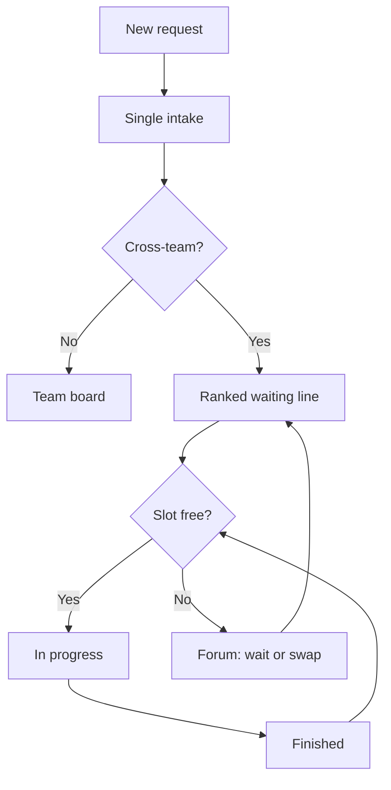
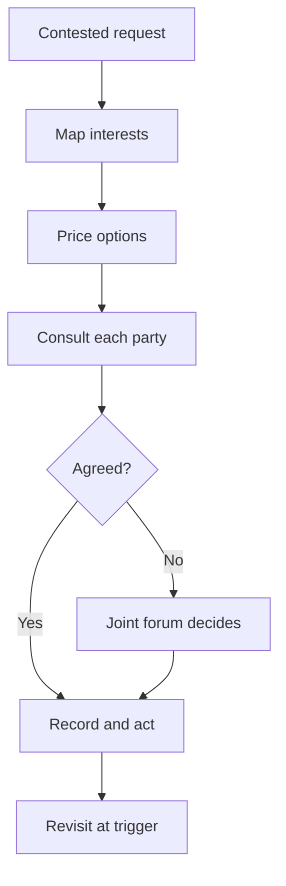

# Chapter 42 — Cross-Functional Dependencies, Portfolio Management, and Influence Without Authority

A director spends much of the week on work that no one person controls: a feature promised by sales
that needs three teams, an escalation landing on a full team, a roadmap and a reliability plan
competing for the same engineers. This chapter covers three tools for that work. The first is
managing initiatives as one portfolio, with an explicit limit on how many run at once. The second is
resolving dependencies with other functions through structure instead of heroics. The third is
influencing peers and executives who do not report to you. The running example is Northstar Technologies, the fictional company in the
[case study](../../case-studies/northstar/index.md), in its third quarter under the new director.

!!! info "Related chapters"
    Flow within and between teams is in Chapter 16; this chapter applies the same logic one level up,
    to initiatives. Quarterly planning and capacity allocation are in
    [Chapter 38](../08-management-operating-system/38-scorecards-quarterly-planning-and-capacity-allocation.md),
    the meeting cadence in
    [Chapter 37](../08-management-operating-system/37-cadences-and-leadership-meetings.md), and
    negotiation in depth in Chapter 46.

## Why This Matters

On a team, too much work in progress shows up as a crowded board that a manager can see.

At 50 to 150 engineers, it is spread across a dozen initiatives, each with a sponsor who wants it now.
Each is reasonable alone. Together they put every team on three or four cross-team efforts, all
finish late, and each sponsor concludes engineering does not care about their item. Northstar's
baseline shows the pattern: nine of the seventeen committed roadmap items needed more than one team, and only one of those nine
shipped in the quarter
([baseline data](../../case-studies/northstar/baseline-data.md)).

At executive scale, this is where engineering's credibility is made or lost. The heads of product,
sales, customer success, and finance each hold a legitimate claim on engineering capacity, and none
reports to the director. Answer every claim with "yes" and you overcommit; answer with "the process
says no" and you are routed around. The alternative is a visible portfolio, structures that keep
routine dependencies from becoming escalations, and influence built on interests and evidence.

## Learning Objectives

After this chapter you will be able to:

- Build an organization-level portfolio of initiatives with an explicit work-in-progress limit, and
  defend the limit with flow arithmetic and its stated assumptions.
- Diagnose a recurring dependency between engineering and product, sales, customer success, or
  finance, and replace ad hoc coordination with an intake, a policy, or reserved capacity.
- Map each stakeholder's position and underlying interests before a contested decision.
- Choose influence tactics that the research associates with commitment, and avoid the ones it
  associates with resistance.
- Take a contested request to the forum that owns the trade-off, with options priced in capacity
  and time, instead of deciding it alone or escalating it late.

## The Mental Model

> **Mental model:** The organization can finish only so many cross-team things at once. Starting
> more does not add output; it delays everything. Your job is to hold that limit in the open and to
> win agreement to it from people you do not manage, by serving their interests with evidence.

Two ideas organize the chapter.

First, **a portfolio is a queue with the same arithmetic as a team board**. If the organization
finishes about one cross-team initiative a month, ten in progress means each takes about ten months.
Limit what is in progress, finish before starting, and show the waiting line.

Second, **influence without authority works through interests, evidence, and joint decision, in that
order**. Positions ("start my feature now") collide; interests ("I need a date I can defend to this
prospect") can often both be met. A joint decision means the people who bear a decision's costs
deciding it together, not allies assembled to outvote someone.

## Deep Conceptual Explanation

### The portfolio as a queue

A **portfolio** is the full set of initiatives the organization has committed to, in progress or
waiting. An **initiative** here is a piece of work of several engineer-weeks or more with a sponsor
and an outcome; the cross-team ones, needing two or more engineering teams, are the ones that need
portfolio management. Single-team work is governed by the team's own board and
[WIP limits](../../glossary.md#work-in-progress-wip-and-wip-limit) (caps on work in progress, Chapter 16).

[Little's law](../../glossary.md#littles-law), which Chapter 16 explains, relates averages: work in progress equals throughput times
time in the system. It holds exactly for measured data over a window that starts and ends empty, and
it describes rather than settles trade-offs
([Little, 2011](../../references/bibliography.md#little2011law)). For a portfolio the items are
initiatives and the time is months: with throughput fixed, more in progress means each takes longer.
This is a **research finding** (a theorem); predicting what a lower limit will do also assumes
throughput holds.

Throughput rarely rises when more is started, because cross-team initiatives share constraints: the
one engineer who understands currency rounding, the team that builds test environments. Take three
initiatives, each needing four weeks of one such specialist. In sequence they finish at weeks 4, 8,
and 12, an average of 8, and the first delivers value in week 4. In parallel, all three finish around
week 12 (later, counting switching), an average of 12. This is **illustrative** queueing reasoning.

Two strands of evidence support keeping people on fewer efforts at once. DORA's capability guide
states that its research associates WIP limits with better delivery performance. It also names their
failure modes: limits set too high to bind, and limits raised whenever someone is idle
([DORA, WIP limits](../../references/bibliography.md#dora-cap-wip-limits)). This is **industry
research**, survey-based and correlational. And in a study of 849 primary care units, membership of
several teams at once went with lower unit performance, more so when tasks were complex
([Crawford et al., 2019](../../references/bibliography.md#crawford2019link)). That **research
finding**, as the abstract reports it, comes from health care; applying it to engineers spread across
initiatives is plausible but not demonstrated in software.

Reinertsen argues that development queues go unmanaged because they are invisible
([Reinertsen, 2009](../../references/bibliography.md#reinertsen2009principles)): **expert opinion**.
So the limit must be drawn where people can see it: one board of every cross-team initiative in
progress and waiting, in rank order.

### Setting and holding a portfolio limit

A workable portfolio limit has four parts.

1. **What counts.** Every initiative needing two or more engineering teams, whoever sponsors it,
   including reliability and platform work.
2. **The number.** Start below the current count. A first estimate: cross-team initiatives actually
   finished per month over the last two quarters, times the lead time in months you will accept. One
   a month and three months' tolerance gives about three. This is **this book's recommendation**; no
   study gives a portfolio number.
3. **The rank.** Waiting initiatives are ordered by [cost of delay](../../glossary.md#cost-of-delay) (the
   value lost per week of waiting) over duration, with value
   estimates written by the sponsors (Chapter 15 owns the method; Chapter 45 prices delay).
4. **The rule at the limit.** A new initiative starts when one finishes, or when the forum that owns
   the portfolio decides to stop or pause one in progress. Nobody adds a fourth by "just starting
   the design".

Chapter 38's plan decides capacity by category and which items are committed; the limit decides how
many committed cross-team items run at once, and in what order.

Finishing is what admits new work. A swap is legitimate only as a decision with a named cost.

### Dependencies with other functions

Chapter 16 treats dependencies between engineering teams: remove them, loosen them with a contract,
or coordinate them with reserved capacity. Dependencies with product, sales, customer success, and
finance take the same three forms, but the "contract" is usually a policy rather than an API.

| Function | Recurring dependency | Heroic version | Structural version |
|---|---|---|---|
| Product | Priorities and scope decisions | Director and CPO renegotiate in hallways | One ranked portfolio; CPO owns rank of product items with written value estimates |
| Sales | Dates and features promised in deals | Sales engineer messages an engineer directly; director rescues the date | Single intake for deal requests; a published rule for external dates (Chapter 17); a small reserved allowance for deal work |
| Customer success | Escalations and incident status | Escalations to whichever manager answers | Severity-based intake with response targets; status communication owned and rehearsed |
| Finance | Budget, capitalization (which engineering costs are booked as an asset), cost questions | Ad hoc data pulls before board meetings | A quarterly capacity-by-category report in finance's terms (Chapter 38) |

The heroic version works once and teaches that escalation is the fastest path. Coordination works
best where the dependency actually is. In distributed development, the more people a work item
involved, the longer it took
([Herbsleb and Mockus, 2003](../../references/bibliography.md#herbsleb2003empirical)). When developers'
actual coordination matched what their technical dependencies required, change requests were resolved
significantly faster ([Cataldo et al., 2008](../../references/bibliography.md#cataldo2008congruence)).
Both are **research findings**, as the abstracts report them, about coordination inside engineering.
The inference for other functions is this book's: put coordination where the dependency is, in a
named intake and a standing policy, not in whoever escalates.

Cagan and Jones argue that product teams should be given problems
to solve rather than stakeholders' feature lists
([Cagan and Jones, 2020](../../references/bibliography.md#cagan2020empowered)): **expert opinion**.
The implication: a sales request is an input to the product decision, not a commitment.

### Interests, positions, and evidence

Two practitioner classics frame the approach (**expert opinion**). Fisher and Ury's *Getting to Yes*
teaches principled negotiation: separate the people from the problem, look behind positions to
interests, invent options that serve both sides, and agree on objective criteria. Each side's real
leverage is its best alternative to an agreement
([Fisher and Ury, 1981](../../references/bibliography.md#fisher1981getting)). Cohen and Bradford treat
influence among peers as exchange: find what the other party values and offer it in return for
cooperation ([Cohen and Bradford, 1990](../../references/bibliography.md#cohen1990influence)). Chapter
46 treats negotiation in depth.

Research shows which tactics work in which direction. Yukl and Tracey measured nine influence tactics
through questionnaires completed by each manager's subordinates, peers, and boss. Rational persuasion,
inspirational appeal, and consultation were the most effective. Pressure, coalition (enlisting others
to push a target), and legitimating (appealing to rules or authority) were the least effective.
Exchange was moderately effective with peers and subordinates but not with superiors
([Yukl and Tracey, 1992](../../references/bibliography.md#yukl1992consequences)). A
[meta-analysis](../../glossary.md#meta-analysis) found rationality and ingratiation positively related to
work outcomes, with other tactics depending on the situation
([Higgins et al., 2003](../../references/bibliography.md#higgins2003influence)). Both are **research
findings**, as the abstracts report them. The outcomes measured are commitment and evaluations, not
whether a portfolio decision held.

Three practical consequences follow.

- **Coalition, in the research sense, backfires.** A joint decision is different: the people who
  bear a decision's costs decide it together, with the affected party in the room. If it feels like
  ganging up, it will be received as pressure.
- **"The policy says no" is legitimating, and it is weak.** Defend a WIP limit with its reasoning and
  by consulting on what to do at the limit.
- **Upward, persuade; do not trade.** Bring the CFO evidence in finance's terms, not favors.

### When a disagreement goes up

Use the [escalation path](../../glossary.md#escalation-path) and decision log of Chapter 39 and the decision
roles of Chapter 13 as written there. The one portfolio-specific point is the destination: a contested portfolio request
goes to the forum that owns the trade-off (the portfolio forum below), with every affected party
present.

## Engineering Organization Example

!!! info "Northstar so far"
    This example uses the quarter before the director arrived. The case is set in quarter 3 (weeks
    27 to 39): by then Sev1 and Sev2 incidents had fallen from 30 to 21 in quarter 1 and 17 in
    quarter 2, and both renewal commitments were delivered by week 26. See the
    [timeline](../../case-studies/northstar/timeline.md).

This example is **illustrative**. It applies the portfolio arithmetic to Northstar's baseline
quarter, using the [baseline data](../../case-studies/northstar/baseline-data.md).

The quarter committed 17 items: 9 cross-team and 8 single-team. Seven shipped: 6 single-team and 1
cross-team. Single-team items shipped at 75 percent (6 of 8), cross-team items at 11 percent (1 of
9).

Committing all 9 at the start of the quarter put them in progress together. With cross-team
throughput of about one a quarter, Little's law read naively gives about nine quarters in progress.
That is not a forecast (the system was not stable), but it shows the direction. The work-item data say
the same at a smaller grain: median [lead time](../../glossary.md#lead-time) was 11 days for items with no dependency, 24 with one, and 41 with two or more.

Now apply a limit of three. The nine items drew on the same shared constraints: Platform Operations
received 29 of the 86 dependency links, Billing 19. Run three at a time and the first three get those
teams' attention; plausibly two or three ship instead of one, and the other six are marked as waiting,
with an expected start. Whether total delivery rises depends on throughput holding when switching
falls, which is likely but needs checking. What certainly changes is that each sponsor gets a truthful
start date instead of a nominal commitment with an 11 percent record. The cost: six sponsors hear "not
yet" in week 1 instead of "missed" in week 13. That is where influence comes in.

## Decision Framework

Use the first table to decide where a request belongs, and the second to choose how to influence.

| Request | Route | Who decides | Evidence needed |
|---|---|---|---|
| Single-team, fits team plan | Team board | Team manager and product manager | Size, team WIP |
| Cross-team, slot free | Portfolio, start | Director, with CPO's rank | Lead team, size, rank |
| Cross-team, no slot | Ranked waiting line | Portfolio forum if a swap is proposed | Cost of delay of new and displaced items |
| Promised externally before sizing | Treated as a cross-team request with a date risk | Forum, then the commitment rule (Chapter 17) | Forecast with a range |
| Recurring kind of request | Change the structure | Director and the function head | Count of past requests of the kind |

| Situation | Lead with | Avoid |
|---|---|---|
| Peer with a strong position | Consultation on options; their interests stated back to them | Legitimating ("the limit says") |
| Executive above you | Rational persuasion with their numbers | Exchange, pressure |
| Peer whose cooperation you need repeatedly | Exchange of things they value; reliable follow-through | One-off favors that set precedent |
| Real conflict of interests between two peers | Joint forum with priced options | Deciding between them alone |

One rule underlies both tables: the director owns the arithmetic and process; those who bear the
costs own the trade-off.

## Trade-offs

**Limit against responsiveness.** A portfolio limit makes the organization slower to start new
things and faster to finish them. Sales and customer success feel the first and only later see the
second. A small reserved allowance for deal and escalation work, single-team only, buys
responsiveness at a known cost.

**Transparency against comfort.** A ranked waiting line tells sponsors their items are not being
worked on. The honest list causes conflict early; a long "in progress" list causes it at quarter end.

**Structure against goodwill.** An intake instead of direct messages protects focus and feels
bureaucratic to people used to quick favors. Keep it fast (two working days) or it will be bypassed.

**Consultation against speed.** Consulting every affected executive takes days. Reserve the joint
forum for swaps that displace a committed item; decide reversible things and revisit.

**Transition cost.** A new limit means pausing started initiatives; apparent output falls for a few
weeks while work drains. Say so beforehand.

## Failure Modes

**The phantom limit.** A limit is announced and executive requests are added "as exceptions".
Signal: the in-progress count exceeds the limit within a month. Countermeasure: every exception is a
swap decided in the forum and recorded with its cost.

**Internal work outside the portfolio.** Reliability and platform initiatives run alongside the
limited product initiatives and draw on the same people. Signal: the limit holds on paper while
shared specialists are on five efforts. Countermeasure: count every cross-team initiative.

**The hero director.** Every cross-functional conflict is resolved by the director's personal effort.
Signal: the same kind of escalation recurs. Countermeasure: count escalations by kind monthly; build
structure for any that recurs.

**Influence as pressure.** The director lines up the CTO and CFO before talking to the person whose
request is affected. Signal: the decision holds in the meeting and is reopened afterward.
Countermeasure: consult the affected party first; bring options, not a verdict.

**Interests guessed, not asked.** The director assumes sales wants the feature when it needs a
credible date. Signal: generous offers rejected. Countermeasure: ask what a good outcome looks like.

**Evidence in engineering's language.** Lead-time medians shown to finance or sales untranslated.
Signal: polite nods, no change. Countermeasure: restate as revenue at risk, dates, credits paid.

## Enterprise Application

In an organization of 50 to 150 engineers, portfolio and cross-functional work needs four standing
pieces.

**One portfolio board** of every cross-team initiative, in progress and waiting, with sponsor, lead
team, size, rank, and expected start, visible to all executives.

**A monthly portfolio forum** of the director, the CPO, and the sponsoring function heads, with the
CTO when a swap displaces a committed item. It admits work into free slots and decides swaps. Chapter
37's monthly business review is its natural home: run the forum as a standing section of it, with
sponsors joining for that section. Chapter 39 records its decisions.

**Named interfaces with each function**: a counterpart in sales operations for deal requests, in
customer success for escalations, in finance for capacity reports. Each interface has an intake, a
response target, and a policy for what it may bypass.

**An interest map for each recurring stakeholder**, kept by the director and revised after each
contested decision.

At 150 engineers, a portfolio may need two levels: a few organization-wide initiatives with a limit
set by the CTO's staff, and area portfolios run by directors under their own limits.

## CTO Perspective

At CTO level the portfolio becomes the company's, and the limit is set with the CEO and the executive
team, not defended against them. The CTO's job changes in three ways.

First, the CTO owns the commitment rule: who may promise what to customers, on what evidence. Without
one, every director's portfolio limit is undone by dates promised elsewhere.

Second, the CTO turns portfolio data into a conversation about strategy. A ranked waiting line with
costs of delay states what the company has chosen not to do yet, which boards respond to better than
a capacity complaint.

Third, the CTO's peers answer to the board for their own numbers: operating expense, quota, customer
commitments. Persuasion in their terms, follow-through, and early escalation remain the core tools.

## Practical Playbook

1. **List every cross-team initiative** in progress or committed, including internal work.
2. **Count throughput**: cross-team initiatives finished per month over two quarters.
3. **Set a limit** below today's count and write down what counts.
4. **Rank and publish the waiting line** with sponsors' value estimates (Chapter 15).
5. **Agree the rule at the limit** with the CPO and CTO before the first conflict.
6. **Map each function's recurring dependencies**; choose remove, policy, or reserved capacity, with
   an owner.
7. **Write an interest map** for each executive peer: positions, interests, measures, trusted
   evidence, what you can offer.
8. **Consult the affected party first**, with priced options.
9. **Take unresolved conflicts to the forum** with all parties present; record the decision and its
   revisit trigger.
10. **Review monthly**: in progress against limit, finished, escalations by kind.

## Case Study

This case is **fictional**. It is set in quarter 3 (weeks 27 to 39) of the director's time at
Northstar. The capacity figures are those of the quarter 3 plan in Chapter 38. Of 80 engineers, the
planned case gives unplanned work 17.6 [FTE](../../glossary.md#fte) (full-time equivalent engineers),
prevention 8, platform 4.5, and product 49.9. About 463 engineer-weeks of product effort are
committed. This case uses only committed items. The decision is the reader's.

**The relationships in week 27.** The director's four cross-functional peers each held a claim on the
committed product effort.

| Peer | Position going into quarter 3 | Underlying interest | Evidence they trust | What engineering can offer |
|---|---|---|---|---|
| Amara Okafor, CPO | "Commit the targets too" (Chapter 38) | Dates she can give customers without being burned again | Forecast ranges against the four-quarter record | Early warning and forecasts she can repeat |
| Greg Tanaka, VP Sales | His two deal features first | Credible dates that close open deals | What he can say to a prospect | A fast, honest answer on any deal request |
| Sofia Alvarez, VP Customer Success | Fewer escalations, honest incident status | Customer trust after a year of outage calls | Customer-detected share, escalation counts | Status communication built and rehearsed |
| Rajiv Menon, CFO | Flat operating expense; credits to stop | Predictable spend he can explain to the board | Dollars, run rate, credits paid | Capacity reported by category in his terms |

Sofia had co-written the severity definitions in week 3 of the first quarter. Rajiv's request for an
output-per-engineer figure (Chapter 18) was still open.

**The portfolio.** Four of the committed items were cross-team. The director proposed a limit of three
cross-team initiatives in progress at once, on the reasoning in the Engineering Organization Example,
and Amara and Victor Lindqvist (CTO) agreed to try it for the quarter.

| Rank | Initiative | Sponsor | Lead team, others | Size (engineer-weeks) | Plan |
|---|---|---|---|---|---|
| 1 | Multi-currency price lists (deal feature) | Greg Tanaka | Orders; Billing, Customer Experience | 110 | Start week 27, forecast week 38 |
| 2 | Catalog export for customers (deal feature) | Greg Tanaka | Data and Analytics; Orders | 60 | Start week 27, forecast week 34 |
| 3 | Customer incident status notifications | Sofia Alvarez | Customer Experience; Payments and Integrations | 45 | Start week 27, forecast week 33 |
| 4 | Automated [service-credit](../../glossary.md#service-credits) statements (refunds owed for missed availability) | Rajiv Menon | Billing; Data and Analytics | 50 | Waiting; start when a slot frees, about week 33 |

Cross-team committed effort is 265 engineer-weeks, leaving about 198 of the 463 for single-team items,
governed by team boards. Multi-currency had one known constraint: of Billing's
ledger engineers, only one could change currency and rounding safely, so its Billing share was
sequenced around that person rather than spread.

**Week 31.** Greg Tanaka came to the director with a third deal feature: purchase approval rules,
letting a distributor's customer require approval for orders above a set amount. A prospect he valued
at about $700,000 in [annual recurring revenue](../../glossary.md#arr) wanted a delivery date before its decision in week 36.
Sizing put it at about 70 engineer-weeks, led by Orders with Customer Experience. Greg asked for it to
start now.

The director's arithmetic, prepared before the conversation:

- **Orders' load.** Orders already led multi-currency and contributed to the export; a third
  cross-team initiative is the pattern behind the baseline's 1 of 9.
- **Slots.** Slot 3 frees at about week 33, promised to service-credit statements; slot 2 at week 34.
- **Forecast.** From week 34, at about 7 engineer-weeks a week across two teams, 70 engineer-weeks
  takes 10 weeks: week 44, or weeks 45 to 47 with the 15 to 35 percent growth seen in Orders' recent
  features. Starting now as a fourth initiative would not finish earlier, and would put the
  multi-currency date, already given in an open deal, at risk.
- **Capacity.** No new capacity exists; the effort would come from the target band or a
  committed item it displaced.
- **The swap.** Taking the week 33 slot instead moves the forecast one week earlier and pushes
  Rajiv's item into quarter 4.

The director first met Greg alone and asked what a good outcome looked like. The answer changed the
problem: the prospect needed a date it could rely on and evidence that Northstar understood its
approval process, not software in week 36. The director offered two scoping sessions with the
prospect in weeks 32 and 33 (a product manager and an Orders senior engineer, outside the portfolio).
The director also offered a forecast range Greg could quote in week 35, then raised the possible swap with Rajiv before
anyone proposed it in a meeting.

**The decision.** The director brought three priced options to the week 34 portfolio forum, with
Amara, Greg, Sofia, Rajiv, and Victor present:

1. **Queue it.** Approval rules take the week 34 slot; forecast weeks 44 to 47; nothing displaced.
2. **Swap it.** Approval rules take the week 33 slot; service-credit statements move to quarter 4.
3. **Break the limit.** Start it now as a fourth initiative; risk to multi-currency, a date already in
   an open deal.

The director recommended option 1, with the scoping sessions as the part of Greg's need that could be
met now, and proposed for quarter 4 a reserved deal allowance for small single-team requests, to be
sized in Chapter 38's planning. Greg preferred option 2. Rajiv's position on the swap depended on the
credits still being paid, which the forum did not yet have.

**The reader decides:** which option the forum should take, what evidence would change the answer,
and whether a three-initiative limit is the right number for quarter 4.

## Exercises

Solutions are in [chapter 42 solutions](../../solutions/ch42-solutions.md). Northstar data is on the
[baseline page](../../case-studies/northstar/baseline-data.md) and
[the first quarter](../../case-studies/northstar/first-quarter.md) page.

### Foundational

**F1.** An organization of 120 engineers finished 5 cross-team initiatives in the last two quarters
and has 11 in progress. The CPO wants 4 more started next quarter. Estimate the average time an
initiative spends in progress today, propose a portfolio limit, state the assumptions behind both
numbers, and say what you would measure to test them.

**F2.** Classify each tactic by Yukl and Tracey's categories and predict how each will be received:
the director tells the VP Sales "the WIP policy doesn't allow it"; the director asks the CPO which of
two in-progress initiatives she would pause; the director asks the CTO to tell sales to wait; the
director shows the CFO the credits still being paid on a delayed item.

**F3.** Northstar's sales engineers have sent 14 data requests directly to Data and Analytics
engineers by message this quarter, each "urgent". Describe the heroic version of handling this, the
structural version, and the evidence you would collect before proposing the change to Greg Tanaka.

### Applied Leadership

**A1.** In week 29, the multi-currency initiative slips two weeks because the one Billing engineer who
can change currency and rounding safely is pulled into an incident. Greg Tanaka has given the date in
an open deal. Plan the conversation with Greg and the change to the portfolio, and say what structural
problem this exposes.

**A2.** Sofia Alvarez proposes that customer success be able to place one escalation a month straight
into any team's work, bypassing intake. Prepare your response: her interests, what you can accept,
what you cannot, and the evidence you would bring.

**A3.** Write the interest map for Rajiv Menon going into the week 34 forum: his position on the swap,
the interests behind it, the evidence he trusts, and what the director should and should not offer him.
Explain why exchange is a poor tactic with him.

### Executive Decision-Making

**X1.** Using the case study, decide which option the week 34 forum should take. Write the
recommendation as it would go to Victor Lindqvist: the options with costs in engineer-weeks and dates,
who bears each cost, your recommendation, and what would make you change it.

**X2.** Helena Marsh, the CEO, asks why engineering has "only three things in progress" when the board
sees a list of ten waiting. As Victor Lindqvist's advisor, prepare the explanation for the CEO,
including the arithmetic, the risk of raising the limit, and what you would offer to make the waiting
line acceptable to the executive team.

## Reflection Questions

1. How many cross-team initiatives is your organization running right now, counting internal work?
   Would each of your peers give the same number?
2. When did you last find out what a peer actually needed, rather than what they asked for?
3. Which of your influence attempts in the last month were pressure or appeals to policy? How did they
   land?
4. Which escalation reaches you every month in the same form? What structure would stop it?
5. Who outside engineering would say you consistently do what you said you would?

## Key Takeaways

- Treat cross-team initiatives as one portfolio with an explicit limit; count internal work in it.
- Starting more does not add throughput when initiatives share constraints; it delays all of them.
- Make the waiting line visible and ranked; honest "not yet" beats nominal commitments that miss.
- At the limit, a new initiative starts only when one finishes or the forum swaps one out at a stated cost.
- Replace recurring cross-functional escalations with an intake, a policy, or reserved capacity.
- Map interests before positions; ask what a good outcome looks like for the other side.
- Lead with evidence and consultation; pressure, appeals to policy, and lining up allies (coalition,
  in the research sense) backfire.
- The director owns the arithmetic and the process; the people who bear the costs own the trade-off.

## References and Further Reading

- [Little, 2011](../../references/bibliography.md#little2011law). Little's law and its limits.
- [DORA, WIP limits](../../references/bibliography.md#dora-cap-wip-limits). WIP limits and how they fail.
- [Crawford et al., 2019](../../references/bibliography.md#crawford2019link). Multiple team membership
  and performance; indirect evidence against spreading people thin.
- [Herbsleb and Mockus, 2003](../../references/bibliography.md#herbsleb2003empirical) and
  [Cataldo et al., 2008](../../references/bibliography.md#cataldo2008congruence). Coordination costs
  and the value of coordinating where dependencies are.
- [Yukl and Tracey, 1992](../../references/bibliography.md#yukl1992consequences) and
  [Higgins et al., 2003](../../references/bibliography.md#higgins2003influence). Which influence
  tactics work, with whom.
- [Fisher and Ury, 1981](../../references/bibliography.md#fisher1981getting). *Getting to Yes*.
  Interests over positions.
- [Cohen and Bradford, 1990](../../references/bibliography.md#cohen1990influence). *Influence Without
  Authority*. Influence among peers as exchange.
- [Cagan and Jones, 2020](../../references/bibliography.md#cagan2020empowered). *Empowered*. Problems,
  not feature requests, as the input to product teams.
- [Reinertsen, 2009](../../references/bibliography.md#reinertsen2009principles). Invisible queues in
  product development.
