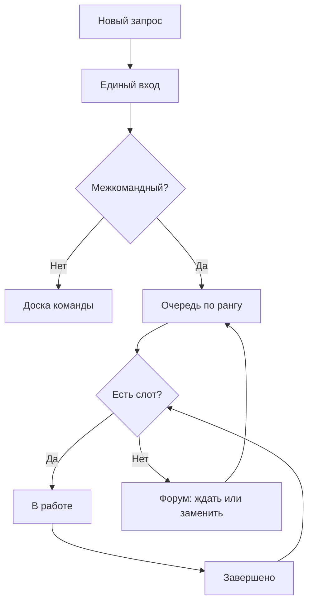
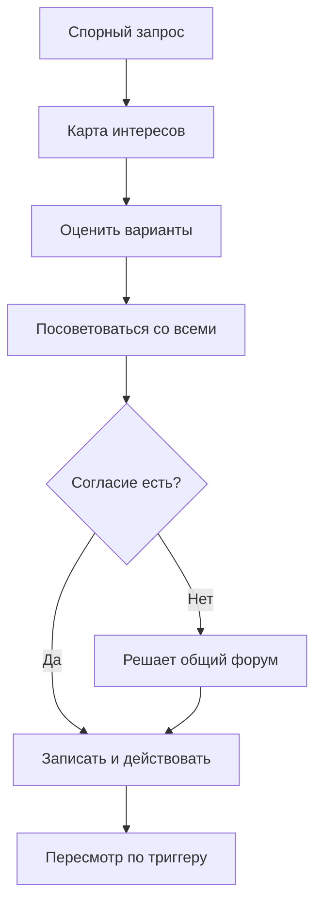

# Глава 42 — Кросс-функциональные зависимости, управление портфелем и влияние без формальной власти { #chapter-42-cross-functional-dependencies-portfolio-management-and-influence-without-authority }

Значительную часть недели директор тратит на работу, которую ни один человек не контролирует целиком:
функцию, обещанную продажами, для которой нужны три команды; эскалацию, свалившуюся на команду без
свободных рук; дорожную карту и план по надёжности, которые претендуют на одних и тех же инженеров. Для
такой работы в главе три инструмента. Первый — вести инициативы как единый портфель с явным лимитом
на то, сколько их идёт одновременно. Второй — разрешать зависимости с другими функциями через структуру, а не через
подвиги. Третий — влиять на коллег и руководителей, которые вам не подчиняются. Сквозной пример —
Northstar Technologies, вымышленная компания из [кейса](../../case-studies/northstar/index.md), в третьем
квартале работы нового директора.

!!! info "Связанные главы"
    Поток внутри команд и между ними разобран в главе 16; эта глава применяет ту же логику уровнем выше,
    к инициативам. Квартальное планирование и распределение ресурсов — в
    [главе 38](../08-management-operating-system/38-scorecards-quarterly-planning-and-capacity-allocation.md),
    ритм встреч — в
    [главе 37](../08-management-operating-system/37-cadences-and-leadership-meetings.md), а подробно о
    переговорах — в главе 46.

## Почему это важно { #why-this-matters }

В команде избыток незавершённой работы виден сразу: доска переполнена, и руководитель это замечает.

В организации из 50–150 инженеров тот же избыток размазан по дюжине инициатив, и у каждой есть спонсор,
которому она нужна сейчас. По отдельности каждая разумна. Но вместе они вешают на каждую команду
три-четыре межкомандных проекта, всё заканчивается с опозданием, и каждый спонсор делает вывод, что
разработке нет дела до его пункта. Именно так выглядел исходный квартал Northstar: девять из
семнадцати обещанных пунктов дорожной карты требовали больше одной команды, и из этих девяти за квартал вышел только один
([исходные данные](../../case-studies/northstar/baseline-data.md)).

Для высшего руководства именно здесь разработка зарабатывает или теряет доверие. У руководителей
продукта, продаж, работы с клиентами и финансов есть законные притязания на ресурс разработки, и никто из
них не подчиняется директору. Если на каждое притязание отвечать «да», вы наобещаете лишнего. Если
отвечать «процесс говорит нет», вас начнут обходить. Альтернатива — видимый портфель, структуры, которые
не дают рутинным зависимостям превращаться в эскалации, и влияние, построенное на интересах и
доказательствах.

## Цели главы { #learning-objectives }

После этой главы вы сможете:

- Строить портфель инициатив на уровне организации с явным лимитом незавершённой работы и защищать этот
  лимит арифметикой потока и явно названными допущениями.
- Диагностировать повторяющуюся зависимость разработки от продукта, продаж, работы с клиентами или
  финансов и заменять разовую координацию единым входом, правилом или зарезервированным ресурсом.
- Составлять карту позиций и стоящих за ними интересов каждого стейкхолдера до спорного решения.
- Выбирать тактики влияния, которые исследования связывают с приверженностью, и избегать тех, что они
  связывают с сопротивлением.
- Выносить спорный запрос на форум, который отвечает за этот компромисс, с вариантами, оценёнными в
  ресурсе и времени, а не решать его в одиночку и не эскалировать слишком поздно.

## Ментальная модель { #the-mental-model }

> **Ментальная модель:** организация может одновременно доводить до конца лишь ограниченное число
> межкомандных дел. Если начинать больше, выпуск не растёт, а всё задерживается. Ваша работа — открыто
> держать этот лимит и добиваться согласия с ним от людей, которыми вы не руководите, служа их интересам
> и опираясь на доказательства.

Вся глава держится на двух идеях.

Первая: **портфель — это очередь с той же арифметикой, что и доска команды**. Если организация
завершает примерно одну межкомандную инициативу в месяц, то при десяти инициативах в работе каждая
займёт около десяти месяцев. Ограничьте незавершённое, доводите до конца, прежде чем начинать новое, и
показывайте очередь ожидания.

Вторая: **влияние без формальной власти работает через интересы, доказательства и совместное решение —
именно в таком порядке**. Позиции («начните мою функцию сейчас») сталкиваются, а интересы («мне нужна
дата, которую я смогу отстоять перед этим потенциальным клиентом») часто удаётся совместить.
Совместное решение принимают вместе те, кто несёт его издержки; это не сбор союзников, чтобы перекрыть
кого-то голосами.

## Подробный разбор { #deep-conceptual-explanation }

### Портфель как очередь { #the-portfolio-as-a-queue }

**Портфель** — полный набор инициатив, которые организация обязалась выполнить: и тех, что в работе, и
тех, что ждут.
**Инициатива** здесь — работа объёмом от нескольких инженеро-недель, у которой есть спонсор и ожидаемый
результат. Управление портфелем нужно для межкомандных инициатив, то есть тех, где участвуют две
инженерные команды или больше. Работа одной команды регулируется её собственной доской и
[лимитами WIP](../../glossary.md#work-in-progress-wip-and-wip-limit) (ограничениями на незавершённую
работу, глава 16).

[Закон Литтла](../../glossary.md#littles-law) (его объясняет глава 16) связывает средние величины:
незавершённая работа равна пропускной способности, умноженной на время в системе. Для измеренных данных
он выполняется точно, если окно начинается и заканчивается при пустой системе. При этом закон описывает
компромиссы, а не разрешает их ([Little, 2011](../../references/bibliography.md#little2011law)). В
портфеле единицы работы — инициативы, а время измеряется месяцами: при неизменной пропускной способности
чем больше в работе, тем дольше длится каждая. Это **научный результат** (теорема). Но чтобы
предсказать, что даст более низкий лимит, нужно ещё допустить, что пропускная способность сохранится.

Если начинать больше, пропускная способность растёт редко: у межкомандных инициатив общие ограничения.
Это может быть единственный инженер, который разбирается в округлении валют, или команда, которая строит
тестовые окружения. Возьмём три инициативы, и каждой нужно по четыре недели одного такого специалиста.
Последовательно они завершатся на неделях 4, 8 и 12, в среднем на неделе 8, и первая
начнёт приносить ценность на неделе 4. Параллельно все три завершатся около недели 12 (а с учётом
переключений позже), в среднем на неделе 12. Это **иллюстрация** рассуждения из теории очередей.

За то, чтобы люди вели меньше проектов одновременно, говорят два направления исследований. В
руководстве DORA по возможностям сказано, что её исследования связывают лимиты WIP с более высокими
показателями поставки. Там же названы типичные провалы: лимиты, поставленные слишком высоко, чтобы
что-то ограничивать, и лимиты, которые повышают всякий раз, когда кто-то простаивает
([DORA, WIP limits](../../references/bibliography.md#dora-cap-wip-limits)). Это **отраслевое
исследование**: оно основано на опросах и носит корреляционный характер. А в исследовании
849 подразделений первичной медицинской помощи у подразделений, где сотрудники участвовали в нескольких
командах одновременно, результативность была ниже, особенно при сложных задачах
([Crawford et al., 2019](../../references/bibliography.md#crawford2019link)). Этот **научный результат**
(в изложении аннотации) получен в здравоохранении. Перенос на инженеров, распределённых по инициативам,
правдоподобен, но для разработки ПО не доказан.

Reinertsen утверждает, что очередями в разработке не управляют, потому что их не видно
([Reinertsen, 2009](../../references/bibliography.md#reinertsen2009principles)); это **мнение
эксперта**. Поэтому лимит должен быть на виду у всех: одна доска со всеми
межкомандными инициативами в работе и в ожидании, в порядке ранга.

### Как установить лимит портфеля и удержать его { #setting-and-holding-a-portfolio-limit }

У работающего лимита портфеля четыре части.

1. **Что учитывается.** Каждая инициатива, которой нужны две инженерные команды или больше, кто бы ни
   был её спонсором, включая работу по надёжности и платформе.
2. **Число.** Начните ниже текущего количества. Для первой оценки умножьте число межкомандных
   инициатив, которые реально завершались в месяц за последние два квартала, на допустимый для вас lead
   time в месяцах. Одна в месяц при допустимых трёх месяцах даёт около трёх. Это **рекомендация
   книги**: ни одно исследование не называет числа для портфеля.
3. **Ранг.** Инициативы в ожидании упорядочивают по
   [стоимости задержки](../../glossary.md#cost-of-delay) (cost of delay; ценность, теряемая за каждую
   неделю ожидания), делённой на длительность, а оценки ценности пишут спонсоры (метод разбирает
   глава 15, оценку задержки в деньгах — глава 45).
4. **Правило на пределе.** Новая инициатива начинается, когда одна завершается или когда форум,
   отвечающий за портфель, решает остановить или приостановить одну из идущих. Никто не
   добавляет четвёртую под видом «мы только начнём проектирование».

План из главы 38 определяет, как распределить ресурс по категориям и какие пункты обещаны; лимит —
сколько обещанных межкомандных пунктов идёт одновременно и в каком порядке.

Новую работу впускает только завершение. Замена допустима лишь как решение с названной ценой.

### Зависимости от других функций { #dependencies-with-other-functions }

Глава 16 разбирает зависимости между инженерными командами: их устраняют, ослабляют контрактом или
координируют через зарезервированный ресурс. Зависимости от продукта, продаж, работы с клиентами и
финансов принимают те же три формы, но «контракт» здесь обычно не API, а правило.

| Функция | Повторяющаяся зависимость | Версия с подвигами | Структурная версия |
|---|---|---|---|
| Продукт | Решения о приоритетах и объёме | Директор и CPO (директор по продукту) договариваются заново в коридорах | Единый ранжированный портфель; CPO отвечает за ранг продуктовых пунктов с письменными оценками ценности |
| Продажи | Даты и функции, обещанные в сделках | Пресейл-инженер пишет инженеру напрямую; директор спасает дату | Единый вход для запросов по сделкам; опубликованное правило для внешних дат (глава 17); небольшая зарезервированная квота на работу по сделкам |
| Работа с клиентами | Эскалации и статус инцидентов | Эскалации к тому руководителю, который ответит | Вход по уровню серьёзности с целевым временем ответа; у статусных сообщений есть владелец, их отрабатывают заранее |
| Финансы | Бюджет, капитализация (какие затраты на разработку учитываются как актив), вопросы о затратах | Разовые выгрузки данных перед заседаниями совета директоров | Квартальный отчёт о ресурсе по категориям на языке финансов (глава 38) |

Версия с подвигами срабатывает один раз и приучает к мысли, что эскалация — самый быстрый путь.
Координация работает лучше всего там, где зависимость действительно существует. В распределённой
разработке чем больше людей было вовлечено в задачу, тем дольше она выполнялась
([Herbsleb and Mockus, 2003](../../references/bibliography.md#herbsleb2003empirical)). Когда реальная
координация разработчиков совпадала с тем, чего требовали технические зависимости, запросы на изменение
решались значительно быстрее
([Cataldo et al., 2008](../../references/bibliography.md#cataldo2008congruence)). Оба — **научные
результаты** в изложении аннотаций, и касаются они координации внутри разработки. Вывод для других
функций делает уже книга: размещайте координацию там же, где зависимость, то есть в названном едином
входе и постоянном правиле, а не у того, кто эскалирует.

Cagan и Jones утверждают, что продуктовым командам нужно давать проблемы для решения, а не списки
функций от стейкхолдеров ([Cagan and Jones, 2020](../../references/bibliography.md#cagan2020empowered));
это **мнение эксперта**. Отсюда следует, что запрос продаж — не обязательство, а входные данные для
продуктового решения.

### Интересы, позиции и доказательства { #interests-positions-and-evidence }

Подход опирается на две классические книги практиков (**мнение эксперта**). В *Getting to Yes* Fisher и
Ury учат принципиальным переговорам: отделять людей от проблемы, видеть за позициями интересы,
придумывать варианты, выгодные обеим сторонам, и договариваться об объективных критериях. Реальная сила
каждой стороны — её лучшая альтернатива соглашению
([Fisher and Ury, 1981](../../references/bibliography.md#fisher1981getting)). Cohen и Bradford
рассматривают влияние среди равных как обмен: выясните, что ценит другая сторона, и предложите это в
обмен на сотрудничество ([Cohen and Bradford, 1990](../../references/bibliography.md#cohen1990influence)).
Подробно переговоры разбирает глава 46.

Исследования показывают, какие тактики работают и в каком направлении. Yukl и Tracey измерили девять
тактик влияния по опросникам, которые заполняли подчинённые, коллеги и руководитель каждого менеджера.
Самыми действенными оказались рациональное убеждение, вдохновляющий призыв и консультация. Наименее
действенными — давление, коалиция (привлечение других, чтобы надавить на адресата) и легитимация (ссылка
на правила или полномочия). Обмен был умеренно действенным с коллегами и подчинёнными, но не с
вышестоящими ([Yukl and Tracey, 1992](../../references/bibliography.md#yukl1992consequences)).
[Метаанализ](../../glossary.md#meta-analysis) показал, что рациональность и снискание расположения
(ingratiation) положительно связаны с рабочими результатами, а действие остальных тактик зависит от
ситуации ([Higgins et al., 2003](../../references/bibliography.md#higgins2003influence)). Оба — **научные
результаты** в изложении аннотаций. Измерялись в них приверженность и оценки, а не то, устояло ли
решение по портфелю.

Отсюда три практических следствия.

- **Коалиция в смысле исследований даёт обратный эффект.** Совместное решение — другое дело: его вместе
  принимают те, кто несёт издержки, и затронутая сторона при этом присутствует. Но если это
  выглядит так, будто на кого-то навалились всем миром, это воспримут как давление.
- **«Правило не позволяет» — это легитимация, и она слаба.** Защищайте лимит WIP его обоснованием и
  советуйтесь о том, что делать, когда лимит достигнут.
- **Наверх — убеждайте, а не торгуйтесь.** Приносите CFO (финансовому директору) не услуги, а
  доказательства на языке финансов.

### Когда разногласие идёт наверх { #when-a-disagreement-goes-up }

[Путь эскалации](../../glossary.md#escalation-path) и журнал решений из главы 39, а также роли в
решениях из главы 13 используйте так, как они там описаны. Единственная особенность портфеля — адресат:
спорный запрос к портфелю идёт на форум, который отвечает за этот компромисс (портфельный форум, о нём
ниже), и на нём присутствуют все затронутые стороны.

## Пример из инженерной организации { #engineering-organization-example }

!!! info "Northstar: что уже известно"
    В этом примере взят квартал до прихода директора. Кейс разворачивается в квартале 3 (недели
    27–39): к тому времени число инцидентов [Sev1 и Sev2](../../glossary.md#severity-sev1-sev2-sev3) (два
    самых серьёзных уровня) упало с 30 до 21 в квартале 1 и до 17 в квартале 2, а оба
    [обязательства по продлению](../../glossary.md#renewal-commitments) были выполнены к неделе 26. См.
    [хронологию](../../case-studies/northstar/timeline.md). Впервые читаете о Northstar? Прочитайте
    [«Год вкратце»](../../case-studies/northstar/year-in-brief.md) и
    [действующих лиц](../../case-studies/northstar/cast.md).

Этот пример — **иллюстрация**. В нём арифметика портфеля применена к исходному кварталу Northstar по
[исходным данным](../../case-studies/northstar/baseline-data.md).

В квартале было обещано 17 пунктов: 9 межкомандных и 8 командных. Вышли семь: 6 командных и 1
межкомандный. Из командных пунктов вышло 75% (6 из 8), из межкомандных — 11% (1 из 9).

Все 9 межкомандных пунктов пообещали в начале квартала, и в работу они попали одновременно. Закон
Литтла переводит это во время: 9 пунктов в работе ÷ около 1 завершённого за квартал = в среднем около
9 кварталов на каждый. Это не прогноз (система не была стабильной), но расчёт показывает, что
обязательство было невыполнимо с самого начала. Данные по задачам говорят то же самое в более мелком
масштабе: медианный
[lead time](../../glossary.md#lead-time) составлял 11 дней у задач без зависимостей, 24 — с одной и 41 —
с двумя или больше.

Теперь применим лимит в три. Девять пунктов опирались на одни и те же общие ограничения: Platform
Operations получала 29 из 86 связей зависимости, Billing — 19. Если вести по три пункта за раз, внимание
этих команд достанется первым трём; вероятно, выйдут два-три пункта вместо одного, а остальные шесть
получат пометку «в ожидании» и ожидаемую дату начала. Вырастет ли общая поставка, зависит от того,
сохранится ли пропускная способность, когда переключений станет меньше; это вероятно, но требует
проверки. Наверняка изменится другое: каждый спонсор получит правдивую дату начала вместо номинального
обязательства с историей выполнения в 11%. Цена такая: шесть спонсоров услышат «пока нет» на неделе 1, а не
«не успели» на неделе 13. Здесь и нужно влияние.

## Как принимать решение { #decision-framework }

По первой таблице решайте, куда направить запрос, по второй — как влиять.

| Запрос | Маршрут | Кто решает | Какие нужны данные |
|---|---|---|---|
| Для одной команды, вписывается в её план | Доска команды | Руководитель команды и продакт-менеджер | Объём, WIP команды |
| Межкомандный, слот свободен | Портфель, старт | Директор с учётом ранга от CPO | Ведущая команда, объём, ранг |
| Межкомандный, слота нет | Очередь по рангу | Портфельный форум, если предложена замена | Стоимость задержки нового и вытесняемого пунктов |
| Обещан вовне до оценки объёма | Рассматривается как межкомандный запрос с риском по дате | Форум, затем правило обязательств (глава 17) | Прогноз с диапазоном |
| Запрос повторяющегося типа | Изменить структуру | Директор и руководитель функции | Число прошлых запросов этого типа |

| Ситуация | С чего начать | Чего избегать |
|---|---|---|
| Коллега с жёсткой позицией | Консультация по вариантам; пересказать ему его же интересы | Легитимации («лимит не позволяет») |
| Руководитель выше вас | Рациональное убеждение на его цифрах | Обмена, давления |
| Коллега, чьё сотрудничество нужно вам постоянно | Обмен тем, что он ценит; надёжное выполнение обещаний | Разовых услуг, которые создают прецедент |
| Реальный конфликт интересов двух коллег | Общий форум с оценёнными вариантами | Решать за них в одиночку |

В основе обеих таблиц одно правило: директору принадлежат арифметика и процесс, а компромисс — тем,
кто несёт издержки.

## Компромиссы { #trade-offs }

**Лимит против отзывчивости.** С лимитом портфеля организация медленнее начинает новое и быстрее его
заканчивает. Продажи и служба работы с клиентами сначала чувствуют первое и лишь потом видят второе.
Небольшая зарезервированная квота на работу по сделкам и эскалациям, только для задач одной команды,
покупает отзывчивость по известной цене.

**Прозрачность против комфорта.** Ранжированная очередь ожидания сообщает спонсорам, что над их пунктами
никто не работает. Честный список вызывает конфликт рано; длинный список «в работе» — в конце квартала.

**Структура против доброй воли.** Единый вход вместо личных сообщений защищает фокус, но кажется
бюрократией тем, кто привык к быстрым услугам. Держите его быстрым (два рабочих дня), иначе его начнут
обходить.

**Консультации против скорости.** Посоветоваться с каждым затронутым руководителем — дело нескольких
дней. Оставьте
общий форум для замен, которые вытесняют обещанный пункт; обратимые вопросы решайте сами и потом
пересматривайте.

**Стоимость перехода.** С новым лимитом начатые инициативы придётся приостановить, и на несколько недель,
пока затор рассасывается, видимый выпуск упадёт. Скажите об этом заранее.

## Типичные провалы { #failure-modes }

**Фантомный лимит.** Лимит объявлен, но запросы руководства добавляют «в порядке исключения». Как
заметить: в течение месяца число инициатив в работе превышает лимит. Что делать: считать каждое
исключение заменой, которую решает форум и записывает вместе с её ценой.

**Внутренняя работа вне портфеля.** Инициативы по надёжности и платформе идут параллельно с
продуктовыми, на которые действует лимит, и опираются на тех же людей. Как заметить: на бумаге лимит
соблюдается, а общие специалисты заняты в пяти проектах. Что делать: учитывать каждую межкомандную инициативу.

**Директор-герой.** Каждый кросс-функциональный конфликт разрешается личными усилиями директора. Как
заметить: эскалации одного и того же типа повторяются. Что делать: ежемесячно считать эскалации по
типам и выстраивать структуру для каждого повторяющегося типа.

**Влияние как давление.** Директор заручается поддержкой CTO (технического директора) и CFO до
разговора с человеком, чей запрос затронут. Как заметить: на встрече решение устояло, а потом к нему
возвращаются снова. Что делать: сначала посоветоваться с затронутой стороной; приносить варианты, а не
вердикт.

**Интересы угаданы, а не выяснены.** Директор полагает, что продажам нужна функция, хотя им нужна
надёжная дата. Как заметить: щедрые предложения отвергают. Что делать: спросить, как выглядит хороший
исход.

**Доказательства на языке разработки.** Медианы lead time показывают финансам или продажам без перевода.
Как заметить: все вежливо кивают, но ничего не меняется. Что делать: переводить на язык выручки под
риском, дат и выплаченных кредитов.

## Применение в крупной организации { #enterprise-application }

В организации из 50–150 инженеров управлению портфелем и кросс-функциональной работе нужны пять
постоянных элементов.

**Одна доска портфеля** со всеми межкомандными инициативами (в работе и в ожидании): у каждой указаны
спонсор, ведущая команда, объём, ранг и ожидаемая дата начала. Доску видят все руководители.

**Ежемесячный портфельный форум**: директор, CPO и руководители функций, выступающие спонсорами, а если
замена вытесняет обещанный пункт, — ещё и CTO. Форум впускает работу в свободные слоты и решает вопросы
о заменах. Естественное место для него — ежемесячный бизнес-обзор из главы 37: проводите форум
постоянным пунктом этого обзора, и пусть спонсоры подключаются именно к нему. Решения форума
записываются так, как описано в главе 39.

**Названные интерфейсы с каждой функцией:** свой контакт в отделе продаж (sales operations) для запросов
по сделкам, в службе работы с клиентами для эскалаций, в финансах для отчётов о ресурсе. У каждого
интерфейса есть единый вход, целевое время ответа и правило о том, что допустимо делать в обход него.

**Карта интересов для каждого постоянного стейкхолдера**: её ведёт директор и пересматривает после
каждого спорного решения.

**Капитал отношений, накопленный заранее.** Влияние в конфликте опирается на доверие, построенное в
спокойные недели (**рекомендация книги**). Раз в месяц проводите короткую встречу один на один с каждым
руководителем соседней функции, без просьб в повестке: спросите, что их тревожит и что разработка могла
бы им облегчить. Предупреждайте их о проблемах раньше, чем это им понадобится. Выполняйте каждое мелкое
обещание в названный срок. Директор, который впервые встречается с коллегой из-за спорной замены, тратит
капитал, который никогда не вносил.

При 150 инженерах портфелю может понадобиться два уровня: несколько общеорганизационных инициатив с
лимитом, который устанавливает команда CTO, и портфели направлений, которые директора ведут со своими
лимитами.

## Взгляд CTO { #cto-perspective }

На уровне CTO портфель становится портфелем компании, и лимит уже не отстаивают перед CEO (генеральным
директором) и командой высшего руководства, а устанавливают вместе с ними. Работа CTO меняется в трёх
отношениях.

Во-первых, CTO отвечает за правило обязательств: кто что может обещать клиентам и на каких основаниях.
Без такого правила лимит портфеля любого директора сводят на нет даты, обещанные где-то ещё.

Во-вторых, CTO превращает данные портфеля в разговор о стратегии. Ранжированная очередь ожидания со
стоимостью задержки показывает, что компания решила пока не делать, и совет директоров откликается на
это лучше, чем на жалобу на нехватку ресурса.

В-третьих, коллеги CTO отвечают перед советом директоров за собственные цифры: операционные расходы,
план продаж, обязательства перед клиентами. Главными инструментами остаются убеждение на их
языке, выполнение обещаний и ранняя эскалация.

## Практический плейбук { #practical-playbook }

1. **Составьте список всех межкомандных инициатив** в работе или обещанных, включая внутреннюю работу.
2. **Посчитайте пропускную способность**: сколько межкомандных инициатив завершалось в месяц за два
   квартала.
3. **Установите лимит** ниже нынешнего количества и запишите, что учитывается.
4. **Ранжируйте и опубликуйте очередь ожидания** с оценками ценности от спонсоров (глава 15).
5. **Согласуйте правило на пределе** с CPO и CTO до первого конфликта.
6. **Составьте карту повторяющихся зависимостей каждой функции**; для каждой выберите устранение,
   правило или зарезервированный ресурс и назначьте владельца.
7. **Напишите карту интересов** для каждого коллеги из высшего руководства: позиции, интересы, метрики,
   доказательства, которым он доверяет, и что вы можете предложить.
8. **Сначала посоветуйтесь с затронутой стороной** и приходите с оценёнными вариантами.
9. **Выносите неразрешённые конфликты на форум** в присутствии всех сторон; записывайте решение и
   триггер его пересмотра.
10. **Пересматривайте ежемесячно**: число в работе против лимита, завершённое, эскалации по типам.

## Кейс { #case-study }

Этот кейс — **вымысел**. Действие происходит в квартале 3 (недели 27–39) работы директора в Northstar.
Цифры ресурса взяты из плана на квартал 3 в главе 38. Из 80 инженеров плановый сценарий отдаёт
незапланированной работе 17,6 [FTE](../../glossary.md#fte) (полной ставки), профилактике — 8, платформе
— 4,5, продукту — 49,9. Обещано около 463 инженеро-недель продуктовых трудозатрат. Кейс рассматривает
только обещанные пункты. Решение принимает читатель.

**Отношения на неделе 27.** Каждый из четырёх кросс-функциональных коллег директора претендовал на
часть обещанных продуктовых трудозатрат.

| Коллега | Позиция на входе в квартал 3 | Стоящий за ней интерес | Каким доказательствам доверяет | Что может предложить разработка |
|---|---|---|---|---|
| Amara Okafor, CPO | «Включите в обязательства и цели» (глава 38) | Даты, которые можно давать клиентам, не обжигаясь снова | Диапазонам прогнозов в сравнении с историей за четыре квартала | Ранние предупреждения и прогнозы, которые она может повторить |
| Greg Tanaka, VP по продажам | Сначала две его функции для сделок | Надёжные даты, которые помогут закрыть открытые сделки | Тому, что он может сказать потенциальному клиенту | Быстрый и честный ответ на любой запрос по сделке |
| Sofia Alvarez, VP по работе с клиентами | Меньше эскалаций, честный статус инцидентов | Доверие клиентов после года звонков об отказах | Доле инцидентов, обнаруженных клиентами, числу эскалаций | Выстроенные и отрепетированные статусные сообщения |
| Rajiv Menon, CFO | [Операционные расходы](../../glossary.md#operating-expense) без роста; прекратить выплату кредитов | Предсказуемые расходы, которые он может объяснить совету директоров | Долларам, [годовому темпу (run-rate)](../../glossary.md#run-rate) (текущие расходы, спроецированные вперёд), выплаченным кредитам | Отчёт о ресурсе по категориям на его языке |

Sofia участвовала в написании определений серьёзности на неделе 3 первого квартала. Запрос Rajiv о
показателе выпуска на одного инженера (глава 18) всё ещё оставался без ответа.

**Портфель.** Четыре из обещанных пунктов были межкомандными. Исходя из рассуждения в примере из
инженерной организации, директор предложил лимит: не больше трёх межкомандных инициатив в работе
одновременно. Amara и Victor Lindqvist (CTO) согласились опробовать его в этом квартале.

| Ранг | Инициатива | Спонсор | Ведущая команда, остальные | Объём (инженеро-недели) | План |
|---|---|---|---|---|---|
| 1 | Мультивалютные прайс-листы (функция для сделки) | Greg Tanaka | Orders; Billing, Customer Experience | 110 | Старт на неделе 27, прогноз — неделя 38 |
| 2 | Экспорт каталога для клиентов (функция для сделки) | Greg Tanaka | Data and Analytics; Orders | 60 | Старт на неделе 27, прогноз — неделя 34 |
| 3 | Уведомления клиентов о статусе инцидентов | Sofia Alvarez | Customer Experience; Payments and Integrations | 45 | Старт на неделе 27, прогноз — неделя 33 |
| 4 | Автоматические выписки по [сервисным кредитам](../../glossary.md#service-credits) (возмещениям за недобранную доступность) | Rajiv Menon | Billing; Data and Analytics | 50 | Ожидание; старт, когда освободится слот, около недели 33 |

Обещанные межкомандные трудозатраты — 265 инженеро-недель, так что из 463 около 198 остаётся на
командные пункты, которые регулируются досками команд. У мультивалютных прайс-листов было одно известное
ограничение: из инженеров Billing, работающих с ledger, безопасно менять логику валют и округления мог
только один. Поэтому работу Billing выстроили последовательно вокруг этого человека, вместо того чтобы
распределить её.

**Неделя 31.** Greg Tanaka пришёл к директору с третьей функцией для сделки: правилами согласования
закупок, которые позволяют клиенту дистрибьютора требовать согласования заказов выше заданной суммы.
Потенциальный клиент, которого Greg оценивал примерно в $700 000
[годовой регулярной выручки](../../glossary.md#arr), хотел получить дату поставки до своего решения на
неделе 36. По оценке объёма функции требовалось около 70 инженеро-недель; ведущая команда — Orders,
вместе с Customer Experience. Greg попросил начать сейчас.

Арифметика, которую директор подготовил до разговора:

- **Нагрузка на Orders.** Orders уже вела мультивалютные прайс-листы и участвовала в экспорте; третья
  межкомандная инициатива — та самая картина, что стоит за «1 из 9» в исходном квартале.
- **Слоты.** Слот 3 освобождается примерно на неделе 33 и обещан выпискам по сервисным кредитам;
  слот 2 — на неделе 34.
- **Прогноз.** Если начать с недели 34 и допустить, что две команды после прочих обязательств смогут
  отдавать функции около 7 инженеро-недель в неделю, 70 инженеро-недель займут 10 недель: готово к
  неделе 44, а с учётом роста объёма на 15–35%, который наблюдался у недавних функций Orders, — к
  неделям 45–47.
  Если начать сейчас четвёртой инициативой, раньше она не закончится, а дата мультивалютных
  прайс-листов, уже названная в открытой сделке, окажется под угрозой.
- **Ресурс.** Нового ресурса нет: трудозатраты пришлось бы взять из целевого диапазона или у
  обещанного пункта, который будет вытеснен.
- **Замена.** Если вместо этого занять слот недели 33, прогноз сдвинется на неделю раньше, а пункт
  Rajiv уйдёт в квартал 4.

Сначала директор встретился с Greg один на один и спросил, как выглядит хороший исход. Ответ изменил
саму задачу: потенциальному клиенту к неделе 36 нужно было не готовое ПО, а дата, на которую можно
положиться, и свидетельство того, что Northstar понимает его процесс согласования. Директор предложил
две сессии по проработке объёма с потенциальным клиентом на неделях 32 и 33 (продакт-менеджер и
senior-инженер из Orders, вне портфеля). Ещё он предложил диапазон прогноза, который Greg сможет назвать
на неделе 35, а затем, ещё до того как кто-либо предложил замену на встрече, обсудил её с Rajiv.

**Решение.** На портфельный форум недели 34, где присутствовали Amara, Greg, Sofia, Rajiv и Victor,
директор принёс три варианта с ценой:

1. **Поставить в очередь.** Правила согласования занимают слот недели 34; прогноз — недели 44–47;
   ничего не вытесняется.
2. **Заменить.** Правила согласования занимают слот недели 33; выписки по сервисным кредитам уходят в
   квартал 4.
3. **Нарушить лимит.** Начать сейчас четвёртой инициативой; под угрозой мультивалютные прайс-листы, чья
   дата уже названа в открытой сделке.

Директор рекомендовал вариант 1, а сессии по проработке объёма предложил как ту часть потребности Greg,
которую можно закрыть сразу. На квартал 4 он предложил зарезервировать квоту на
небольшие запросы по сделкам, посильные одной команде; её размер определят при планировании по главе 38. Greg предпочёл
вариант 2. Позиция Rajiv по замене зависела от того, сколько кредитов всё ещё выплачивается, а этих
данных у форума пока не было.

**Решает читатель:** какой вариант следует выбрать форуму, какие данные изменили бы ответ и верно ли
число три для лимита на квартал 4.

## Упражнения { #exercises }

Разборы упражнений: [решения к главе 42](../../solutions/ch42-solutions.md). Данные Northstar — на
[странице исходных данных](../../case-studies/northstar/baseline-data.md) и в
[хронике года 1](../../case-studies/northstar/first-quarter.md).

### Базовый уровень { #foundational }

**F1.** Организация из 120 инженеров за последние два квартала завершила 5 межкомандных инициатив, и
ещё 11 сейчас в работе. CPO хочет в следующем квартале начать ещё 4. Оцените, сколько в среднем времени
инициатива сейчас проводит в работе, предложите лимит портфеля, назовите допущения, на которых
держатся оба числа, и скажите, что бы вы измеряли, чтобы их проверить.

**F2.** Отнесите каждую тактику к категориям Yukl и Tracey и предскажите, как её воспримут: директор
говорит VP по продажам «политика WIP этого не позволяет»; директор спрашивает CPO, какую из двух
идущих инициатив она бы приостановила; директор просит CTO велеть продажам подождать; директор
показывает CFO кредиты, которые всё ещё выплачиваются по задержанному пункту.

**F3.** За этот квартал пресейл-инженеры Northstar отправили инженерам Data and Analytics напрямую в
мессенджере 14 запросов данных, и каждый был «срочным». Опишите, как решить эту проблему через подвиги и
как — через структуру, и скажите, какие данные вы собрали бы, прежде чем предлагать изменение Greg
Tanaka.

### Прикладное лидерство { #applied-leadership }

**A1.** На неделе 29 мультивалютные прайс-листы сдвигаются на две недели, потому что единственного
инженера Billing, который может безопасно менять логику валют и округления, забрали на инцидент. Greg
Tanaka уже назвал дату в открытой сделке. Спланируйте разговор с Greg и изменение портфеля и скажите,
какую структурную проблему это обнажает.

**A2.** Sofia Alvarez предлагает, чтобы служба работы с клиентами могла раз в месяц ставить одну
эскалацию прямо в работу любой команды, минуя единый вход. Подготовьте ответ: её интересы, что вы можете
принять, чего не можете и какие доказательства принесёте.

**A3.** Напишите карту интересов Rajiv Menon перед форумом недели 34: его позиция по замене, интересы за
ней, доказательства, которым он доверяет, и что директору следует и не следует ему предлагать.
Объясните, почему обмен — неудачная тактика в разговоре с ним.

### Решения на уровне руководства { #executive-decision-making }

**X1.** Опираясь на кейс, решите, какой вариант следует выбрать форуму недели 34. Напишите рекомендацию
в том виде, в каком она уйдёт к Victor Lindqvist: варианты с ценой в инженеро-неделях и датах, кто несёт
каждую цену, ваша рекомендация и что заставило бы вас её изменить.

**X2.** Helena Marsh, CEO, спрашивает, почему у разработки «в работе всего три вещи», хотя совет
директоров видит список из десяти ожидающих. Вы — советник Victor Lindqvist: подготовьте объяснение для
CEO, включая арифметику, риск повышения лимита и то, что вы предложили бы, чтобы очередь ожидания стала
приемлемой для команды высшего руководства.

## Вопросы для размышления { #reflection-questions }

1. Сколько межкомандных инициатив ваша организация ведёт прямо сейчас, если учитывать внутреннюю работу?
   Назовёт ли каждый из ваших коллег то же число?
2. Когда вы в последний раз выясняли, что коллеге действительно нужно, а не что он попросил?
3. Какие из ваших попыток повлиять за последний месяц были давлением или ссылками на правила? Как их
   восприняли?
4. Какая эскалация каждый месяц доходит до вас в одном и том же виде? Какая структура её остановила бы?
5. Кто за пределами разработки сказал бы, что вы неизменно делаете то, что обещали?

## Главное { #key-takeaways }

- Ведите межкомандные инициативы как единый портфель с явным лимитом и учитывайте в нём внутреннюю
  работу.
- Когда у инициатив общие ограничения, новые старты не добавляют пропускной способности, а задерживают
  все инициативы.
- Делайте очередь ожидания видимой и ранжированной: честное «пока нет» лучше номинальных обязательств,
  которые срываются.
- На пределе новая инициатива начинается только тогда, когда одна завершается или форум заменяет одну
  из идущих по названной цене.
- Заменяйте повторяющиеся кросс-функциональные эскалации единым входом, правилом или зарезервированным
  ресурсом.
- Выясняйте интересы раньше позиций; спрашивайте, как выглядит хороший исход для другой стороны.
- Начинайте с доказательств и консультаций; давление, ссылки на правила и сбор союзников (коалиция в
  смысле исследований) дают обратный эффект.
- Директору принадлежат арифметика и процесс; компромисс — тем, кто несёт издержки.

## Источники и что почитать { #references-and-further-reading }

- [Little, 2011](../../references/bibliography.md#little2011law). Закон Литтла и его пределы.
- [DORA, WIP limits](../../references/bibliography.md#dora-cap-wip-limits). Лимиты WIP и то, как они
  ломаются.
- [Crawford et al., 2019](../../references/bibliography.md#crawford2019link). Участие в нескольких
  командах и результативность; косвенные доказательства против того, чтобы распылять людей.
- [Herbsleb and Mockus, 2003](../../references/bibliography.md#herbsleb2003empirical) и
  [Cataldo et al., 2008](../../references/bibliography.md#cataldo2008congruence). Издержки координации
  и польза от координации там, где есть зависимости.
- [Yukl and Tracey, 1992](../../references/bibliography.md#yukl1992consequences) и
  [Higgins et al., 2003](../../references/bibliography.md#higgins2003influence). Какие тактики влияния
  работают и с кем.
- [Fisher and Ury, 1981](../../references/bibliography.md#fisher1981getting). *Getting to Yes*.
  Интересы важнее позиций.
- [Cohen and Bradford, 1990](../../references/bibliography.md#cohen1990influence). *Influence Without
  Authority*. Влияние среди равных как обмен.
- [Cagan and Jones, 2020](../../references/bibliography.md#cagan2020empowered). *Empowered*. Проблемы,
  а не запросы на функции, как входные данные для продуктовых команд.
- [Reinertsen, 2009](../../references/bibliography.md#reinertsen2009principles). Невидимые очереди в
  разработке продуктов.
