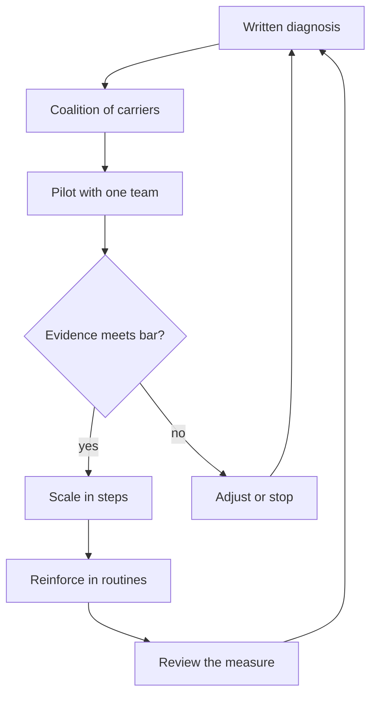
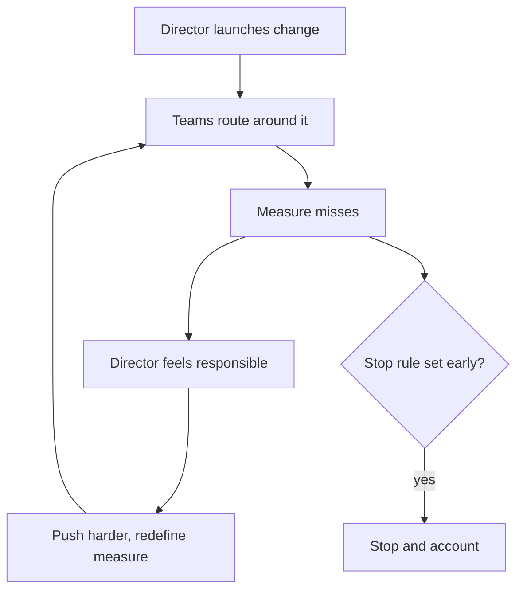
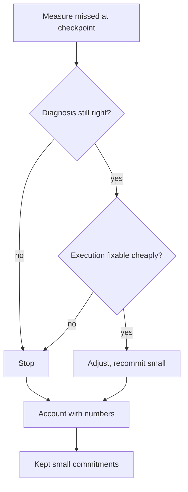

# Chapter 43 — Leading Organizational Change and Director Failure Patterns

A director changes the organization mostly through other people: six managers, three staff engineers,
and peers who own the product roadmap and the budget. This chapter is about planning such a change so
that it survives contact with those people, about the failure patterns directors fall into (and how to
see them in yourself before your managers do), and about recovering credibility when an initiative
fails anyway. Chapter 36 owns the mechanics of reorganization, Chapter 27 owns the quality
transformation, and Chapter 57 will cover resistance at executive level; this chapter covers the
director's general method. The running example is a director-led initiative at Northstar Technologies,
the fictional company in the [case study](../../case-studies/northstar/index.md), that partly fails in
quarter 3.

## Why This Matters

At team scale, a manager can change a practice by changing it: the team is in the room and a bad
idea shows within a sprint. A director's changes travel through managers
before they reach engineers, so the director sees them late, filtered, and often already reshaped.

At organization scale, the director is the person most able to start organization-wide changes and
the least able to see how they land. Each change costs the managers attention, the organization's
scarcest resource. A director who starts changes faster than managers can absorb them gets compliance
in meetings and workarounds in the work.

At executive scale, the director's record of changes becomes their credibility: the CTO, peers, and
engineers judge the next proposal by how the last one went. A director who cannot recover from one
failure cannot start the next.

## Learning Objectives

After this chapter you will be able to:

- Plan a change with a written diagnosis, a coalition of the people who must carry it, early evidence
  from a small pilot, and reinforcement in the organization's routines.
- Recognize the common director failure patterns in your own record, using evidence rather than
  self-image.
- Decide whether to continue, adjust, or stop an initiative that is missing its measure, without
  escalating commitment to it.
- Recover credibility after a failed initiative with an honest account and small, kept commitments.

## The Mental Model

> **Mental model:** A director's change is a hypothesis that managers have to test with their own
> time. Plan it so that it can be shown wrong early and cheaply, and so that the people who carry it
> helped shape it. Credibility is the balance of promises kept against promises broken, and a failed
> initiative is recovered by how it is ended, not by how it is defended.

Two consequences follow. Every change needs a stated way of failing: a measure, a date, and a
threshold at which you stop; a change you cannot stop becomes a commitment you defend with your
reputation. And the people who carry the change are its co-authors, not its audience: announcing it
makes managers messengers, designing it with them makes them owners who report problems early.

Each box is cheap next to a change the organization routes around; the case study's failures began
at the boxes it skipped.

## Deep Conceptual Explanation

### What the evidence on change does and does not say

Much of the advice on organizational change comes from practitioners. The most cited is John Kotter's
1995 article, which draws on his observation of more than 100 companies attempting large
transformations ([Kotter, 1995](../../references/bibliography.md#kotter1995leading)). It is known for a
sequence of errors that sink such efforts: too little urgency, no powerful guiding coalition, no
planned short-term wins, declaring victory too soon, and failing to anchor the change in the culture.
That is **expert opinion** from long observation, not a study with a stated method; treat it as a
checklist of what to think about, not as a law with a known effect.

The statistic that often accompanies such advice, that 70 percent of change programs fail, does not
survive inspection. Mark Hughes reviewed five published sources of the figure and found no valid and
reliable empirical evidence behind any of them, and argued that a single failure rate is hard even to
define, since change is ambiguous, context-dependent, perceived differently, and measured at different
times ([Hughes, 2011](../../references/bibliography.md#hughes2011seventy)). That is a **research
finding** about the evidence, read at abstract level. Do not quote the figure, and define in advance
what "failed" will mean for your own change.

What the research does support is narrower. A review of 79 quantitative studies of how people react
to organizational change sorts the causes of those reactions into conditions before the change (who
the recipients are and the context they work in) and features of the change itself: the process, the
perceived benefit or harm, and the content
([Oreg, Vakola, and Armenakis, 2011](../../references/bibliography.md#oreg2011recipients)). Only the
abstract was read, so this chapter takes one point from it: how a change is run is a lever separate
from what the change is. A good idea run badly gets a bad reaction. Chapter 36 applies the same review
to reorganizations.

A book on digital transformation makes a related argument: the hard
part of such change is people, culture, and organization, not the technology
([Kane et al., 2019](../../references/bibliography.md#kane2019technology); credited for the idea only).
For a director, a new pipeline or planning format is the easy half; the managers' routines and
incentives decide whether it lasts.

### Diagnosis before solution

Richard Rumelt's account of strategy starts with a diagnosis: a judgment about what is actually
going on and which part of the situation is critical, followed by a guiding policy and coherent
actions ([Rumelt, 2011](../../references/bibliography.md#rumelt2011good); idea level). Most failed
director initiatives skip the first step. They begin with a solution the director has seen work
elsewhere ("fix-it days", "design review for everything", "a single sprint cadence") and back-fill a
reason.

A usable diagnosis for an organizational change fits on half a page and answers four questions:

1. What outcome is wrong, with a number? ("Debt work stalls" is not a number; "no priced register
   entry has moved in six weeks" is.)
2. What mechanism produces it? Capacity, ownership, skill, incentive, information, or a decision
   nobody can make.
3. What evidence would show the mechanism is something else?
4. Who already sees this problem, and what do they think causes it?

Directors go wrong most often on the second question. Capacity is the easiest mechanism to believe
in, because the director controls it, but many quality problems are ownership problems: the work needs
one person to hold it for weeks, which free hours do not supply.

### The coalition: who has to carry it

Kotter's guiding coalition is, at director level, concrete: the managers whose teams will do the work,
the staff engineer whose domain it touches, and the peer whose plans it changes (usually the product
leader). Chapter 42 covers influence with peers; this section is about the managers.

A coalition is not consent obtained in a meeting. It is the managers having changed the design. The
test: can you name one thing in the plan that is there because a manager objected? If not, you have an
audience, and an audience reports compliance and lets the workarounds speak.

Patrick Lencioni's argument that organizational health rests on a cohesive leadership team that
creates clarity, communicates it repeatedly, and reinforces it through the organization's human
systems ([Lencioni, 2012](../../references/bibliography.md#lencioni2012advantage); idea level) points
the same way. For a director that team meets in the leadership team meeting (Chapter 37), and a change
that was not decided there will be explained differently by six managers to six teams.

### Early evidence: pilots and small wins

Karl Weick argued that large problems become tractable when recast as a series of small, concrete,
completed outcomes, each of which changes what seems possible next
([Weick, 1984](../../references/bibliography.md#weick1984small); idea level). Michael Watkins makes the
leader's version of the point: early wins build the credibility a new leader needs for larger changes
([Watkins, 2003](../../references/bibliography.md#watkins2003first); idea level).

The practical form is a pilot: one team, a defined period, a measure chosen before the start, and a
threshold for scaling, adjusting, or stopping. A pilot finds the collisions with real calendars
(period close, release dates, on-call), costs one team's time instead of everyone's, and can be stopped
without a public reversal. Its measure should be an outcome the diagnosis predicts ("register entries
closed"), not activity ("engineers who took part").

### Reinforcement: making it the way work is done

Changes that depend on the director's attention stop when the attention moves. Reinforcement moves
the change into routines that run without the director: the planning template, capacity model, review
agenda, promotion evidence, onboarding checklist. That is Kotter's anchoring. The test: if you were
away for a quarter, would the change still happen? Chapter 37 describes the cadences that carry
such routines.

### Director failure patterns

The patterns below are **this book's recommendation**, a synthesis from the sources above and from the
failure modes of earlier chapters. They are traps of the role, not character flaws; most directors
show several. The point is to look for them in your own record.

| Pattern | What it looks like | Evidence to look for in yourself |
|---|---|---|
| Change by announcement | Managers hear about the change with their teams | Count changes where a manager altered the design before launch |
| Initiative overload | More changes in flight than managers can absorb | List open initiatives per manager; ask each manager to rank them |
| Solution before diagnosis | A favorite practice looking for a problem | Can you state the mechanism and what would disprove it? |
| Level slip | Doing a manager's or staff engineer's job | Decisions you made that sat in someone else's scope |
| Decision vacuum | Cross-team decisions with no named decider | Disputes that waited more than two weeks |
| Promise inflation | Commitments made faster than they are kept | Your commitments list: kept, slipped, dropped silently |
| Escalation | Defending a failing initiative because it is yours | Measures redefined after launch; exemptions granted quietly |
| Signal isolation | Learning about problems from summaries only | Problems you heard about first from a peer or customer |

Escalation deserves its own note. Barry Staw's work introduced escalation of commitment, the tendency
to commit more to a failing course of action one chose oneself
([Staw, 1976](../../references/bibliography.md#staw1976knee); idea level). A director's initiatives are
public and personal. The defense is a stopping rule set before launch, and someone else charged with
saying when it is met.

The loop on the left is escalation: each miss raises the director's personal stake, the push makes
teams route around harder, and the next miss follows. A stopping rule written before launch is the
exit.

### Recovering credibility

Credibility with managers is built from kept promises and spent by broken ones, and a failed
initiative spends a lot of it at once. Research on trust repair offers one finding a director can use.
In two experimental studies, trust was repaired better when the party apologized for a violation
about competence, and denied culpability for a violation about integrity; and apology worked better
when later evidence showed guilt, denial when it showed innocence
([Kim et al., 2004](../../references/bibliography.md#kim2004removing)). The studies concern an alleged
violation, not a manager's failed project, so the transfer is this book's inference.

The inference: most failed initiatives are competence failures (a wrong diagnosis, a poor launch), and
owning them plainly is the repair that fits. Explaining them away ("the teams did not commit") is a
denial, and when evidence shows the director's part, the denial costs more than the failure. Integrity
is at stake when people believe they were misled, for example when a "voluntary" day turns out to be
tracked by name; then the account must address what was said, not only what was done.

A recovery has four parts: stop or reshape the initiative visibly, account for it with numbers and your
own errors named, make a few commitments you will certainly keep, and let someone else check them.

## Engineering Organization Example

The figures here are **illustrative** and not from Northstar. A director of 110 engineers in 12 teams
under 9 managers lists the organization-wide changes in flight at the start of a quarter.

| Initiative | Teams affected | Manager hours per week, estimated | Started by |
|---|---|---|---|
| New incident severity scheme | 12 | 1.0 each | Director |
| Quarterly planning template | 12 | 1.5 each | Director |
| Design review for cross-team changes | 8 | 1.0 each | Director |
| Career ladder rewrite | 12 | 1.0 each | Director and HR |
| On-call compensation change | 6 | 0.5 each | HR |

Assumptions: a 45-hour manager week about 85 percent committed to people, delivery, and technical
work, leaving about 7 hours of slack. A manager touched by all five carries 1.0 + 1.5 + 1.0 + 1.0 +
0.5 = 5.0 hours a week, 71 percent of the slack (5.0 / 7). A sixth change at 1.5 hours makes it 6.5
hours, 93 percent, leaving almost nothing for an incident or a resignation.

Each initiative looks small on the list, so the load is invisible until summed. Sum it per manager
before adding a change, and ask the managers to rank the initiatives: one ranked last by most is badly
explained or not worth its hours. Here three managers ranked the design review last because it
duplicated a review they already held with the staff engineers, and that reason changed its design.

## Decision Framework

Use this framework at two points: before launching a change, and when a launched change is missing its
measure.

| Question before launch | If the answer is no |
|---|---|
| Is there a written diagnosis with a mechanism and a disconfirming test? | Diagnose first; do not launch |
| Did at least half the affected managers change something in the design? | Hold a design session, not an announcement |
| Is there a pilot with a measure and a threshold set in advance? | Pilot with one team first |
| Does the change fit within the managers' remaining change capacity? | Stop or finish something else first |
| Is there a named person who will tell you when the stopping rule is met? | Name one; ideally a manager |

"Continue unchanged" is deliberately missing: if an honestly set measure was missed, something must
change, and continuing unchanged is how escalation looks from the inside.

## Trade-offs

**Coalition versus speed.** Designing with managers takes weeks; announcing takes a meeting. The
weeks are usually cheaper than a quarter of workarounds, but not always. A safety or security change
with a deadline (Chapter 26's remediation service levels, for instance) may be imposed and explained
afterwards. Reserve imposition for changes where the cost of delay is real and stated.

**Pilot versus fairness.** A pilot treats one team differently, which others may read as favoritism.
Use a volunteering team and explain the choice.

**Stopping versus persistence.** Some valuable changes look bad early: a new review practice slows
merges before it reduces incidents. A stopping rule set too tight kills them. Set the threshold on the
outcome the diagnosis predicts, with a checkpoint late enough for that outcome to appear, and say in
advance which early costs you expect.

**Owning failure versus authority.** Directors fear that admitting a mistake weakens them. The trust
repair evidence points the other way for competence failures, and the managers already know the
initiative failed. The real cost is sharper questions on the next proposal, a fair price.

**Transition cost.** Stopping a change also costs managers attention, and reversing twice in a
quarter costs more than either change. When you stop, stop once, and say what replaces it.

## Failure Modes

**The launch nobody shaped.** Managers learn of the change with their teams. Early sign: their
questions are about logistics, not whether it should happen, and they later explain it in different
words.

**The quiet exemption.** Managers grant exemptions instead of objecting; each is reasonable, the sum
dissolves the change. Early sign: participation falls while no manager has raised a concern.

**The activity measure.** Attendance or items started stand in for outcomes, and engineers satisfy
them with the easiest work. Early sign: output skews toward items under a day.

**The redefined target.** After a miss, success is redefined; escalation's commonest disguise. Early
sign: the review deck's measures differ from the launch deck's.

**The silent end.** The initiative is never formally ended, and engineers learn that director
initiatives can be outlasted. Early sign: the director stops asking about it.

**The over-apology.** Self-criticism without numbers or a next step asks managers for reassurance
instead of giving them a plan. Early sign: the note is longer on feelings than on what changes.

## Enterprise Application

In an organization of 50 to 150 engineers the director is usually the only person who can start an
organization-wide practice change, and the person furthest from where it lands. Four practices make
that workable:

- A change register: each change in flight with its owner, the managers it touches, the weekly cost
  per manager, its measure, next checkpoint, and stopping rule, reviewed monthly in the leadership
  team meeting (Chapter 37). When the total is high, nothing is added until something finishes or stops.
- The leadership team meeting as the decision forum for practice changes, with written proposals sent
  in advance. A change decided there has six explainers who agree.
- Pilots by default. Such an organization has enough teams for a pilot to be representative and few
  enough to scale a successful one within a quarter.
- A commitments list of everything you promised, with dates, reviewed with a manager each quarter. It
  is the simplest instrument for seeing promise inflation.

## CTO Perspective

At CTO level the failure patterns repeat one level up: initiatives announced to directors, changes
from several directors landing on the same managers, and the CTO's favorite practice looking for a
problem. The specific risk is that directors cannot say no and rarely report that an executive
initiative is failing, so the CTO needs stopping rules and independent signals too.

A CTO also judges directors by how they handle failure. A director who stops a failing initiative with
a clear account shows judgment needed at the next level; a director with no failures is either taking
no risks or not reporting them. The useful CTO questions after a failure are about the diagnosis and
the stopping rule, not blame. Chapter 57 will cover executive-level resistance.

## Practical Playbook

1. Write the half-page diagnosis before proposing anything.
2. Take the diagnosis, not the solution, to the leadership team meeting and ask them to challenge the
   mechanism.
3. Design the change with the affected managers; record at least one design change that came from an
   objection.
4. Sum the change load per manager. If the new change exceeds anyone's slack, finish or stop
   something first.
5. Pilot with one volunteering team, with measure, checkpoint, and thresholds set before it starts.
6. Name a person, ideally a manager, who will tell you when the stopping rule is met.
7. Agree the capacity the change takes with the product leader before launch.
8. At each checkpoint, use the decision diagram. Do not redefine the measure.
9. If you scale, move the change into routines: planning template, capacity model, review agenda.
10. If you stop, write a one-page account with numbers and your own errors, take it to the managers
    first, then publish it, with at most two small new commitments.
11. Each quarter, review your commitments list with a manager and assess yourself against the
    failure patterns.

## Case Study

The Northstar quarter 3 events below are **illustrative** and fictional; the facts not already in the
canon are recorded as proposed additions for this chapter. Quarter 3 starts in week 27.

**The launch.** Chapter 27's projection lowers the prevention allocation from 12 FTE to 8 FTE in
quarter 3. In week 27 the director, worried that debt and test-health work would stall, announced
"Engineering Excellence Day" at the engineering all-hands: one Friday every four weeks (weeks 28, 32,
and 36), all 80 engineers stop roadmap work and choose an item from their team's debt list, the
flaky-test owner list, or the standing Core build warnings; no meetings; results posted on the Monday;
on-call engineers exempt. The director had discussed it with Kwame Mensah. The six managers and Amara
Okafor heard it at the all-hands. No success measure was stated.

Planned cost: 3 days × 80 engineers = 240 engineer-days, or 48 engineer-weeks, about 3.7 FTE over the
13-week quarter (48 / 13), on top of the 8 FTE allocation.

**What happened.**

| Day | Week | Engineers who logged an item | Items started | Items merged |
|---|---|---|---|---|
| 1 | 28 | 64 of 80 | 62 | 39 |
| 2 | 32 | 41 | 36 | 22 |
| 3 | 36 | 23 | 20 | 10 |
| Total | | 128 engineer-days | 118 | 71 |

Check: 64 + 41 + 23 = 128 engineer-days, 25.6 engineer-weeks, about half the planned 48. Items: 62 + 36
+ 20 = 118 started, 39 + 22 + 10 = 71 merged.

Of the 71 merged items, 52 took under a day (build warnings, documentation, small refactors), 9 were
flaky-test fixes, and 10 added tests. No item touched an entry of the priced debt register from
[Chapter 21](../05-engineering-quality/21-technical-debt.md); every such entry needs an owner for more
than a day. A core/scheduler refactor merged on day 1 delayed the next Monday's scheduled invoicing run
by about three hours, with no wrong records; it was rated Sev3, and the weekly severity audit agreed.
Managers cited it in week 29.

Day 2 fell on Billing's period-close support and Data and Analytics' month-end reporting. Marcus
Oyelaran and Farah Haddad exempted their teams (15 + 11 = 26 engineers) two days before. Of the other
54, about 5 were on call and 8 finished sprint work at a product manager's request, leaving 41. By day
3 there were no formal exemptions; product managers asked teams to protect sprint goals and managers
did not push back. A three-question anonymous pulse in week 37 drew 52 responses: keep as is 11, let
teams choose their own time 29, stop 12.

**Diagnosis of the failure.** Against the loop: the diagnosis was capacity, but register entries
needed owners for weeks, which a day every four weeks cannot supply. There was no coalition, so the
managers' objections took the form of exemptions. There was no pilot, so two whole teams found the
period-close collision. There was no measure, so engineers chose the easiest work. The initiative
partly failed: 71 small improvements and 9 flaky-test fixes, and a lesson that a director's mandate
could be exempted away.

**The recovery.** In week 37 the director took a one-page note to the managers' weekly forum (the managers'
meeting, or the leadership team meeting proposed to replace it) first,
then posted it to engineering. It stated what was intended, the numbers above, and four errors in the
director's own name: a capacity diagnosis for what was mostly an ownership problem, a launch without
the managers, a date chosen without checking period close, and no success measure at all. It ended the
organization-wide day, allowed teams to schedule their own fix-it time inside their prevention
allocation (the option 29 of 52 respondents chose), and made two commitments: the next
organization-wide practice change would be agreed in that managers' weekly forum and piloted with one
team first, and one manager each quarter would review the director's commitments list. Whether
register entries get dedicated owners in quarter 4 planning is left open.

**The director's self-assessment.** The note prompted the director to look at quarters 1 and 2 against
the failure patterns, using only the canon record in [the first quarter](../../case-studies/northstar/first-quarter.md).

| Pattern | Evidence from quarters 1 and 2 | Reading |
|---|---|---|
| Initiative overload | The canon lists 19 standing decisions from quarter 1 and 20 open situations at the start of quarter 2; the QA transition (week 10) raised Priya Raman to 16 reports and Daniel Cho to 17 | Present. Many were necessary, but nobody summed the load per manager |
| Promise inflation | The migration check promised after INC-427 was due in week 7, slipped, and landed in week 11; the week 9 Sev1 happened in the gap | Present once, with a visible cost |
| Decision vacuum | ADR-0001 opened in week 14 with nobody's decision rights mapped; core/permissions has no owner at day 90, under a recorded exemption | At risk; both are open decisions |
| Change by announcement | Quarter 3: Excellence Day | Present |
| Level slip | The role definition excludes incident response and production code; in week 7 the director re-rated an incident and added a severity audit to the weekly review | Guarded. The re-rating was a signal source the director owns, not a team's job taken over |
| Signal isolation | The severity audit and the day-90 measures are the director's own signals | Not seen |
| Escalation | The director ended Excellence Day after one pulse rather than redefining its measure | Not seen this time |

The readings are the director's judgment, and the same person chose the evidence and the verdict; the
manager's review of the commitments list is the check.

## Exercises

Worked solutions are in [the chapter 43 solutions](../../solutions/ch43-solutions.md).

### Foundational

**F1.** A director proposes a single two-week sprint cadence for all six Northstar teams, "so that
planning and reporting are consistent". Payments and Integrations runs Kanban with WIP limits, Data and
Analytics has no named method, and Platform Operations runs an interrupt rotation. Write the half-page
diagnosis the proposal lacks: the outcome with a number, a candidate mechanism, the evidence that would
disprove it, and who already sees the problem. Then say whether the diagnosis supports the proposal.

**F2.** A colleague tells you that "70 percent of change programs fail, so we should keep this change
small". Another says the figure proves change management consultants are needed. Explain what is wrong
with both uses of the figure, and what you would define instead before launching a change of your own
at Northstar.

**F3.** Using the failure patterns table, assess a director you have worked with (or yourself) on three
patterns. For each, give one piece of observable evidence for and one against, and say what further
evidence would settle it. Do not use adjectives about character.

### Applied Leadership

**A1.** It is week 38. Re-plan the Excellence Day intent as a change that follows this chapter's loop:
a diagnosis of why priced register entries are not moving, the coalition you would build and with whom,
a pilot with a measure and thresholds, and how the change would be reinforced if the pilot succeeds.
Keep within the 8 FTE prevention allocation.

**A2.** Draft the week 37 note to the managers in under 400 words. It must contain the numbers, the
director's own errors, what stops, what replaces it, and no more than two new commitments. Then list
two sentences a weaker draft would include and explain why each would damage credibility.

**A3.** In week 40 Marcus Oyelaran tells you in a one-on-one that the managers "expected the next
initiative to fail too" and that two of them now wait a month before acting on anything you announce.
Plan your response over the next quarter: what you say to Marcus, what you change in how you propose
changes, and what evidence would show that credibility is returning.

### Executive Decision-Making

**X1.** Victor Lindqvist asks you for a short written account of Excellence Day for his staff meeting
with the other executives, where Amara Okafor has already called it "a lost week of roadmap". Write the
account's structure and its key sentences. Decide what you concede, what you defend with numbers, and
what you ask of Amara for the next change.

**X2.** As CTO of a larger company, you find three directors have each launched an organization-wide
practice change in the same quarter, landing on the same 14 managers. None has a stopping rule. Design
the rule you would set for directors' changes, including how you would detect a failing one without
making directors afraid to report it.

## Reflection Questions

1. Which change you led was announced rather than designed with its carriers, and would you know if
   they routed around it?
2. When did you last stop an initiative you started? If never, did they all work?
3. Which of your diagnoses named capacity because capacity is what you control?
4. Who would tell you that your initiative is failing, and have you made that safe and expected?
5. When you explain a failure, how much of the explanation is about other people's commitment?

## Key Takeaways

- Write the diagnosis before the solution, with a mechanism and the evidence that would disprove it.
- Treat managers as co-authors: a coalition exists only if a manager changed the design.
- Pilot with one team, with an outcome measure and stopping thresholds set before the start.
- Sum the change load per manager before adding a change; managers' attention is the scarce resource.
- Measure outcomes, not participation; activity measures attract the easiest work.
- Set the stopping rule early and give someone else the job of saying it has been met.
- Do not quote the 70 percent failure figure; there is no valid evidence behind it.
- Recover from a competence failure by owning it with numbers, ending it once, and keeping a few small
  promises in public.
- Assess yourself against the failure patterns with evidence, and let a manager check the assessment.

## References and Further Reading

- [Hughes, 2011](../../references/bibliography.md#hughes2011seventy). Why the 70 percent failure
  figure lacks valid evidence.
- [Oreg, Vakola, and Armenakis, 2011](../../references/bibliography.md#oreg2011recipients). A review
  of reactions to change; process separate from content.
- [Kim et al., 2004](../../references/bibliography.md#kim2004removing). Experimental evidence on
  repairing trust after competence and integrity violations.
- [Staw, 1976](../../references/bibliography.md#staw1976knee). The origin of escalation of commitment.
- [Weick, 1984](../../references/bibliography.md#weick1984small). Small wins as a way of making large
  problems tractable.
- [Kotter, 1995](../../references/bibliography.md#kotter1995leading). The classic practitioner account
  of why transformations fail; a checklist, not evidence.
- [Rumelt, 2011](../../references/bibliography.md#rumelt2011good). Diagnosis as the first element of
  strategy.
- [Lencioni, 2012](../../references/bibliography.md#lencioni2012advantage). A cohesive leadership team
  and repeated, reinforced clarity.
- [Kane et al., 2019](../../references/bibliography.md#kane2019technology). Transformation as a people
  problem more than a technology one.
- [Watkins, 2003](../../references/bibliography.md#watkins2003first). Early wins as the basis for a
  leader's credibility.
