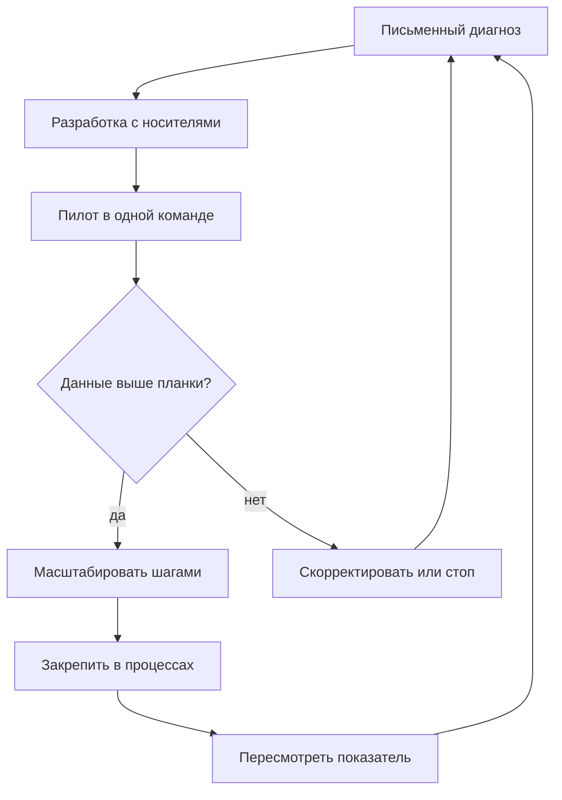
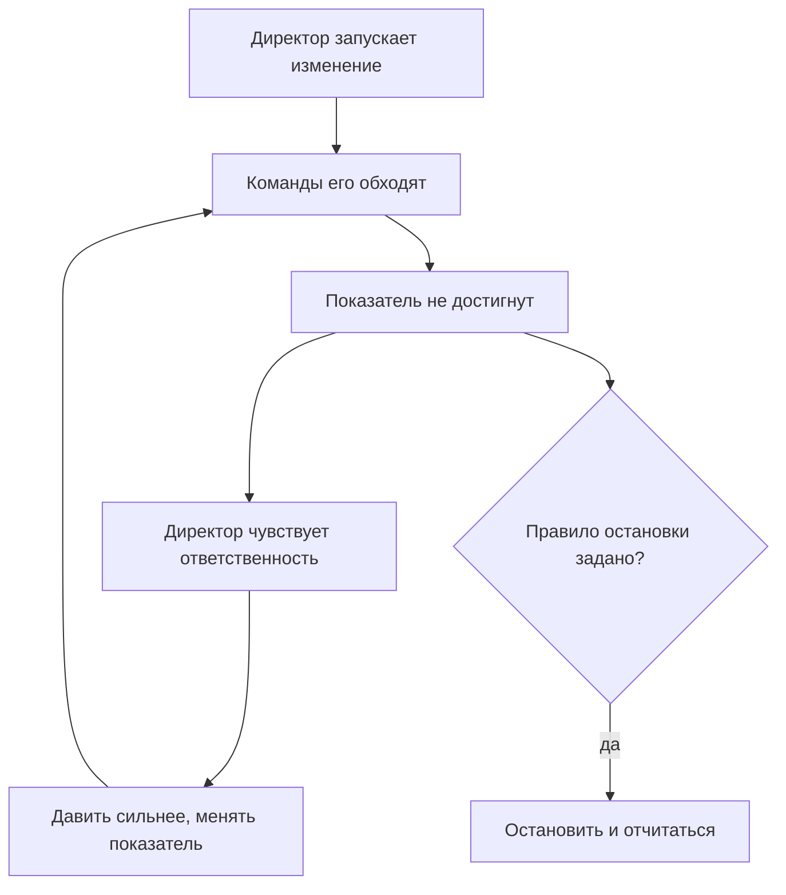
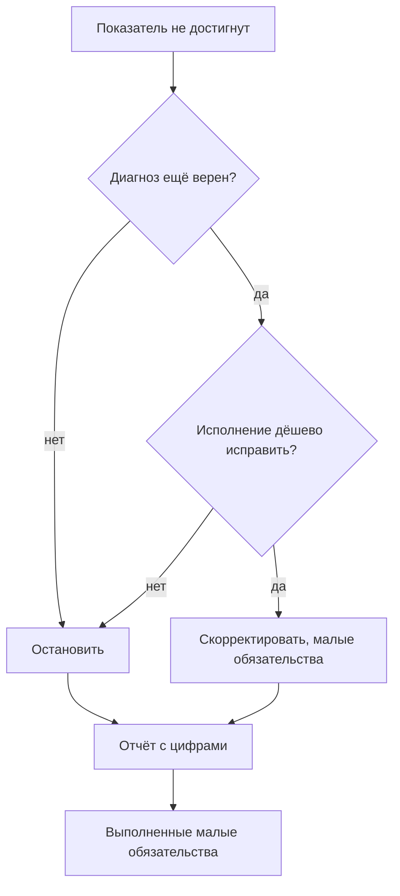

# Глава 43 — Организационные изменения и типичные провалы директоров { #chapter-43-leading-organizational-change-and-director-failure-patterns }

Директор меняет организацию в основном чужими руками: руками шести руководителей, трёх staff-инженеров и
коллег, отвечающих за продуктовую дорожную карту и бюджет. Эта глава о том, как спланировать изменение,
чтобы оно выдержало встречу с этими людьми. В ней разобраны типичные провалы директоров и то, как
заметить их у себя раньше, чем это сделают ваши руководители, а также то, как восстановить доверие, если
инициатива всё-таки провалилась. Сквозной пример — инициатива директора Northstar Technologies,
вымышленной компании из [кейса](../../case-studies/northstar/index.md). В квартале 3 эта инициатива
частично проваливается.

!!! info "Связанные главы"
    Механика реорганизаций разобрана в главе 36, трансформация качества — в главе 27, сопротивление на
    уровне высшего руководства — в главе 57. Эта глава описывает общий метод директора.

## Почему это важно { #why-this-matters }

**В команде** руководитель меняет практику напрямую: команда рядом, и неудачная идея становится видна за
один спринт. Изменения директора доходят до инженеров через руководителей, поэтому директор видит их
поздно, через фильтр и часто уже переделанными.

**В организации** запустить общее изменение директору проще, чем кому-либо, а увидеть, как оно
приживается, — труднее всех. Каждое изменение отнимает внимание руководителей, самый дефицитный ресурс
организации. Если запускать изменения быстрее, чем руководители успевают их усвоить, на встречах директор
получит видимое согласие, а в работе — обходные пути.

**Для высшего руководства** история изменений директора становится его репутацией: CTO (технический
директор), коллеги и инженеры судят о новом предложении по тому, чем кончилось прошлое. Если директор не
может оправиться после одного провала, следующее изменение ему уже не запустить.

## Цели главы { #learning-objectives }

Прочитав эту главу, вы сможете:

- Планировать изменение так, чтобы у него были письменный диагноз, согласие тех, кто будет его нести,
  ранние данные небольшого пилота и закрепление в регулярных процессах организации.
- Распознавать типичные провалы директоров в собственной истории, опираясь на факты, а не на
  представление о себе.
- Решать, продолжать, скорректировать или остановить инициативу, которая не дотягивает до своего
  показателя, и не наращивать при этом приверженность ей.
- Восстанавливать доверие после провалившейся инициативы честным отчётом и небольшими выполненными
  обещаниями.

## Ментальная модель { #the-mental-model }

> **Ментальная модель:** изменение, которое предлагает директор, — гипотеза, и проверяют её руководители
> за счёт собственного времени. Планируйте изменение так, чтобы ошибка обнаружилась рано и дёшево, а те,
> кому его нести, участвовали в разработке. Доверие — это баланс выполненных и нарушенных обещаний.
> Провалившуюся инициативу спасает не то, как её защищают, а то, как её завершают.

Отсюда два следствия. Первое: у каждого изменения должен быть заранее названный признак провала —
показатель, дата и порог, на котором вы останавливаетесь. Изменение, которое нельзя остановить,
превращается в обязательство, и защищать его приходится своей репутацией. Второе: люди, которые несут
изменение (в этой главе они называются носителями), — его соавторы, а не слушатели. Если изменение просто
объявить, руководители станут посыльными. Если разработать его вместе с ними, они станут владельцами и
будут рано сообщать о проблемах.

Любой из этих шагов дешевле изменения, которое организация обходит стороной. Провалы в кейсе начались как
раз с пропущенных шагов.

## Подробный разбор { #deep-conceptual-explanation }

### Что говорят и чего не говорят исследования изменений { #what-the-evidence-on-change-does-and-does-not-say }

Большинство советов об организационных изменениях дают практики. Чаще всего цитируют статью John Kotter
1995 года. Она опирается на его наблюдения за более чем 100 компаниями, которые пытались провести крупные
трансформации ([Kotter, 1995](../../references/bibliography.md#kotter1995leading)). Kotter называет
цепочку ошибок, которые губят такие попытки: слишком слабое ощущение срочности; нет сильной направляющей
коалиции; не запланированы быстрые победы; победу объявляют слишком рано; изменение не закрепляют в
культуре. Это **мнение эксперта**, основанное на долгих наблюдениях, а не исследование с описанным
методом. Пользуйтесь им как чек-листом вопросов, которые стоит продумать, а не как законом с известным
эффектом.

К таким советам часто прилагают статистику: 70 процентов программ изменений проваливаются. Проверки она
не выдерживает. Mark Hughes разобрал пять опубликованных источников этой цифры и ни за одним из них не
нашёл валидных и надёжных эмпирических данных. Он показал, что единую долю провалов трудно даже
определить: изменения неоднозначны и зависят от контекста, разные люди воспринимают их по-разному, а
измеряют их в разные моменты ([Hughes, 2011](../../references/bibliography.md#hughes2011seventy)).
Это **научный результат** о самих данных в изложении аннотации. Не цитируйте эту цифру. Лучше заранее
определите, что будет считаться провалом именно вашего изменения.

Исследования поддерживают более узкий тезис: то, как проводят изменение, — отдельный рычаг, не зависящий
от его содержания. Обзор 79 количественных исследований о реакции людей на организационные изменения
делит её причины на две группы. Первая — условия до изменения: кто его получатели и в каком они
контексте. Вторая — свойства самого изменения: процесс, ощущаемая польза или вред и содержание
([Oreg, Vakola, and Armenakis, 2011](../../references/bibliography.md#oreg2011recipients)). Из аннотации
обзора эта глава берёт только один вывод: на хорошую идею, проведённую плохо, реагируют плохо. К
реорганизациям тот же обзор применяет глава 36.

Близкий довод приводят авторы книги о цифровой трансформации: самое трудное в таких изменениях — люди,
культура и организация, а не технология
([Kane et al., 2019](../../references/bibliography.md#kane2019technology); **мнение эксперта**). Для
директора новый пайплайн или новый формат планирования — лёгкая половина задачи. Приживётся ли изменение,
решают привычки и стимулы руководителей.

### Сначала диагноз, потом рецепт { #diagnosis-before-solution }

Richard Rumelt начинает описание стратегии с диагноза: суждения о том, что на самом деле происходит и
какая часть ситуации критична. За диагнозом следуют направляющая политика и согласованные действия
([Rumelt, 2011](../../references/bibliography.md#rumelt2011good); **мнение эксперта**). В большинстве
провалившихся инициатив директоров первый шаг пропущен. Они начинаются с рецепта, который директор видел
в деле где-то ещё («дни исправлений», «дизайн-ревью для всего», «единый ритм спринтов»), а причину под
него подбирают задним числом.

Рабочий диагноз для организационного изменения умещается на половине страницы и отвечает на четыре
вопроса:

1. Какой результат плох и насколько, в цифрах? («Работа над долгом буксует» — это не цифра; «ни одна
   оценённая запись реестра не сдвинулась за шесть недель» — цифра.)
2. Какой механизм его порождает? Ресурс, владение, навык, стимул, информация или решение, которое никто
   не может принять.
3. Какие данные показали бы, что механизм другой?
4. Кто уже видит эту проблему и в чём, по его мнению, её причина?

Чаще всего директора ошибаются во втором вопросе. Проще всего поверить, что механизм — ресурс: ведь
ресурсом распоряжается сам директор. Но многие проблемы качества — это проблемы владения: работа требует,
чтобы один человек вёл её неделями, а свободные часы этого не дают.

### Носители: кто понесёт изменение { #the-carriers-who-has-to-carry-it }

Группу, которая продвигает изменение, Kotter называет «направляющей коалицией». У директора эта группа
вполне конкретна, и в этой главе её участники называются носителями. Это руководители, чьи команды будут
делать работу, staff-инженер, чьего домена касается изменение, и коллега, чьи планы оно меняет (обычно
руководитель продукта). Влияние на коллег разобрано в главе 42, а этот раздел — о руководителях.

Нести изменение — не то же самое, что согласиться с ним на встрече. Это значит, что руководители уже
внесли правки в его проект. Проверка простая: можете ли вы назвать в плане хотя бы один пункт, который
появился там из-за возражения руководителя? Если нет, у вас слушатели. Слушатели докладывают, что всё
выполняется, а несогласие выражают обходными путями.

Туда же указывает довод Patrick Lencioni: здоровье организации держится на сплочённой команде
руководителей. Такая команда создаёт ясность, многократно её доносит и закрепляет через кадровые системы
организации ([Lencioni, 2012](../../references/bibliography.md#lencioni2012advantage); **мнение
эксперта**). У директора эта команда собирается на встрече команды руководителей (глава 37). Если
изменение решили не там, шесть руководителей объяснят его шести командам по-разному.

### Ранние данные: пилоты и малые победы { #early-evidence-pilots-and-small-wins }

Karl Weick утверждал, что большие проблемы становятся решаемыми, если представить их как серию небольших,
конкретных, доведённых до конца результатов. Каждый из них меняет представление о том, что возможно
дальше ([Weick, 1984](../../references/bibliography.md#weick1984small)). Michael Watkins формулирует ту
же мысль применительно к новому руководителю: ранние победы дают ему доверие, без которого не провести
более крупные изменения ([Watkins, 2003](../../references/bibliography.md#watkins2003first)). Оба
довода — **мнение эксперта**.

На практике это пилот: одна команда, заданный срок, показатель, выбранный до старта, и пороги, при
которых пилот масштабируют, корректируют или останавливают. Пилот выявляет столкновения с реальными
календарями (закрытие периода, срок месячной отчётности у финансов, даты релизов, дежурства), и платит за
это время одна команда, а не все. Остановить его можно без публичного разворота. Показателем пилота
должен быть результат, который предсказывает диагноз («закрытые записи реестра»), а не активность
(«сколько инженеров приняли участие»).

### Закрепление: сделать новое обычным порядком работы { #reinforcement-making-it-the-way-work-is-done }

Изменение, которое держится на внимании директора, заканчивается, как только внимание переключается.
Закрепить изменение — значит перенести его в регулярные процессы, которые идут без директора: шаблон
планирования, модель ресурсов, повестку обзоров, свидетельства для повышения, чек-лист онбординга. Именно
это Kotter и называет закреплением в культуре. Проверка: если бы вас не было квартал, продолжалось бы
изменение? Ритмы, в которых живут такие процессы, описаны в главе 37.

Изменение нужно объяснять не только руководителям, но и инженерам (**рекомендация книги**). Несут его
руководители, но от директора инженеры слышат формулировку один раз, а от своего руководителя — много
раз, поэтому оба должны говорить одно и то же. Напишите инженерам о трёх вещах: в чём проблема и как она
выглядит в цифрах, что меняется для них в этом месяце и как возразить. Затем слушайте, причём несколькими
способами. Пульс-опрос подсчитывает реакции, а групповые встречи через уровень и отдельный канал для
вопросов объясняют их. Расскажите, что вы услышали и что из-за этого изменилось. Когда инженеры видят,
что их возражение изменило проект, они перестают обходить следующее изменение стороной.

### Типичные провалы директоров { #director-failure-patterns }

Перечень ниже — **рекомендация книги**: синтез источников выше и типичных провалов из предыдущих глав.
Это ловушки роли, а не недостатки характера, и у большинства директоров встречается сразу несколько.
Перечень нужен, чтобы искать их в собственной истории.

| Провал | Как выглядит | Что искать у себя |
|---|---|---|
| Изменение через объявление | Руководители узнают об изменении вместе со своими командами | Посчитайте изменения, в проект которых руководитель внёс правку до запуска |
| Перегрузка инициативами | Изменений в работе больше, чем руководители могут усвоить | Составьте список открытых инициатив на каждого руководителя; попросите каждого их ранжировать |
| Рецепт до диагноза | Любимая практика ищет себе проблему | Можете ли вы назвать механизм и то, что его опровергло бы? |
| Соскальзывание на уровень ниже | Директор делает работу руководителя или staff-инженера | Решения, которые вы приняли в чужой области ответственности |
| Вакуум решений | У межкомандных решений нет названного решающего | Споры, которые ждали дольше двух недель |
| Инфляция обещаний | Обязательства появляются быстрее, чем выполняются | Ваш список обязательств: выполнено, сдвинулось, тихо брошено |
| Эскалация приверженности | Защита проваливающейся инициативы, потому что она ваша | Показатели, переопределённые после запуска; тихо выданные исключения |
| Изоляция от сигналов | О проблемах директор узнаёт только из сводок | Проблемы, о которых вы впервые услышали от коллеги или клиента |

Эскалация приверженности заслуживает отдельного пояснения. Название выбрано намеренно: в остальной книге
просто «эскалация» означает передачу решения наверх, тому, у кого есть полномочия (глава 39), и это
здоровая практика. Здесь речь о другом. Barry Staw ввёл понятие эскалации приверженности (escalation of
commitment) — склонности всё больше вкладываться в проваливающийся курс, выбранный самим человеком
([Staw, 1976](../../references/bibliography.md#staw1976knee)). Инициативы директора публичны и личны.
Защищают от этой ловушки две вещи: правило остановки, заданное до запуска, и другой человек, которому
поручено сказать, что условие выполнено.

Петля слева — эскалация приверженности: каждый промах повышает личную ставку директора, от нажима команды
обходят изменение ещё старательнее, и за этим следует новый промах. Выход из петли — правило остановки,
записанное до запуска.

### Восстановление доверия { #recovering-credibility }

Доверие руководителей копится с каждым выполненным обещанием и тратится с каждым нарушенным, а
провалившаяся инициатива расходует его много и сразу. Из исследований восстановления доверия директор
может взять один вывод. В двух экспериментальных исследованиях доверие восстанавливалось лучше, если за
нарушение, связанное с компетентностью, сторона извинялась, а за нарушение, связанное с честностью,
отрицала вину. Кроме того, извинение помогало больше, когда последующие данные подтверждали вину, а
отрицание — когда они показывали невиновность
([Kim et al., 2004](../../references/bibliography.md#kim2004removing)). Эти исследования касаются
предполагаемого нарушения, а не провалившегося проекта руководителя, поэтому перенос их выводов на
директора — умозаключение этой книги.

Вывод такой. Большинство провалившихся инициатив — провалы компетентности (неверный диагноз, неудачный
запуск), и восстанавливать доверие здесь лучше прямым признанием. Объяснения в духе «команды не
выложились» — это отрицание, и когда данные показывают долю вины директора, оно обходится дороже самого
провала. Честность оказывается под вопросом, когда люди считают, что их ввели в заблуждение: например,
«добровольный» день вдруг оказывается с поимённым учётом. Тогда в отчёте нужно говорить о том, что было
сказано, а не только о том, что было сделано.

Восстановление состоит из четырёх частей: заметно остановить или перестроить инициативу; отчитаться о ней
с цифрами, назвав собственные ошибки; дать несколько обязательств, которые вы точно выполните; и поручить
кому-то другому проверять их выполнение.

## Пример из инженерной организации { #engineering-organization-example }

Цифры в этом примере — **иллюстрация**, они не из Northstar. У директора 110 инженеров в 12 командах под
началом 9 руководителей. В начале квартала он выписывает все общие изменения, которые сейчас в работе.

| Инициатива | Затронуто команд | Часов руководителя в неделю, оценка | Кто запустил |
|---|---|---|---|
| Новая шкала серьёзности инцидентов | 12 | по 1.0 | Директор |
| Шаблон квартального планирования | 12 | по 1.5 | Директор |
| Дизайн-ревью для межкомандных изменений | 8 | по 1.0 | Директор |
| Переписывание карьерной лестницы | 12 | по 1.0 | Директор и HR |
| Изменение оплаты дежурств | 6 | по 0.5 | HR |

Допущение: из 45-часовой рабочей недели руководителя около 85 процентов уже занято людьми, поставкой и
технической работой, так что запас — около 7 часов. Руководитель, которого затрагивают все пять
изменений, тратит на них 5 часов в неделю, то есть около 70 процентов запаса. Шестое изменение ещё на
1,5 часа поднимает загрузку запаса выше 90 процентов, и на случай инцидента или чьего-то ухода почти
ничего не остаётся.

По отдельности каждая инициатива в списке выглядит небольшой, поэтому общую нагрузку видно, только если
её сложить. Прежде чем добавлять изменение, сложите нагрузку на каждого руководителя и попросите
руководителей ранжировать инициативы. Если большинство ставит одну из них на последнее место, её либо
плохо объяснили, либо она не стоит своих часов. В этом примере трое руководителей поставили дизайн-ревью
на последнее место: оно дублировало ревью, которые они уже проводили со staff-инженерами. Этот довод
изменил устройство дизайн-ревью.

## Как принимать решение { #decision-framework }

Пользуйтесь этой схемой дважды: перед запуском изменения и тогда, когда запущенное изменение не
дотягивает до своего показателя.

| Вопрос перед запуском | Если ответ «нет» |
|---|---|
| Есть ли письменный диагноз с механизмом и опровергающей проверкой? | Сначала диагноз; не запускайте |
| Изменила ли в проекте что-нибудь хотя бы половина затронутых руководителей? | Проведите сессию по разработке, а не объявление |
| Есть ли пилот с показателем и порогом, заданными заранее? | Сначала пилот в одной команде |
| Помещается ли изменение в оставшийся у руководителей запас на изменения? | Сначала остановите или завершите что-то другое |
| Есть ли названный человек, который скажет вам, что условие остановки выполнено? | Назовите его; лучше всего руководителя |

Варианта «продолжать без изменений» в схеме нет, и это намеренно. Если честно заданный показатель не
достигнут, что-то должно измениться. «Продолжать без изменений» — это и есть эскалация приверженности,
как она выглядит изнутри.

## Компромиссы { #trade-offs }

**Носители или скорость.** Разработка вместе с руководителями занимает недели, объявление — одну встречу.
Обычно эти недели обходятся дешевле квартала обходных путей, но не всегда. Изменение в области безопасности
с жёстким сроком (например, сроки устранения уязвимостей из главы 26) можно ввести
директивно и объяснить потом. Директивный путь оставьте для изменений, у которых стоимость задержки
реальна и названа вслух.

**Пилот или справедливость.** Пилот ставит одну команду в особое положение, и остальные могут воспринять
это как фаворитизм. Берите команду-добровольца и объясняйте выбор.

**Остановка или упорство.** Некоторые ценные изменения поначалу выглядят плохо: новая практика ревью
сначала замедляет мёржи и лишь потом сокращает число инцидентов. Слишком жёсткое правило остановки такие
изменения убивает. Задавайте порог по результату, который предсказывает диагноз, ставьте контрольную
точку достаточно поздно, чтобы этот результат успел проявиться, и заранее говорите, каких ранних издержек
ожидаете.

**Признание провала или авторитет.** Директора боятся, что, признав ошибку, они ослабят свои позиции. Но
данные о восстановлении доверия после провалов компетентности говорят об обратном, к тому же руководители
и так знают, что инициатива провалилась. Настоящая цена признания — более острые вопросы к следующему
предложению, и это справедливая цена.

**Стоимость перехода.** Остановка изменения тоже отнимает у руководителей внимание, а два разворота за
квартал обходятся дороже любого из изменений. Если останавливаете, останавливайте один раз и говорите,
что придёт на смену.

## Типичные провалы { #failure-modes }

**Запуск, который никто не обсуждал.** Руководители узнают об изменении вместе со своими командами. Как
заметить: руководители спрашивают об организационных деталях, а не о том, нужно ли это вообще, а потом
пересказывают изменение каждый по-своему.

**Тихие исключения.** Руководители не возражают, а выдают исключения. Каждое по отдельности разумно, но
вместе они растворяют изменение. Как заметить: участие падает, хотя ни один руководитель не высказал
опасений.

**Показатель активности.** Посещаемость или число начатых задач подменяют результат, и инженеры закрывают
такой показатель самой лёгкой работой. Как заметить: выпуск смещается к задачам меньше чем на день.

**Переопределённая цель.** После промаха успех определяют заново. Это самая частая маскировка эскалации
приверженности. Как заметить: показатели в презентации к обзору не совпадают с показателями из
презентации запуска.

**Тихое завершение.** Инициативу так и не закрывают официально, и инженеры усваивают, что инициативы
директора можно переждать. Как заметить: директор перестаёт о ней спрашивать.

**Чрезмерное покаяние.** Самокритика без цифр и следующего шага напрашивается у руководителей на
утешение, а плана им не даёт. Как заметить: о чувствах в записке написано больше, чем о том, что
меняется.

## Применение в крупной организации { #enterprise-application }

В организации из 50–150 инженеров изменить практику для всей организации обычно может только директор, и
он же дальше всех от того места, где изменение должно прижиться. Справиться с этим помогают четыре
практики:

- Реестр изменений: все изменения в работе, и для каждого — владелец, затронутые руководители, недельная
  нагрузка на руководителя, показатель, следующая контрольная точка и правило остановки. Реестр раз в
  месяц просматривают на встрече команды руководителей (глава 37). Если суммарная нагрузка высока, ничего
  нового не добавляют, пока что-то не завершится или не будет остановлено.
- Встреча команды руководителей как место, где принимают решения об изменениях практик, по письменным
  предложениям, разосланным заранее. Изменение, принятое там, объясняют шесть человек, согласных между собой.
- Пилоты по умолчанию. В такой организации команд достаточно много, чтобы пилот был показательным, и
  достаточно мало, чтобы успешный пилот можно было масштабировать за квартал.
- Список обязательств: всё, что вы пообещали, с датами; раз в квартал вы просматриваете его с одним из
  руководителей. Это самый простой способ заметить инфляцию обещаний.

## Взгляд CTO { #cto-perspective }

У CTO те же провалы повторяются уровнем выше: инициативы объявляют директорам, изменения от нескольких
директоров ложатся на одних и тех же руководителей, а любимая практика CTO ищет себе проблему. Особый
риск в том, что директора не могут сказать «нет» и редко сообщают, что инициатива высшего руководства
проваливается. Поэтому CTO тоже нужны правила остановки и независимые сигналы.

Кроме того, CTO оценивает директоров по тому, как они справляются с провалами. Если директор
останавливает проваливающуюся инициативу и ясно отчитывается о ней, он показывает умение судить, нужное
на следующем уровне. Если у директора нет ни одного провала, то он либо вообще не рискует, либо о
провалах не сообщает. После провала CTO полезно спрашивать о диагнозе и правиле остановки, а не искать
виноватых. Сопротивление на уровне высшего руководства разобрано в главе 57.

## Практический плейбук { #practical-playbook }

1. Напишите диагноз на полстраницы, прежде чем что-либо предлагать.
2. Приносите на встречу команды руководителей диагноз, а не рецепт, и просите оспорить механизм.
3. Разработайте изменение вместе с затронутыми руководителями; запишите хотя бы одну правку проекта,
   которая появилась из-за возражения.
4. Сложите нагрузку от изменений на каждого руководителя. Если новое изменение превышает чей-то запас,
   сначала завершите или остановите что-то другое.
5. Проведите пилот с одной командой-добровольцем; показатель, контрольную точку и пороги задайте до
   старта.
6. Назовите человека, лучше всего руководителя, который скажет вам, что условие остановки выполнено.
7. До запуска согласуйте с руководителем продукта, сколько ресурса заберёт изменение.
8. На каждой контрольной точке пользуйтесь схемой решения. Не переопределяйте показатель.
9. Если масштабируете, перенесите изменение в регулярные процессы: шаблон планирования, модель ресурсов,
   повестку обзоров.
10. Если останавливаете, напишите отчёт на одну страницу с цифрами и собственными ошибками. Сначала
    обсудите его с руководителями, затем опубликуйте. Новых обязательств — не больше двух, и только
    небольшие.
11. Каждый квартал просматривайте свой список обязательств с одним из руководителей и проверяйте себя на
    типичные провалы.

## Кейс { #case-study }

!!! info "Northstar: что уже известно"
    Неделя 27, начало квартала 3. Число инцидентов [Sev1 и Sev2](../../glossary.md#severity-sev1-sev2-sev3)
    (два самых серьёзных уровня) упало с 30 в исходном квартале до 21 в квартале 1 и 17 в квартале 2, а
    оба [обязательства по продлению](../../glossary.md#renewal-commitments) выполнены к неделе 26. План
    квартала 3 сокращает профилактику с 12 до 8 FTE. См.
    [хронологию](../../case-studies/northstar/timeline.md). Впервые читаете о Northstar? Прочитайте
    [«Год вкратце»](../../case-studies/northstar/year-in-brief.md) и
    [действующих лиц](../../case-studies/northstar/cast.md).

Описанные ниже события квартала 3 в Northstar — **иллюстрация** и вымысел. Квартал 3 начинается на
неделе 27.

**Запуск.** По прогнозу главы 27 выделение на профилактику (ресурс, зарезервированный под работу, которая
предотвращает сбои) в квартале 3 сокращается с 12 до 8 [FTE](../../glossary.md#fte) (полных ставок).
Директор опасался, что работа над долгом и здоровьем тестов забуксует, и на неделе 27 объявил на общем
собрании разработки «Engineering Excellence Day». Одну пятницу из каждых четырёх (недели 28, 32 и 36) все
80 инженеров должны были отложить работу по дорожной карте и выбрать задачу из списка долга своей
команды, из списка владельцев нестабильных тестов или из давно висящих предупреждений сборки Core.
Правила: никаких встреч, результаты публикуются в понедельник, дежурные инженеры освобождаются. Директор
обсудил идею с Kwame Mensah (staff-инженер, надёжность), а шесть руководителей и Amara Okafor (CPO,
директор по продукту) услышали о ней уже на общем собрании. Показателя успеха никто не назвал.

Плановая стоимость: 240 инженеро-дней (3 дня × 80 инженеров), то есть 48 инженеро-недель, или около
3,7 FTE за 13-недельный квартал, сверх выделенных 8 FTE.

**Что произошло.**

| День | Неделя | Инженеров, записавших задачу | Начато задач | Смёржено задач |
|---|---|---|---|---|
| 1 | 28 | 64 из 80 | 62 | 39 |
| 2 | 32 | 41 | 36 | 22 |
| 3 | 36 | 23 | 20 | 10 |
| Итого | | 128 инженеро-дней | 118 | 71 |

Итого 128 инженеро-дней, то есть около 25,6 инженеро-недели — половина от запланированных 48.

Из 71 смёрженной задачи 52 заняли меньше дня (предупреждения сборки, документация, мелкий рефакторинг), 9
исправляли нестабильные тесты, ещё 10 добавляли тесты. Ни одна задача не коснулась оценённых записей
реестра долга из [главы 21](../05-engineering-quality/21-technical-debt.md): каждой такой записи нужен
владелец больше чем на день. Рефакторинг core/scheduler, смёрженный в первый день, задержал плановый
прогон выставления счетов в следующий понедельник примерно на три часа; неверных записей не появилось.
Инцидент оценили как Sev3, и еженедельный аудит серьёзности эту оценку подтвердил. На неделе 29
руководители ссылались на этот случай.

Второй день совпал с поддержкой закрытия периода в Billing и с отчётностью на конец месяца в Data and
Analytics. За два дня до него Marcus Oyelaran (руководитель Billing) и Farah Haddad (руководитель Data
and Analytics) освободили от участия свои команды — 26 инженеров. Из остальных 54 около 5 дежурили, а 8
по просьбе продакт-менеджера доделывали работу спринта; осталось 41. К третьему дню формальных исключений
уже не выдавали: продакт-менеджеры просили команды защитить цели спринта, и руководители не возражали.
Анонимный пульс-опрос из трёх вопросов на неделе 37 собрал 52 ответа: оставить как есть — 11, дать
командам самим выбирать время — 29, прекратить — 12.

**Диагноз провала.** Если пройти по петле, картина такая. Диагноз гласил, что не хватает ресурса, но
записям реестра нужны были владельцы на недели, а один день раз в четыре недели этого не даёт.
Руководители не были носителями, поэтому их возражения приняли форму исключений. Пилота не было, поэтому
на столкновение с закрытием периода наткнулись сразу две команды целиком. Показателя не было, поэтому
инженеры выбирали самую лёгкую работу. Инициатива провалилась частично: 71 мелкое улучшение, 9
исправленных нестабильных тестов и урок о том, что от мандата директора можно отделаться исключениями.

**Восстановление.** На неделе 37 директор принёс записку на одну страницу на еженедельную встречу команды
руководителей, а затем опубликовал её для всей разработки. В записке говорилось, что было задумано,
приводились цифры выше и четыре ошибки, которые директор признал своими: диагноз «не хватает ресурса»
там, где проблема была в основном во владении; запуск без руководителей; дата, выбранная без сверки с
закрытием периода; и полное отсутствие показателя успеха. Записка отменяла общий для всей организации
день и разрешала командам самим планировать время на исправления в пределах своего выделения на
профилактику (этот вариант выбрали 29 из 52 ответивших). Кроме того, в ней было два обязательства.
Первое: следующее изменение практики для всей организации будет согласовано на встрече команды
руководителей и сначала пройдёт пилот в одной команде. Второе: каждый квартал один из руководителей будет
просматривать список обязательств директора. Получат ли записи реестра выделенных владельцев при
планировании квартала 4, пока не решено.

**Самооценка директора.** Записка подтолкнула директора проверить по
[хронике года 1](../../case-studies/northstar/first-quarter.md), какие типичные провалы были в
кварталах 1 и 2.

| Провал | Факты за кварталы 1 и 2 | Вывод |
|---|---|---|
| Перегрузка инициативами | Около 40 решений и открытых вопросов легли на шестерых руководителей за два квартала; у двух руководителей на неделе 10 прибавилось по два подчинённых | Есть; нагрузку на каждого руководителя никто не суммировал |
| Инфляция обещаний | Проверка релиза, обещанная после двойного применения кредит-нот, сдвинулась на четыре недели, и в этот пробел попал Sev1 | Был один раз, с заметной ценой |
| Вакуум решений | Два межкомандных решения ([запись архитектурного решения](../../glossary.md#architecture-decision-record-adr) и владелец общего модуля) открыты, решающего нет | Есть риск |
| Изменение через объявление | Квартал 3: Excellence Day | Есть |
| Соскальзывание на уровень ниже | Директор переоценил серьёзность одного инцидента и добавил еженедельный выборочный аудит | Под контролем: проверка оценок — собственный источник сигналов директора |
| Изоляция от сигналов | Аудит серьёзности и показатели Дня 90 — собственные сигналы директора | Не замечено |
| Эскалация приверженности | Директор завершил Excellence Day после одного пульс-опроса, а не стал переопределять показатель | На этот раз не замечено |

Выводы — суждение самого директора: факты выбирал и вердикт выносил один и тот же человек. Поэтому
проверкой служит просмотр списка обязательств руководителем.

## Упражнения { #exercises }

Разборы упражнений: [решения к главе 43](../../solutions/ch43-solutions.md). Данные Northstar — на
[странице исходного уровня](../../case-studies/northstar/baseline-data.md) и в
[хронике года 1](../../case-studies/northstar/first-quarter.md).

### Базовый уровень { #foundational }

**F1.** Директор предлагает единый двухнедельный ритм спринтов для всех шести команд Northstar, «чтобы
планирование и отчётность были единообразными». Сейчас Payments and Integrations работает по Kanban с
лимитами WIP, у Data and Analytics нет определённого метода, Platform Operations живёт с ротацией на
прерываниях, а Orders и Billing уже работают по двухнедельному Scrum, синхронизированному с
[релизным поездом](../../glossary.md#release-train) (фиксированным графиком релизов Core). В исходном
квартале 8 из 10 сорванных пунктов дорожной карты были межкомандными; медианный lead time составлял
11 дней для задач без зависимостей и 41 день для задач с двумя и более зависимостями; один инженер тратил
около двух дней в месяц на ручной сбор цифр поставки (страница исходного уровня, раздел «Планирование и
поставка»). Напишите на полстраницы диагноз, которого не хватает предложению: результат в цифрах,
возможный механизм, данные, которые его опровергли бы, и кто уже видит проблему. Затем скажите,
поддерживает ли диагноз это предложение.

**F2.** Коллега говорит вам: «70 процентов программ изменений проваливаются, поэтому давайте сделаем это
изменение небольшим». Другой утверждает, что эта цифра доказывает: без консультантов по управлению
изменениями не обойтись. Объясните, что не так в обоих способах использовать цифру и что бы вы определили
вместо неё, прежде чем запускать своё изменение в Northstar.

**F3.** Возьмите таблицу типичных провалов и оцените по трём из них директора, с которым вы работали (или
себя). Для каждого провала приведите один наблюдаемый факт «за» и один «против» и скажите, какие ещё
данные решили бы вопрос. Не используйте прилагательных, описывающих характер.

### Прикладное лидерство { #applied-leadership }

**A1.** Идёт неделя 38. Спланируйте замысел Excellence Day заново, на этот раз по петле из этой главы:
диагноз того, почему оценённые записи реестра не двигаются; носители, с которыми вы бы разрабатывали
изменение; пилот с показателем и порогами; и то, как изменение будет закреплено, если пилот удастся.
Уложитесь в выделение на профилактику — 8 FTE.

**A2.** Набросайте записку руководителям для недели 37, меньше 400 слов. В ней должны быть цифры,
собственные ошибки директора, что прекращается и что приходит на смену, а также не больше двух новых
обязательств. Затем приведите два предложения, которые попали бы в более слабый черновик, и объясните,
чем каждое из них подорвало бы доверие.

**A3.** На неделе 40 Marcus Oyelaran говорит вам на встрече один на один (1:1), что руководители
«ожидали, что следующая инициатива тоже провалится» и что двое из них теперь выжидают месяц, прежде чем
браться за ваши объявления. Спланируйте свои действия на следующий квартал: что вы скажете Marcus, что
поменяете в том, как предлагаете изменения, и какие факты покажут, что доверие возвращается.

### Решения на уровне руководства { #executive-decision-making }

**X1.** Victor Lindqvist (CTO) просит у вас короткий письменный отчёт об Excellence Day для совещания с
другими руководителями компании. На этом совещании Amara Okafor уже назвала Excellence Day «потерянной
неделей дорожной карты». Напишите структуру отчёта и его ключевые фразы. Решите, что вы признаёте, что
отстаиваете с цифрами в руках и о чём просите Amara для следующего изменения.

**X2.** Вы CTO более крупной компании и обнаруживаете, что за один квартал три директора запустили
каждый своё изменение практики для всей организации и все три ложатся на одних и тех же 14 руководителей.
Правила остановки нет ни у одного. Сформулируйте правило для изменений, которые запускают директора, в
том числе то, как вы будете замечать проваливающееся изменение, не отбивая у директоров желания о нём
сообщать.

## Вопросы для размышления { #reflection-questions }

1. Какое из ваших изменений было объявлено, а не разработано вместе с носителями, и узнали бы вы, если
   бы его обходили?
2. Когда вы в последний раз останавливали инициативу, которую сами запустили? Если никогда, то неужели
   все они сработали?
3. В каких ваших диагнозах механизмом назван ресурс просто потому, что ресурсом распоряжаетесь вы?
4. Кто сказал бы вам, что ваша инициатива проваливается? Сделали ли вы так, чтобы говорить об этом было
   безопасно и ожидаемо?
5. Когда вы объясняете провал, какая часть объяснения касается того, насколько выкладывались другие?

## Главное { #key-takeaways }

- Пишите диагноз до рецепта, с механизмом и данными, которые бы его опровергли.
- Относитесь к руководителям как к соавторам: они понесут изменение, только если сами его поменяли.
- Проводите пилот в одной команде, с показателем результата и порогами остановки, заданными до старта.
- Прежде чем добавлять изменение, сложите нагрузку от изменений на каждого руководителя: их внимание —
  дефицитный ресурс.
- Измеряйте результаты, а не участие: показатели активности притягивают самую лёгкую работу.
- Задавайте правило остановки заранее и поручайте кому-то другому сказать, что условие выполнено.
- Не цитируйте цифру о 70 процентах провалов: за ней нет валидных данных.
- После провала компетентности восстанавливайте доверие так: признайте провал с цифрами, завершите
  инициативу один раз и публично выполните несколько небольших обещаний.
- Проверяйте себя на типичные провалы по фактам и дайте одному из руководителей проверить эту оценку.

## Источники и что почитать { #references-and-further-reading }

- [Hughes, 2011](../../references/bibliography.md#hughes2011seventy). Почему за цифрой о 70 процентах
  провалов нет валидных данных.
- [Oreg, Vakola, and Armenakis, 2011](../../references/bibliography.md#oreg2011recipients). Обзор реакций
  на изменения; процесс отдельно от содержания.
- [Kim et al., 2004](../../references/bibliography.md#kim2004removing). Экспериментальные данные о
  восстановлении доверия после нарушений, связанных с компетентностью и с честностью.
- [Staw, 1976](../../references/bibliography.md#staw1976knee). Откуда взялось понятие эскалации
  приверженности.
- [Weick, 1984](../../references/bibliography.md#weick1984small). Малые победы как способ сделать большие
  проблемы решаемыми.
- [Kotter, 1995](../../references/bibliography.md#kotter1995leading). Классический рассказ практика о
  том, почему трансформации проваливаются; чек-лист, а не доказательства.
- [Rumelt, 2011](../../references/bibliography.md#rumelt2011good). Диагноз как первый элемент стратегии.
- [Lencioni, 2012](../../references/bibliography.md#lencioni2012advantage). Сплочённая команда
  руководителей и ясность, которую повторяют и закрепляют.
- [Kane et al., 2019](../../references/bibliography.md#kane2019technology). Трансформация как проблема
  людей в большей степени, чем технологий.
- [Watkins, 2003](../../references/bibliography.md#watkins2003first). Ранние победы как основа доверия к
  руководителю.
