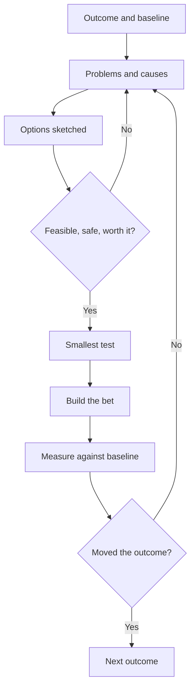
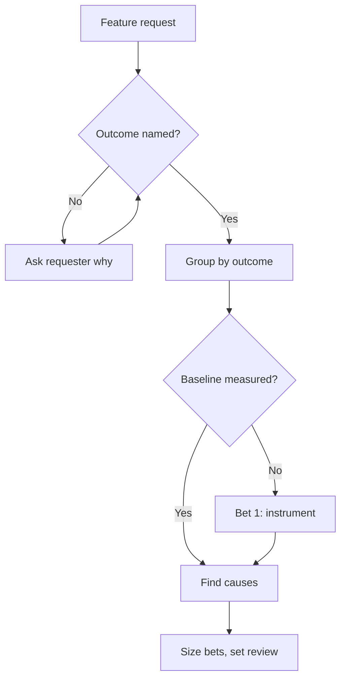
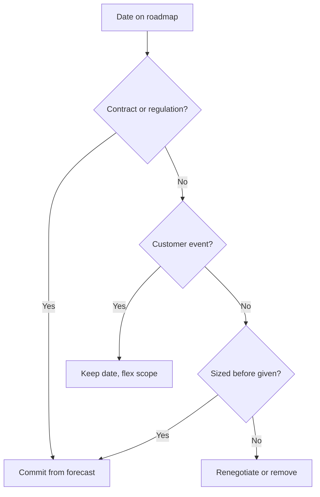

# Chapter 44 — Working with Product: Discovery and Outcome-Based Roadmaps

Most of what an engineering organization builds is decided before an engineer sees it. Engineering's
knowledge of what is cheap, risky, or already broken then arrives too late to change the options, and
its only lever is the estimate, which becomes the argument. This chapter covers what a director owns
with product management: a working contract, engineering's part in discovery, and converting a feature
roadmap into an outcome roadmap, including the dates that survive the conversion. The
running example is the fictional [Northstar Technologies](../../case-studies/northstar/index.md).

## Why This Matters

At team scale, the relationship between an engineering manager and a product manager decides whether
the team solves problems or completes tickets. A team handed finished specifications has no reason to
ask whether they are right, and every reason to defend its estimate.

At organization scale, the cost shows in two places. The roadmap record: Northstar's baseline committed
17 items, delivered 7, and gave customers dates for 5 of them before anyone sized them
([baseline data](../../case-studies/northstar/baseline-data.md)). And waste that looks like a quality
problem: of 212 customer-reported defects that quarter, 27 (13 percent) were "requirement
misunderstood; built as specified". The software did what it was asked; what it was asked was wrong.

At executive scale, the question is which engineering spending changed anything for customers. A
feature roadmap answers "did we ship it"; only an outcome roadmap answers "did it work". A CTO and CPO
who cannot answer that together will each answer it alone, differently.

## Learning Objectives

After this chapter you will be able to:

- Write a working contract between engineering and product management that states decision rights,
  date rules, the quality floor, and how disagreements are settled.
- Place engineers in discovery so that feasibility, cost, and operational risk shape the options
  before one is chosen, at a cost you can state.
- Convert a feature roadmap into an outcome roadmap with a measured baseline, a target, guardrails,
  and bets sized against capacity.
- Classify each date on a roadmap by where it came from, and keep, convert, or remove it accordingly.
- Diagnose the failure modes of outcome roadmaps, including measures that improve while customers
  do not.

Related chapters: Chapter 17 (forecasts and commitments) is the one prerequisite; read it first if
"commit from the cautious end of the forecast" is unfamiliar. Chapters 15, 38, 42, and 45 cover team
planning, quarterly capacity, the cross-team portfolio, and investment economics.

## The Mental Model

> **Mental model:** Product owns the problem and the bet; engineering owns feasibility and the quality
> floor; both own the evidence. A roadmap item is a hypothesis until a measure says otherwise.

Two ideas organize the chapter. First, **engineering's most valuable product contribution is
information that changes the option set**, not the estimate for an option already chosen. An engineer
who sees in production data that a "user error" is a retry bug changes what gets built, but only while
the options are open.

Second, **an outcome roadmap does not remove commitments; it separates them**. Some dates are real (a
contract, a regulation, an event); most are guesses that hardened into promises. Keep the first kind as
sized commitments (Chapter 17) and replace the second with a measure and a review date.

Engineering contributes at three points: causes from production data, feasibility and risk at the
option check, and instrumenting the measure. The common failure is entering only at "Build the bet".

## Deep Conceptual Explanation

### Two functions, one product

In this book's terms, the product manager is accountable for **which problem the company solves next
and whether solving it is worth the money**. The engineering manager is accountable for **how the
team solves it, whether the result is safe to run, and whether the team stays healthy doing it**.
Marty Cagan's work on product discovery treats a product idea as a set of risks: is it valuable,
usable, feasible, and workable for the business? Product, design, and engineering work these risks
together rather than in sequence
([Cagan, 2008](../../references/bibliography.md#cagan2008inspired);
[Cagan and Jones, 2020](../../references/bibliography.md#cagan2020empowered)) (**expert opinion**).

For a director, the useful consequence is that feasibility is not an estimate. It includes whether the
change touches an unowned component, adds load to a [tier 1](../../glossary.md#tier-1) path (one
whose failure stops customers ordering or paying), needs data that does not exist, or can be operated at
all. Those answers often reframe the problem; an estimate given afterwards cannot.

Cagan and Jones later contrast **empowered product teams**, given a problem to solve, with **feature
teams**, given features to ship ([Cagan and Jones, 2020](../../references/bibliography.md#cagan2020empowered)).
Melissa Perri calls the organizational version the **build trap**: measuring output shipped instead of
value created ([Perri, 2018](../../references/bibliography.md#perri2018escaping)). Chapter 15 introduced
Perri's warning; this chapter applies it to the roadmap. Their agreement on outcomes over outputs is
**practitioner consensus**, not a research result.

Gaps between the people who decide and the people who build have measurable costs. Bjarnason, Wnuk,
and Regnell interviewed nine practitioners at one large software company. The communication gaps they
found led to unmet customer expectations, quality issues, and wasted effort
([Bjarnason et al., 2011](../../references/bibliography.md#bjarnason2011requirements))
(**research finding**, one company, interview study). Northstar's 27 "built as specified" defects are
an instance of the effect they describe.

### The working contract

A working contract is a one-page agreement between the director and the head of product (or a manager
and a product manager) on how the two functions decide together. It is not a RACI chart (a grid of who
is responsible, accountable, consulted, and informed; Chapters 13 and 28 cover decision rights) or a
meeting schedule (Chapter 37). It records the few rules
whose absence causes most fights (**this book's recommendation**):

| Clause | What it settles | Typical rule |
|---|---|---|
| Problem and priority | Who ranks the work | Product ranks problems; engineering may add any problem it can price |
| Feasibility and risk | Who may say "not like that" | Engineering names feasibility and operational risk before an option is chosen, in writing |
| Discovery staffing | Who does discovery | An engineer named for each area, with time budgeted |
| External dates | When a date may leave the building | Only after sizing, with a forecast range, and logged |
| Quality floor | What is not traded | Tier 1 minimums, [SLOs](../../glossary.md#sli-slo-and-sla) (reliability objectives), and security service levels are not traded for dates |
| Capacity lines | What product does not schedule | Prevention, platform, and unplanned lines are set in quarterly planning, not reopened per item |
| Measures | Who owns which number | Product owns the outcome measure; engineering owns its instrumentation and guardrails |
| Disagreement | How it ends | The published [escalation path](../../glossary.md#escalation-path), with a written case |
| Review | When the contract changes | Quarterly, with evidence of which clauses were broken |

Two clauses deserve comment. **The quality floor** is engineering's only veto, so keep it narrow
enough to defend; a floor that covers everything is negotiated away item by item (Chapter 46).
**External dates** start most conflicts: a date given before sizing is a commitment made on
engineering's behalf, and Chapter 17 explains why commitments come from the cautious end of a
forecast. The contract makes that rule shared rather than engineering's private complaint.

A contract only engineering wanted will not be honored. Each side must get something: product gets
engineers in discovery and forecasts it can quote; engineering gets a floor and dates after sizing.

### Engineering in discovery

**Discovery** is deciding what to build: understanding a problem, generating options, and testing them
cheaply before committing a team. **Delivery** is building and running the chosen option. Keeping
engineers out of discovery to protect delivery saves a little time now and spends a lot later, because
the options were chosen without the people who could see their cost.

Engineers bring four things product managers usually cannot:

1. **Causes from production data.** Logs, order records, and incident data show why a problem
   happens; the technical cause often changes the remedy.
2. **Feasibility and operational risk.** Whether an option touches an unowned component, a tier 1
   path, or a migration.
3. **Cheaper options.** A smaller change that addresses most of the problem.
4. **Instrumentation.** Without a measured baseline, no one will know whether the bet worked.

A day a week in discovery removes a fifth of an engineer from delivery. The case for paying it is that
discovery is the cheapest place to kill a bad option. Chapter 17's spike and walking skeleton
([retiring risk early](../04-execution/17-predictability-and-managing-uncertainty.md#retiring-risk-early))
retire technical uncertainty inside delivery; discovery retires uncertainty about whether the
delivery is worth doing at all.

### What experiments can and cannot tell you

Confident predictions of a feature's effect are often wrong, in both directions. The strongest
evidence comes from online controlled experiments, where users are randomly assigned to a change or a
control. Kohavi and colleagues describe them as the best design for linking a change to user behavior
([Kohavi et al., 2009](../../references/bibliography.md#kohavi2009controlled)). At Bing, they report,
many ideas moved key metrics by about 1 percent and were poorly estimated in advance, and many features
that stakeholders were excited about turned out to be negative and were not deployed
([Kohavi et al., 2013](../../references/bibliography.md#kohavi2013online)). These are peer-reviewed
**documented practice** from very large consumer web properties, not controlled studies of product
organizations.

The method transfers less well. Northstar has about 1,900 customers, the largest 40 producing a third
of revenue; a business-to-business product rarely has the traffic to detect small effects, and cannot
randomize a contractual feature. Weaker tools remain: staged rollouts behind
[feature flags](../../glossary.md#feature-flag) (Chapter 23 covers deploy versus release), before-and-after comparisons with a stated caveat, customer prototype
sessions, and production data. Say which kind each decision rests on.

Evidence that does not flow back into the roadmap changes nothing. Eric Ries popularized building the
smallest thing that yields evidence ([Ries, 2011](../../references/bibliography.md#ries2011lean))
(**expert opinion**). Fagerholm and colleagues built a model of continuous experimentation and checked
it in two startups. Its requirements include instrumented minimum viable features, managed experiment
plans, and linking results to the product roadmap
([Fagerholm et al., 2017](../../references/bibliography.md#fagerholm2017right)) (**research finding**,
two small companies).

### From feature roadmap to outcome roadmap

A **feature roadmap** lists things to build, usually with dates. An **outcome roadmap** lists changes
in customer or business behavior, each with a measure, and treats features as bets toward them. The
conversion has five steps (**this book's recommendation**):

1. **Group features by problem.** Ask each requester what changes for the customer if it works; the
   same answer means the same outcome.
2. **Measure the baseline.** Without one the measure is a wish, and instrumentation is the first bet.
3. **Pair it with guardrails:** what must not get worse (Chapter 18 covers metric gaming).
4. **Find causes before choosing bets.** Here engineers in discovery pay for themselves.
5. **Size bets against capacity and set a review date.** The commitment is the bets and the review;
   the number is a target in Chapter 17's sense.

### The dates that remain

Some dates are not negotiable, and pretending otherwise destroys trust. Classify them by origin
(**this book's recommendation**):

| Origin | Example | Treatment |
|---|---|---|
| Contractual | A renewal condition, a signed delivery date | Keep. Sized commitment with written scope, from the cautious end of the forecast (Chapter 17) |
| External event | A regulation's effective date, a customer's go-live | Keep the event; flex scope to meet it; agree the minimum scope early |
| Deal | A date a prospect needs for its decision | Keep only if given after sizing; otherwise renegotiate before it hardens |
| Internal guess | "Q4" on a slide | Remove. Replace with a review date and the outcome |

"Where did this date come from?" is a neutral question whose answer usually settles the treatment
without a fight. Chapter 45 adds the economic test: whether the
[cost of delay](../../glossary.md#cost-of-delay) (the value lost per week of waiting) has a deadline
shape.

## Engineering Organization Example

!!! info "Northstar so far"
    Week 40 of the director's first year. [Sev1 and Sev2](../../glossary.md#severity-sev1-sev2-sev3)
    incidents (the two most severe levels) fell from 30 a quarter to 14 in quarter 3, and both renewal features have shipped. In week 39 Orders sized price-list effective dates
    at 14 engineer-weeks, and Greg Tanaka (VP Sales) then gave a customer week 46. See the
    [timeline](../../case-studies/northstar/timeline.md). New to Northstar? Read
    [the year in brief](../../case-studies/northstar/year-in-brief.md), the
    [cast](../../case-studies/northstar/cast.md), and the
    [quarter 4 briefing](../../case-studies/northstar/quarter-4-briefing.md).

This example is **illustrative**: Northstar's ordering area in quarter 4 (weeks 40 to 52). The area
handles about 600,000 order submissions every 28 days.

**The feature list.** The quarter-4 plan gave the ordering area (Orders and Customer Experience's
ordering screens) about 60 [engineer-weeks](../../glossary.md#engineer-week-engineer-day-engineer-year)
for small items. These sit outside the three cross-team initiatives that Chapter 42's portfolio limits.
The candidates:

| # | Feature | Requested by | Estimate (engineer-weeks) |
|---|---|---|---|
| 1 | Duplicate-order warning | Customer Success | 6 |
| 2 | Unit-of-measure display rework, web and mobile | Customer Success | 10 |
| 3 | Order template editor redesign | Product | 18 |
| 4 | Mobile reorder from history | Product | 12 |
| 5 | Bulk-order file preview | Product | 8 |
| 6 | Price-list effective dates (dated, week 46) | Greg Tanaka, for an existing distributor | 14 |

The list totals 68 engineer-weeks against about 60.

**Step 1, grouping.** Items 1, 2, and 6 answer "orders arrive wrong and must be corrected" (outcome A);
items 3 and 4 "repeat orders take too long" (outcome B). Item 5 has no stated problem yet.

**Step 2, baseline.** Data and Analytics defined a corrected order as one cancelled and re-entered,
amended, or credited for an ordering error within 72 hours of submission. Last 28 days of quarter 3:
7,800, or 1.3 percent of 600,000.

**Step 4, causes.** An Orders senior engineer and an Orders quality engineer reviewed a random sample
of 400 corrections with Keiko Ashworth, the area's product manager (about 2 engineer-weeks). Sixty were
customers changing their minds and 340 were errors. The ordering-error rate is therefore about 1.1
percent, about 6,630 orders per 28 days. The 340 errors:

| Cause | Count | Share | Engineering finding |
|---|---|---|---|
| Price differs from what the buyer saw | 130 | 38% | 96 occurred when a price list changed between drafting and submitting; the cart showed draft-time prices |
| Wrong unit of measure | 85 | 25% | 64 on mobile, which does not show pack size next to quantity |
| Duplicate submission | 70 | 21% | 58 were mobile retries after a timeout; order submission has no idempotency key (a unique token that lets the server ignore a repeated request) |
| Wrong delivery site | 35 | 10% | No technical cause found |
| Other | 20 | 6% | Mixed |

The findings changed the bets. The duplicate-order warning (6 engineer-weeks) would have interrupted
legitimate repeat orders and missed the main cause; an idempotency key on submission (about 4) removes
the retries. The two-client unit rework (10) became a mobile pack-size display (about 3). Repricing at
submission, showing the difference before the buyer confirms (about 5), addresses the 96 drafts. But
it adds a pricing-svc call to a tier 1 path whose proposed latency objective is 99 percent within 2
seconds. A 1-engineer-week spike (a short, time-boxed experiment) measures the cost first.

**Step 5, sizing and target.**

| Line | Engineer-weeks |
|---|---|
| Outcome A bets: idempotency 4, latency spike 1, repricing 5, mobile pack size 3 | 13 |
| Dated commitment: price-list effective dates | 14 |
| Outcome B: instrument repeat ordering, then discovery | 2 |
| Outcome B bets, released only if discovery supports them (items 3 and 4) | 30 |
| **Total** | **59** |
| Later: bulk-order file preview, pending data on rejected files | 8 |

If every bet works as hoped, they remove 46 percent of errors and take the rate from about 1.1 to
about 0.6 percent:

| Bet | Errors it addresses | Assumed effect | Errors removed |
|---|---|---|---|
| Idempotency key | 58 retry duplicates | Most | 52 |
| Repricing at submission | 96 stale prices | 70 percent | 67 |
| Mobile pack-size display | 64 mobile unit errors | 60 percent | 38 |
| **All three** | | | **157 of 340** |

Predictions like this are often wrong, so the target is 0.8 percent by week 52, reviewed in week 46.
The margin is 1 engineer-week; outcome B's 30 are the release valve if anything grows.

**Step 3, guardrails (set with the target).** Order latency within its objective, order volume per
distributor, and carts abandoned at the repricing prompt. A prompt that makes buyers give up would
lower corrections by losing orders.

## Decision Framework

Use the table to decide how a roadmap item should be held (**this book's recommendation**).

| Situation | Hold it as | Who decides | Evidence needed |
|---|---|---|---|
| Contractual or regulatory date | Commitment with written scope | Director and head of product | Forecast range, scope, quality floor check |
| Deal date given after sizing | Commitment | Head of product, with sales | Forecast, deal value (Chapter 45) |
| Deal date given before sizing | Renegotiate within a week | Head of product, with sales and director | Forecast; what the customer actually needs |
| Clear problem, known cause, cheap fix | Bet, built directly | Product manager and engineering manager | Baseline and guardrail |
| Clear problem, unknown cause | Discovery first, time-boxed | Product manager with a named engineer | Data sample, customer sessions |
| Feature with no stated problem | Ask "what changes for the customer"; park until answered | Product manager | None yet |
| Engineering-originated (debt, reliability) | Bet with a priced outcome | Engineering manager | Cost now, cost avoided (Chapter 21) |

## Trade-offs

**Discovery time against delivery capacity.** A named engineer spending a day a week per product area
costs about 0.2 [FTE](../../glossary.md#fte) (full-time equivalent engineers); across three areas, 0.6 FTE, three-quarters of a percent of 80 engineers. The cost
is visible and the benefit counterfactual, so it is cut first under pressure. Budget it as a line.

**Outcomes against predictability.** An outcome roadmap tells customers less about what they will get
and when, and executives who report "roadmap items delivered" lose their number. A feature roadmap with
honest forecasts is defensible when problems are well understood and the features known to work.

**Fast measures against slow outcomes.** Choosing only outcomes that move within a quarter biases the
roadmap toward small fixes; review slow outcomes less often.

**Engineering voice against product ownership.** A director in discovery can become a second product
manager (Chapter 40 names the same risk). Engineering's job is to change the options with evidence, not
to rank them.

**Contract against relationship.** Written rules can feel like distrust; unwritten ones exist anyway,
inconsistently. Write it together.

## Failure Modes

**Outcome theater.** Features renamed as outcomes ("improve ordering experience"), with no baseline and
the same list underneath. Signal: every outcome maps to exactly its old features. Countermeasure:
require a baseline number and at least one bet that was not on the original list.

**The measure that improves while customers do not.** Corrected orders fall because the definition
changed, or because buyers abandon orders instead. Signal: the outcome improves while guardrails or
support contacts worsen. Countermeasure: freeze the definition for the quarter and audit a sample.

**Engineering as estimator only.** Engineers join discovery to size options already chosen. Signal:
discovery notes hold sizes but no findings. Countermeasure: ask which option an engineer's finding changed.

**Discovery without end.** Decisions wait in discovery. Signal: an outcome passes a review with no bet
released. Countermeasure: time-box it and make "nothing worth building" a recorded answer.

**The date that slipped back in.** A sales-call date reappears unsized. Signal: roadmap dates no one
can source. Countermeasure: log each external date, who gave it, and whether it was sized.

**One-sided contract.** The contract protects engineering and gives product nothing. Signal: product
managers never cite it. Countermeasure: check each clause gives each side something, and that
engineering honors its side (discovery staffing, forecasts on time).

## Enterprise Application

With 50 to 150 engineers there are usually three to eight product managers under a head of product,
each paired with one or two teams. The director's contract is with the head of product; managers'
contracts with their product managers add team clauses and must not contradict it.

Three patterns help. **One owner per outcome measure**: two product managers sharing one means neither
owns it. **A named discovery engineer per area**, rotated every quarter or two so the skill spreads.
**Outcome reviews inside the existing cadence** (Chapter 37), not a new meeting.

An outcome that needs a cross-team bet competes for a portfolio slot (Chapter 42) like anything else;
the outcome roadmap does not bypass the limit. Outcomes also make the
[unfunded list](../../glossary.md#unfunded-list) (Chapter 38) easier to defend, because each unfunded bet is attached to a problem of known size.

## CTO Perspective

At executive scale the relationship is between the CTO and the chief product officer, and their
contract is the template for every pair beneath them. If they disagree in public about who decides
dates, every product and engineering pair will reenact the disagreement.

The CTO's distinctive contribution is the **board-level story**. Boards are usually shown output
because it is easy to count. A CTO and CPO who move the board to a few outcomes, with commitments listed
separately, change what the company optimizes. The cost: the first quarters of outcome reporting will
show bets that did not work, and the executives must be ready to explain why that is information.

The CTO also sets how much discovery engineering funds, and can make the quality floor company policy
rather than engineering's preference, which lets it survive a large deal.

## Practical Playbook

1. **Read the record.** Count four quarters of roadmap items delivered, missed, and dated before
   sizing, and defects classed as misunderstood requirements.
2. **Draft the contract with the head of product,** not for them; one page, from the clause table.
3. **Name a discovery engineer per product area** and budget the time as a capacity line.
4. **Convert one area first,** where the problem is clear and a measure is cheap to build.
5. **Measure the baseline before choosing bets;** if you cannot, instrumentation is the first bet.
6. **Review a sample of the problem with an engineer present,** looking for causes that change options.
7. **Classify every date by origin** and treat it accordingly.
8. **Publish the outcome** with guardrails, a target, a review date, and sized bets.
9. **Review at the agreed date.** Stop bets that did not move the measure; record what was learned.
10. **Review the contract quarterly** with evidence of which clauses were broken, and by whom.

## Case Study

This case is **fictional**, set in quarter 4 (weeks 40 to 52); none of its decisions has an outcome
yet, and they are yours. It concerns only work outside the three cross-team initiatives.

The people are on the [cast](../../case-studies/northstar/cast.md) page.

**The background.** The quarter-3 list of Amara Okafor, the chief product officer (CPO), held about 62
[FTE-quarters](../../glossary.md#fte-quarter) of estimated effort, 22.6 of them unfunded
([Chapter 38](../08-management-operating-system/38-scorecards-quarterly-planning-and-capacity-allocation.md#engineering-organization-example)).
Her quarter-4 list again exceeded capacity. Her three product managers cover ordering (Keiko Ashworth),
billing and payments, and data and customer reporting. The monthly [board pack](../../glossary.md#board-pack) (the report sent to the board) of Helena Marsh, the CEO,
still carries one engineering delivery number: committed roadmap items delivered.

**Weeks 40 and 41.** Sofia Alvarez (VP Customer Success) forwards a complaint from one of the 40 largest distributors: its
staff spend hours a week correcting orders. Keiko and the director run the conversion described in the
Engineering Organization Example. The director also drafts a working contract from the clause table
and sends it to Amara before her next meeting with the product managers: "Draft for us to change, not
for you to approve."

**Week 42.** Amara's response, in that meeting:

- She accepts named discovery engineers if the time comes out of the product line she already has,
  and asks which line it comes from.
- She accepts "no external date before sizing" only if engineering sizes any deal request within five
  working days; otherwise, she says, sales will give dates anyway.
- She objects to the ordering area's outcome target appearing in place of its items. "Helena reports
  roadmap items delivered to the board. If I replace six items with one percentage, she reports zero
  of six."
- The billing and payments product manager asks whether the
  [customer-detected share](../../glossary.md#customer-detected-share) (incidents customers report
  before Northstar notices), flat at 29 percent in quarters 1 and 2, should become an outcome on her
  roadmap or remain engineering's measure.

**The dated item.** Greg Tanaka gave the distributor week 46 for price-list effective dates after Orders
sized it at 14 engineer-weeks in week 39. It is a deal date given after sizing, so the contract would
keep it as a commitment with written scope. Orders' forecast, starting week 40, puts completion between
week 44 and week 46; the cautious end leaves no margin.

**The reader decides:** what to give Amara on each of her conditions, including which capacity line pays
for discovery; how the ordering area's results should appear in the board pack alongside the roadmap
measure; whether the week 46 commitment needs a scope cut agreed now; and who should own the
customer-detected share.

## Exercises

Solutions are in [chapter 44 solutions](../../solutions/ch44-solutions.md).

### Foundational

**F1.** Northstar's billing and payments product manager brings five candidate items for quarter 4:
automated dunning emails, a payment retry dashboard for distributors, a redesign of the invoice PDF,
a reconciliation exception report, and support for one more card network that Greg Tanaka says a
prospect needs. Group them by outcome, propose a measure and a guardrail for each group, and say which
items carry a date that should survive conversion and why.

**F2.** A product manager tells a new engineering manager: "Product owns what, engineering owns how,
so I'll bring you specifications when they are ready." Using the four product risks, explain what this
division leaves out, describe one concrete Northstar change where an engineer's finding would have
altered what was built, and propose the clause you would add to their team contract.

**F3.** The ordering area's ordering-error rate (corrections for ordering errors, estimated by sample) falls from 1.1 to 0.7 percent by week 48. Name three
ways the measure could have improved without distributors being better off, the guardrail or audit
that would expose each, and what you would ask Data and Analytics to check before the result is reported.

### Applied Leadership

**A1.** It is week 46. The idempotency key shipped in week 43 and duplicates fell as expected, but the
overall ordering-error rate (estimated by sample) has moved only from 1.1 to 1.0 percent. The repricing spike showed the
extra pricing-svc call would push order latency to about 98.6 percent within 2 seconds. Keiko Ashworth
asks whether to drop repricing, fund a cache, or try something else. Decide, and say what evidence you
need first.

**A2.** The billing and payments product manager proposes making the customer-detected share of Sev1
and Sev2 incidents (29 percent in quarters 1 and 2) an outcome on her roadmap, with bets she would rank.
Decide whether the measure belongs on a product roadmap, engineering's scorecard, or both, design the
outcome entry if you accept it, and state who owns the measure and who owns the bets.

**A3.** In week 45, after the contract is agreed, Greg Tanaka tells a prospect it will have purchase
order import "before year end", without sizing. The prospect is worth about $300,000 a year. Plan your
conversations with Greg, Amara, and the prospect's account team, and say what the contract should say
about this happening again without making Greg its enemy.

### Executive Decision-Making

**X1.** You are Victor Lindqvist, the CTO. Helena Marsh wants to keep "committed roadmap items delivered" in the
board pack because the board has seen it for two years. Amara and the director propose replacing it
with three outcomes and a list of dated commitments. Propose what the board pack should show in quarter
4 and quarter 5, how you would explain a quarter in which two of three outcomes do not move, and what
you would not change.

**X2.** Rajiv Menon, the CFO, asks why engineering should fund discovery time under a flat headcount: three named
engineers at a day a week each, about 0.6 FTE. Make the case or decline to, using only evidence you
could collect at Northstar within two quarters, and say what result would make you stop funding it.

## Reflection Questions

1. Which items on your current roadmap could you not connect to a measured customer or business change,
   and why are they still there?
2. When did an engineer last change what your organization built, rather than how or when, and how did
   that information reach the decision?
3. Which dates on your roadmap were given before anyone sized the work, and who gave them?
4. If your product counterpart wrote the working contract alone, which clause would surprise you most?
5. What outcome measure in your organization could improve while customers are worse off?
6. Is your quality floor narrow enough that you would defend every item on it against a large deal?

## Key Takeaways

- Engineering's most valuable product contribution is information that changes the options, delivered
  before one is chosen.
- Write a one-page contract with product: decision rights, date rules, the quality floor, measures,
  and how disagreements end; each clause gives each side something.
- Budget discovery engineers as a capacity line, not goodwill.
- An outcome roadmap needs a baseline, target, guardrails, sized bets, and a review date; without a
  baseline it is renamed features.
- Find causes in production data before choosing bets.
- Classify every date by origin: keep contractual and event dates as sized commitments, renegotiate
  unsized deal dates, remove guesses.
- The bets are the commitment; the outcome number is a target, because predictions of effect are often wrong.
- Say what kind of evidence each decision rests on; business-to-business products rarely allow
  randomized tests.

## References and Further Reading

- [Cagan, 2008](../../references/bibliography.md#cagan2008inspired). *Inspired*: product discovery and
  the engineer's place in it.
- [Cagan and Jones, 2020](../../references/bibliography.md#cagan2020empowered). *Empowered*: product
  teams versus feature teams.
- [Perri, 2018](../../references/bibliography.md#perri2018escaping). *Escaping the Build Trap*: outputs
  versus outcomes.
- [Ries, 2011](../../references/bibliography.md#ries2011lean). *The Lean Startup*: build-measure-learn;
  better suited to new products than mature ones.
- [Kohavi et al., 2009](../../references/bibliography.md#kohavi2009controlled). A practical guide to
  online controlled experiments and their limits.
- [Kohavi et al., 2013](../../references/bibliography.md#kohavi2013online). Experimentation at very
  large scale; read for the organizational challenges.
- [Fagerholm et al., 2017](../../references/bibliography.md#fagerholm2017right). Continuous
  experimentation model; linking results to the roadmap.
- [Bjarnason et al., 2011](../../references/bibliography.md#bjarnason2011requirements). Requirements
  communication gaps and their effects in one company.
