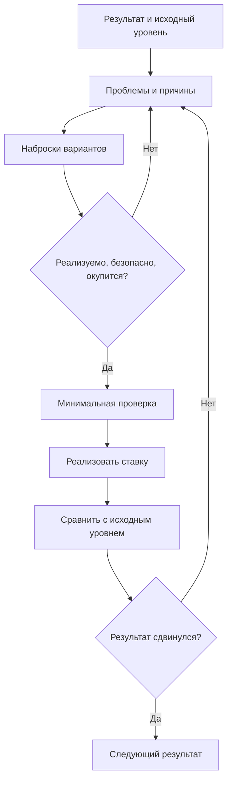
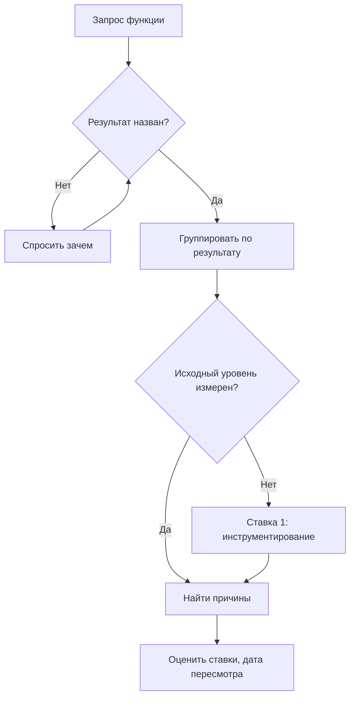
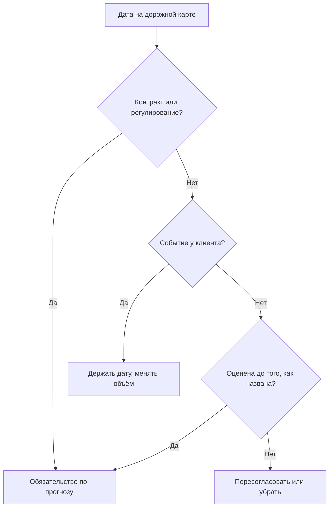

# Глава 44 — Работа с продуктом: discovery и дорожные карты, ориентированные на результат { #chapter-44-working-with-product-discovery-and-outcome-based-roadmaps }

Большую часть того, что строит инженерная организация, решают ещё до того, как это увидит инженер.
Разработка знает, что дёшево, что рискованно и что уже сломано, но это знание приходит слишком поздно,
чтобы повлиять на варианты. Единственным рычагом остаётся оценка трудозатрат, и спор разгорается вокруг
неё. Эта глава о том, за что директор отвечает вместе с продакт-менеджментом: о рабочем договоре, об
участии разработки в discovery и о переводе дорожной карты функций в дорожную карту результатов, в том
числе о датах, которые переживают такой перевод. Сквозной пример — вымышленная компания
[Northstar Technologies](../../case-studies/northstar/index.md).

## Почему это важно { #why-this-matters }

**В команде** от отношений между руководителем разработки (engineering manager, EM) и продакт-менеджером
зависит, решает команда проблемы или закрывает тикеты. У команды, которой вручают готовые спецификации,
нет причин спрашивать, верны ли они, зато есть все причины защищать свою оценку.

**В организации** цена видна в двух местах. Первое — история дорожной карты: в исходном квартале
Northstar пообещала 17 пунктов, выполнила 7 и для 5 из них назвала клиентам даты до того, как кто-либо
оценил объём работы ([исходные данные](../../case-studies/northstar/baseline-data.md)). Второе — потери,
похожие на проблему качества: из 212 дефектов, о которых в том квартале сообщили клиенты, 27
(13 процентов) были помечены как «требование понято неверно; сделано по спецификации». ПО делало то, о
чём просили, но просили не того.

**Для высшего руководства** вопрос в том, какие из расходов на разработку что-то изменили для клиентов.
Дорожная карта функций отвечает на вопрос «выпустили ли мы это?», а на вопрос «сработало ли это?»
отвечает только дорожная карта результатов. Если CTO и CPO не могут ответить на него вместе, каждый
ответит сам, и ответы разойдутся.

## Цели главы { #learning-objectives }

Прочитав эту главу, вы сможете:

- Составить рабочий договор между разработкой и продакт-менеджментом, в котором записаны права на
  решения, правила для дат, нижняя планка качества и порядок разрешения разногласий.
- Включать инженеров в discovery так, чтобы реализуемость, стоимость и операционный риск влияли на
  варианты до выбора одного из них, и знать цену этого участия.
- Переводить дорожную карту функций в дорожную карту результатов с измеренным исходным уровнем, целью,
  ограничителями и ставками, соотнесёнными с ресурсом.
- Определять происхождение каждой даты на дорожной карте и в зависимости от него сохранять, переводить в
  другую форму или убирать её.
- Диагностировать типичные провалы дорожных карт результатов, в том числе показатели, которые улучшаются,
  хотя клиентам лучше не становится.

Связанные главы: обязательна для понимания только глава 17 (прогнозы и обязательства). Прочитайте её
сначала, если формула «обязательство берут по осторожному краю прогноза» вам незнакома. Главы 15, 38, 42
и 45 посвящены соответственно планированию в команде, квартальному распределению ресурсов, межкомандному
портфелю и экономике инвестиций.

## Ментальная модель { #the-mental-model }

> **Ментальная модель:** продукт владеет проблемой и ставкой, разработка — реализуемостью и нижней
> планкой качества, а доказательствами владеют обе стороны. Пункт дорожной карты остаётся гипотезой, пока
> показатель не скажет иное.

Глава держится на двух идеях. Первая: **самый ценный вклад разработки в продукт — информация, которая
меняет набор вариантов**, а не оценка уже выбранного варианта. Если инженер видит в продакшен-данных, что
«ошибка пользователя» на самом деле баг повторных запросов, он меняет то, что будет построено, но только
пока варианты ещё открыты.

Вторая: **дорожная карта результатов не отменяет обязательств, а разделяет их**. Некоторые даты реальны
(контракт, регулирование, событие), но большинство — догадки, которые затвердели и превратились в
обещания. Реальные даты сохраняйте как обязательства с оценкой объёма (глава 17), а догадки замените
показателем и датой пересмотра.

Разработка вносит вклад в трёх точках: находит причины в продакшен-данных, оценивает реализуемость и риск
при проверке вариантов и инструментирует показатель. Типичная ошибка — подключать её только на шаге
«Реализовать ставку».

## Подробный разбор { #deep-conceptual-explanation }

### Две функции, один продукт { #two-functions-one-product }

В этой книге принято такое разделение: продакт-менеджер отвечает за то, **какую проблему компания решает
следующей и стоит ли её решение денег**, а руководитель разработки — за то, **как команда её решает,
безопасно ли эксплуатировать результат и остаётся ли команда при этом здоровой**. Marty Cagan в работах о
продуктовом discovery рассматривает продуктовую идею как набор рисков: ценна ли она, удобна ли в
использовании, реализуема ли и жизнеспособна ли для бизнеса? Продукт, дизайн и разработка прорабатывают
эти риски вместе, а не по очереди ([Cagan, 2008](../../references/bibliography.md#cagan2008inspired);
[Cagan and Jones, 2020](../../references/bibliography.md#cagan2020empowered)) (**мнение эксперта**).

Для директора отсюда следует полезный вывод: реализуемость — это не оценка трудозатрат. В неё входят
вопросы: задевает ли изменение компонент без владельца, добавляет ли нагрузку на путь
[tier 1](../../glossary.md#tier-1) (тот, при отказе которого клиенты не могут заказывать или платить),
требует ли данных, которых нет, и можно ли его вообще эксплуатировать. Ответы на них часто переворачивают
постановку проблемы. Оценка, данная задним числом, на это не способна.

Позже Cagan и Jones противопоставляют **продуктовые команды с полномочиями (empowered product teams)**,
которым дают проблему, **фича-командам (feature teams)**, которым дают функции для выпуска
([Cagan and Jones, 2020](../../references/bibliography.md#cagan2020empowered)). Melissa Perri называет
организационную версию того же явления **«ловушкой разработки» (build trap)**: измеряют выпущенное, а не
созданную ценность ([Perri, 2018](../../references/bibliography.md#perri2018escaping)). Предупреждение
Perri уже звучало в главе 15, а здесь оно применяется к дорожной карте. Эти авторы сходятся в том, что
результат важнее выпуска, но это **консенсус практиков**, а не научный результат.

У разрыва между теми, кто решает, и теми, кто строит, есть измеримая цена. Bjarnason, Wnuk и Regnell
опросили девять практиков в одной крупной софтверной компании. Разрывы в коммуникации, которые они
обнаружили, приводили к невыполненным ожиданиям клиентов, проблемам с качеством и потраченным впустую
усилиям ([Bjarnason et al., 2011](../../references/bibliography.md#bjarnason2011requirements)) (**научный
результат**, одна компания, интервью). Те самые 27 дефектов Northstar с пометкой «сделано по
спецификации» — пример именно такого эффекта.

### Рабочий договор { #the-working-contract }

Рабочий договор — это соглашение на одну страницу между директором и руководителем продукта (или между
руководителем разработки и продакт-менеджером) о том, как две функции принимают решения вместе. Это не
матрица RACI (таблица того, кто исполняет, кто отвечает, с кем консультируются и кого информируют; права
на решения разобраны в главах 13 и 28) и не расписание встреч (глава 37). В договоре записаны те немногие
правила, без которых возникает большинство конфликтов (**рекомендация книги**):

| Пункт | Что он решает | Типичное правило |
|---|---|---|
| Проблема и приоритет | Кто ранжирует работу | Продукт ранжирует проблемы; разработка может добавить любую проблему, которую способна оценить в деньгах |
| Реализуемость и риск | Кто может сказать «не так» | Разработка называет риски реализуемости и эксплуатации до выбора варианта, письменно |
| Люди в discovery | Кто ведёт discovery | Для каждой области назначен инженер, и его время заложено в бюджет |
| Внешние даты | Когда дату можно выносить за пределы компании | Только после оценки объёма, с диапазоном прогноза и с записью в журнал |
| Нижняя планка качества | Чем не торгуют | Минимумы tier 1, [SLO](../../glossary.md#sli-slo-and-sla) (целевые уровни надёжности) и сроки по безопасности не обменивают на даты |
| Линии ресурса | Что продукт не планирует | Линии профилактики, платформы и незапланированной работы задаются при квартальном планировании и не пересматриваются ради отдельного пункта |
| Показатели | Кто владеет каким числом | Продукт владеет показателем результата; разработка — его инструментированием и ограничителями |
| Разногласия | Чем они заканчиваются | Опубликованный [путь эскалации](../../glossary.md#escalation-path) с письменным обоснованием |
| Пересмотр | Когда договор меняется | Раз в квартал, с фактами о том, какие пункты нарушались |

Два пункта требуют пояснений. **Нижняя планка качества** — единственное право вето у разработки, поэтому
держите её достаточно узкой, чтобы её можно было отстоять. Если планка охватывает всё, её выторгуют пункт
за пунктом (глава 46). **Внешние даты** — источник большинства конфликтов. Дата, названная до оценки
объёма, — это обязательство, взятое за разработку без её участия, а почему обязательства берут по
осторожному краю прогноза, объясняет глава 17. Договор превращает это правило из личной жалобы разработки
в общее.

Договор, который нужен только разработке, соблюдать не будут. Каждая сторона должна что-то получить:
продукт — инженеров в discovery и прогнозы, которые можно называть вслух, разработка — нижнюю планку и
даты только после оценки объёма.

### Разработка в discovery { #engineering-in-discovery }

**Discovery** — это решение о том, что строить: понять проблему, найти варианты и дёшево проверить их,
прежде чем выделять команду. **Поставка** — это создание и эксплуатация выбранного варианта. Если не
пускать инженеров в discovery, чтобы защитить поставку, вы немного сэкономите сейчас и много потратите
потом: варианты выберут без людей, которые могли бы увидеть их цену.

Инженеры приносят четыре вещи, которых у продакт-менеджеров обычно нет:

1. **Причины из продакшен-данных.** Логи, записи заказов и данные об инцидентах показывают, почему
   возникает проблема; техническая причина часто меняет способ её решения.
2. **Реализуемость и операционный риск.** Задевает ли вариант компонент без владельца, путь tier 1 или
   миграцию.
3. **Более дешёвые варианты.** Меньшее изменение, которое закрывает большую часть проблемы.
4. **Инструментирование.** Без измеренного исходного уровня никто не узнает, сработала ли ставка.

День в неделю в discovery забирает из поставки пятую часть инженера. Довод в пользу такой цены прост:
discovery — самый дешёвый момент, чтобы отсечь плохой вариант. Спайк и ходячий скелет из главы 17
([как снимать риски заранее](../04-execution/17-predictability-and-managing-uncertainty.md#retiring-risk-early))
снимают техническую неопределённость внутри поставки, а discovery — неопределённость в том, стоит ли
вообще браться за эту поставку.

### Что эксперименты могут и чего не могут сказать { #what-experiments-can-and-cannot-tell-you }

Уверенные прогнозы эффекта функции часто ошибаются, причём в обе стороны. Самые сильные доказательства
дают онлайн-контролируемые эксперименты, в которых пользователей случайно делят на группу с изменением и
контрольную группу. Kohavi и соавторы описывают такие эксперименты как лучший способ связать изменение с
поведением пользователей ([Kohavi et al., 2009](../../references/bibliography.md#kohavi2009controlled)).
По их данным, в Bing многие идеи сдвигали ключевые метрики примерно на 1 процент, причём заранее их
эффект оценивали плохо. А многие функции, от которых стейкхолдеры были в восторге, оказывались вредными и
до развёртывания не доходили ([Kohavi et al., 2013](../../references/bibliography.md#kohavi2013online)).
Это рецензируемая **задокументированная практика** очень крупных потребительских веб-сервисов, а не
контролируемые исследования продуктовых организаций.

Перенести сам метод труднее. У Northstar около 1 900 клиентов, и на 40 крупнейших приходится треть
выручки. У продукта для бизнеса (B2B) редко бывает трафик, достаточный, чтобы заметить небольшие эффекты,
а функцию, прописанную в контракте, нельзя рандомизировать. Остаются более слабые инструменты: поэтапная
раскатка за [фича-флагами](../../glossary.md#feature-flag) (развёртывание и релиз разобраны в главе 23),
сравнение «до и после» с явно названной оговоркой, сессии с прототипом у клиентов и продакшен-данные.
Называйте, на каком из них держится каждое решение.

Доказательства, которые не попадают обратно в дорожную карту, ничего не меняют. Eric Ries популяризировал
идею строить минимальную вещь, которая даёт доказательства
([Ries, 2011](../../references/bibliography.md#ries2011lean)) (**мнение эксперта**). Fagerholm и соавторы
построили модель непрерывного экспериментирования и проверили её в двух стартапах. Среди её требований —
минимально жизнеспособные функции с инструментированием, управляемые планы экспериментов и связь
результатов с продуктовой дорожной картой
([Fagerholm et al., 2017](../../references/bibliography.md#fagerholm2017right)) (**научный результат**,
две небольшие компании).

### От дорожной карты функций к дорожной карте результатов { #from-feature-roadmap-to-outcome-roadmap }

**Дорожная карта функций** перечисляет, что построить, обычно с датами. **Дорожная карта результатов**
перечисляет изменения в поведении клиентов или в бизнесе; у каждого изменения есть показатель, а функции
считаются ставками на эти изменения. Перевод одной карты в другую состоит из пяти шагов (**рекомендация
книги**):

1. **Сгруппируйте функции по проблемам.** Спросите каждого, кто просит функцию, что изменится для
   клиента, если она сработает. Одинаковые ответы означают один и тот же результат.
2. **Измерьте исходный уровень.** Без него показатель — просто пожелание. Если исходного уровня нет,
   первая ставка — инструментирование.
3. **Добавьте к показателю ограничители:** что не должно ухудшиться (подгонка метрик разобрана в
   главе 18).
4. **Найдите причины, прежде чем выбирать ставки.** Именно здесь участие инженеров в discovery окупается.
5. **Соотнесите ставки с ресурсом и назначьте дату пересмотра.** Обязательство — это ставки и пересмотр,
   а число — цель в том смысле, в каком о ней говорит глава 17.

### Даты, которые остаются { #the-dates-that-remain }

Некоторые даты не обсуждаются, и делать вид, будто это не так, — верный способ разрушить доверие.
Классифицируйте даты по происхождению (**рекомендация книги**):

| Происхождение | Пример | Что делать |
|---|---|---|
| Контракт | Условие продления, подписанная дата поставки | Сохранить. Обязательство с оценкой объёма и письменным содержанием, по осторожному краю прогноза (глава 17) |
| Внешнее событие | Дата вступления в силу регулирования, запуск у клиента | Сохранить событие; подстраивать объём, чтобы успеть; рано договориться о минимальном объёме |
| Сделка | Дата, которая нужна потенциальному клиенту для решения | Сохранить, только если названа после оценки объёма; иначе пересогласовать, пока не затвердела |
| Внутренняя догадка | «Q4» на слайде | Убрать. Заменить датой пересмотра и результатом |

«Откуда взялась эта дата?» — нейтральный вопрос, и ответ на него обычно без всякого спора определяет, что
с ней делать. Глава 45 добавляет экономическую проверку: выглядит ли
[стоимость задержки (cost of delay)](../../glossary.md#cost-of-delay) (ценность, теряемая за каждую
неделю ожидания) как жёсткий срок.

## Пример из инженерной организации { #engineering-organization-example }

!!! info "Northstar: что уже известно"
    Неделя 40 первого года директора. Число инцидентов [Sev1 и Sev2](../../glossary.md#severity-sev1-sev2-sev3)
    (два самых серьёзных уровня) упало с 30 за квартал до 14 в квартале 3, и обе функции для продлений
    выпущены. На неделе 39 Orders оценила даты вступления прайс-листов в силу в 14 инженеро-недель, после
    чего Greg Tanaka (VP по продажам) назвал клиенту неделю 46. См.
    [хронологию](../../case-studies/northstar/timeline.md). Впервые читаете о Northstar? Прочитайте
    [«Год вкратце»](../../case-studies/northstar/year-in-brief.md),
    [действующих лиц](../../case-studies/northstar/cast.md) и
    [брифинг квартала 4](../../case-studies/northstar/quarter-4-briefing.md).

Этот пример — **иллюстрация**: область заказов Northstar в квартале 4 (недели 40–52). Через эту область
каждые 28 дней проходит около 600 000 отправленных заказов.

**Список функций.** На небольшие пункты план квартала 4 выделил области заказов (Orders и экранам заказа
Customer Experience) около 60
[инженеро-недель](../../glossary.md#engineer-week-engineer-day-engineer-year). Эти пункты не входят в три
межкомандные инициативы, которыми ограничен портфель из главы 42. Кандидаты:

| # | Функция | Кто просит | Оценка (инженеро-недели) |
|---|---|---|---|
| 1 | Предупреждение о дубликате заказа | Customer Success | 6 |
| 2 | Переделка отображения единиц измерения, веб и мобильное приложение | Customer Success | 10 |
| 3 | Новый дизайн редактора шаблонов заказа | Продукт | 18 |
| 4 | Повторный заказ из истории в мобильном приложении | Продукт | 12 |
| 5 | Предпросмотр файла массового заказа | Продукт | 8 |
| 6 | Даты вступления прайс-листов в силу (с датой, неделя 46) | Greg Tanaka, для существующего дистрибьютора | 14 |

Вместе пункты списка требуют 68 инженеро-недель, а доступно примерно 60.

**Шаг 1, группировка.** Пункты 1, 2 и 6 отвечают на проблему «заказы приходят с ошибками, и их приходится
исправлять» (результат A); пункты 3 и 4 — на проблему «повторные заказы занимают слишком много времени»
(результат B). У пункта 5 пока нет названной проблемы.

**Шаг 2, исходный уровень.** Data and Analytics определила исправленный заказ как заказ, который в
течение 72 часов после отправки отменили и ввели заново, изменили или по которому выдали кредит-ноту
из-за ошибки при оформлении. За последние 28 дней квартала 3 таких заказов было 7 800, то есть
1,3 процента от 600 000.

**Шаг 4, причины.** Senior-инженер и инженер по качеству из Orders вместе с Keiko Ashworth,
продакт-менеджером этой области, разобрали случайную выборку из 400 исправлений (на это ушло около
2 инженеро-недель). В 60 случаях клиенты просто передумали, остальные 340 оказались ошибками. Значит,
доля ошибочных заказов — около 1,1 процента, или примерно 6 630 заказов за 28 дней. По причинам 340 ошибок
распределились так:

| Причина | Число | Доля | Что нашла разработка |
|---|---|---|---|
| Цена отличается от той, что видел покупатель | 130 | 38% | 96 случаев: прайс-лист сменился между созданием черновика и отправкой; корзина показывала цены на момент черновика |
| Не та единица измерения | 85 | 25% | 64 в мобильном приложении, где рядом с количеством не показан размер упаковки |
| Повторная отправка | 70 | 21% | 58 — повторные запросы мобильного приложения после тайм-аута; у отправки заказа нет ключа идемпотентности (уникального токена, по которому сервер игнорирует повторный запрос) |
| Не тот адрес доставки | 35 | 10% | Технической причины не найдено |
| Прочее | 20 | 6% | Разное |

Находки изменили ставки. Предупреждение о дубликате заказа (6 инженеро-недель) мешало бы законным
повторным заказам и не устраняло бы главную причину, а ключ идемпотентности при отправке (около 4)
убирает сами повторные запросы. Переделка единиц измерения в двух клиентских приложениях (10)
превратилась в показ размера упаковки в мобильном приложении (около 3). Повторный расчёт цены при
отправке с показом разницы до того, как покупатель подтвердит заказ (около 5), закрывает 96 случаев с
черновиками. Но он добавляет вызов pricing-svc на путь tier 1, для которого предложен целевой уровень
задержки: 99 процентов запросов за 2 секунды. Поэтому сначала эту цену измерит спайк на 1 инженеро-неделю
(короткий эксперимент с ограничением по времени).

**Шаг 5, оценка и цель.**

| Строка | Инженеро-недели |
|---|---|
| Ставки результата A: идемпотентность 4, спайк по задержке 1, повторный расчёт цены 5, размер упаковки в мобильном приложении 3 | 13 |
| Обязательство с датой: даты вступления прайс-листов в силу | 14 |
| Результат B: инструментирование повторных заказов, затем discovery | 2 |
| Ставки результата B, только если discovery их подтвердит (пункты 3 и 4) | 30 |
| **Итого** | **59** |
| Позже: предпросмотр файла массового заказа, когда появятся данные об отклонённых файлах | 8 |

Если каждая ставка сработает так, как ожидается, вместе они уберут 46 процентов ошибок и снизят долю
примерно с 1,1 до 0,6 процента:

| Ставка | На какие ошибки направлена | Предполагаемый эффект | Убрано ошибок |
|---|---|---|---|
| Ключ идемпотентности | 58 дубликатов из-за повторных запросов | Большинство | 52 |
| Повторный расчёт цены при отправке | 96 устаревших цен | 70 процентов | 67 |
| Размер упаковки в мобильном приложении | 64 ошибки единиц в мобильном приложении | 60 процентов | 38 |
| **Все три** | | | **157 из 340** |

Такие прогнозы часто ошибаются, поэтому цель — 0,8 процента к неделе 52, с пересмотром на неделе 46.
Запас — 1 инженеро-неделя. Если что-то разрастётся, предохранительным клапаном послужат
30 инженеро-недель результата B.

**Шаг 3, ограничители (задаются вместе с целью).** Задержка оформления заказа в пределах целевого уровня,
объём заказов на одного дистрибьютора и доля корзин, брошенных на запросе о новой цене. Третий
ограничитель важен: если из-за такого запроса покупатели начнут сдаваться, число исправлений снизится
за счёт потерянных заказов.

## Как принимать решение { #decision-framework }

По этой таблице решайте, в какой форме держать пункт дорожной карты (**рекомендация книги**).

| Ситуация | Форма | Кто решает | Какие нужны данные |
|---|---|---|---|
| Дата из контракта или регулирования | Обязательство с письменным содержанием | Директор и руководитель продукта | Диапазон прогноза, содержание, проверка нижней планки качества |
| Дата для сделки, названная после оценки | Обязательство | Руководитель продукта вместе с продажами | Прогноз, ценность сделки (глава 45) |
| Дата для сделки, названная до оценки | Пересогласовать в течение недели | Руководитель продукта вместе с продажами и директором | Прогноз; что клиенту нужно на самом деле |
| Проблема ясна, причина известна, исправление дешёвое | Ставка, реализуется сразу | Продакт-менеджер и руководитель разработки | Исходный уровень и ограничитель |
| Проблема ясна, причина неизвестна | Сначала discovery с ограничением по времени | Продакт-менеджер с назначенным инженером | Выборка данных, сессии с клиентами |
| Функция без названной проблемы | Спросить «что изменится для клиента»; отложить до ответа | Продакт-менеджер | Пока никаких |
| Инициатива разработки (долг, надёжность) | Ставка с результатом, оценённым в деньгах | Руководитель разработки | Стоимость сейчас, предотвращённые затраты (глава 21) |

## Компромиссы { #trade-offs }

**Время на discovery или ресурс поставки.** Если назначенный инженер тратит день в неделю на одну
продуктовую область, это около 0,2 [FTE](../../glossary.md#fte) (полной ставки инженера); на три
области — 0,6 FTE, три четверти процента от 80 инженеров. Цена видна, а выгода контрфактическая
(её видно только в сравнении с тем, что случилось бы без discovery), поэтому под давлением эту строку
режут первой. Закладывайте её в бюджет отдельной строкой.

**Результаты или предсказуемость.** Дорожная карта результатов меньше сообщает клиентам о том, что они
получат и когда, а руководители, которые отчитываются «выполненными пунктами дорожной карты», теряют своё
число. Дорожная карта функций с честными прогнозами вполне оправдана, когда проблемы хорошо понятны, а
функции заведомо работают.

**Быстрые показатели или медленные результаты.** Если выбирать только результаты, которые сдвигаются за
квартал, дорожная карта перекосится в сторону мелких исправлений. Медленные результаты лучше
пересматривать реже.

**Голос разработки или владение продуктом.** Директор в discovery может превратиться во второго
продакт-менеджера (о том же риске говорит глава 40). Задача разработки — менять набор вариантов с
помощью доказательств, а не ранжировать их.

**Договор или отношения.** Письменные правила могут выглядеть как недоверие, но неписаные правила
существуют всё равно, только применяются непоследовательно. Поэтому пишите договор вместе.

## Типичные провалы { #failure-modes }

**Театр результатов.** Функции переименовывают в результаты («улучшить опыт заказа»), исходного уровня
нет, а под новыми названиями скрывается прежний список. Как заметить: каждый результат в точности
совпадает со своими старыми функциями. Что делать: требуйте исходный уровень в цифрах и хотя бы одну
ставку, которой не было в первоначальном списке.

**Показатель улучшается, а клиентам не лучше.** Исправленных заказов становится меньше, потому что
изменилось определение или потому что покупатели вместо исправления бросают заказы. Как заметить:
результат улучшается, а ограничители или число обращений в поддержку ухудшаются. Что делать: заморозьте
определение на квартал и сверяйте результат по выборке.

**Разработка только как оценщик.** Инженеров подключают к discovery, чтобы оценить уже выбранные
варианты. Как заметить: в записях discovery есть оценки объёма, но нет находок. Что делать: спрашивайте,
какой вариант изменился благодаря находке инженера.

**Discovery без конца.** Решения застревают в discovery. Как заметить: результат проходит пересмотр, а ни
одна ставка так и не запущена. Что делать: ограничьте discovery по времени и признайте ответ «ничего
стоящего строить не нашли» законным итогом, который тоже записывают.

**Дата, которая вернулась.** Дата из разговора с клиентом снова появляется без оценки объёма. Как
заметить: на дорожной карте есть даты, происхождение которых никто не может назвать. Что делать:
записывайте каждую внешнюю дату — кто её назвал и была ли она оценена.

**Односторонний договор.** Договор защищает разработку и ничего не даёт продукту. Как заметить:
продакт-менеджеры никогда на него не ссылаются. Что делать: проверьте, что каждый пункт что-то даёт
каждой стороне и что разработка выполняет свою часть (люди в discovery, прогнозы в срок).

## Применение в крупной организации { #enterprise-application }

В организации из 50–150 инженеров под началом руководителя продукта обычно от трёх до восьми
продакт-менеджеров, и у каждого в паре одна или две команды. Директор заключает договор с руководителем
продукта. Договоры руководителей разработки с их продакт-менеджерами добавляют к нему командные пункты и
не должны ему противоречить.

Помогают три практики. **Один владелец у каждого показателя результата**: если показатель делят два
продакт-менеджера, им не владеет ни один. **Назначенный инженер для discovery в каждой области**; этот
инженер меняется раз в один-два квартала, чтобы навык распространялся. **Пересмотр результатов внутри
существующих ритмов** (глава 37), а не на новой встрече.

Результат, которому нужна межкомандная ставка, конкурирует за место в портфеле (глава 42) наравне со всем
остальным: дорожная карта результатов не обходит лимит. Кроме того, с результатами легче отстаивать
[список непрофинансированного](../../glossary.md#unfunded-list) (глава 38): каждая непрофинансированная
ставка привязана к проблеме известного размера.

## Взгляд CTO { #cto-perspective }

На уровне высшего руководства речь идёт об отношениях CTO (технического директора) и CPO (директора по
продукту), и их договор служит образцом для всех пар ниже. Если они публично спорят о том, за кем
последнее слово в датах, каждая пара продукта и разработки будет разыгрывать тот же спор.

Особый вклад CTO — **история для совета директоров**. Совету обычно показывают выпуск, потому что его
легко посчитать. Если CTO и CPO переведут совет на несколько результатов, а обязательства покажут
отдельным списком, изменится то, что компания оптимизирует. Цена такая: в первые кварталы отчётности по
результатам будут видны ставки, которые не сработали, и руководителям нужно быть готовыми объяснить,
почему это тоже информация.

Кроме того, CTO определяет, сколько discovery финансирует разработка, и может сделать нижнюю планку
качества политикой компании, а не предпочтением разработки. Тогда планка устоит даже перед крупной
сделкой.

## Практический плейбук { #practical-playbook }

1. **Изучите историю.** Посчитайте за четыре квартала пункты дорожной карты: выполненные, сорванные и
   получившие дату до оценки объёма, а также дефекты, отнесённые к неверно понятым требованиям.
2. **Составьте договор вместе с руководителем продукта,** а не вместо него: одна страница по таблице
   пунктов.
3. **Назначьте инженера для discovery в каждой продуктовой области** и заложите его время отдельной
   линией ресурса.
4. **Переведите сначала одну область,** где проблема ясна, а показатель дёшево построить.
5. **Измерьте исходный уровень, прежде чем выбирать ставки;** если не можете, первая ставка —
   инструментирование.
6. **Разберите вместе с инженером выборку случаев проблемы** и ищите причины, которые меняют варианты.
7. **Классифицируйте каждую дату по происхождению** и обращайтесь с ней соответственно.
8. **Опубликуйте результат** с ограничителями, целью, датой пересмотра и оценёнными ставками.
9. **Проведите пересмотр в согласованную дату.** Остановите ставки, которые не сдвинули показатель;
   запишите, что вы узнали.
10. **Пересматривайте договор раз в квартал** с фактами о том, какие пункты нарушались и кем.

## Кейс { #case-study }

Этот кейс — **вымысел**. Действие происходит в квартале 4 (недели 40–52). Исхода ни у одного из решений
пока нет: принимать их предстоит вам. Кейс касается только работы вне трёх межкомандных инициатив.

Все участники перечислены на странице [действующих лиц](../../case-studies/northstar/cast.md).

**Предыстория.** Список Amara Okafor, директора по продукту (CPO), на квартал 3 включал около 62
[FTE-кварталов](../../glossary.md#fte-quarter) оценённых трудозатрат, и 22,6 из них остались
непрофинансированными
([глава 38](../08-management-operating-system/38-scorecards-quarterly-planning-and-capacity-allocation.md#engineering-organization-example)).
На квартал 4 её список снова превысил ресурс. У неё три продакт-менеджера: по заказам (Keiko Ashworth),
по биллингу и платежам и по данным и отчётности для клиентов. В ежемесячном
[пакете для совета директоров](../../glossary.md#board-pack) (отчёте, который отправляют совету) от
Helena Marsh, CEO (генерального директора), по-прежнему есть одно число о поставке от разработки:
выполненные обещанные пункты дорожной карты.

**Недели 40 и 41.** Sofia Alvarez (VP по работе с клиентами, Customer Success) пересылает жалобу одного
из 40 крупнейших дистрибьюторов: его сотрудники тратят по несколько часов в неделю на исправление
заказов. Keiko и директор переводят список в дорожную карту результатов, как описано в разделе «Пример из
инженерной организации». Кроме того, директор набрасывает рабочий договор по таблице пунктов и отправляет
его Amara до её следующей встречи с продакт-менеджерами: «Это черновик, чтобы мы вместе его меняли, а не
чтобы вы его утверждали».

**Неделя 42.** На этой встрече Amara отвечает так:

- Она согласна на назначенных инженеров для discovery, если их время пойдёт из уже имеющейся у неё
  продуктовой линии, и спрашивает, из какой именно.
- Она согласна на правило «никаких внешних дат до оценки объёма», только если разработка будет оценивать
  любой запрос по сделке в течение пяти рабочих дней; иначе, по её словам, продажи всё равно будут
  называть даты.
- Она возражает против того, чтобы цель по результату для области заказов заменила её пункты. «Helena
  отчитывается перед советом выполненными пунктами дорожной карты. Если я заменю шесть пунктов одним
  процентом, она отчитается: выполнено ноль из шести».
- Продакт-менеджер по биллингу и платежам спрашивает о
  [доле инцидентов, обнаруженных клиентами](../../glossary.md#customer-detected-share) (инцидентов, о
  которых клиенты сообщают раньше, чем их замечает Northstar). В кварталах 1 и 2 эта доля держалась на
  29 процентах. Стать ли ей результатом на дорожной карте продакт-менеджера или остаться показателем
  разработки?

**Пункт с датой.** На неделе 39 Orders оценила даты вступления прайс-листов в силу в 14 инженеро-недель,
и после этого Greg Tanaka назвал дистрибьютору неделю 46. Это дата для сделки, названная после оценки,
поэтому по договору она остаётся обязательством с письменным содержанием. Если начать на неделе 40,
Orders прогнозирует завершение между неделями 44 и 46; по осторожному краю прогноза запаса не остаётся.

**Решает читатель:** что ответить Amara на каждое из её условий, в том числе из какой линии ресурса
оплачивать discovery; как показать результаты области заказов в пакете для совета директоров рядом с
показателем дорожной карты; нужно ли уже сейчас согласовать сокращение объёма для обязательства на
неделю 46; и кто должен владеть долей инцидентов, обнаруженных клиентами.

## Упражнения { #exercises }

Разборы упражнений: [решения к главе 44](../../solutions/ch44-solutions.md).

### Базовый уровень { #foundational }

**F1.** Продакт-менеджер Northstar по биллингу и платежам приносит пять кандидатов на квартал 4:
автоматические письма-напоминания о просроченной оплате, панель повторных попыток платежа для
дистрибьюторов, новый дизайн PDF-счёта, отчёт об исключениях при сверке и поддержку ещё одной карточной
платёжной системы, которая, по словам Greg Tanaka, нужна потенциальному клиенту. Сгруппируйте их по
результатам, предложите показатель и ограничитель для каждой группы и скажите, у каких пунктов есть
дата, которая должна пережить перевод, и почему.

**F2.** Продакт-менеджер говорит новому руководителю разработки: «Продукт отвечает за „что“,
разработка — за „как“, так что я принесу вам спецификации, когда они будут готовы». Опираясь на четыре
продуктовых риска, объясните, что упускает такое разделение, опишите одно конкретное изменение в
Northstar, где находка инженера изменила бы то, что построили, и предложите пункт, который вы добавили
бы в их командный договор.

**F3.** К неделе 48 доля ошибочных заказов в области заказов (исправления из-за ошибок при оформлении,
оценённые по выборке) снижается с 1,1 до 0,7 процента. Назовите три способа, которыми показатель мог
улучшиться, хотя дистрибьюторам лучше не стало, и для каждого — ограничитель или проверку, которые бы его
выявили. Скажите также, что бы вы попросили проверить Data and Analytics, прежде чем докладывать
результат.

### Прикладное лидерство { #applied-leadership }

**A1.** Идёт неделя 46. Ключ идемпотентности выпустили на неделе 43, и дубликатов, как и ожидалось, стало
меньше, но общая доля ошибочных заказов (оценка по выборке) сдвинулась только с 1,1 до 1,0 процента.
Спайк по повторному расчёту цены показал, что дополнительный вызов pricing-svc снизит долю заказов,
оформленных за 2 секунды, примерно до 98,6 процента. Keiko Ashworth спрашивает, отказаться ли от
повторного расчёта, профинансировать кэш или попробовать что-то другое. Примите решение и скажите, какие
данные вам нужны в первую очередь.

**A2.** Продакт-менеджер по биллингу и платежам предлагает сделать долю инцидентов Sev1 и Sev2,
обнаруженных клиентами (29 процентов в кварталах 1 и 2), результатом на своей дорожной карте, со
ставками, которые она будет ранжировать. Решите, где место этому показателю: на продуктовой дорожной
карте, в карте показателей (scorecard) разработки или и там и там. Если вы согласны с предложением,
составьте запись о результате и скажите, кто владеет показателем, а кто ставками.

**A3.** На неделе 45, уже после того как договор согласован, Greg Tanaka без всякой оценки говорит
потенциальному клиенту, что импорт заказов на закупку будет «до конца года». Сделка с этим клиентом
оценивается примерно в $300 000 в год. Спланируйте разговоры с Greg, Amara и командой, которая ведёт
этого клиента, и скажите, что должно быть записано в договоре на случай повторения, причём так, чтобы
Greg не стал врагом договора.

### Решения на уровне руководства { #executive-decision-making }

**X1.** Вы — Victor Lindqvist, CTO. Helena Marsh хочет оставить в пакете для совета директоров
показатель «выполненные обещанные пункты дорожной карты», потому что совет видит его уже два года. Amara
и директор предлагают заменить его тремя результатами и списком обязательств с датами. Предложите, что
должен показывать пакет для совета в квартале 4 и квартале 5, как вы объясните квартал, в котором два
из трёх результатов не сдвинулись, и чего вы менять не станете.

**X2.** Rajiv Menon, CFO (финансовый директор), спрашивает, зачем разработке без роста численности
финансировать время на discovery: три назначенных инженера по дню в неделю, около 0,6 FTE. Обоснуйте эти
расходы или откажитесь от них, опираясь только на данные, которые можно собрать в Northstar за два
квартала, и скажите, какой результат заставил бы вас прекратить финансирование.

## Вопросы для размышления { #reflection-questions }

1. Какие пункты вашей текущей дорожной карты вы не можете связать с измеренным изменением для клиентов
   или бизнеса, и почему они всё ещё там?
2. Когда инженер в последний раз изменил то, что строит ваша организация (а не то, как или когда), и
   каким путём эта информация дошла до решения?
3. Какие даты на вашей дорожной карте назвали до того, как кто-либо оценил работу, и кто их назвал?
4. Если бы ваш коллега из продукта написал рабочий договор в одиночку, какой пункт удивил бы вас
   больше всего?
5. Какой показатель результата в вашей организации может улучшиться, когда клиентам становится хуже?
6. Достаточно ли узка ваша нижняя планка качества, чтобы вы могли отстоять каждый её пункт даже перед
   крупной сделкой?

## Главное { #key-takeaways }

- Самый ценный вклад разработки в продукт — информация, которая меняет варианты, причём до того, как
  выбран один из них.
- Напишите с продуктом договор на одну страницу: права на решения, правила для дат, нижняя планка
  качества, показатели и то, чем заканчиваются разногласия. Пусть каждый пункт что-то даёт каждой
  стороне.
- Закладывайте инженеров в discovery отдельной линией ресурса, а не надейтесь на добрую волю.
- Дорожной карте результатов нужны исходный уровень, цель, ограничители, оценённые ставки и дата
  пересмотра; без исходного уровня это просто переименованные функции.
- Ищите причины в продакшен-данных, прежде чем выбирать ставки.
- Классифицируйте каждую дату по происхождению: даты из контрактов и событий сохраняйте как оценённые
  обязательства, неоценённые даты для сделок пересогласовывайте, догадки убирайте.
- Обязательство — это ставки, а число результата — цель: прогнозы эффекта часто ошибаются.
- Называйте, на каких доказательствах держится каждое решение: продукты для бизнеса редко допускают
  рандомизированные тесты.

## Источники и что почитать { #references-and-further-reading }

- [Cagan, 2008](../../references/bibliography.md#cagan2008inspired). *Inspired*: продуктовое discovery и
  место инженера в нём.
- [Cagan and Jones, 2020](../../references/bibliography.md#cagan2020empowered). *Empowered*: продуктовые
  команды и фича-команды.
- [Perri, 2018](../../references/bibliography.md#perri2018escaping). *Escaping the Build Trap*: выпуск и
  результаты.
- [Ries, 2011](../../references/bibliography.md#ries2011lean). *The Lean Startup*: цикл
  «создать — измерить — научиться»; лучше подходит для новых продуктов, чем для зрелых.
- [Kohavi et al., 2009](../../references/bibliography.md#kohavi2009controlled). Практическое руководство
  по онлайн-контролируемым экспериментам и их ограничениям.
- [Kohavi et al., 2013](../../references/bibliography.md#kohavi2013online). Эксперименты в очень крупном
  масштабе; читайте ради организационных трудностей.
- [Fagerholm et al., 2017](../../references/bibliography.md#fagerholm2017right). Модель непрерывного
  экспериментирования; связь результатов с дорожной картой.
- [Bjarnason et al., 2011](../../references/bibliography.md#bjarnason2011requirements). Разрывы в
  коммуникации требований и их последствия в одной компании.
