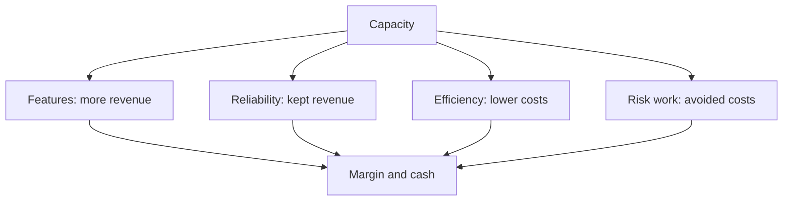
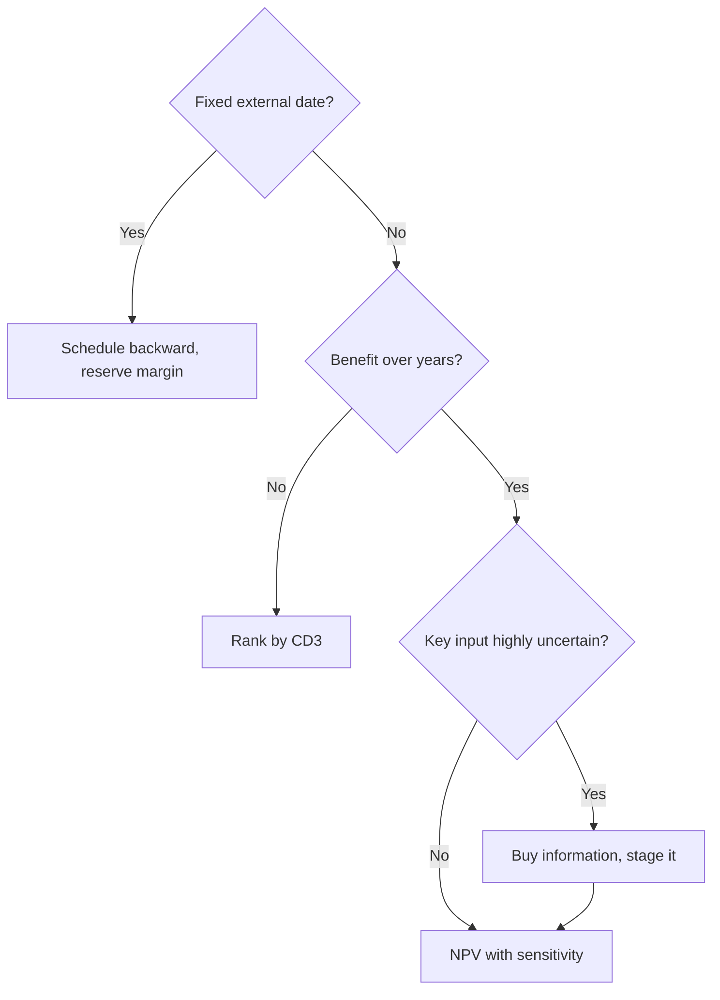

# Chapter 45 — Business Models, Engineering Economics, and Investment Decisions

Every engineering week is spent on one thing instead of another. Engineering economics makes that
comparison explicit: in money where money is honest, over time, under stated uncertainty. This
chapter covers reading the business model, pricing time with cost of delay and opportunity cost, and
comparing investments in one frame (payback, net present value, real options at a practitioner's
level). The running example is the fictional
[Northstar Technologies](../../case-studies/northstar/index.md).

## Why This Matters

At team scale, a manager who cannot say what a piece of work is worth loses every prioritization
argument to whoever speaks loudest. "Sales wants it" beats "the pricing rules keep paging us" until
someone states both in the same unit.

At organization scale, the director allocates fixed capacity among product, prevention, and platform
(Chapter 38). At Northstar's baseline, [unplanned work](../../glossary.md#unplanned-work) consumed about $5.0M a
year of engineering capacity (34 percent of 80 engineers' time), and the quarter's [service credits](../../glossary.md#service-credits)
(refunds owed when availability falls below contract) were $410,000. A director who cannot connect such figures
to revenue and margin funds whatever arrives with a customer's name on it.

At executive scale, the CFO and CEO think in recurring revenue, margin, cash, and risk. A CTO who
brings velocity charts is managed as a cost center; one who brings "protects two renewals worth $9M, costs
about $250,000 of capacity, pays back in about a year under these assumptions" is a peer.

## Learning Objectives

After this chapter you will be able to:

- Read a company's business model and locate where engineering work changes revenue, margin, and risk.
- Estimate cost of delay for an item, choosing its urgency shape and writing down every assumption.
- State the opportunity cost of a capacity decision as the value of the best alternative displaced.
- Compare portfolio investments of different shapes with payback, net present value, and staged
  (option-like) investment, and detect how such analyses are gamed.

Related chapters: Chapter 15 introduced cost of delay as a ranking rule and Chapter 21 used it to price
debt; this chapter explains the economics underneath both. Chapter 52 covers financial statements and
budgeting.

## The Mental Model

> **Mental model:** Capacity is fixed, so every yes is a priced no. Ask three questions of any
> investment: where does its money come from (the business model), what does waiting cost (cost of
> delay), and what else would the same capacity have bought (opportunity cost). Then compare the
> answers in one frame, with the assumptions written where the other side can attack them.

The first question locates the work. Engineering changes a software company's economics through four
channels, the benefit types Arnold and Yüce used to triage requirements at Maersk Line: increase
revenue, protect revenue, reduce costs, and avoid costs
([Arnold and Yüce, 2013](../../references/bibliography.md#arnold2013blackswan)). Features usually
increase revenue; reliability usually protects it; automation and efficiency reduce costs; security
and compliance work usually avoids costs that have not happened yet.

Four kinds of work usually argued about in four vocabularies end in the same place. Each arrow is a
hypothesis with a size and a probability; the director's job is to make them explicit and comparable.
Two corollaries follow. **Time is a cost**: a feature worth $10,000 a week that ships ten weeks late
has lost about $100,000. And **the price of engineering work is what it displaces**, not its salary
cost: with headcount fixed, the salaries are paid whatever you choose.

## Deep Conceptual Explanation

### Reading a business model

A business model is a hypothesis about how the company gets paid. Teece's abstract describes it as the
way an enterprise delivers value to customers, persuades them to pay, and converts those payments into
profit ([Teece, 2010](../../references/bibliography.md#teece2010business)). For an engineering leader
it becomes five questions that one hour with the finance partner can answer:

| Question | What to find | Why engineering cares |
|---|---|---|
| Who pays, and for what? | The buyer, the unit of pricing (seat, transaction, tier, contract) | Which capabilities move the price or the volume |
| How does revenue recur? | Annual recurring revenue (ARR), renewal cycle, expansion, churn | Reliability and quality show up at renewal, not at delivery |
| What does serving a customer cost? | Gross margin: revenue minus hosting, support, payment fees, service credits | Cloud cost and incident load are margin, not overhead |
| What do contracts promise? | Availability commitments, credits, security obligations | A breach converts directly into lost revenue |
| Where is it concentrated? | Revenue share of the largest customers, segments, regions | A defect that hits the top 40 customers is a different event |

**[ARR](../../glossary.md#arr)** is the annualized value of subscription contracts in force.
**Churn** is the revenue lost when customers leave or shrink their contracts; **expansion** is revenue
added by existing customers buying more. **[Gross margin](../../glossary.md#gross-margin)** is the share
of revenue left after the costs of delivering the service. A dollar of new revenue is therefore worth
less than a dollar to the company. A dollar of service credits avoided is worth a full dollar, because
a credit is refunded revenue with no delivery cost attached (**this book's recommendation**).

Strategy works as a filter. Lafley and Martin frame it as choices about where to play and how to win
([Lafley and Martin, 2013](../../references/bibliography.md#lafley2013playing)). An investment in a
segment the company has chosen not to play in is worth less than its spreadsheet says, however large
the deal.

### Cost of delay: definition, shape, and origin

**[Cost of delay](../../glossary.md#cost-of-delay)** is the value lost per unit of time while work is
not done. Arnold and Yüce define a
feature's cost of delay as the value it could generate if it were available now, including what
building it would teach, and how both decay with time
([Arnold and Yüce, 2013](../../references/bibliography.md#arnold2013blackswan)). Chapter 15 teaches the
ranking that follows ([CD3](../../glossary.md#cd3-and-wsjf), cost of delay divided by duration; see
[prioritization as economics](../04-execution/15-planning-prioritization-and-delivery-methods.md#prioritization-as-economics))
and SAFe's relative-scoring version, WSJF
([SAFe, WSJF](../../references/bibliography.md#safe-wsjf)). This section adds shape, estimation, and
evidence.

**Shape.** Cost of delay is rarely a constant. Arnold and Yüce describe urgency profiles that change
how delay is priced:

| Profile | What happens when it is late | Typical engineering example |
|---|---|---|
| Long life, peak unaffected | Benefits shift later; the peak is the same | Automation, efficiency, most prevention |
| Long life, peak affected | A competitor or a customer's alternative takes part of the market for good | Capabilities that decide a platform choice |
| Short life, peak affected | The window closes; late delivery earns a lower peak, briefly | Seasonal or event-driven features |
| External deadline | Nothing is lost until a date, then much is | Renewal conditions, regulatory dates |

For the first profile, cost of delay per week is roughly the weekly benefit. For the second, add the
permanent loss: estimate the share of the market lost for good per week of delay, times its yearly
margin, over the years you count. A deadline item is scheduled backward from its date with a margin
rather than ranked by ratio. Northstar did this with its two renewal commitments, features that two
large customers made a condition of renewing (Chapter 15).

**Estimation.** At Maersk Line, requirements were triaged into the four benefit types in under a
week, with assumptions exposed and challenged in weekly sessions; the stated goal was accuracy rather
than precision (Arnold and Yüce, 2013). The practical form is a one-line formula per item, for
example deal ARR × probability the feature decides the deal × gross margin ÷ 52, with every factor a
claim someone owns and can be checked later.

**Evidence.** The Maersk Line case applied cost of delay across a portfolio of about $100M. One
feature's cost of delay was about $210,000 a week, and its 38 weeks in queues cost nearly $8M of
missed opportunity. Treat it as **documented practice**: one company, no control group, other
practices introduced at the same time. It shows the method can run at portfolio scale, not how much
it helps.

Donald Reinertsen is widely credited with popularizing the idea in product development
([Reinertsen, 2009](../../references/bibliography.md#reinertsen2009principles)).

### Opportunity cost and sunk cost

Economists use **[opportunity cost](../../glossary.md#opportunity-cost-and-sunk-cost)** for the value
of the next best alternative a choice gives up. **Sunk costs** are costs already incurred that cannot
be recovered, and they should be ignored in deciding what to do next
([Greenlaw et al., 2022](../../references/bibliography.md#greenlaw2022economics)). Engineering
planning violates both routinely.

With fixed headcount, the opportunity cost of a 70
[engineer-week](../../glossary.md#engineer-week-engineer-day-engineer-year) project is not its salary
cost of about $249,000. It is the value of the best work those weeks would otherwise produce, usually
the cost of delay of the displaced item. Salary cost remains a useful yardstick. But a portfolio that
compares every project against it approves anything worth more than its payroll, and never asks
whether something else was worth more still.

**The book's rate for engineer time.** Wherever this book prices capacity, it uses one planning
rate: **$3,558 per engineer-week**, Northstar's $185,000 average
[fully loaded cost](../../glossary.md#fully-loaded-cost) divided by 52 weeks. That is also $46,250
per [FTE-quarter](../../glossary.md#fte-quarter). A few chapters quote **Finance's day rate** of $800
per engineer-day ($185,000 ÷ about 230 working days); it is higher per day because Finance counts only
working days. $157,250 per capitalized FTE-year is the capitalized share (85 percent) of $185,000
(Chapter 52). Agree one rate with your own finance team and use it everywhere.

**Cash versus capacity.** A saving comes in two kinds, and a CFO reads them differently. **Cash
savings** (lower credits, cloud bills, or contractor spend) reduce what the company pays. **Returned
capacity** (engineers freed from unplanned work) reduces nothing: the salaries are paid anyway. It is
worth the cost of delay of the work those engineers now do. Valuing it at salary, as the examples
below do, is a convention to agree with finance, not a cash figure. Show any case that relies on
returned capacity twice, with cash only and with cash plus capacity, labeled.

Sunk cost shows up as "we are 60 percent through the migration". The only question is what the
remaining 40 percent costs against what it delivers. Chapter 43 covers why people keep going
(escalation of commitment); the economic rule is to price the future only.

### Discounting: what a future dollar is worth today

A dollar received next year is worth less than a dollar today. This is the **time value of money**: a
dollar in hand now can be invested and earn a return in the meantime, and a dollar promised later may
not arrive. To compare money that arrives at different dates, finance converts every future amount
into its **present value**, what it is worth today.

The conversion uses a [discount rate](../../glossary.md#discount-rate-and-hurdle-rate), a yearly
percentage. In theory it is the company's **cost of capital**: the return its lenders and investors
expect for funding it. That is hard to estimate, so most finance teams set a **hurdle rate**, the
minimum yearly return they accept on an investment, and ask everyone to use it. Northstar's finance
team uses 10 percent.

At a rate r, a dollar received n years from now is worth 1 ÷ (1 + r)^n today. That number is the
**discount factor**. At 10 percent, each year's factor is the previous one divided by 1.10:

| Year | Calculation | Discount factor | $100,000 received that year is worth today |
|---|---|---|---|
| 1 | 1 ÷ 1.10 | 0.909 | $90,900 |
| 2 | 1 ÷ 1.21 | 0.826 | $82,600 |
| 3 | 1 ÷ 1.331 | 0.751 | $75,100 |
| 4 | 1 ÷ 1.4641 | 0.683 | $68,300 |

When a project returns the same amount every year, add the factors. Over three years at 10 percent,
0.909 + 0.826 + 0.751 = 2.487, the three-year **annuity factor**. Multiply a steady yearly benefit by
it to get the benefit's present value. When the amounts differ by year, discount each year separately.

**[Net present value (NPV)](../../glossary.md#net-present-value-npv)** is the present value of what a
project returns minus the present value of what it costs. Engineering capacity is usually spent at the
start, in year 0, so its factor is 1. A worked example: a project costs $200,000 of capacity now and
returns $100,000 a year for three years.

| Line | Calculation | Value |
|---|---|---|
| Present value of benefits | $100,000 × 2.487 | $248,700 |
| Present value of cost | $200,000 × 1 | $200,000 |
| NPV | $248,700 − $200,000 | +$48,700 |

A positive NPV means the project earns more than the hurdle rate; a negative one means the capacity
would earn more elsewhere at that rate. Without discounting, the same project looks like a $100,000
gain. Discounting removes about half of it, and it removes more the later the benefits arrive.

### A common frame: payback, net present value, and options

A feature earning revenue for three years, a prevention package, a platform, and an automation
compete for the same capacity in different shapes. A common frame makes their differences visible.

**Payback period** is the time a project takes to recover its initial cost from the cash flows it
generates. It is easy to explain and has well-known weaknesses. It ignores the time value of money,
uses an arbitrary cutoff, ignores everything after the payback date, and treats uncertain cash flows
like certain ones
([Dahlquist and Knight, 2022](../../references/bibliography.md#dahlquist2022finance)).

**Net present value**, from the previous section, accepts positive values and rejects negative ones.
Because the cost of capital is hard to estimate, the same textbook recommends checking how sensitive
the answer is to the rate (Dahlquist and Knight, 2022). In practice, use finance's hurdle rate. Count
software benefits for two or three years, not ten: the horizon moves the answer more than the rate.
And cost capacity the same way for every option, since the real comparison is between options, not
against zero.

**Real options.** Waiting for better information has value when an investment is hard to reverse. The
publisher's summary of Dixit and Pindyck's book stresses the irreversibility of most investments and
the option value of waiting, by analogy with financial options
([Dixit and Pindyck, 1994](../../references/bibliography.md#dixit1994investment)). Sullivan and
colleagues' abstract reports that real-options techniques applied to modular software designs gave
results consistent with Parnas's argument for information hiding
([Sullivan et al., 2001](../../references/bibliography.md#sullivan2001modularity)). At a
practitioner's level, without formulas, the idea becomes three rules (**this book's
recommendation**):

1. **Buy information before an irreversible commitment** when uncertainty is high. A spike, a
   prototype, or a scoping session with the prospect is an option premium.
2. **Stage large investments** so each stage earns its keep or produces the information that decides
   the next.
3. **Value flexibility only when someone will exercise it.** "It keeps our options open" is not a
   valuation unless a foreseeable change will use the option.

The diagram is a routing rule, not a ladder of sophistication. Most weekly decisions end at CD3; NPV
earns its effort for multi-quarter investments; staging comes first whenever one input could swing the
answer. The skill is knowing which assumptions carry the result
([Berman and Knight, 2006](../../references/bibliography.md#berman2006financial)).

## Engineering Organization Example

!!! info "Northstar so far"
    Week 31 of the director's first year. [Sev1 and Sev2](../../glossary.md#severity-sev1-sev2-sev3)
    incidents (the two most severe levels) fell from 30 to 17 a quarter by quarter 2, and service credits
    from $410,000 to $95,000. Both renewal features are delivered. Greg Tanaka (VP Sales) has just asked
    for a third deal feature. See the [timeline](../../case-studies/northstar/timeline.md). New to
    Northstar? Read [the year in brief](../../case-studies/northstar/year-in-brief.md), the
    [cast](../../case-studies/northstar/cast.md), and the
    [quarter 4 briefing](../../case-studies/northstar/quarter-4-briefing.md).

The following example is **illustrative**, like all Northstar figures. The prevention package and the
cost and probability estimates are this example's assumptions.

**Step 1: the business model in numbers.** Northstar sells an order-to-cash platform to about 1,900
distributors on recurring contracts, with a 99.9 percent quarterly availability commitment on the
order and payment paths, backed by service credits.

| Measure | Value |
|---|---|
| ARR | $140M |
| Top 40 customers | about $46.7M (one third), about $1.17M each |
| Other 1,860 customers | about $93.3M, about $50,000 each |
| Service credits, baseline quarter | $410,000 ($1.64M a year, 1.2 percent of ARR) |
| Service credits, quarter 2 | $95,000 ($380,000 a year annualized) |
| Gross margin | 72 percent, applied to new revenue only |
| Finance's hurdle rate | 10 percent a year, used for NPV |

Reading it: concentration means 40 customers carry half as much revenue as the other 1,860
combined, and losing one top-40 customer costs as much as losing about 23 of the others. With
credits down from $410,000 to $95,000 a quarter, prevention's cash case has shrunk; it now rests more
on renewals and on capacity returned from unplanned work.

**Step 2: three candidate investments**, compared as uses of capacity as the director saw them in
week 31. A and C are the items in Chapter 42's portfolio; B is a hypothetical prevention package.

The inputs:

| Investment | Channel | Size (engineer-weeks) | Probability it works |
|---|---|---|---|
| A. Purchase approval rules | Increase revenue | 70 (about $249,000) | 0.5 |
| B. Payment-path prevention | Protect revenue, reduce costs | 70 (about $249,000) | 0.6 |
| C. Service-credit statements | Reduce costs | 50 (about $178,000) | 0.9 |

- **A:** a prospect at $700,000 ARR, at 72 percent margin, is $504,000 a year, less $25,000 of upkeep.
  The 0.5 is Greg Tanaka's estimate that the prospect signs, unchecked.
- **B:** credits down $25,000 a quarter ($100,000 a year) plus 1 [FTE](../../glossary.md#fte)
  (full-time equivalent engineer) of unplanned work returned ($185,000 a year).
- **C:** 160 analyst-hours a quarter at $70 ($44,800 a year) plus $15,000 a year of disputes avoided.

The results:

| Investment | Expected benefit a year | NPV, 3 years at 10% | Cost of delay a week | Payback |
|---|---|---|---|---|
| A | $227,000 | about +$315,000 | about $4,800 | 1.1 years |
| B | $171,000 | about +$176,000 | about $3,300 | 1.5 years |
| C | about $54,000 | about −$44,000 | about $1,000 | 3.3 years |

How computed: NPV is the expected benefit × 2.487 (the annuity factor) − size; cost of delay is the
expected benefit ÷ 52, without A's upkeep, which starts only at go-live.

**Step 3: what the table really says.** The ranking A, B, C is less interesting than its fragility:

- **A turns on one number.** At a win probability of 0.25, A's expected benefit falls to $101,000 a
  year and its NPV to about $2,000: break-even. That probability is the input to buy information about,
  and its owner, the sponsor, should write it down and be checked later.
- **B's case is mostly capacity.** With cash only (expected credits saved, 0.6 × $100,000 a year), its
  NPV is about −$100,000; the returned engineer is what makes it +$176,000. A CFO will ask what that
  engineer will do instead, and the answer is B's real benefit.
- **B is also undervalued.** It counts no renewal protection. If it cut by 15 points the probability of
  losing one top-40 customer, that alone adds about 0.15 × $1.17M × 72% = $126,000 a year, and B passes
  A. Whether that is plausible is a question for the renewal data of Sofia Alvarez (VP Customer
  Success).
- **B and C interact.** C's value scales with the credits it processes; if B works, C is worth less.
- **C fails on cost savings and might still be right** if accurate statements are worth something the
  table omits, such as the confidence of Rajiv Menon (CFO) in the credit numbers. The frame forces that claim into
  the open.

## Decision Framework

Use the frame that fits the decision, and state the assumptions that carry it.

| Situation | Frame | State explicitly | Watch for |
|---|---|---|---|
| Ordering weekly or quarterly work in one team | CD3 (Chapter 15) | Cost of delay per week, duration, urgency profile | Sponsor estimates nobody checks |
| An item with a contract, regulatory, or renewal date | Backward schedule with margin | Date, lead time, margin, cost of missing | Ranking it by ratio instead |
| A multi-quarter investment competing with features | NPV over 2–3 years, plus payback | Horizon, rate, benefit per year, probability | Benefits counted for ten years |
| One input could flip the decision | Stage it; buy information first | The input, what evidence would change it, the cost of finding out | "Option value" claimed with no exercise in sight |
| A proposal that saves cost or capacity | NPV with capacity valued at cost | Whether savings are cash or capacity | Counting capacity as cash |
| Continuing a half-finished project | Remaining cost against remaining value | Only future costs | Sunk cost, "we've come this far" |

Two guards apply to every row (**this book's recommendation**). The person who benefits from a number
is never its only author: finance or a neutral reviewer checks inputs on large items. And every
estimate that decided a choice is revisited a quarter or two later, with the variance reported.

## Trade-offs

**Money versus what money misses.** Dollars make trade-offs comparable and push out what resists
pricing: trust, morale, learning. Name the unpriced factors next to the number, and distrust any
decision that rests entirely on them.

**Dollars versus relative scores.** SAFe's WSJF uses relative scores, fast and free of false precision
([SAFe, WSJF](../../references/bibliography.md#safe-wsjf)). Dollars take longer but can be checked
against outcomes and added across teams. Scores suit a team's own ordering; dollars suit decisions a
CFO will read.

**Short horizons versus prevention.** A three-year horizon is honest about software's churn but
penalizes slow-growing benefits such as platform and prevention. Test a longer one and report flips.

**Transparency versus gaming.** Published assumptions invite challenge and teach sponsors which numbers
win; post-decision checks counter that.

## Failure Modes

**Spreadsheet theater.** NPVs to the dollar built on guesses. Signal: no ranges, no sensitivity, no
owner per input. Fix: two significant figures and the break-even value of the input that matters.

**The sponsor's number.** A win probability supplied by the person who wants the work, never
revisited. Signal: every sales request carries 50 percent. Fix: compare estimates with outcomes each
quarter; this is where the method is gamed, so this is where it is audited.

**Revenue mistaken for value.** New revenue counted at face value, avoided credits and churn at zero.
Signal: no feature ever loses to reliability work. Fix: convert revenue to margin and price retention.

**The free engineer.** Salaries treated as the cost of a decision, or capacity treated as free
because headcount is fixed. Signal: no proposal names what it displaces. Fix: every case names its
opportunity cost.

**Sunk-cost continuation.** Signal: status in percent complete with no updated remaining value. Fix:
re-decide at each stage on future costs only.

**Option theater.** "Flexibility" justifying an abstraction nobody asked for. Signal: no named change
would use it. Fix: name the change and its probability, or drop the claim.

**Items evaluated in isolation.** Signal: two projects both claim the same credits. Fix: map
interactions before ranking.

## Enterprise Application

In an organization of 50 to 150 engineers, economics is a practice shared by the director, the product
leader, and a finance partner, not a private spreadsheet.

- **A one-page investment case** above a threshold (say a quarter of a team's capacity): channel,
  size as a range, benefit and owner, probability, urgency profile, opportunity cost, and the input
  that would change the answer. The
  [technical debt register template](../../templates/technical-debt-register.md) applies the same
  logic to debt.
- **Capacity priced once**, at one fully loaded rate agreed with finance, in the categories of the
  [capacity planning model template](../../templates/capacity-planning-model.md) (Chapter 38).
- **A quarterly estimate review** of last quarter's decisive estimates against outcomes, inside
  Chapter 39's reviews.
- **Interactions checked** in the cross-team forum (Chapter 42).

The transition costs a quarter teaching the one-pager and a second discovering how wrong the first
estimates were. The second is the useful one.

## CTO Perspective

At executive scale, engineering is a portfolio of investments whose return the CTO answers for
alongside the CFO. Three things change.

First, **the conversation moves from cost to allocation**. The board asks whether the mix between
growth, retention, efficiency, and risk fits the strategy. A CTO who shows the split and each part's
expected return argues for a mix rather than defending a total.

Second, **risk becomes an investment category**. Reliability and security work protects revenue and
avoids losses that never appear as line items. Northstar's baseline credits of $1.64M a year, and two
renewals worth $9M in which reliability was the customers' stated concern, made this concrete; the harder task is keeping the category funded after the
credits fall and the urgency fades.

Third, **the CTO owns the honesty of the numbers**. Accounting choices such as capitalizing
development cost (Chapter 52) can make a project look cheaper without changing its economics.
Credibility depends on separating what an investment does from how it is booked, and on reporting
estimate accuracy, misses included.

## Practical Playbook

1. **Learn the business model in one sitting** with finance: ARR, gross margin, churn, concentration,
   contractual commitments. Write the five-question table.
2. **Map large items to the four channels**, with an amount.
3. **Agree one capacity rate and one hurdle rate** with finance and use them everywhere.
4. **Give every large item a cost-of-delay line** with an urgency profile and named owners per factor.
5. **Name the opportunity cost** of every yes.
6. **For multi-quarter investments, compute payback and a three-year NPV**, plus the break-even value
   of the most uncertain input.
7. **Stage what is uncertain**: fund the cheapest step that measures the deciding input first.
8. **Check interactions** between items sharing a benefit or a person.
9. **Review decisive estimates a quarter later** and publish the variance.
10. **Present in the CFO's units** (margin, cash, risk), assumptions on the same page.

## Case Study

This case is **fictional**, set in weeks 31 to 34; the forum's decision has no recorded outcome, and
it is yours. It continues
[Chapter 42's case study](../09-engineering-directorship/42-cross-functional-dependencies-portfolio-and-influence.md#case-study).

**The situation.** Northstar runs at most three cross-team initiatives at once. Each starts in a fixed
slot when an earlier one finishes, and the next slots open in weeks 33 and 34. A portfolio forum of
the executives decides what fills them. In week 31 Greg Tanaka asked for purchase approval rules
(about 70 engineer-weeks) for a prospect he valued at about $700,000 ARR, deciding in week 36. The
week 32 forum had three options:

1. **Queue it** into the week 34 slot (forecast weeks 44 to 47).
2. **Swap it** into the week 33 slot, moving the service-credit statements that Rajiv Menon wants to
   quarter 4.
3. **Start it now** as a fourth initiative. That puts at risk multi-currency price lists, one of Greg's
   earlier deal features, whose date is already promised in an open deal.

**The economic note.** Before the forum, the director priced the options with the Engineering
Organization Example's assumptions (win probability 0.5, 72 percent margin, revenue from go-live):

| Effect | Queue versus swap |
|---|---|
| Approval rules ship one week earlier under the swap | About 1 × $4,800 = $4,800 gained |
| Statements start in quarter 4 instead of week 33, assumed about 7 weeks later | About 7 × $1,000 = $7,000 lost |
| Net | About $2,000 in favor of queueing, well inside the error of every input |

Two findings mattered more than the net. First, **queueing versus swapping is noise**: a few thousand
dollars either way. Second, **the inputs with real swing were elsewhere**. A five-point change in the
prospect's win probability is worth about 0.05 × $504,000 = $25,200 a year of margin, more than ten
times that difference. Chapter 42 had shown that the prospect needed a reliable date and evidence that
Northstar understood its approval process, not software in week 36. The scoping sessions in weeks 32
and 33 were the option premium that could move the probability. And the statements' value depended on
credits still being paid, the condition Rajiv raised: if credits stay at or below quarter 2's $95,000
a quarter, their cost of delay shrinks further.

The third option had no row: it put at risk a committed date in an open deal whose value the director
did not have. The note named that as the missing input rather than guessing it.

**What the reader decides.** Whether the note should change the forum's agenda (from slot order to
the win probability and the multi-currency exposure), which inputs Greg and Rajiv should own in
writing, and what evidence after week 36 would show whether the estimates were honest.

## Exercises

Solutions are in [chapter 45 solutions](../../solutions/ch45-solutions.md).

### Foundational

**F1.** A product leader proposes a reporting feature for a customer segment worth $6M ARR. Sales
believes the feature would cut that segment's annual churn from 10 percent to 8 percent. The company's
gross margin is 75 percent, and the feature takes 12 weeks of a six-person team. Estimate the cost of
delay per week, choose an urgency profile, and name the two assumptions you would test first.

**F2.** At Northstar, a staff engineer argues that because headcount is flat, the 70 engineer-weeks of
the prevention package "cost nothing; we pay those salaries anyway". The CFO's analyst argues it
costs $249,000. Explain what each gets wrong, state the package's actual cost in the terms this
chapter uses, and say which number belongs in the investment case.

**F3.** Two investments each cost $300,000 of capacity. One returns $200,000 a year for two years;
the other returns nothing in year one and $250,000 a year in years two to four. Compute payback and
NPV at 10 percent for both, say which each method prefers, and explain what that difference teaches
about using payback alone.

### Applied Leadership

**A1.** At Northstar in week 42, Sofia Alvarez reports that one of the top 40 customers has raised
reliability at its account review, with renewal in week 60. Rebuild the comparison of investments A,
B, and C with a renewal-protection term for B, state the probability you assume and why, and say how
the ranking and the cost of delay change.

**A2.** A team lead proposes a six-month rewrite of a billing component, citing "flexibility for
future pricing models". No pricing change is planned. Using the real-options rules, design a staged
alternative, state what the first stage must learn, and say what evidence would justify funding the
second.

**A3.** Your organization has used cost-of-delay estimates for two quarters. A review shows that of
nine sales-sponsored items, the median estimated cost of delay was three times the value later
realized, while reliability items were within 30 percent. Design the change to the process, and
draft what you say to the VP of Sales.

### Executive Decision-Making

**X1.** Northstar's quarter 4 plan includes a deal allowance: capacity reserved for small single-team
requests from sales, so they need not wait for a cross-team slot. The quarter 3 plan funded about 49.9
FTE of product work out of 80. Rajiv Menon asks how large the allowance should be and how it should be
judged. Using this chapter's frame and the case figures, propose a size and a rule for admitting requests to it, state
the opportunity cost, and describe the evidence after two quarters that would make you shrink or
remove it.

**X2.** You are CTO of a 400-engineer company whose credits and incidents have fallen for four
quarters. The CFO proposes moving half of the reliability allocation to growth features, citing an
NPV analysis that values reliability work only by credits avoided. Write the economic case you would
bring to the CEO and CFO, including what the analysis omits, how you would value it, and which part of
the CFO's proposal you would accept.

## Reflection Questions

1. Which of your current projects could you not place in one of the four channels? What does that say
   about the project, or about the channels?
2. When did you last approve work because its sponsor was persistent rather than because its cost of
   delay was high?
3. Which numbers in your planning are written by the people who benefit from them, and who checks
   them afterward?
4. What would change in your next budget conversation if engineering were a portfolio, not a cost?

## Key Takeaways

- Read the business model before arguing priorities: payers, recurrence, cost to serve, contractual
  promises, concentration.
- Place every large investment in one of four channels with an amount and a probability.
- Price time with cost of delay and an urgency profile; schedule deadline items backward.
- The cost of a capacity decision is the best alternative it displaces, not the salaries it consumes;
  sunk costs do not count.
- Use CD3 for ordering, NPV with sensitivity for multi-quarter investments, and staging when one input
  decides the answer.
- Convert revenue to margin; a dollar of avoided credits is worth more than a dollar of new revenue.
- Every decisive estimate has an owner and a later check; that is how the method resists gaming.
- When options differ by less than the error of their inputs, stop arguing about them and spend the
  time on the input that swings the answer.

## References and Further Reading

- [Arnold and Yüce, 2013](../../references/bibliography.md#arnold2013blackswan): cost of delay at
  portfolio scale at Maersk Line; benefit types and urgency profiles. A single-company case report.
- [Teece, 2010](../../references/bibliography.md#teece2010business): the business model defined.
- [Dahlquist and Knight, 2022](../../references/bibliography.md#dahlquist2022finance): open textbook
  on payback and NPV, weaknesses included.
- [Greenlaw et al., 2022](../../references/bibliography.md#greenlaw2022economics): opportunity cost and
  sunk cost.
- [Dixit and Pindyck, 1994](../../references/bibliography.md#dixit1994investment): investment under
  uncertainty and the value of waiting.
- [Sullivan et al., 2001](../../references/bibliography.md#sullivan2001modularity): real options
  applied to software modularity.
- [SAFe, WSJF](../../references/bibliography.md#safe-wsjf): relative-scoring cost of delay over size.
- [Reinertsen, 2009](../../references/bibliography.md#reinertsen2009principles): widely credited with
  popularizing cost of delay in product development.
- [Berman and Knight, 2006](../../references/bibliography.md#berman2006financial): financial literacy
  for managers; a bridge to Chapter 52.
- [Lafley and Martin, 2013](../../references/bibliography.md#lafley2013playing): strategy as where to
  play and how to win.
