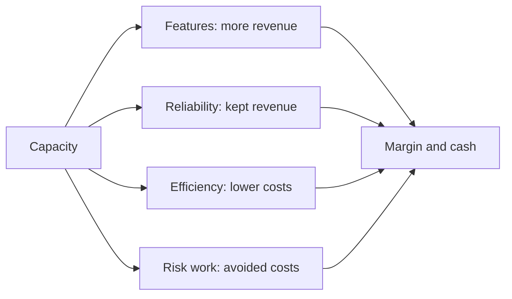
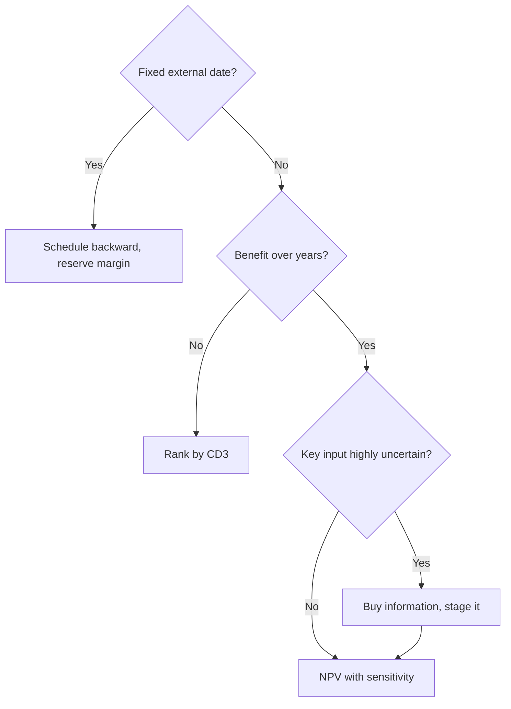

# Chapter 45 — Business Models, Engineering Economics, and Investment Decisions

Every engineering week is spent on one thing instead of another. Engineering economics makes that
comparison explicit: in money where money is honest, over time, under stated uncertainty. This
chapter covers reading the business model, pricing time with cost of delay and opportunity cost, and
comparing investments in one frame (payback, net present value, real options at a practitioner's
level). Chapter 15 introduced cost of delay as a ranking rule and Chapter 21 used it to price debt;
this chapter owns the economics underneath both. Chapter 52 owns financial statements and budgeting.
The running example is the fictional
[Northstar Technologies](../../case-studies/northstar/index.md).

## Why This Matters

At team scale, a manager who cannot say what a piece of work is worth loses every prioritization
argument to whoever speaks loudest. "Sales wants it" beats "the pricing rules keep paging us" until
someone states both in the same unit.

At organization scale, the director allocates fixed capacity among product, prevention, and platform
(Chapter 38). At Northstar's baseline, unplanned work consumed about $5.0M a year of engineering
capacity and the quarter's service credits were $410,000. A director who cannot connect such figures
to revenue and margin funds whatever arrives with a customer's name on it.

At executive scale, the CFO and CEO think in recurring revenue, margin, cash, and risk. A CTO who
brings velocity charts is managed as a cost center; one who brings "protects $9M of renewals, costs
about $250,000 of capacity, pays back in about a year under these assumptions" is a peer.

## Learning Objectives

After this chapter you will be able to:

- Read a company's business model and locate where engineering work changes revenue, margin, and risk.
- Estimate cost of delay for an item, choosing its urgency shape and writing down every assumption.
- State the opportunity cost of a capacity decision as the value of the best alternative displaced.
- Compare portfolio investments of different shapes with payback, net present value, and staged
  (option-like) investment, and detect how such analyses are gamed.

## The Mental Model

> **Mental model:** Capacity is fixed, so every yes is a priced no. Ask three questions of any
> investment: where does its money come from (the business model), what does waiting cost (cost of
> delay), and what else would the same capacity have bought (opportunity cost). Then compare the
> answers in one frame, with the assumptions written where the other side can attack them.

The first question locates the work. Engineering changes a software company's economics through four
channels, the benefit types Arnold and Yüce used to triage requirements at Maersk Line: increase
revenue, protect revenue, reduce costs, and avoid costs
([Arnold and Yüce, 2013](../../references/bibliography.md#arnold2013blackswan)). Features usually
increase revenue; reliability usually protects it; automation and efficiency reduce costs; security
and compliance work usually avoids costs that have not happened yet.

Four kinds of work usually argued about in four vocabularies end in the same place. Each arrow is a
hypothesis with a size and a probability; the director's job is to make them explicit and comparable.
Two corollaries follow: **time is a cost** (a feature worth $10,000 a week that ships ten weeks late
has lost about $100,000), and **the price of engineering work is what it displaces**, not its salary
cost, because with headcount fixed the salaries are paid whatever you choose.

## Deep Conceptual Explanation

### Reading a business model

Teece describes a business model as the way an enterprise delivers value to customers, persuades
them to pay for it, and converts those payments into profit; it embodies management's hypothesis
about what customers want and how the firm can organize to meet that need and get paid
([Teece, 2010](../../references/bibliography.md#teece2010business), abstract). For an engineering
leader it becomes five questions that one hour with the finance partner can answer:

| Question | What to find | Why engineering cares |
|---|---|---|
| Who pays, and for what? | The buyer, the unit of pricing (seat, transaction, tier, contract) | Which capabilities move the price or the volume |
| How does revenue recur? | Annual recurring revenue (ARR), renewal cycle, expansion, churn | Reliability and quality show up at renewal, not at delivery |
| What does serving a customer cost? | Gross margin: revenue minus hosting, support, payment fees, service credits | Cloud cost and incident load are margin, not overhead |
| What do contracts promise? | Availability commitments, credits, security obligations | A breach converts directly into lost revenue |
| Where is it concentrated? | Revenue share of the largest customers, segments, regions | A defect that hits the top 40 customers is a different event |

**ARR** is the annualized value of subscription contracts in force. **Gross margin** is the share of
revenue left after the costs of delivering the service. A dollar of new revenue is therefore worth
less than a dollar to the company, while a dollar of service credits avoided is worth a full dollar,
because a credit is refunded revenue with no delivery cost attached (**this book's recommendation**).

Strategy, in Lafley and Martin's widely used framing a set of choices about where to play and how to
win ([Lafley and Martin, 2013](../../references/bibliography.md#lafley2013playing)), works here as a
filter: an investment in a segment the company has chosen not to play in is worth less than its
spreadsheet says, however large the deal.

### Cost of delay: definition, shape, and origin

**Cost of delay** is the value lost per unit of time while work is not done. Arnold and Yüce define a
feature's cost of delay as the value it could generate over a period if it were available now,
including the value of what would be learned by building it, and how both decay with time
([Arnold and Yüce, 2013](../../references/bibliography.md#arnold2013blackswan)). Chapter 15 owns the
ranking that follows (cost of delay divided by duration, CD3; see
[prioritization as economics](../04-execution/15-planning-prioritization-and-delivery-methods.md#prioritization-as-economics))
and SAFe's relative-scoring version, WSJF
([SAFe, WSJF](../../references/bibliography.md#safe-wsjf)). This section adds shape, estimation, and
evidence.

**Shape.** Cost of delay is rarely a constant. Arnold and Yüce describe urgency profiles that change
how delay is priced:

| Profile | What happens when it is late | Typical engineering example |
|---|---|---|
| Long life, peak unaffected | Benefits shift later; the peak is the same | Automation, efficiency, most prevention |
| Long life, peak affected | A competitor or a customer's alternative takes part of the market for good | Capabilities that decide a platform choice |
| Short life, peak affected | The window closes; late delivery earns a lower peak, briefly | Seasonal or event-driven features |
| External deadline | Nothing is lost until a date, then much is | Renewal conditions, regulatory dates |

For the first profile, cost of delay per week is roughly the weekly benefit; for the second, add the
permanent loss. A deadline item is scheduled backward from its date with a margin rather than ranked
by ratio, as Northstar did with its two renewal commitments (Chapter 15).

**Estimation.** At Maersk Line, requirements were triaged into the four benefit types in under a
week, with assumptions exposed and challenged in weekly sessions; the stated goal was accuracy rather
than precision (Arnold and Yüce, 2013). The practical form is a one-line formula per item, for
example deal ARR × probability the feature decides the deal × gross margin ÷ 52, with every factor a
claim someone owns and can be checked later.

**Evidence.** That Maersk Line case, presented at the Agile 2013 conference, applied cost of delay
across a portfolio of about $100M; one feature's cost of delay was about $210,000 a week, and its 38
weeks in queues cost nearly $8M of missed opportunity. Treat it as **documented practice**:
one company, no control group, and cost of delay introduced together with other practices, so the
authors do not attribute their reported improvements to it alone. It shows the method can run at
portfolio scale, not how much it helps.

**Origin (gap G6).** Cost of delay is widely credited to Donald Reinertsen
([Reinertsen, 2009](../../references/bibliography.md#reinertsen2009principles)), but this book has not
read his work. SAFe opens its WSJF guidance with a quotation credited to that book, and Arnold and
Yüce cite it and Smith and Reinertsen's earlier book, but neither establishes who first defined the
term. Credit Reinertsen for popularizing the idea; do not quote a date of origin.

### Opportunity cost and sunk cost

Economists use **opportunity cost** for what must be given up to get what you choose, the value of
the next best alternative; **sunk costs** are costs already incurred that cannot be recovered, and
should be ignored in deciding what to do next
([Greenlaw et al., 2022](../../references/bibliography.md#greenlaw2022economics)). Engineering
planning violates both routinely.

With fixed headcount, the opportunity cost of a 70 engineer-week project is not 70 × $3,558 (an
engineer-week at $185,000 a year); it is the value of the best work those weeks would otherwise
produce, usually the cost of delay of the displaced item. Salary cost remains a useful yardstick, but
a portfolio that compares every project against it approves anything worth more than its payroll and
never asks whether something else was worth more still.

Sunk cost shows up as "we are 60 percent through the migration". The only question is what the
remaining 40 percent costs against what it delivers. Chapter 43 covers why people keep going
(escalation of commitment); the economic rule is to price the future only.

### A common frame: payback, net present value, and options

A feature earning revenue for three years, a prevention package, a platform, and an automation
compete for the same capacity in different shapes. A common frame makes their differences visible.

**Payback period** is the time a project takes to recover its initial cost from the cash flows it
generates. It is easy to explain, and it has well-known weaknesses: it ignores the time value of
money, it uses an arbitrary cutoff, it ignores everything after the payback date, and it treats
uncertain cash flows like certain ones
([Dahlquist and Knight, 2022](../../references/bibliography.md#dahlquist2022finance)).

**Net present value (NPV)** is the present value of a project's cash inflows minus the present value
of its outflows; accept positive values, reject negative ones. The discount rate should in theory be
the firm's cost of capital, which is hard to estimate, so the same textbook recommends checking how
sensitive the answer is to the rate (Dahlquist and Knight, 2022). In practice, use the rate finance
uses (a hurdle rate); count software benefits for two or three years, not ten, because the horizon
moves the answer more than the rate; and cost capacity the same way for every option, since the real
comparison is between options, not against zero.

**Real options.** Dixit and Pindyck's treatment of investment under uncertainty stresses the
irreversibility of most investments and the option value of waiting for better, never complete,
information, by analogy with financial options
([Dixit and Pindyck, 1994](../../references/bibliography.md#dixit1994investment), publisher summary).
Sullivan and colleagues applied real-options techniques to value modular software designs and found
the results consistent with Parnas's argument for information hiding
([Sullivan et al., 2001](../../references/bibliography.md#sullivan2001modularity), abstract). At a
practitioner's level, without formulas, the idea becomes three rules (**this book's
recommendation**):

1. **Buy information before an irreversible commitment** when uncertainty is high. A spike, a
   prototype, or a scoping session with the prospect is an option premium.
2. **Stage large investments** so each stage earns its keep or produces the information that decides
   the next.
3. **Value flexibility only when someone will exercise it.** "It keeps our options open" is not a
   valuation unless a foreseeable change will use the option.

The diagram is a routing rule, not a ladder of sophistication. Most weekly decisions end at CD3; NPV
earns its effort for multi-quarter investments; staging comes first whenever one input could swing the
answer. Finance books for non-financial managers, such as
[Berman and Knight, 2006](../../references/bibliography.md#berman2006financial), are read for the same
lesson: financial numbers rest on estimates and judgment, so the skill is knowing which assumptions
carry the result.

## Engineering Organization Example

The following example is **illustrative**. Northstar's revenue, customer counts, costs, and credits
are canon, as are the gross margin and the hurdle rate; the prevention package and the cost and
probability estimates were added for this chapter and are fictional.

**Step 1: the business model in numbers.** Northstar sells an order-to-cash platform to about 1,900
distributors on recurring contracts, with a 99.9 percent quarterly availability commitment on the
order and payment paths, backed by service credits.

| Measure | Value | Derivation |
|---|---|---|
| ARR | $140M | canon |
| Average ARR per customer | about $74,000 | $140M ÷ 1,900 |
| Top 40 customers | about $46.7M, about $1.17M each | one third of $140M, ÷ 40 |
| Other 1,860 customers | about $93.3M, about $50,000 each | remaining two thirds ÷ 1,860 |
| Engineering people plus cloud and tooling | $20.3M, 14.5 percent of ARR | $16.1M + $4.2M |
| Service credits, baseline quarter | $410,000 ($1.64M a year, 1.2 percent of ARR) | canon |
| Service credits, quarter 2 | $95,000 ($380,000 a year annualized) | canon |
| Gross margin | 72 percent | used for new revenue only |
| Finance's hurdle rate | 10 percent a year | used for NPV |

Reading it: concentration means 40 customers carry half as much revenue as the other 1,860
combined, and losing one top-40 customer costs as much as losing about 23 of the others. With
credits down from $410,000 to $95,000 a quarter, prevention's cash case has shrunk; it now rests more
on renewals and on capacity returned from unplanned work. Quarter 3 later came in at $60,000, which
weakens the credits term further.

**Step 2: three candidate investments**, compared as uses of capacity as the director saw them in week 31, before the week 34 forum. A and C are
Chapter 42's items; B is fictional. One engineer-week costs $185,000 ÷ 52 = about $3,558.

| | A. Purchase approval rules | B. Payment-path prevention package | C. Automated service-credit statements |
|---|---|---|---|
| Channel | Increase revenue | Protect revenue, reduce costs | Reduce costs |
| Size | 70 engineer-weeks (about $249,000) | 70 engineer-weeks (about $249,000) | 50 engineer-weeks (about $178,000) |
| Benefit if it works | Prospect at $700,000 ARR × 72% margin = $504,000 a year, less upkeep of $25,000 | Credits down $25,000 a quarter ($100,000 a year) plus 1 FTE of unplanned work returned ($185,000 a year) | 160 analyst-hours a quarter at $70 ($44,800 a year) plus $15,000 a year of disputes avoided |
| Probability it works | 0.5 that the prospect signs (Greg Tanaka's estimate, unchecked) | 0.6 that the estimates hold | 0.9 |
| Expected annual benefit | 0.5 × $504,000 − $25,000 = $227,000 | 0.6 × $285,000 = $171,000 | 0.9 × $59,800 = about $54,000 |
| Payback | about 1.1 years | about 1.5 years | about 3.3 years |
| NPV, 3 years at 10% | about +$315,000 | about +$176,000 | about −$44,000 |
| Cost of delay per week | about $4,800 (revenue starts at go-live) | about $3,300 | about $1,000 |

The three-year annuity factor at 10 percent is 0.909 + 0.826 + 0.751 = 2.487. For A, $227,000 × 2.487
= about $564,500, minus $249,000 = about $315,000. For B, $171,000 × 2.487 = about $425,300, minus
$249,000 = about $176,000. For C, $54,000 × 2.487 = about $134,300, minus $178,000 = about −$44,000.
Cost of delay per week is the expected annual benefit ÷ 52, with A's upkeep left out because upkeep
starts only at go-live: A is 0.5 × $504,000 ÷ 52 = about $4,800.

**Step 3: what the table really says.** The ranking A, B, C is less interesting than its fragility:

- **A turns on one number.** At a win probability of 0.25, A's expected benefit falls to $101,000 a
  year and its NPV to about $2,000: break-even. That probability is the input to buy information about,
  and its owner, the sponsor, should write it down and be checked later.
- **B is undervalued.** It counts no renewal protection. If it cut by 15 points the probability of
  losing one top-40 customer, that alone adds about 0.15 × $1.17M × 72% = $126,000 a year, and B passes
  A. Whether that is plausible is a question for Sofia Alvarez's renewal data.
- **B and C interact.** C's value scales with the credits it processes; if B works, C is worth less.
- **C fails on cost savings and might still be right** if accurate statements are worth something the
  table omits, such as the CFO's confidence in the credit numbers. The frame forces that claim into
  the open.

## Decision Framework

Use the frame that fits the decision, and state the assumptions that carry it.

| Situation | Frame | State explicitly | Watch for |
|---|---|---|---|
| Ordering weekly or quarterly work in one team | CD3 (Chapter 15) | Cost of delay per week, duration, urgency profile | Sponsor estimates nobody checks |
| An item with a contract, regulatory, or renewal date | Backward schedule with margin | Date, lead time, margin, cost of missing | Ranking it by ratio instead |
| A multi-quarter investment competing with features | NPV over 2–3 years, plus payback | Horizon, rate, benefit per year, probability | Benefits counted for ten years |
| One input could flip the decision | Stage it; buy information first | The input, what evidence would change it, the cost of finding out | "Option value" claimed with no exercise in sight |
| A proposal that saves cost or capacity | NPV with capacity valued at cost | Whether savings are cash or capacity | Counting capacity as cash |
| Continuing a half-finished project | Remaining cost against remaining value | Only future costs | Sunk cost, "we've come this far" |

Two guards apply to every row (**this book's recommendation**): the person who benefits from a number
is never its only author (finance or a neutral reviewer checks inputs on large items), and every
estimate that decided a choice is revisited a quarter or two later with the variance reported.

## Trade-offs

**Money versus what money misses.** Dollars make trade-offs comparable and push out what resists
pricing: trust, morale, learning. Name the unpriced factors next to the number, and distrust any
decision that rests entirely on them.

**Dollars versus relative scores.** SAFe's WSJF uses relative scores, fast and free of false precision
([SAFe, WSJF](../../references/bibliography.md#safe-wsjf)). Dollars take longer but can be checked
against outcomes and added across teams. Scores suit a team's own ordering; dollars suit decisions a
CFO will read.

**Speed versus rigor.** Scale the analysis with the size and irreversibility of the commitment.

**Short horizons versus prevention.** A three-year horizon is honest about software's churn but
penalizes slow-growing benefits such as platform and prevention. Test a longer one and report flips.

**Transparency versus gaming.** Published assumptions invite challenge and teach sponsors which numbers
win; post-decision checks counter that.

## Failure Modes

**Spreadsheet theater.** NPVs to the dollar built on guesses. Signal: no ranges, no sensitivity, no
owner per input. Fix: two significant figures and the break-even value of the input that matters.

**The sponsor's number.** A win probability supplied by the person who wants the work, never
revisited. Signal: every sales request carries 50 percent. Fix: compare estimates with outcomes each
quarter; this is where the method is gamed, so this is where it is audited.

**Revenue mistaken for value.** New revenue counted at face value, avoided credits and churn at zero.
Signal: no feature ever loses to reliability work. Fix: convert revenue to margin and price retention.

**The free engineer.** Salaries treated as the cost of a decision, or capacity treated as free
because headcount is fixed. Signal: no proposal names what it displaces. Fix: every case names its
opportunity cost.

**Sunk-cost continuation.** Signal: status in percent complete with no updated remaining value. Fix:
re-decide at each stage on future costs only.

**Option theater.** "Flexibility" justifying an abstraction nobody asked for. Signal: no named change
would use it. Fix: name the change and its probability, or drop the claim.

**Items evaluated in isolation.** Signal: two projects both claim the same credits. Fix: map
interactions before ranking.

## Enterprise Application

In an organization of 50 to 150 engineers, economics is a practice shared by the director, the product
leader, and a finance partner, not a private spreadsheet.

- **A one-page investment case** above a threshold (say a quarter of a team's capacity): channel,
  size as a range, benefit and owner, probability, urgency profile, opportunity cost, and the input
  that would change the answer. The
  [technical debt register template](../../templates/technical-debt-register.md) applies the same
  logic to debt.
- **Capacity priced once**, at one fully loaded rate agreed with finance, in the categories of the
  [capacity planning model template](../../templates/capacity-planning-model.md) (Chapter 38).
- **A quarterly estimate review** of last quarter's decisive estimates against outcomes, inside
  Chapter 39's reviews.
- **Interactions checked** in the cross-team forum (Chapter 42).

The transition costs a quarter teaching the one-pager and a second discovering how wrong the first
estimates were. The second is the useful one.

## CTO Perspective

At executive scale, engineering is a portfolio of investments whose return the CTO answers for
alongside the CFO. Three things change.

First, **the conversation moves from cost to allocation**. The board asks whether the mix between
growth, retention, efficiency, and risk fits the strategy. A CTO who shows the split and each part's
expected return argues for a mix rather than defending a total.

Second, **risk becomes an investment category**. Reliability and security work protects revenue and
avoids losses that never appear as line items. Northstar's baseline credits of $1.64M a year and $9M
of renewals at risk made this concrete; the harder task is keeping the category funded after the
credits fall and the urgency fades.

Third, **the CTO owns the honesty of the numbers**. Accounting choices such as capitalizing
development cost (Chapter 52) can make a project look cheaper without changing its economics.
Credibility depends on separating what an investment does from how it is booked, and on reporting
estimate accuracy, misses included.

## Practical Playbook

1. **Learn the business model in one sitting** with finance: ARR, gross margin, churn, concentration,
   contractual commitments. Write the five-question table.
2. **Map large items to the four channels**, with an amount.
3. **Agree one capacity rate and one hurdle rate** with finance and use them everywhere.
4. **Give every large item a cost-of-delay line** with an urgency profile and named owners per factor.
5. **Name the opportunity cost** of every yes.
6. **For multi-quarter investments, compute payback and a three-year NPV**, plus the break-even value
   of the most uncertain input.
7. **Stage what is uncertain**: fund the cheapest step that measures the deciding input first.
8. **Check interactions** between items sharing a benefit or a person.
9. **Review decisive estimates a quarter later** and publish the variance.
10. **Present in the CFO's units** (margin, cash, risk), assumptions on the same page.

## Case Study

This case is **illustrative**. The portfolio, the request, and the options come from
[Chapter 42's case study](../09-engineering-directorship/42-cross-functional-dependencies-portfolio-and-influence.md#case-study);
the cost estimates are fictional additions. The week 34 forum's decision remains open.

**The situation.** In week 31 Greg Tanaka asked for purchase approval rules (about 70 engineer-weeks)
for a prospect he valued at about $700,000 ARR, deciding in week 36. The week 34 forum had three
options: queue it into the week 34 slot (forecast weeks 44 to 47); swap it into the week 33 slot,
moving Rajiv Menon's service-credit statements to quarter 4; or start it now as a fourth initiative,
putting at risk the multi-currency date already given in an open deal.

**The economic note.** Before the forum, the director priced the options with the Engineering
Organization Example's assumptions (win probability 0.5, 72 percent margin, revenue from go-live):

| Effect | Queue versus swap |
|---|---|
| Approval rules ship one week earlier under the swap | About 1 × $4,800 = $4,800 gained |
| Statements start in quarter 4 instead of week 33, assumed about 7 weeks later | About 7 × $1,000 = $7,000 lost |
| Net | About $2,000 in favor of queueing, well inside the error of every input |

Two findings mattered more than the net. First, **queueing versus swapping is noise**: a few thousand
dollars either way. Second, **the inputs with real swing were elsewhere**. A five-point change in the
prospect's win probability is worth about 0.05 × $504,000 = $25,200 a year of margin, more than ten
times that difference. Chapter 42 had shown that the prospect needed a reliable date and evidence that
Northstar understood its approval process, not software in week 36; the scoping sessions in weeks 32
and 33 were the option premium that could move the probability. And the statements' value depended on
credits still being paid, the condition Rajiv raised: if credits stay at or below quarter 2's $95,000
a quarter, their cost of delay shrinks further.

The third option had no row: it put at risk a committed date in an open deal whose value the director
did not have. The note named that as the missing input rather than guessing it.

**What the reader decides.** Whether the note should change the forum's agenda (from slot order to
the win probability and the multi-currency exposure), which inputs Greg and Rajiv should own in
writing, and what evidence after week 36 would show whether the estimates were honest.

## Exercises

Solutions are in [chapter 45 solutions](../../solutions/ch45-solutions.md).

### Foundational

**F1.** A product leader proposes a reporting feature for a customer segment worth $6M ARR. Sales
believes the feature would cut that segment's annual churn from 10 percent to 8 percent. The company's
gross margin is 75 percent, and the feature takes 12 weeks of a six-person team. Estimate the cost of
delay per week, choose an urgency profile, and name the two assumptions you would test first.

**F2.** At Northstar, a staff engineer argues that because headcount is flat, the 70 engineer-weeks of
the prevention package "cost nothing; we pay those salaries anyway". The CFO's analyst argues it
costs $249,000. Explain what each gets wrong, state the package's actual cost in the terms this
chapter uses, and say which number belongs in the investment case.

**F3.** Two investments each cost $300,000 of capacity. One returns $200,000 a year for two years;
the other returns nothing in year one and $250,000 a year in years two to four. Compute payback and
NPV at 10 percent for both, say which each method prefers, and explain what that difference teaches
about using payback alone.

### Applied Leadership

**A1.** At Northstar in week 42, Sofia Alvarez reports that one of the top 40 customers has raised
reliability at its account review, with renewal in week 60. Rebuild the comparison of investments A,
B, and C with a renewal-protection term for B, state the probability you assume and why, and say how
the ranking and the cost of delay change.

**A2.** A team lead proposes a six-month rewrite of a billing component, citing "flexibility for
future pricing models". No pricing change is planned. Using the real-options rules, design a staged
alternative, state what the first stage must learn, and say what evidence would justify funding the
second.

**A3.** Your organization has used cost-of-delay estimates for two quarters. A review shows that of
nine sales-sponsored items, the median estimated cost of delay was three times the value later
realized, while reliability items were within 30 percent. Design the change to the process, and
draft what you say to the VP of Sales.

### Executive Decision-Making

**X1.** Northstar's quarter 4 plan includes the deal allowance for small single-team requests that
Chapter 42 proposed. Rajiv Menon asks how large it should be and how it should be judged. Using this
chapter's frame and the canon figures, propose a size and a rule for admitting requests to it, state
the opportunity cost, and describe the evidence after two quarters that would make you shrink or
remove it.

**X2.** You are CTO of a 400-engineer company whose credits and incidents have fallen for four
quarters. The CFO proposes moving half of the reliability allocation to growth features, citing an
NPV analysis that values reliability work only by credits avoided. Write the economic case you would
bring to the CEO and CFO, including what the analysis omits, how you would value it, and which part of
the CFO's proposal you would accept.

## Reflection Questions

1. Which of your current projects could you not place in one of the four channels? What does that say
   about the project, or about the channels?
2. When did you last approve work because its sponsor was persistent rather than because its cost of
   delay was high?
3. Which numbers in your planning are written by the people who benefit from them, and who checks
   them afterward?
4. What would change in your next budget conversation if engineering were a portfolio, not a cost?

## Key Takeaways

- Read the business model before arguing priorities: payers, recurrence, cost to serve, contractual
  promises, concentration.
- Place every large investment in one of four channels with an amount and a probability.
- Price time with cost of delay and an urgency profile; schedule deadline items backward.
- The cost of a capacity decision is the best alternative it displaces, not the salaries it consumes;
  sunk costs do not count.
- Use CD3 for ordering, NPV with sensitivity for multi-quarter investments, and staging when one input
  decides the answer.
- Convert revenue to margin; a dollar of avoided credits is worth more than a dollar of new revenue.
- Every decisive estimate has an owner and a later check; that is how the method resists gaming.
- When options differ by less than the error of their inputs, stop arguing about them and spend the
  time on the input that swings the answer.

## References and Further Reading

- [Arnold and Yüce, 2013](../../references/bibliography.md#arnold2013blackswan): cost of delay at
  portfolio scale at Maersk Line; benefit types and urgency profiles. A single-company case report.
- [Teece, 2010](../../references/bibliography.md#teece2010business): the business model defined
  (abstract read).
- [Dahlquist and Knight, 2022](../../references/bibliography.md#dahlquist2022finance): open textbook
  on payback and NPV, weaknesses included.
- [Greenlaw et al., 2022](../../references/bibliography.md#greenlaw2022economics): opportunity cost and
  sunk cost.
- [Dixit and Pindyck, 1994](../../references/bibliography.md#dixit1994investment): investment under
  uncertainty and the value of waiting (publisher summary read).
- [Sullivan et al., 2001](../../references/bibliography.md#sullivan2001modularity): real options
  applied to software modularity (abstract read).
- [SAFe, WSJF](../../references/bibliography.md#safe-wsjf): relative-scoring cost of delay over size.
- [Reinertsen, 2009](../../references/bibliography.md#reinertsen2009principles): widely credited with
  popularizing cost of delay; metadata only here (gap G6).
- [Berman and Knight, 2006](../../references/bibliography.md#berman2006financial): financial literacy
  for managers; a bridge to Chapter 52.
- [Lafley and Martin, 2013](../../references/bibliography.md#lafley2013playing): strategy as where to
  play and how to win.
