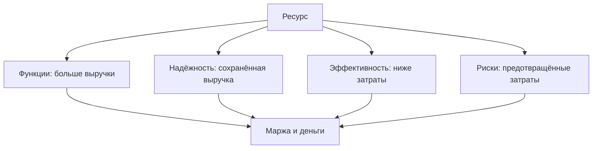
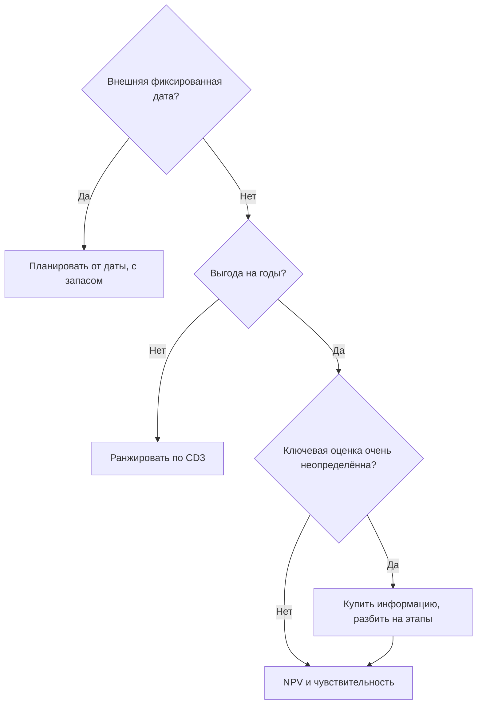

# Глава 45 — Бизнес-модели, экономика разработки и инвестиционные решения { #chapter-45-business-models-engineering-economics-and-investment-decisions }

Каждая инженерная неделя, потраченная на одно, отнята у другого. Экономика разработки делает этот выбор
явным: считает в деньгах там, где деньги честно отражают суть, учитывает время и прямо называет
неопределённость. Эта глава учит читать бизнес-модель, оценивать время через стоимость задержки и
альтернативные издержки и сравнивать инвестиции в единой рамке: срок окупаемости, чистая приведённая
стоимость, реальные опционы на уровне практика. Сквозной пример — вымышленная компания
[Northstar Technologies](../../case-studies/northstar/index.md).

## Почему это важно { #why-this-matters }

**В команде** руководитель, который не может сказать, чего стоит работа, проигрывает любой спор о
приоритетах тому, кто громче. Довод «этого хотят продажи» будет побеждать довод «правила ценообразования
то и дело будят дежурных», пока кто-нибудь не выразит оба в одной единице.

**В организации** директор распределяет фиксированный ресурс между продуктом, профилактикой и платформой
(глава 38). В базовом квартале Northstar [незапланированная работа](../../glossary.md#unplanned-work)
съедала примерно $5,0 млн инженерного ресурса в год (34% времени 80 инженеров), а
[сервисные кредиты](../../glossary.md#service-credits) (компенсации, которые компания должна клиентам, когда
доступность опускается ниже договорной) за квартал составили $410 000. Если директор не умеет связать
такие цифры с выручкой и маржой, он будет финансировать всё, к чему приложено имя клиента.

**Для высшего руководства** CFO (финансовый директор) и CEO (генеральный директор) думают категориями
регулярной выручки, маржи, денежных средств и риска. CTO с графиками скорости команды для них —
руководитель центра затрат. А CTO, который говорит: «Это защищает два продления на $9 млн, стоит около
$250 000 ресурса и при этих допущениях окупается примерно за год», — равный собеседник.

## Цели главы { #learning-objectives }

После этой главы вы сможете:

- Читать бизнес-модель компании и находить места, где инженерная работа меняет выручку, маржу и риск.
- Оценивать стоимость задержки задачи: выбирать профиль срочности и записывать каждое допущение.
- Определять альтернативные издержки решения о ресурсе как ценность лучшей из вытесненных альтернатив.
- Сравнивать в портфеле инвестиции разной формы по сроку окупаемости и чистой приведённой стоимости,
  применять поэтапное инвестирование (по образцу опционов) и замечать, как такие расчёты подгоняют.

Связанные главы: глава 15 ввела стоимость задержки как правило ранжирования, глава 21 оценивала с её
помощью долг; эта глава объясняет экономику, на которой держатся обе. Финансовую отчётность и
бюджетирование разбирает глава 52.

## Ментальная модель { #the-mental-model }

> **Ментальная модель:** ресурс фиксирован, поэтому каждое «да» — это «нет» с ценой. Задайте любой
> инвестиции три вопроса: откуда берутся её деньги (бизнес-модель), чего стоит ожидание (стоимость
> задержки) и что ещё можно было бы купить тем же ресурсом (альтернативные издержки). Затем сравните ответы
> в одной рамке, а допущения запишите там, где другая сторона сможет их оспорить.

Первый вопрос показывает, через какой канал работа влияет на деньги компании. У софтверной компании
таких каналов четыре, и это те же типы выгоды, по которым Arnold и Yüce раскладывали требования в Maersk Line: рост выручки, защита выручки, снижение затрат и предотвращение
затрат ([Arnold and Yüce, 2013](../../references/bibliography.md#arnold2013blackswan)). Функции обычно
увеличивают выручку, надёжность обычно её защищает, автоматизация и повышение эффективности снижают
затраты, а работа над безопасностью и соответствием требованиям (compliance) обычно предотвращает
затраты, которых ещё не было.

О четырёх видах работы спорят обычно на четырёх разных языках, но ведут все они в одну точку. Каждая
стрелка — гипотеза, у которой есть размер и вероятность; задача директора — сделать эти гипотезы явными
и сопоставимыми. Отсюда два следствия. Первое: **время — это затраты**. Функция, которая приносит
$10 000 в неделю, но выходит на десять недель позже, теряет около $100 000. Второе: **цена инженерной
работы — то, что она вытесняет**, а не зарплаты. При фиксированной численности зарплаты платят, что бы
вы ни выбрали.

## Подробный разбор { #deep-conceptual-explanation }

### Как читать бизнес-модель { #reading-a-business-model }

Бизнес-модель — это гипотеза о том, как компания получает деньги. Teece в аннотации описывает её как
способ, которым предприятие приносит клиентам ценность, побуждает их платить за неё и превращает эти
платежи в прибыль ([Teece, 2010](../../references/bibliography.md#teece2010business)). Для руководителя
разработки она сводится к пяти вопросам, на которые можно ответить за час вместе с финансовым партнёром:

| Вопрос | Что выяснить | Почему это важно разработке |
|---|---|---|
| Кто платит и за что? | Покупатель, единица ценообразования (место, транзакция, тариф, контракт) | Какие возможности двигают цену или объём |
| Как выручка становится регулярной? | Годовая регулярная выручка (ARR), цикл продления, расширение, отток | Надёжность и качество сказываются при продлении, а не при поставке |
| Сколько стоит обслуживать клиента? | Валовая маржа: выручка минус хостинг, поддержка, платёжные комиссии, сервисные кредиты | Затраты на облако и нагрузка от инцидентов — это маржа, а не накладные расходы |
| Что обещают контракты? | Обязательства по доступности, кредиты, обязательства по безопасности | Нарушение напрямую превращается в потерянную выручку |
| Где она сосредоточена? | Доля выручки крупнейших клиентов, сегментов, регионов | Дефект, который задевает 40 крупнейших клиентов, — событие другого масштаба |

**[ARR](../../glossary.md#arr)** (годовая регулярная выручка) — годовая стоимость действующих
подписочных контрактов. **Отток** (churn) — выручка, которую компания теряет, когда клиенты уходят или
урезают контракты; **расширение** (expansion) — выручка, которую приносят действующие клиенты, когда
покупают больше. **[Валовая маржа](../../glossary.md#gross-margin)** — доля выручки, которая остаётся
после затрат на оказание сервиса. Поэтому доллар новой выручки стоит для компании меньше доллара, а
доллар предотвращённых сервисных кредитов — полный доллар: кредит — это возвращённая выручка, и затрат
на поставку за ним нет (**рекомендация книги**).

Стратегия работает как фильтр. Lafley и Martin описывают её как выбор того, где играть и как выигрывать
([Lafley and Martin, 2013](../../references/bibliography.md#lafley2013playing)). Если компания решила не
играть в каком-то сегменте, инвестиция в этот сегмент стоит меньше, чем показывает таблица, как бы ни
была крупна сделка.

### Стоимость задержки: определение, форма и происхождение { #cost-of-delay-definition-shape-and-origin }

**[Стоимость задержки](../../glossary.md#cost-of-delay)** (cost of delay) — ценность, которую теряют за
единицу времени, пока работа не сделана. Arnold и Yüce определяют стоимость задержки функции как
ценность, которую функция создавала бы, будь она доступна уже сейчас, включая то, чему научила бы её
разработка, — и то, как обе величины убывают со временем
([Arnold and Yüce, 2013](../../references/bibliography.md#arnold2013blackswan)). Ранжирование, которое отсюда следует,
разбирает глава 15 ([CD3](../../glossary.md#cd3-and-wsjf) — стоимость задержки, делённая на
длительность; см.
[приоритизацию как экономику](../04-execution/15-planning-prioritization-and-delivery-methods.md#prioritization-as-economics));
там же разобрана версия SAFe с относительными баллами, WSJF
([SAFe, WSJF](../../references/bibliography.md#safe-wsjf)). Этот раздел добавляет к ним форму стоимости
задержки, способ её оценки и доказательства.

**Форма.** Стоимость задержки редко бывает постоянной. Arnold и Yüce описывают профили срочности, от
которых зависит, как оценивать задержку:

| Профиль | Что происходит при опоздании | Типичный инженерный пример |
|---|---|---|
| Долгая жизнь, пик не затронут | Выгоды сдвигаются позже; пик тот же | Автоматизация, эффективность, большая часть профилактики |
| Долгая жизнь, пик затронут | Конкурент или альтернатива клиента навсегда забирает часть рынка | Возможности, от которых зависит выбор платформы |
| Короткая жизнь, пик затронут | Окно закрывается; поздняя поставка ненадолго даёт более низкий пик | Сезонные функции или функции под событие |
| Внешний срок | До даты ничего не теряется, после неё — многое | Условия продления, регуляторные даты |

Для первого профиля стоимость задержки в неделю примерно равна недельной выгоде. Для второго добавьте
постоянную потерю: оцените, какую долю рынка каждая неделя задержки отнимает навсегда, и умножьте её на
годовую маржу этой доли и на число лет, которые вы учитываете. Задачу с дедлайном не ранжируют по
отношению, а планируют от даты назад, с запасом. Так Northstar поступила со своими двумя обязательствами
по продлению — функциями, без которых два крупных клиента не соглашались продлевать контракты
(глава 15).

**Оценка.** В Maersk Line требования раскладывали по четырём типам выгоды меньше чем за неделю, а
допущения открыто обсуждали и оспаривали на еженедельных встречах; заявленной целью была правильность, а
не точность (Arnold and Yüce, 2013). На практике на каждую задачу хватает формулы в одну строку,
например: ARR сделки × вероятность того, что функция решит исход сделки, × валовая маржа ÷ 52. Каждый
множитель — утверждение, у которого есть владелец и которое потом можно проверить.

**Доказательства.** В кейсе Maersk Line стоимость задержки применяли к портфелю примерно на $100 млн.
Для одной функции она составляла около $210 000 в неделю, и 38 недель ожидания в очередях обошлись почти
в $8 млн упущенных возможностей. Считайте это **задокументированной практикой**: компания одна,
контрольной группы нет, а вместе с этим методом вводились и другие практики. Кейс показывает, что метод
работает в масштабе портфеля, но не показывает, насколько он помогает.

Популяризацию этой идеи в разработке продуктов обычно приписывают Donald Reinertsen
([Reinertsen, 2009](../../references/bibliography.md#reinertsen2009principles)).

### Альтернативные издержки и невозвратные затраты { #opportunity-cost-and-sunk-cost }

Экономисты называют **[альтернативными издержками](../../glossary.md#opportunity-cost-and-sunk-cost)**
(opportunity cost) ценность лучшей из альтернатив, от которых отказываются при выборе. **Невозвратные
затраты** (sunk costs) — уже понесённые затраты, которые нельзя вернуть; решая, что делать дальше, их
следует игнорировать ([Greenlaw et al., 2022](../../references/bibliography.md#greenlaw2022economics)).
Планирование в разработке регулярно нарушает оба правила.

При фиксированной численности альтернативные издержки проекта на 70
[инженеро-недель](../../glossary.md#engineer-week-engineer-day-engineer-year) — это не его зарплатная
стоимость (около $249 000), а ценность лучшей работы, которую можно было бы сделать за эти недели;
обычно это стоимость задержки вытесненной задачи. Зарплатная стоимость остаётся полезной мерой. Но если
сравнивать с ней каждый проект, портфель будет одобрять всё, что ценнее собственного фонда оплаты труда,
и ни разу не спросит, не было ли что-то другое ещё ценнее.

**Ставка книги для инженерного времени.** Везде, где книга переводит ресурс в деньги, она пользуется
одной плановой ставкой: **$3 558 за инженеро-неделю**. Это средняя
[полная стоимость сотрудника](../../glossary.md#fully-loaded-cost) в Northstar ($185 000), делённая на 52 недели; на
[FTE-квартал](../../glossary.md#fte-quarter) та же ставка даёт $46 250. В нескольких главах встречается
**дневная ставка финансов**: $800 за инженеро-день ($185 000, делённые примерно на 230 рабочих дней). На
день она выходит выше, потому что финансы считают только рабочие дни. Ещё одно число, $157 250 за
капитализированный FTE-год, — это капитализируемая доля (85%) от $185 000 (глава 52). Договоритесь с
финансами об одной ставке и пользуйтесь ею везде.

**Деньги и ресурс.** Экономия бывает двух видов, и CFO читает их по-разному. **Денежная экономия**
(меньше кредитов, счетов за облако или расходов на подрядчиков) сокращает платежи компании.
**Возвращённый ресурс** (инженеры, освобождённые от незапланированной работы) ничего не сокращает:
зарплаты платят в любом случае. Ценность такого ресурса равна стоимости задержки той работы, которой эти
инженеры теперь заняты. Оценивать его по зарплате, как в примерах ниже, — условность, о которой нужно
договориться с финансами; денежной величиной такая оценка не становится. Бизнес-кейс, который опирается
на возвращённый ресурс, всегда показывайте в двух вариантах и подписывайте их: «только деньги» и «деньги
плюс ресурс».

Невозвратные затраты слышны во фразе «мы прошли уже 60% миграции». Важно лишь одно: сколько стоят
оставшиеся 40% по сравнению с тем, что они дадут. Почему люди всё равно продолжают, разбирает глава 43
(эскалация приверженности); экономическое правило простое — оценивать только будущее.

### Дисконтирование: сколько стоит сегодня будущий доллар { #discounting-what-a-future-dollar-is-worth-today }

Доллар через год стоит меньше, чем доллар сегодня. В этом и состоит **стоимость денег во времени**:
сегодняшний доллар можно вложить, и он успеет принести доход, а доллар, обещанный на потом, может и не
прийти. Чтобы сравнивать деньги, которые поступают в разные даты, финансы переводят каждую будущую сумму
в её **приведённую стоимость** (present value), то есть в то, сколько она стоит сегодня.

Для такого пересчёта нужна [ставка дисконтирования](../../glossary.md#discount-rate-and-hurdle-rate) —
годовой процент. В теории это **стоимость капитала** компании: доходность, которую кредиторы и инвесторы
ожидают получить за то, что финансируют компанию. Оценить её трудно, поэтому большинство финансовых
команд задают **барьерную ставку** (hurdle rate) — минимальную годовую доходность, которую они готовы
принять от инвестиции, — и просят всех пользоваться ею. Финансы Northstar берут 10%.

При ставке r доллар, полученный через n лет, сегодня стоит 1 ÷ (1 + r)^n. Это число называют
**коэффициентом дисконтирования**. При 10% коэффициент каждого года равен коэффициенту предыдущего,
делённому на 1,10:

| Год | Расчёт | Коэффициент дисконтирования | Сколько сегодня стоят $100,000, полученные в этот год |
|---|---|---|---|
| 1 | 1 ÷ 1.10 | 0.909 | $90,900 |
| 2 | 1 ÷ 1.21 | 0.826 | $82,600 |
| 3 | 1 ÷ 1.331 | 0.751 | $75,100 |
| 4 | 1 ÷ 1.4641 | 0.683 | $68,300 |

Если проект каждый год приносит одну и ту же сумму, сложите коэффициенты. За три года при 10% получается
0,909 + 0,826 + 0,751 = 2,487 — это трёхлетний **коэффициент аннуитета**. Умножив на него постоянную
годовую выгоду, вы получите её приведённую стоимость. Если суммы по годам разные, дисконтируйте каждый
год отдельно.

**[Чистая приведённая стоимость (NPV)](../../glossary.md#net-present-value-npv)** — приведённая
стоимость того, что приносит проект, минус приведённая стоимость того, во что он обходится. Инженерный
ресурс обычно тратят в самом начале, в год 0, поэтому коэффициент для него равен 1. Пример: проект
требует $200 000 ресурса сейчас и три года приносит по $100 000 в год.

| Строка | Расчёт | Значение |
|---|---|---|
| Приведённая стоимость выгод | $100,000 × 2.487 | $248,700 |
| Приведённая стоимость затрат | $200,000 × 1 | $200,000 |
| NPV | $248,700 − $200,000 | +$48,700 |

Положительная NPV означает, что проект приносит больше барьерной ставки, отрицательная — что при такой
ставке ресурс заработал бы больше в другом месте. Без дисконтирования тот же проект выглядит выигрышем в
$100 000. Дисконтирование съедает примерно половину, и тем больше, чем позже приходят выгоды.

### Единая рамка: срок окупаемости, чистая приведённая стоимость и опционы { #a-common-frame-payback-net-present-value-and-options }

На один и тот же ресурс претендуют функция, которая три года приносит выручку, пакет профилактики,
платформа и автоматизация. Форма у этих инвестиций разная, и единая рамка делает различия видимыми.

**Срок окупаемости** (payback period) — время, за которое проект возвращает первоначальные затраты за
счёт денежных потоков, которые он создаёт. Его легко объяснить, но слабости его хорошо известны: он не
учитывает стоимость денег во времени, опирается на произвольную границу, игнорирует всё, что происходит
после даты окупаемости, и не отличает неопределённые денежные потоки от определённых
([Dahlquist and Knight, 2022](../../references/bibliography.md#dahlquist2022finance)).

**Чистая приведённая стоимость** из предыдущего раздела даёт простое правило: положительные значения
принимают, отрицательные отвергают. Стоимость капитала трудно оценить, поэтому тот же учебник советует
проверять, насколько ответ чувствителен к ставке (Dahlquist and Knight, 2022). На практике берите
барьерную ставку финансов. Выгоды от ПО считайте за два-три года, а не за десять: горизонт сдвигает
ответ сильнее, чем ставка. И оценивайте ресурс одинаково во всех вариантах: на деле их сравнивают друг с
другом, а не с нулём.

**Реальные опционы.** Когда инвестицию трудно обратить, ожидание более полной информации имеет ценность.
Издательская аннотация к книге Dixit и Pindyck подчёркивает, что большинство инвестиций необратимы, а у
ожидания есть опционная ценность — по аналогии с финансовыми опционами
([Dixit and Pindyck, 1994](../../references/bibliography.md#dixit1994investment)). Sullivan и коллеги сообщают в аннотации,
что методы реальных опционов, применённые к модульным программным архитектурам, дали результаты,
согласующиеся с доводом Parnas в пользу сокрытия информации
([Sullivan et al., 2001](../../references/bibliography.md#sullivan2001modularity)). На уровне практика, без формул, идея
сводится к трём правилам (**рекомендация книги**):

1. **Покупайте информацию перед необратимым обязательством**, когда неопределённость высока. Спайк,
   прототип или встреча с потенциальным клиентом для уточнения объёма — это опционная премия.
2. **Разбивайте крупные инвестиции на этапы**, чтобы каждый этап окупал себя или давал информацию, от
   которой зависит следующий.
3. **Цените гибкость, только если кто-то ею воспользуется.** «Это оставляет нам варианты» — ещё не
   оценка, если не просматривается изменение, при котором этот опцион пригодится.

Диаграмма показывает, куда направить вопрос; это не лестница всё более изощрённых методов. Большинству
еженедельных решений хватает CD3. NPV оправдывает усилия на инвестициях длиной в несколько кварталов. А
если одна оценка способна перевернуть ответ, первой идёт разбивка на этапы. Мастерство в том, чтобы
знать, какие допущения определяют результат
([Berman and Knight, 2006](../../references/bibliography.md#berman2006financial)).

## Пример из инженерной организации { #engineering-organization-example }

!!! info "Northstar: что уже известно"
    Неделя 31 первого года директора. Число инцидентов [Sev1 и Sev2](../../glossary.md#severity-sev1-sev2-sev3)
    (два самых серьёзных уровня) упало с 30 за квартал до 17 к кварталу 2, а сервисные кредиты — с
    $410 000 до $95 000. Обе функции для продлений выпущены. Greg Tanaka (VP по продажам) только что
    попросил третью функцию для сделки. См. [хронологию](../../case-studies/northstar/timeline.md).
    Впервые читаете о Northstar? Прочитайте [«Год вкратце»](../../case-studies/northstar/year-in-brief.md),
    [действующих лиц](../../case-studies/northstar/cast.md) и
    [брифинг квартала 4](../../case-studies/northstar/quarter-4-briefing.md).

Пример ниже — **иллюстрация**, как и все цифры Northstar. Пакет профилактики, оценки затрат и вероятностей
— допущения этого примера.

**Шаг 1: бизнес-модель в цифрах.** Northstar продаёт платформу order-to-cash («от заказа до оплаты»)
примерно 1 900 дистрибьюторам по регулярным контрактам. На пути заказа и оплаты действует обязательство
по доступности 99,9% за квартал, подкреплённое сервисными кредитами.

| Показатель | Значение |
|---|---|
| ARR | $140M |
| 40 крупнейших клиентов | около $46.7M (треть), около $1.17M на клиента |
| Остальные 1,860 клиентов | около $93.3M, около $50,000 на клиента |
| Сервисные кредиты, базовый квартал | $410,000 ($1.64M в год, 1.2 процента ARR) |
| Сервисные кредиты, квартал 2 | $95,000 ($380,000 в год в пересчёте на год) |
| Валовая маржа | 72 процента, применяется только к новой выручке |
| Барьерная ставка финансов | 10 процентов в год, используется для NPV |

Как читать таблицу. Выручка сконцентрирована: 40 клиентов приносят вдвое меньше, чем остальные 1 860
вместе взятые, а потеря одного клиента из топ-40 обходится так же, как потеря примерно 23 остальных.
Кредиты упали с $410 000 до $95 000 в квартал, и денежный довод за профилактику ослаб: теперь он
держится скорее на продлениях и на ресурсе, который возвращается из незапланированной работы.

**Шаг 2: три кандидата на инвестиции.** Все три сравнивают как способы потратить ресурс — в том виде, в
каком их видел директор на неделе 31. A и C — пункты из портфеля главы 42; B — гипотетический пакет
профилактики.

Входные данные:

| Инвестиция | Канал | Объём (инженеро-недели) | Вероятность успеха |
|---|---|---|---|
| A. Правила согласования закупок | Рост выручки | 70 (около $249,000) | 0.5 |
| B. Профилактика на пути оплаты | Защита выручки, снижение затрат | 70 (около $249,000) | 0.6 |
| C. Выписки по сервисным кредитам | Снижение затрат | 50 (около $178,000) | 0.9 |

- **A:** потенциальный клиент на $700 000 ARR при марже 72% даёт $504 000 в год, из них вычитается
  $25 000 на поддержку. Вероятность 0,5 — это оценка Greg Tanaka, что клиент подпишет контракт; её никто
  не проверял.
- **B:** кредиты снижаются на $25 000 в квартал ($100 000 в год), и вдобавок из незапланированной работы
  возвращается 1 [FTE](../../glossary.md#fte) (эквивалент полной ставки инженера), то есть $185 000 в
  год.
- **C:** 160 часов аналитиков в квартал по $70 за час ($44 800 в год) плюс $15 000 в год за счёт
  предотвращённых споров с клиентами.

Результаты:

| Инвестиция | Ожидаемая выгода в год | NPV, 3 года при 10% | Стоимость задержки в неделю | Окупаемость |
|---|---|---|---|---|
| A | $227,000 | около +$315,000 | около $4,800 | 1.1 года |
| B | $171,000 | около +$176,000 | около $3,300 | 1.5 года |
| C | около $54,000 | около −$44,000 | около $1,000 | 3.3 года |

Как рассчитано: NPV — это ожидаемая выгода × 2,487 (коэффициент аннуитета) − объём; стоимость задержки —
ожидаемая выгода ÷ 52. Расходы A на поддержку в стоимость задержки не входят, потому что начинаются
только после запуска.

**Шаг 3: о чём на самом деле говорит таблица.** Сам порядок A, B, C менее интересен, чем его хрупкость:

- **A держится на одном числе.** При вероятности выигрыша 0,25 ожидаемая выгода A падает до $101 000 в
  год, а NPV — примерно до $2 000, то есть до точки безубыточности. Именно эту вероятность стоит
  уточнять, покупая информацию. А её владелец, спонсор, должен записать свою оценку, чтобы позже её
  можно было проверить.
- **Довод за B держится в основном на ресурсе.** Если считать только деньги (ожидаемая экономия на
  кредитах, 0,6 × $100 000 в год), NPV составит около −$100 000; до +$176 000 её поднимает возвращённый
  инженер. CFO спросит, чем этот инженер теперь будет заниматься. Ответ на этот вопрос и есть настоящая
  выгода B.
- **B к тому же недооценён:** в нём не учтена защита продлений. Если B снизит вероятность потерять
  одного клиента из топ-40 на 15 пунктов, одно это добавит около 0,15 × $1,17 млн × 72% = $126 000 в
  год, и B обойдёт A. Насколько это правдоподобно, покажут данные о продлениях, которые есть у Sofia
  Alvarez (VP по работе с клиентами).
- **B и C влияют друг на друга.** Чем больше кредитов проходит через C, тем он ценнее; если B сработает,
  C станет менее ценным.
- **C проигрывает по экономии затрат, но всё же может оказаться правильным выбором**, если точные
  выписки дают то, чего нет в таблице, — например, уверенность Rajiv Menon (CFO) в цифрах по кредитам.
  Рамка заставляет сказать об этом открыто.

## Как принимать решение { #decision-framework }

Выбирайте рамку по типу решения и называйте допущения, на которых оно держится.

| Ситуация | Рамка | Что назвать явно | Чего остерегаться |
|---|---|---|---|
| Порядок работы на неделю или квартал в одной команде | CD3 (глава 15) | Стоимость задержки в неделю, длительность, профиль срочности | Оценки спонсора, которые никто не проверяет |
| Задача с датой из контракта, регулирования или продления | Обратное планирование с запасом | Дата, lead time, запас, цена пропуска даты | Ранжирование по отношению вместо этого |
| Инвестиция на несколько кварталов, конкурирующая с функциями | NPV за 2–3 года плюс срок окупаемости | Горизонт, ставка, выгода в год, вероятность | Выгоды, посчитанные на десять лет |
| Одна оценка может перевернуть решение | Разбить на этапы; сначала купить информацию | Эта оценка, какие данные её изменят, сколько стоит их получить | «Опционная ценность» без видимого использования опциона |
| Предложение, которое экономит затраты или ресурс | NPV с ресурсом по себестоимости | Деньги это или ресурс | Ресурс, посчитанный как деньги |
| Продолжение наполовину сделанного проекта | Оставшиеся затраты против оставшейся ценности | Только будущие затраты | Невозвратные затраты, «мы уже столько прошли» |

Для каждой строки действуют две страховки (**рекомендация книги**). Первая: тот, кому число выгодно,
никогда не бывает его единственным автором; на крупных задачах входные данные проверяют финансы или
нейтральный рецензент. Вторая: каждую оценку, которая определила выбор, через квартал-два пересматривают
и сообщают о расхождении.

## Компромиссы { #trade-offs }

**Деньги и то, чего деньги не видят.** Доллары делают компромиссы сопоставимыми, но вытесняют то, что
трудно оценить: доверие, моральный дух, обучение. Называйте неоценённые факторы рядом с числом — и не
доверяйте решению, которое держится только на них.

**Доллары и относительные баллы.** WSJF из SAFe работает с относительными баллами: это быстро и не
создаёт ложной точности ([SAFe, WSJF](../../references/bibliography.md#safe-wsjf)). На доллары уходит
больше времени, зато их можно сверить с результатами и сложить по командам. Баллы годятся для порядка
работы внутри команды, доллары — для решений, которые будет читать CFO.

**Короткие горизонты и профилактика.** Трёхлетний горизонт честно учитывает, как быстро устаревает ПО,
но обделяет медленно растущие выгоды, например от платформы и профилактики. Посчитайте и на более
длинном горизонте и сообщите, если порядок меняется.

**Прозрачность и подгонка.** Опубликованные допущения открыты для критики, но заодно подсказывают
спонсорам, какие числа выигрывают. Противовес — проверки после решения.

## Типичные провалы { #failure-modes }

**Театр электронных таблиц.** NPV с точностью до доллара, построенные на догадках. Как заметить: нет
диапазонов, нет анализа чувствительности, у входных данных нет владельцев. Что делать: оставьте две
значащие цифры и покажите значение безубыточности для той оценки, от которой всё зависит.

**Число спонсора.** Вероятность выигрыша называет тот, кому нужна работа, и её никто не пересматривает.
Как заметить: у каждого запроса продаж вероятность 50%. Что делать: каждый квартал сравнивайте оценки с
результатами. Подгоняют метод именно здесь, поэтому здесь его и проверяют.

**Выручку принимают за ценность.** Новую выручку считают по номиналу, а предотвращённые кредиты и отток
оценивают в ноль. Как заметить: функция никогда не проигрывает работе над надёжностью. Что делать:
переводите выручку в маржу и оценивайте удержание клиентов в деньгах.

**Бесплатный инженер.** Зарплаты принимают за стоимость решения или, наоборот, считают ресурс
бесплатным, раз численность фиксирована. Как заметить: ни одно предложение не называет, что оно
вытесняет. Что делать: пусть каждый бизнес-кейс называет свои альтернативные издержки.

**Продолжение ради невозвратных затрат.** Как заметить: статус сообщают в процентах готовности, а
оставшуюся ценность не пересчитывают. Что делать: на каждом этапе решайте заново, учитывая только
будущие затраты.

**Театр опционов.** «Гибкостью» оправдывают абстракцию, которую никто не просил. Как заметить: не
названо ни одного изменения, которому она пригодилась бы. Что делать: назовите изменение и его
вероятность или откажитесь от этого довода.

**Задачи оценивают по отдельности.** Как заметить: два проекта записывают себе в выгоду одни и те же
кредиты. Что делать: прежде чем ранжировать, составьте карту взаимного влияния.

## Применение в крупной организации { #enterprise-application }

В организации из 50–150 инженеров экономика — общая практика директора, руководителя продукта и
финансового партнёра, а не чья-то личная таблица.

- **Одностраничный инвестиционный бизнес-кейс** для всего, что выше порога (скажем, четверти ресурса
  команды): канал, объём в виде диапазона, выгода и её владелец, вероятность, профиль срочности,
  альтернативные издержки и оценка, которая изменила бы ответ. Та же логика применяется к долгу — в
  [шаблоне реестра технического долга](../../templates/technical-debt-register.md).
- **Ресурс оценивают один раз** — по единой ставке полной стоимости, согласованной с финансами, и в
  категориях [шаблона модели планирования ресурсов](../../templates/capacity-planning-model.md)
  (глава 38).
- **Квартальный пересмотр оценок:** решающие оценки прошлого квартала сравнивают с результатами на
  обзорах из главы 39.
- **Взаимное влияние проверяют** на межкомандном форуме (глава 42).

Переход занимает два квартала: первый уходит на то, чтобы научить пользоваться одностраничником, второй
— на то, чтобы обнаружить, насколько ошибались первые оценки. Пользу приносит именно второй.

## Взгляд CTO { #cto-perspective }

Для высшего руководства разработка — это портфель инвестиций, и за его доходность CTO отвечает вместе с
CFO. Меняются три вещи.

Во-первых, **разговор переходит от затрат к распределению**. Совет директоров спрашивает, соответствует
ли стратегии соотношение между ростом, удержанием, эффективностью и риском. CTO, который показывает это
деление и ожидаемую доходность каждой части, отстаивает пропорции, а не оправдывает общую сумму.

Во-вторых, **риск становится категорией инвестиций**. Работа над надёжностью и безопасностью защищает
выручку и предотвращает потери, которые никогда не появляются отдельной строкой. В Northstar это стало
наглядно благодаря базовым кредитам ($1,64 млн в год) и двум продлениям на $9 млн, в которых клиенты
прямо называли надёжность своей заботой. Труднее другое: сохранить финансирование этой категории, когда
кредиты упадут и срочность пройдёт.

В-третьих, **CTO отвечает за честность чисел**. Бухгалтерские решения, например капитализация затрат на
разработку (глава 52), могут сделать проект на вид дешевле, не меняя его экономики. Вам доверяют, если
вы отделяете то, что инвестиция даёт, от того, как она отражена в учёте, и сообщаете, насколько точными
оказались оценки, включая промахи.

## Практический плейбук { #practical-playbook }

1. **Изучите бизнес-модель за одну встречу** с финансами: ARR, валовая маржа, отток, концентрация,
   договорные обязательства. Заполните таблицу из пяти вопросов.
2. **Разнесите крупные задачи по четырём каналам** и для каждой укажите сумму.
3. **Согласуйте с финансами одну ставку ресурса и одну барьерную ставку** и используйте их везде.
4. **Для каждой крупной задачи запишите строку стоимости задержки**: профиль срочности и владелец
   каждого множителя.
5. **Называйте альтернативные издержки** каждого «да».
6. **Для инвестиций на несколько кварталов считайте срок окупаемости и трёхлетнюю NPV**, а также
   значение безубыточности для самой неопределённой оценки.
7. **Разбивайте неопределённое на этапы**: сначала финансируйте самый дешёвый шаг, который измеряет
   решающую оценку.
8. **Проверяйте взаимное влияние** задач, которые опираются на одну и ту же выгоду или на одного и того
   же человека.
9. **Пересматривайте решающие оценки через квартал** и публикуйте расхождение.
10. **Докладывайте в единицах CFO** (маржа, деньги, риск) и держите допущения на той же странице.

## Кейс { #case-study }

Этот кейс **вымышленный**; действие происходит на неделях 31–34. Чем закончилось обсуждение на форуме,
не записано: решать вам. Кейс продолжает
[кейс главы 42](../09-engineering-directorship/42-cross-functional-dependencies-portfolio-and-influence.md#case-study).

**Ситуация.** Northstar ведёт одновременно не больше трёх межкомандных инициатив. Новая инициатива
стартует в фиксированном слоте, когда завершается одна из текущих; ближайшие слоты открываются на
неделях 33 и 34, и что в них попадёт, решает портфельный форум руководителей. На неделе 31 Greg Tanaka
попросил правила согласования закупок (около 70 инженеро-недель) для потенциального клиента, которого он
оценил примерно в $700 000 ARR; решение клиент примет на неделе 36. У форума недели 32 было три
варианта:

1. **Поставить в очередь** в слот недели 34 (прогноз — недели 44–47).
2. **Заменить**: поставить в слот недели 33, а выписки по сервисным кредитам, которых хочет Rajiv Menon,
   перенести на квартал 4.
3. **Начать сейчас** четвёртой инициативой. Это ставит под угрозу мультивалютные прайс-листы — одну из
   прежних функций, которые Greg просил под сделки; её дату уже пообещали в открытой сделке.

**Экономическая записка.** Перед форумом директор оценил варианты, взяв допущения из примера выше
(вероятность выигрыша 0,5, маржа 72%, выручка идёт с момента запуска):

| Эффект | Очередь против замены |
|---|---|
| При замене правила согласования выходят на неделю раньше | Около 1 × $4,800 = $4,800 выигрыша |
| Выписки начинаются в квартале 4, а не на неделе 33, предположительно примерно на 7 недель позже | Около 7 × $1,000 = $7,000 потерь |
| Итог | Около $2,000 в пользу очереди, глубоко в пределах погрешности каждой оценки |

Важнее итога оказались два вывода. Первый: **выбор между очередью и заменой — это шум**, несколько тысяч
долларов в ту или другую сторону. Второй: **оценки, которые действительно меняют картину, находились в
другом месте**. Изменение вероятности выигрыша на 5 пунктов стоит около 0,05 × $504 000 = $25 200 маржи
в год — в десять с лишним раз больше этой разницы. Глава 42 показала: к неделе 36 клиенту нужно было не
ПО, а надёжная дата и свидетельства того, что Northstar понимает его процесс согласования. Встречи для
уточнения объёма на неделях 32 и 33 и были той опционной премией, которая могла сдвинуть вероятность. А
ценность выписок зависела от того, будут ли кредиты выплачиваться и дальше; именно на это условие указал
Rajiv. Если кредиты останутся на уровне квартала 2 ($95 000 в квартал) или опустятся ниже, стоимость
задержки выписок снизится ещё больше.

Для третьего варианта строки в таблице не нашлось: он ставил под угрозу обещанную дату в открытой
сделке, а ценности этой сделки директор не знал. Записка прямо назвала это недостающей оценкой и не
стала её угадывать.

**Что решает читатель.** Должна ли записка сменить повестку форума (вместо порядка слотов — вероятность
выигрыша и риск по мультивалютным прайс-листам)? Какие оценки Greg и Rajiv должны письменно взять на
себя? Какие данные после недели 36 покажут, были ли оценки честными?

## Упражнения { #exercises }

Разборы упражнений: [решения к главе 45](../../solutions/ch45-solutions.md).

### Базовый уровень { #foundational }

**F1.** Руководитель продукта предлагает функцию отчётности для сегмента клиентов на $6 млн ARR. Продажи
считают, что функция снизит годовой отток этого сегмента с 10 до 8%. Валовая маржа компании — 75%, а
разработка функции займёт 12 недель команды из шести человек. Оцените стоимость задержки в неделю,
выберите профиль срочности и назовите два допущения, которые вы проверили бы первыми.

**F2.** В Northstar staff-инженер утверждает: раз численность не растёт, 70 инженеро-недель пакета
профилактики «ничего не стоят: эти зарплаты мы платим в любом случае». Аналитик CFO возражает, что пакет
стоит $249 000. Объясните, в чём ошибается каждый, назовите настоящую стоимость пакета в понятиях этой
главы и скажите, какое число должно стоять в инвестиционном бизнес-кейсе.

**F3.** Две инвестиции обходятся по $300 000 ресурса каждая. Первая приносит $200 000 в год в течение
двух лет; вторая ничего не приносит в первый год и по $250 000 в год со второго по четвёртый.
Рассчитайте для обеих срок окупаемости и NPV при 10%, скажите, какую предпочитает каждый метод, и
объясните, чему эта разница учит тех, кто считает только срок окупаемости.

### Прикладное лидерство { #applied-leadership }

**A1.** В Northstar на неделе 42 Sofia Alvarez сообщает, что один из 40 крупнейших клиентов поднял
вопрос надёжности на обзоре своего аккаунта, а продление у него на неделе 60. Пересчитайте сравнение
инвестиций A, B и C, добавив к B слагаемое защиты продления. Назовите вероятность, которую вы
закладываете, и обоснуйте её. Как изменятся порядок и стоимость задержки?

**A2.** Тимлид предлагает за полгода переписать компонент биллинга, ссылаясь на «гибкость для будущих
моделей ценообразования». Никаких изменений в ценообразовании не планируется. Опираясь на правила
реальных опционов, спроектируйте поэтапную альтернативу и скажите, что должен выяснить первый этап и
какие данные оправдали бы финансирование второго.

**A3.** Ваша организация два квартала пользуется оценками стоимости задержки. Обзор показывает, что по
девяти задачам, которые спонсировали продажи, медианная оценка стоимости задержки втрое превысила
ценность, полученную позже, а у задач надёжности оценки разошлись с фактом не больше чем на 30%.
Спроектируйте изменение процесса и набросайте, что вы скажете VP по продажам.

### Решения на уровне руководства { #executive-decision-making }

**X1.** В квартальный план Northstar на квартал 4 входит квота для сделок: ресурс, зарезервированный под
небольшие запросы продаж в пределах одной команды, чтобы им не приходилось ждать межкомандного слота.
План на квартал 3 финансировал около 49,9 FTE продуктовой работы из 80. Rajiv Menon спрашивает, какой
должна быть квота и как её оценивать. Опираясь на рамку этой главы и цифры кейса, предложите размер и
правило допуска запросов, назовите альтернативные издержки и опишите, какие данные через два квартала
заставили бы вас квоту уменьшить или убрать.

**X2.** Вы CTO компании из 400 инженеров, где кредиты и инциденты снижались четыре квартала подряд. CFO
предлагает перевести половину ресурса, выделенного на надёжность, на функции роста и ссылается на расчёт
NPV, в котором работа над надёжностью оценена только по предотвращённым кредитам. Напишите экономическое
обоснование, которое вы принесёте CEO и CFO: что упускает расчёт, как бы вы это оценили и какую часть
предложения CFO вы бы приняли.

## Вопросы для размышления { #reflection-questions }

1. Какой из ваших текущих проектов вы не смогли бы отнести ни к одному из четырёх каналов? Что это
   говорит о проекте — или о каналах?
2. Когда вы в последний раз одобрили работу потому, что её спонсор был настойчив, а не потому, что у неё
   была высокая стоимость задержки?
3. Какие числа в вашем планировании пишут люди, которым они выгодны, и кто потом их проверяет?
4. Что изменилось бы в вашем следующем разговоре о бюджете, если бы разработка была портфелем, а не
   статьёй затрат?

## Главное { #key-takeaways }

- Прежде чем спорить о приоритетах, прочитайте бизнес-модель: кто платит, как выручка становится
  регулярной, сколько стоит обслуживание, что обещано по контрактам, где концентрация.
- Относите каждую крупную инвестицию к одному из четырёх каналов и указывайте сумму и вероятность.
- Оценивайте время через стоимость задержки и профиль срочности; задачи с дедлайном планируйте в обратном
  порядке от даты.
- Стоимость решения о ресурсе — лучшая альтернатива, которую оно вытесняет, а не зарплаты, которые оно
  съедает; невозвратные затраты не считаются.
- Для порядка работы используйте CD3, для инвестиций на несколько кварталов — NPV с анализом
  чувствительности, а разбивку на этапы — когда ответ решает одна оценка.
- Переводите выручку в маржу: доллар предотвращённых кредитов стоит больше доллара новой выручки.
- У каждой решающей оценки есть владелец и последующая проверка; так метод защищают от подгонки.
- Если варианты различаются меньше, чем погрешность их входных данных, перестаньте о них спорить и
  потратьте время на оценку, которая меняет ответ.

## Источники и что почитать { #references-and-further-reading }

- [Arnold and Yüce, 2013](../../references/bibliography.md#arnold2013blackswan): стоимость задержки в
  масштабе портфеля в Maersk Line; типы выгоды и профили срочности. Описание кейса одной компании.
- [Teece, 2010](../../references/bibliography.md#teece2010business): определение бизнес-модели.
- [Dahlquist and Knight, 2022](../../references/bibliography.md#dahlquist2022finance): открытый учебник
  о сроке окупаемости и NPV, включая их слабости.
- [Greenlaw et al., 2022](../../references/bibliography.md#greenlaw2022economics): альтернативные издержки
  и невозвратные затраты.
- [Dixit and Pindyck, 1994](../../references/bibliography.md#dixit1994investment): инвестиции в условиях
  неопределённости и ценность ожидания.
- [Sullivan et al., 2001](../../references/bibliography.md#sullivan2001modularity): реальные опционы
  применительно к модульности ПО.
- [SAFe, WSJF](../../references/bibliography.md#safe-wsjf): стоимость задержки в относительных баллах,
  делённая на объём.
- [Reinertsen, 2009](../../references/bibliography.md#reinertsen2009principles): ему обычно приписывают
  популяризацию стоимости задержки в разработке продуктов.
- [Berman and Knight, 2006](../../references/bibliography.md#berman2006financial): финансовая грамотность
  для руководителей; мостик к главе 52.
- [Lafley and Martin, 2013](../../references/bibliography.md#lafley2013playing): стратегия как выбор того,
  где играть и как выигрывать.
