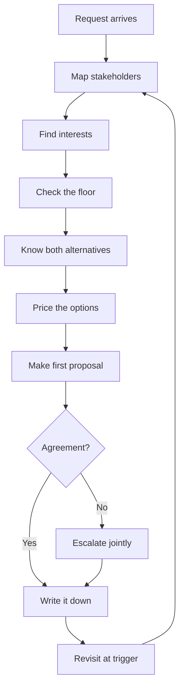
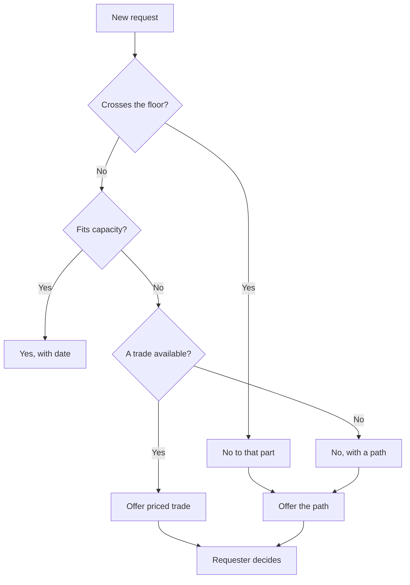

# Chapter 46 — Stakeholder Management and Negotiation

This chapter is about the negotiations an engineering leader conducts with the people around
engineering: the CTO, product, sales, finance, customer success, and the CEO. It covers mapping who
matters for a decision, and negotiating scope, time, and quality without quietly giving up the minimum
quality the organization depends on. It also covers saying no so that the relationship survives and
the other person leaves with a way forward. The running example is the Engineering Director at
Northstar Technologies, the fictional company in the [case study](../../case-studies/northstar/index.md),
in quarter 4.

## Why This Matters

At team scale, a manager who cannot negotiate becomes a pipe: requests flow through to the team,
dates are accepted before anyone sizes the work, and the gap is closed with overtime or by skipping
tests. The team learns that its manager's yes says nothing about feasibility.

At organization scale, a director negotiates the same few variables with the same five or six
executives every quarter. These are repeated games. A director who wins one meeting by pressure loses
the next three, and a director who concedes the quality floor once has set the price of every later
request.

At executive scale, the subject changes. The CTO negotiates the company's appetite for risk with the
CEO and the board: what reliability it promises customers, what it spends to keep the promise, and what
it will not trade for revenue. If engineering does not bring evidence to that negotiation, someone else
sets the number, often as a target that sounds simple and behaves badly once people are measured on it.

## Learning Objectives

After this chapter you will be able to:

- Map the stakeholders of a specific decision by interest and power, note where positions move with the
  issue, and plan engagement for each.
- Separate the tradeable variables of a request (scope, date, capacity, sequencing, and quality above
  the floor) from the quality floor, and write the floor down before you negotiate.
- Prepare a negotiation: interests behind positions, each side's alternative to agreement, priced
  options, and a first proposal grounded in your own target.
- Say no in a way that names the other person's interest, gives a reason in their terms, and offers a
  concrete path.
- Diagnose the failure modes of stakeholder work, from the stale map to the floor that moves.

Related chapters: Chapter 42 covers influence tactics and the limit on cross-team initiatives; this
chapter goes deeper on the negotiation itself.

## The Mental Model

> **Mental model:** A negotiation inside a company trades variables you have priced in advance,
> around a floor you wrote down before the meeting, with people you will meet again next quarter.

**Priced variables:** scope, date, capacity, sequencing, and quality work above the minimum are all
tradeable, and each trade has a cost you can state in engineer-weeks, risk, or displaced work. **A
written floor:** some things are not on the table, such as the severity definitions, the
[tier 1 operational minimums](../../glossary.md#tier-1-operational-minimums) (owner, alerts, runbook,
and on-call for every critical component), or the rule that a migration is rehearsed before it touches financial data. If the
floor is not written and owned before the meeting, it will be negotiated in the meeting.
**Repetition:** the counterpart is a colleague, so what matters is the agreement, the relationship, and
the precedent together.

Every agreement changes who cares about what, so the loop returns to the map.

## Deep Conceptual Explanation

### Who matters: interest, power, and how both move

A stakeholder in a decision is anyone who can affect it or is affected by it. The usual tool is a grid
of interest against power. Eden and Ackermann describe a widely used version
([Eden and Ackermann, 2021](../../references/bibliography.md#eden2021modelling)):

- **Players** (high power, high interest) deserve sustained attention.
- **Subjects** (high interest, low power) care but cannot decide, and may form coalitions that give
  them power.
- **Context setters** (high power, low interest) can change the outcome but are not yet paying
  attention. The work is to raise their awareness before they arrive late with a veto.
- The **crowd** is low on both.

Bryson's review of stakeholder techniques states the purpose: shape proposals that are technically feasible and
politically acceptable, and build a coalition able to adopt them
([Bryson, 2004](../../references/bibliography.md#bryson2004what)). Eden and Ackermann illustrate their
method with one case rather than testing it, and Bryson reviews techniques. Treat the grid as **expert
opinion**, not as a finding that mapping improves outcomes.

Three points from Eden and Ackermann change how to use the grid.

- **Positions are issue-specific.** In their case, a team could not place one stakeholder because its
  power and interest depended on the issue. A CFO is a player on the budget and a context setter on a
  severity definition, until severity starts to drive service credits. Map per decision, not per person.
- **Goals include things people want to avoid.** They recommend recording negative-avoidance goals, and
  note that about a third of the goals a team first writes down turn out to be strategies. "Hit the
  date" is usually a strategy; the goal behind it is "do not lose this renewal".
- **Stakeholders respond to each other.** Their distinctive step is to think through each player's
  response to a proposal, then the responses to those responses, while remembering these are informed
  guesses that are easily over-trusted.

Others add legitimacy and urgency as dimensions, they note. The most useful extra column for an
engineering leader is **stance with evidence**, with the date it was last checked.

### What can be traded, and what cannot

The project triangle trades scope, time, and cost. With flat headcount, cost becomes **capacity**, which
can only be moved between uses, and **quality** appears as a fifth variable in two layers.

The **quality floor** is the set of minimums the organization has already decided protect customers:
severity definitions, tier 1 operational minimums
([Chapter 20](../05-engineering-quality/20-engineering-standards-and-their-governance.md),
[Chapter 24](../05-engineering-quality/24-reliability-slos-and-operational-readiness.md)), the error
budget policy, rehearsal rules for financial data. Google's SRE book presents the
[error budget](../../glossary.md#error-budget-and-burn-rate) (the unreliability an objective allows) as a
shared, objective measure. It lets product and reliability engineers decide how much risk to take from
agreed numbers rather than by political argument
([Alvidrez, 2017](../../references/bibliography.md#google2017embracing)) (**documented practice**).
That is the floor's job: to move a recurring argument out of the meeting and into a rule agreed when no
deadline was pressing.

**Quality above the floor** is tradeable: test automation beyond the mandatory, polish on an admin
screen, a refactor now or recorded as debt ([Chapter 21](../05-engineering-quality/21-technical-debt.md)).
Trading it is legitimate when the trade is explicit and recorded.

Two tests tell the layers apart. A floor item has an owner, is written down, and applies to every team
whoever is asking. And it was set before the current request; a "non-negotiable" invented during a
negotiation is a position. A leader who calls everything the floor has no floor, only a reputation for
obstruction.

### What the research says about negotiating

Most negotiation research is laboratory work with students; two findings still transfer.

**Firmness and concern for the other side together produce better joint outcomes.** The abstract of a
meta-analysis of 28 studies reports that negotiators with a prosocial motive (concern for the other
party's outcome as well as their own) were less contentious and did more problem solving. They reached
higher joint outcomes, but only when their resistance to yielding was high or unknown, not when it was
low ([De Dreu et al., 2000](../../references/bibliography.md#dedreu2000influence)) (**research
finding**; study characteristics such as class-exercise participation moderated the effects). The
lesson for a director (**this book's recommendation**): caring about the CTO's problem and refusing to
move the floor are not in tension. The combination produces problem solving; care without firmness produces concessions.

**First offers anchor, and the antidote is preparation.** The abstract reports three experiments in
which whichever party made the first offer got a better outcome, and first offers strongly predicted
final prices. The advantage disappeared when the other negotiator focused on the opponent's
alternatives, the opponent's reservation price (the worst deal they would accept), or their own target
([Galinsky and Mussweiler, 2001](../../references/bibliography.md#galinsky2001first)) (**research
finding**, single-issue price negotiations). So: once you have prepared, make the first
concrete proposal. When someone has already anchored ("start Monday", "incidents below 10"), do not argue
from their number. Return to your own target, set from data before you heard theirs, and to what they
will do if you do not agree.

**Alternatives decide leverage.** *Getting to Yes* is widely known for principled negotiation and for
the best alternative to a negotiated agreement: what each side does if there is no deal
([Fisher and Ury, 1981](../../references/bibliography.md#fisher1981getting)) (**expert opinion**;
Chapter 42 introduced it). Inside a company the alternatives are odd. A director cannot walk away
from the CTO; their realistic alternatives are to accept and record a disagreement, to escalate jointly
([Chapter 39](../08-management-operating-system/39-reviews-decision-logs-escalation-and-executive-reporting.md)),
or to let the decision be made without engineering's evidence. The CTO's alternative is to decide alone.
With a weak alternative, the director's leverage is the quality of the proposal: a better option that
serves the CTO's interest.

### Saying no with a path

Most negotiations end in a partial no. This book's recommendation is a five-part structure:

1. **Name their interest** in their words: "You need a date the prospect can rely on."
2. **Say the no plainly and early.** Hedged noes are heard as yeses and discovered as noes later.
3. **Give the reason in their terms**: what it would displace, or the risk to their own goal.
4. **Offer at least one path**: smaller, later, traded, or another route to the same interest.
5. **Say what would change the answer, and when they will hear.**

The structure borrows from practitioner work taught in
[Chapter 6](../02-people-management/06-feedback-conflict-and-difficult-conversations.md): pairing
personal care with direct challenge ([Scott, 2017](../../references/bibliography.md#scott2017radical)),
and recognizing that a hard conversation also touches feelings and identity
([Stone, Patton, and Heen, 1999](../../references/bibliography.md#stone1999difficult)). Grove is known
for treating a manager's time as the scarcest input, to be spent on high-leverage work
([Grove, 1983](../../references/bibliography.md#grove1983high)); a leader who cannot say no has handed
their calendar, and their team's, to whoever asks most often. All three are **expert opinion**.

A request that crosses the floor still gets a path: the floor removes an option, not the conversation.

## Engineering Organization Example

An illustrative company of about 45 engineers; every number is invented. The head of product asks a
six-engineer team for a payroll export that an enterprise prospect wants within six weeks.

**Assumptions.** Estimate 30 engineer-weeks. Unplanned work takes a quarter of capacity, so the team
delivers about 4.5 engineer-weeks a week (6 × 0.75). Similar features grew about 20 percent after
starting. The floor requires a load test for bulk endpoints and a rehearsed backfill for payroll data.

| Option | Effort | Forecast | Cost |
|---|---|---|---|
| A. Full scope now | 30 to 36 engineer-weeks | Week 7 or 8 | Prospect's date missed by one to two weeks |
| B. Scheduled CSV export first, configuration screen after | 18 to 21.6 engineer-weeks | Week 4 or 5 | Screen follows about three weeks later |
| C. Full scope, skip load test and rehearsal | 25 to 30 engineer-weeks | 5.6 to 6.7 weeks | Crosses the floor; may still miss week 6 |
| D. Full scope, borrow two engineers for four weeks | Nominal +8 engineer-weeks | Weeks 5 to 7 | Another team's committed item slips about four weeks |

Each forecast divides the effort by the team's 4.5 engineer-weeks a week; D's range allows for the
borrowed engineers' ramp-up.

Option C shows why the floor matters in arithmetic, not only in principle: scope growth alone consumes
what the shortcut saves. The leader does not offer it, and says so in one sentence if product raises it.

The conversation. The engineering manager asks what the prospect needs in week 6 and learns that its
first payroll run on the new system is in week 7. The interest is "data out before the first run", not
"the feature in week 6", and option B serves it. The manager proposes B first, with A and D priced, and
says what would change the answer: if the prospect needs the configuration screen for that first run,
D is reopened with the other team's manager present. Product chooses B.

## Decision Framework

Plan engagement per stakeholder for the decision at hand:

| Position for this decision | Engagement | Typical mistake |
|---|---|---|
| Player | Consult before the proposal is final, one-to-one before any group meeting | Presenting a finished plan to them in a group |
| Subject | Involve in shaping options; tell them early what was decided and why | Treating them as an audience; they may form a coalition |
| Context setter | A short briefing on the one point that touches them; ask what would make them object | Ignoring them until they arrive with a veto |
| Crowd | Normal channels | Spending attention you will need later |

Then choose the approach:

| Situation | Approach | Watch for |
|---|---|---|
| Interests can be served together | Integrative: find the interest, price options, propose first | Splitting the difference on an estimate |
| A fixed amount is divided (this quarter's capacity) | Distributive but transparent: show the whole and what each slice displaces | Hidden padding, discovered later |
| The request crosses the floor | No to that part, with a path that serves the interest | Moving the floor "just this once" |
| Your alternative is weak; theirs is to decide alone | Bring the better option in writing before their anchor hardens | Arguing from their number |
| No agreement | Joint escalation through the published path | Escalating alone, which reads as going around them |

## Trade-offs

**Preparation against speed.** Reserve full preparation for decisions with a player on the other side
and the floor at risk; answer routine requests from the capacity plan ([Chapter 38](../08-management-operating-system/38-scorecards-quarterly-planning-and-capacity-allocation.md)).

**Pre-meeting consultation against the appearance of politics.** One-to-ones before a group decision
avoid public surprises and let people move without losing face. They become lobbying when the most
affected person hears last. The person bearing the cost hears first.

**Moving first against learning the interest.** The anchoring research favors moving first, but moving
first before you know the interest anchors the wrong problem. Ask, then propose.

**A firm floor against a reputation for rigidity.** A floor protects customers only if it holds under
pressure, and it is tolerated only if it is small, written, and applied to engineering's own wishes too.
Review it yearly, not in the meeting where it is inconvenient.

**Written agreements against flexibility.** Recording a trade (what was given and received, what
triggers a revisit) takes ten minutes, prevents two honest memories of different deals, and makes the
agreement harder to change informally.

## Failure Modes

**The moving floor.** The minimum drops one exception at a time under deadline: a migration not
rehearsed, a severity rating softened, alerts "after launch". Detect it by counting floor exceptions per
quarter and who approved them.

**Everything is the floor.** Every preference is called non-negotiable; product stops consulting
engineering. Detect it when requests arrive as announced dates rather than
questions.

**The stale map.** Stance columns record what people said two quarters ago. Detect it by the
last-checked date, and by surprises: a context setter who appears with a veto was misplaced.

**Splitting the difference on an estimate.** Product says four weeks, engineering eight, they agree on
six. An estimate is a forecast, not an offer
([Chapter 17](../04-execution/17-predictability-and-managing-uncertainty.md)); halving the gap changes
the commitment, not the work.

**Yes now, no later.** Agreed in the room, missed in week 9; each miss devalues every later yes.
Compare negotiated commitments with delivery, per leader.

**Winning the meeting.** Won by pressure or by lining up executives against a peer; the next
negotiation with that peer starts in deficit (Chapter 42).

## Enterprise Application

In an organization of 50 to 150 engineers, a director has ten to fifteen recurring stakeholders: the
CTO, four or five executive peers, product leaders, finance's business partner, security, and large
customers through customer success. The work becomes a system.

1. **A standing map per quarter, issue maps per major decision.** The quarterly map records stance and
   evidence for recurring players; issue maps are drawn for the two or three decisions a quarter where a
   player's interest meets the floor. The [stakeholder map template](../../templates/stakeholder-map.md)
   has the columns.
2. **A written floor with owners.** It lives with the standards, fits on a page, and has named owners
   who decide exceptions with an expiry, so "not on the table" refers to a published rule.
3. **Managers negotiate with their own peers.** First-line managers negotiate with product managers
   daily. The director coaches the five-part no and steps in only when a player or the floor is
   involved, or becomes the bottleneck.
4. **A record of trades.** Significant trades go in the decision log with a revisit trigger. Over a year
   the log answers "engineering always says no" with what was traded for what.

## CTO Perspective

At CTO scale the floor itself is negotiated with the CEO and sometimes the board. The reliability
promised to customers, the security posture, the capacity kept for system health: these are company
decisions with engineering evidence, not engineering decisions with company consequences. A CTO who
treats them as engineering's private matter will see them overridden in a revenue crisis; one who
negotiated them openly can point to the agreement.

Upward, the arguments are risk, revenue, and cost in finance's terms; Chapter 42 notes that upward
influence works through persuasion rather than exchange. The CTO's most common failure is the simple target, a number chosen because it fits on a slide, which
then drives behavior below. Negotiate the form of a commitment (what is counted, over what window, with
what pair) as hard as its level.

Watkins's *The First 90 Days* is known for advising new leaders to negotiate expectations explicitly
with their own boss rather than guess them
([Watkins, 2003](../../references/bibliography.md#watkins2003first)) (**expert opinion**).
The CTO does this with the CEO and models it for directors doing it with the CTO.

## Practical Playbook

1. **Name the decision** in one sentence; map stakeholders for it, not for your job.
2. **Place each stakeholder** on the grid with one line of evidence for their stance and the date you
   last checked. Note anyone whose position moves with the issue.
3. **Write each player's interests**, including what they want to avoid; mark stated goals that are
   really strategies.
4. **Check the floor.** If something you want to protect is not written down, you are about to
   negotiate it; consider settling it as a separate decision first.
5. **Know both alternatives.** If theirs is "decide alone", your leverage is the proposal.
6. **Set your target from data** before reading their number, and price three or four options in
   engineer-weeks, dates, and displaced work.
7. **Talk to players one-to-one first**, asking before proposing; tell the most affected party first.
8. **Make the first concrete proposal** in writing, with the options beside it.
9. **If the answer is no, use the five parts.**
10. **Write the agreement down** with a revisit trigger; log significant trades.
11. **Refresh the map** each quarter and after any surprise.

## Case Study

!!! info "Northstar so far"
    Week 41 of the director's first year. [Sev1 and Sev2](../../glossary.md#severity-sev1-sev2-sev3)
    incidents (the two most severe levels) fell from 30 a quarter to 14 in quarter 3, availability
    reached 99.89 percent against a 99.9 commitment, and credits fell to $60,000. Prevention took 8
    [FTE](../../glossary.md#fte) of 80 engineers in quarter 3. See the
    [timeline](../../case-studies/northstar/timeline.md). New to Northstar? Read
    [the year in brief](../../case-studies/northstar/year-in-brief.md), the
    [cast](../../case-studies/northstar/cast.md), and the
    [quarter 4 briefing](../../case-studies/northstar/quarter-4-briefing.md).

This case is **fictional**, set in weeks 41 to 44; the decisions are yours. Quarter 3 is the latest
measured quarter, so the arithmetic uses it.

**The request.** The twelve-month mandate (halve Sev1 and Sev2 incidents from 30 a quarter, meet 99.9
percent, flat headcount) ends with quarter 4. In week 41 Victor Lindqvist asks for the engineering page
of the year-2 board plan by week 45 and proposes the headline he once suggested as an [OKR](../../glossary.md#okr) (a quarterly
objective with measurable key results): "Sev1 and
Sev2 incidents below 10 per quarter", headcount flat.

**The director's map for this decision.**

| Stakeholder | Position | Interest (and what they want to avoid) | Stance and evidence |
|---|---|---|---|
| Victor Lindqvist (CTO) | Player | A commitment the board understands; avoid a headcount request | Proposes the number; has used it before |
| Helena Marsh (CEO) | Player, through Victor | Renewals; an end to outage calls | Not yet asked |
| Rajiv Menon (CFO) | Context setter here, player on budget | Flat operating expense; service credits to stop ($60,000 in quarter 3) | Indifferent unless capacity or cost moves |
| Amara Okafor (CPO) | Player | Her committed roadmap; avoid prevention capacity growing again | Likely to support a price that returns capacity; would resist a trigger that takes it back |
| Sofia Alvarez (VP Customer Success) | Subject | Fewer escalations, honest status | Co-wrote the severity definitions |
| Greg Tanaka (VP Sales) | Crowd, unless capacity moves | Deal features | Becomes a player if deal work is cut |
| The six managers and Kwame Mensah (staff engineer, reliability) | Subjects | Not being judged on counts they partly do not control | Kwame stewards the severity data |
| The renewal customers' operations contacts | Context setters, through Sofia | Reliable ordering and payment | Contracts already fix 99.9 percent |

**The arithmetic.** "Below 10" means 9 or fewer, against 14 in quarter 3 (the first quarter at or below
the mandate's 15). The table treats incident counts as roughly Poisson, a standard model for counts of
independent events. The assumption only shows the size of chance variation;
[Chapter 18](../04-execution/18-measuring-engineering-productivity.md) covers intervals.

| True average per quarter | One quarter at 9 or fewer | All four quarters |
|---|---|---|
| 9 | 59% | 12% |
| 12 | 24% | under 1% |
| 14 | 11% | under 1% |

An organization that truly averages 9 misses "below 10" in about two quarters of five, and meets it four
quarters running about one year in eight. A target missed by chance this often pushes on the one
variable people can move quickly, the rating. The pressure already exists: in week 7 a two-hour payment
delay rated Sev3 had to be re-rated
([Chapter 27](../05-engineering-quality/27-quality-transformation-at-enterprise-scale.md)).

**The floor.** Severity definitions change only through their published owners; the weekly audit
continues; no manager is assessed on their team's count.

**The alternatives.** Victor's is to write the page himself with his number; the director's is to accept
and record a disagreement. Neither serves Victor: his number, missed by chance in the first quarter of
year 2, becomes his board problem. That is the director's opening.

**The director's draft counter** (whether to bring it, and in what form, is the reader's decision):

1. **Keep the count, change the window:** Sev1 and Sev2 at or below 40 over year 2 (10 a quarter on
   average), shown quarterly as a rolling four-quarter total with the audit result beside it. At a true
   average of 9 a quarter (36 a year), the annual total is 40 or fewer about 78 percent of the time.
2. **Pair it with the customer outcome:** contractual availability at or above 99.9 percent every
   quarter (99.89 percent in quarter 3, still below the commitment), with service credits as Rajiv's line.
3. **State the price:** prevention at 6 FTE in quarters 5 and 6 and 5 FTE in quarters 7 and 8, down
   from quarter 3's 8 FTE, with flat headcount
   ([Chapter 49](../11-vp-engineering/49-multi-year-transformation-communication-and-politics.md) builds
   the multi-year proposal around this price). The 2 to 3 FTE released (26 to 39 engineer-weeks a quarter) go back to product; the risk is whether 5 to 6 FTE can
   hold the total at 40.
4. **A trigger:** two consecutive quarters above 12 reopen the prevention allocation with Victor and
   Amara.

**The planned sequence.** First, a one-to-one with Victor in week 42, asking what the board needs
before showing anything. Then the written draft that week. Then Amara and Rajiv, briefed before week
44; Amara hears about the trigger in item 4, which could take capacity back from her plan.

**The reader decides:** whether to counter or accept; which form of commitment to propose; what to
concede on window or level; how to handle Amara if the trigger fires; and what to say if
Victor answers "the board wants a quarterly number".

## Exercises

Solutions are in [chapter 46 solutions](../../solutions/ch46-solutions.md). Northstar data is in the
[quarter 4 briefing](../../case-studies/northstar/quarter-4-briefing.md), the
[baseline data](../../case-studies/northstar/baseline-data.md), and
[the year 1 record](../../case-studies/northstar/first-quarter.md).

### Foundational

**F1.** Draw the power-interest grid for two Northstar decisions in quarter 4: the year-2 reliability
commitment in the case study, and a proposal to change the quarterly split of capacity between product
and prevention. Place Victor Lindqvist, Rajiv Menon, Amara Okafor, Greg Tanaka, Sofia Alvarez, and the
six managers on each. Identify at least two people whose quadrant changes between the decisions, explain
why, and say what that changes in your engagement plan.

**F2.** Before a planning negotiation a manager sends you eight "non-negotiables": the severity
definitions; migration rehearsal for tier 1 data; 80 percent line coverage on all new code; no Friday
deploys; the tier 1 runbook requirement; two reviewers on every merge request; the team's preferred
framework for a new service; on-call for every tier 1 component. Sort them into floor and preference
using this chapter's two tests, and say what you would do with the preferences.

**F3.** Greg Tanaka asks a manager for a small integration change for a prospect "by Friday". The
manager replies: "Sorry, we're slammed this sprint, maybe next quarter." Rewrite the reply with the
five-part structure. The change is about 3 engineer-weeks, the team's next free slot is in three weeks,
and a configuration workaround could cover the prospect's demo.

### Applied Leadership

**A1.** In week 43 Amara Okafor asks Billing for itemized credit notes on invoices for a renewal
customer by week 47. The team of Marcus Oyelaran (Billing manager) can make week 47 only by skipping the migration rehearsal,
which has been on the quality floor for tier 1 data since week 10; with it, the forecast is week 48 or 49. Amara says the customer was promised week 47.
Prepare the negotiation (interests, floor, both alternatives, priced options, first proposal) and write
the first two minutes of what Marcus should say.

**A2.** Greg Tanaka opens a meeting with "the prospect needs purchase-order import live by week 48, so
start Monday". Nothing is sized, and he has anchored a date. Using the first-offer research, describe what you
do in this meeting and before the next, and what you avoid saying.

**A3.** In quarter 4 you notice that one of your managers accepts every request from their product
manager and then misses about a third of the dates; their team has the highest unplanned work in the
organization. Design a six-week coaching plan that builds this chapter's negotiation skills, with the
evidence you would look for that it is working.

### Executive Decision-Making

**X1.** You are the director in the case study. Write the one-page response to Victor Lindqvist's
proposal for the year-2 board page, and the plan for the conversations before you send it. Decide
whether to counter or accept, state what you will not trade and why, and include arithmetic a board
member could check.

**X2.** In week 43, before you have spoken to Victor, Helena Marsh stops you after a meeting: "Victor
says we can get below ten incidents a quarter next year. Can we?" Decide what you say in the moment,
what you do afterward, and how you avoid both misleading the CEO and going around your manager.

## Reflection Questions

1. Which of your current "non-negotiables" were written down before the last time you invoked them?
2. In your last hard negotiation, did you know the other person's alternative to agreement, or only
   their position?
3. Whose stance on your map rests on something they said more than a quarter ago?
4. When did you last make the first concrete proposal instead of responding to someone else's number?
5. Which recent yes would your team call a no you did not say?
6. Of the requests you declined last quarter, how many left without a path?

## Key Takeaways

- Map stakeholders per decision, not per person; the same executive can be a player on one issue and a
  context setter on the next.
- Record what each player wants to avoid; the request is often a strategy for an interest you can serve
  another way.
- Write the quality floor down, with owners, before any negotiation; anything unwritten will be traded
  under deadline.
- Keep the floor small and apply it to engineering's own wishes, or it becomes obstruction.
- Firmness on the floor and concern for the other side's problem belong together; the research
  associates the combination with problem solving.
- Set your target from data before you hear their number, and make the first proposal once you know the
  interest.
- Never negotiate a forecast; negotiate scope, date, capacity, or sequencing.
- Every no carries a path and a statement of what would change it.
- Record negotiated trades with a revisit trigger.

## References and Further Reading

- [Eden and Ackermann, 2021](../../references/bibliography.md#eden2021modelling). Open-access method
  for anticipating stakeholder responses; the power-interest grid and negative-avoidance goals.
- [Bryson, 2004](../../references/bibliography.md#bryson2004what). A review of stakeholder analysis
  techniques from public management.
- [De Dreu et al., 2000](../../references/bibliography.md#dedreu2000influence). Meta-analysis: concern
  for the other side helps only together with firmness.
- [Galinsky and Mussweiler, 2001](../../references/bibliography.md#galinsky2001first). First offers as
  anchors, and how preparation neutralizes them.
- [Fisher and Ury, 1981](../../references/bibliography.md#fisher1981getting). *Getting to Yes*.
  Interests, options, and the alternative to agreement.
- [Alvidrez, 2017](../../references/bibliography.md#google2017embracing). The error budget as an agreed
  rule that takes an argument out of politics.
- [Watkins, 2003](../../references/bibliography.md#watkins2003first). *The First 90 Days*. Negotiating
  expectations with your own manager.
- [Scott, 2017](../../references/bibliography.md#scott2017radical) and
  [Stone, Patton, and Heen, 1999](../../references/bibliography.md#stone1999difficult). Directness with
  care, and the anatomy of a hard conversation.
- [Grove, 1983](../../references/bibliography.md#grove1983high). *High Output Management*. Time as the
  manager's scarcest input.
