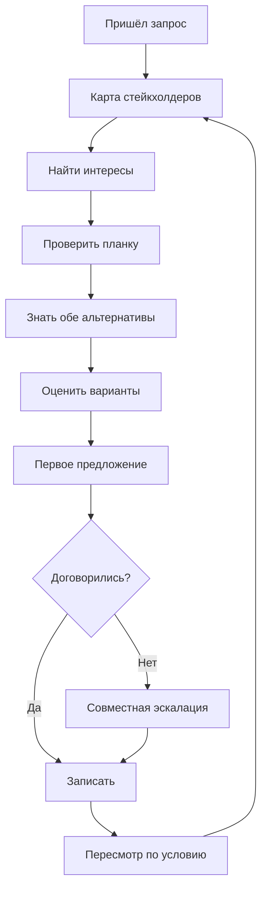
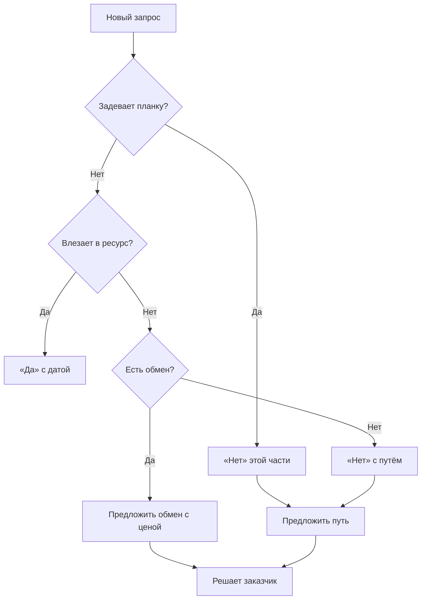

# Глава 46 — Работа со стейкхолдерами и переговоры { #chapter-46-stakeholder-management-and-negotiation }

Эта глава о переговорах, которые руководитель разработки ведёт с теми, кто окружает разработку: с CTO,
продуктом, продажами, финансами, службой работы с клиентами и CEO. Вы узнаете, как понять, кто важен для
решения, и как договариваться об объёме, сроках и качестве, не сдавая втихую тот минимум качества, на
который опирается организация. А ещё — как говорить «нет», чтобы отношения сохранились, а собеседник
ушёл с понятным путём вперёд. Сквозной пример — директор по разработке в Northstar Technologies
(вымышленной компании из [кейса](../../case-studies/northstar/index.md)) в квартале 4.

## Почему это важно { #why-this-matters }

**В команде** руководитель, который не умеет вести переговоры, превращается в трубу: запросы проходят
сквозь него прямо в команду, даты принимают раньше, чем кто-то оценил объём работы, а разрыв закрывают
переработками или пропуском тестов. Команда усваивает: «да» её руководителя ничего не говорит о том,
выполнимо ли обещанное.

**В организации** директор каждый квартал договаривается о нескольких одних и тех же переменных с теми
же пятью-шестью руководителями. Это повторяющиеся игры: кто выиграл одну встречу давлением, проигрывает
три следующие. А кто однажды уступил нижнюю планку качества, тем самым назначил цену каждому следующему
запросу.

**Для высшего руководства** меняется сам предмет переговоров. CTO договаривается с CEO и советом
директоров о том, какой риск готова нести компания: какую надёжность она обещает клиентам, сколько
тратит, чтобы сдержать обещание, и что не станет обменивать на выручку. Если разработка приходит на эти
переговоры без доказательств, число назначает кто-то другой — часто в виде цели, которая звучит просто,
а работает плохо, как только по ней начинают оценивать людей.

## Цели главы { #learning-objectives }

После этой главы вы сможете:

- Составлять карту стейкхолдеров конкретного решения по интересу и влиянию, отмечать, у кого положение
  меняется в зависимости от вопроса, и планировать взаимодействие с каждым.
- Отделять переменные запроса, которыми можно торговаться (объём, дата, ресурс, очерёдность и качество
  выше планки), от нижней планки качества и записывать планку до начала переговоров.
- Готовиться к переговорам: видеть интересы за позициями, знать альтернативу соглашению у каждой
  стороны, называть цену каждого варианта и строить первое предложение от собственной цели.
- Говорить «нет»: называть интерес собеседника, объяснять причину в его категориях и предлагать
  конкретный путь.
- Диагностировать типичные провалы в работе со стейкхолдерами, от устаревшей карты до сдвигающейся планки.

Связанные главы: тактики влияния и лимит межкомандных инициатив разбирает глава 42; здесь подробнее
разобраны сами переговоры.

## Ментальная модель { #the-mental-model }

> **Ментальная модель:** переговоры внутри компании — это обмен переменными, цену которых вы определили
> заранее. Обмен идёт вокруг планки, записанной до встречи, и с людьми, которых вы снова увидите в
> следующем квартале.

**Переменные с ценой:** объём, дата, ресурс, очерёдность и работа над качеством сверх минимума — всем
этим можно торговаться, и у каждого обмена есть цена в инженеро-неделях, риске или вытесненной работе.
**Записанная планка:** некоторые вещи не обсуждаются. Это, например, определения серьёзности,
[операционные минимумы tier 1](../../glossary.md#tier-1-operational-minimums) (владелец, алерты, ранбук
(runbook) и дежурство для каждого критичного компонента) или правило репетировать миграцию до того, как
она затронет финансовые данные. Если планка не записана до встречи и у неё нет владельца, её начнут
обсуждать на самой встрече. **Повторяемость:** на другой стороне сидит коллега, поэтому важно всё сразу:
соглашение, отношения и прецедент.

Каждое соглашение меняет, кому и что важно, поэтому петля возвращается к карте.

## Подробный разбор { #deep-conceptual-explanation }

### Кто важен: интерес, влияние и как они меняются { #who-matters-interest-power-and-how-both-move }

Стейкхолдер решения — любой, кто может на это решение повлиять или на кого оно влияет. Обычный
инструмент здесь — сетка «интерес × влияние»; Eden и Ackermann описывают её широко распространённую
версию ([Eden and Ackermann, 2021](../../references/bibliography.md#eden2021modelling)):

- **Игроки** (players: большое влияние, большой интерес) заслуживают постоянного внимания.
- **Субъекты** (subjects: большой интерес, малое влияние) заинтересованы, но решать не могут; зато они
  способны объединиться в коалицию и так получить влияние.
- **Задающие контекст** (context setters: большое влияние, малый интерес) способны изменить исход, но
  пока не следят за вопросом. Задача — привлечь их внимание раньше, чем они явятся в последний момент с
  вето.
- **Толпа** (crowd) — низкие значения по обеим осям.

Bryson в обзоре методов работы со стейкхолдерами формулирует цель: выработать предложения, которые
технически реализуемы и политически приемлемы, и собрать коалицию, способную их принять
([Bryson, 2004](../../references/bibliography.md#bryson2004what)). Eden и Ackermann не проверяют свой метод, а
иллюстрируют его одним кейсом; Bryson делает обзор методов. Поэтому считайте сетку **мнением эксперта**,
а не научным результатом, доказывающим, что карта стейкхолдеров улучшает исходы.

Три наблюдения Eden и Ackermann меняют то, как пользоваться сеткой.

- **Положение на сетке зависит от вопроса.** В их кейсе команде не удалось разместить одного
  стейкхолдера: его влияние и интерес менялись от вопроса к вопросу. CFO — игрок, когда речь идёт о
  бюджете, и задающий контекст, когда обсуждают определения серьёзности, — пока серьёзность не начинает
  влиять на сервисные кредиты. Составляйте карту для решения, а не для человека.
- **Среди целей есть то, чего люди хотят избежать.** Авторы советуют записывать цели избегания и
  замечают, что примерно треть целей, которые команда записывает первыми, на деле оказываются
  стратегиями. «Успеть к дате» — обычно стратегия, а цель за ней — «не потерять это продление».
- **Стейкхолдеры реагируют друг на друга.** Отличительный шаг метода — продумать, как каждый игрок
  отреагирует на предложение, а затем — как остальные ответят на эти реакции. При этом нужно помнить,
  что всё это обоснованные догадки, а им легко начать доверять слишком сильно.

Авторы отмечают, что другие исследователи добавляют ещё два измерения: легитимность и срочность. Самая
полезная дополнительная колонка для руководителя разработки — **отношение с доказательствами** и дата,
когда его в последний раз проверяли.

### Чем можно торговаться, а чем нельзя { #what-can-be-traded-and-what-cannot }

В проектном треугольнике объём, время и стоимость обменивают друг на друга. При фиксированной
численности стоимость превращается в **ресурс**, который можно лишь перекладывать между задачами, а
**качество** становится пятой переменной, причём двухслойной.

**Нижняя планка качества** — набор минимумов, которые, по уже принятому решению организации, защищают
клиентов: определения серьёзности, операционные минимумы tier 1
([глава 20](../05-engineering-quality/20-engineering-standards-and-their-governance.md),
[глава 24](../05-engineering-quality/24-reliability-slos-and-operational-readiness.md)), политика
бюджета ошибок, правила репетиций для финансовых данных. Книга Google по SRE описывает
[бюджет ошибок](../../glossary.md#error-budget-and-burn-rate) (error budget: ненадёжность, которую допускает
целевой уровень) как общую объективную меру: с ним продуктовые инженеры и инженеры по надёжности решают,
на какой риск идти, по согласованным числам, а не в политическом споре
([Alvidrez, 2017](../../references/bibliography.md#google2017embracing)) (**задокументированная практика**). В этом
и состоит задача планки: перенести повторяющийся спор со встречи в правило, о котором договорились, пока
не давил никакой дедлайн.

**Качеством выше планки** торговаться можно: автоматизацией тестов сверх обязательной, полировкой
административного экрана, выбором между рефакторингом сейчас и записью в долг
([глава 21](../05-engineering-quality/21-technical-debt.md)). Такой обмен законен, если он сделан явно и
записан.

Отличить один слой от другого помогают два теста. Первый: у пункта планки есть владелец, он записан и
действует для каждой команды, кто бы ни просил. Второй: он установлен до текущего запроса; «не
обсуждается», придуманное во время переговоров, — это позиция. Если руководитель называет планкой всё
подряд, планки у него нет — есть только репутация человека, который мешает.

### Что исследования говорят о переговорах { #what-the-research-says-about-negotiating }

Большая часть исследований переговоров — лабораторные эксперименты со студентами, но два результата всё
же переносятся на практику.

**Твёрдость вместе с заботой о другой стороне даёт лучший совместный результат.** В аннотации
метаанализа 28 исследований сообщается, что участники переговоров с просоциальным мотивом (им важен не
только свой результат, но и результат другой стороны) реже шли на конфронтацию и чаще искали решение
вместе. Совместный результат у них был выше, но только если их сопротивление уступкам было высоким или
неизвестным, а не низким ([De Dreu et al., 2000](../../references/bibliography.md#dedreu2000influence))
(**научный результат**; эффекты зависели от особенностей исследований, например от того, было ли участие
для испытуемых учебным заданием). Вывод для директора (**рекомендация книги**): забота о проблеме CTO и
отказ сдвигать планку друг другу не противоречат. Вместе они ведут к совместному поиску решения, а
забота без твёрдости — к уступкам.

**Первое предложение становится якорем, а противоядие — подготовка.** В аннотации описаны три
эксперимента: сторона, сделавшая первое предложение, добивалась лучшего результата, а первые предложения
хорошо предсказывали итоговые цены. Преимущество исчезало, если другая сторона сосредоточивалась на
альтернативах оппонента, на его резервной цене (reservation price — худшей сделке, на которую он
согласится) или на собственной цели
([Galinsky and Mussweiler, 2001](../../references/bibliography.md#galinsky2001first)) (**научный результат**, переговоры о цене по
одному вопросу). Отсюда правило: подготовьтесь и первым сделайте конкретное предложение. Если кто-то уже
поставил якорь («начинайте в понедельник», «инцидентов меньше 10»), не спорьте, отталкиваясь от его
числа. Вернитесь к собственной цели, заданной по данным ещё до того, как вы услышали его число, и к
тому, что он будет делать, если вы не договоритесь.

**Рычаг определяют альтернативы.** Книга *Getting to Yes* широко известна идеей принципиальных
переговоров и лучшей альтернативы соглашению — того, что каждая сторона станет делать, если сделка не
состоится ([Fisher and Ury, 1981](../../references/bibliography.md#fisher1981getting)) (**мнение
эксперта**; её вводила глава 42). Внутри компании альтернативы особые. Директор не может просто уйти с
переговоров с CTO; реалистичных альтернатив у него три: согласиться и записать несогласие, совместно
эскалировать вопрос
([глава 39](../08-management-operating-system/39-reviews-decision-logs-escalation-and-executive-reporting.md))
или позволить принять решение без доказательств от разработки. Альтернатива CTO — решить самому. Когда
альтернатива слабая, рычагом директора становится качество предложения: лучший вариант, который служит
интересу CTO.

### Как сказать «нет» и предложить путь { #saying-no-with-a-path }

Большинство переговоров заканчивается частичным «нет». Для такого «нет» книга рекомендует структуру из
пяти частей:

1. **Назовите интерес собеседника** его словами: «Вам нужна дата, на которую клиент сможет положиться».
2. **Скажите «нет» прямо и сразу.** Уклончивое «нет» слышат как «да», а что это было «нет», выясняется
   позже.
3. **Объясните причину в его категориях**: что это вытеснит или чем это грозит его собственной цели.
4. **Предложите хотя бы один путь**: меньше, позже, в обмен на что-то или другой маршрут к тому же
   интересу.
5. **Скажите, что могло бы изменить ответ и когда собеседник об этом узнает.**

Структура опирается на практические работы, которые разбирает
[глава 6](../02-people-management/06-feedback-conflict-and-difficult-conversations.md): на сочетание
личной заботы с прямым вызовом ([Scott, 2017](../../references/bibliography.md#scott2017radical)) и на
понимание того, что трудный разговор задевает ещё и чувства, и самоощущение
([Stone, Patton, and Heen, 1999](../../references/bibliography.md#stone1999difficult)). Grove известен мыслью, что время
руководителя — самый дефицитный ресурс и тратить его нужно на работу с наибольшим рычагом
([Grove, 1983](../../references/bibliography.md#grove1983high)). Руководитель, который не умеет говорить «нет»,
отдаёт свой календарь и календарь команды тому, кто просит чаще всех. Все три источника — **мнение
экспертов**.

Даже запрос, который задевает планку, получает путь: планка исключает вариант, а не разговор.

## Пример из инженерной организации { #engineering-organization-example }

Возьмём для иллюстрации компанию примерно из 45 инженеров; все числа придуманы. Руководитель продукта
просит команду из шести инженеров сделать экспорт данных для расчёта зарплаты: крупный потенциальный
клиент хочет получить его в течение шести недель.

**Допущения.** Оценка — 30 инженеро-недель. Незапланированная работа забирает четверть ресурса, поэтому
команда выдаёт около 4,5 инженеро-недели в неделю (6 × 0,75). Похожие функции после начала работы
разрастались примерно на 20%. Планка требует нагрузочного теста для эндпоинтов массовых операций и
отрепетированного заполнения исторических данных (backfill) по зарплатам.

| Вариант | Трудозатраты | Прогноз | Цена |
|---|---|---|---|
| A. Полный объём сейчас | от 30 до 36 инженеро-недель | Неделя 7 или 8 | Дата клиента пропущена на одну-две недели |
| B. Сначала экспорт CSV по расписанию, экран настройки потом | от 18 до 21.6 инженеро-недели | Неделя 4 или 5 | Экран появляется примерно на три недели позже |
| C. Полный объём без нагрузочного теста и репетиции | от 25 до 30 инженеро-недель | от 5.6 до 6.7 недели | Задевает планку; неделю 6 всё равно можно пропустить |
| D. Полный объём, два инженера взаймы на четыре недели | Номинально +8 инженеро-недель | Недели 5–7 | Обещанный пункт другой команды сдвигается примерно на четыре недели |

Каждый прогноз — это трудозатраты, делённые на 4,5 инженеро-недели, которые команда выдаёт в неделю; в
диапазоне D учтено время, пока одолженные инженеры входят в работу.

Вариант C показывает, что планка важна не только в принципе, но и арифметически: одно лишь разрастание
объёма съедает всё, что сэкономил срезанный угол. Руководитель этот вариант не предлагает, а если продукт сам о
нём заговорит, одной фразой объясняет почему.

Разговор. Руководитель разработки спрашивает, что именно клиенту нужно к неделе 6, и узнаёт, что первый
расчёт зарплаты в новой системе у клиента на неделе 7. Значит, интерес — «выгрузить данные до первого
расчёта», а не «функция к неделе 6», и этому интересу служит вариант B. Руководитель первым предлагает
B, называет цену вариантов A и D и говорит, что могло бы изменить ответ: если экран настройки нужен
клиенту уже к первому расчёту, к варианту D вернутся вместе с руководителем другой команды. Продукт
выбирает B.

## Как принимать решение { #decision-framework }

Для конкретного решения спланируйте взаимодействие с каждым стейкхолдером:

| Место на сетке для этого решения | Взаимодействие | Типичная ошибка |
|---|---|---|
| Игрок | Посоветоваться до того, как предложение станет окончательным, один на один до любой групповой встречи | Показать ему готовый план на групповой встрече |
| Субъект | Привлечь к выработке вариантов; рано сообщить, что решили и почему | Относиться к нему как к публике; он может войти в коалицию |
| Задающий контекст | Короткий брифинг по единственному пункту, который его касается; спросить, что вызвало бы у него возражения | Не замечать его, пока он не появится с вето |
| Толпа | Обычные каналы | Тратить внимание, которое понадобится позже |

Затем выберите подход:

| Ситуация | Подход | Чего остерегаться |
|---|---|---|
| Интересам можно служить одновременно | Интегративный: найти интерес, оценить варианты, предложить первым | Делить разницу в оценке пополам |
| Делится фиксированная величина (ресурс этого квартала) | Распределительный, но прозрачный: показать целое и то, что вытесняет каждая доля | Скрытый запас, который потом обнаружат |
| Запрос задевает планку | «Нет» этой части и путь, который служит интересу | Сдвинуть планку «только в этот раз» |
| Ваша альтернатива слабая, а их альтернатива — решить самим | Принести лучший вариант письменно, пока их якорь не затвердел | Спорить от их числа |
| Соглашения нет | Совместная эскалация по опубликованному пути | Эскалировать в одиночку: это выглядит как действие в обход |

## Компромиссы { #trade-offs }

**Подготовка или скорость.** Полную подготовку оставьте для решений, где на другой стороне игрок и под
угрозой планка; на рутинные запросы отвечайте по плану ресурсов
([глава 38](../08-management-operating-system/38-scorecards-quarterly-planning-and-capacity-allocation.md)).

**Встречи до встречи или видимость политики.** Разговоры один на один перед групповым решением избавляют
от публичных сюрпризов и позволяют людям менять позицию, не теряя лица. Но если тот, кого решение
задевает сильнее всех, узнаёт о нём последним, такие разговоры превращаются в лоббизм. Пусть первым
узнаёт тот, кто несёт затраты.

**Ходить первым или узнать интерес.** Исследования якорения говорят в пользу первого хода, но если
сделать его, не зная интереса, якорь ляжет не на ту проблему. Сначала спросите, потом предлагайте.

**Твёрдая планка или репутация негибкого человека.** Планка защищает клиентов, только если выдерживает
давление. А мирятся с ней, только если она небольшая, записана и распространяется и на желания самой
разработки. Пересматривайте её раз в год, а не на той встрече, где она мешает.

**Записанные соглашения или гибкость.** Записать обмен (что отдали, что получили и что запускает
пересмотр) — дело десяти минут. Запись избавляет от ситуации, когда стороны честно помнят две разные
сделки, но и мешает менять договорённость неформально.

## Типичные провалы { #failure-modes }

**Сдвигающаяся планка.** Под давлением дедлайнов минимум опускается по одному исключению за раз:
миграцию не отрепетировали, оценку серьёзности смягчили, алерты — «после запуска». Как заметить:
считайте исключения из планки за квартал и смотрите, кто их одобрил.

**Всё — планка.** Каждое предпочтение объявляют не подлежащим обсуждению, и продукт перестаёт
советоваться с разработкой. Как заметить: запросы приходят как объявленные даты, а не как вопросы.

**Устаревшая карта.** В колонках отношения записано то, что люди говорили два квартала назад. Как
заметить: смотрите на дату последней проверки и на сюрпризы. Если задающий контекст появился с вето, его
разместили не там.

**Делить разницу в оценке пополам.** Продукт говорит четыре недели, разработка — восемь, сходятся на
шести. Но оценка — это прогноз, а не предложение в торге
([глава 17](../04-execution/17-predictability-and-managing-uncertainty.md)): если поделить разрыв
пополам, изменится обязательство, а не работа.

**«Да» сейчас, «нет» потом.** На встрече согласились, а на неделе 9 сорвали; каждый срыв обесценивает
все следующие «да». Как заметить: сравнивайте согласованные обязательства с фактической поставкой по
каждому руководителю.

**Выиграть встречу.** Встречу выигрывают давлением или тем, что выстраивают руководителей против
коллеги; следующие переговоры с этим коллегой начинаются с минуса (глава 42).

## Применение в крупной организации { #enterprise-application }

В организации из 50–150 инженеров у директора десять-пятнадцать постоянных стейкхолдеров: CTO, четыре
или пять руководителей того же уровня, руководители продукта, финансовый бизнес-партнёр, служба
безопасности и крупные клиенты (через службу работы с клиентами). Работа с ними превращается в систему.

1. **Постоянная карта на квартал, карты по вопросу для крупных решений.** Квартальная карта фиксирует
   отношение и доказательства для постоянных игроков; карты по вопросу рисуют для двух-трёх решений в
   квартал, в которых интерес игрока сталкивается с планкой. Нужные колонки есть в
   [шаблоне карты стейкхолдеров](../../templates/stakeholder-map.md).
2. **Записанная планка с владельцами.** Она хранится вместе со стандартами и умещается на одной
   странице; у неё есть названные владельцы, которые решают об исключениях, и каждое исключение
   действует ограниченный срок. Тогда «не обсуждается» отсылает к опубликованному правилу.
3. **Руководители договариваются с коллегами сами.** Линейные руководители договариваются с
   продакт-менеджерами каждый день. Директор учит их говорить «нет» из пяти частей и вмешивается, только
   когда затронут игрок или планка; иначе узким местом становится он сам.
4. **Журнал обменов.** Значимые обмены записывают в журнал решений с условием пересмотра. За год в
   журнале накапливается ответ на упрёк «разработка всегда говорит „нет“»: список того, что на что
   обменяли.

## Взгляд CTO { #cto-perspective }

CTO обсуждает с CEO, а иногда и с советом директоров, уже саму планку. Надёжность, обещанная клиентам,
состояние безопасности, ресурс, оставленный на здоровье системы, — это решения компании, подкреплённые
доказательствами от разработки, а не решения разработки, последствия которых несёт компания. CTO,
который считает их частным делом разработки, увидит, как их отменят в кризис выручки. А CTO, который
договорился о них открыто, может сослаться на соглашение.

Наверх доводы несут на языке риска, выручки и затрат — так, как их считают финансы; глава 42 отмечает,
что влияние наверх работает через убеждение, а не через обмен. Самый частый провал CTO — простая цель:
число выбирают потому, что оно помещается на слайд, а потом оно управляет поведением людей ниже.
Обсуждайте форму обязательства (что считается, за какое окно, с какой парной метрикой) так же жёстко,
как его уровень.

Книга Watkins *The First 90 Days* известна советом новому руководителю: явно договориться об ожиданиях с
начальником, а не угадывать их ([Watkins, 2003](../../references/bibliography.md#watkins2003first))
(**мнение эксперта**). CTO делает это с CEO — и тем самым подаёт пример директорам, которые делают то же
самое с CTO.

## Практический плейбук { #practical-playbook }

1. **Назовите решение** одной фразой; карту стейкхолдеров составляйте для этого решения, а не для всей
   своей работы.
2. **Разместите каждого стейкхолдера** на сетке; для каждого — одна строка доказательств его отношения и
   дата последней проверки. Отметьте тех, чьё положение меняется в зависимости от вопроса.
3. **Запишите интересы каждого игрока**, включая то, чего он хочет избежать; пометьте заявленные цели,
   которые на деле оказываются стратегиями.
4. **Проверьте планку.** Если то, что вы хотите защитить, не записано, вы вот-вот начнёте это обсуждать;
   подумайте, не решить ли этот вопрос сначала отдельно.
5. **Знайте обе альтернативы.** Если их альтернатива — «решить самим», ваш рычаг — предложение.
6. **Задайте свою цель по данным**, прежде чем увидите число другой стороны, и оцените три-четыре
   варианта в инженеро-неделях, датах и вытесненной работе.
7. **Сначала поговорите с игроками один на один**: спрашивайте, прежде чем предлагать; первым сообщите
   тому, кого решение затрагивает сильнее всех.
8. **Первым сделайте конкретное предложение** — письменно и с вариантами рядом.
9. **Если ответ «нет», используйте пять частей.**
10. **Запишите соглашение** с условием пересмотра; значимые обмены заносите в журнал.
11. **Обновляйте карту** каждый квартал и после любого сюрприза.

## Кейс { #case-study }

!!! info "Northstar: что уже известно"
    Неделя 41 первого года директора. Число инцидентов [Sev1 и Sev2](../../glossary.md#severity-sev1-sev2-sev3)
    (два самых серьёзных уровня) упало с 30 за квартал до 14 в квартале 3, доступность достигла 99,89%
    при обязательстве 99,9%, а кредиты снизились до $60 000. На профилактику в квартале 3 ушло
    8 [FTE](../../glossary.md#fte) из 80 инженеров. См.
    [хронологию](../../case-studies/northstar/timeline.md). Впервые читаете о Northstar? Прочитайте
    [«Год вкратце»](../../case-studies/northstar/year-in-brief.md),
    [действующих лиц](../../case-studies/northstar/cast.md) и
    [брифинг квартала 4](../../case-studies/northstar/quarter-4-briefing.md).

Этот кейс **вымышленный**; действие происходит на неделях 41–44, решения принимаете вы. Последний
квартал, по которому есть измерения, — квартал 3, поэтому расчёты опираются на него.

**Запрос.** Двенадцатимесячный мандат (вдвое сократить инциденты Sev1 и Sev2 с 30 за квартал, выйти на
99,9%, без роста численности) заканчивается вместе с кварталом 4. На неделе 41 Victor Lindqvist просит
подготовить к неделе 45 страницу разработки для плана на год 2, который представят совету директоров.
Главную формулировку он предлагает ту же, что когда-то уже предлагал как [OKR](../../glossary.md#okr)
(квартальную цель с измеримыми ключевыми результатами): «Инцидентов Sev1 и Sev2 меньше 10 за квартал» —
без роста численности.

**Карта директора для этого решения.**

| Стейкхолдер | Место на сетке | Интерес (и чего хочет избежать) | Отношение и доказательства |
|---|---|---|---|
| Victor Lindqvist (CTO) | Игрок | Обязательство, понятное совету директоров; избежать запроса на рост численности | Предлагает это число; уже пользовался им |
| Helena Marsh (CEO) | Игрок, через Victor | Продления; конец звонкам об отказах | Ещё не спрашивали |
| Rajiv Menon (CFO) | Здесь задающий контекст, в вопросах бюджета игрок | Операционные расходы без роста; прекращение выплат сервисных кредитов ($60,000 в квартале 3) | Безразличен, пока не меняются ресурс или затраты |
| Amara Okafor (CPO) | Игрок | Её обещанная дорожная карта; избежать нового роста ресурса на профилактику | Скорее поддержит цену, которая возвращает ресурс; будет против триггера, который забирает его обратно |
| Sofia Alvarez (VP по работе с клиентами) | Субъект | Меньше эскалаций, честный статус | Участвовала в написании определений серьёзности |
| Greg Tanaka (VP по продажам) | Толпа, пока не меняется ресурс | Функции для сделок | Становится игроком, если работу по сделкам сократят |
| Шесть руководителей и Kwame Mensah (staff-инженер, надёжность) | Субъекты | Чтобы их не оценивали по числам, которые они контролируют лишь отчасти | Kwame отвечает за данные о серьёзности |
| Операционные контакты клиентов с продлениями | Задающие контекст, через Sofia | Надёжный приём заказов и оплата | Контракты уже фиксируют 99.9 процента |

**Расчёт.** «Меньше 10» означает 9 или меньше, а в квартале 3 их было 14 (это первый квартал, когда
число не превысило заложенных в мандат 15). Таблица исходит из того, что число инцидентов примерно
подчиняется распределению Пуассона — стандартной модели для числа независимых событий. Это допущение
нужно лишь для того, чтобы показать размер случайных колебаний; интервалы разбирает
[глава 18](../04-execution/18-measuring-engineering-productivity.md).

| Истинное среднее за квартал | Один квартал с 9 или меньше | Все четыре квартала |
|---|---|---|
| 9 | 59% | 12% |
| 12 | 24% | меньше 1% |
| 14 | 11% | меньше 1% |

Организация с истинным средним 9 не выполняет «меньше 10» примерно в двух кварталах из пяти, а четыре
квартала подряд выполняет примерно раз в восемь лет. Цель, которую так часто срывает случайность, давит
на единственную переменную, которую люди могут быстро сдвинуть, — на оценку серьёзности. И это давление
уже проявилось: на неделе 7 двухчасовую задержку платежей оценили как Sev3, и её пришлось переоценить
([глава 27](../05-engineering-quality/27-quality-transformation-at-enterprise-scale.md)).

**Планка.** Определения серьёзности меняют только их опубликованные владельцы; еженедельный аудит
продолжается; ни одного руководителя не оценивают по числу инцидентов его команды.

**Альтернативы.** Альтернатива Victor — написать страницу самому, со своим числом; альтернатива
директора — согласиться и записать несогласие. Ни то ни другое Victor не помогает: если его число по
случайности сорвётся уже в первом квартале года 2, отвечать за это перед советом директоров придётся
ему. В этом и состоит возможность для директора.

**Черновик встречного предложения директора** (приносить ли его и в какой форме — решает читатель):

1. **Сохранить счёт, сменить окно:** не больше 40 инцидентов Sev1 и Sev2 за год 2 (в среднем 10 за
   квартал); показывать ежеквартально как скользящую сумму за четыре квартала, а рядом — результат
   аудита. При истинном среднем 9 за квартал (36 за год) годовая сумма укладывается в 40 примерно в 78%
   случаев.
2. **Дать ей в пару результат для клиентов:** договорная доступность не ниже 99,9% каждый квартал
   (99,89% в квартале 3, всё ещё ниже обязательства), а сервисные кредиты — отдельной строкой для Rajiv.
3. **Назвать цену:** профилактика — 6 FTE в кварталах 5 и 6 и 5 FTE в кварталах 7 и 8 вместо 8 FTE в
   квартале 3, без роста численности
   ([глава 49](../11-vp-engineering/49-multi-year-transformation-communication-and-politics.md) строит
   вокруг этой цены многолетнее предложение). Освободившиеся 2–3 FTE (26–39 инженеро-недель в квартал)
   возвращаются продукту; риск в том, удержат ли 5–6 FTE годовую сумму в пределах 40.
4. **Триггер:** если два квартала подряд число выше 12, вопрос о выделении на профилактику открывают
   заново вместе с Victor и Amara.

**Запланированная последовательность.** Сначала, на неделе 42, встреча один на один с Victor: спросить,
что нужно совету директоров, прежде чем что-либо показывать. Затем, на той же неделе, письменный
черновик. Потом, до недели 44, брифинги для Amara и Rajiv; Amara узнаёт о триггере из пункта 4, который
может забрать ресурс из её плана.

**Решает читатель:** встречное предложение или согласие; какую форму обязательства предложить; в чём
уступить по окну или уровню; что делать с Amara, если триггер сработает; и что сказать, если Victor
ответит: «Совету нужно квартальное число».

## Упражнения { #exercises }

Разборы упражнений: [решения к главе 46](../../solutions/ch46-solutions.md). Данные Northstar — в
[брифинге квартала 4](../../case-studies/northstar/quarter-4-briefing.md),
[исходных данных](../../case-studies/northstar/baseline-data.md) и
[хронике года 1](../../case-studies/northstar/first-quarter.md).

### Базовый уровень { #foundational }

**F1.** Нарисуйте сетку «влияние × интерес» для двух решений Northstar в квартале 4: обязательства по
надёжности на год 2 из кейса и предложения изменить квартальное деление ресурса между продуктом и
профилактикой. Разместите на каждой Victor Lindqvist, Rajiv Menon, Amara Okafor, Greg Tanaka, Sofia
Alvarez и шестерых руководителей. Найдите хотя бы двух человек, чей квадрант меняется от решения к
решению, объясните почему и скажите, что это меняет в вашем плане взаимодействия.

**F2.** Перед переговорами о планировании руководитель присылает вам восемь пунктов «не обсуждается»:
определения серьёзности; репетиция миграций для данных tier 1; 80% покрытия строк для всего нового кода;
никаких развёртываний по пятницам; требование ранбука для tier 1; два ревьюера на каждый мерж-реквест;
предпочтительный фреймворк команды для нового сервиса; дежурство для каждого компонента tier 1.
Разделите их на планку и предпочтения с помощью двух тестов этой главы и скажите, что вы сделали бы с
предпочтениями.

**F3.** Greg Tanaka просит руководителя сделать небольшое изменение в интеграции для потенциального
клиента «к пятнице». Руководитель отвечает: «Извините, в этом спринте мы завалены, может, в следующем
квартале». Перепишите ответ по структуре из пяти частей. Изменение займёт около 3 инженеро-недель,
ближайший свободный слот команды — через три недели, а для демо клиенту хватило бы обходного пути через
конфигурацию.

### Прикладное лидерство { #applied-leadership }

**A1.** На неделе 43 Amara Okafor просит Billing к неделе 47 сделать детализированные кредит-ноты в
счетах для клиента с продлением. Команда Marcus Oyelaran (руководитель Billing) успеет к неделе 47,
только если пропустит репетицию миграции, а репетиция с недели 10 входит в нижнюю планку качества для
данных tier 1; с репетицией прогноз — неделя 48 или 49. Amara говорит, что клиенту обещали неделю 47.
Подготовьте переговоры (интересы, планка, обе альтернативы, варианты с ценой, первое предложение) и
напишите, что Marcus должен сказать в первые две минуты.

**A2.** Greg Tanaka начинает встречу словами: «Клиенту нужен импорт заказов на закупку в продакшене к
неделе 48, так что начинайте в понедельник». Ничего ещё не оценено, а якорь — дата — уже поставлен.
Опираясь на исследования первого предложения, опишите, что вы сделаете на этой встрече и до следующей и
чего не станете говорить.

**A3.** В квартале 4 вы замечаете, что один из ваших руководителей соглашается на каждый запрос своего
продакт-менеджера, а потом срывает примерно треть дат; при этом у его команды самая большая доля
незапланированной работы в организации. Спроектируйте шестинедельный план коучинга, развивающий навыки
переговоров из этой главы, и назовите признаки, по которым вы поймёте, что план работает.

### Решения на уровне руководства { #executive-decision-making }

**X1.** Вы директор из кейса. Напишите одностраничный ответ на предложение Victor Lindqvist по странице
плана на год 2 для совета директоров, а также план разговоров, которые вы проведёте до отправки ответа.
Решите, делать встречное предложение или согласиться, скажите, чем вы не станете торговаться и почему, и
приведите расчёт, который член совета директоров мог бы проверить.

**X2.** На неделе 43, ещё до вашего разговора с Victor, Helena Marsh останавливает вас после встречи:
«Victor говорит, что в следующем году мы сможем опуститься ниже десяти инцидентов в квартал. Сможем?»
Решите, что вы скажете сразу, что сделаете потом и как не ввести CEO в заблуждение, не действуя при этом
в обход своего руководителя.

## Вопросы для размышления { #reflection-questions }

1. Какие из ваших нынешних «не обсуждается» были записаны до того, как вы в последний раз на них
   сослались?
2. В последних трудных переговорах вы знали альтернативу соглашению у другой стороны или только её
   позицию?
3. Чьё отношение на вашей карте опирается на то, что человек сказал больше квартала назад?
4. Когда вы в последний раз первым сделали конкретное предложение, вместо того чтобы отвечать на чужое
   число?
5. Какое из ваших недавних «да» ваша команда назвала бы невысказанным «нет»?
6. Сколько запросов, отклонённых вами в прошлом квартале, ушли без пути вперёд?

## Главное { #key-takeaways }

- Составляйте карту стейкхолдеров для решения, а не для человека: один и тот же руководитель может быть
  игроком в одном вопросе и задающим контекст в следующем.
- Записывайте, чего хочет избежать каждый игрок: запрос часто оказывается лишь стратегией, а стоящему за
  ним интересу можно послужить иначе.
- Записывайте нижнюю планку качества с владельцами до любых переговоров: всё незаписанное будут
  обменивать под давлением дедлайна.
- Держите планку небольшой и применяйте её и к желаниям самой разработки, иначе она превратится в
  обструкцию.
- Твёрдость в отношении планки и забота о проблеме другой стороны идут вместе; исследования связывают
  такое сочетание с совместным поиском решений.
- Задавайте свою цель по данным до того, как услышите чужое число, и делайте первое предложение, когда
  поймёте интерес.
- Никогда не торгуйтесь о прогнозе; торгуйтесь об объёме, дате, ресурсе или очерёдности.
- К каждому «нет» прилагаются путь и условие, которое могло бы его изменить.
- Записывайте согласованные обмены с условием пересмотра.

## Источники и что почитать { #references-and-further-reading }

- [Eden and Ackermann, 2021](../../references/bibliography.md#eden2021modelling). Метод в открытом доступе
  для предвидения реакций стейкхолдеров; сетка «влияние × интерес» и цели избегания.
- [Bryson, 2004](../../references/bibliography.md#bryson2004what). Обзор методов анализа стейкхолдеров из
  области государственного управления.
- [De Dreu et al., 2000](../../references/bibliography.md#dedreu2000influence). Метаанализ: забота о
  другой стороне помогает только вместе с твёрдостью.
- [Galinsky and Mussweiler, 2001](../../references/bibliography.md#galinsky2001first). Первые предложения
  как якоря и как подготовка их нейтрализует.
- [Fisher and Ury, 1981](../../references/bibliography.md#fisher1981getting). *Getting to Yes*.
  Интересы, варианты и альтернатива соглашению.
- [Alvidrez, 2017](../../references/bibliography.md#google2017embracing). Бюджет ошибок как согласованное
  правило, которое выводит спор из политики.
- [Watkins, 2003](../../references/bibliography.md#watkins2003first). *The First 90 Days*. Как
  договариваться об ожиданиях со своим руководителем.
- [Scott, 2017](../../references/bibliography.md#scott2017radical) и
  [Stone, Patton, and Heen, 1999](../../references/bibliography.md#stone1999difficult). Прямота с
  заботой и анатомия трудного разговора.
- [Grove, 1983](../../references/bibliography.md#grove1983high). *High Output Management*. Время как
  самый дефицитный ресурс руководителя.
