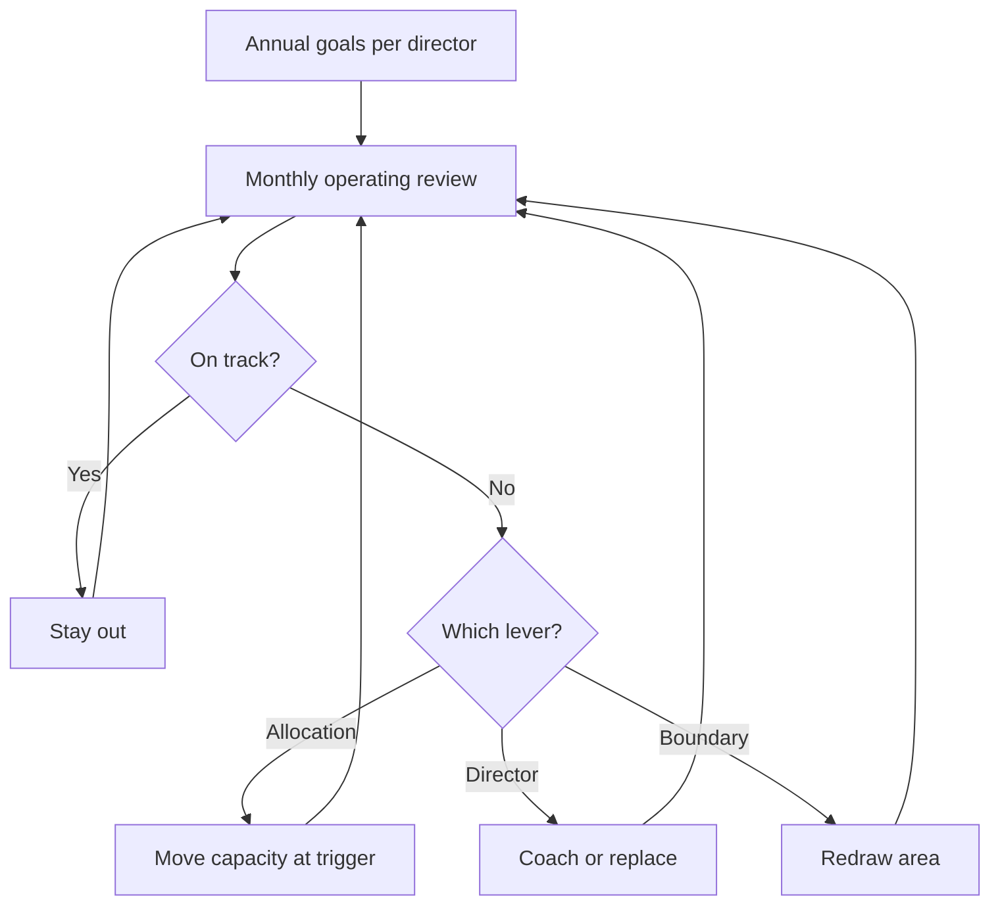
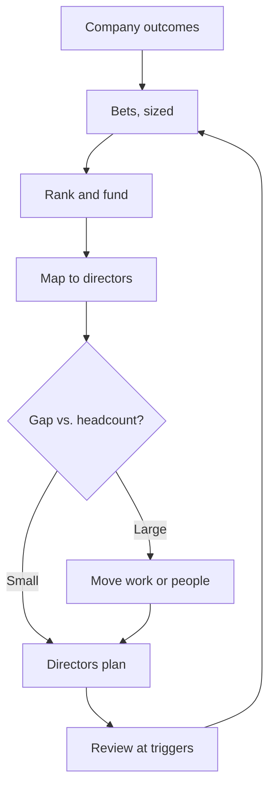

# Chapter 47 — The VP of Engineering: Managing Directors and the Portfolio

A director runs one area. A VP of Engineering runs several directors, and through them a portfolio of
areas competing for the same money and people. The VP rarely sees a team's work, and decides instead
what each director is accountable for, what each gets, and who the directors are. This chapter defines the
role against the director and CTO roles, shows how to manage directors through goals, operating
reviews, and staffing, and treats the portfolio as an allocation problem across directors. The VP's
view comes from Halvard Systems, the fictional 500-engineer company of
[Chapter 35](../07-organization-design/35-designing-organizations-at-four-scales.md#engineering-organization-example);
the case study asks whether [Northstar](../../case-studies/northstar/index.md), the book's fictional
company, needs a VP at all. Chapters 40 to 42 own the director's job, manager development, and the
director-level portfolio; Chapter 38 capacity categories; Chapter 48 workforce planning; Chapter 50 the
CTO's archetypes.

## Why This Matters

At team scale, a VP is invisible most weeks and decisive a few times a year: whether a team is staffed
for its roadmap, whether its director is the right one, whether its area is funded next year.
Engineers feel these as "the reorg" or "the project cancelled in March".

At organization scale, the VP is the first level at which capacity moves between areas. A director can
rebalance inside an area; only someone above several directors can say that one area shrinks so that
another grows. If nobody does that, allocation follows last year's org chart, and the company funds
its boxes instead of its bets.

At executive scale, companies often get this layer wrong. Some hire a VP before there are directors
to manage, adding a layer that relays messages. Others reach several hundred engineers with a CTO who
still arbitrates every director dispute. Both cost speed, and both are design choices.

## Learning Objectives

After this chapter you will be able to:

- Define the VP of Engineering role against the director and CTO roles in four company shapes, by the
  decisions each role owns.
- Decide whether an organization needs a VP, by naming the decisions the role would take that nobody
  takes today.
- Manage directors through written goals, a monthly operating review, and timely staffing decisions.
- Allocate engineering capacity across directors as a portfolio of bets, and detect allocation that
  simply follows the org chart.
- Build a leadership team of directors that solves shared problems rather than competing for capacity.

## The Mental Model

> **Mental model:** A VP manages a portfolio of directors, not a bigger organization. The VP has three
> levers: what each director is accountable for, what each director gets, and who the directors are.
> Everything below those levers belongs to the directors.

Two ideas organize the chapter.

First, **the VP's unit of management is the director and the director's area**. A director inspects
teams' systems; a VP inspects directors' systems. The test of a VP's week is whether its decisions
could only have been taken by someone above several directors. Decisions a director could take are a
sign that the VP has become, in Chapter 4's phrase, a large director
([Chapter 4](../01-foundations/04-the-leadership-ladder.md)).

Second, **allocation is the VP's distinctive decision, and its default is wrong**. Left alone,
capacity follows headcount, and headcount follows last year's structure. The VP's job is to fund bets
(outcomes the company wants, sized and ranked), then map them onto directors, and to move capacity when
the evidence says so, not every time someone asks.

## Deep Conceptual Explanation

### Three roles, four company shapes

Titles do not define these roles. Larson defines the engineering executive as the person responsible
for all of engineering, whatever the title, and observes that companies use CTO, VP of Engineering, and
Head of Engineering inconsistently
([Larson, 2023a](../../references/bibliography.md#larson2023executive-job)). His *Engineering
Executive's Primer* is known as a guide to that executive job
([Larson, 2024](../../references/bibliography.md#larson2024primer)); **expert opinion**, credited at
idea level.

This book defines the roles by the decisions they own (**this book's synthesis**):

| Role | Owns | Does not own |
|---|---|---|
| Director | The system of one area: structure, managers, quality, delivery (Chapter 40) | Moving capacity between areas |
| VP of Engineering | Allocation across areas; the director bench; area boundaries; the operating rhythm across directors | Teams' plans, technical designs |
| CTO | Technical strategy and engineering's place in the company; often the top engineering executive | Running directors, where a VP exists |

How these combine depends on the company's shape.

| Shape | Typical size | Who runs directors | The VP question |
|---|---|---|---|
| One director under a CTO | 50 to 150 engineers | The CTO, nominally | Premature: a VP would manage one person |
| CTO plus a VP who runs the organization | 150 to 400 | The VP | The classic split: CTO outward and technical, VP inward and operational |
| VP as top executive; no CTO, or a CTO without reports | 100 to 400 | The VP | The VP is the engineering executive |
| Several VPs under a CTO | 400 and up | Each VP, for a group | The VP runs a group, as at Halvard |

The size ranges are **illustrative** and overlap. What matters is the number of directors and how often
their claims on capacity conflict. A VP earns the layer when two, more usually three or more,
directors' claims conflict often enough that someone below the CEO must decide them. Larson suggests
managers of managers support four to six managers
([Larson, 2018](../../references/bibliography.md#larson2018sizing)), a rough ceiling on directors per
VP; **expert opinion**, without data.

### Why who sits at the top matters

Upper echelons theory, from general management research, holds that organizational outcomes (strategic
choices and performance) are partially predicted by top managers' background characteristics
([Hambrick and Mason, 1984](../../references/bibliography.md#hambrick1984upper)). Hambrick's update
states the premise as executives' experiences, values, and personalities shaping how they interpret
situations and so what they choose
([Hambrick, 2007](../../references/bibliography.md#hambrick2007upper)). Both were read at abstract
level; the 1984 article offers propositions, not a test. Treat it as a **research finding** at the level
of established theory about firms' top teams, not a measured effect in engineering; "partially" is
doing real work.

The inference here is modest (**this book's reasoning**). A VP's directors are a small upper echelon:
what they notice depends on who they are. Three directors who came up through product teams will see
platform debt late; three from infrastructure will underweight customer requests. Staffing the director
team decides which problems the group can see.

### Managing directors through goals

Each director needs a short written statement of what they are accountable for this year. Goal-setting
research summarizes evidence on the effectiveness of specific, difficult goals
([Locke and Latham, 2006](../../references/bibliography.md#locke2006new)); Ordóñez and colleagues argue
that goals also narrow focus onto what they measure
([Ordóñez et al., 2009](../../references/bibliography.md#ordonez2009goals)). Chapter 38 owns that
debate. For a VP the narrowing is the design problem: a director with only area goals optimizes the
area. So give each director two kinds of goal (**this book's recommendation**):

1. **Area goals**: two or three outcomes for the director's area, each with a scorecard measure.
2. **One shared goal**, identical for every director, for an outcome no area reaches alone (a
   group-wide reliability target, a migration every area must finish).

Larson, drawing on Lencioni, describes a leader's peers as their "first team", and notes that a
leader's incentives are often at odds with peers' incentives; he advises setting explicit expectations
with direct reports, including how they will be judged and how to resolve tension between peers' goals
([Larson, 2023c](../../references/bibliography.md#larson2023gelling);
[Lencioni, 2002](../../references/bibliography.md#lencioni2002five)): **expert opinion**. The shared
goal makes the first team real.

### The operating review

The VP's main recurring instrument is a monthly operating review with each director: 60 minutes, the
area's scorecard (Chapter 38), progress on funded bets, staffing, and what the director wants decided.
It inspects the director's system, as Chapter 39 describes one level down.

Keil and colleagues, summarizing their own studies, report that in a review of 56 experienced software
project managers, status reports were biased 60 percent of the time; they advise executives to seek
corroboration, and report that aggressive auditing can backfire into more misreporting, while trust in
supervisors was associated with willingness to report problems
([Keil et al., 2014](../../references/bibliography.md#keil2014pitfalls)). That is a **research
finding**, from samples that need caution in generalizing. A VP sits two filters above Chapter 40's
director, so the bias compounds.

Aghion and Tirole's formal model distinguishes formal authority (the right to decide) from real
authority (effective control), ties real authority to information, and lists the superior's overload
among the factors that shift real authority to subordinates
([Aghion and Tirole, 1997](../../references/bibliography.md#aghion1997formal)); read at abstract level.
A VP over five directors holds formal authority over everything and real authority over little, so the
VP should choose where to hold it (allocation, director staffing, a few shared standards) rather than
lose it by overload. The opposite failure is distance: Larson argues that a disengaged executive does
more damage than a somewhat over-involved one, because decisions stall and struggling leaders go
unaddressed ([Larson, 2023d](../../references/bibliography.md#larson2023micromanage)); **expert
opinion**.

When an area is off track, the VP asks which of the three levers is at fault. Reaching into the area's
teams is not an option; if the VP feels they must, that is evidence about the director.

### The portfolio as an allocation problem

Chapter 42 limits how many cross-team initiatives a director runs at once; Chapter 38 splits a
director's capacity into categories. The VP decides how much capacity each director gets for the year,
and for what.

Larson divides executive planning into an annual financial plan with headcount, a portfolio allocation
between internal priorities and cross-functional requests, and a roadmap agreed with product and sales.
He recommends allocating coarsely, to an area's leader rather than its teams, and infrequently, partly
because frequent changes make teams compete for allocation in a zero-sum way
([Larson, 2023b](../../references/bibliography.md#larson2023planning)): **expert opinion**.

Research adds a bias. Bardolet, Fox, and Lovallo argue that multibusiness firms tend toward even
allocation across divisions, which makes allocations depend on how the firm is divided ("partition
dependence"). An archival study found internal capital allocations biased toward equality over the
number of business units, and two experiments with experienced managers, free of agency conflicts,
found allocations still varied with the divisional structure presented
([Bardolet et al., 2011](../../references/bibliography.md#bardolet2011capital)). That is a **research
finding** about capital budgets, read at abstract level; applying it to engineering capacity is this
book's extension. The mechanism transfers: if a VP funds each director a share of their own plan, the
shape of the org chart drives the allocation. Staw's work on escalation of commitment, the tendency to
put more into a failing course one chose oneself
([Staw, 1976](../../references/bibliography.md#staw1976knee)), adds a second hazard, credited at idea
level: the VP's own bets are the hardest to cut.

Bets are ranked before anyone looks at which director they land on. A large gap between funded work
and an area's headcount is a decision (move work, move people, or redraw the area), not a reason to
fund the area's next-best item.

### Staffing the director team

The VP's highest-leverage and most delayed decisions concern directors: who they are, how their areas
are bounded, when one must change. Larson advises testing first impressions before acting, then making
necessary personnel changes quickly
([Larson, 2023c](../../references/bibliography.md#larson2023gelling)). Chapter 36 owns succession
coverage, Chapter 41 manager development, Chapter 9 underperformance; the VP applies them one level up.
The VP-specific question is whether an area's problem is the director, the allocation, or the
boundary, because the remedies differ in cost and reversibility.

## Engineering Organization Example

This example is **illustrative** and fictional. It uses Halvard Systems from Chapter 35 (500 engineers,
about 63 first-line managers, about 11 directors, four product groups and a platform organization of 70
engineers, each under a VP). The Commerce details below are on the
[Halvard page](../../case-studies/northstar/halvard.md).

**The group.** Nadia Brennan is VP of Commerce, Halvard's largest product group: 130 engineers and 16
first-line managers under three directors.

| Director | Area | Managers | Engineers |
|---|---|---|---|
| Owen Achterberg | Checkout | 5 | 41 |
| Selin Kaya | Catalog and Search | 5 | 40 |
| Joaquín Ferreyra | Merchant Tools | 6 | 49 |
| **Total** | | **16** | **130** |

Check: 41 + 40 + 49 = 130; 5 + 5 + 6 = 16.

**Run work.** Each area's on-call, maintenance, and unplanned work, from last year's samples
(assumption): Checkout 12 FTE, Catalog and Search 8, Merchant Tools 12, total 32. That leaves 98 FTE to
invest: Checkout 29, Catalog and Search 32, Merchant Tools 37 (29 + 32 + 37 = 98).

**Bets.** Halvard's year goals are growth in enterprise merchants and fewer failed checkouts. The
directors and product leads proposed six bets, sized in FTE for the year (assumptions):

| Rank | Bet | FTE | From which areas |
|---|---|---|---|
| 1 | Checkout reliability and new payment methods | 24 | Checkout 24 |
| 2 | Enterprise catalogs (several catalogs per merchant) | 30 | Catalog 20, Merchant Tools 10 |
| 3 | Merchant self-serve onboarding | 18 | Merchant Tools 18 |
| 4 | Merchant reporting, version 2 | 16 | Merchant Tools 16 |
| 5 | Checkout experience experiments | 8 | Checkout 8 |
| 6 | Search relevance rebuild | 14 | Catalog 14 |

Demand is 24 + 30 + 18 + 16 + 8 + 14 = 110 FTE against 98. Funding in rank order, bets 1 to 5 take
24 + 30 + 18 + 16 + 8 = 96 FTE, leaving 2 FTE of reserve; bet 6 is not funded.

**The gap by area.** Funded work lands unevenly on the directors:

| Area | Investable | Funded work | Gap |
|---|---|---|---|
| Checkout | 29 | 32 | −3 |
| Catalog and Search | 32 | 20 | +12 |
| Merchant Tools | 37 | 44 | −7 |
| **Total** | **98** | **96** | **+2** |

Check: −3 + 12 − 7 = +2.

**What the org chart would have done.** Had each director planned within their own investable
capacity, Catalog and Search would have funded most of search relevance (20 + 14 = 34 against 32),
Merchant Tools would have dropped reporting version 2, and Checkout trimmed its experiments. The org
chart, not the ranking, would have chosen: partition dependence in miniature.

**Nadia's options.** (a) Move a Catalog and Search team of about eight engineers to Merchant Tools, a
people move with transition cost (Chapter 36). (b) Move work instead: a Catalog and Search team builds
the merchant-facing parts of bets 2 and 4, with coordination cost. (c) Change the ranking: put search
relevance above bet 4, which leaves Merchant Tools 9 FTE spare, Catalog and Search 2 short, and
Checkout 3 short (94 FTE funded). Each is defensible; the arithmetic makes the choice explicit and
Nadia's rather than the org chart's.

## Decision Framework

Use the first table to decide whether a VP layer is warranted, the second to decide which decisions a
VP keeps.

| Signal | Points to |
|---|---|
| One director, or none | No VP; give the director or CTO the allocation decisions explicitly |
| Two or more directors whose capacity claims conflict monthly, decided by the CEO or CTO | A VP, or a CTO who explicitly takes the VP decisions |
| CTO's time consumed by director disputes and staffing, technical strategy neglected | A CTO and VP split |
| Several groups each with several directors | VPs per group under a CTO |
| Board or investor expectation of a title, with no decisions attached | Not a reason; clarify the existing leader's scope instead |

| Decision | VP keeps | Delegated to directors |
|---|---|---|
| Capacity per area for the year | Yes, at triggers | Within the area |
| Ranking of cross-area bets | Yes, with product | Ranking inside the area |
| Hiring and replacing directors | Yes | Hiring managers |
| Area boundaries | Yes | Team boundaries |
| Shared standards across areas | A few, with an owner each | Everything else |
| Technical design | No (staff and principal engineers) | Through their staff engineers |

The rule (**this book's recommendation**): the VP keeps decisions that move something between
directors and delegates what stays inside one area.

## Trade-offs

**Promote a director or hire a VP.** An internal director knows the system and the people; an outside
VP brings experience of the next scale. Upper echelons theory suggests either choice shapes what the
leadership team notices, so the question is which blind spots the company can least afford.

**CTO and VP split, or one executive.** A split frees the CTO for strategy and adds a seam where
priorities get argued twice.

**Stable allocation against responsiveness.** Infrequent reallocation lets directors plan and stops
lobbying; it also funds a fading bet for months. Written triggers ("if enterprise deals in the second
quarter are below four, bet 2 drops to 20 FTE") buy responsiveness without constant renegotiation.

**Inspection against autonomy.** A thorough review catches problems early; per Keil and colleagues'
warning about aggressive auditing, it must also reward early bad news, or it produces polished
reports.

**Moving people against moving work.** People moves fix a lasting mismatch at a transition cost;
work moves keep teams intact and add coordination. Use the first for mismatches expected to outlast a
year.

## Failure Modes

**The large director.** The VP runs teams directly: joins sprint reviews, assigns engineers, approves
designs. Signal: directors bring decisions to the VP that sit inside their own areas. Detection: once a
quarter, sort the VP's decisions into "only I could take this" and "a director could have".

**The pass-through VP.** The VP relays the CTO's priorities down and directors' status up, adding a hop
and no decision. Signal: directors would describe the VP's role as communication. Detection: list the
allocation and staffing decisions the VP took last half; if there are none, the layer is not earning its
place.

**Allocation by org chart.** Each director receives roughly last year's share plus or minus a little.
Signal: allocation proportions barely change year to year while company goals do. Detection: rank the
bets before mapping them to areas, and compare the result with headcount by area.

**Status theater.** Reviews show green until a quarter is lost. Signal: problems surface first in
another function. Detection: corroborate each review with a second source (Chapter 40's signal
sources).

**The director tournament.** Directors compete for headcount, hoard engineers, and escalate privately.
Larson warns that rewarding private headcount escalations turns the agreed plan into a fiction
([Larson, 2023b](../../references/bibliography.md#larson2023planning)). Signal: one-on-one requests to
move capacity. Detection: every reallocation request goes through the director team meeting, with the
other directors present.

**The unreplaced director.** A failing director stays for a year. Signal: the area's managers route
around them to the VP. Detection: a written assessment every half, with a decision date when it is
poor.

## Enterprise Application

In an organization of 50 to 150 engineers, there is usually one director, or two at most, and no VP.
The VP's work still exists in small form, and someone has to do it.

**Allocation.** At 80 to 150 engineers, the director decides annual allocation with the CTO and the
head of product, using Chapter 38's categories and Chapter 42's portfolio limit. The VP-level addition
is to rank bets before mapping them to teams, so that six teams do not quietly fund six favorites.

**The second director.** The first VP-shaped decision is usually whether to create a second director
role. Chapter 35 owns the design; the VP lens adds one test: will the two directors' claims on capacity
conflict, and who will decide between them? If the answer is "the CTO", the CTO is acting as VP and
should say so.

**Growing into the role.** A director who expects to become VP builds the evidence in the current job:
allocation by ranking rather than by team, managers who could become directors (Chapter 41's bench),
and working relationships with executive peers.

## CTO Perspective

The CTO designs the VP role, or decides not to have one. Three choices are the CTO's.

**What the CTO keeps.** Larson describes the engineering executive's job as merging the CEO's,
executive peers', and engineering's views into the problem the company actually has, as a company-first
problem solver rather than an advocate for one function
([Larson, 2023e](../../references/bibliography.md#larson2023balancing)). In a CTO and VP split, both
cannot do that job for the same decisions. Write down which decisions each owns: typically the CTO
keeps technical strategy, major build-or-buy calls, and the external face; the VP keeps allocation,
director staffing, and the operating rhythm.

**Who the VPs are.** At Halvard's scale the upper echelons argument applies directly: a CTO choosing
VPs is choosing the leadership team's blind spots.

**How allocation across VPs is made.** Partition dependence recurs one level up: four product groups
and a platform organization tend to receive five shares. The CTO ranks company bets before mapping
them to groups, and accepts that a group may shrink.

## Practical Playbook

1. **List the decisions** you take that move something between directors, and those that stay inside
   one area. Delegate the second list.
2. **Write each director's goals**: two or three area outcomes with measures, and one shared goal,
   identical for all.
3. **Set expectations in writing**: how each director will be judged, how disputes between directors
   are resolved, what you want brought to you.
4. **Run a monthly operating review per director**, 60 minutes, scorecard first, with one corroborating
   source per review.
5. **Rank bets before mapping them**: size each bet, rank across areas, fund in order, then compute
   each area's gap against its headcount.
6. **Decide each large gap explicitly**: move people, move work, or change the ranking, with a written
   reason.
7. **Write reallocation triggers**; reallocate at them, not on request, and only in a weekly director
   team meeting with all directors present.
8. **Assess each director every half** on evidence; set a decision date for any poor assessment.
9. **Check the layer**: twice a year, list the decisions only a VP took. If the list is short, change
    the role.

## Case Study

This case is **fictional**, set in quarter 4 at Northstar. Per the
[first quarter](../../case-studies/northstar/first-quarter.md) page, the director drafted a year-2
organization proposal in week 44, with Victor Lindqvist's decision due in week 46 and the outcome open.
Victor's week-45 question is on the same page. The decision is the reader's.

**The situation.** The week-44 draft proposes 79 engineers, 7 managers, and the director (87 people);
the director's direct reports rise to 10 (seven managers, three staff engineers). Its alternative D
adds two managers of managers (77 engineers, 9 managers). Northstar has no VP; Victor Lindqvist has the
director as his only engineering leader. Headcount is flat at 87 seats for the whole organization.

**Week 45.** Reading the draft, Victor asks a question it does not answer: "For year 2, do we need a
VP of Engineering above you, or do you grow into that role?" He wants more of his own time for
technical strategy and year-2 planning, and doubts that a director with a span of 10 can run the
organization and the cross-functional portfolio at once. He asks for a recommendation by week 48.

**Evidence the director has.**

| Fact | Value | Source |
|---|---|---|
| Director's meetings, quarter 2 | About 25 hours of a 47-hour week | Chapter 37 |
| Director's firsthand time, weeks 14 to 15 | 4.7 percent of hours | Chapter 40 |
| Succession coverage, week 44 | 10 critical roles; none ready-now; 4 with no cover | Chapter 36 |
| Headcount | Flat at 87; a VP hire takes a seat | Canon constraint |

**The options as the director frames them.**

1. **Hire a VP of Engineering above the director.** Under the flat rule, the seat comes from an
   engineering seat left unfilled (one fewer engineer, about 1.3 percent of the 79 engineers in the main proposal). The VP would manage
   one director: the pass-through layer this chapter warns against, unless the role also takes
   decisions the director does not have today.
2. **The director grows into the role.** Victor delegates in writing the VP decisions that exist at
   Northstar: annual allocation across teams with Amara Okafor, manager staffing, and the operating
   rhythm. The director's span of 10 remains the open risk.
3. **Alternative D's layer as the VP's substitute.** Two managers of managers absorb some span; the
   director's job moves toward the VP's. Its cost is in the week-44 proposal: two seats of engineering
   capacity compared with the main proposal (77 against 79 engineers).
4. **Decide later, with triggers.** No VP in year 2; written triggers for revisiting, such as approved
   headcount growth, a second director role, or the director's span staying above a stated number for
   two quarters.

None is free, and each depends on Victor's week 46 decision on the year-2 proposal, which remains
open.

**The reader decides:** what the director should recommend in week 48, what decisions the
recommendation transfers and to whom, and what evidence would change it.

## Exercises

Solutions are in [chapter 47 solutions](../../solutions/ch47-solutions.md).

### Foundational

**F1.** A software company has 220 engineers in three areas, each under a director, and a CTO who
founded the company. The CTO spends two days a week settling the directors' disputes over headcount
and shared services, and has stopped writing technical strategy. The CEO proposes
hiring a CTO-level peer. Using this chapter's role table, say which decisions are unowned, and which
role, if any, should take them.

**F2.** Halvard's VP of Fulfillment has two directors. Each received exactly half of the group's
investable capacity for three years in a row, while the group's goals moved from warehouse integrations
to delivery tracking. Explain what partition dependence predicts here, what evidence you would collect
to test it, and how you would change the allocation process.

**F3.** A VP writes these goals for three directors: "Ship the checkout redesign", "Improve team
morale", and "Reduce incidents in Catalog by 30 percent". Rewrite them using this chapter's two kinds
of goal, and explain what each original goal would have led its director to neglect.

### Applied Leadership

**A1.** In Nadia Brennan's monthly operating review, Joaquín Ferreyra has reported Merchant Tools green
for four months. A product lead in another group tells Nadia that merchant onboarding (bet 3) is about
two months behind. Plan Nadia's next steps: what she checks, with whom, and how she handles the
conversation with Joaquín without teaching him to hide problems.

**A2.** Using the Engineering Organization Example, Selin Kaya argues that her area's 12 FTE surplus
should fund search relevance (bet 6), because "Catalog and Search exists to own search". Prepare Nadia's
response to Selin and to the director team meeting, including the arithmetic for each of the three
options and who bears each cost.

**A3.** A VP inherits four directors. In the first month, one director is described by three of their
managers as unavailable and slow to decide; that director's area is meeting its goals. Plan the VP's
first quarter with this director: what the VP tests before acting, what evidence would justify a change,
and what the VP does in the meantime.

### Executive Decision-Making

**X1.** Using the case study, write the director's week 48 recommendation to Victor Lindqvist on
whether Northstar needs a VP of Engineering in year 2. Include the decisions the recommendation assigns,
the cost in seats under the flat-headcount rule, the conditions under which you would recommend
differently, and how the recommendation depends on Victor's week 46 decision about the year-2 proposal.

**X2.** You are Halvard's CTO. Your five VPs each argue for more headcount in next year's plan, and the
financial plan allows 20 net additions across the company's 500 engineers. Two VPs have asked you
privately for most of them. Design how the 20 will be allocated: the process, who is in the room, what
evidence each VP brings, and how you prevent private escalation from becoming the real process.

## Reflection Questions

1. Which decisions did your leader take last quarter that only someone at that level could have taken?
   Which could a level below have taken?
2. If you ranked your organization's bets for next year without looking at the org chart, how different
   would the allocation be from this year's?
3. What problems would your leadership team be the last to notice, given who is in it?
4. Which leader in your organization should have been moved a year ago, and what stopped it?

## Key Takeaways

- Define the VP role by the decisions it owns: allocation across areas, the director bench, area
  boundaries, and the operating rhythm across directors.
- A VP above a single director is a layer without its defining decisions; name the decisions before
  creating the title.
- Give every director area goals and one shared goal, so peers are judged partly on what they can only
  reach together.
- Run a monthly operating review per director, corroborate it with a second source, and reward early
  bad news.
- Rank bets before mapping them to directors; allocation that follows the org chart funds boxes, not
  outcomes.
- Treat a large gap between funded work and an area's headcount as an explicit decision: move people,
  move work, or change the ranking.
- Reallocate at written triggers in a forum with all directors present, never through private
  escalation.
- Staffing the director team decides which problems the organization can see; make director changes
  on evidence, and without a year's delay.

## References and Further Reading

- [Larson, 2024](../../references/bibliography.md#larson2024primer). The executive role as a job of
  its own.
- [Larson, 2023a](../../references/bibliography.md#larson2023executive-job). The executive defined by
  responsibility, not title.
- [Larson, 2023b](../../references/bibliography.md#larson2023planning). Executive planning and
  allocation.
- [Larson, 2023c](../../references/bibliography.md#larson2023gelling). Leadership teams; peers as a
  first team.
- [Larson, 2023d](../../references/bibliography.md#larson2023micromanage). Disengagement as the worse
  failure.
- [Larson, 2023e](../../references/bibliography.md#larson2023balancing). The company-first executive.
- [Hambrick and Mason, 1984](../../references/bibliography.md#hambrick1984upper) and
  [Hambrick, 2007](../../references/bibliography.md#hambrick2007upper). Upper echelons theory: top
  managers' backgrounds and organizational choices.
- [Bardolet et al., 2011](../../references/bibliography.md#bardolet2011capital). Even allocation and
  partition dependence in corporate resource allocation.
- [Keil et al., 2014](../../references/bibliography.md#keil2014pitfalls). Bias in status reporting and
  how executives should read it.
- [Aghion and Tirole, 1997](../../references/bibliography.md#aghion1997formal). Formal and real
  authority.
- [Locke and Latham, 2006](../../references/bibliography.md#locke2006new) and
  [Ordóñez et al., 2009](../../references/bibliography.md#ordonez2009goals). Goal setting and its side
  effects.
- [Staw, 1976](../../references/bibliography.md#staw1976knee). Escalation of commitment.
- [Larson, 2018](../../references/bibliography.md#larson2018sizing). Spans for managers of managers.
- [Lencioni, 2002](../../references/bibliography.md#lencioni2002five). *The Five Dysfunctions of a
  Team*. The idea of peers as a first team.
