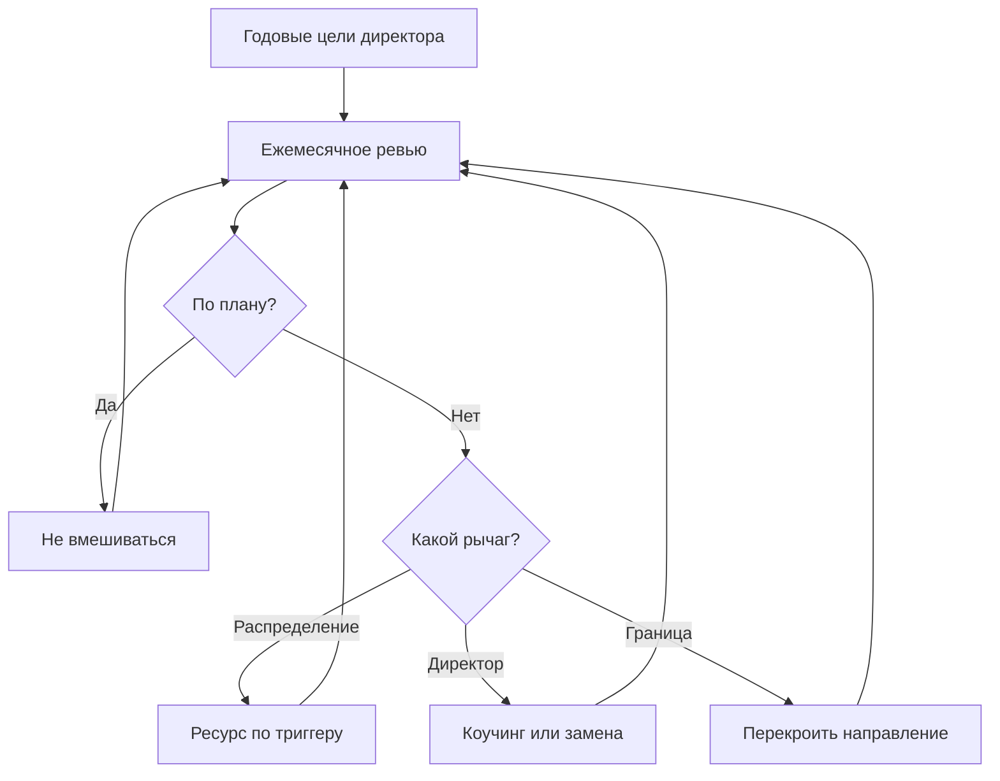
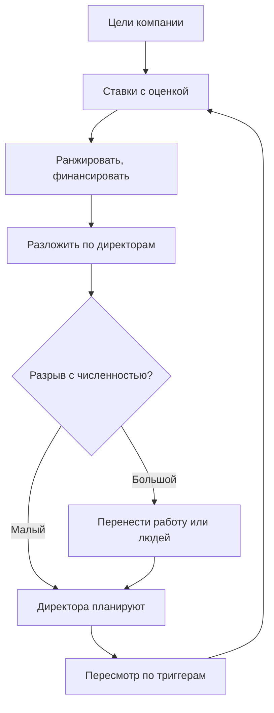

# Глава 47 — VP of Engineering: управление директорами и портфелем { #chapter-47-the-vp-of-engineering-managing-directors-and-the-portfolio }

Директор руководит одним направлением. VP of Engineering (вице-президент по разработке) руководит
несколькими директорами, а через них — портфелем направлений, которые борются за одни и те же деньги и
людей. Работу команд VP видит редко: его дело — решать, за что отвечает каждый директор, что каждый
получает и кто эти директора. Глава сопоставляет роль VP с ролями директора и CTO (технического
директора), показывает, как управлять директорами через цели, операционные ревью и кадровые решения, и
разбирает портфель как задачу распределения ресурса между директорами. Взгляд VP показан на примере
Halvard Systems, вымышленной компании с 500 инженерами из
[главы 35](../07-organization-design/35-designing-organizations-at-four-scales.md#engineering-organization-example).
Кейс ставит вопрос, нужен ли VP вообще в [Northstar](../../case-studies/northstar/index.md), вымышленной
компании книги.

## Почему это важно { #why-this-matters }

Большую часть недель команда VP не замечает, но несколько раз в год именно его решения становятся
определяющими: укомплектована ли команда под свою дорожную карту, тот ли у неё директор, получит ли её
направление финансирование в следующем году.

В масштабе организации VP — первый уровень, на котором ресурс переходит из одного направления в другое.
Директор может перераспределять ресурс внутри своего направления. Но сказать, что одно направление
сокращается, чтобы выросло другое, может только тот, кто стоит над несколькими директорами. Если этого
никто не делает, распределение повторяет прошлогоднюю оргструктуру, и компания финансирует квадратики
на оргсхеме, а не ставки.

С этим [уровнем управления](../../glossary.md#layer) (ступенью руководства между инженерами и вершиной)
высшее руководство часто ошибается. Одни компании нанимают VP раньше, чем появляются директора,
которыми он мог бы руководить. Другие дорастают до нескольких сотен инженеров, а CTO всё ещё сам
разбирает каждый спор между директорами. Обе ошибки замедляют компанию.

## Цели главы { #learning-objectives }

Прочитав эту главу, вы сможете:

- Определять роль VP of Engineering рядом с ролями директора и CTO для четырёх форм компании, исходя
  из решений, которыми владеет каждая роль.
- Решать, нужен ли организации VP: называть решения, которые сегодня не принимает никто и которые
  взяла бы на себя эта роль.
- Управлять директорами через письменные цели, ежемесячное операционное ревью и своевременные кадровые
  решения.
- Распределять ресурс разработки между директорами как портфель ставок и замечать распределение, которое
  просто повторяет оргструктуру.
- Собирать из директоров команду руководителей, которая решает общие проблемы, а не соревнуется за
  ресурс.

Связанные главы: если вы ещё не читали главу 40 (работа директора), начните с неё. Развитию
руководителей и портфелю на уровне директора посвящены главы 41 и 42, планированию персонала —
глава 48, роли CTO — глава 50.

## Ментальная модель { #the-mental-model }

> **Ментальная модель:** VP управляет портфелем директоров, а не просто организацией побольше. У VP три
> рычага: за что отвечает каждый директор, что каждый директор получает и кто эти директора. Всё, что
> ниже этих рычагов, — дело самих директоров.

На этой модели держатся две идеи.

Первая: **единица управления для VP — директор и его направление**. Директор проверяет системы команд,
VP — системы директоров. Неделю VP проверяют одним вопросом: могли ли её решения принять только тот,
кто стоит над несколькими директорами? Если с ними справился бы и директор, значит, VP превратился, по
выражению главы 4, в «большого директора»
([глава 4](../01-foundations/04-the-leadership-ladder.md)).

Вторая: **распределение ресурса — определяющее решение VP, и по умолчанию его принимают
неправильно**. Если ничего не делать, ресурс следует за численностью, а численность — за прошлогодней
структурой. Работа VP — финансировать ставки (результаты, которых хочет компания, с оценкой размера и
рангом), затем раскладывать их по директорам и перемещать ресурс, когда этого требуют данные, а не
всякий раз, когда кто-то просит.

## Подробный разбор { #deep-conceptual-explanation }

### Три роли, четыре формы компании { #three-roles-four-company-shapes }

Роли определяет не название должности. По Larson, руководитель разработки высшего уровня
(engineering executive) — тот, кто отвечает за всю разработку, как бы ни называлась его должность;
компании, отмечает он, пользуются этими названиями непоследовательно
([Larson, 2023a](../../references/bibliography.md#larson2023executive-job);
[Larson, 2024](../../references/bibliography.md#larson2024primer)); **мнение эксперта**.

Книга определяет роли через решения, которыми они владеют (**рекомендация книги**):

| Роль | Владеет | Не владеет |
|---|---|---|
| Директор | Системой одного направления: структура, руководители, качество, поставка (глава 40) | Перемещением ресурса между направлениями |
| VP of Engineering | Распределением ресурса между направлениями; резервом директоров; границами направлений; операционным ритмом для всех директоров | Планами команд, техническим дизайном |
| CTO | Технической стратегией и местом разработки в компании; часто это высший руководитель разработки | Руководством директорами, если есть VP |

Как эти роли сочетаются, зависит от формы компании.

| Форма | Типичный размер | Кто руководит директорами | Вопрос о VP |
|---|---|---|---|
| Один директор под CTO | От 50 до 150 инженеров | Формально CTO | Преждевременно: VP руководил бы одним человеком |
| CTO плюс VP, который руководит организацией | От 150 до 400 | VP | Классическое разделение: CTO обращён вовне и к технике, VP — внутрь и к операционной работе |
| VP как высший руководитель; CTO нет или у CTO нет подчинённых | От 100 до 400 | VP | VP и есть руководитель разработки высшего уровня |
| Несколько VP под CTO | От 400 и больше | Каждый VP в своей группе | VP руководит группой, как в Halvard |

Диапазоны размеров — **иллюстрация**, и они пересекаются. Важно другое: сколько директоров и как часто
их притязания на ресурс сталкиваются. Уровень VP оправдан, когда притязания двух, а чаще трёх и более
директоров сталкиваются так часто, что разбирать эти конфликты должен кто-то ниже CEO (генерального
директора). Larson советует, чтобы у руководителя руководителей было от четырёх до шести подчинённых
руководителей ([Larson, 2018](../../references/bibliography.md#larson2018sizing)). Для VP это грубый
потолок числа директоров; **мнение эксперта**, без данных.

### Почему важно, кто наверху { #why-who-sits-at-the-top-matters }

Теория верхних эшелонов (upper echelons theory) утверждает, что биография топ-менеджеров частично
предсказывает результаты организации: опыт определяет, как руководители читают ситуацию
([Hambrick and Mason, 1984](../../references/bibliography.md#hambrick1984upper);
[Hambrick, 2007](../../references/bibliography.md#hambrick2007upper)). Это **научный результат**, но в
статусе устоявшейся теории о высших командах фирм, а не измеренного эффекта в разработке. Скромный вывод
(**рекомендация книги**): три директора, выросшие в продуктовых командах, поздно заметят платформенный
долг, а три выходца из инфраструктуры недооценят запросы клиентов. От состава команды директоров
зависит, какие проблемы группа способна увидеть.

### Управление директорами через цели { #managing-directors-through-goals }

Каждому директору нужно короткое письменное описание того, за что он отвечает в этом году.
Locke и Latham обобщают данные о том, что конкретные и трудные цели работают
([Locke and Latham, 2006](../../references/bibliography.md#locke2006new)). Ordóñez с коллегами
возражают: цели заодно сужают внимание до того, что измеряют
([Ordóñez et al., 2009](../../references/bibliography.md#ordonez2009goals)). Этот спор разобран в
главе 38. Для VP это сужение и есть задача, которую должна решить постановка целей: директор, у которого
есть только цели направления, будет оптимизировать своё направление. Поэтому дайте каждому директору цели
двух видов (**рекомендация книги**):

1. **Цели направления**: два-три результата для направления директора, у каждого своя метрика в карте
   показателей.
2. **Одна общая цель**, одинаковая для всех директоров, — результат, которого ни одно направление не
   достигнет в одиночку (например, целевой уровень надёжности для всей группы или миграция, которую
   должно завершить каждое направление).

Larson, опираясь на Lencioni, называет коллег руководителя его «первой командой». Он советует
письменно зафиксировать, по чему будут оценивать директоров и как разрешается напряжение между целями
коллег ([Larson, 2023c](../../references/bibliography.md#larson2023gelling);
[Lencioni, 2002](../../references/bibliography.md#lencioni2002five)): **мнение эксперта**. Именно общая
цель превращает первую команду в настоящую.

### Как вести команду директоров { #running-the-director-team }

Директора становятся командой, только если VP ведёт их как команду. Без общего форума каждый директор
договаривается с VP один на один, и любой вопрос, затрагивающий несколько направлений, превращается в
закулисное лоббирование. Всё, что ниже, — **рекомендация книги**; она опирается на письменные ожидания
из предыдущего раздела.

**Ритм.** Три встречи, у каждой одна задача:

| Встреча | Частота и длительность | Её единственная задача |
|---|---|---|
| Встреча команды директоров | Еженедельно, 60 минут | Решения, затрагивающие несколько направлений, и общая цель |
| Обзор портфеля | Ежеквартально, полдня | Заново ранжировать ставки; решать о перераспределениях, когда срабатывают их триггеры |
| Встречи один на один и операционные ревью | Еженедельно и ежемесячно, с каждым директором | Собственное направление директора и его развитие |

Рабочая повестка еженедельной встречи: метрика общей цели (пять минут); решения, затрагивающие
несколько направлений, каждое подано письменно за день, с вариантами и их стоимостью; одна проблема, с
которой директору нужна помощь. Статус отдельных направлений обсуждают на операционном ревью. Запросы
на перераспределение рассматривают только здесь, при всех директорах, поэтому пролоббировать
распределение трудно.

**Права на решения.** Запишите, какие решения принимает команда и как принимается каждое из них
([права на решения](../../glossary.md#decision-rights)), и пересматривайте этот список дважды в год:

| Решение | Как принимается |
|---|---|
| Внутри одного направления | Решает директор; команде сообщают, если это затрагивает других |
| Между направлениями, легко обратимое | Договариваются затронутые директора; если они не договорились за неделю, решает VP |
| Между направлениями, трудно обратимое (границы, общие платформы, перераспределения) | Команда обсуждает; решает VP и записывает причину |
| Стандарты, которые применяет вся группа | Команда предлагает; VP утверждает |

Если решает VP, это не провал команды. Директора отстаивают свои направления — это их работа. Работа
VP — выслушать их, принять решение к известной дате и письменно объяснить причину.

**Конфликт.** Норма такая: спорить на встрече, а за её пределами держаться принятого решения. Нарушают
её двумя способами: заново открывают решённый вопрос с VP наедине и критикуют направление коллеги перед
его стейкхолдерами. Соперничество между коллегами Larson объясняет отчасти привычками, усвоенными там,
где захватить существующий ресурс было выгоднее, чем создать новый, а отчасти руководителем, который не
следит за соблюдением норм ([Larson, 2023c](../../references/bibliography.md#larson2023gelling))
(**мнение эксперта**). Значит, следить за нормами должны вы. Если директор подрывает решение, поднимите
это на ближайшей встрече один на один: назовите поведение и его цену и напомните порядок (решение
открывают заново только при новых данных и только на встрече). Если такое повторится, это должно
отразиться в оценке директора.

Признак того, что команда работает: директора поднимают проблемы своих направлений на встрече раньше,
чем VP услышит о них со стороны, а иногда кто-то из директоров сам предлагает отдать ресурс коллеге.

### Операционное ревью { #the-operating-review }

Главный регулярный инструмент VP — ежемесячное операционное ревью с каждым директором: 60 минут, карта
показателей направления (глава 38), ход профинансированных ставок, укомплектованность и то, что
директор хочет решить. Это проверка системы директора, такая же, какую глава 39 описывает уровнем
ниже.

Отчёты о статусе искажены, и с каждым уровнем искажение накапливается. Keil с коллегами сообщают:
отчёты опытных руководителей программных проектов о статусе были искажены в 60 процентах случаев.
Авторы советуют искать подтверждения в других источниках и предупреждают, что агрессивный аудит может
дать обратный эффект и умножить искажения
([Keil et al., 2014](../../references/bibliography.md#keil2014pitfalls)) (**научный результат**;
переносить его за пределы изученных выборок нужно осторожно).

Формальная модель Aghion и Tirole различает формальную власть (право решать) и реальную власть
(фактический контроль). Реальная власть следует за информацией и переходит к подчинённым, когда
начальник перегружен ([Aghion and Tirole, 1997](../../references/bibliography.md#aghion1997formal)). У
VP над пятью директорами формальная власть есть над всем, а реальная — над немногим, поэтому решите,
где её удерживать (распределение, состав директоров, несколько общих стандартов). Противоположный
провал — отстранённость. Larson утверждает, что отстранённый руководитель вредит больше, чем немного
чересчур вовлечённый: решения застревают, а с руководителями, которые не справляются, никто не
работает ([Larson, 2023d](../../references/bibliography.md#larson2023micromanage)); **мнение
эксперта**.

Когда направление отклоняется от плана, VP выясняет, какой из трёх рычагов дал сбой. Напрямую
вмешиваться в работу команд направления — не вариант. Если VP кажется, что без этого не обойтись, это
уже само по себе свидетельство о директоре.

### Портфель как задача распределения { #the-portfolio-as-an-allocation-problem }

Глава 42 ограничивает число межкомандных инициатив, которые директор ведёт одновременно, а глава 38
делит ресурс директора на категории. VP же решает, сколько ресурса получает каждый директор на год и
на что.

Larson советует распределять ресурс крупными блоками, нечасто и руководителю направления, а не его
командам.
Одна из причин: частые изменения заставляют команды бороться за ресурс как в игре с нулевой суммой
([Larson, 2023b](../../references/bibliography.md#larson2023planning)): **мнение эксперта**.

Исследования указывают ещё и на искажение: распределение следует за оргструктурой. Bardolet, Fox и
Lovallo утверждают, что многопрофильные компании склонны делить ресурсы между подразделениями поровну,
так что распределение зависит от того, как компания поделена («зависимость от разбиения», partition
dependence). Вывод подтверждают архивное исследование и два эксперимента с опытными менеджерами
([Bardolet et al., 2011](../../references/bibliography.md#bardolet2011capital)). Это **научный
результат** о капитальных бюджетах; перенос его на ресурс разработки — расширение, сделанное книгой.
Если VP выделяет каждому директору долю от его собственного плана, распределение диктует оргструктура.
Вторую опасность показывает работа Staw об эскалации приверженности (escalation of commitment): люди
склонны вкладывать всё больше в провальный курс, если выбрали его сами
([Staw, 1976](../../references/bibliography.md#staw1976knee)). Поэтому труднее всего урезать
собственные ставки VP.

Ставки ранжируют раньше, чем кто-либо посмотрит, к какому директору они попадут. Большой разрыв между
профинансированной работой и численностью направления — повод решить, перенести работу, перевести
людей или перекроить направление, а не профинансировать следующий по важности пункт этого направления.

### Укомплектование команды директоров { #staffing-the-director-team }

Самые весомые решения VP, которые к тому же чаще всего откладывают, касаются директоров: кто они, как
очерчены их направления, когда кого-то пора сменить. Larson советует сначала проверить первые
впечатления, а затем быстро провести необходимые кадровые изменения
([Larson, 2023c](../../references/bibliography.md#larson2023gelling)). Преемственность, развитие
руководителей и низкая результативность разобраны в главах 36, 41 и 9; здесь те же идеи применены
уровнем выше (**рекомендация книги**).

**Оценка директора.** Опирайтесь на четыре вида свидетельств из разных источников, чтобы ни один
искажённый канал не решал всё в одиночку:

| Свидетельство | Источник | Тревожный признак |
|---|---|---|
| Результаты и здоровье системы | Карта показателей направления | Цели выполнены, а инциденты, незапланированная работа или текучесть растут |
| Сигналы со встреч через уровень | Руководители и senior-инженеры директора | Руководители проводят решения в обход директора |
| Рост руководителей | Наймы, повышения, переводы | Ни один руководитель не стал ближе к более крупной роли, чем год назад |
| Поведение среди коллег | Команда директоров | Решения пересматривают за закрытыми дверями; общая цель так и не получает ресурса |

Раз в полугодие пишите оценку со свидетельствами и обсуждайте её с директором.

**Директор, распределение или граница?** Средства различаются по стоимости и обратимости, поэтому
задавайте вопросы по порядку. Было ли направление профинансировано под то, что от него требовали? Если
таблица разрывов показывала нехватку, а ничего не сдвинулось, проблема в распределении, и новый
директор её не решит. Заставляет ли граница постоянно договариваться с другим направлением (общие
компоненты, один клиентский сценарий, разрезанный надвое)? Если коллеги жалуются на то же трение,
перекроите границу. Только когда и финансирование, и граница в порядке, свидетельства указывают на
директора. Пример: направление опаздывает с обязательством на два месяца. Соседнее направление с
похожим финансированием своё выполнило, а руководители отстающего направления говорят, что решения
подолгу ждут директора. Это проблема директора.

**Коучинг, перевод или замена.** Коучинг подходит, когда директор сам признаёт пробел: с метрикой и
датой, обычно на полгода. Переводите директора, который был бы силён в направлении
другого типа. Заменяйте, когда письменная оценка остаётся плохой и после назначенной даты решения.
Любая смена директора — переходный период для всего направления, поэтому решайте один раз и по
свидетельствам.

**Найм или повышение директора.** Сначала опишите роль: цели направления, что нужно его руководителям
и какой сильной стороны не хватает команде директоров. Внутреннего кандидата проверьте в роли исполняющего
обязанности или на расширенной области ответственности, с датой пересмотра; судите по тому, как
работают его руководители. Внешнего кандидата интервьюируйте по описанию роли (глава 7), берите
рекомендации у его бывших подчинённых и согласуйте план на 90 дней в первую же неделю. Дайте другим
директорам познакомиться с кандидатами: они станут первой командой новичка.

## Пример из инженерной организации { #engineering-organization-example }

Этот пример — **иллюстрация**, он вымышлен. В Halvard Systems (глава 35) 500 инженеров в четырёх
продуктовых группах и платформенной организации, у каждой свой VP; подробности — на
[странице Halvard](../../case-studies/northstar/halvard.md).

**Группа.** Nadia Brennan — VP of Commerce, самой большой продуктовой группы Halvard: 130 инженеров и
16 линейных руководителей под тремя директорами.

| Директор | Направление | Руководители | Инженеры |
|---|---|---|---|
| Owen Achterberg | Checkout | 5 | 41 |
| Selin Kaya | Catalog and Search | 5 | 40 |
| Joaquín Ferreyra | Merchant Tools | 6 | 49 |
| **Итого** | | **16** | **130** |

**Поддерживающая работа.** По прошлогодним выборкам (допущение), дежурства, сопровождение и
незапланированная работа направлений занимают 32 [FTE](../../glossary.md#fte) (полные ставки
инженеров): Checkout 12, Catalog and Search 8, Merchant Tools 12. Для инвестиций остаётся 98 FTE:
Checkout 29, Catalog and Search 32, Merchant Tools 37.

**Ставки.** Цели Halvard на год — больше корпоративных продавцов и меньше неудачных оформлений
заказа. Директора и продуктовые лиды предложили шесть ставок с оценкой в FTE на год (допущения):

| Ранг | Ставка | FTE | Из каких направлений |
|---|---|---|---|
| 1 | Надёжность оформления заказа и новые способы оплаты | 24 | Checkout 24 |
| 2 | Корпоративные каталоги (несколько каталогов на продавца) | 30 | Catalog 20, Merchant Tools 10 |
| 3 | Самостоятельное подключение продавцов | 18 | Merchant Tools 18 |
| 4 | Отчётность для продавцов, версия 2 | 16 | Merchant Tools 16 |
| 5 | Эксперименты с интерфейсом оформления заказа | 8 | Checkout 8 |
| 6 | Перестройка релевантности поиска | 14 | Catalog 14 |

Спрос — 110 FTE при 98 доступных. Если финансировать по рангу, ставки 1–5 занимают 96 FTE, ещё
2 FTE остаются в резерве, а ставка 6 не финансируется.

**Разрыв по направлениям.** Профинансированная работа ложится на директоров неравномерно:

| Направление | Для инвестиций | Профинансированная работа | Разрыв |
|---|---|---|---|
| Checkout | 29 | 32 | −3 |
| Catalog and Search | 32 | 20 | +12 |
| Merchant Tools | 37 | 44 | −7 |
| **Итого** | **98** | **96** | **+2** |

**Что выбрала бы оргструктура.** Если бы каждый директор планировал в пределах своего ресурса для
инвестиций, направление Catalog and Search профинансировало бы большую часть релевантности поиска
(20 + 14 = 34 при 32 доступных), Merchant Tools отказалось бы от отчётности версии 2, а Checkout урезало
бы эксперименты. Выбор сделала бы оргструктура, а не ранжирование: зависимость от разбиения в
миниатюре.

**Варианты у Nadia.**

- **(a) Перевести людей.** Одна команда Catalog and Search, примерно восемь инженеров, переходит в
  Merchant Tools; платить за это придётся
  [стоимостью перехода](../../glossary.md#transition-cost) (глава 36).
- **(b) Перенести работу.** Команда Catalog and Search делает части ставок 2 и 4, обращённые к
  продавцам; но добавляется стоимость координации.
- **(c) Изменить ранжирование.** Релевантность поиска поднимается выше ставки 4. Финансируются
  ставки 1, 2, 3, 6 и 5 (94 FTE), ставка 4 выпадает:

| Направление | Для инвестиций | Профинансированная работа при (c) | Разрыв |
|---|---|---|---|
| Checkout | 29 | 32 (ставки 1 и 5) | −3 |
| Catalog and Search | 32 | 34 (ставки 2 и 6) | −2 |
| Merchant Tools | 37 | 28 (ставки 2 и 3) | +9 |

Каждый вариант можно защитить. Арифметика делает выбор явным, и делает его Nadia, а не оргструктура.

## Как принимать решение { #decision-framework }

Первая таблица помогает решить, нужен ли уровень VP, вторая — какие решения VP оставляет за собой.

| Сигнал | Указывает на |
|---|---|
| Один директор или ни одного | VP не нужен; явно передайте решения о распределении директору или CTO |
| Два или больше директоров, чьи притязания на ресурс сталкиваются каждый месяц, а разрешает их CEO или CTO | VP или CTO, который явно берёт на себя решения VP |
| Время CTO уходит на споры директоров и кадровые вопросы, техническая стратегия заброшена | Разделение ролей CTO и VP |
| Несколько групп, в каждой по несколько директоров | По VP на группу под CTO |
| Совет директоров или инвесторы ждут должности, к которой не привязаны решения | Не причина; лучше уточните область ответственности нынешнего руководителя |

| Решение | Остаётся за VP | Делегировано директорам |
|---|---|---|
| Ресурс на направление на год | Да, по триггерам | Внутри направления |
| Ранжирование ставок между направлениями | Да, вместе с продуктом | Ранжирование внутри направления |
| Найм и замена директоров | Да | Найм руководителей |
| Границы направлений | Да | Границы команд |
| Общие стандарты для направлений | Несколько, у каждого свой владелец | Всё остальное |
| Технический дизайн | Нет (staff- и principal-инженеры) | Через своих staff-инженеров |

Правило (**рекомендация книги**): VP оставляет за собой решения, которые что-то перемещают между
директорами, и делегирует то, что остаётся внутри одного направления.

## Компромиссы { #trade-offs }

**Повысить директора или нанять VP.** Внутренний директор знает систему и людей, внешний VP приносит
опыт следующего масштаба. Из теории верхних эшелонов следует, что любой из двух вариантов определит,
что будет замечать команда руководителей. Поэтому вопрос в другом: какие слепые пятна компания меньше
всего может себе позволить.

**Стабильное распределение или гибкость.** Редкие перераспределения позволяют директорам планировать и
прекращают лоббирование, но они же месяцами финансируют угасающую ставку. Записанные триггеры («если
во втором квартале корпоративных сделок меньше четырёх, ставка 2 сокращается до 20 FTE») дают гибкость
без постоянных пересогласований.

**Проверка или автономия.** Тщательное ревью рано ловит проблемы. Но если оно не поощряет ранние
плохие новости, оно порождает отполированные отчёты (об этом и предупреждают Keil с коллегами).

**Перевести людей или перенести работу.** Перевод людей устраняет долговременное несоответствие, но
за него платят стоимостью перехода. Перенос работы сохраняет команды целыми, но добавляет
координацию. Переводить людей стоит, если несоответствие, по ожиданиям, продлится дольше года.

## Типичные провалы { #failure-modes }

**«Большой директор».** VP напрямую руководит командами: ходит на обзоры спринтов, назначает инженеров,
утверждает дизайн. Признак: директора приносят VP решения, которые лежат внутри их собственных
направлений. Как заметить: раз в квартал разложите решения VP на «это мог решить только я» и «это мог
решить директор».

**VP-передатчик.** VP передаёт приоритеты CTO вниз, а статус директоров вверх, добавляя лишнее звено
и ни одного решения. Признак: директора описали бы роль VP как коммуникацию. Как заметить: перечислите
решения о распределении и составе руководителей, которые VP принял за прошлое полугодие; если их нет,
уровень не оправдывает своего места.

**Распределение по оргструктуре.** Каждый директор получает примерно прошлогоднюю долю, плюс-минус
немного. Признак: пропорции распределения из года в год почти не меняются, хотя цели компании
меняются. Как заметить: ранжируйте ставки до того, как раскладывать их по направлениям, и сравните
результат с численностью направлений.

**Театр статусов.** На ревью всё зелёное, пока квартал не оказывается потерян. Признак: проблемы сначала
всплывают в другой функции. Как заметить: подтверждайте каждое ревью вторым источником (источники
сигналов из главы 40).

**Турнир директоров.** Директора соревнуются за численность и эскалируют вопросы наедине. Larson
предупреждает, что если это поощрять, согласованный план превращается в фикцию
([Larson, 2023b](../../references/bibliography.md#larson2023planning)). Признак: просьбы перенести
ресурс звучат на встречах один на один. Как заметить: запросы на перераспределение идут только через встречу
команды директоров.

**Незаменённый директор.** Директор, который не справляется, остаётся на месте целый год. Признак:
руководители направления идут к VP в обход него. Как заметить: письменная оценка раз в полугодие, а
если она плохая — дата решения.

## Применение в крупной организации { #enterprise-application }

В организации из 50–150 инженеров обычно один директор, максимум два, и нет VP. Но работа VP всё равно
есть, пусть и в малом масштабе, и кто-то должен её делать.

**Распределение.** При 80–150 инженерах директор решает о годовом распределении вместе с CTO и
руководителем продукта (главы 38 и 42). Уровень VP добавляет к этому одно: ставки ранжируют до того,
как раскладывать их по командам, чтобы шесть команд не профинансировали тихо шесть своих любимых
проектов.

**Второй директор.** Первое решение «масштаба VP» обычно такое: создавать ли вторую роль
директора. Проектирование такой роли разобрано в главе 35, а взгляд VP добавляет одну проверку: будут
ли притязания двух директоров на ресурс сталкиваться и кто будет решать между ними? Если ответ —
«CTO», значит, CTO выполняет роль VP и должен сказать об этом прямо.

**Как дорасти до роли.** Директор, который рассчитывает стать VP, собирает свидетельства уже сейчас:
распределение по ранжированию, руководители, которые могли бы стать директорами (глава 41), отношения
с коллегами из высшего руководства.

## Взгляд CTO { #cto-perspective }

CTO проектирует роль VP или решает обойтись без неё. Здесь за CTO три решения.

**Что CTO оставляет себе.** Larson описывает руководителя разработки высшего уровня как человека,
который решает проблемы прежде всего в интересах компании, а не отстаивает одну функцию
([Larson, 2023e](../../references/bibliography.md#larson2023balancing)). Если роли CTO и VP разделены,
оба не могут делать эту работу для одних и тех же решений. К тому же разделение добавляет шов, на
котором приоритеты обсуждают дважды. Запишите, какими решениями владеет каждый. Обычно CTO оставляет
себе техническую стратегию, крупные решения «разработать или купить» (build vs buy) и
представительство компании вовне, а VP — распределение ресурса, состав директоров и операционный ритм.

**Кто станет VP.** В масштабе Halvard довод теории верхних эшелонов применим напрямую: выбирая VP, CTO
выбирает слепые пятна команды руководителей.

**Как распределять ресурс между VP.** Зависимость от разбиения повторяется уровнем выше: четыре
продуктовые группы и платформенная организация, как правило, получают пять долей. CTO ранжирует ставки
компании до того, как раскладывать их по группам, и готов к тому, что какая-то группа сократится.

## Практический плейбук { #practical-playbook }

1. **Перечислите свои решения**: те, что что-то перемещают между директорами, и те, что остаются
   внутри одного направления. Второй список делегируйте.
2. **Запишите цели каждого директора**: два-три результата направления с метриками и одну общую цель,
   одинаковую для всех.
3. **Зафиксируйте ожидания письменно**: по чему будут оценивать каждого директора, как разрешаются
   споры между директорами, с чем к вам следует приходить.
4. **Проводите ежемесячное операционное ревью с каждым директором**: 60 минут, сначала карта
   показателей, и для каждого ревью — один подтверждающий источник.
5. **Ранжируйте ставки до того, как раскладывать их**: оцените размер каждой ставки, ранжируйте их
   по всем направлениям, финансируйте по порядку, затем посчитайте для каждого направления разрыв
   с его численностью.
6. **Решайте каждый большой разрыв явно**: перевести людей, перенести работу или изменить
   ранжирование, с письменной причиной.
7. **Запишите триггеры перераспределения**; перераспределяйте, когда они срабатывают, а не по просьбе,
   и только на еженедельной встрече команды директоров, где присутствуют все.
8. **Оценивайте каждого директора раз в полугодие** по свидетельствам; для любой плохой оценки
   назначайте дату решения.
9. **Проверяйте уровень**: дважды в год перечисляйте решения, которые принял только VP. Если список
   короткий, меняйте роль.

## Кейс { #case-study }

!!! info "Northstar: что уже известно"
    Неделя 45 первого года директора. Число инцидентов [Sev1 и Sev2](../../glossary.md#severity-sev1-sev2-sev3)
    упало с 30 за квартал до 14 в квартале 3 без роста численности. На неделе 44 директор подготовил
    черновик предложения по организации второго года; Victor Lindqvist (CTO) решает по нему на
    неделе 46. См. [хронологию](../../case-studies/northstar/timeline.md). Впервые читаете о Northstar?
    Прочитайте [«Год вкратце»](../../case-studies/northstar/year-in-brief.md),
    [действующих лиц](../../case-studies/northstar/cast.md) и
    [брифинг квартала 4](../../case-studies/northstar/quarter-4-briefing.md).

Этот кейс **вымышлен**, действие происходит в недели 45–48. Итог не задан: решение принимаете вы.
Другие открытые решения перечислены в брифинге квартала 4.

!!! note "Предложение по организации второго года вкратце"
    В Northstar 87 [мест](../../glossary.md#seat) (80 инженеров, 6 руководителей и директор), и общее
    число не меняется. Основное предложение делит Customer Experience на команды Web и Mobile:
    неформальный лид мобильной разработки становится руководителем Mobile, а его инженерное место не
    заполняется. Итог — 79 инженеров и 7 руководителей. Прямых подчинённых у директора становится 10
    (семь руководителей и три staff-инженера). Альтернатива D добавляет двух руководителей
    руководителей: 77 инженеров, 9 руководителей.

**Неделя 45.** VP в Northstar нет; директор — единственный руководитель разработки, подчинённый Victor.
Читая черновик, Victor задаёт вопрос, на который в нём нет ответа: «Во второй год нам нужен VP of
Engineering над вами, или вы дорастёте до этой роли?» Он хочет высвободить больше времени на
техническую стратегию и сомневается, что директор с [охватом управления](../../glossary.md#span-of-control)
в 10 прямых подчинённых сможет одновременно вести организацию и кросс-функциональный портфель.
Рекомендацию он ждёт к неделе 48.

**Какие данные есть у директора.**

| Факт | Значение | Как измерено |
|---|---|---|
| Время директора на встречах | Около 25 часов из 47-часовой недели | Подсчёт по календарю, квартал 2 |
| Время из первых рук (наблюдение за работой, а не отчёты) | 4.7 процента часов | Исследование времени, недели 14–15 |
| [Покрытие преемниками](../../glossary.md#succession-coverage) | 10 критических ролей; ни одного преемника, готового сейчас; у 4 нет никого | Обзор преемственности, неделя 44 |
| Численность | 87 мест; VP занимает одно | Правило «без роста численности» |

**Варианты в формулировке директора.**

1. **Нанять VP над директором.** Под него отдают незаполненное инженерное место. VP руководил бы
   одним директором. Это тот самый уровень-передатчик, от которого предостерегает глава, если только
   роль не возьмёт на себя решения, которых у директора сегодня нет.
2. **Директор дорастает до роли.** Victor письменно делегирует решения уровня VP, которые в Northstar
   существуют: годовое распределение ресурса между командами вместе с Amara Okafor (CPO, директором
   по продукту), кадровые решения о руководителях и операционный ритм. Охват в 10 человек остаётся
   открытым риском.
3. **Уровень из альтернативы D вместо VP.** Два руководителя руководителей забирают часть охвата, и
   работа директора смещается в сторону работы VP. Цена — два инженерных места (77 инженеров вместо
   79).
4. **Решить позже, по триггерам.** Во второй год VP нет; заранее записаны триггеры пересмотра, например
   одобренный рост численности, вторая роль директора или охват, который два квартала подряд
   остаётся выше заданного числа.

Каждый вариант зависит от решения Victor по предложению об организации на неделе 46. **Решает
читатель:** что директор должен рекомендовать на неделе 48, какие решения и кому эта рекомендация
передаёт и какие данные заставили бы её изменить.

## Упражнения { #exercises }

Разборы упражнений: [решения к главе 47](../../solutions/ch47-solutions.md).

### Базовый уровень { #foundational }

**F1.** В софтверной компании 220 инженеров в трёх направлениях, у каждого направления свой директор;
CTO — основатель компании. Два дня в неделю он разбирает споры директоров о численности и общих
сервисах и перестал писать техническую стратегию. CEO предлагает нанять коллегу уровня CTO. С помощью
таблицы ролей из этой главы определите, у каких решений нет владельца и какая роль должна их взять,
если такая роль вообще нужна.

**F2.** У VP of Fulfillment в Halvard два директора. Три года подряд каждый получал ровно половину
ресурса группы для инвестиций, хотя цели группы сместились от интеграций со складами к отслеживанию
доставки. Объясните, что здесь предсказывает зависимость от разбиения, какие свидетельства вы
собрали бы, чтобы это проверить, и как изменили бы процесс распределения.

**F3.** VP записывает такие цели для трёх директоров: «Выпустить редизайн оформления заказа»,
«Улучшить моральный дух команды» и «Сократить число инцидентов в Catalog на 30 процентов».
Перепишите их, используя два вида целей из этой главы, и объясните, чем пренебрёг бы директор при
каждой исходной цели.

### Прикладное лидерство { #applied-leadership }

**A1.** Четыре месяца подряд Joaquín Ferreyra на ежемесячном операционном ревью у Nadia Brennan
показывает Merchant Tools зелёным. Продуктовый лид из другой группы говорит Nadia, что подключение
продавцов (ставка 3) отстаёт примерно на два месяца. Спланируйте следующие шаги Nadia: что и у кого
она проверяет и как ведёт разговор с Joaquín, чтобы не приучить его скрывать проблемы.

**A2.** Опираясь на пример из инженерной организации, Selin Kaya доказывает, что избыток её
направления в 12 FTE должен пойти на релевантность поиска (ставка 6), потому что «Catalog and Search
для того и существует, чтобы владеть поиском». Подготовьте ответ Nadia для Selin и для встречи
команды директоров, включая арифметику по каждому из трёх вариантов и то, кто несёт каждую стоимость.

**A3.** VP получает в наследство четырёх директоров. В первый же месяц трое руководителей одного из
директоров называют его недоступным и медлительным в решениях; при этом его направление
выполняет свои цели. Спланируйте первый квартал VP с этим директором: что VP проверяет, прежде чем
действовать, какие свидетельства оправдали бы перемены и что VP делает тем временем.

**A4.** Допустим, двое директоров Nadia Brennan договорились на встрече команды директоров отложить
изменение общего API оформления заказа на квартал. Через неделю продуктовый лид сообщает Nadia, что
один из них рассказывает своим продуктовым партнёрам, будто отсрочка — это «руководство Commerce нас
переиграло», а сам потихоньку всё равно выделяет людей на это изменение. Решите, что Nadia делает в
ближайшую неделю, что она говорит этому директору и меняет ли что-нибудь в том, как команда
принимает решения, а если да, то что.

### Решения на уровне руководства { #executive-decision-making }

**X1.** Опираясь на кейс, напишите рекомендацию директора для Victor Lindqvist к неделе 48: нужен ли
Northstar во второй год VP of Engineering. Укажите, какие решения и кому рекомендация передаёт,
сколько мест это стоит по правилу «без роста численности», при каких условиях вы рекомендовали бы
иначе и как рекомендация зависит от решения Victor по предложению на второй год на неделе 46.

**X2.** Вы CTO Halvard. Каждый из пяти ваших VP добивается большей численности в плане на следующий
год, а финансовый план допускает чистый прирост на 20 мест на все 500 инженеров компании. Двое
VP наедине попросили у вас большую часть этих мест. Спроектируйте, как будут распределены эти 20 мест: процесс, кто
участвует, какие свидетельства приносит каждый VP и как не дать закулисной эскалации стать настоящим
процессом.

## Вопросы для размышления { #reflection-questions }

1. Какие из решений, принятых вашим руководителем в прошлом квартале, мог принять только человек его
   уровня? Какие мог бы принять уровень ниже?
2. Если бы вы ранжировали ставки своей организации на следующий год, не глядя на оргструктуру,
   насколько распределение отличалось бы от нынешнего?
3. Какие проблемы ваша команда руководителей заметит последней, учитывая, кто в неё входит?
4. Какого руководителя в вашей организации следовало перевести ещё год назад и что этому помешало?

## Главное { #key-takeaways }

- Определяйте роль VP через решения, которыми она владеет: распределение между направлениями, резерв
  директоров, границы направлений и операционный ритм для всех директоров.
- VP над единственным директором — уровень, у которого нет определяющих его решений. Назовите эти решения,
  прежде чем создавать должность.
- Дайте каждому директору цели направления и одну общую цель, чтобы коллег отчасти оценивали по тому,
  чего они могут достичь только вместе.
- Проводите ежемесячное операционное ревью с каждым директором, подтверждайте его вторым источником и
  поощряйте ранние плохие новости.
- Ранжируйте ставки до того, как раскладывать их по директорам, а большой разрыв с численностью
  направления считайте явным решением: перевести людей, перенести работу или изменить ранжирование.
- Перераспределяйте ресурс по записанным триггерам на форуме, где присутствуют все директора, и
  никогда — через закулисную эскалацию.
- От состава команды директоров зависит, какие проблемы организация способна увидеть. Прежде чем
  менять директора, исключите распределение и границу; потом решайте по письменным свидетельствам, не
  откладывая на год.

## Источники и что почитать { #references-and-further-reading }

- [Larson, 2024](../../references/bibliography.md#larson2024primer). Роль руководителя высшего уровня как
  отдельная работа.
- [Larson, 2023a](../../references/bibliography.md#larson2023executive-job). Руководитель высшего
  уровня определяется ответственностью, а не должностью.
- [Larson, 2023b](../../references/bibliography.md#larson2023planning). Планирование и распределение
  ресурсов на уровне руководства.
- [Larson, 2023c](../../references/bibliography.md#larson2023gelling). Команды руководителей; коллеги
  как первая команда.
- [Larson, 2023d](../../references/bibliography.md#larson2023micromanage). Почему отстранённость —
  худший провал.
- [Larson, 2023e](../../references/bibliography.md#larson2023balancing). Руководитель, который ставит
  компанию на первое место.
- [Hambrick and Mason, 1984](../../references/bibliography.md#hambrick1984upper) и
  [Hambrick, 2007](../../references/bibliography.md#hambrick2007upper). Теория верхних эшелонов:
  биография топ-менеджеров и выбор организации.
- [Bardolet et al., 2011](../../references/bibliography.md#bardolet2011capital). Равномерное
  распределение и зависимость от разбиения при распределении ресурсов в корпорациях.
- [Keil et al., 2014](../../references/bibliography.md#keil2014pitfalls). Искажения в отчётах о статусе
  и как руководителям их читать.
- [Aghion and Tirole, 1997](../../references/bibliography.md#aghion1997formal). Формальная и реальная
  власть.
- [Locke and Latham, 2006](../../references/bibliography.md#locke2006new) и
  [Ordóñez et al., 2009](../../references/bibliography.md#ordonez2009goals). Постановка целей и её
  побочные эффекты.
- [Staw, 1976](../../references/bibliography.md#staw1976knee). Эскалация приверженности.
- [Larson, 2018](../../references/bibliography.md#larson2018sizing). Охват управления у руководителей
  руководителей.
- [Lencioni, 2002](../../references/bibliography.md#lencioni2002five). *The Five Dysfunctions of a
  Team* («Пять пороков команды»). Идея коллег как первой команды.
