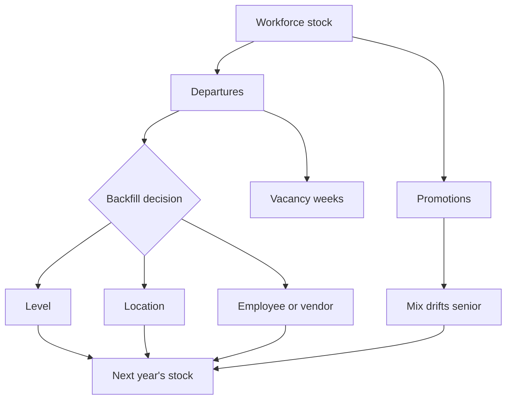
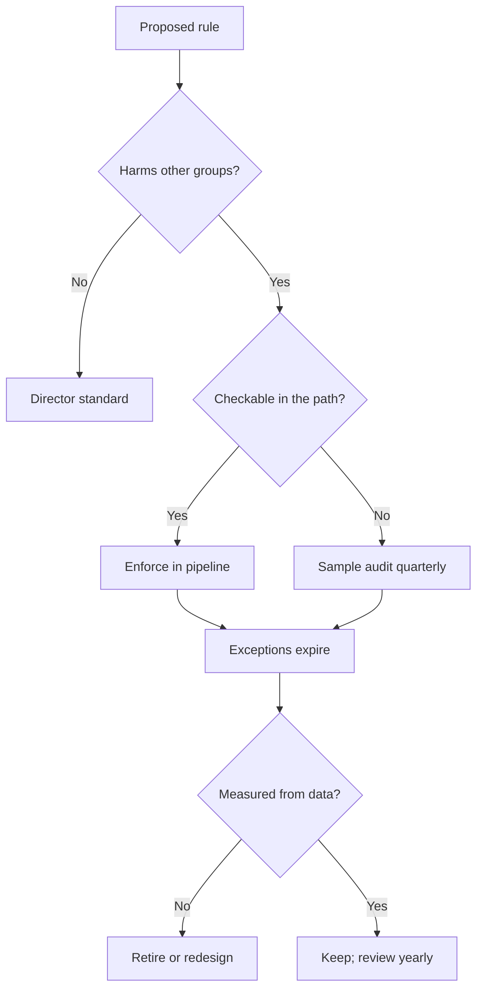
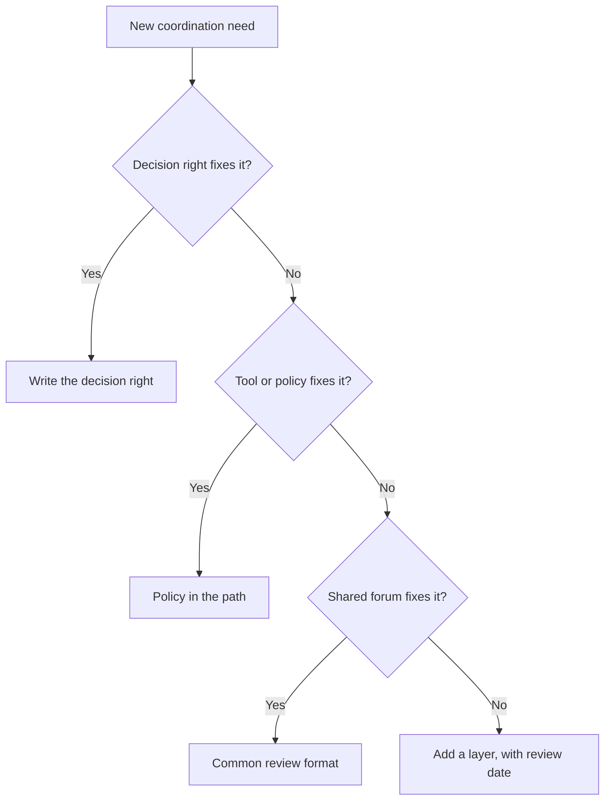

# Chapter 48 — Capacity Strategy, Workforce Planning, and Enterprise Governance

A director plans capacity a quarter at a time (Chapter 38). A VP of Engineering plans the stock those
quarterly plans draw on: which levels, in which locations, employed or contracted, and how that stock
changes as people leave, get promoted, and are replaced. The VP also decides which few rules must
hold identically in every group, and how the management system grows without a new layer each time
the organization does. The enterprise example is Halvard Systems, the fictional 500-engineer company
from [Chapter 35](../07-organization-design/35-designing-organizations-at-four-scales.md); the case
study is the fictional [Northstar Technologies](../../case-studies/northstar/index.md) building its
year-2 workforce plan under a flat headcount rule.

## Why This Matters

At team scale, a departure is a personal and practical event: who takes the on-call shifts, who
reviews the ledger changes.

At organization scale, departures are a flow. Northstar lost 8 of 80 engineers in the year before its
director arrived, with a median of 15 weeks from resignation to the replacement's first day
([baseline data](../../case-studies/northstar/baseline-data.md)). That is 120 engineer-weeks of empty
seats a year, about 2.3 engineers missing on an average day, before ramp-up. Every backfill is also a
choice of level, location, and employment type. Made one at a time by whichever manager lost
someone, those choices still add up to a workforce strategy. It is just nobody's.

At executive scale, the workforce is most of the engineering budget, and its shape outlasts any
roadmap. A level mix drifts senior if nobody watches it; a location chosen for cost sets coordination
costs for a decade; a contractor bench becomes a dependency; and each new layer or approval board
slows every decision that crosses it.

## Learning Objectives

After this chapter you will be able to:

- Build a workforce plan that models attrition, time to fill, promotion, and level mix, with its
  assumptions stated.
- Decide where to place engineering work by location and sourcing model, using the evidence on
  distributed and offshored development rather than rate cards alone.
- Set vendor and contractor rules that keep critical knowledge inside the organization.
- Design a short enterprise policy set in which every policy has an owner, an enforcement point, an
  exception path, and a measure.
- Choose the cheapest coordination mechanism for a new need before adding a management layer.

Related chapters: Chapter 38 (quarterly capacity) comes first. Chapter 34 covers spans and layers,
Chapter 20 standards at director scale, and Chapter 59 removing bureaucracy.

## The Mental Model

> **Mental model:** The workforce is a stock you cannot change quickly, and governance is a small
> number of rules you can actually enforce. Plan the flows that change the stock, and spend
> enforcement only where one group's failure lands on another.

The first idea is **stock and flow**. Headcount, level mix, and location mix are stocks that change
only through flows: departures, hires, promotions, transfers, contract starts and ends. A flat
headcount rule fixes the size of the stock, not its shape; the shape is set at every backfill.

Each departure creates vacancy weeks and a backfill decision. Promotions move people up without
leaving, so like-for-like backfill drifts the mix senior even at flat headcount.

The second idea is **governance as a budget**. Every enterprise rule spends capacity in every team,
and every unenforced rule teaches that rules are optional. So the VP keeps only rules whose violation
in one group harms other groups, customers, or the company, each enforced where it cannot be
skipped, and delegates the rest to directors (Chapter 20).

## Deep Conceptual Explanation

### What a workforce plan contains

The workforce plan is the capacity model's longer-range parent: Chapter 38 and the
[capacity planning model template](../../templates/capacity-planning-model.md) take headcount as
given for a quarter; the workforce plan sets headcount and its shape for a year or more. Six parts
(this book's recommendation):

| Part | Question | Source |
|---|---|---|
| Demand | What work, at what skill, in which domains | Portfolio and technical strategy |
| Supply | Who is here, by team, level, location, employment type | HR system, checked with managers |
| Flows | Departures, promotions, moves, time to fill | Last two years, stated as assumptions |
| Shape rules | Level bands, location rules, vendor rules | This plan |
| Cost | [Fully loaded cost](../../glossary.md#fully-loaded-cost) by level and location | Finance, loading factor (the multiplier from salary to loaded cost) stated |
| Risks | Single points of knowledge, sites without leaders | Knowledge maps, succession (Chapter 36) |

Larson's primer on the engineering executive's job counts planning and organization design as part of
that job ([Larson, 2024](../../references/bibliography.md#larson2024primer); **expert opinion**). It
helps to read costs as finance does
([Berman and Knight, 2006](../../references/bibliography.md#berman2006financial)): fully loaded cost (salary, benefits, taxes, equipment, space) rather than salary, and a
budget that assumes every funded seat is filled every week. Vacancy weeks are approved budget unspent.

### Attrition, vacancy, and knowledge

> average missing capacity = departures per year × weeks to fill ÷ 52

Add ramp-up: the idea credited to Brooks is that new people consume the time of those who teach them
([Brooks, 1995](../../references/bibliography.md#brooks1995mythical); **expert opinion**). The
research is about knowledge. In one large project, recent departures were associated with a higher probability of
customer-reported defects ([Mockus, 2010](../../references/bibliography.md#mockus2010volatility);
**research finding**, observational). A study of Chrome and a project at Avaya found that historical losses
from departed developers' files could exceed three times the expected loss. Naming successors reduced
expected loss by up to 15 percent
([Rigby et al., 2016](../../references/bibliography.md#rigby2016turnover); **research finding**, two
projects). Plan for the average vacancy; protect the few knowledge areas where one departure is a tail
risk.

Attrition is partly a management outcome: at one high-tech firm, survey-measured people management
skills had a strong negative relation to turnover
([Hoffman and Tadelis, 2021](../../references/bibliography.md#hoffman2021people); **research
finding**, one firm). Retention itself belongs to Chapter 10.

### Level mix

There is no research-backed "right" level mix; what follows is **this book's recommendation**. Three
forces move it. **Promotion** moves people up without a vacancy; under calibrated promotion (Chapter
8) that is correct, and it is a cost increase. **Like-for-like backfill** preserves the mix only if
nobody is promoted. **Hiring difficulty** pushes managers who waited 15 weeks to take whoever clears
the bar at whatever level was easiest to fill.

Senior drift is not automatically bad: a ledger with few people able to change it safely needs
experience. Junior drift is not automatically cheap. At one Fortune 500 firm, sitting near teammates
increased the coding feedback engineers received, most for newer and younger engineers, while
experienced engineers wrote less code
([Emanuel, Harrington, and Pallais, 2023](../../references/bibliography.md#emanuel2023proximity);
**research finding**, one firm, working paper). So place junior hires where their teachers sit, and
price the teaching. The workable approach is a **band per domain**, with promotions funded by hiring
some backfills at entry level.

### Location strategy

The usual case for a location is cost. The saving is real on the rate card (the price per person in
that location or from that vendor) and uncertain in total.

- Using change-management data and surveys, distributed work items appeared to take about two and a
  half times as long as similar colocated ones, and the number of people involved was strongly related
  to completion time ([Herbsleb and Mockus, 2003](../../references/bibliography.md#herbsleb2003empirical);
  **research finding**, early 2000s).
- A review of published global software engineering studies, its abstract reports, found not enough
  evidence to conclude that offshoring reduced costs
  ([Šmite, Calefato, and Wohlin, 2015](../../references/bibliography.md#smite2015cost);
  **research finding**).
- A systematic review of follow-the-sun development (handing work between time zones to shorten
  calendar time) covered 1990 to 2012 and catalogued 36 practices and 17 challenges. Communication
  problems at task allocation and daily handovers make it hard to adopt
  ([Kroll et al., 2013](../../references/bibliography.md#kroll2013followthesun); **research finding**).

The rule that follows (this book's recommendation): **place whole ownership, not fragments**. A site
works when a team there owns a component end to end, so most work items never cross the boundary. It
works badly when it holds part of a team or takes tickets from elsewhere. Site boundaries matter even
within one time zone: Chapter 14 shows a team split between Minneapolis and Bogotá, one hour apart,
drifting into two. And every site needs a leader who can decide locally and represent it in
calibration.

### Vendors and contractors

Contractors offer capacity without headcount, which is why they appear whenever headcount is frozen.
Three tests decide whether work suits a vendor (this book's recommendation):

1. **Bounded:** a defined end, with no continual change needed afterwards.
2. **Verifiable:** tests, contract checks, or an internal owner with time to accept it.
3. **Not core knowledge:** nobody needs the vendor's people to keep the system running afterwards.

Rebuilding ledger posting rules fails the third test: it rents knowledge that leaves with the
contract. No vendor engineer should be the only person able to change a
[tier 1](../../glossary.md#tier-1) (business-critical) component. And flat
headcount with an open contractor budget is not flat cost; an honest plan shows both.

### Enterprise governance: few policies, enforced

Chapter 20 turns a wiki of musts into a director's register of standards. At VP scale the question is
which rules must be identical across groups that do not share a director. In economics an
externality is a cost that lands on someone other than the party that caused it. Hence the
**externality test** (this book's recommendation): a rule earns enterprise scope only if a violation in
one group harms another group, customers, or the company. Shared production infrastructure, customer data, financial
correctness, contractual availability, and dates promised to customers pass. Code style, sprint
length, and test frameworks do not. RFC 2119, which defines MUST, SHOULD, and MAY, advises using such
imperatives sparingly, only where required for interoperation or to limit harm
([Bradner, 1997](../../references/bibliography.md#bradner1997rfc2119); **standard**, written for
protocols, used here as an analogy).

Each policy needs an **owner**, an **enforcement point** where it cannot be skipped, an **exception
path** with expiry, and a **measure** from system data rather than attestation (teams declaring
themselves compliant).

**Enforce in the path of work, not in a meeting.** DORA reports that heavyweight change approval by a
board or senior manager hurt delivery performance with no evidence of lower change failure rates. It
recommends recorded peer review plus automated testing and monitoring
([DORA, Streamlining change approval](../../references/bibliography.md#dora-cap-change-approval);
**industry research**, survey-based). A policy enforced by a board is a queue in front of every
group; enforced by the pipeline, it costs seconds.

**Mandate outcomes, not tools, unless the tool is the control.** The CNCF platforms white paper says
platforms should not rely on top-down mandates for adoption
([CNCF Platforms White Paper](../../references/bibliography.md#cncf-platforms-whitepaper);
**practitioner consensus**). DORA's 2024 report found that respondents required to use a platform
exclusively for the whole lifecycle reported 6 percent lower throughput
([DORA, 2024](../../references/bibliography.md#dora2024accelerate); **industry research**,
cross-sectional). "Every production change passes an auditable pipeline with rollback" is a policy;
"every team uses pipeline product X" should win by being better.

**Govern delivery too.** One delivery policy usually passes the test: no external date without an
estimate and an owner ([Chapter 44](../10-business-leadership/44-working-with-product.md#the-dates-that-remain)
explains it).

Finally, check that policies are real. Organizations adopt formal structures for legitimacy and
decouple them from work ([Meyer and Rowan, 1977](../../references/bibliography.md#meyer1977institutionalized);
Chapter 20). Report each policy's measure quarterly, exceptions included, and retire any policy nobody
can measure.

### Management systems that grow without layers

Each layer adds a hop to every decision that crosses it. Williamson's model of firm size is known for
"control loss", a share of intent lost at each level and compounding with depth
([Williamson, 1967](../../references/bibliography.md#williamson1967hierarchical); a theoretical
model). GitLab's handbook keeps the same span range at every
level explicitly to avoid an additional layer
([GitLab, Organizational Structure](../../references/bibliography.md#gitlab2026structure);
**documented practice**). [Spans](../../glossary.md#span-of-control) are Chapter 34's subject; the point here is what to try
before a [layer](../../glossary.md#layer): a written decision right, a policy enforced by tooling, a common review format so every director reports
the same scorecard, a staff or principal role with a mandate, or a platform that removes the need to
coordinate.

## Engineering Organization Example

This example is **fictional**; the Halvard figures are from the
[Halvard page](../../case-studies/northstar/halvard.md).

**Supply.** Product groups of 130 (Commerce), 110, 100, and 90, plus a 70-engineer platform
organization: 500 engineers, 62 percent at Senior or above. "Engineer" below is the career level
beneath Senior. The assumptions, with headcount held at 500:

| Level | Headcount | Departures (12 percent, in proportion) | Promoted to the next level | Fully loaded cost |
|---|---|---|---|---|
| Engineer | 190 | 23 | 15 (8 percent) | $170,000 |
| Senior | 245 | 29 | 7 (3 percent) | $215,000 |
| Staff | 58 | 7 | 0 | $270,000 |
| Principal | 7 | 1 | 0 | $330,000 |

**Policy 1, like-for-like backfill:**

| Level | Start | Leave | Promoted out | Promoted in | Hired | End |
|---|---|---|---|---|---|---|
| Engineer | 190 | 23 | 15 | 0 | 23 | 175 |
| Senior | 245 | 29 | 7 | 15 | 29 | 253 |
| Staff | 58 | 7 | 0 | 7 | 7 | 65 |
| Principal | 7 | 1 | 0 | 0 | 1 | 7 |
| **Total** | **500** | **60** | | | **60** | **500** |

Senior and above rises to 325 (65 percent).

**Policy 2, hold the mix:** hire so each level ends where it started, still 60 hires.

| Level | Start | Leave | Promoted out | Promoted in | Hired | End |
|---|---|---|---|---|---|---|
| Engineer | 190 | 23 | 15 | 0 | 38 | 190 |
| Senior | 245 | 29 | 7 | 15 | 21 | 245 |
| Staff | 58 | 7 | 0 | 7 | 0 | 58 |
| Principal | 7 | 1 | 0 | 0 | 1 | 7 |

**Cost of drift.** Policy 1 ends with 15 fewer Engineers, 8 more Seniors, and 7 more Staff. That adds
$1,060,000 a year, about 1 percent of the held-mix payroll of $102.9 million, decided by nobody.

**Cost of holding it.** If each of 38 entry-level hires needs four hours a week of senior time for 26
weeks (an assumption), that is 3,952 hours, about 2.1 senior engineer-years at 1,840 hours a year.
Policy 2 also makes no external Staff hires at all. So the VP sets **a band per group**: the platform organization may hold
a higher senior share; feature-heavy product groups hire more at entry level and staff the mentoring.

**Vendors.** About 60 contractors on two contracts sit outside the 500. Every vendor scope
must pass the three tests and have a Halvard owner, and no tier 1 component may have a vendor engineer
as its only person able to change it. Scopes that fail convert to employee work over two years.

**Policies.** The groups each kept their own standards, and the CTO's staff kept a further unmeasured
list of musts. Six enterprise policies survive the externality test, each owned
by a principal engineer:

| Policy | Enforcement point | Measure |
|---|---|---|
| One owning team per production component | Deploys refused if unregistered | Components in the register |
| Tier 1 operational minimums | Quarterly sample | Tier 1 share meeting all |
| Auditable pipeline with rollback | The shared pipeline | Share of deploys through it |
| Vulnerability remediation service levels | Scanner in the pipeline | Findings past deadline |
| Tracked review for every [Sev1](../../glossary.md#severity-sev1-sev2-sev3) (most severe incident) | Incident tracker | Actions closed on time |
| No customer date without estimate and owner | Planning tool | Dates given before sizing |

The rest belongs to the VPs and their directors.

## Decision Framework

**For each departure, before the requisition (the approved request to hire into a seat) opens:**

| Question | If yes | If no |
|---|---|---|
| Is the leaver one of fewer than three who can change a tier 1 knowledge area? | Backfill at that level or above; start a successor now | Apply the level band |
| Is the team above its senior band? | Hire at entry level; name the mentor | Hire at the needed level |
| Does a team at another site own this work end to end? | Consider moving the seat there | Hire where the team sits |
| Is the work bounded, verifiable, and not core knowledge? | A vendor is an option | Employee hire |

**Enterprise policy or not:** the governance diagram above. A rule that fails the externality test is a
director's standard; one that passes but has no measure from system data is not ready.

**Layer or not:**

## Trade-offs

**Holding the mix versus speed.** Entry-level hires are cheaper and widen the future senior pool, but
slow teams for months and spend senior time. Senior hires are productive sooner and cost more every
year after.

**Cost versus coordination.** A lower-cost site saves on every seat and costs time on every item that
crosses the boundary. The saving is easy to compute and the cost is not, so decisions get made on the
saving.

**Vendor capacity versus knowledge.** Contractors arrive in weeks, not 15, and leave with what they
learned. A scope that turns out to be core knowledge is expensive to bring back.

**Few policies versus local fit.** A short list leaves directors free and accepts variation the
enterprise may regret. A long list looks safer and is usually not enforced.

**Tools versus judgment.** A pipeline check is cheap and blind to context; a human review sees context
and creates a queue. Tool enforcement needs an exception path, or teams route around it. Likewise,
refusing a layer keeps decisions fast only while spans stay workable (Chapter 34).

## Failure Modes

**Backfill by reflex.** The plan is the sum of managers' requests. Detect: no requisition says why
its level or location was chosen.

**Silent senior drift.** Cost per engineer rises at flat headcount. Detect: level mix tracked quarterly
beside promotions.

**Rate-card offshoring.** A site gets fragments of teams elsewhere. Detect: share of the site's work
items needing a handoff or review from another site.

**The vendor who became the owner.** A renewed contract holds the only people who understand a
service. Detect: employees able to change each tier 1 component safely.

**Headcount freeze, contractor thaw.** Detect: contractors reported in full-time equivalents beside
headcount, monthly.

**Policy inflation.** Each incident adds an enterprise rule; none retires. Detect: count of policies,
and how many have a measure from system data.

**Governance by attestation.** Spreadsheets say compliant; system data disagrees. Detect: sample the
evidence from the pipeline or paging tool.

**The reflex layer.** A layer added because a span crossed a number. Detect: no record of which
decisions it owns.

## Enterprise Application

In an organization of 50 to 150 engineers there is usually a director and no VP, and the workforce
plan is the director's. It can be short:

- **A one-page annual plan**, refreshed quarterly: headcount by team, level, location; expected
  departures and time to fill; level bands; location and vendor rules.
- **A ten-minute backfill review** per departure, with the manager and HR partner, using the four
  questions above.
- **A knowledge risk list** of areas with fewer than three people able to change them safely, from the
  teams' knowledge maps (Chapter 12), reviewed with the succession list (Chapter 36).
- **Five to eight organization-wide rules:** Chapter 20's tier 1 minimums, Chapter 26's vulnerability
  service levels, and one delivery rule about external dates.
- **No new layer** below about 100 engineers unless the dependency analysis shows a cluster of teams
  that argue weekly (Chapter 34).

At flat headcount, the backfills are the main lever; "we only backfill" is not a plan.

## CTO Perspective

The CTO sees the workforce as a multi-year commitment. Location decisions are hard to reverse: a site
of a hundred people has leases, local law, and careers attached. The CTO asks whether each site owns
whole products, whether each has a leader with authority, and whether the cost case survives
coordination, travel, and local attrition.

At Halvard, five VPs run groups that share no director, so the enterprise policy set is CTO staff
work: keep it at six, give each policy a principal owner, and review the measures quarterly with the
VPs. When Halvard grows, the first answer should be wider director spans and clearer decision rights,
not a level between the VPs and the CTO.

The hardest workforce conversation is with finance. Flat headcount counts people, not cost, capacity,
or knowledge. With vacancy, mix, and contractor figures in hand, a CTO can negotiate for a cost
ceiling with freedom in shape instead of a number that invites contractor workarounds. Whether
Northstar, at 80 engineers under one director, needs a VP in year 2 is an open question for Victor
Lindqvist (CTO), raised in week 45 (Chapter 47).

## Practical Playbook

1. **Build the supply table:** every engineer by team, level, location, employment type, checked with
   managers; contractors in full-time equivalents.
2. **State the flows:** departures and time to fill from two years of records, promotions from the
   last calibrated cycle, each written as an assumption.
3. **Compute vacancy** and convert it to money at fully loaded cost.
4. **Set level bands per domain,** naming where senior depth is a risk control and where entry-level
   hiring with named mentors is normal.
5. **Write the location rule:** whole ownership per site, a leader per site.
6. **Write the vendor rule:** three tests, an internal owner per scope, no vendor-only tier 1
   knowledge, contractor spend beside headcount.
7. **Prepare options,** each with capacity, cost, risk, and what must be true; take them to the CTO and
   finance together.
8. **Audit enterprise rules** with the externality test; give survivors an owner, enforcement point,
   exception path, and measure; retire or delegate the rest.
9. **Test before adding a layer,** recording what it owns and when to check it.
10. **Review quarterly:** departures, fill times, mix, contractors, and policy measures against plan.

## Case Study

!!! info "Northstar so far"
    Week 41 of the director's first year. Sev1 and Sev2 incidents fell from 30 a quarter to 14 in
    quarter 3 with headcount flat at 80 engineers. The level mix in week 40 was 39 Engineers, 38
    Seniors, and 3 Staff. Victor Lindqvist (CTO) has asked for the year-2 plans. See the
    [timeline](../../case-studies/northstar/timeline.md).

This case is **fictional**, set in weeks 41 to 49; the decision has no recorded outcome, and it is
yours.

**The request.** In week 41 Rajiv Menon (CFO) asks for a year-2 workforce plan to accompany the budget
pack; Victor asks for options. The rule holds: 87 seats (80 engineers), backfills allowed, no net
additions.

**Supply.** The mix at arrival was 44 Engineers, 33 Seniors, 3 Staff; the quarter-3 cycle promoted
five to Senior, giving 39, 38, and 3 (assuming departures since arrival were backfilled at the same
level). Locations: Minneapolis 52, Bogotá 16, remote US 12. Finance's figure for a Bogotá
engineer-year, fully loaded with the office, is about $110,000. Against Northstar's $185,000 average
over 87 people, US-based staff therefore average about $202,000.

**Flows.** Assume the baseline rate continues: 8 departures a year and 15 weeks to fill. Vacancy is
2.3 engineers on average, about $427,000 of approved budget unspent. If the year-2 proposal's Mobile
team is approved, one engineer becomes its manager, that seat is not backfilled, and the plan starts
at 79 engineers; it must work either way.

| Option | What it does | Capacity | Cost | Risks |
|---|---|---|---|---|
| A. Like-for-like | Same level, team, location | Vacancy about 2.3 FTE | Baseline | Senior drift; eight decisions unused |
| B. Shaped | Entry level unless a named knowledge gap; seats in teams with a Bogotá cluster may move there | As A, plus mentoring | Saves about $91,000 (level) and $174,000 (location) at full year | Mentoring load; Bogotá has no site manager unless the proposal passes |
| C. Hire ahead | Two requisitions open before departures, for ledger and Core roles | Vacancy about 0.9 FTE | Within budget; up to $370,000 over if attrition falls short | Engineers briefly 81 or 82 (88 or 89 of the 87 seats); needs an explicit, dated exception to the 87-seat rule from Victor Lindqvist and Rajiv Menon |
| D. Vendor | Fixed-scope contract for the Core framework migration (120 to 180 engineer-days) | Frees Core engineers | From the underspend; needs a quote | Core, the Java monolith, has 41 percent line coverage, so the work is weakly verifiable |

The arithmetic, with assumptions:

- **B, level.** Leavers half Engineer, half Senior (the mix is 39 to 38). Hiring two of four Senior
  replacements at Engineer level saves $45,500 per seat, so $91,000. (US salary midpoints of $152,500
  and $120,000, times Chapter 8's 1.4 loading assumption.)
- **B, location.** Last year's departures: Billing 2, Orders 2, Data and Analytics 2, Customer
  Experience 1, Payments and Integrations 1. Up to four seats are in teams with a Bogotá cluster (the
  Customer Experience one only if mobile). Moving three saves about $58,000
  each (a loaded US Engineer at midpoint, $168,000, against the Bogotá average). That is $174,000 at
  full year, about half in year 2 if hires land mid-year.
- **C.** With an approved pipeline of candidates, the lag falls from 15 weeks to about 6 (one to
  offer, five of notice, as on Billing's last ledger hire): 8 × 6 ÷ 52 = 0.9
  [FTE](../../glossary.md#fte), recovering about 1.4. If fewer than
  eight leave, up to two extra people: 2 × $185,000 = $370,000.

**Governance.** The draft adopts Chapter 44's delivery rule as an organization-wide policy: no date
to a customer without an engineering estimate and a named owner, with estimates within five working
days. It passes the externality test, because a missed customer date lands on sales, customer success,
and the renewal. Greg Tanaka (VP Sales) objects that it slows deals.

**Where it stands.** In week 49 the director sends the draft to Victor and Rajiv with the
recommendation left open. Rajiv likes B and dislikes C, because a headcount above the 87 seats, however brief,
appears in the board pack. Victor wants ledger risk first: at baseline one person could safely change
period close and one currency and rounding, and B's entry-level default does not obviously reach
either. The outside offer a Billing ledger engineer reported in week 20, and the year-2 proposal, are
still open.

## Exercises

Solutions are in [chapter 48 solutions](../../solutions/ch48-solutions.md). Northstar's data is on the
[baseline page](../../case-studies/northstar/baseline-data.md) and the
[first quarter page](../../case-studies/northstar/first-quarter.md).

### Foundational

**F1.** Using the case study's assumptions (80 engineers, 8 departures a year, 15 weeks to fill),
compute average vacancy in engineers and dollars. Add a ramp-up assumption of your own, state it, and
recompute effective missing capacity. Say which input you would most want to measure better before
taking the plan to Rajiv Menon, and why.

**F2.** Halvard's like-for-like policy raises Senior and above from 62 to 65 percent in a year. Project
both policies for a second year with the same assumptions and say at what point, if any, a VP should
treat the drift as a problem. Name one Halvard group where a rising senior share might be right, and
the evidence you would ask for.

**F3.** Apply the externality test to these proposed Halvard enterprise rules: a common branching
strategy; tier 1 alerting and on-call; one approved front-end framework; vulnerability remediation
service levels; no customer date without an estimate; weekly retrospectives. For each that passes,
name an enforcement point and a measure; for each that fails, say who should own it.

### Applied Leadership

**A1.** Two Data and Analytics engineers in Minneapolis resign in the same month. Farah Haddad, the
team's manager, asks to backfill both in Minneapolis at Senior level, "because that's who we lost".
Her 11 engineers sit 4 in Minneapolis, 5 in Bogotá, and 2 remote, and before these departures were
about 5 at Engineer level and 6 Seniors. Yusuf Demir, an Engineer on her team, received a
[not yet](../../glossary.md#not-yet) for Senior in quarter 3; his plan is to lead the ledger-export
contract design through Billing's review. Use the backfill questions to decide each seat's level and
location, and say what you need to know first.

**A2.** Tom Becker, the Platform Operations manager, proposes four contractors for nine months to
finish CI consolidation phase 1: moving the four services still deployed by hand-maintained shell
scripts onto a shared pipeline. Only one Platform Operations engineer understands those scripts. The
platform roadmap planned about 29 engineer-weeks for three items, phase 1 among them, and the target
pipeline (GitLab CI was proposed) has not been chosen. The contract would be paid from the vacancy
underspend. Apply the three vendor tests to the scope, decide whether to support it, and specify the
conditions you would attach.

**A3.** Halvard's CTO staff list still holds a rule that every service has an architecture review
before each major release. No system records whether the reviews happen, and two groups say they
stopped holding them a year ago without incident. A principal engineer wants it made a seventh
enterprise policy, because a review once caught a design that would have caused an outage. Apply the
externality test and the four policy requirements, decide whether to keep, redesign, delegate, or
retire the rule, and say how you would announce the decision.

### Executive Decision-Making

**X1.** Write the recommendation section of Northstar's year-2 workforce plan. Choose among options A
to D, or combine them, and make the plan work whether or not the year-2 organization proposal is
approved. State what Rajiv Menon and Victor Lindqvist each have to accept, and the measures you would
review at the end of quarter 5.

**X2.** You are Halvard's CTO. A VP proposes a Senior Vice President of Engineering between you and the
five VPs, because "you cannot run five groups and the policy set". Decide whether to add the layer
using the layer diagram, and describe what you would build instead if you refuse.

## Reflection Questions

1. Who decided the level and location of your last five backfills, and was it a decision or a
   default?
2. How many people outside your headcount do engineering work for you, and does anyone report that
   number beside headcount?
3. Which of your organization-wide rules would fail the externality test, and who would object to
   retiring them?
4. For each rule that remains, where exactly is it enforced, and what would you see if a group stopped
   complying?
5. When your organization last added a management layer, which decisions was it meant to own, and did
   anyone check?

## Key Takeaways

- Flat headcount fixes the size of the workforce, not its shape; each backfill decides the shape.
- Vacancy is departures times weeks to fill: capacity lost and approved budget unspent.
- Promotions plus like-for-like backfills drift the mix senior; set bands per domain and staff the
  mentoring entry-level hiring needs.
- Place whole ownership at each site, give each site a leader, and distrust location cases built on
  rate cards.
- Use vendors for bounded, verifiable, non-core work; never let a vendor be the only owner of tier 1
  knowledge; report contractors beside headcount.
- An enterprise policy passes the externality test and has an owner, an enforcement point in the path
  of work, an expiring exception path, and a measure from system data.
- Mandate outcomes, not tools, unless the tool is the control.
- Before adding a layer, try decision rights, policies in tooling, and common review formats.

## References and Further Reading

- [Larson, 2024](../../references/bibliography.md#larson2024primer). Engineering executive work,
  including planning and headcount.
- [Larson, 2019](../../references/bibliography.md#larson2019elegant). Systems thinking about
  engineering organizations and their sizing.
- [Berman and Knight, 2006](../../references/bibliography.md#berman2006financial). Financial literacy
  before a workforce conversation with finance.
- [Herbsleb and Mockus, 2003](../../references/bibliography.md#herbsleb2003empirical),
  [Šmite, Calefato, and Wohlin, 2015](../../references/bibliography.md#smite2015cost), and
  [Kroll et al., 2013](../../references/bibliography.md#kroll2013followthesun). Distributed work,
  offshoring costs, and follow-the-sun.
- [Emanuel, Harrington, and Pallais, 2023](../../references/bibliography.md#emanuel2023proximity).
  Proximity and feedback for newer engineers.
- [Mockus, 2010](../../references/bibliography.md#mockus2010volatility),
  [Rigby et al., 2016](../../references/bibliography.md#rigby2016turnover),
  [Brooks, 1995](../../references/bibliography.md#brooks1995mythical), and
  [Hoffman and Tadelis, 2021](../../references/bibliography.md#hoffman2021people). Departures,
  knowledge loss, ramp-up, and the manager's effect on turnover.
- [Bradner, 1997](../../references/bibliography.md#bradner1997rfc2119). Using MUST sparingly.
- [DORA, Streamlining change approval](../../references/bibliography.md#dora-cap-change-approval),
  [DORA, 2024](../../references/bibliography.md#dora2024accelerate), and the
  [CNCF Platforms White Paper](../../references/bibliography.md#cncf-platforms-whitepaper). Approval
  boards, mandated platforms, and platforms as products.
- [Meyer and Rowan, 1977](../../references/bibliography.md#meyer1977institutionalized). Why formal
  rules decouple from practice.
- [Williamson, 1967](../../references/bibliography.md#williamson1967hierarchical) and
  [GitLab, Organizational Structure](../../references/bibliography.md#gitlab2026structure). Control
  loss across layers, and a rule for avoiding one.
