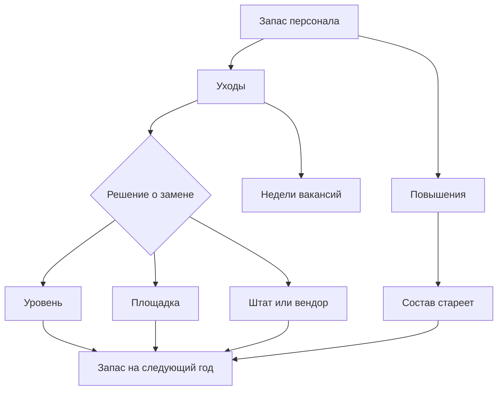
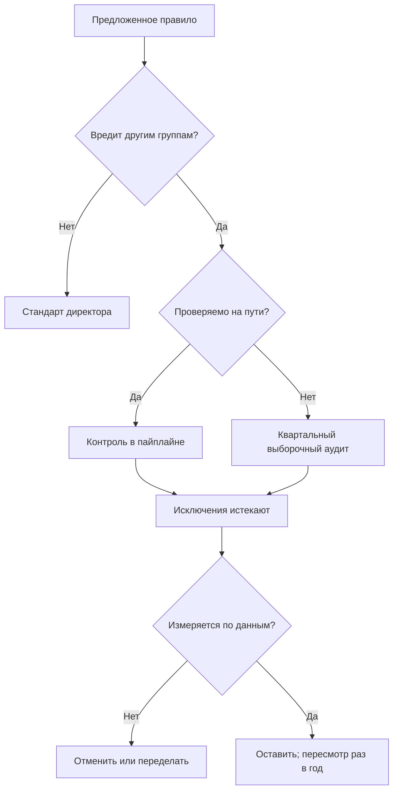
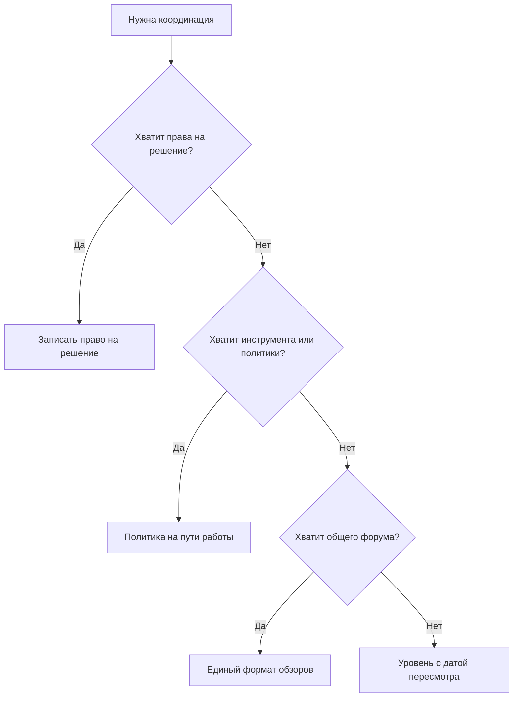

# Глава 48 — Стратегия ресурсов, планирование персонала и корпоративное управление { #chapter-48-capacity-strategy-workforce-planning-and-enterprise-governance }

Директор планирует ресурс на квартал вперёд (глава 38). VP of Engineering (вице-президент по
разработке) планирует запас, из которого берутся эти квартальные планы: какие уровни, на каких
площадках, в штате или по контракту и как этот запас меняется, когда люди уходят, получают повышения и
их заменяют. Кроме того, VP решает, какие немногие правила должны действовать одинаково во всех группах
и как системе управления расти, не добавляя новый уровень всякий раз, когда растёт организация.
Пример крупной организации — Halvard Systems, вымышленная компания с 500 инженерами из
[главы 35](../07-organization-design/35-designing-organizations-at-four-scales.md). В кейсе вымышленная
[Northstar Technologies](../../case-studies/northstar/index.md) строит план персонала на второй год по
правилу «без роста численности».

## Почему это важно { #why-this-matters }

Для команды уход человека — событие личное и практическое: кто возьмёт его смены дежурств, кто будет
ревьюить изменения в ledger.

В масштабе организации уходы — это поток. За год до прихода директора Northstar потеряла 8 из
80 инженеров, а от заявления об уходе до первого дня замены проходило в среднем (по медиане) 15 недель
([исходные данные](../../case-studies/northstar/baseline-data.md)). Это 120 инженеро-недель пустых мест
в год, то есть в обычный день не хватает примерно 2,3 инженера, и это ещё без учёта вхождения в работу.
Каждый найм на замену — это ещё и выбор уровня, площадки и формы занятости. Если каждый такой выбор
делает тот руководитель, от которого ушёл человек, выборы всё равно складываются в стратегию персонала.
Просто она ничья.

Для высшего руководства персонал — это большая часть бюджета разработки, и его структура переживёт
любую дорожную карту. Если за составом по уровням никто не следит, он сползает к старшим уровням.
Площадка, выбранная ради экономии, на десятилетие задаёт стоимость координации. Скамейка подрядчиков
превращается в зависимость. А каждый новый уровень управления или комитет по согласованию замедляет
любое решение, которое через него проходит.

## Цели главы { #learning-objectives }

Прочитав эту главу, вы сможете:

- Строить план персонала, который моделирует [текучесть](../../glossary.md#attrition-and-regretted-attrition)
  (уходы людей), срок закрытия вакансий, повышения и состав по уровням и явно называет свои
  допущения.
- Выбирать площадки и модель привлечения людей для инженерной работы, опираясь на данные о
  распределённой и офшорной разработке, а не только на тарифные ставки.
- Задавать правила для вендоров и подрядчиков, при которых критические знания остаются внутри
  организации.
- Проектировать короткий набор корпоративных политик, где у каждой политики есть владелец, точка
  контроля, порядок исключений и метрика.
- Подбирать для новой потребности в координации самый дешёвый механизм, прежде чем добавлять уровень
  управления.

Связанные главы: сначала прочитайте главу 38 (квартальное планирование ресурсов). Охват и уровни
управления разобраны в главе 34, стандарты на уровне директора — в главе 20, устранение бюрократии — в
главе 59.

## Ментальная модель { #the-mental-model }

> **Ментальная модель:** персонал — это запас, который нельзя быстро изменить, а корпоративное
> управление — это небольшое число правил, соблюдение которых вы действительно можете обеспечить.
> Планируйте потоки, которые меняют запас, и тратьте усилия на контроль только там, где провал одной
> группы бьёт по другой.

Первая идея — **запас и поток**. Численность, состав по уровням и распределение по площадкам — это
запасы, и меняются они только через потоки: уходы, наймы, повышения, переводы, начало и конец
контрактов. Правило «без роста численности» фиксирует размер запаса, но не его форму; форму задаёт
каждый найм на замену.

Каждый уход создаёт недели вакансии и требует решения о замене. Повышения переводят людей вверх, хотя
никто не уходит, поэтому замена один к одному сдвигает состав к старшим уровням даже без роста
численности.

Вторая идея — **корпоративное управление как бюджет**. Каждое общекорпоративное правило тратит ресурс в
каждой команде, а каждое правило, которое никто не проверяет, приучает к мысли, что правила
необязательны. Поэтому VP оставляет только те правила, нарушение которых в одной группе вредит другим
группам, клиентам или компании. Соблюдение каждого он обеспечивает там, где его нельзя обойти, а
остальное делегирует директорам (глава 20).

## Подробный разбор { #deep-conceptual-explanation }

### Из чего состоит план персонала { #what-a-workforce-plan-contains }

План персонала — это надстройка над моделью ресурсов, с более дальним горизонтом. Глава 38 и
[шаблон модели планирования ресурсов](../../templates/capacity-planning-model.md) принимают численность
на квартал как данность; план персонала задаёт численность и её форму на год и дальше. В нём шесть
частей (рекомендация книги):

| Часть | Вопрос | Источник |
|---|---|---|
| Спрос | Какая работа, какой квалификации, в каких предметных областях | Портфель и техническая стратегия |
| Предложение | Кто есть сейчас: по командам, уровням, площадкам, формам занятости | HR-система, сверенная с руководителями |
| Потоки | Уходы, повышения, переводы, срок закрытия вакансий | Последние два года, записанные как допущения |
| Правила формы | Диапазоны по уровням, правила для площадок и вендоров | Этот план |
| Стоимость | [Полная стоимость сотрудника](../../glossary.md#fully-loaded-cost) по уровням и площадкам | Финансы; коэффициент нагрузки (множитель от оклада к полной стоимости) указан явно |
| Риски | Единые точки отказа по знаниям, площадки без руководителей | Карты знаний, преемственность (глава 36) |

В своём введении в работу руководителя разработки высшего уровня Larson относит к этой работе
планирование и организационный дизайн
([Larson, 2024](../../references/bibliography.md#larson2024primer); **мнение эксперта**). Полезно
читать затраты так, как их читают финансы
([Berman and Knight, 2006](../../references/bibliography.md#berman2006financial)): смотреть на полную
стоимость сотрудника (оклад, льготы, налоги, оборудование, помещение), а не на оклад, и помнить, что
бюджет исходит из того, что каждое профинансированное место занято все недели года. Недели вакансий — это
утверждённый, но не потраченный бюджет.

**Спрос против предложения.** Начинайте план со спроса: возьмите профинансированные ставки, переведите
их в нужные навыки и предметные области и сравните с теми, кто есть. Таблица разрывов Commerce из
главы 47 делает это по направлениям, а план персонала — ещё и по навыкам, как в этой группе из
60 инженеров (**иллюстрация**):

| Навык или предметная область | Нужно в следующем году (FTE) | Есть (FTE) | Разрыв и действие |
|---|---|---|---|
| Интеграция платежей | 8 | 5 | −3: две замены с уклоном в платежи, один внутренний перевод |
| Поиск и ранжирование | 4 | 6 | +2: одолжить ставке на каталоги, без замены |
| Мобильная разработка | 6 | 6 | Нет |
| Пайплайны данных | 5 | 3 | −2: одного нанять, одного обучить |

Закрывают разрывы наймами на замену, поэтому таблица подсказывает каждой
[заявке на найм](../../glossary.md#requisition) (утверждённому запросу нанять человека на место), кого
искать.

**Планирование роста.** Когда численность может расти, ограничение обычно не в бюджете, а в том,
сколько новых людей организация способна принять. Рост ограничивают три пропускные способности
(**рекомендация книги**; измерьте свои). Рекрутинг: каждый найм отнимает время рекрутера и десятки
часов интервьюеров, поэтому считайте, сколько циклов интервью за квартал ваши интервьюеры способны
обеспечить (глава 7). Онбординг: каждый новичок месяцами занимает время наставника. Способность команды
принять людей: команда, которая добавляет больше одного-двух человек за квартал, тратит этот квартал на
обучение. Планируйте наймы по командам и кварталам с учётом этих пределов и финансируйте наставничество
как ресурс.

### Текучесть, вакансии и знания { #attrition-vacancy-and-knowledge }

> средний недостающий ресурс = уходы в год × недели до закрытия вакансии ÷ 52

К этому добавьте вхождение в работу. Brooks приписывают идею, что новые люди отнимают время у тех,
кто их обучает
([Brooks, 1995](../../references/bibliography.md#brooks1995mythical); **мнение эксперта**). Исследования
же касаются знаний. В одном крупном проекте недавние уходы были связаны с более высокой вероятностью
дефектов, о которых сообщали клиенты
([Mockus, 2010](../../references/bibliography.md#mockus2010volatility); **научный результат**,
наблюдательное исследование). Rigby с коллегами измерили в Chrome и в одном проекте Avaya
долю брошенных файлов, то есть таких, все знающие разработчики которых ушли. В плохие периоды потери более чем
втрое превышали ожидаемый уровень, а назначение преемников для файлов из зоны риска сокращало ожидаемые
потери на величину до 15 процентов
([Rigby et al., 2016](../../references/bibliography.md#rigby2016turnover); **научный результат**, два
проекта). Поэтому закладывайте в план среднюю вакансию, а преемников назначайте в тех немногих
областях, где даже один уход относится к рискам из хвоста распределения.

Текучесть отчасти зависит от управления. В одной высокотехнологичной компании навыки управления людьми,
измеренные опросом, были сильно и отрицательно связаны с текучестью
([Hoffman and Tadelis, 2021](../../references/bibliography.md#hoffman2021people); **научный
результат**, одна компания). Само удержание разобрано в главе 10.

### Состав по уровням { #level-mix }

«Правильного» состава по уровням, подтверждённого исследованиями, не существует; дальше —
**рекомендация книги**. Состав сдвигают три силы. **Повышение** поднимает людей вверх, не создавая
вакансии; при откалиброванных повышениях (глава 8) это правильно, но затраты растут. **Замена один к
одному** сохраняет состав, только если никого не повышают. **Трудности найма** толкают руководителя,
который ждал 15 недель, взять первого, кто прошёл планку, на том уровне, который было проще всего
закрыть.

Сдвиг к старшим уровням не всегда плох: ledger, который мало кто умеет безопасно менять, требует
опыта. Сдвиг к младшим не всегда дёшев. В одной компании из Fortune 500 работа рядом с коллегами по
команде увеличивала объём обратной связи по коду, которую получали инженеры, особенно новые и
молодые, а опытные инженеры при этом писали меньше кода
([Emanuel, Harrington, and Pallais, 2023](../../references/bibliography.md#emanuel2023proximity);
**научный результат**, одна компания, рабочий доклад). Поэтому размещайте младших там, где сидят их
учителя, и закладывайте стоимость обучения. Рабочий подход — **свой диапазон состава для каждой
предметной области**, а повышения оплачивайте тем, что часть замен нанимаете на начальный уровень.

### Стратегия площадок { #location-strategy }

Обычный довод в пользу площадки — стоимость. Экономия реальна, если смотреть на тарифную ставку (rate
card: цену одного человека на этой площадке или у этого вендора), и неочевидна, если смотреть на
картину в целом.

- По данным систем управления изменениями и опросам, распределённые задачи, судя по всему, занимали
  примерно в два с половиной раза больше времени, чем похожие задачи в одном месте, а число вовлечённых
  людей было сильно связано со временем выполнения
  ([Herbsleb and Mockus, 2003](../../references/bibliography.md#herbsleb2003empirical);
  **научный результат**, начало 2000-х).
- Обзор опубликованных исследований глобальной разработки ПО, согласно его аннотации, не нашёл
  достаточно данных, чтобы заключить, что офшоринг снижает затраты
  ([Šmite, Calefato, and Wohlin, 2015](../../references/bibliography.md#smite2015cost);
  **научный результат**).
- Систематический обзор разработки «вслед за солнцем» (follow-the-sun: работа передаётся между
  часовыми поясами, чтобы сократить календарное время) охватил 1990–2012 годы и описал 36 практик и
  17 проблем. Внедрять такую модель трудно из-за проблем коммуникации при распределении задач и
  ежедневных передачах работы
  ([Kroll et al., 2013](../../references/bibliography.md#kroll2013followthesun); **научный результат**).

Отсюда правило (рекомендация книги): **размещайте владение целиком, а не фрагменты**. Площадка
работает, когда её команда владеет компонентом от начала до конца и большинство задач никогда не
пересекает границу. Плохо она работает, когда на ней сидит часть команды или она берёт тикеты извне.
Границы площадок важны даже в одном часовом поясе: в главе 14 команда, разделённая между Миннеаполисом
и Боготой с разницей в один час, постепенно распадается на две. И каждой площадке нужен руководитель,
который может принимать решения на месте и представлять её на калибровке.

### Вендоры и подрядчики { #vendors-and-contractors }

Подрядчики дают ресурс без роста численности, поэтому появляются всякий раз, когда численность
заморожена. Подходит ли работа вендору, решают три проверки (рекомендация книги):

1. **Ограниченность:** у работы есть определённый конец, и после него не нужны постоянные изменения.
2. **Проверяемость:** есть тесты, проверки контрактов или внутренний владелец, у которого есть время
   принять работу.
3. **Не ключевые знания:** после окончания работы никому не нужны люди вендора, чтобы система
   продолжала работать.

Перестройка правил проводок в ledger не проходит третью проверку: так компания арендует знания,
которые уйдут вместе с контрактом. Ни один инженер вендора не должен быть единственным, кто может
менять компонент [tier 1](../../glossary.md#tier-1) (критичный для бизнеса). И неизменная численность
при открытом бюджете на подрядчиков — это не неизменные затраты; честный план показывает и то, и другое.

### Корпоративное управление: мало политик, но соблюдаемых { #enterprise-governance-few-policies-enforced }

В главе 20 вики с обязательными правилами превращается в реестр стандартов директора. На уровне VP вопрос в
другом: какие правила должны быть одинаковыми для групп, у которых нет общего директора. В экономике
внешний эффект (экстерналия) — это издержки, которые ложатся не на того, кто их вызвал. Отсюда **тест
на внешний эффект** (рекомендация книги): правило заслуживает общекорпоративного статуса, только если
его нарушение в одной группе вредит другой группе, клиентам или компании. Общая продакшен-инфраструктура,
данные клиентов, финансовая корректность, доступность по контракту и даты, обещанные клиентам, этот
тест проходят. Стиль кода, длина спринта и тестовые фреймворки — нет. RFC 2119, где определены MUST,
SHOULD и MAY, советует пользоваться такими императивами скупо, только там, где это нужно для
взаимодействия или чтобы ограничить вред
([Bradner, 1997](../../references/bibliography.md#bradner1997rfc2119); **стандарт**, написанный для
протоколов и использованный здесь как аналогия).

Каждой политике нужны **владелец**, **точка контроля**, которую нельзя обойти, **порядок исключений**
со сроком действия и **метрика** по системным данным, а не по подтверждениям (attestation, когда
команды сами объявляют себя соответствующими требованиям).

**Контролируйте на пути работы, а не на встрече.** DORA сообщает, что тяжеловесное согласование
изменений комитетом или старшим руководителем ухудшало показатели поставки, причём нет данных о том,
что доля неудачных изменений при этом снижалась. DORA рекомендует записанное ревью коллегами плюс
автоматическое тестирование и мониторинг
([DORA, Streamlining change approval](../../references/bibliography.md#dora-cap-change-approval);
**отраслевое исследование**, на основе опросов). Политика, которую обеспечивает комитет, — это очередь
перед каждой группой; если её обеспечивает пайплайн, она стоит секунды.

**Предписывайте результаты, а не инструменты, кроме случаев, когда инструмент и есть механизм контроля.**
Белая книга CNCF о платформах говорит, что платформы не должны рассчитывать на то, что их станут
использовать по указанию сверху ([CNCF Platforms White Paper](../../references/bibliography.md#cncf-platforms-whitepaper);
**консенсус практиков**). В отчёте DORA за 2024 год респонденты, которых обязали пользоваться только платформой
и на всём жизненном цикле, сообщали о пропускной способности на 6 процентов ниже
([DORA, 2024](../../references/bibliography.md#dora2024accelerate); **отраслевое исследование**,
одномоментное). «Каждое изменение в продакшене проходит через пайплайн с журналом аудита и откатом» —
это политика. А «каждая команда пользуется пайплайн-продуктом X» — уже нет: продукт должен побеждать
за счёт того, что он лучше.

**Управляйте и поставкой.** Одна политика поставки обычно проходит тест: никакой даты вовне без оценки
и владельца (объяснение — в
[главе 44](../10-business-leadership/44-working-with-product.md#the-dates-that-remain)).

Наконец, проверяйте, что политики настоящие. Организации заводят формальные структуры ради
легитимности и отделяют их от реальной работы
([Meyer and Rowan, 1977](../../references/bibliography.md#meyer1977institutionalized); глава 20).
Раз в квартал отчитывайтесь по метрике каждой политики, включая исключения, и отменяйте любую политику,
которую никто не может измерить.

### Как система управления растёт без новых уровней { #management-systems-that-grow-without-layers }

Каждый уровень — лишнее звено для любого решения, которое через него проходит. Модель размера фирмы
Williamson известна понятием «потеря контроля» (control loss): на каждом уровне теряется часть
замысла, и с глубиной потери накапливаются
([Williamson, 1967](../../references/bibliography.md#williamson1967hierarchical); теоретическая
модель). Хендбук GitLab сохраняет одинаковый диапазон охвата на всех уровнях именно для того, чтобы не
добавлять лишний уровень
([GitLab, Organizational Structure](../../references/bibliography.md#gitlab2026structure);
**задокументированная практика**). [Охват управления](../../glossary.md#span-of-control) — тема
главы 34, а здесь важно, что попробовать, прежде чем добавлять
[уровень управления](../../glossary.md#layer): записанное право на решение, политику, которую
обеспечивает инструмент, единый формат обзоров, чтобы каждый директор отчитывался по одной и той же
карте показателей, роль staff- или principal-инженера с мандатом или платформу, которая убирает саму
необходимость координироваться.

## Пример из инженерной организации { #engineering-organization-example }

Этот пример **вымышлен**; цифры по Halvard взяты со [страницы Halvard](../../case-studies/northstar/halvard.md).

**Предложение.** Продуктовые группы по 130 (Commerce), 110, 100 и 90 инженеров плюс платформенная
организация из 70: всего 500 инженеров, 62% из них на уровне Senior и выше. Engineer здесь —
карьерный уровень ниже Senior. Допущения при численности, зафиксированной на 500:

| Уровень | Численность | Уходы (12 процентов, пропорционально) | Повышены на следующий уровень | Полная стоимость |
|---|---|---|---|---|
| Engineer | 190 | 23 | 15 (8 процентов) | $170,000 |
| Senior | 245 | 29 | 7 (3 процента) | $215,000 |
| Staff | 58 | 7 | 0 | $270,000 |
| Principal | 7 | 1 | 0 | $330,000 |

**Политика 1, замена один к одному:**

| Уровень | Начало | Ушли | Повышены с уровня | Повышены на уровень | Нанято | Конец |
|---|---|---|---|---|---|---|
| Engineer | 190 | 23 | 15 | 0 | 23 | 175 |
| Senior | 245 | 29 | 7 | 15 | 29 | 253 |
| Staff | 58 | 7 | 0 | 7 | 7 | 65 |
| Principal | 7 | 1 | 0 | 0 | 1 | 7 |
| **Итого** | **500** | **60** | | | **60** | **500** |

Число инженеров уровня Senior и выше растёт до 325 (65%).

**Политика 2, сохранить состав:** нанимать так, чтобы каждый уровень закончил год там же, где начал;
наймов по-прежнему 60.

| Уровень | Начало | Ушли | Повышены с уровня | Повышены на уровень | Нанято | Конец |
|---|---|---|---|---|---|---|
| Engineer | 190 | 23 | 15 | 0 | 38 | 190 |
| Senior | 245 | 29 | 7 | 15 | 21 | 245 |
| Staff | 58 | 7 | 0 | 7 | 0 | 58 |
| Principal | 7 | 1 | 0 | 0 | 1 | 7 |

**Цена сдвига.** К концу года при политике 1 инженеров уровня Engineer на 15 меньше, Senior на 8
больше, а Staff на 7 больше. Это добавляет $1 060 000 в год, около 1% фонда оплаты труда при
сохранённом составе ($102,9 млн), и никто такого решения не принимал.

**Цена сохранения состава.** Если каждому из 38 новичков начального уровня нужно четыре часа в неделю
времени старшего инженера в течение 26 недель (допущение), это примерно 2 инженеро-года наставничества
senior-инженеров. Кроме того, при политике 2 вообще нет внешних наймов на уровень Staff. Поэтому VP
задаёт **свой диапазон для каждой группы**: платформенная организация может держать более высокую долю
старших уровней, а продуктовые группы, где много работы над функциями, больше нанимают на начальный
уровень и выделяют людей на наставничество.

**Вендоры.** Около 60 подрядчиков по двум контрактам работают вне этих 500. Каждый объём работ вендора
должен проходить три проверки и иметь владельца в Halvard, и ни у одного компонента tier 1 инженер
вендора не может быть единственным, кто способен его менять. Объёмы, которые проверки не проходят, за
два года переводятся на сотрудников.

**Политики.** Каждая группа сохраняла собственные стандарты, а у аппарата CTO был ещё и свой список
обязательных правил, который никак не измерялся. Тест на внешний эффект пережили шесть корпоративных
политик, у каждой владелец — principal-инженер:

| Политика | Точка контроля | Метрика |
|---|---|---|
| Одна команда-владелец у каждого продакшен-компонента | Развёртывания незарегистрированных компонентов отклоняются | Компоненты в реестре |
| Операционные минимумы для tier 1 | Ежеквартальная выборка | Доля tier 1, выполняющих все минимумы |
| Пайплайн с журналом аудита и откатом | Общий пайплайн | Доля развёртываний через него |
| Уровни сервиса по устранению уязвимостей | Сканер в пайплайне | Находки с просроченным сроком |
| Отслеживаемый разбор каждого [Sev1](../../glossary.md#severity-sev1-sev2-sev3) (самого серьёзного инцидента) | Трекер инцидентов | Действия, закрытые вовремя |
| Никакой даты клиенту без оценки и владельца | Инструмент планирования | Даты, названные до оценки |

Всё остальное — дело VP и их директоров.

## Как принимать решение { #decision-framework }

**При каждом уходе, до открытия заявки на найм:**

| Вопрос | Если да | Если нет |
|---|---|---|
| Уходящий — один из менее чем трёх людей, способных менять область знаний tier 1? | Нанимать на этот уровень или выше; сразу начать готовить преемника | Применить диапазон по уровням |
| Команда выше своего диапазона доли senior? | Нанимать на начальный уровень; назначить наставника | Нанимать на нужный уровень |
| Владеет ли этой работой целиком команда на другой площадке? | Рассмотреть перенос места туда | Нанимать там, где сидит команда |
| Работа ограничена, проверяема и не требует ключевых знаний? | Вендор возможен | Найм в штат |

**Корпоративная политика или нет:** см. схему управления выше. Правило, которое не прошло тест на
внешний эффект, — это стандарт директора. Правило, которое прошло тест, но не имеет метрики по
системным данным, ещё не готово.

**Новый уровень или нет:**

## Компромиссы { #trade-offs }

**Сохранение состава или скорость.** Наймы на начальный уровень дешевле и расширяют будущий резерв
senior-инженеров, но на месяцы замедляют команды и отнимают время старших. Senior-инженеры начинают
приносить пользу раньше, но обходятся дороже в каждый следующий год.

**Стоимость или координация.** Площадка с более низкими затратами экономит на каждом месте, но отнимает
время на каждой задаче, которая пересекает границу. Экономию посчитать легко, а издержки — нет, поэтому
решения принимают, глядя на экономию.

**Ресурс вендора или знания.** Подрядчики выходят на работу за несколько недель, а не за 15, и уходят
со всем, чему научились. Если эта работа окажется ключевым знанием, вернуть его обойдётся дорого.

**Мало политик или учёт местной специфики.** Короткий список оставляет директорам свободу и мирится с
различиями, о которых компания может пожалеть. Длинный список выглядит надёжнее, но обычно никто не
следит за его соблюдением.

**Инструменты или суждение.** Проверка в пайплайне дешева, но не видит контекста; ревью человеком видит
контекст, но создаёт очередь. Контролю через инструмент нужен порядок исключений, иначе команды начнут его
обходить. Точно так же отказ от нового уровня сохраняет скорость решений лишь до тех пор, пока охват
остаётся посильным (глава 34).

## Типичные провалы { #failure-modes }

**Замена на рефлексе.** План — это сумма запросов руководителей. Как заметить: ни одна заявка на найм
не объясняет, почему выбраны её уровень или площадка.

**Тихий сдвиг к старшим уровням.** Стоимость инженера растёт без роста численности. Как заметить:
отслеживайте состав по уровням ежеквартально рядом с повышениями.

**Офшоринг по тарифной ставке.** Площадка получает фрагменты команд, которые сидят в других местах.
Как заметить: доля задач площадки, которым нужна передача или ревью с другой площадки.

**Вендор, ставший владельцем.** По продлённому контракту работают единственные люди, которые понимают
сервис.
Как заметить: сколько сотрудников могут безопасно менять каждый компонент tier 1.

**Численность заморожена, подрядчики оттаяли.** Как заметить: ежемесячно показывайте подрядчиков в
эквиваленте полной занятости рядом с численностью.

**Инфляция политик.** Каждый инцидент добавляет общекорпоративное правило, а отменяют ни одного. Как
заметить: число политик и сколько из них имеют метрику по системным данным.

**Управление через подтверждения.** Таблицы говорят «соответствует», а системные данные с этим не
согласны. Как заметить: проверяйте свидетельства выборочно по данным пайплайна или системы вызовов
дежурных.

**Уровень на рефлексе.** Уровень добавили, потому что охват перевалил за какое-то число. Как заметить:
нигде не записано, какими решениями он владеет.

## Применение в крупной организации { #enterprise-application }

В организации из 50–150 инженеров обычно есть директор и нет VP, и план персонала — забота директора.
Такой план может быть коротким:

- **Годовой план на одну страницу**, обновляемый раз в квартал: численность по командам, уровням и
  площадкам; ожидаемые уходы и сроки закрытия вакансий; диапазоны по уровням; правила для площадок и
  вендоров.
- **Десятиминутный разбор замены** при каждом уходе, с руководителем и HR-партнёром, по четырём
  вопросам выше.
- **Список рисков по знаниям**: области, которые способны безопасно менять меньше трёх человек, по
  картам знаний команд (глава 12); его просматривают вместе со списком преемников (глава 36).
- **От пяти до восьми правил для всей организации:** операционные минимумы tier 1 из главы 20, уровни
  сервиса по уязвимостям из главы 26 и одно правило поставки о датах для внешних сторон.
- **Никакого нового уровня** примерно до 100 инженеров, если только анализ зависимостей не показывает
  группу команд, которые спорят каждую неделю (глава 34).

Без роста численности главный рычаг — наймы на замену; «мы только заменяем ушедших» — это не план.

## Взгляд CTO { #cto-perspective }

CTO (технический директор) видит персонал как многолетнее обязательство. Решения о площадках трудно
обратить: к площадке на сотню человек привязаны договоры аренды, местное право и карьеры. CTO
спрашивает, владеет ли каждая площадка продуктами целиком, есть ли у каждой руководитель с
полномочиями и выдерживает ли довод о стоимости учёт координации, поездок и местной текучести.

В Halvard пять VP руководят группами, у которых нет общих директоров, поэтому набор корпоративных
политик — работа аппарата CTO: держать набор в пределах шести политик, дать каждой владельца из
principal-инженеров и раз в квартал разбирать метрики вместе с VP. Когда Halvard вырастет, первым
ответом должны стать более широкий охват директоров и более ясные права на решения, а не уровень между
VP и CTO.

Самый трудный разговор о персонале — с финансами. Правило «без роста численности» считает людей, а не
затраты, ресурс или знания. Имея на руках цифры по вакансиям, составу и подрядчикам, CTO может
договориться о потолке затрат со свободой в выборе формы, а не о числе, которое подталкивает к обходным
путям через подрядчиков. Нужен ли Northstar с её 80 инженерами под одним директором VP во второй год —
открытый вопрос для Victor Lindqvist (CTO), поднятый на неделе 45 (глава 47).

## Практический плейбук { #practical-playbook }

1. **Составьте таблицу предложения:** все инженеры с командой, уровнем, площадкой и формой занятости,
   сверенные с руководителями; подрядчики — в эквиваленте полной занятости.
2. **Запишите потоки:** уходы и сроки закрытия вакансий по записям за два года, повышения по
   последнему циклу калибровки; каждый поток — как допущение.
3. **Посчитайте вакансии** и переведите их в деньги по полной стоимости сотрудника.
4. **Задайте диапазоны по уровням для каждой предметной области** и назовите, где глубина старших
   уровней — это контроль риска, а где найм на начальный уровень с назначенными наставниками — норма.
5. **Запишите правило для площадок:** на каждой площадке владение целиком и свой руководитель.
6. **Запишите правило для вендоров:** три проверки, внутренний владелец у каждого объёма работ, никаких
   знаний tier 1, которые есть только у вендора, затраты на подрядчиков рядом с численностью.
7. **Подготовьте варианты**, у каждого — ресурс, стоимость, риск и то, что должно оказаться верным;
   показывайте их CTO и финансам вместе.
8. **Проведите аудит корпоративных правил** тестом на внешний эффект; выжившим дайте владельца, точку
   контроля, порядок исключений и метрику; остальные отмените или делегируйте.
9. **Проверьте, прежде чем добавлять уровень**, и запишите, чем он владеет и когда его пересмотреть.
10. **Пересматривайте раз в квартал:** уходы, сроки закрытия вакансий, состав, подрядчиков и метрики
    политик в сравнении с планом.

## Кейс { #case-study }

!!! info "Northstar: что уже известно"
    Неделя 41 первого года директора. Число инцидентов [Sev1 и Sev2](../../glossary.md#severity-sev1-sev2-sev3)
    (два самых серьёзных уровня) упало с 30 за квартал до 14 в квартале 3 без роста численности.
    Victor Lindqvist (CTO) попросил планы на второй год. См.
    [хронологию](../../case-studies/northstar/timeline.md). Впервые читаете о Northstar? Прочитайте
    [«Год вкратце»](../../case-studies/northstar/year-in-brief.md),
    [действующих лиц](../../case-studies/northstar/cast.md) и
    [брифинг квартала 4](../../case-studies/northstar/quarter-4-briefing.md).

Этот кейс **вымышлен**, действие происходит в недели 41–49. Итог не задан: решение принимаете вы.

**Запрос.** На неделе 41 Rajiv Menon (CFO, финансовый директор) просит план персонала на второй год в
дополнение к бюджетному пакету; Victor просит варианты. Правило остаётся в силе: 87
[мест](../../glossary.md#seat), замены разрешены, чистого прироста нет. Место — это любая
профинансированная позиция; 87 мест Northstar — это 80 инженеров, 6 руководителей и директор.

**Факты, на которые опирается план.**

| Факт | Значение |
|---|---|
| Состав по уровням, неделя 40 | 39 Engineer, 38 Senior, 3 Staff |
| Площадки | Миннеаполис 52, Богота 16, удалённо в США 12 |
| Полная стоимость | Около $110,000 в год в Боготе; около $168,000 за инженера уровня Engineer в США |
| Потоки | 8 уходов в год, 15 недель до закрытия вакансии: в среднем не хватает 2.3 инженера, около $427,000 не потрачено |
| Риск по знаниям | В исходном состоянии безопасно менять закрытие периода в ledger мог один человек, и валюты и округление — тоже один |

Одно условие: если предложение по организации второго года создаёт команду Mobile, её руководителя
берут из инженеров и его место не заполняют, так что план начинается с 79 инженеров. План должен
работать в обоих случаях.

| Вариант | Что делает | Затраты или экономия | Главный риск |
|---|---|---|---|
| A. Один к одному | Тот же уровень, команда, площадка | Базовый | Сдвиг к старшим уровням; восемь решений не использованы |
| B. С формой | Начальный уровень, если нет названного пробела в знаниях; часть мест переходит в Боготу | Экономит около $91,000 (уровень) и $174,000 (площадка) за полный год | Нагрузка наставничества; нет руководителя площадки в Боготе |
| C. Найм на опережение | Две заявки на найм открываются до уходов, для ledger и Core | Вакансии падают примерно до 0.9 FTE; перерасход до $370,000, если уйдёт меньше людей | Ненадолго 88 или 89 мест: нужно исключение с датой |
| D. Вендор | Контракт с фиксированным объёмом на миграцию фреймворка Core | Оплачивается из недорасхода на вакансиях | Низкое тестовое покрытие Core мешает проверить работу |

Расчёты (какие места, какие оклады, более короткая задержка найма) — на
[странице решений](../../solutions/ch48-solutions.md#x1-northstars-year-2-workforce-plan-recommendation).

**Управление.** Черновик к тому же делает одно правило поставки общим для всей организации: никакой
даты клиенту без оценки разработки и названного владельца. Правило проходит тест на внешний эффект,
потому что сорванная дата для клиента бьёт по продажам, службе работы с клиентами и продлению. Greg
Tanaka (VP по продажам) возражает, что оно замедляет сделки.

**Положение дел.** На неделе 49 черновик уходит к Victor и Rajiv, рекомендация остаётся открытой. Rajiv
нравится B и не нравится C, потому что любая численность выше 87 попадает в [пакет для совета
директоров](../../glossary.md#board-pack). Victor хочет прежде всего снизить риск по ledger, а
неочевидно, что найм на начальный уровень по умолчанию из варианта B этот риск закрывает. Открытый
вопрос: как снизить риск по ledger, не нарушив правило мест, о котором Rajiv отчитывается перед советом.

## Упражнения { #exercises }

Разборы упражнений: [решения к главе 48](../../solutions/ch48-solutions.md). Данные Northstar — в
[брифинге квартала 4](../../case-studies/northstar/quarter-4-briefing.md),
[исходных данных](../../case-studies/northstar/baseline-data.md) и
[хронике года 1](../../case-studies/northstar/first-quarter.md).

### Базовый уровень { #foundational }

**F1.** Используя допущения кейса (80 инженеров, 8 уходов в год, 15 недель до закрытия вакансии),
посчитайте средний объём вакансий в инженерах и долларах. Добавьте собственное допущение о вхождении
в работу, назовите его и пересчитайте фактически недостающий ресурс. Скажите, какой входной параметр
вы больше всего хотели бы измерить точнее, прежде чем нести план Rajiv Menon, и почему.

**F2.** При политике замены один к одному доля уровней Senior и выше в Halvard растёт за год с 62 до
65 процентов. Спрогнозируйте обе политики на второй год при тех же допущениях и скажите, с какого момента
VP следует считать этот сдвиг проблемой, если вообще следует. Назовите одну группу Halvard, где растущая доля
старших уровней может быть правильной, и данные, которые вы бы для этого запросили.

**F3.** Примените тест на внешний эффект к таким предложенным корпоративным правилам Halvard: общая
стратегия ветвления; алертинг и дежурства для tier 1; один утверждённый фронтенд-фреймворк; уровни
сервиса по устранению уязвимостей; никакой даты клиенту без оценки; еженедельные ретроспективы. Для
каждого прошедшего правила назовите точку контроля и метрику; для каждого непрошедшего скажите, кто
должен им владеть.

### Прикладное лидерство { #applied-leadership }

**A1.** Два инженера Data and Analytics в Миннеаполисе увольняются в один месяц. Farah Haddad,
руководитель команды, просит заменить обоих в Миннеаполисе на уровне Senior, «потому что именно таких
мы потеряли». Из её 11 инженеров 4 сидят в Миннеаполисе, 5 в Боготе и 2 работают удалённо; до этих
уходов около 5 были на уровне Engineer и 6 — на уровне Senior. Yusuf Demir, инженер уровня Engineer из
её команды, получил в квартале 3 [«пока нет»](../../glossary.md#not-yet) на повышение до Senior. По его
плану он проводит дизайн контракта экспорта ledger через ревью Billing, так что в течение года может
дорасти до Senior. С помощью вопросов о замене определите уровень и площадку для каждого места и
скажите, что вам нужно узнать в первую очередь.

**A2.** Tom Becker, руководитель Platform Operations, предлагает взять четырёх подрядчиков на девять
месяцев, чтобы закончить этап 1 консолидации CI: перевести на общий пайплайн четыре сервиса, которые
всё ещё развёртываются вручную поддерживаемыми shell-скриптами. Эти скрипты понимает только один
инженер Platform Operations. Дорожная карта платформы выделила примерно 29 инженеро-недель на три
пункта, в том числе на этап 1, а целевой пайплайн ещё не выбран (предлагался GitLab CI). Контракт
оплачивался бы из недорасхода на вакансиях. Примените к этому объёму работ три проверки для вендоров,
решите, поддержать ли предложение, и сформулируйте условия, которые вы бы поставили.

**A3.** В списке аппарата CTO Halvard всё ещё есть правило: у каждого сервиса перед каждым крупным
релизом проходит архитектурное ревью. Ни одна система не фиксирует, проводятся ли эти ревью, а две
группы говорят, что перестали их проводить год назад, и инцидентов не было. Один principal-инженер
хочет сделать это правило седьмой корпоративной политикой, потому что однажды ревью поймало дизайн,
который привёл бы к сбою. Примените тест на внешний эффект и четыре требования к политике, решите,
оставить, переделать, делегировать или отменить правило, и скажите, как вы объявите это решение.

### Решения на уровне руководства { #executive-decision-making }

**X1.** Напишите раздел с рекомендацией в плане персонала Northstar на второй год. Выберите один из
вариантов A–D или сочетание нескольких и сделайте так, чтобы план работал независимо от того, одобрят
ли предложение по организации второго года. Укажите, с чем придётся согласиться Rajiv Menon и
Victor Lindqvist, и метрики, которые вы разберёте в конце квартала 5.

**X2.** Вы CTO Halvard. Один из VP предлагает ввести Senior Vice President of Engineering (старшего
вице-президента по разработке) между вами и пятью VP, потому что «вы не можете вести пять групп и
набор политик». С помощью схемы «новый уровень или нет» решите, добавлять ли уровень, и опишите, что
вы построите вместо него, если откажетесь.

## Вопросы для размышления { #reflection-questions }

1. Кто решал, какими будут уровень и площадка при ваших последних пяти заменах, и было ли это решение
   или вариант по умолчанию?
2. Сколько людей вне вашей численности выполняют для вас инженерную работу, и показывает ли кто-нибудь
   это число рядом с численностью?
3. Какие из правил вашей организации не прошли бы тест на внешний эффект и кто стал бы возражать против
   их отмены?
4. Где именно обеспечивается соблюдение каждого оставшегося правила и что вы увидели бы, если бы
   какая-то группа перестала его соблюдать?
5. Когда ваша организация в последний раз добавила уровень управления, какими решениями он должен был
   владеть и проверил ли это кто-нибудь?

## Главное { #key-takeaways }

- Правило «без роста численности» фиксирует размер персонала, но не его форму; форму определяет каждая
  замена.
- Вакансии — это уходы, умноженные на недели до закрытия вакансии: потерянный ресурс и утверждённый, но
  не потраченный бюджет.
- Повышения вместе с заменами один к одному сдвигают состав к старшим уровням; задайте диапазоны для
  каждой предметной области и выделите людей на наставничество, которого требует найм на начальный
  уровень.
- Размещайте на каждой площадке владение целиком, дайте каждой площадке руководителя и не доверяйте
  доводам в пользу площадки, построенным на тарифных ставках.
- Отдавайте вендорам ограниченную, проверяемую работу, не требующую ключевых знаний; никогда не
  допускайте, чтобы вендор был единственным владельцем знаний tier 1; показывайте подрядчиков рядом с
  численностью.
- Корпоративная политика проходит тест на внешний эффект и имеет владельца, точку контроля на пути
  работы, порядок исключений со сроком действия и метрику по системным данным.
- Предписывайте результаты, а не инструменты, кроме случаев, когда инструмент и есть механизм контроля.
- Прежде чем добавлять уровень управления, попробуйте права на решения, политики в инструментах и
  единые форматы обзоров.

## Источники и что почитать { #references-and-further-reading }

- [Larson, 2024](../../references/bibliography.md#larson2024primer). Работа руководителя разработки
  высшего уровня, включая планирование и численность.
- [Larson, 2019](../../references/bibliography.md#larson2019elegant). Системное мышление об инженерных
  организациях и их размерах.
- [Berman and Knight, 2006](../../references/bibliography.md#berman2006financial). Финансовая
  грамотность перед разговором о персонале с финансами.
- [Herbsleb and Mockus, 2003](../../references/bibliography.md#herbsleb2003empirical),
  [Šmite, Calefato, and Wohlin, 2015](../../references/bibliography.md#smite2015cost) и
  [Kroll et al., 2013](../../references/bibliography.md#kroll2013followthesun). Распределённая работа,
  затраты на офшоринг и разработка «вслед за солнцем».
- [Emanuel, Harrington, and Pallais, 2023](../../references/bibliography.md#emanuel2023proximity).
  Физическая близость и обратная связь для новых инженеров.
- [Mockus, 2010](../../references/bibliography.md#mockus2010volatility),
  [Rigby et al., 2016](../../references/bibliography.md#rigby2016turnover),
  [Brooks, 1995](../../references/bibliography.md#brooks1995mythical) и
  [Hoffman and Tadelis, 2021](../../references/bibliography.md#hoffman2021people). Уходы, потеря
  знаний, вхождение в работу и влияние руководителя на текучесть.
- [Bradner, 1997](../../references/bibliography.md#bradner1997rfc2119). Как скупо пользоваться MUST.
- [DORA, Streamlining change approval](../../references/bibliography.md#dora-cap-change-approval),
  [DORA, 2024](../../references/bibliography.md#dora2024accelerate) и
  [CNCF Platforms White Paper](../../references/bibliography.md#cncf-platforms-whitepaper). Комитеты по
  согласованию, обязательные платформы и платформы как продукты.
- [Meyer and Rowan, 1977](../../references/bibliography.md#meyer1977institutionalized). Почему
  формальные правила отрываются от практики.
- [Williamson, 1967](../../references/bibliography.md#williamson1967hierarchical) и
  [GitLab, Organizational Structure](../../references/bibliography.md#gitlab2026structure). Потеря
  контроля на уровнях иерархии и правило, которое помогает избежать лишнего уровня.
