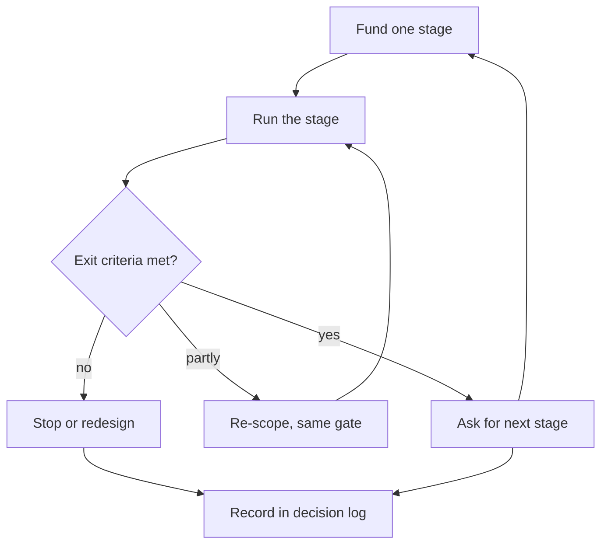
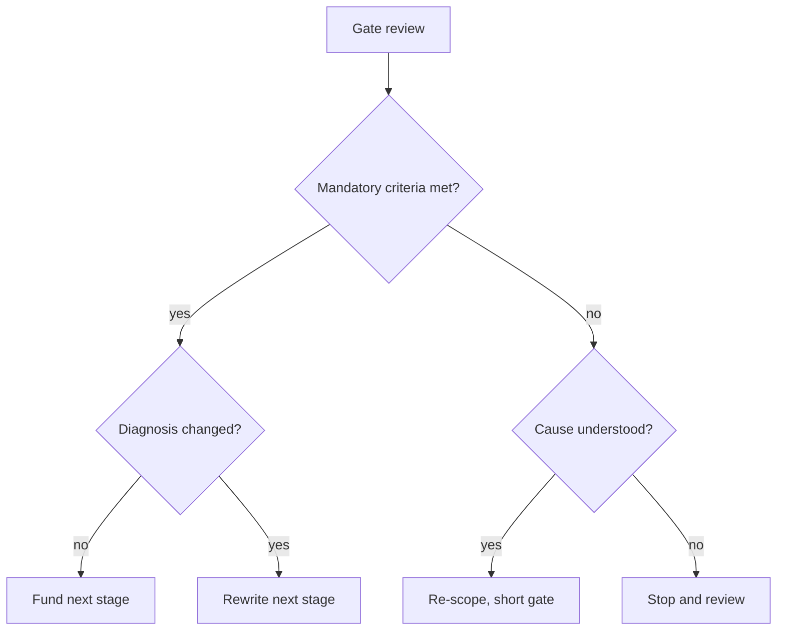

# Chapter 49 — Multi-Year Transformation, Executive Communication, and Constructive Politics

A ninety-day transformation is funded on a mandate; a multi-year one has to be funded again and again,
by executives whose priorities move while it runs. This chapter covers the skills that decide whether
such a program survives its second year. They are cutting it into stages that each earn the next,
asking executives for what you need in their terms, working the politics around the ask in the open,
and developing the people who will run it after you. The running example is the Engineering
Director's two-year continuation proposal at Northstar Technologies, the fictional company in the
[case study](../../case-studies/northstar/index.md).

## Why This Matters

At team scale, an improvement sticks within a few sprints or it does not, and nobody has to fund it
twice.

At organization scale, a transformation outlives its mandate. The first year's results reduce the pain
that justified it, so the case for continuing weakens exactly when the work moves from quick gains to
the slow work that keeps them: ownership, pipelines, succession.

At executive scale, the program is one claim on capacity among many: the CFO sees cost, the sales
leader sees engineers not building deal features. Continuation depends less on the engineering argument
than on whether the ask is staged, priced, put to the right people in the right order, and trusted.

## Learning Objectives

After this chapter you will be able to:

- Structure a multi-year transformation into stages, each with a funding ask, exit criteria, and a
  decision date.
- Write an executive proposal that states the ask first, prices it in the executives' units, and
  shows the cost of saying no.
- Map the interests around a proposal and work them in the open, without private deals that contradict
  the public record.
- Judge your own political behavior against what the research on political skill and perceived
  politics shows.
- Build succession into the program's exit criteria, so it does not depend on its sponsor.

Related chapters: Chapter 27 (the first-year quality transformation) and Chapter 46 (the reliability
commitment for year 2) set up this chapter's case. Chapters 43, 39, and 51 cover leading change,
executive reporting, and the CTO's three-year technology strategy.

## The Mental Model

> **Mental model:** A multi-year transformation is a series of bets, each sold separately. Fund one
> stage at a time against exit criteria agreed in advance, and treat every gate as a real decision that
> can stop the program. Politics is the work of getting that decision made well: knowing what each
> decision maker needs, telling all of them the same story, and leaving a record.

A program that asks for two years at once asks executives to suspend judgment for two years. One that
asks for six months, with a gate and a stated option beyond it, asks them to judge the evidence in
front of them. Because each gate is a fresh sale, the director's credibility is the program's working
capital: a miss explained honestly preserves it, a criterion quietly redefined spends it.

Programs live on the "partly" branch. It needs a rule written before the gate: which criteria are
mandatory, which may be missed with a re-scope, and who decides.

## Deep Conceptual Explanation

### Why multi-year programs decay

**The success paradox.** The first stage removes the visible pain. At Northstar, service credits fell
from $410,000 in the baseline quarter to $95,000 in quarter 2, and the remaining work has no outage
attached to it. Kotter's account of failed transformations is known for warning against declaring
victory too soon ([Kotter, 1995](../../references/bibliography.md#kotter1995leading)); the multi-year
version is not a speech but a budget cycle in which nobody declares anything and the allocation shrinks.

**Escalation of commitment.** The opposite failure: funding continues because stopping would admit
waste. Staw's study is known for introducing this tendency
([Staw, 1976](../../references/bibliography.md#staw1976knee)). Chapter 43 shows it at initiative scale;
at program scale it hides better, because a large program always has some measure going well.

**Strategic misrepresentation.** Flyvbjerg distinguishes optimism bias, an honest tendency to forecast
too favorably, from strategic misrepresentation, deliberately understating costs to win approval, and
argues the two need different remedies ([Flyvbjerg, 2006](../../references/bibliography.md#flyvbjerg2006nobel)).
A director asking for a second year is under exactly that pressure. Better forecasting (Chapter 17)
addresses the first; the second needs a gate where stated and actual cost meet in front of the same
people.

### Stages, gates, and exit criteria

Cooper's stage-gate idea, from new-product development, divides an effort into stages separated by
gates at which the work is reviewed against stated criteria and continued, stopped, held, or reworked
([Cooper, 1990](../../references/bibliography.md#cooper1990stagegate)). The transfer to an
organizational program is this book's: each stage is a block of funded capacity; each gate is a
meeting with its funders on a date fixed in advance. A stage is fundable when it has:

| Element | Test |
|---|---|
| A purpose in one sentence | A finance or sales executive can repeat it |
| A funding ask | Capacity in FTE-quarters and money, both in dollars |
| Exit criteria | Measured, dated, agreed before the stage, five to seven |
| A gate rule | Which criteria are mandatory; what a partial result triggers |
| An option beyond it | What the next stage would buy, described but not requested |

Exit criteria are the conditions under which the funders agreed the money was well spent, not the
program's dashboard. Every criterion invites gaming
([Chapter 18](../04-execution/18-measuring-engineering-productivity.md) covers how), so pair each with a
check: an incident count with the weekly severity audit, a count of compliant components with a sample
inspected by someone outside the owning team.

Rumelt's account of strategy is known for its kernel of diagnosis, guiding policy, and coherent actions
([Rumelt, 2011](../../references/bibliography.md#rumelt2011good)). A staged program re-diagnoses at
every gate; a diagnosis that never changes was never specific enough to be wrong. Kane and colleagues are known for arguing that digital transformation is mostly about
people, culture, and organization rather than technology
([Kane et al., 2019](../../references/bibliography.md#kane2019technology)). Later stages are usually
about ownership, habits, and successors; a year two that is a list of tools to buy has probably
mistaken its stage.

### Communicating to executives in their terms

Dutton and Ashford treat top management's attention as a critical, limited resource and describe
*issue selling*, the process by which people below the top shape where that attention goes early in
decision making ([Dutton and Ashford, 1993](../../references/bibliography.md#dutton1993selling)). In a
study of 82 accounts of issue selling, managers stressed packaging, involvement, and timing as the moves
that matter ([Dutton et al., 2001](../../references/bibliography.md#dutton2001moves)). These are
research findings about what managers believe works, not a test of which moves succeed.

**Packaging: their currency.** The CFO reads operating expense and variance; the sales leader, deals
and dates; the chief executive, revenue at risk. Price every ask in dollars and engineers, and
translate each outcome: "unplanned work from 25 to 18 percent" becomes "about 5.6 engineers returned to
the roadmap, worth about $1M a year".

**The ask first.** Chapter 39 covers the executive report; a proposal differs because it asks for a
decision. Its first paragraph states what is asked, by when, and what happens if the answer is no,
following Minto's governing point first ([Minto, 2002](../../references/bibliography.md#minto2002pyramid)).

**The cost of no.** Doing nothing looks cheaper because its costs go unwritten. Write which risk rises,
which measure regresses, and when executives would see it.

**Bad news first.** Keil and colleagues report that executive sponsorship can make people less candid
and that senior executives sometimes ignore reported bad news
([Keil et al., 2014](../../references/bibliography.md#keil2014pitfalls)). The director sponsors their
own program, so state the measure missing its target before an executive finds it.

### Constructive politics

Organizational politics is the use of influence on decisions where interests differ and authority does
not settle the matter. Pfeffer's work is known for arguing that power and influence are how
organizations get things done, and that managers should diagnose whose support a decision needs rather
than treat politics as beneath them ([Pfeffer, 1992](../../references/bibliography.md#pfeffer1992managing)).
Lencioni is known for putting a cohesive leadership team at the base of organizational health
([Lencioni, 2012](../../references/bibliography.md#lencioni2012advantage)): a team that argues in the
room and speaks with one voice outside it leaves little room for side deals.

Two research findings pull in different directions.

**Political skill helps the person who has it.** Political skill predicted managers' performance
ratings in the validation of the Political Skill Inventory
([Ferris et al., 2005](../../references/bibliography.md#ferris2005development)). A later meta-analysis
found it related to productivity, career success, and reputation, even after controlling for
personality and general mental ability
([Munyon et al., 2015](../../references/bibliography.md#munyon2015political)). These are
correlational findings about individual outcomes, not about whether the organization gains.

**Perceived politics hurts everyone else.** A meta-analysis studied employees' *perceptions* of
organizational politics, the sense that decisions are driven by self-serving maneuvering. It found them
associated with strain (.48), turnover intentions (.43), lower job satisfaction (−.57), and lower
task performance (−.20) ([Chang et al., 2009](../../references/bibliography.md#chang2009perceptions)).
These are correlations, not causal estimates, and not small ones.

Together they define constructive politics, in this book's terms: influence exercised so that the rest
of the organization would not see it as self-serving if they could see all of it. Three tests:

1. **Transcript.** Would you be comfortable if every executive read the notes of every one-on-one you
   held about the proposal? Telling the CFO the program will shrink and sales that it will not fails.
2. **Record.** Every agreement that changes the plan reaches the decision log (Chapter 39).
3. **Interests.** Chapter 42 explains interests versus positions
   ([Fisher and Ury, 1981](../../references/bibliography.md#fisher1981getting)). A constructive
   one-on-one asks what the other executive needs and changes the proposal where it can; a destructive
   one trades support for favors that bypass the shared process.

On tactics, a field study found rational persuasion, inspirational appeal, and consultation most
effective. Pressure, coalition, and appeals to legitimacy were least effective, and exchange did not
work with superiors
([Yukl and Tracey, 1992](../../references/bibliography.md#yukl1992consequences)): bring evidence, ask
for input early, and do not trade favors upward.

### Successors as part of the program

A transformation only its sponsor can run ends when the sponsor moves. Chapter 36 covers succession
coverage and its readiness scale, and the review finding that succession is better treated as a process
than an event ([Berns and Klarner, 2017](../../references/bibliography.md#berns2017succession)). This
chapter adds one rule: put succession in the exit criteria, so a stage is incomplete while a role it
depends on has nobody who could hold it. Running a stage's workstream then becomes the development
assignment, with real stakes ([Chapter 41](../09-engineering-directorship/41-managing-and-developing-engineering-managers.md)
covers developing managers through such work).

## Engineering Organization Example

!!! info "Northstar so far"
    Week 45 of the director's first year. [Sev1 and Sev2](../../glossary.md#severity-sev1-sev2-sev3)
    incidents (the two most severe levels) fell from 30 a quarter to 14 in quarter 3, the mandate's
    target of 15 met for the first time; availability reached 99.89 percent, just short of 99.9.
    Prevention took 8 FTE of 80 engineers. The director now drafts a two-year continuation. See the
    [timeline](../../case-studies/northstar/timeline.md).

The figures are **illustrative**, from the Northstar case. Year 2 is quarters 5 to 8 (weeks 53 to
104). Capacity is priced at $185,000 per engineer per year, so one
[FTE-quarter](../../glossary.md#fte-quarter) (one full-time engineer for a quarter) costs $46,250. Assumption: year 2's $250,000
discretionary tooling budget is already committed to existing tools, so new tooling needs the CFO.

| Stage | Prevention capacity | Capacity cost | New tooling | Total |
|---|---|---|---|---|
| 2: Hold (quarters 5–6) | 6 FTE × 2 = 12 FTE-quarters | $555,000 | $150,000 | $705,000 |
| 3: Converge (quarters 7–8) | 5 FTE × 2 = 10 FTE-quarters | $462,500 | $100,000, only if a CI target (one build system for all services) is chosen | $562,500 |
| Two stages | 22 FTE-quarters | $1,017,500 | $250,000 | $1,267,500 |

Presented alone, the total misleads. Headcount is flat, so the $1,017,500 of capacity is a choice about
what existing engineers do, priced in roadmap work not done; only the $250,000 of tooling changes
operating expense. A CFO shown $1.27M reads new money; a sales leader shown "$250,000" misses that 6
engineers are 7.5 percent of the 80. The proposal shows both lines to everyone.

| Outcome | Quarter 3 | Stage 3 target | Annual value |
|---|---|---|---|
| Unplanned work | 25% = 20 FTE | 18% = 14.4 FTE | 5.6 FTE × $185,000 = $1,036,000 |
| Service credits | $60,000 a quarter | at most $25,000 | ($60,000 − $25,000) × 4 = $140,000 |

The credit line is small because year one took most of it: the baseline ran at $410,000 a quarter,
$1.64M a year. That is the success paradox in numbers. The strongest argument for continuing is the
fragility of the gains, which needs evidence. Northstar has some. The change failure rate of Core
(the Java monolith) fell from 31 percent at baseline to 22 in quarter 1 and then held at 23 in quarter
2. Releases are smaller but no safer since quarter 1, on counts too small to call a trend (4 of 13, 2
of 9, and 3 of 13 releases).

## Decision Framework

Use this gate rule at every stage gate. It is this book's recommendation; adjust the thresholds, but
write them before the stage starts.

| Question at the gate | Evidence | If the answer is no |
|---|---|---|
| Mandatory exit criteria met? | The measures with their pairing checks | No default continuation; explain the miss in writing |
| Cause of any miss understood? | A written analysis, not a new target | Stop and review; funding an unexplained miss is escalation |
| Diagnosis unchanged? | Re-run the diagnosis that justified the program | Rewrite the next stage before asking for it |
| Next stage still the best use of the capacity? | Cost of no against the strongest competing claim | Shrink the stage or end the program |
| Next stage independent of one person? | Succession coverage for its critical roles | Add the gap to the exit criteria |
| Funders tell the same story? | Each can state the ask and the cost of no | More one-on-ones before asking |

Ask for more than one stage only when the second needs a long-lead commitment now (a contract, a vendor
migration), and then ask for that commitment alone.

## Trade-offs

**Short stages against momentum.** Every gate costs preparation and risks a stop. Two-quarter stages
suit work whose results show within a quarter; year-long stages suit long-lag work such as a platform
migration, at the cost of later correction.

**Sharp criteria against gaming.** "Tier 1 components meeting all four operational minimums" is easy to
judge and easy to game by narrowing tier 1. "Ownership is clear" cannot be gamed or judged. Pair sharp
criteria with inspection.

**Pre-wiring against transparency.** Meeting each executive beforehand surfaces objections early; done
badly, it moves the decision into private rooms. Bring what you learned into the written proposal so
the meeting decides on what everyone heard.

**Succession against delivery.** Giving a workstream to a developing manager slows it; keeping it makes
the program fragile. Price the slowdown in the stage rather than hide it.

**Continuing against stopping.** Ending at a gate because the work has become ordinary operations is
success: prevention becomes a line in the quarterly capacity plan
([Chapter 38](../08-management-operating-system/38-scorecards-quarterly-planning-and-capacity-allocation.md)).
Programs without a defined end become permanent taxes.

## Failure Modes

**The two-year blank check.** The whole program is requested at once; executives approve without
commitment and withdraw capacity quietly later. Early sign: nobody can name the next decision date.

**Moving goalposts.** A missed criterion is redefined after the fact ("tier 1 now means 12
components"). Early sign: the gate document lists different criteria from the funding document.

**The engineering-only case.** The proposal argues in change failure rates and flaky tests and leaves
translation to executives, who do not do it. Early sign: the CFO asks "so what does this cost?"

**The buried ask.** The decision needed is on the last page or nowhere, and the meeting ends without
one. Early sign: no sentence in the draft begins "We ask the executive team to decide".

**Back-channel trading.** Support is bought with a private promise that bypasses the shared process. It
leaks, others conclude the process is for show, and perceived politics rises. Early sign: an agreement
you would not put in the decision log.

**The sponsor-dependent program.** The director runs every workstream and develops no successor.
Early sign: the program's critical roles show no cover.

**Victory by attrition.** Nobody ends the program; its capacity leaks one request at a time. Early sign:
the allocation in the quarterly plan differs from the approved stage.

## Enterprise Application

In an organization of 50 to 150 engineers, the program is usually led by a director reporting to a CTO
on the executive team, and the CTO decides whether to sponsor the proposal or present it. A practical
shape:

- **One program document**, two to four pages, revised at every gate: purpose, stages, the current ask
  and exit criteria, the option beyond, the cost of no.
- **One gate every two quarters**, held in an existing executive forum such as a business review.
- **The stage as a line in the quarterly plan**, so any reduction is a visible decision, carried in the
  [capacity planning model](../../templates/capacity-planning-model.md); the
  [quarterly engineering review](../../templates/quarterly-engineering-review.md) can host the gate.
- **A stakeholder map refreshed before each gate**: each funder's interest, position, needed evidence,
  and who they listen to. Private, but containing nothing you could not defend.
- **At least one people criterion per stage**: cover for a critical role, a manager running a
  workstream, a staff engineer owning a standard.

## CTO Perspective

For a CTO the director's program is one claim among several, and must fit inside the three-year
technology roadmap (Chapter 51). The CTO asks whether it serves company strategy, whether the executive
team can hold it through a bad quarter, and who runs it if the director leaves.

At Halvard Systems, the fictional 500-engineer company of
[Chapter 35](../07-organization-design/35-designing-organizations-at-four-scales.md), with four product
groups and a platform organization under five vice presidents, transformation runs through those groups,
and the CTO cannot hold a gate per program per group. A workable pattern is one company-level gate each
half-year judging every group's stage against the same kind of criteria, so funding moves on evidence
rather than on which vice president argued best. The CTO's political risk there is groups competing for
one budget; the job is to make the competition visible and rule-based.

The CTO also owns the hardest succession question, whether the program has outgrown its leader's role;
Chapter 47 asks when a company of Northstar's size needs a VP of Engineering.

## Practical Playbook

1. **Write the end state first:** what is true when the program is no longer needed, and how prevention
   is then funded (normally as a line in the quarterly plan).
2. **Cut the path into stages**, two quarters each unless the work has long lags, each with purpose,
   ask, five to seven paired exit criteria, gate rule, and gate date.
3. **Ask for one stage.** Describe the next as an option with an indicative cost.
4. **Price the cost of no** for each stage.
5. **Map the funders**: interest, position, evidence needed, what they could lose, and conflicts.
6. **Hold one-on-ones before the decision meeting.** Ask, do not pitch; change the proposal where an
   interest can be met.
7. **Put the ask on page one**: the decision, the date, the consequence of no.
8. **Run the transcript test** on everything said in step 6.
9. **Log the decision** with its conditions and dissent.
10. **Make succession a criterion** and give workstreams to people you are developing.
11. **Hold every gate on time**, especially with bad news.

## Case Study

This case is **fictional**, set in weeks 45 to 51 (quarter 4 runs from week 40 to week 52); the
decisions have no recorded outcome, and they are yours.

**Where the program stands.** The year-1 mandate: halve Sev1 and Sev2 incidents (from 30 a quarter to at
most 15) and meet 99.9 percent availability on the contractual paths within twelve months, with flat
headcount.

| Measure | Baseline | Quarter 1 | Quarter 2 | Quarter 3 |
|---|---|---|---|---|
| Sev1 and Sev2 incidents | 30 | 21 | 17 | 14 (2 Sev1, 12 Sev2) |
| Availability, contractual paths | 99.62% | not recorded | 99.86% | 99.89% |
| Service credits | $410,000 | not recorded | $95,000 | $60,000 |
| Unplanned work | 34% | 31% | 28% | 25% |
| Tier 1 meeting four minimums | 3 of 15 | 8 of 15 | 11 of 15 | 13 of 15 |

The incident target was met for the first time in quarter 3. Availability missed by about 13 minutes
of downtime in the quarter: 99.9 percent of a 91-day quarter allows about 131 minutes, and 99.89
percent means about 144. Quarter 4's numbers arrive after week 52, so year 2 must be
proposed before the year-1 verdict.

**The proposal.** In week 45, a week after the year-2 organization proposal (decision due week 46), the
director drafts a two-year continuation with no headcount request.

| Stage | Ask | Exit criteria (gate week) |
|---|---|---|
| 1: Stabilize (year 1) | Funded | Sev1+Sev2 at most 15 in two consecutive quarters; 99.9% in a full quarter (week 56, the first gate after quarter 4 data is in) |
| 2: Hold (quarters 5–6) | 6 FTE prevention; $150,000 tooling | Sev1+Sev2 at most 12 and 99.9% in each quarter, read as explained below; credits at most $25,000 a quarter; 14 of 14 tier 1 (current list) meeting the minimums; every component in the ownership register exactly once; no critical role without cover (week 78) |
| 3: Converge (quarters 7–8) | 5 FTE prevention; $100,000 if a CI target is chosen | Tier 1 deployed through an auditable pipeline with automated rollback; unplanned work at most 18%; every critical role with someone ready now or ready with development (week 104) |
| Year 3 option | Not requested | Core boundary work, decided at week 104; "VP or second layer" listed as an open question (Chapter 47) |

**How the stage 2 incident figure is read.** "At most 12 in each quarter" is a review trigger, not a
pass mark. Chapter 46 showed why: incident counts vary by chance, and a program that truly averages 10
a quarter would exceed 12 in at least one of stage 2's two quarters about a third of the time. So the
gate tests the rolling four-quarter total against the director's year-2 commitment of at most 40
(Chapter 46's counter). A quarter above 12 triggers a written analysis at the gate, and two in a row
reopen the prevention allocation. Availability, which chance moves far less, is read quarter by
quarter. The rolling incident total and availability are mandatory; any other miss permits a
re-scope with a gate four weeks later, decided by Victor Lindqvist (CTO).

Stage 2 also picks up two open items. The week 44 succession review found four critical roles with no
cover: the Billing manager, the Data and Analytics manager, and the core-domain and
data-and-integration staff engineer roles. And the year-2 organization proposal requires every
component to appear exactly once in the ownership register. Two technical choices become stage 2
decisions with owners: the target for consolidating Northstar's four build systems (GitLab CI was
proposed), and [ADR-0001](../../glossary.md#adr-0001), the open decision on how integrations read
ledger data. Tier 1 counts use 14 components in year 2, because notification-svc moved to tier 2 in
quarter 2; year-1 counts keep the original 15 so quarters compare.

**The funders.** In weeks 46 and 47 the director held one-on-ones and asked what each executive needed.

- **Victor** supports staging, will not take a headcount request to the board, and
  asked that the proposal follow the week 46 organization decision rather than share its meeting.
- **Helena Marsh (CEO)** is focused on the next renewal cycle: six of the largest 40 customers renew in
  quarters 5 to 8. She wants to know whether reliability will hold through them.
- **Rajiv Menon (CFO)** wants operating expense flat. The $150,000 falls outside the committed discretionary
  budget and needs his approval. He will consider it only with an offset elsewhere in the $4.2M cloud
  and tooling budget, and he asked when the program ends.
- **Greg Tanaka (VP Sales)** argues the incident mandate is met and the 6 FTE should move to deal
  features. In week 47 he privately offered his support if two
  engineers moved to his deal features without going through the cross-team portfolio forum.
- **Amara Okafor (CPO)** wants the allocation fixed per stage so she can plan around it.
- **Sofia Alvarez (VP Customer Success)** supports continuing and wants the customer incident status
  notifications kept on the plan.

**What changed after the one-on-ones.** Page one now opens with Helena Marsh's question, framing the
ask as protecting reliability through six renewals, and states the cost of no with the change failure
rate evidence. An end state answers Rajiv Menon: after stage 3, prevention becomes a normal line in the
quarterly plan and the program ends. Fixed per-stage allocations answer Amara Okafor. Greg Tanaka's
alternative appears as a priced option: moving 2 of the 6 FTE to Greg's deal features for quarters 5
and 6, which is $185,000 of capacity. That leaves stage 2 at 4 FTE, and the proposal lists which exit
criteria would then move to stage 3.

The director declined Greg's private offer in the same conversation and told him the option would go in
the written proposal for the whole executive team. That passes the transcript and record tests; whether
it cost Greg's support is not known.

**What is open.** The executive team meets in week 49. It is asked for three decisions by week 51:

1. Approve stage 2, conditional on the week 56 stage 1 gate.
2. Approve or decline the $150,000, with or without an offset.
3. Choose between 6 FTE of prevention and 4 FTE plus two engineers on deal features.

Victor has not said whether he will present the proposal himself.

## Exercises

Worked solutions are in the [Chapter 49 solutions](../../solutions/ch49-solutions.md).

### Foundational

**F1.** Northstar's stage 2 proposal has six exit criteria, including "14 of 14 tier 1 components meeting
the four operational minimums" and "no critical role without cover". For each, describe how it could be
met on paper while the problem remains, and propose a pairing check that would expose it. Then choose
two criteria to make mandatory alongside incidents and availability, and justify the choice.

**F2.** The proposal's two-stage total is $1,267,500, of which $250,000 is new operating expense.
Rewrite the cost summary as one paragraph each for Rajiv Menon, Greg Tanaka, and Helena Marsh, with the
same facts in every version. For each, identify the sentence most likely to be misread and how you would
prevent it.

**F3.** Suppose that at the week 56 gate quarter 4 shows 13 Sev1 and Sev2 incidents and availability of 99.88
percent. Using the case study's gate rule, state what the rule requires, what the director should write
to the executive team, and what distinguishes a legitimate re-scope from moving the goalposts.

### Applied Leadership

**A1.** Suppose the director had accepted Greg Tanaka's week 47 offer and moved two engineers to
his deal features outside the portfolio forum. Trace the likely consequences over two quarters for
Amara Okafor, Rajiv Menon, the portfolio forum, and the director's credibility. Then write the two or
three sentences you would actually say to Greg.

**A2.** Stage 2 requires that no critical role is without cover; four roles have none (the Billing
manager, the Data and Analytics manager, and the core-domain and data-and-integration staff roles).
Design development assignments drawn from stage 2's own workstreams that would give each at least interim
cover by week 78. Name the delivery risk each adds and how you would price it in the stage.

**A3.** Suppose Victor Lindqvist had instead asked you to present the continuation alongside the week
46 organization decision, "to save the executive team a meeting". Decide whether to agree, considering
executive attention, the political coupling of the two decisions, and what happens to each if the other
is rejected. Write your reply to Victor.

### Executive Decision-Making

**X1.** You are Victor Lindqvist in the week 49 meeting. Rajiv Menon will approve the $150,000 only with
an offset, Greg Tanaka wants 2 FTE for deal features, Helena Marsh wants reliability through six
renewals, and Amara Okafor wants a fixed allocation. Decide what you approve, with which conditions, and
what goes in the decision log. State what you would need to believe for the 4 FTE option to be better.

**X2.** You are CTO of Halvard Systems. Three of the five vice presidents run transformation programs,
each asking for a full year of funding at once; one has missed its exit criteria twice and been
re-scoped twice. Design the company-level gate process, decide what to do with the twice-re-scoped
program, and explain how you keep the gate from becoming a contest of advocacy.

## Reflection Questions

1. Which of your initiatives would survive being cut into a six-month stage with a gate that could stop
   it? What does the answer say about the initiative, or your confidence in it?
2. When you last tailored a message for an executive, did the conclusion change or only the units?
3. Which agreements in your organization live outside any written record, and who would pay if they
   broke?
4. Do the people who work for you perceive decisions as political? What evidence do you have besides
   your own view?
5. If you left in three months, which of your programs would continue, and who would run them?

## Key Takeaways

- Fund a multi-year transformation one stage at a time, against exit criteria agreed before it starts;
  describe the next stage as an option.
- Write the gate rule in advance: mandatory criteria, what a partial result triggers, who decides.
- Expect the success paradox and argue the second year on the fragility of the gains, with evidence.
- Price every ask in dollars and engineers, separate new spending from reallocated capacity, and show
  the cost of no.
- Put the ask on page one, in the executives' currency, with the missed measure stated before anyone
  finds it.
- Political skill helps its holder; perceived politics hurts everyone else. Same facts to every
  executive, every plan change in the decision log, no side deals.
- Make succession an exit criterion and use workstreams as development assignments.
- Define the end state; a program that cannot end becomes a permanent tax.

## References and Further Reading

- [Cooper, 1990](../../references/bibliography.md#cooper1990stagegate): stage-gate structure.
- [Kotter, 1995](../../references/bibliography.md#kotter1995leading): transformation errors, including
  declaring victory too soon.
- [Staw, 1976](../../references/bibliography.md#staw1976knee): escalation of commitment.
- [Flyvbjerg, 2006](../../references/bibliography.md#flyvbjerg2006nobel): optimism bias versus
  strategic misrepresentation.
- [Rumelt, 2011](../../references/bibliography.md#rumelt2011good): diagnosis, policy, coherent action.
- [Kane et al., 2019](../../references/bibliography.md#kane2019technology): transformation as people
  and organization.
- [Dutton and Ashford, 1993](../../references/bibliography.md#dutton1993selling) and
  [Dutton et al., 2001](../../references/bibliography.md#dutton2001moves): issue selling to top
  management.
- [Minto, 2002](../../references/bibliography.md#minto2002pyramid): the governing point first.
- [Keil et al., 2014](../../references/bibliography.md#keil2014pitfalls): why status reporting fails.
- [Pfeffer, 1992](../../references/bibliography.md#pfeffer1992managing): power and influence (idea
  level).
- [Ferris et al., 2005](../../references/bibliography.md#ferris2005development) and
  [Munyon et al., 2015](../../references/bibliography.md#munyon2015political): political skill.
- [Chang et al., 2009](../../references/bibliography.md#chang2009perceptions): perceived politics.
- [Yukl and Tracey, 1992](../../references/bibliography.md#yukl1992consequences): influence tactics by
  direction.
- [Fisher and Ury, 1981](../../references/bibliography.md#fisher1981getting): interests over positions.
- [Lencioni, 2012](../../references/bibliography.md#lencioni2012advantage): the cohesive leadership team.
- [Berns and Klarner, 2017](../../references/bibliography.md#berns2017succession): succession as process.
