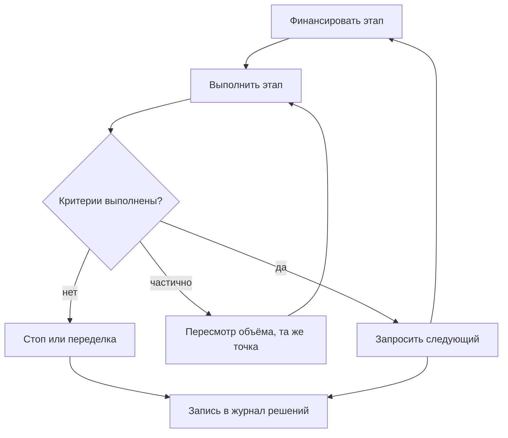
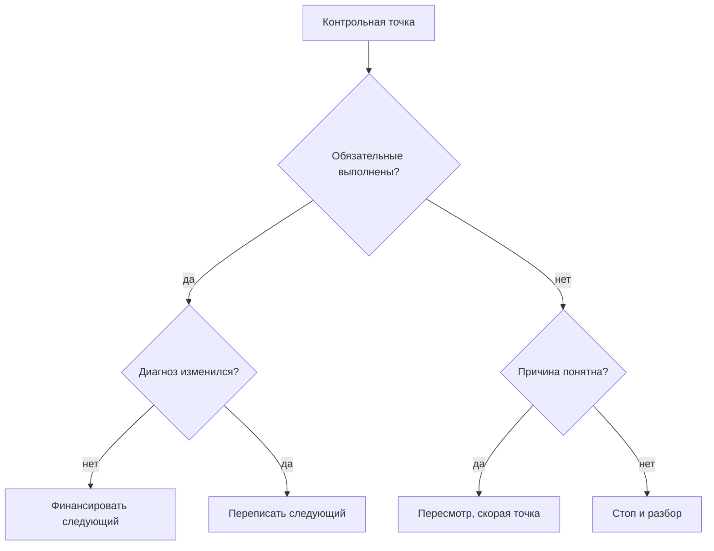

# Глава 49 — Многолетняя трансформация, коммуникация с руководством и конструктивная политика { #chapter-49-multi-year-transformation-executive-communication-and-constructive-politics }

Девяностодневную трансформацию финансируют по мандату. Многолетнюю приходится финансировать снова и
снова, а те, кто даёт деньги, тем временем успевают сменить приоритеты. Переживёт ли такая программа
свой второй год, зависит от навыков, которым посвящена эта глава: разрезать программу на этапы, каждый
из которых зарабатывает право на следующий; просить у руководства то, что нужно, на его языке; открыто
вести политическую работу вокруг запроса; растить людей, которые поведут программу после вас.
Сквозной пример — предложение директора по разработке в Northstar Technologies, вымышленной компании из
[кейса](../../case-studies/northstar/index.md), продолжить программу ещё на два года.

## Почему это важно { #why-this-matters }

В команде улучшение либо приживается за несколько спринтов, либо нет; дважды его никто не
финансирует.

В организации трансформация длится дольше своего мандата. Результаты первого года снимают ту самую
боль, которой её обосновывали. Поэтому доводы в пользу продолжения слабеют ровно тогда, когда работа переходит
от быстрых побед к медленному труду по их закреплению: владение, пайплайны, преемственность.

Для высшего руководства программа — лишь одно из многих притязаний на ресурс. CFO (финансовый
директор) видит затраты, руководитель продаж — инженеров, которые не делают функции для сделок. Продлят
ли программу, решают не столько инженерные доводы, сколько другое: разбит ли запрос на этапы, названа ли
его цена, попал ли он к нужным людям в нужном порядке и вызывает ли он доверие.

## Цели главы { #learning-objectives }

Прочитав эту главу, вы сможете:

- Разбивать многолетнюю трансформацию на этапы, у каждого из которых есть запрос на финансирование,
  критерии выхода и дата решения.
- Писать для руководства предложение, которое начинается с запроса, выражает его в единицах самих
  руководителей и показывает цену отказа.
- Составлять карту интересов вокруг предложения и работать с ними открыто, без частных договорённостей,
  которые противоречат публичной записи.
- Оценивать собственное политическое поведение, опираясь на исследования политических навыков и
  воспринимаемой политики.
- Встраивать преемственность в критерии выхода, чтобы программа не зависела от спонсора.

Связанные главы: к кейсу этой главы подводят глава 27 (трансформация качества первого года) и
глава 46 (обязательство по надёжности на второй год). Лидерство в изменениях, отчётность для руководства
и трёхлетнюю технологическую стратегию CTO (технического директора) разбирают главы 43, 39 и 51.

## Ментальная модель { #the-mental-model }

> **Ментальная модель:** многолетняя трансформация — это серия ставок, и каждую продают отдельно.
> Финансируйте по одному этапу за раз под заранее согласованные критерии выхода и считайте каждую
> контрольную точку настоящим решением, которое может остановить программу. Политика — это работа над
> тем, чтобы решение приняли хорошо: знать, что нужно каждому из тех, кто решает, рассказывать всем
> одну и ту же историю и оставлять запись.

Если программа просит сразу два года, она просит руководителей на два года отложить собственное
суждение. Если она просит полгода, с контрольной точкой и описанным вариантом продолжения, то предлагает
им судить по доказательствам, которые лежат у них перед глазами. Каждая контрольная точка — новая продажа,
поэтому доверие к директору становится оборотным капиталом программы. Честно объяснённый промах это
доверие сохраняет, тихо переопределённый критерий — тратит.

Программы живут на ветке «частично», и для неё нужно правило, записанное до контрольной точки: какие
критерии обязательны, какие можно не выполнить ценой пересмотра объёма и кто решает.

## Подробный разбор { #deep-conceptual-explanation }

### Почему многолетние программы угасают { #why-multi-year-programs-decay }

**Парадокс успеха.** Первый этап снимает видимую боль. В Northstar сервисные кредиты (компенсации по
SLA) упали с $410 000 в базовом квартале до $95 000 в квартале 2, а оставшуюся работу не подкрепляет
ни один сбой. Kotter известен предупреждением не объявлять победу слишком рано
([Kotter, 1995](../../references/bibliography.md#kotter1995leading)). В многолетней программе
преждевременная победа выглядит иначе: никто ничего не объявляет, просто в очередном бюджетном цикле
выделенный ресурс сокращается.

**Эскалация приверженности.** Обратный провал: финансирование продолжается, потому что остановиться
значило бы признать, что деньги потрачены впустую. Staw известен тем, что первым описал эту склонность
([Staw, 1976](../../references/bibliography.md#staw1976knee)). Глава 43 показывает её в масштабе
инициативы. В масштабе программы она прячется лучше: у большой программы всегда найдётся хороший
показатель.

**Стратегическое искажение данных.** Flyvbjerg отличает оптимистическое искажение (optimism bias),
честную склонность давать слишком благоприятные прогнозы, от стратегического искажения данных
(strategic misrepresentation), то есть сознательного занижения затрат ради одобрения
([Flyvbjerg, 2006](../../references/bibliography.md#flyvbjerg2006nobel)). От первого помогает более
точное прогнозирование (глава 17). Против второго нужна контрольная точка, где заявленные и фактические
затраты кладут рядом перед одними и теми же людьми.

### Этапы, контрольные точки и критерии выхода { #stages-gates-and-exit-criteria }

Идею stage-gate Cooper предложил для разработки новых продуктов. Работа делится на этапы, между ними
стоят контрольные точки (gates), и на каждой точке работу сверяют с заявленными критериями, а затем
продолжают, останавливают, приостанавливают или отправляют на доработку
([Cooper, 1990](../../references/bibliography.md#cooper1990stagegate)). Переносит эту идею на
организационную программу уже эта книга: каждый этап — блок профинансированного ресурса, каждая
контрольная точка — встреча с теми, кто финансирует, в заранее назначенную дату. Этап можно
финансировать, если у него есть:

| Элемент | Проверка |
|---|---|
| Цель в одном предложении | Руководитель финансов или продаж может её повторить |
| Запрос на финансирование | Ресурс в FTE-кварталах и деньги, и то и другое в долларах |
| Критерии выхода | Измеримые, с датами, согласованы до начала этапа, от пяти до семи |
| Правило контрольной точки | Какие критерии обязательны; что запускает частичный результат |
| Вариант на следующий этап | Что купит следующий этап: описан, но не запрошен |

Критерии выхода — не дашборд программы, а условия, при которых финансирующие согласились считать
деньги потраченными с толком. Любой критерий подталкивает к подгонке (как именно, разбирает
[глава 18](../04-execution/18-measuring-engineering-productivity.md)), поэтому к каждому добавляйте
проверку: к числу инцидентов — еженедельный аудит серьёзности, к числу компонентов, отвечающих
требованиям, — выборку, которую проверяет человек не из команды-владельца.

Rumelt известен описанием «ядра» стратегии (kernel): диагноз, направляющая политика и согласованные
действия ([Rumelt, 2011](../../references/bibliography.md#rumelt2011good)). Программа, разбитая на
этапы, заново ставит диагноз на каждой контрольной точке. Диагноз, который никогда не меняется, с самого
начала был недостаточно конкретным, чтобы оказаться ошибочным. Kane с соавторами известны тезисом, что
цифровая трансформация касается прежде всего людей и организации, а не технологий
([Kane et al., 2019](../../references/bibliography.md#kane2019technology)). Если второй год свёлся к
списку инструментов для покупки, программа, вероятно, неверно определила этап.

### Как говорить с руководством на его языке { #communicating-to-executives-in-their-terms }

Внимания у высшего руководства мало, и те, кто ниже, за него соревнуются. Попытки повлиять на то, куда
это внимание направится, Dutton и Ashford называют *продвижением вопросов* (issue selling)
([Dutton and Ashford, 1993](../../references/bibliography.md#dutton1993selling)). В 82 рассказах о
продвижении вопросов руководители выделяли три вещи: упаковку, вовлечение и выбор момента
([Dutton et al., 2001](../../references/bibliography.md#dutton2001moves)). Это **научные результаты** о
том, что работает по мнению руководителей, а не проверка того, какие ходы действительно приносят успех.

**Упаковка: их валюта.** CFO смотрит на операционные расходы и отклонения от плана, руководитель
продаж — на сделки и даты, генеральный директор — на выручку под угрозой. Выражайте каждый запрос в
долларах и инженерах и переводите на этот язык каждый результат. «Незапланированная работа снижается с
25 до 18 процентов» превращается в «на дорожную карту возвращаются около 5,6 инженера, это примерно
$1 млн в год».

**Сначала запрос.** Об отчётах для руководства — глава 39. Предложение отличается от отчёта тем, что
просит решения. Поэтому его первый абзац говорит, о чём просят, к какому сроку и что будет, если ответ
«нет». Это принцип Minto «сначала главная мысль» ([Minto, 2002](../../references/bibliography.md#minto2002pyramid)).

**Цена отказа.** Бездействие кажется дешевле, потому что его затраты никто не записывает. Запишите их:
какой риск растёт, какой показатель откатится назад и когда руководство это увидит.

**И вниз тоже.** Инженерам и руководителям, которые делают работу, нужна та же история, но рассказанная
для них: зачем нужен этап 2, если «мы уже достигли цели», и что контрольная точка значит для их команд.
Как доносить изменения до всей организации, разбирает глава 43.

**Плохие новости — первыми.** Keil с соавторами пишут, что спонсорство со стороны руководства может
делать людей менее откровенными, а высшие руководители порой пропускают мимо ушей плохие новости, даже
когда о них сообщили ([Keil et al., 2014](../../references/bibliography.md#keil2014pitfalls)). Директор
и есть спонсор своей программы, поэтому называйте показатель, не достигший цели, раньше, чем его найдёт
кто-то из руководства.

### Пример первой страницы { #a-sample-page-one }

На первой странице — всё решение, остальное — доказательства. Вот первая страница предложения о
продолжении из кейса этой главы; в ней только цифры кейса (**иллюстрация**). Сначала два пояснения.
Northstar считает первый год этапом 1: он уже профинансирован, а его контрольная точка назначена на
неделю 56, когда появятся данные квартала 4. Предложение просит профинансировать этап 2 (кварталы 5
и 6).
«Не больше 40» — обязательство директора на второй год из главы 46: инциденты Sev1 и Sev2, посчитанные
скользящей суммой за четыре квартала.

> **Решение нужно к неделе 51.** Профинансировать этап 2 программы качества, «Удержание», на
> кварталы 5 и 6: 6 из наших 80 инженеров на профилактике и $150 000 на новые инструменты, при
> условии, что этап 1 пройдёт контрольную точку на неделе 56.
>
> **Почему сейчас.** Шесть из 40 наших крупнейших клиентов продлевают контракты в кварталах 5–8. За
> первый год число инцидентов Sev1 и Sev2 сократилось с 30 за квартал до 14, а сервисные кредиты — с
> $410 000 до $60 000. Но результаты ещё не закреплены. Доступность (99,89% в квартале 3) всё ещё ниже
> нашего обязательства в 99,9%, а [доля неудачных изменений](../../glossary.md#change-failure-rate)
> (change failure rate) в Core не улучшилась с квартала 1.
>
> **Сколько это стоит.** Рост численности не нужен. Эти 6 инженеров — ресурс на $555 000, который
> иначе ушёл бы на дорожную карту. $150 000 — единственные новые операционные расходы, и их должен
> одобрить CFO.
>
> **Если ответ «нет».** Профилактике достанется то, что останется от дорожной карты. Риск в
> том, что инциденты и кредиты поползут обратно вверх как раз во время продлений; первыми это покажут
> цифры квартала 5.
>
> **Как вы узнаете результат.** Контрольная точка на неделе 78 с письменными критериями выхода:
> скользящая сумма инцидентов идёт к тому, чтобы за второй год уложиться в 40 (наше обязательство на
> второй год), доступность 99,9% в каждом квартале, кредиты не больше $25 000 за квартал.
> Необъяснённый промах останавливает программу до пересмотра.

У каждого абзаца одна задача: решение и его срок; причина в валюте читателя; цена в обеих единицах
(инженерах и долларах); цена отказа; проверка. Невыполненный показатель назван на первой странице,
прежде чем кому-то придётся его искать.

### Как вести встречу, на которой принимают решение { #running-the-decision-meeting }

На встрече решают, а не презентуют документ (**рекомендация книги**). Отправьте предложение минимум за
два дня, заранее проведите все встречи один на один (1:1) и договоритесь с председателем, кто
докладывает и кто решает.

Откройте встречу так, будто документ уже прочитан: за две минуты назовите решение, о котором просите,
и варианты. Затем каждое возражение, как только оно прозвучит, относите к одному из трёх видов:

| Возражение | Ответ |
|---|---|
| Вопрос факта | Ответьте или пообещайте ответ к названной дате |
| Другой интерес | Укажите вариант, который его учитывает, с ценой; или предложите оценить новый |
| Другое суждение | Изложите своё один раз, с доказательствами, и попросите решающего выбрать |

Не спорьте об одном и том же дважды и не сдавайте нижнюю планку прямо на встрече, лишь бы закрыть
вопрос.

Если решение отложили, спросите, какие доказательства и к какому сроку позволят его принять, и
скажите, что тем временем будет с ресурсом. Отсрочка без даты — это «нет», за которое никому не придётся отвечать. В
течение дня запишите решение, его условия и все несогласия в журнал решений (глава 39) и разошлите
запись всем участникам.

### Конструктивная политика { #constructive-politics }

Организационная политика — это влияние на решения там, где интересы расходятся, а формальная власть
вопроса не решает. Pfeffer известен тем, что призывал руководителей не считать политику ниже своего
достоинства, а выяснять, чья поддержка нужна решению
([Pfeffer, 1992](../../references/bibliography.md#pfeffer1992managing)). Lencioni — тем, что положил в
основу здоровья организации сплочённую команду руководителей, в которой почти не остаётся места для
закулисных сделок ([Lencioni, 2012](../../references/bibliography.md#lencioni2012advantage)).

Два научных результата тянут в разные стороны.

**Политические навыки помогают тому, у кого они есть.** При валидации опросника Political Skill
Inventory политические навыки предсказывали оценки результативности руководителей
([Ferris et al., 2005](../../references/bibliography.md#ferris2005development)). Более поздний
метаанализ связал их с продуктивностью, карьерным успехом и репутацией, причём даже с поправкой на
личностные черты и общие умственные способности
([Munyon et al., 2015](../../references/bibliography.md#munyon2015political)). Это корреляционные
результаты, и говорят они о выгоде для отдельного человека, а не о том, выигрывает ли организация.

**Воспринимаемая политика вредит всем остальным.** Ещё один метаанализ изучал, как сотрудники
*воспринимают* организационную политику, то есть насколько им кажется, что решения определяет
своекорыстное маневрирование. Там, где воспринимаемая политика была выше, заметно выше были и напряжение, и
намерение уйти, и неудовлетворённость (связи от умеренных до сильных), а выполнение рабочих задач было
несколько хуже (связь слабее) ([Chang et al., 2009](../../references/bibliography.md#chang2009perceptions)).
Это корреляции, а не оценки причинного эффекта.

Из этих двух результатов вытекает то, что книга называет конструктивной политикой: влияние, которое
остальная организация не сочла бы своекорыстным, если бы видела его целиком. Проверить его можно тремя
тестами.

1. **Стенограмма.** Было бы вам спокойно, если бы каждый руководитель прочитал записи всех встреч один
   на один, которые вы провели по этому предложению? Сказать CFO, что программа сократится, а продажам —
   что нет, значит провалить этот тест.
2. **Запись.** Каждая договорённость, которая меняет план, попадает в журнал решений (глава 39).
3. **Интересы.** Чем интересы отличаются от позиций, объясняет глава 42
   ([Fisher and Ury, 1981](../../references/bibliography.md#fisher1981getting)). На конструктивной
   встрече один на один вы выясняете, что нужно другому руководителю, и меняете предложение там, где
   это возможно. На деструктивной поддержку обменивают на услуги в обход общего процесса.

Что до тактик, полевое исследование показало: эффективнее всего рациональное убеждение, вдохновляющий
призыв и консультация, а обмен услугами с вышестоящими неэффективен
([Yukl and Tracey, 1992](../../references/bibliography.md#yukl1992consequences)). Отсюда правило:
приносите доказательства, спрашивайте мнение заранее и не обменивайтесь услугами с теми, кто выше.

### Преемники как часть программы { #successors-as-part-of-the-program }

Трансформация, которую может вести только её спонсор, заканчивается, когда спонсор переходит на другую
роль. Покрытие преемниками и шкалу готовности разбирает глава 36. Там же приведён вывод обзора: о
преемственности лучше думать как о процессе, а не как о событии
([Berns and Klarner, 2017](../../references/bibliography.md#berns2017succession)). Эта глава добавляет
одно правило: включите преемственность в критерии выхода. Тогда этап не считается завершённым, пока
для роли, от которой он зависит, нет никого, кто мог бы её занять. А руководство направлением работ на
этапе превращается в задание на развитие, где на кону реальный результат
([глава 41](../09-engineering-directorship/41-managing-and-developing-engineering-managers.md)).

## Пример из инженерной организации { #engineering-organization-example }

!!! info "Northstar: что уже известно"
    Неделя 45 первого года директора. Число инцидентов [Sev1 и Sev2](../../glossary.md#severity-sev1-sev2-sev3)
    (два самых серьёзных уровня) упало с 30 за квартал до 14 в квартале 3, и цель мандата (15) впервые
    выполнена. Доступность достигла 99,89% и совсем немного не дотянула до 99,9%. На профилактике
    заняты 8 FTE из 80 инженеров. Теперь директор готовит предложение продолжить программу на два года. См.
    [хронологию](../../case-studies/northstar/timeline.md). Впервые читаете о Northstar? Прочитайте
    [«Год вкратце»](../../case-studies/northstar/year-in-brief.md),
    [действующих лиц](../../case-studies/northstar/cast.md) и
    [брифинг квартала 4](../../case-studies/northstar/quarter-4-briefing.md).

Цифры — **иллюстрация**, построенная на данных кейса Northstar. Второй год — это кварталы 5–8 (недели 53–104).
Ресурс оценён по плановой ставке книги (глава 45), $185 000 на инженера в год, так что один
[FTE-квартал](../../glossary.md#fte-quarter) (один инженер на полной ставке в течение квартала) стоит
$46 250. Допущение: свободный бюджет второго года на инструменты ($250 000) уже распределён между
существующими инструментами, поэтому на новые нужно одобрение CFO.

| Этап | Ресурс на профилактику | Стоимость ресурса | Новые инструменты | Итого |
|---|---|---|---|---|
| 2: Удержание (кварталы 5–6) | 6 FTE × 2 = 12 FTE-кварталов | $555,000 | $150,000 | $705,000 |
| 3: Консолидация (кварталы 7–8) | 5 FTE × 2 = 10 FTE-кварталов | $462,500 | $100,000, только если выбрана целевая система CI (одна система сборки для всех сервисов) | $562,500 |
| Два этапа | 22 FTE-квартала | $1,017,500 | $250,000 | $1,267,500 |

Сама по себе итоговая сумма вводит в заблуждение. Численность не растёт, поэтому $1 017 500 ресурса —
это выбор того, чем займутся уже работающие инженеры, а платят за этот выбор работой по дорожной карте,
которая не будет сделана. Операционные расходы меняются только на $250 000 — на инструменты. Если CFO
увидит $1,27 млн, он прочтёт это как новые деньги. Если руководитель продаж увидит «$250 000», он не
заметит, что 6 инженеров — это 7,5% из 80. Поэтому предложение показывает обе строки всем.

| Результат | Квартал 3 | Цель этапа 3 | Годовая ценность |
|---|---|---|---|
| Незапланированная работа | 25% = 20 FTE | 18% = 14.4 FTE | 5.6 FTE × $185,000 = $1,036,000 |
| Сервисные кредиты | $60,000 за квартал | не больше $25,000 | ($60,000 − $25,000) × 4 = $140,000 |

Строка кредитов маленькая, потому что основную экономию уже дал первый год: в базовом квартале кредиты
составляли $410 000 за квартал, то есть $1,64 млн в год. Это и есть парадокс успеха в цифрах. Самый
сильный довод за продолжение — хрупкость достигнутого, но его нужно подкрепить доказательствами.
Кое-какие у Northstar есть. В Core (Java-монолите) доля неудачных изменений (доля релизов, которые
вызывают сбой) упала с 31% в базовом квартале до 22% в квартале 1, а в квартале 2 держалась на 23%.
Иначе говоря, с квартала 1 релизы стали мельче, но не безопаснее. Правда, числа слишком малы, чтобы
говорить о тренде.

## Как принимать решение { #decision-framework }

Применяйте это правило на каждой контрольной точке. Это рекомендация книги: пороги можно менять, но
записывать их нужно до начала этапа.

| Вопрос на контрольной точке | Доказательства | Если ответ «нет» |
|---|---|---|
| Обязательные критерии выхода выполнены? | Показатели вместе с парными проверками | Никакого продолжения по умолчанию; объясните промах письменно |
| Причина каждого промаха понятна? | Письменный анализ, а не новая цель | Остановить и разобрать; финансировать необъяснённый промах — это эскалация приверженности |
| Диагноз не изменился? | Заново проведённая диагностика, которая обосновала программу | Переписать следующий этап, прежде чем просить о нём |
| Следующий этап всё ещё лучшее применение ресурса? | Цена отказа против самого сильного конкурирующего притязания | Сократить этап или завершить программу |
| Следующий этап не зависит от одного человека? | Покрытие преемниками для его критических ролей | Добавить пробел в критерии выхода |
| Финансирующие рассказывают одну и ту же историю? | Каждый может сформулировать запрос и цену отказа | Больше встреч один на один, прежде чем просить |

Больше одного этапа просите, только если второму уже сейчас нужно обязательство с долгим сроком
подготовки (контракт, миграция с одного вендора на другого). Но и тогда просите только об этом
обязательстве.

## Компромиссы { #trade-offs }

**Короткие этапы или импульс.** Каждая контрольная точка требует подготовки и несёт риск остановки.
Этапы по два квартала подходят работе, результаты которой видны в пределах квартала. Годовые этапы
подходят работе с долгим запаздыванием, например миграции платформы, но курс тогда корректируют
позже.

**Чёткие критерии или подгонка.** Критерий «компоненты [tier 1](../../glossary.md#tier-1) (критичные
для бизнеса) выполняют все четыре операционных минимума» легко оценить и так же легко подогнать, сузив
tier 1. Критерий «владение понятно» нельзя ни подогнать, ни оценить. Сочетайте чёткие критерии с
проверкой.

**Предварительное согласование или прозрачность.** Встречи с каждым руководителем заранее (pre-wiring)
рано выявляют возражения. Но если делать это неумело, решение уходит за закрытые двери. Переносите
узнанное в письменное предложение, чтобы на встрече решали, опираясь на то, что слышали все.

**Преемственность или поставка.** Если отдать направление работ руководителю, который ещё растёт, оно
замедлится; если оставить его себе, программа станет хрупкой. Заложите цену замедления в этап.

**Продолжать или остановиться.** Если программу завершают на контрольной точке, потому что работа
стала обычной эксплуатацией, это успех: профилактика становится строкой в квартальном плане ресурсов
([глава 38](../08-management-operating-system/38-scorecards-quarterly-planning-and-capacity-allocation.md)).
Программы без определённого конца превращаются в постоянный налог.

## Типичные провалы { #failure-modes }

**Карт-бланш на два года.** Всю программу запрашивают разом. Руководители одобряют её, ничего на себя не
беря, а потом тихо забирают ресурс. Как заметить: никто не может назвать дату следующего решения.

**Правила меняют по ходу игры.** Невыполненный критерий задним числом переопределяют («tier 1 теперь
означает 12 компонентов»). Как заметить: в документе для контрольной точки критерии не те, что в
документе о финансировании.

**Доводы только на языке разработки.** Предложение говорит о доле неудачных изменений и нестабильных
тестах, а перевести это на свой язык предоставляет руководителям, которые этого не делают. Как
заметить: CFO спрашивает: «Так
сколько это стоит?»

**Спрятанный запрос.** Решение, которое нужно получить, стоит на последней странице или нигде, и
встреча заканчивается без решения. Как заметить: ни одна фраза в черновике не начинается словами «Мы просим руководство компании
решить».

**Торг в обход.** Поддержку покупают частным обещанием в обход общего процесса. Об этом становится
известно, остальные решают, что процесс существует для вида, и воспринимаемая политика растёт. Как
заметить: появилась договорённость, которую вы не стали бы записывать в журнал решений.

**Программа, завязанная на спонсора.** Директор сам ведёт все направления работ и не растит преемника.
Как заметить: у критических ролей программы нет замены.

**Победа измором.** Программу никто не завершает: её ресурс просто утекает, запрос за запросом. Как заметить:
выделение в квартальном плане расходится с одобренным этапом.

## Применение в крупной организации { #enterprise-application }

В организации на 50–150 инженеров программу обычно ведёт директор, который подчиняется CTO, члену команды
высшего руководства. CTO решает, поддержать ли предложение как спонсор или представить его самому. На
практике это выглядит так:

- **Один документ программы** на две–четыре страницы, с первой страницей, как в примере выше; его
  обновляют к каждой контрольной точке.
- **Одна контрольная точка раз в два квартала** на уже существующем форуме руководства, например на
  бизнес-обзоре.
- **Этап как строка в квартальном плане**, чтобы любое сокращение было видимым решением. Эта строка
  ведётся в [модели планирования ресурсов](../../templates/capacity-planning-model.md), а провести
  контрольную точку можно на [квартальном обзоре разработки](../../templates/quarterly-engineering-review.md).
- **Карта стейкхолдеров, обновлённая перед каждой контрольной точкой**; в ней нет ничего, что вы не
  смогли бы защитить.
- **Хотя бы один критерий о людях на каждом этапе**: замена для критической роли, руководитель
  направления работ, staff-инженер — владелец стандарта.

## Взгляд CTO { #cto-perspective }

Для CTO программа директора — одно притязание из нескольких, и она должна вписаться в трёхлетнюю
технологическую дорожную карту (глава 51). CTO спрашивает, служит ли программа стратегии компании,
не откажется ли от неё команда руководителей в плохой квартал и кто будет её вести, если директор
уйдёт.

В Halvard Systems, вымышленной компании на 500 инженеров из
[главы 35](../07-organization-design/35-designing-organizations-at-four-scales.md), группами руководят
пять вице-президентов, и CTO не может проводить контрольную точку для каждой программы каждой группы.
Рабочий вариант — одна контрольная точка на уровне компании раз в полгода, где этап каждой группы
оценивают по однотипным критериям. Тогда финансирование следует за доказательствами, а не за тем, какой
вице-президент убедительнее спорил.

Кроме того, CTO решает самый трудный вопрос преемственности: не переросла ли программа роль своего
руководителя. Когда компании размера Northstar нужен VP of Engineering, разбирает глава 47.

## Практический плейбук { #practical-playbook }

1. **Сначала запишите конечное состояние:** каким будет положение дел, когда программа станет
   не нужна, и как тогда будет финансироваться профилактика (обычно строкой в квартальном плане).
2. **Разрежьте путь на этапы**, по два квартала, если у работы нет долгого запаздывания. У каждого этапа
   — цель, запрос, пять–семь критериев выхода с парными проверками, правило и дата контрольной точки.
3. **Просите об одном этапе.** Следующий опишите как вариант с ориентировочной стоимостью.
4. **Оцените цену отказа** для каждого этапа.
5. **Составьте карту финансирующих**: интерес, позиция, какие доказательства нужны, что они могут
   потерять, конфликты.
6. **Проведите встречи один на один до встречи, на которой решают.** Спрашивайте, а не продавайте;
   меняйте предложение там, где интерес можно учесть.
7. **Поставьте запрос на первую страницу** (см. пример выше).
8. **Проверьте тестом стенограммы** всё, что было сказано на шаге 6.
9. **Запишите решение в журнал** вместе с условиями и несогласиями.
10. **Сделайте преемственность критерием** и отдавайте направления работ тем, кого развиваете.
11. **Проводите каждую контрольную точку вовремя**, особенно когда новости плохие.

## Кейс { #case-study }

Этот кейс **вымышлен**. Действие происходит на неделях 45–51 (квартал 4 идёт с недели 40 по
неделю 52). Исход решений не записан: решать вам.

**Где сейчас программа.** Мандат первого года: за двенадцать месяцев без роста численности вдвое
сократить число инцидентов Sev1 и Sev2 (с 30 за квартал до 15 и меньше) и выйти на доступность 99,9% на
контрактных путях.

| Показатель | Базовый квартал | Квартал 1 | Квартал 2 | Квартал 3 |
|---|---|---|---|---|
| Инциденты Sev1 и Sev2 | 30 | 21 | 17 | 14 (2 Sev1, 12 Sev2) |
| Доступность, контрактные пути | 99.62% | не записано | 99.86% | 99.89% |
| Сервисные кредиты | $410,000 | не записано | $95,000 | $60,000 |
| Незапланированная работа | 34% | 31% | 28% | 25% |
| Tier 1, выполняющие четыре минимума | 3 из 15 | 8 из 15 | 11 из 15 | 13 из 15 |

Цель по инцидентам впервые выполнена в квартале 3. По доступности цель не достигнута: простой за
квартал оказался примерно на 13 минут больше допустимого. Цифры квартала 4 придут после недели 52, поэтому второй год приходится предлагать раньше, чем
будет вынесен вердикт по первому.

**Предложение.** На неделе 45, через неделю после предложения по организации второго года (решение по
нему — на неделе 46), директор готовит черновик предложения продолжить программу на два
года, не запрашивая роста численности. Остальные открытые решения перечислены в
[брифинге квартала 4](../../case-studies/northstar/quarter-4-briefing.md).

| Этап | Запрос | Контрольная точка |
|---|---|---|
| 1: Стабилизация (год 1) | Уже профинансирован | Неделя 56, первая точка после данных квартала 4 |
| 2: Удержание (кварталы 5–6) | 6 FTE на профилактику; $150,000 на инструменты | Неделя 78 |
| 3: Консолидация (кварталы 7–8) | 5 FTE; $100,000, только если выбрана целевая система CI | Неделя 104 |
| Вариант на год 3 | Не запрашивается | Решение на неделе 104 |

Критерии выхода:

- **Этап 1:** Sev1 и Sev2 не больше 15 два квартала подряд; 99,9% в течение полного квартала.
- **Этап 2:** Sev1 и Sev2 не больше 12 и 99,9% в каждом квартале (как это читать, объяснено ниже);
  кредиты не больше $25 000 за квартал; все 14 компонентов tier 1 выполняют минимумы\*; каждый
  компонент значится в реестре владения ровно один раз; ни одной критической роли без замены.
- **Этап 3:** tier 1 развёртывается через пайплайн с журналом аудита и автоматическим откатом;
  незапланированная работа не больше 18%; для каждой критической роли есть человек, «готовый сейчас»
  или «готовый после развития».
- **Вариант на третий год:** работа над границами Core; нужен ли Northstar VP или второй уровень
  управления (глава 47).

\* Во втором году компонентов tier 1 считается 14, потому что notification-svc в квартале 2 перешёл в
tier 2; цифры первого года сохраняют исходные 15, чтобы кварталы можно было сравнивать.

**Как читать показатель инцидентов на этапе 2.** «Не больше 12 в каждом квартале» — условие
пересмотра, а не проходной балл. Почему, показала глава 46: число инцидентов колеблется случайно.
Программа с истинным средним в 10 инцидентов за квартал примерно в трети случаев превысит 12 хотя бы
в одном из двух кварталов этапа 2. Поэтому контрольная точка сверяет скользящую сумму за четыре
квартала с обязательством: не больше 40. Если в квартале больше 12 инцидентов, к контрольной точке
нужен письменный анализ; два таких квартала подряд снова открывают вопрос о выделении на профилактику.
Доступность, на которую случайность влияет гораздо меньше, оценивают поквартально. Скользящая сумма
инцидентов и доступность обязательны. При любом другом промахе возможен пересмотр объёма с контрольной
точкой через четыре недели; решение принимает Victor Lindqvist (CTO).

Этап 2 также берёт на себя открытые вопросы, у каждого из которых есть владелец:

| Пункт | Почему он в этапе 2 |
|---|---|
| Четыре критические роли без замены (обзор на неделе 44): руководитель Billing, руководитель Data and Analytics, две роли staff-инженеров | Критерий «ни одной роли без замены» |
| Каждый компонент значится в реестре владения ровно один раз | Этого требует предложение по организации на год 2 |
| Два технических выбора: одна целевая система для четырёх систем сборки (предложен GitLab CI) и [ADR-0001](../../glossary.md#adr-0001) — как интеграции читают данные ledger | От них зависят критерий этапа 3 о пайплайне и его инструменты |

**Финансирующие.** На неделях 46 и 47 директор провёл встречи один на один и спросил каждого
руководителя, что ему нужно.

- **Victor** поддерживает разбивку на этапы, не понесёт совету директоров запрос на рост численности и
  хочет, чтобы предложение не обсуждали на встрече по организации на неделе 46.
- **Helena Marsh (CEO, генеральный директор)** спрашивает, выдержит ли надёжность ближайшие продления:
  шесть из 40 крупнейших клиентов продлевают контракты в кварталах 5–8.
- **Rajiv Menon (CFO)** хочет, чтобы операционные расходы не росли. Он одобрит $150 000, только если их
  компенсирует экономия в бюджете на облако и инструменты ($4,2 млн). Ещё он спросил, когда
  программа закончится.
- **Greg Tanaka (VP по продажам)** говорит, что мандат выполнен и 6 FTE должны делать функции для
  сделок. На неделе 47 он наедине пообещал поддержку, если два инженера перейдут на его функции для
  сделок, минуя межкомандный портфельный форум.
- **Amara Okafor (CPO, директор по продукту)** хочет, чтобы выделение было зафиксировано на каждый этап.
- **Sofia Alvarez (VP по работе с клиентами)** поддерживает продолжение и хочет сохранить уведомления
  клиентов об инцидентах.

**Что изменилось после встреч один на один.** Теперь первая страница открывается вопросом Helena: запрос
защищает надёжность на время шести продлений. На вопрос Rajiv отвечает конечное состояние: после
этапа 3 профилактика становится обычной строкой квартального плана. Пожелание Amara учтено
фиксированным выделением на каждый этап. Альтернатива Greg включена как вариант с ценой: 2 из 6 FTE на функциях для сделок в
кварталах 5 и 6 (ресурс на $185 000), так что на этапе 2 остаётся 4 FTE; там же указано, какие
критерии выхода в этом случае перейдут на этап 3.

Частное предложение Greg директор отклонил в том же разговоре и сказал, что этот вариант войдёт в
письменное предложение для всей команды руководителей. Так директор прошёл тесты стенограммы и записи.
Не лишился ли он из-за этого поддержки Greg, неизвестно.

**Что остаётся открытым.** Команда руководителей собирается на неделе 49. К неделе 51 её просят
принять три решения:

1. Одобрить этап 2 при условии, что этап 1 пройдёт контрольную точку на неделе 56.
2. Одобрить или отклонить $150 000, с компенсирующей экономией или без неё.
3. Выбрать между 6 FTE на профилактике и 4 FTE плюс двумя инженерами на функциях для сделок.

Victor пока не сказал, будет ли он представлять предложение сам.

## Упражнения { #exercises }

Разборы упражнений: [решения к главе 49](../../solutions/ch49-solutions.md).

### Базовый уровень { #foundational }

**F1.** В предложении Northstar по этапу 2 шесть критериев выхода, в том числе «14 из 14 компонентов
tier 1 выполняют четыре операционных минимума» и «ни одной критической роли без замены». Для каждого
критерия опишите, как его можно выполнить на бумаге, хотя проблема никуда не делась, и предложите
парную проверку, которая это выявит. Затем выберите два критерия, которые вы сделали бы обязательными
наряду с инцидентами и доступностью, и обоснуйте выбор.

**F2.** Итог двух этапов в предложении — $1 267 500, из них $250 000 — новые операционные расходы.
Перепишите сводку затрат в виде отдельного абзаца для каждого из трёх читателей: Rajiv Menon, Greg Tanaka
и Helena Marsh; факты во всех версиях должны быть одни и те же. В каждой версии найдите фразу, которую
скорее всего поймут неправильно, и скажите, как этого избежать.

**F3.** Предположим, к контрольной точке на неделе 56 квартал 4 показывает 13 инцидентов Sev1 и Sev2 и
доступность 99,88%. Опираясь на правило контрольной точки из кейса, скажите, чего оно требует, что
директору следует написать команде руководителей и чем законный пересмотр объёма отличается от смены
правил по ходу игры.

### Прикладное лидерство { #applied-leadership }

**A1.** Предположим, директор принял предложение Greg Tanaka на неделе 47 и перевёл двух инженеров на
его функции для сделок в обход портфельного форума. Проследите вероятные последствия на горизонте двух
кварталов для Amara Okafor, Rajiv Menon, портфельного форума и доверия к директору. Затем напишите две
или три фразы, которые вы действительно сказали бы Greg.

**A2.** Этап 2 требует, чтобы ни одна критическая роль не осталась без замены, а у четырёх ролей замены
нет (руководитель Billing, руководитель Data and Analytics, роли staff-инженеров по core-домену и по
данным и интеграциям). Спроектируйте задания на развитие, построенные на собственных направлениях работ
этапа 2, чтобы к неделе 78 у каждой роли была хотя бы временная замена. Назовите риск для поставки,
который добавляет каждое задание, и скажите, как вы заложили бы его цену в этап.

**A3.** Предположим, Victor Lindqvist вместо этого попросил вас представить продолжение вместе с решением
по организации на неделе 46, «чтобы сэкономить команде руководителей одну встречу». Решите, соглашаться
ли, учитывая внимание руководства, политическую связку двух решений и то, что будет с каждым из них,
если другое отклонят. Напишите ответ Victor.

### Решения на уровне руководства { #executive-decision-making }

**X1.** Вы — Victor Lindqvist на встрече на неделе 49. Rajiv Menon одобрит $150 000 только с
компенсирующей экономией, Greg Tanaka хочет 2 FTE на функции для сделок, Helena Marsh нужна надёжность
на время шести продлений, Amara Okafor — фиксированное выделение. Решите, что вы одобряете, с какими
условиями и что попадает в журнал решений. Скажите, во что вам нужно было бы поверить, чтобы вариант с
4 FTE оказался лучше.

**X2.** Вы — CTO в Halvard Systems. Трое из пяти вице-президентов ведут программы трансформации, и каждый
просит финансирование сразу на целый год; одна программа дважды не выполнила критерии выхода, и её объём
дважды пересматривали. Спроектируйте процесс контрольных точек на уровне компании, решите, что делать с
программой, которую пересматривали дважды, и объясните, как не дать контрольной точке превратиться в
состязание в красноречии.

## Вопросы для размышления { #reflection-questions }

1. Какие из ваших инициатив пережили бы нарезку на полугодовой этап с контрольной точкой, способной их
   остановить? Что ответ говорит об инициативе или о вашей уверенности в ней?
2. Когда вы в последний раз подстраивали сообщение под руководителя, изменился ли вывод или только
   единицы измерения?
3. Какие договорённости в вашей организации нигде не записаны и кто заплатит, если они рухнут?
4. Воспринимают ли ваши люди решения как политические? Какие данные об этом, кроме собственного
   мнения, у вас есть?
5. Если бы вы ушли через три месяца, какие ваши программы продолжились бы и кто бы их вёл?

## Главное { #key-takeaways }

- Финансируйте многолетнюю трансформацию по одному этапу за раз под критерии выхода, согласованные до
  начала этапа; следующий этап описывайте как вариант.
- Записывайте правило контрольной точки заранее: обязательные критерии, что запускает частичный
  результат, кто решает.
- Ожидайте парадокса успеха и обосновывайте второй год хрупкостью достигнутого, подкреплённой
  доказательствами.
- Выражайте каждый запрос в долларах и инженерах, отделяйте новые расходы от перераспределённого ресурса
  и показывайте цену отказа.
- Ставьте запрос на первую страницу, в валюте руководителей, и называйте невыполненный показатель раньше,
  чем его кто-нибудь найдёт.
- Политические навыки помогают тому, у кого они есть; воспринимаемая политика вредит всем остальным.
  Одни и те же факты каждому руководителю, каждое изменение плана — в журнал решений, никаких закулисных
  сделок.
- Сделайте преемственность критерием выхода и используйте направления работ как задания на развитие.
- Определите конечное состояние: программа, которая не может закончиться, становится постоянным налогом.

## Источники и что почитать { #references-and-further-reading }

- [Cooper, 1990](../../references/bibliography.md#cooper1990stagegate). Структура stage-gate: этапы и
  контрольные точки.
- [Kotter, 1995](../../references/bibliography.md#kotter1995leading). Ошибки трансформации, в том числе
  слишком раннее объявление победы.
- [Staw, 1976](../../references/bibliography.md#staw1976knee). Эскалация приверженности.
- [Flyvbjerg, 2006](../../references/bibliography.md#flyvbjerg2006nobel). Оптимистическое искажение и
  стратегическое искажение данных.
- [Rumelt, 2011](../../references/bibliography.md#rumelt2011good). Диагноз, направляющая политика,
  согласованные действия.
- [Kane et al., 2019](../../references/bibliography.md#kane2019technology). Трансформация как дело людей
  и организации.
- [Dutton and Ashford, 1993](../../references/bibliography.md#dutton1993selling) и
  [Dutton et al., 2001](../../references/bibliography.md#dutton2001moves). Продвижение вопросов к
  высшему руководству.
- [Minto, 2002](../../references/bibliography.md#minto2002pyramid). Главная мысль — первой.
- [Keil et al., 2014](../../references/bibliography.md#keil2014pitfalls). Почему не работает отчётность
  о статусе.
- [Pfeffer, 1992](../../references/bibliography.md#pfeffer1992managing). Власть и влияние.
- [Ferris et al., 2005](../../references/bibliography.md#ferris2005development) и
  [Munyon et al., 2015](../../references/bibliography.md#munyon2015political). Политические навыки.
- [Chang et al., 2009](../../references/bibliography.md#chang2009perceptions). Воспринимаемая политика.
- [Yukl and Tracey, 1992](../../references/bibliography.md#yukl1992consequences). Тактики влияния в
  зависимости от направления.
- [Fisher and Ury, 1981](../../references/bibliography.md#fisher1981getting). Интересы важнее позиций.
- [Lencioni, 2012](../../references/bibliography.md#lencioni2012advantage). Сплочённая команда
  руководителей.
- [Berns and Klarner, 2017](../../references/bibliography.md#berns2017succession). Преемственность как
  процесс.
