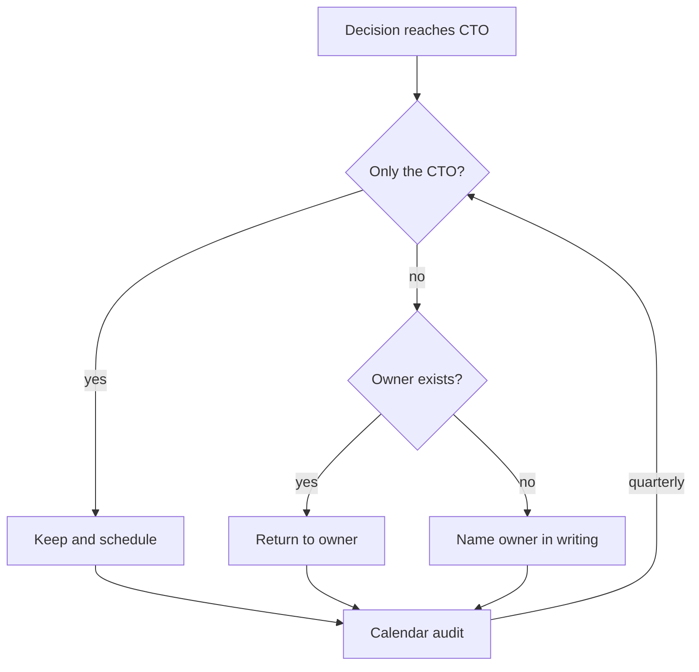
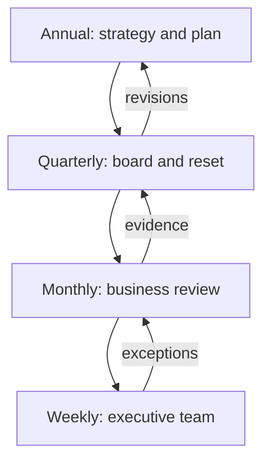
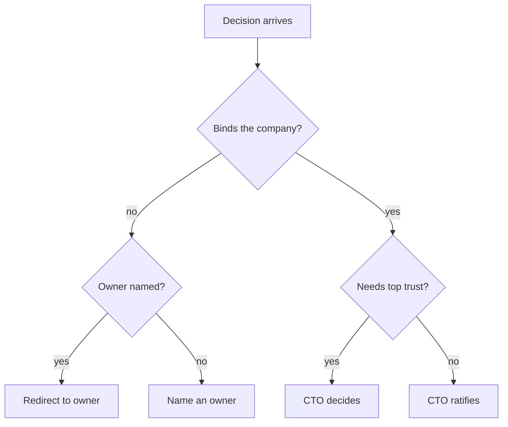

# Chapter 50 — What a CTO Actually Does

The title Chief Technology Officer names a seat, not a job. One CTO runs every engineer in the company;
another has no reports and spends the year with customers. This chapter defines the role by the decisions
it owns: the archetypes CTOs fall into, how the CTO, CIO, and VP of Engineering divide the territory, how a
CTO designs a leadership team and an operating rhythm, and the short list of things only the CTO can do.
Chapter 47 owns the VP role and the question of whether Northstar needs one; [Chapter 51](51-enterprise-technology-strategy.md) owns technology
strategy, [Chapter 52](52-technology-investment-budgeting-and-financial-literacy.md) finance, [Chapter 53](53-risk-governance-regulation-and-security-strategy.md) risk and security,
[Chapter 54](54-data-and-ai-strategy.md) data and AI, and
[Chapter 55](55-boards-due-diligence-and-executive-decision-making.md) the board. The running example puts you in the seat
of Victor Lindqvist, CTO of Northstar Technologies, the book's fictional
[case study](../../case-studies/northstar/index.md), in quarter 4 of the director's first year.

## Why This Matters

At team scale, the CTO is a name on announcements. What engineers feel is the CTO's presence in technical
decisions: a ruling given in a hallway that overrides a team's design, or a strategy that explains why their
service is being retired. A CTO who rules informally makes every team's decisions provisional.

At organization scale, the CTO decides what the engineering leaders below are accountable for and what
stays at the top. When that split is unwritten, directors and VPs either wait for permission they already
have or take decisions that were never theirs, and the organization learns that "the CTO said" outranks
any process.

At executive scale, the CTO is the only technologist at the table where the company's money, risk, and
direction are decided. If the CTO spends that seat advocating for engineering, the company loses its
technical judgment; if the CTO spends the week inside engineering, the seat is empty. Most CTO failures
are failures of allocation, of the CTO's own time.

## Learning Objectives

After this chapter you will be able to:

- Distinguish the common CTO archetypes and diagnose which one a company needs, given who else sits at
  the top.
- Divide responsibility among the CTO, a CIO or head of IT, and a VP of Engineering by decision rights,
  and find the seams where nobody owns a decision.
- Audit a CTO's calendar against the decisions only the CTO can take, and design a delegation plan with
  named receivers.
- Design the CTO's own leadership team and operating rhythm, including forums the CTO attends rather than
  chairs.
- Recognize the role's failure patterns (the shadow architect, the absent executive, the engineering
  advocate) and detect them early.

## The Mental Model

> **Mental model:** The CTO's job is the set of technology decisions that only the company's top
> technologist can take. Everything else is delegated, in writing, to a named person. The CTO's
> calendar is the evidence of which job is actually being done.

Two ideas organize the chapter.

First, **the role is a residual.** What a CTO does depends on who else is at the top. If a VP of
Engineering runs the organization, the CTO's job is what is left: strategy, external trust, company-level
bets. If IT reports to the CFO, the CTO's territory ends at the product's boundary, and the seam needs an
owner. Archetypes describe what was left over in a given company; they are not personality types.

Second, **delegation is the CTO's main design tool, and the calendar is its audit.** The week is fixed.
Peter Drucker's *The Effective Executive* is widely known for the advice to record where time actually goes
before deciding where it should go
([Drucker, 1967](../../references/bibliography.md#drucker1967effective)); **expert opinion**, credited at
idea level. Research on chief executives supports the premise that time use is measurable and that its fit
to the firm matters: from diary data on 1,114 CEOs in six countries, Bandiera and colleagues distinguished
CEOs who favored multifunction, high-level meetings from those in individual meetings on core functions,
and attributed performance gaps mainly to mismatch between CEO and firm
([Bandiera et al., 2020](../../references/bibliography.md#bandiera2020ceo)); a **research finding** on
CEOs, read at abstract level, applied here to CTOs by analogy only.

A decision returned to its owner once is a favor; a decision class returned every time, with the owner
named in writing, changes the organization. The quarterly audit catches delegated decisions drifting back
because the CTO keeps answering them.

## Deep Conceptual Explanation

### Archetypes: what the company needs at the top

The best-known taxonomy is a four-way classification attributed to Tom Berray and summarized by Werner
Vogels ([Vogels, 2007](../../references/bibliography.md#vogels2007ctoroles)): the **infrastructure
manager**, who runs infrastructure and operations where technology supports the business; the **technology
visionary and operations manager**, who decides how technology carries out the strategy and also runs it,
typical of founders; the **external-facing technologist**, who works between key customers and the product
organization; and the **big thinker**, who studies how technology could create new business, often with an
advanced-development group. The post notes that the first two usually manage engineering directly, while
the last two sit close to the executive team. This is **expert opinion**: a vocabulary, not a tested model.

Research on the role is thin. Adler and Ferdows surveyed 25 CTOs of Fortune 100 industrial companies about
their tasks, backgrounds, and why the position was created, describing a role that orchestrates product,
process, and information technology
([Adler and Ferdows, 1990](../../references/bibliography.md#adler1990cto)); read at abstract level, and far
from a software company. Medcof argues, from upper echelons research
([Hambrick, 2007](../../references/bibliography.md#hambrick2007upper)), that a CTO's influence rests less
on expertise and formal position than on broad knowledge of the business, networks inside and outside the
firm, and the CEO's leadership style ([Medcof, 2008](../../references/bibliography.md#medcof2008cto)): a
conceptual article offering propositions, not a test, so an informed hypothesis.

This book adds a fifth pattern seen in software companies of 50 to 400 engineers, the **organization
builder**: a CTO who runs engineering as its top manager, with technical direction delegated to staff and
principal engineers. Will Larson treats this executive job as a craft of its own
([Larson, 2024](../../references/bibliography.md#larson2024primer)) and defines the engineering executive
by responsibility for all of engineering, regardless of title
([Larson, 2023a](../../references/bibliography.md#larson2023executive-job)); **expert opinion**.

| Archetype | Owns | Typical company | What must exist elsewhere |
|---|---|---|---|
| Infrastructure manager | Operations, infrastructure, internal systems | Technology supports a non-software business | An owner for product technology, if any |
| Visionary and operator | Strategy and the engineering organization | Startup to about 50 engineers | Nothing yet; the risk is the CTO's span |
| Organization builder | The engineering organization through managers | 50 to 400 engineers without a VP | Technical direction carried by senior engineers |
| External-facing technologist | Customer and partner technical trust | Enterprise software with large accounts | Someone who runs engineering (a VP or director) |
| Big thinker | New technology bets, long horizon | Large firms with funded exploration | A VP who runs delivery; a strategy that funds bets |

The archetype is diagnosed, not chosen by taste (**this book's recommendation**). Ask three questions. Is
technology the product, or does it support the product? Who runs the engineering organization day to day?
Which of the company's top problems is technical and has no owner? The third answer names the archetype the
company needs this year, and it changes: a CTO who was right as operator at 40 engineers is wrong as
operator at 150 if nobody else is setting direction.

### CTO, CIO, and VP of Engineering: splitting by decision rights

Companies define the CTO and VP roles very differently
([Larson, 2020](../../references/bibliography.md#larson2020first90)), so splitting by title does not work.
Splitting by decision does. Weill, studying IT governance in more than 250 enterprises in 23 countries,
defines governance as specifying decision rights and accountabilities for important IT decisions, names five
(principles, architecture, infrastructure, application needs, investment), and describes archetypes that
assign each to business executives, IT executives, a federal mix, a duopoly, separate business units, or
nobody in particular ([Weill, 2004](../../references/bibliography.md#weill2004govern)). It reports that top
performers align governance with their performance goals: a **research finding** at abstract level about
enterprise IT, not product engineering. The transferable part is the method: list the decisions, then
assign each one.

For a software company with all three roles, a typical split (**this book's recommendation**):

| Decision | CTO | VP of Engineering | CIO or Head of IT |
|---|---|---|---|
| Product technology direction and major bets | Decides | Advises | Informed |
| Allocation of engineering capacity across areas | Sets envelope | Decides | n/a |
| Engineering leaders below the top | Approves VP picks | Decides directors | n/a |
| Internal business systems (finance, HR, CRM) | Informed | n/a | Decides |
| Employee devices, identity, office networks | Informed | n/a | Decides |
| Security of the product and its pipeline | Accountable (unless a CISO) | Implements | Shares controls |
| Customer and board technical trust | Decides | Supports | Supports on internal controls |

Where there is no VP, the CTO holds the VP column too, or gives it explicitly to a director (Chapter 47's
first company shape). Where IT reports to the CFO, the CTO and the CFO share seams: identity, security,
vendors that serve both, evidence for customer security reviews. The table's job is to make each seam
somebody's decision. A blank cell is acceptable only if it is written down as blank.

### What only the CTO can do

A list held deliberately short (**this book's recommendation**):

1. **Merge the company's view and engineering's view into one problem.** Larson describes the engineering
   executive as a company-first problem solver who reconciles the CEO's, peers', and engineering's partial
   views, rather than a functional advocate
   ([Larson, 2023b](../../references/bibliography.md#larson2023balancing)).
2. **Own the technology strategy's fit with the business strategy.** Others draft it; only the CTO can
   commit the company to it ([Chapter 51](51-enterprise-technology-strategy.md)).
3. **Take or ratify company-level, hard-to-reverse technical bets**: a platform the company will run for a
   decade, an acquisition's integration, an exit from a vendor. Team-level choices, even expensive ones,
   belong to the teams and the architecture process
   ([Chapter 28](../06-technical-leadership/28-architecture-decision-making-and-governance.md)).
4. **Design the technology leadership structure and choose its top people**, including whether a VP
   exists (Chapter 47).
5. **Hold the technical trust of the largest customers and the board.**
6. **Set decision rights at the seams** with product, IT, security, and finance.
7. **Be accountable at the top for technology risk**, whoever operates the controls ([Chapter 53](53-risk-governance-regulation-and-security-strategy.md)).

Everything else can be done by someone else, often better. Aghion and Tirole distinguish formal authority
(the right to decide) from real authority (effective control, which follows information)
([Aghion and Tirole, 1997](../../references/bibliography.md#aghion1997formal)): a CTO who keeps formal
authority where others hold the information either decides badly or rubber-stamps, and the organization
waits. Their model also lists the superior's overload as raising subordinates' real authority; an
overloaded CTO delegates by neglect instead of by design. It is a formal model, read at abstract level.

### Delegation that holds

Delegation fails in two directions. The CTO keeps answering questions that have an owner, so people keep
asking; or the CTO disappears from decisions that needed the top. Larson argues the second does more
damage: an executive somewhat too involved harms less than one too disengaged
([Larson, 2023c](../../references/bibliography.md#larson2023micromanage)); **expert opinion**. The fix for
both is a published list of decision classes with an owner each, and a CTO who redirects every request
that arrives at the wrong door, every time, for a quarter.

Mintzberg's well-known argument that managerial work is brief, fragmented, and verbal
([Mintzberg, 1990](../../references/bibliography.md#mintzberg1990job)) explains why the redirect must be
habitual: most decisions reach a CTO as a two-minute question in a corridor or chat, and each answer
teaches the organization to ask again. Larson advises new engineering executives to document how
high-impact technical decisions are actually made, and warns that many lightly held executive opinions
create thrash ([Larson, 2020](../../references/bibliography.md#larson2020first90)).

### The CTO's own team and operating rhythm

A CTO has two teams. The **first team** is the executive team. Larson takes from Lencioni the idea that a
leader's peers are the first team, and notes that peers' incentives often conflict, which makes being a
good peer harder than being a good manager
([Larson, 2023d](../../references/bibliography.md#larson2023gelling);
[Lencioni, 2002](../../references/bibliography.md#lencioni2002five)); **expert opinion**. The **second
team** is the CTO's direct reports: VPs or a director, perhaps a technical direction group.

Design the second team by the decisions it must make together (**this book's recommendation**). If the CTO
decides allocation across areas, everyone whose area competes for capacity is on it. If technical direction
is the CTO's main job, the senior engineers who carry it belong in a standing forum with the CTO, even if
they report elsewhere. A forum can include people without moving them.

The rhythm follows Chapter 37's rule that every loop has one home
([Chapter 37](../08-management-operating-system/37-cadences-and-leadership-meetings.md)); the CTO's loops
are longer than a director's.

| Loop | CTO chairs | CTO attends, does not run |
|---|---|---|
| Weekly | One-on-ones with direct reports | Executive team, as a member; a sample of engineering forums |
| Monthly | Business review with engineering leaders; technical direction review | Largest-customer executive reviews |
| Quarterly | Strategy check; calendar audit | Board item; engineering's quarterly reset |
| Annual | Technology strategy and investment plan ([Chapter 51](51-enterprise-technology-strategy.md), [Chapter 52](52-technology-investment-budgeting-and-financial-literacy.md)) | Operating plan with the CFO |

A CTO who chairs engineering's weekly operational review has taken the director's or VP's meeting; one who
never attends loses unfiltered signal; and any attendance changes the forum, because people perform for the
most senior person in the room. Attending a sample, without running it, balances the three.

## Engineering Organization Example

This example is **illustrative** and fictional. Facts beyond the
[Northstar canon](../../case-studies/northstar/index.md) are recorded as additions for this chapter.

**You are Victor Lindqvist in week 47.** You have one direct report, the Engineering Director, who runs 87
seats. Corporate IT (14 people under Marta Kowalczyk, including Joon Park's two-person security function)
reports to Rajiv Menon, the CFO. In week 45 you asked the director whether Northstar needs a VP of
Engineering in year 2; the recommendation is due in week 48, and you have decided nothing. Whatever the
answer, you want to know which part of your week no structure would change. You export your calendar for
weeks 44 to 46 and sort an average week.

| Activity | Hours a week | Class |
|---|---|---|
| Executive team meeting and one-on-one with Helena Marsh | 3.0 | Only the CTO |
| One-on-ones with Amara Okafor, Rajiv Menon, Greg Tanaka, Sofia Alvarez (fortnightly) | 1.0 | Only the CTO |
| One-on-one with the director | 0.5 | Only the CTO |
| Largest customers' technical relationships | 5.0 | Only the CTO |
| Board preparation (week 50 item, board pack figures) | 4.0 | Only the CTO, seasonal |
| Year-2 decision reviews (organization, continuation, workforce plan) | 4.5 | Only the CTO, seasonal |
| Strategy work, uninterrupted | 2.0 | Only the CTO |
| Customer security reviews (Joon Park drafts, you join calls) | 2.0 | Shared seam |
| Sales calls on open deals with Greg Tanaka's team | 3.5 | Mostly delegable |
| Sev1 bridges and customer calls during incidents | 2.0 | Partly delegable |
| Technical rulings asked in chat or the corridor, unrecorded | 3.5 | Should have an owner |
| Engineering forums attended (monthly review, quarterly reset) | 1.5 | Keep |
| Recruiting and external | 1.0 | Keep |
| Email, administration, travel | 14.5 | Overhead |
| **Total** | **48.0** | |

Check: 3.0 + 1.0 + 0.5 + 5.0 + 4.0 + 4.5 + 2.0 = 20.0 hours only the CTO can spend; 2.0 + 3.5 + 2.0 +
3.5 = 11.0 in the four middle rows; 1.5 + 1.0 + 14.5 = 17.0 for the rest; 20.0 + 11.0 + 17.0 = 48.0.
Strategy work is 2.0 of 48.0 hours, about 4 percent, the complaint behind your week 45 question.

**The rulings.** In the three weeks, 11 technical questions reached you outside any process. Three were
genuinely yours: a top-40 customer's request for a dedicated environment, which would change how Northstar
runs its platform; the technical terms of a vendor renewal affecting both product and IT; and a top-40
customer's request to review Northstar's architecture direction before renewing. Six had an owner under the
director's escalation path published in week 15 (five working days for the parties, then the director, and
you only for customer commitments or the director's budget authority). Two belonged to the standard owners,
Kwame Mensah for pipelines and Li Na Zhou for data. Answering the eight repeated the pattern of your week 14
"read the tables now" remark about ADR-0001
([Chapter 39](../08-management-operating-system/39-reviews-decision-logs-escalation-and-executive-reporting.md)).

**Your draft keep, give, stop list.**

| Item | Now | Draft | Receiver |
|---|---|---|---|
| Sales calls | 3.5 | 1.5: top-40 accounts and roadmap-changing deals only | The director names a staff engineer per deal |
| Technical rulings | 3.5 | 1.0: the "only the CTO" list only | Escalation path and standard owners; you redirect every time |
| Incident bridges | 2.0 | 1.0: customer executive calls only | Incident commander runs the bridge |
| Security reviews | 2.0 | 0.5: final call with top-40 customers | Joon Park's evidence library, Kwame Mensah proposed as engineering evidence owner (draft, Chapter 53) |
| **Reclaimed** | | **7.0** | |

Check: (3.5 − 1.5) + (3.5 − 1.0) + (2.0 − 1.0) + (2.0 − 0.5) = 2.0 + 2.5 + 1.0 + 1.5 = 7.0 hours. Moved to
strategy work, that row would rise from 2.0 to 9.0 hours, about 19 percent of a 48-hour week.

The 7.0 hours are an upper bound: delegation costs time in its first quarter (briefing receivers,
redirecting the same people), and the seasonal rows fall only once the year-2 decisions are taken. None of
this answers the VP question; it shows that 20 hours are yours under any structure, and 7 recoverable
without one.

## Decision Framework

The archetype table above answers which role the company needs; its last column is the condition for
success. The recurring decision is the single request: does it stay with the CTO? Use the test below
(**this book's recommendation**).

| Question or outcome | Meaning |
|---|---|
| Binds the company? | Beyond engineering, for more than about a year, or hard to reverse |
| Needs top trust? | The CEO, board, or a top customer will hold the CTO personally accountable |
| CTO ratifies | Someone else prepares and recommends; the CTO signs or sends it back with a reason |
| Name an owner | The decision class has no home: the CTO assigns one in writing and logs it |
| Redirect to owner | Say who decides and where it is recorded; give no view that could be read as a ruling |

## Trade-offs

**Inside or outside.** An inward-facing CTO keeps technical judgment close to delivery but leaves
customers, the board, and peers with a thinner technology voice. An outward-facing CTO strengthens customer
trust and the company's technical position, but needs someone who runs engineering, which costs a seat or a
written delegation (Chapter 47).

**One report or several.** A CTO with a single direct report, as at Northstar, has a clear chain and time
for the outside, but depends on one person for nearly all signal about engineering and has no technical
peers to argue with. More reports widen the signal at the cost of management time.

**Owning IT or not.** Owning corporate IT removes the product-IT seam and gives one view of identity,
security, and vendors, at the cost of attention on laptops, finance systems, and office networks. Leaving
IT with the CFO keeps the CTO focused and gives finance control of internal spending, but makes every shared
decision a negotiation unless decision rights are written.

**Ruling or redirecting.** An informal ruling saves days on one decision and costs the organization a
process it can trust. Redirecting is slower the first time and cheaper by the third.

## Failure Modes

**The shadow architect.** The CTO gives rulings in conversation that override the architecture process.
Early sign: teams quote "the CTO said" for decisions nobody can find in a log. Detection: count requests
reaching the CTO outside any process for three weeks, as Victor did.

**The absent executive.** The CTO moves outward and stops looking inside: no forums, no skip-levels,
engineering known through one report's summaries. Early sign: the CTO learns of a serious incident or a
resignation from the CEO.

**The engineering advocate.** The CTO argues for engineering's share instead of the company's answer. Early
sign: peers pre-negotiate with the CTO's reports, and the CEO stops asking the CTO about anything outside
engineering. Medcof's argument that influence depends on business knowledge and networks predicts the loss
of influence that follows.

**The archetype lag.** The CTO keeps doing the job that was right three years ago: still writing code at
150 engineers, or still running every manager after a VP arrived. Early sign: the VP or director cannot name
a decision that is fully theirs.

**The orphaned seam.** Security, identity, or customer evidence falls between the CTO and the head of IT,
each assuming the other owns it. Early sign: a customer questionnaire answered differently by two functions.

## Enterprise Application

In an organization of 50 to 150 engineers the CTO is usually close to Northstar's shape: one director, or a
few managers of managers, and no VP. Three practices matter at this size.

**Write the split with the director.** Without a VP, decide which VP-level decisions the director holds
(allocation across teams with the product leader, manager staffing, the operating rhythm) and which the CTO
keeps. Chapter 47's case study poses the question at Northstar; whatever the answer, write the split down.

**Build a technical direction forum without moving people.** Staff engineers usually report through the
director at this size. A monthly technical direction review chaired by the CTO, with the director and the
staff engineers, gives direction a home without a second reporting line
([Chapter 29](../06-technical-leadership/29-staff-and-principal-engineers.md) owns the staff role).

**Map the seams with the head of IT.** List the shared decisions (identity, security tooling, customer
security evidence, shared vendors) and give each an owner. Do not move IT into engineering to solve a seam
that a table can solve.

A rough guide for the calendar at this size (**illustrative**): at least a fifth of the week on
non-seasonal work only the CTO can do, no standing chair of an engineering-internal weekly forum, and a
quarterly audit that is actually run.

## CTO Perspective

The whole chapter is the CTO's perspective; this section looks at how the role changes past Northstar's
size.

At Halvard Systems, the fictional 500-engineer company of
[Chapter 35](../07-organization-design/35-designing-organizations-at-four-scales.md), the CTO has five vice
presidents (four product groups and a platform organization) and three management layers below; seven
principal engineers include two in a technical direction function. The CTO's second team is the five VPs,
and the archetype is organization builder at the top: allocation across groups, the choice of VPs, and
cross-group bets. Technical direction runs through the principal engineers and six enterprise policies,
each owned by a principal engineer. An informal ruling from Halvard's CTO crosses group boundaries and does
damage at six times Northstar's size.

As the company grows, the CTO's time shifts from deciding to designing who decides; the "only the CTO" list
stays short while each item gets heavier; and the first team matters more than the second, because
influence on capital and risk is exercised among peers and with the board, where Medcof's non-positional
sources of influence count most. Larson's advice to learn how the business makes and spends money and to
build peer relationships before conflict arises
([Larson, 2020](../../references/bibliography.md#larson2020first90)) becomes the job, not the onboarding.

## Practical Playbook

1. **Write the "only the CTO" list**: at most seven decision classes, each with the reason it stays.
2. **Name the archetype the company needs this year** from the three diagnostic questions, and what must
   exist elsewhere for it to work.
3. **Write the decision-rights table** with the VP or director and the head of IT; one owner per row,
   deliberate blanks marked.
4. **Audit three weeks of calendar** into only the CTO, seasonal, delegable, and should have an owner.
5. **Count informal requests** in the same weeks: who asked, what, and who should have decided.
6. **Draft a keep, give, stop list** with a named, briefed receiver for every item given away.
7. **Redirect every misrouted request for a quarter**, naming the owner, and log decision classes with no
   owner.
8. **Design the rhythm**: what you chair, what you attend without running, one home per loop.
9. **Repeat the audit quarterly**, and revise the list when the archetype the company needs changes. To
   assess the CTO against the role rather than the calendar, use the
   [CTO competency matrix](../../templates/cto-competency-matrix.md).

## Case Study

This case is **fictional**, set in quarter 4 at Northstar. The executive context is on the
[Northstar overview](../../case-studies/northstar/index.md); the quarter 4 calendar is on the
[first quarter](../../case-studies/northstar/first-quarter.md) page. New facts are this chapter's additions.
The outcome is open.

**The seam.** Northstar has no CISO and holds no SOC 2 report or other independent attestation. Joon Park's two-person security function sits in Corporate IT under
Marta Kowalczyk, who reports to Rajiv Menon. Product security runs through engineering's pipeline:
dependency scanning, remediation service levels, the security earmark in the prevention allocation
([Chapter 26](../05-engineering-quality/26-security-and-software-supply-chain-quality.md)). Customers send
security questionnaires to the CTO, who is accountable for the product. In weeks 44 to 46 Victor spent
about 2 hours a week on them: Joon Park drafted answers from IT's records, engineering supplied evidence ad
hoc, and Victor joined the calls.

**The shared decisions.** Victor's week 47 list of decisions touching both him and Rajiv's organization:

| Decision | Who decides today | Victor's draft owner |
|---|---|---|
| Identity and access for production systems | Unclear: IT runs the directory, engineering grants production roles | IT runs the directory; the director owns production role grants |
| Vendor contracts serving product and internal systems | Whoever signs first | The budget holder, with the other side's written technical sign-off |
| Customer security questionnaires and evidence | Victor, by default | The director's week 47 security strategy draft proposes an evidence library owned by Joon Park, with Kwame Mensah as engineering evidence owner; not decided |
| Product security tooling in the pipeline | Engineering | Engineering, unchanged |
| Internal business systems | IT | IT, unchanged |

**What Victor considers.** Three options, none chosen:

1. **Keep the structure and write the table.** IT stays with the CFO; the seams get owners; Victor raises the
   table with Rajiv. Cheapest, and depends on two executives honoring a page.
2. **Move IT under the CTO.** Removes the seam; adds 14 people and corporate systems to a CTO trying to
   reclaim time for strategy, and takes from Rajiv an organization he did not offer.
3. **Wait for the risk and security design.** Leave the questionnaire row undecided until after the audit
   committee's week 50 technology risk session and the decision on security's reporting line
   ([Chapter 53](53-risk-governance-regulation-and-security-strategy.md)), and keep answering meanwhile.

**What makes it hard.** The board meets in week 50; the VP recommendation arrives in week 48; the year-2
organization proposal's transition plan schedules an announcement for week 51; the workforce plan is
unresolved. Raising IT's reporting line with the CFO now adds a fourth structural question in the same
month. Not raising it leaves Victor answering questionnaires by default, the work his own audit says he
should not be doing.

**The reader decides:** which option Victor should take, what he says to Rajiv Menon and when relative to
the other open decisions, and what evidence would change his course.

## Exercises

Worked solutions are in the [Chapter 50 solutions](../../solutions/ch50-solutions.md).

### Foundational

**F1.** A 120-engineer software company has a founding CTO who manages four engineering managers directly, a
CPO, and IT under the CFO. The CTO spends most mornings in design reviews and is the only person who approves
database schema changes. The CEO wants the CTO to meet more customers. Using the three diagnostic questions,
name the archetype the company needs, what must exist elsewhere for it to work, and the first activity to
give away.

**F2.** Using Victor Lindqvist's week 44 to 46 calendar, reclassify every row for a typical quarter 5 week,
with the year-2 decisions and the week 50 board meeting behind him. State which hours disappear, which grow,
and what share of the week is then work only the CTO can do. Show the arithmetic and every assumption you
add.

**F3.** Write a decision-rights table for a 90-engineer company with a CTO, a VP of Engineering, and a head of
IT reporting to the CFO, with at least six decisions. Mark the seams where two roles share a decision, give
each seam one owner, and identify the row you expect to be disputed first, and why.

### Applied Leadership

**A1.** You are the Engineering Director at Northstar in week 47. Victor Lindqvist shows you his draft keep,
give, stop list and asks you to name a staff engineer per open deal for sales calls. Ines Carvalho, Kwame
Mensah, and Li Na Zhou already have standing scopes and quarter 4 commitments. Decide whether to accept the
work as proposed, and write what you say to Victor, including what you need from him.

**A2.** Of the 11 informal requests Victor counted, three were his, six belonged under the director's
escalation path, and two with the standard owners. Design Victor's redirect for each group: the words, what
he logs, and how he handles someone who asks a second time. Explain how you would know after one quarter
whether the redirect worked.

**A3.** A new CTO joins a 150-engineer company where the previous CTO personally chaired the weekly
operational review, the architecture review, and the incident review. Two directors run the organization.
Design the new CTO's rhythm for the first two quarters: what to chair, what to attend without running, what
to stop, and how to transfer each forum without signaling disengagement.

### Executive Decision-Making

**X1.** You are Victor Lindqvist in week 47, with the case study's three options for the security and IT seam
in front of you. Choose one and write the half-page note you would send Rajiv Menon. Address the sequencing
problem (the VP recommendation in week 48, the board in week 50, the year-2 organization still
undecided, with an announcement planned for week 51 if it is approved), and state what you would need to
believe for moving IT under the CTO to be right.

**X2.** Suppose, as a hypothetical scenario that is not part of the Northstar canon, that Helena Marsh tells
Victor the board wants "a more strategic CTO" next year and asks him to spend half his week on customers and
the board. Using the archetype table, explain what this implies for who runs engineering, what it costs,
which of Victor's activities must move and to whom, and what you would tell Helena about the risks. Do not
decide the week 48 VP question; show how your answer depends on it.

## Reflection Questions

1. If you exported the last three weeks of your calendar, what share would be work only your seat can do?
   What would you have guessed before looking?
2. Which decisions do people bring to you that already have an owner, and why do they keep bringing them?
3. Which archetype was your current role designed for, and is it the one the company needs this year?
4. Where does a decision in your area fall between two executives, and has either of you written it down?
5. When did you last argue in an executive meeting for an answer that cost engineering something?

## Key Takeaways

- Define the CTO role by the decisions it owns; the title tells you almost nothing.
- Diagnose the archetype from who else is at the top and which top problem has no owner; expect it to
  change as the company grows.
- Split CTO, VP, and IT responsibilities by decision rights, with one written owner per seam.
- Keep the "only the CTO" list short: the company's technology problem, strategy fit, company-level bets,
  the leadership structure, top customer and board trust, seams, and technology risk.
- Audit the calendar quarterly; a CTO with 4 percent of the week for strategy has delegated strategy to
  nobody.
- Redirect every misrouted decision to its owner, every time; informal rulings make every team's decisions
  provisional.
- The executive team is the first team and the direct reports the second; forums can include people without
  moving them.
- Chair few forums, attend a sample of the rest, and never confuse distance with delegation.

## References and Further Reading

- [Drucker, 1967](../../references/bibliography.md#drucker1967effective). *The Effective Executive*. Knowing
  where an executive's time goes.
- [Bandiera et al., 2020](../../references/bibliography.md#bandiera2020ceo). CEO time use from diary data,
  and the fit between executive and firm.
- [Vogels, 2007](../../references/bibliography.md#vogels2007ctoroles). The four CTO roles attributed to Tom
  Berray.
- [Adler and Ferdows, 1990](../../references/bibliography.md#adler1990cto). An early survey of CTOs in large
  industrial companies.
- [Medcof, 2008](../../references/bibliography.md#medcof2008cto). Sources of a CTO's influence beyond
  expertise and position.
- [Weill, 2004](../../references/bibliography.md#weill2004govern). IT governance as decision rights.
- [Aghion and Tirole, 1997](../../references/bibliography.md#aghion1997formal). Formal and real authority.
- [Larson, 2024](../../references/bibliography.md#larson2024primer). The engineering executive's job.
- [Larson, 2023a](../../references/bibliography.md#larson2023executive-job). The executive defined by
  responsibility, not title.
- [Larson, 2023b](../../references/bibliography.md#larson2023balancing). The company-first executive.
- [Larson, 2023c](../../references/bibliography.md#larson2023micromanage). Disengagement as the worse
  failure.
- [Larson, 2023d](../../references/bibliography.md#larson2023gelling). The executive team as the first team.
- [Larson, 2020](../../references/bibliography.md#larson2020first90). The first 90 days as CTO or VP
  Engineering.
- [Mintzberg, 1990](../../references/bibliography.md#mintzberg1990job). The fragmented reality of managerial
  work.
- [Hambrick, 2007](../../references/bibliography.md#hambrick2007upper). Upper echelons theory.
- [Lencioni, 2002](../../references/bibliography.md#lencioni2002five). *The Five Dysfunctions of a Team*.
  Peers as a first team.
- [Fournier, 2017](../../references/bibliography.md#fournier2017manager). *The Manager's Path*. Known for
  following the management track up to senior executive roles, including the CTO.
