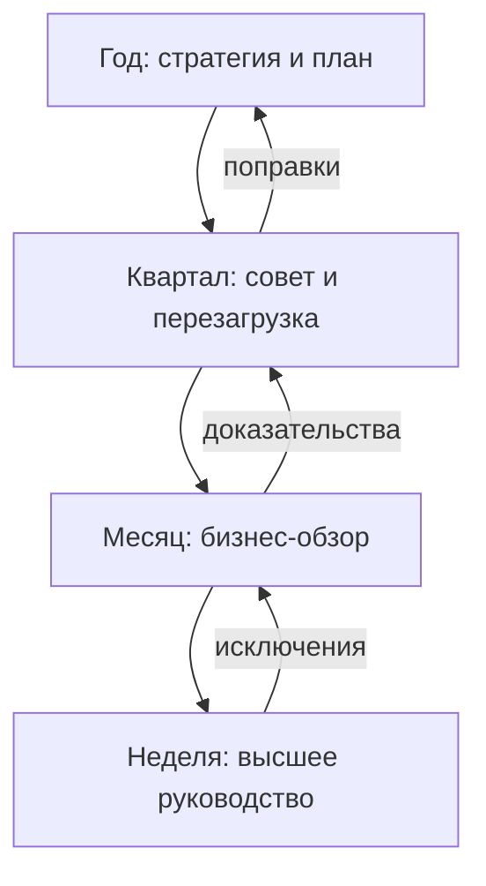
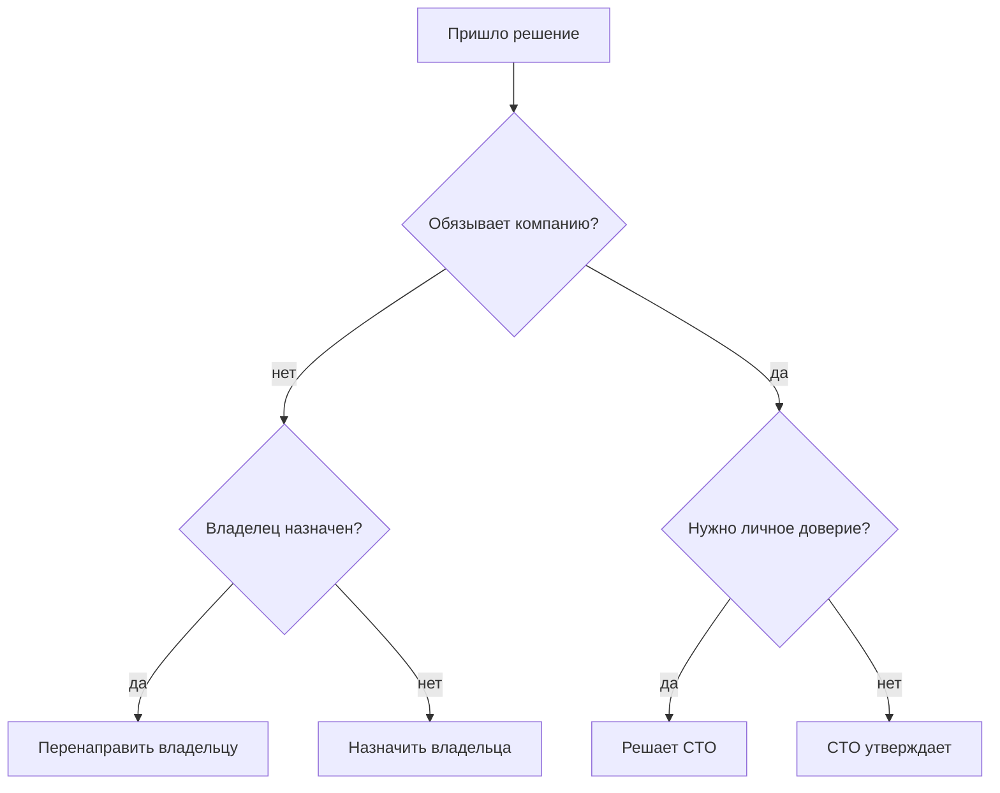

# Глава 50 — Чем на самом деле занимается CTO { #chapter-50-what-a-cto-actually-does }

Должность Chief Technology Officer (CTO, технический директор) обозначает место, а не работу. Один CTO
руководит всеми инженерами компании; у другого нет подчинённых, и он весь год проводит с клиентами. Эта
глава определяет роль через решения, которыми она владеет. В ней разобраны архетипы, раздел обязанностей
с руководителем ИТ и VP of Engineering (вице-президентом по разработке), собственная команда и ритм CTO,
а также короткий список того, что может сделать только CTO. В сквозном примере вы окажетесь на месте Victor
Lindqvist, CTO компании Northstar Technologies из вымышленного [кейса](../../case-studies/northstar/index.md)
книги, в квартале 4 первого года директора.

Связанные главы: роль VP (глава 47) и главы части XII о стратегии, финансах, рисках, данных и совете
директоров (с [51](51-enterprise-technology-strategy.md) по
[55](55-boards-due-diligence-and-executive-decision-making.md)).

## Почему это важно { #why-this-matters }

Команда ощущает CTO через технические решения: вердикт в коридоре, который отменяет её дизайн, или
стратегию, объясняющую, почему её сервис выводят из эксплуатации. Если CTO выносит вердикты
неформально, решения любой команды становятся временными.

Для организации CTO определяет, за что отвечают руководители разработки уровнем ниже, а что остаётся
наверху. Когда этот раздел не записан, директора и VP либо ждут разрешения, которое у них уже есть, либо
принимают решения, которые им никогда не принадлежали.

В высшем руководстве CTO — единственный технолог за столом, где решают, куда пойдут деньги компании,
какие риски она примет и в каком направлении будет двигаться. Если CTO тратит это место на защиту
интересов разработки или всю неделю проводит внутри неё, компания остаётся без технического суждения.
Большинство провалов CTO сводится к тому, как он распоряжается собственным временем.

## Цели главы { #learning-objectives }

Прочитав эту главу, вы сможете:

- Различать распространённые архетипы CTO и диагностировать, какой из них нужен компании, с учётом того,
  кто ещё есть в высшем руководстве.
- Делить ответственность между CTO, CIO или руководителем ИТ и VP of Engineering по правам на решения и
  находить швы, где решением никто не владеет.
- Сверять календарь CTO с решениями, которые может принять только CTO, и составлять план делегирования,
  в котором у каждого пункта назван получатель.
- Проектировать собственную команду руководителей CTO и его операционный ритм, включая форумы, на которых
  CTO присутствует, но не председательствует.
- Распознавать типичные провалы роли (теневой архитектор, отсутствующий руководитель, адвокат разработки)
  и замечать их рано.

## Ментальная модель { #the-mental-model }

> **Ментальная модель:** работа CTO — это набор технологических решений, которые может принять только
> главный технолог компании. Всё остальное письменно делегировано конкретному человеку. Какую работу
> CTO делает в действительности, показывает его календарь.

Глава строится на двух идеях.

Первая: **роль — это остаток.** Что делает CTO, зависит от того, кто ещё есть наверху. Если организацией
руководит VP of Engineering, работа CTO — то, что осталось: стратегия, доверие внешнего мира, ставки
уровня компании. Если ИТ подчиняется CFO (финансовому директору), территория CTO заканчивается на границе
продукта, и у шва между ними должен быть владелец. Архетипы описывают этот остаток в конкретной
компании, а не типы личности.

Вторая: **делегирование — главный инструмент, которым CTO проектирует свою роль, а календарь позволяет
проверить результат.** Неделя не растягивается. Peter Drucker известен советом сначала записать, куда в
действительности уходит время, и лишь потом решать, куда оно должно уходить
([Drucker, 1967](../../references/bibliography.md#drucker1967effective)); **мнение эксперта**.
Дневниковое исследование, охватившее больше тысячи CEO (генеральных директоров), не нашло единственно
правильного способа распределять неделю. Согласно аннотации, результаты компании связаны с тем,
насколько время генерального директора распределено в соответствии с её потребностями
([Bandiera et al., 2020](../../references/bibliography.md#bandiera2020ceo)). Это **научный результат** о
CEO, перенесённый на CTO по аналогии.

Петля такая. Каждое решение, которое доходит до CTO, он либо оставляет себе, либо возвращает владельцу,
либо письменно назначает ему нового владельца. Ежеквартальный аудит календаря показывает, не вернулись
ли отданные решения обратно. Решение, возвращённое один раз, — это одолжение; класс решений, который
возвращают каждый раз, меняет организацию.

## Подробный разбор { #deep-conceptual-explanation }

### Архетипы: что нужно компании наверху { #archetypes-what-the-company-needs-at-the-top }

Самая известная классификация принадлежит Tom Berray; её изложил Werner Vogels
([Vogels, 2007](../../references/bibliography.md#vogels2007ctoroles)). В ней четыре роли:

- **управляющий инфраструктурой** (infrastructure manager) ведёт инфраструктуру и эксплуатацию там, где
  технологии поддерживают бизнес;
- **технологический визионер и операционный руководитель** решает, как технологии воплощают стратегию, и
  сам же ими управляет; это типично для основателей;
- **внешний технолог** (external-facing technologist) работает на стыке ключевых клиентов и продуктовой
  организации;
- **стратегический мыслитель** (big thinker) изучает, как технологии могут создать новый бизнес, часто
  вместе с группой перспективных разработок.

Первые два обычно руководят разработкой напрямую, последние два работают рядом с командой высшего
руководства. Это **мнение эксперта**: словарь, а не проверенная модель. Исследований роли мало. Medcof
утверждает, что влияние CTO держится больше на знании бизнеса и связях, чем на экспертизе
([Medcof, 2008](../../references/bibliography.md#medcof2008cto)).

Книга добавляет пятый паттерн, который встречается в софтверных компаниях на 50–400 инженеров:
**строитель организации**. Такой CTO руководит разработкой как её высший руководитель и делегирует
техническое направление staff- и principal-инженерам. Will Larson определяет руководителя разработки
высшего уровня (engineering executive) через ответственность за всю разработку, независимо от должности
([Larson, 2023a](../../references/bibliography.md#larson2023executive-job);
[Larson, 2024](../../references/bibliography.md#larson2024primer)); **мнение эксперта**.

| Архетип | Чем владеет | Типичная компания | Что должно быть у других |
|---|---|---|---|
| Управляющий инфраструктурой | Эксплуатация, инфраструктура, внутренние системы | Технологии поддерживают бизнес, который не продаёт ПО | Владелец продуктовых технологий, если они есть |
| Визионер и операционный руководитель | Стратегия и инженерная организация | От стартапа примерно до 50 инженеров | Пока ничего; риск — охват управления у CTO |
| Строитель организации | Инженерная организация через руководителей | 50–400 инженеров без VP | Техническое направление, которое несут старшие инженеры |
| Внешний технолог | Техническое доверие клиентов и партнёров | Корпоративное ПО с крупными клиентами | Тот, кто руководит разработкой (VP или директор) |
| Стратегический мыслитель | Ставки на новые технологии, долгий горизонт | Крупные компании с финансируемыми исследованиями | VP, который отвечает за поставку; стратегия, которая финансирует ставки |

Архетип диагностируют, а не выбирают по вкусу (**рекомендация книги**). Задайте три вопроса:

1. Технологии — это сам продукт или они поддерживают продукт?
2. Кто изо дня в день руководит инженерной организацией?
3. Какая из главных проблем компании — техническая и при этом без владельца?

Ответ на третий вопрос указывает, какой архетип нужен компании в этом году, а со временем он меняется.
CTO, который при 40 инженерах верно выбрал роль операционного руководителя, при 150 в той же роли уже
ошибается, если направление больше никто не задаёт.

### CTO, CIO и VP of Engineering: раздел по правам на решения { #cto-cio-and-vp-of-engineering-splitting-by-decision-rights }

Делите роли по решениям, а не по должностям: компании очень по-разному понимают роли CTO и VP
([Larson, 2020](../../references/bibliography.md#larson2020first90)). CIO (chief information officer,
директор по информационным технологиям) или руководитель ИТ обычно отвечает за внутренние системы. Weill
изучил более 250 предприятий и рассматривает управление ИТ как распределение
[прав на решения](../../glossary.md#decision-rights)
([Weill, 2004](../../references/bibliography.md#weill2004govern)). Это **научный результат**, и его
метод применим и здесь: перечислите решения, затем назначьте владельца каждому.

Для софтверной компании, где есть все три роли, типичный раздел такой (**рекомендация книги**):

| Решение | CTO | VP of Engineering | CIO или руководитель ИТ |
|---|---|---|---|
| Направление продуктовых технологий и крупные ставки | Решает | Советует | Информирован |
| Распределение инженерного ресурса между направлениями | Задаёт рамки бюджета | Решает | — |
| Руководители разработки ниже высшего уровня | Утверждает кандидатов в VP | Решает по директорам | — |
| Внутренние бизнес-системы (финансы, HR, CRM) | Информирован | — | Решает |
| Устройства сотрудников, учётные записи, офисные сети | Информирован | — | Решает |
| Безопасность продукта и его пайплайна | Отвечает (если нет CISO) | Реализует | Делит меры защиты |
| Техническое доверие клиентов и совета директоров | Решает | Поддерживает | Поддерживает по внутренним мерам контроля |

[Рамки бюджета](../../glossary.md#budget-envelope) — общий лимит расходов, утверждённый на год; делит
его VP. [CISO](../../glossary.md#ciso) (chief information security officer, директор по
информационной безопасности) — отдельный руководитель по безопасности; если он есть, строка о
безопасности переходит к нему. Если VP нет, CTO берёт на себя и столбец VP либо явно передаёт его директору
(первая форма компании из главы 47). Если ИТ подчиняется CFO, у CTO и CFO появляются общие швы:
учётные записи и доступ, безопасность, вендоры, которые обслуживают обе стороны, и доказательства для
проверок безопасности, которые проводят клиенты. Задача таблицы — сделать каждый шов чьим-то решением.
Пустая клетка допустима, только если её оставили пустой намеренно и это записано.

### Что может только CTO { #what-only-the-cto-can-do }

Держите этот список намеренно коротким (**рекомендация книги**):

1. **Сводить взгляд компании и взгляд разработки в одну задачу.** Larson описывает руководителя
   разработки высшего уровня как человека, который прежде всего решает задачи компании, а не отстаивает
   интересы своей функции ([Larson, 2023b](../../references/bibliography.md#larson2023balancing)).
2. **Отвечать за то, чтобы технологическая стратегия соответствовала бизнес-стратегии.** Готовить её
   могут другие, но обязать компанию следовать ей может только CTO
   ([глава 51](51-enterprise-technology-strategy.md)).
3. **Принимать или утверждать технические ставки уровня компании, которые трудно отменить**: платформу,
   на которой компания будет работать десятилетие, интеграцию после поглощения, уход от вендора. Выбор на
   уровне команд, даже дорогой, остаётся за командами и архитектурным процессом
   ([глава 28](../06-technical-leadership/28-architecture-decision-making-and-governance.md)).
4. **Проектировать структуру технологического руководства и выбирать людей на верхние позиции**, в том
   числе решать, нужен ли VP (глава 47).
5. **Удерживать техническое доверие крупнейших клиентов и совета директоров.**
6. **Задавать права на решения на швах** с продуктом, ИТ, безопасностью и финансами.
7. **Отвечать на высшем уровне за технологические риски**, кто бы ни управлял мерами защиты
   ([глава 53](53-risk-governance-regulation-and-security-strategy.md)).

Всё остальное может сделать кто-то другой, и часто лучше. Aghion и Tirole разделяют формальную власть
(право решать) и реальную, которая следует за информацией
([Aghion and Tirole, 1997](../../references/bibliography.md#aghion1997formal)). CTO, который сохраняет
за собой формальную власть там, где информацией владеют другие, либо решает плохо, либо утверждает не
глядя.

### Как договориться о роли с CEO { #agreeing-the-role-with-the-ceo }

Зачем компании CTO, решает CEO, поэтому запишите это вместе с ним (**рекомендация книги**). Хватит одной
страницы: архетип, который нужен компании в этом году, список «только CTO», три-четыре результата, по
которым CEO будет вас оценивать, и то, что вы перестанете делать. Пересматривайте страницу раз в год и
всякий раз, когда меняется ответ на три диагностических вопроса: наняли VP, компания начала продавать
более крупным клиентам или совет директоров просит CTO другого типа. Договаривайтесь заново до того, как
измените распределение своей недели, а не после. CTO, который молча уходит вовне, выглядит
отсутствующим. Если же он остаётся внутри, хотя CEO попросил больше внешней работы, кажется, что он
сопротивляется. Обе проблемы дешевле решить на бумаге, чем в разговоре о результативности
(упражнение X2).

### Делегирование, которое держится { #delegation-that-holds }

Делегирование ломается двумя способами: CTO либо продолжает отвечать на вопросы, у которых уже есть
владелец, либо исчезает из решений, где нужен верх. Larson считает, что второе вредит больше первого
([Larson, 2023c](../../references/bibliography.md#larson2023micromanage)); **мнение эксперта**.

Лекарство от обоих провалов — опубликованный список классов решений, у каждого из которых есть владелец.
А затем целый квартал CTO перенаправляет каждый запрос, пришедший не по адресу, без исключений.
Перенаправление должно стать привычкой, ведь управленческая работа состоит из коротких, раздробленных и
устных эпизодов ([Mintzberg, 1990](../../references/bibliography.md#mintzberg1990job)). Большинство
решений доходит до CTO в виде двухминутного вопроса в чате, и каждый ответ учит организацию спрашивать снова.

### Собственная команда CTO и операционный ритм { #the-ctos-own-team-and-operating-rhythm }

У CTO две команды. **Первая команда** — команда высшего руководства. Вслед за Lencioni Larson называет
первой командой руководителя его коллег по уровню и замечает, что работать с ними труднее, чем
руководить подчинёнными: у коллег конфликтующие стимулы
([Larson, 2023d](../../references/bibliography.md#larson2023gelling);
[Lencioni, 2002](../../references/bibliography.md#lencioni2002five)); **мнение эксперта**. **Вторая
команда** — прямые подчинённые CTO: вице-президенты или директор, возможно, группа технического
направления.

Состав второй команды определяйте по решениям, которые она должна принимать сообща (**рекомендация
книги**). Если CTO решает, как распределить ресурс, в неё входят все, чьи направления конкурируют за
ресурс. Если главная работа — техническое направление, то старшие инженеры, которые его ведут, входят в постоянный форум
с CTO, даже если подчиняются кому-то другому.

Ритм подчиняется правилу из главы 37: у каждой петли одно место
([глава 37](../08-management-operating-system/37-cadences-and-leadership-meetings.md)). Петли CTO
длиннее директорских.

| Петля | CTO ведёт | CTO участвует, но не ведёт |
|---|---|---|
| Еженедельно | Встречи один на один с прямыми подчинёнными | Команда высшего руководства, как её участник; выборочно инженерные форумы |
| Ежемесячно | Бизнес-обзор с руководителями разработки; обзор технического направления | Обзоры с руководством крупнейших клиентов |
| Ежеквартально | Проверка стратегии; аудит календаря | Пункт повестки совета директоров; квартальная перезагрузка разработки |
| Ежегодно | Технологическая стратегия и инвестиционный план ([глава 51](51-enterprise-technology-strategy.md), [глава 52](52-technology-investment-budgeting-and-financial-literacy.md)) | Операционный план вместе с CFO |

[Операционный план](../../glossary.md#operating-plan) — утверждённый план компании на год: цели,
численность и бюджет; за него отвечают CEO и CFO.

На инженерных форумах бывайте выборочно, а не председательствуйте. CTO, который ведёт еженедельный
операционный разбор разработки, забирает себе встречу директора. Тот, кто не бывает на нём никогда,
теряет сигнал без фильтров.

## Пример из инженерной организации { #engineering-organization-example }

!!! info "Northstar: что уже известно"
    Неделя 47 первого года директора; число инцидентов [Sev1 и Sev2](../../glossary.md#severity-sev1-sev2-sev3)
    упало с 30 за квартал до 14. Открытые вопросы на второй год: предложение по организации и нужно ли
    нанимать VP of Engineering. См. [хронологию](../../case-studies/northstar/timeline.md).
    Впервые читаете о Northstar? Прочитайте [«Год вкратце»](../../case-studies/northstar/year-in-brief.md),
    [действующих лиц](../../case-studies/northstar/cast.md) и
    [брифинг квартала 4](../../case-studies/northstar/quarter-4-briefing.md).

Этот пример — вымышленная **иллюстрация**.

**Вы — Victor Lindqvist (CTO), неделя 47.** У вас один прямой подчинённый — директор по разработке,
за которым 87 мест (инженеры, руководители и сам директор). Корпоративное ИТ подчиняется Rajiv Menon
(CFO): это 14 человек под началом Marta Kowalczyk (руководитель ИТ), включая службу безопасности из двух
человек, которую возглавляет Joon Park (руководитель ИТ-безопасности). На неделе 45 вы спросили
директора, нужен ли Northstar во второй год VP of Engineering. Рекомендация ожидается на неделе 48, и вы
пока ничего не решили. Каким бы ни был ответ, вы хотите знать, какую часть вашей недели не изменит
никакая структура. Вы выгружаете свой календарь за недели 44–46 и раскладываете среднюю неделю по занятиям.

[Пакет для совета директоров](../../glossary.md#board-pack) — набор материалов, которые рассылают членам
совета перед заседанием.

**Сначала вывод.** Из ваших 48 часов 20 занимает работа, которую при любой структуре может делать только
CTO. Ещё 7 часов можно вернуть и без VP. На стратегию уходит всего 2 часа, около 4%, и именно эта
жалоба стоит за вашим вопросом на неделе 45.

| Занятие | Часов в неделю | Класс |
|---|---|---|
| Встреча команды высшего руководства и встреча один на один с Helena Marsh (CEO) | 3.0 | Только CTO |
| Встречи один на один раз в две недели с Amara Okafor (CPO), Rajiv Menon, Greg Tanaka (VP по продажам), Sofia Alvarez (VP по работе с клиентами) | 1.0 | Только CTO |
| Встреча один на один с директором | 0.5 | Только CTO |
| Технические отношения с крупнейшими клиентами | 5.0 | Только CTO |
| Подготовка к совету директоров (пункт на неделе 50, цифры для пакета) | 4.0 | Только CTO, сезонно |
| Разборы решений на год 2 (организация, продолжение, план персонала) | 4.5 | Только CTO, сезонно |
| Работа над стратегией без перерывов | 2.0 | Только CTO |
| Проверки безопасности от клиентов (черновики готовит Joon Park, вы подключаетесь к звонкам) | 2.0 | Общий шов |
| Звонки по открытым сделкам с командой Greg Tanaka | 3.5 | В основном можно делегировать |
| Созвоны по Sev1 и звонки клиентам во время инцидентов | 2.0 | Частично можно делегировать |
| Технические вердикты по вопросам в чате или в коридоре, без записи | 3.5 | Должен быть владелец |
| Инженерные форумы, где вы присутствуете (ежемесячный обзор, квартальная перезагрузка) | 1.5 | Оставить |
| Найм и внешняя работа | 1.0 | Оставить |
| Почта, администрирование, поездки | 14.5 | Накладные расходы |
| **Итого** | **48.0** | |

Первые семь строк дают в сумме 20,0 часа, четыре делегируемые строки — 11,0 часа.

**Вердикты.** За три недели до вас в обход всякого процесса дошли 11 технических вопросов. Действительно
вашими были три:

- запрос клиента из топ-40 (одного из 40 крупнейших, на которых приходится треть выручки) на выделенное
  окружение, которое изменило бы порядок эксплуатации платформы Northstar;
- технические условия продления контракта с вендором, которые затрагивают и продукт, и ИТ;
- просьба клиента из топ-40 изучить архитектурное направление Northstar перед продлением.

У шести вопросов уже был владелец согласно [пути эскалации](../../glossary.md#escalation-path),
который директор опубликовал на неделе 15. Этот путь даёт сторонам пять рабочих дней, затем вопрос переходит к
директору, а до вас доходит, только если затронуты обязательства перед клиентами или бюджетные
полномочия директора. Ещё два вопроса относились к staff-инженерам, которые владеют стандартами
пайплайна и данных: Kwame Mensah (инфраструктура) и Li Na Zhou (данные и интеграции).

Ответив на эти восемь, вы повторили бы старую ошибку: на неделе 14 ваше мимолётное замечание
предрешило открытое архитектурное решение, [ADR-0001](../../glossary.md#adr-0001)
(эту историю рассказывает [глава 51](51-enterprise-technology-strategy.md)).

**Ваш черновик списка «оставить, отдать, прекратить».**

| Пункт | Сейчас | Черновик | Получатель |
|---|---|---|---|
| Звонки по продажам | 3.5 | 1.5: только клиенты из топ-40 и сделки, меняющие дорожную карту | Директор назначает staff-инженера на каждую сделку |
| Технические вердикты | 3.5 | 1.0: только список «только CTO» | Путь эскалации и два staff-инженера; вы каждый раз перенаправляете |
| Созвоны по инцидентам | 2.0 | 1.0: только звонки с руководством клиентов | Созвон ведёт координатор инцидента |
| Проверки безопасности | 2.0 | 0.5: финальный звонок с клиентами из топ-40 | Библиотека доказательств Joon Park; Kwame Mensah предложен владельцем доказательств со стороны разработки (черновик, глава 53) |
| **Высвобождено** | | **7.0** | |

Если перенести эти 7 часов на стратегию, строка вырастет с 2 до 9 часов, около 19% недели. Это верхняя
граница: в первый квартал само делегирование отнимает время. На вопрос о VP всё это не отвечает.

## Как принимать решение { #decision-framework }

Таблица архетипов отвечает на вопрос, какая роль нужна компании. Но снова и снова решать приходится
другое: оставить ли у CTO конкретный запрос? Для этого используйте проверку (**рекомендация книги**).

| Вопрос или исход | Что это значит |
|---|---|
| Обязывает компанию? | Выходит за пределы разработки, действует дольше примерно года или трудно отменимо |
| Нужно личное доверие? | CEO, совет директоров или крупный клиент спросят лично с CTO |
| CTO утверждает | Кто-то другой готовит и рекомендует; CTO подписывает или возвращает, объяснив причину |
| Назначить владельца | У класса решений нет места: CTO письменно назначает владельца и записывает это в журнал |
| Перенаправить владельцу | Скажите, кто решает и где это записано; не высказывайте мнения, которое можно принять за вердикт |

## Компромиссы { #trade-offs }

**Внутрь или вовне.** CTO, обращённый внутрь, держит техническое суждение близко к поставке, но для
клиентов и совета директоров голос технологий звучит слабее. CTO, обращённому вовне, нужен человек,
который руководит разработкой, а это обходится в одно место в штате или требует письменного
делегирования (глава 47).

**Один подчинённый или несколько.** Один прямой подчинённый, как в Northstar, даёт ясную цепочку и время
на внешнюю работу, но тогда почти всё, что CTO знает о разработке, идёт через одного человека. Больше
подчинённых — шире сигнал, но дороже управленческое время.

**Владеть ИТ или нет.** Если CTO владеет корпоративным ИТ, шов между продуктом и ИТ исчезает, но
внимание уходит на ноутбуки и финансовые системы. Если ИТ остаётся у CFO, CTO сохраняет фокус, но каждое
общее решение превращается в переговоры, пока права на решения не записаны.

**Выносить вердикт или перенаправлять.** Неформальный вердикт экономит дни на одном решении, а платят за
него процессом, которому люди могли бы доверять. Перенаправлять в первый раз медленнее, зато к третьему
разу дешевле.

## Типичные провалы { #failure-modes }

**Теневой архитектор.** CTO в разговорах выносит вердикты, которые перекрывают архитектурный процесс.
Признак: команды ссылаются на «CTO сказал», а в журнале таких решений никто найти не может. Как
заметить: три недели считайте запросы, которые доходят до CTO в обход всякого процесса, как сделал
Victor.

**Отсутствующий руководитель.** CTO уходит вовне и перестаёт смотреть внутрь, зная разработку только по
сводкам одного подчинённого. Признак: о серьёзном инциденте или о чьём-то увольнении по собственному
желанию CTO узнаёт от CEO.

**Адвокат разработки.** CTO отстаивает долю разработки, а не лучший ответ для компании. Признак: коллеги
заранее договариваются с подчинёнными CTO, а CEO перестаёт спрашивать CTO о чём-либо за пределами
разработки.

**Отставание архетипа.** CTO продолжает делать работу, которая была правильной три года назад: всё ещё
пишет код при 150 инженерах или по-прежнему сам руководит каждым руководителем после прихода VP.
Признак: VP или директор не может назвать ни одного решения, которое целиком за ним.

**Бесхозный шов.** Безопасность, учётные записи или доказательства для клиентов оказываются между CTO и
руководителем ИТ, и каждый считает, что ими владеет другой. Признак: две службы по-разному отвечают на
один и тот же опросник клиента.

## Применение в крупной организации { #enterprise-application }

В организации на 50–150 инженеров роль CTO обычно устроена как в Northstar: один директор или несколько
руководителей руководителей, VP нет. Для этого размера характерны две вещи.

Во-первых, staff-инженеры подчиняются через директора, поэтому прямой линии к техническому направлению у
CTO нет. Ежемесячный обзор технического направления, который CTO проводит с директором и
staff-инженерами, даёт направлению своё место, не создавая второй линии подчинения (роль staff-инженера
разбирает [глава 29](../06-technical-leadership/29-staff-and-principal-engineers.md)).

Во-вторых, без VP всё делегирование сводится к разделу обязанностей с директором. Запишите, какие решения
уровня VP остаются за директором: распределение ресурса вместе с руководителем продукта, подбор
руководителей, операционный ритм.

Примерный ориентир для календаря при таком размере (**иллюстрация**): не меньше пятой части недели на
несезонную работу, которую может делать только CTO. Никакого постоянного председательства на
еженедельном внутреннем форуме разработки. Ежеквартальный аудит — и чтобы он действительно проводился.

## Взгляд CTO { #cto-perspective }

Этот раздел о том, как меняется роль, когда компания перерастает размер Northstar. В Halvard Systems,
вымышленной компании на 500 инженеров из
[главы 35](../07-organization-design/35-designing-organizations-at-four-scales.md), у CTO пять
вице-президентов (четыре продуктовые группы и платформенная организация). Вторая команда — эти пять VP,
а архетип — строитель организации: распределение ресурса между группами, выбор вице-президентов и ставки,
затрагивающие несколько групп. Техническое направление проводят через семь principal-инженеров и шесть
корпоративных политик. Неформальный вердикт CTO в Halvard выходит за границы групп, и ущерб от него в
шесть раз масштабнее.

По мере роста компании время CTO смещается от самих решений к тому, чтобы определять, кто их принимает.
Список «только CTO» остаётся коротким, но каждый пункт в нём становится весомее. Первая команда важнее второй,
потому что влиять на капитал и риски приходится среди коллег и в работе с советом директоров. Советы на
первые 90 дней, приведённые ниже (разберитесь в деньгах, заранее выстройте отношения с коллегами),
становятся самой работой, а не онбордингом.

### Устойчивость самого руководителя { #the-executives-own-sustainability }

Над CTO никто не следит за его нагрузкой, поэтому следить придётся ему самому (**рекомендация книги**).
Аудит календаря — заодно и проверка здоровья. В 48-часовой неделе Victor было 14,5 часа накладных
расходов и 2 часа стратегии: таков профиль человека, который живёт в режиме реакции. Внимания заслуживают
три сигнала: недели, которые целый квартал держатся выше примерно 50 часов; время на стратегию, которое
раз за разом проигрывает почте; решения, которые вы теперь откладываете из-за усталости, а не из-за
нехватки данных. Помогают три привычки. Делегируйте не только ради развития людей, но и ради
собственного ресурса: каждый пункт списка «оставить, отдать, прекратить» возвращает часы. Защищайте один
блок в неделю, который не может занять ни один запрос. Поддерживайте сеть коллег вне компании (другие CTO,
бывший руководитель), чтобы было с кем обсудить то, что нельзя обсуждать со своей командой или с CEO.
Измотанный CTO хуже принимает именно те решения, которые эта глава оставляет за верхом, а организация
начинает работать так же долго, как он.

## Практический плейбук { #practical-playbook }

1. **Запишите список «только CTO»**: не больше семи классов решений, и для каждого — причина, по которой
   он остаётся у вас.
2. **Назовите архетип, который нужен компании в этом году**, исходя из трёх диагностических вопросов, и
   то, что должно быть у других, чтобы он работал.
3. **Составьте таблицу прав на решения** вместе с VP или директором и руководителем ИТ: один владелец на
   строку, намеренно пустые клетки помечены. Перечислите швы с ИТ (учётные записи, инструменты
   безопасности, доказательства для проверок безопасности клиентами, общие вендоры) и назначьте каждому
   владельца, прежде чем думать о переводе ИТ.
4. **Проведите аудит трёх недель календаря**, разложив время по классам: только CTO, сезонное,
   делегируемое, должно иметь владельца.
5. **Посчитайте неформальные запросы** за те же недели: кто спросил, о чём и кто должен был решать.
6. **Подготовьте черновик списка «оставить, отдать, прекратить»**, где у каждого отданного пункта есть
   названный и введённый в курс дела получатель.
7. **Целый квартал перенаправляйте каждый запрос, пришедший не по адресу**, называя владельца, и
   записывайте классы решений, у которых владельца нет.
8. **Спроектируйте ритм**: что вы ведёте, где участвуете, не ведя, и одно место для каждой петли.
9. **Повторяйте аудит ежеквартально** и пересматривайте список, когда меняется нужный компании архетип.
   Чтобы оценить CTO по роли, а не по календарю, используйте
   [матрицу компетенций CTO](../../templates/cto-competency-matrix.md).

### Первые 90 дней CTO { #a-ctos-first-90-days }

Первый квартал нового CTO должен дать понимание и несколько письменных договорённостей, а не программу
изменений. Larson советует новым CTO и VP of Engineering разобраться, как бизнес зарабатывает и тратит
деньги, выстроить отношения с коллегами до того, как возникнет конфликт, получить ожидания своего
руководителя в письменном виде и ограничить число одновременных изменений. Он также предупреждает: если
новый руководитель мимоходом высказывает множество мнений, начинаются метания
([Larson, 2020](../../references/bibliography.md#larson2020first90); **мнение эксперта**).
Последовательность, которую предлагает книга, переводит эти советы на язык инструментов главы:

| Дни | Цель | Результат |
|---|---|---|
| 1–30 | Слушать и измерять | Встречи один на один со всеми коллегами в руководстве и прямыми подчинёнными; встречи через уровень; финансовый план компании, прочитанный вместе с CFO; записанные три недели собственного календаря |
| 31–60 | Записать то, что есть | Как на самом деле сегодня принимаются важные технические решения; неявная технологическая стратегия; архетип, который нужен компании (три вопроса); черновик таблицы прав на решения |
| 61–90 | Договориться и начать | Ожидания CEO в письменном виде; таблица прав на решения, согласованная с коллегами; список «только CTO»; ваш операционный ритм (встречи один на один, письменные отчёты, обзор найма, возможно, еженедельный операционный разбор); начато не больше двух изменений |

Ловушек, характерных именно для первого квартала, две. Первая — ранние вердикты. В первый месяц к
новому CTO несут любой вопрос, и каждый ответ становится прецедентом раньше, чем вы узнаете, кто
должен этим вопросом владеть. Спрашивайте: «Кто решает это сегодня?» — и записывайте ответ. Вторая
ловушка — унаследовать календарь предшественника. CTO, который занимает место предшественника во всех
его форумах, по умолчанию становится тем же архетипом. Походите на эти форумы месяц, а потом решите, какие оставить
(упражнение A3).

## Кейс { #case-study }

Этот кейс **вымышлен**, действие происходит в Northstar в квартале 4. Исход открыт.

**Шов.** В Northstar нет CISO. У компании нет отчёта [SOC 2](../../glossary.md#soc-2), то есть проверки
мер контроля независимым аудитором, которую часто требуют крупные клиенты. Служба безопасности Joon Park
находится в корпоративном ИТ под началом Marta Kowalczyk, которая подчиняется Rajiv Menon. Безопасность
продукта обеспечивается через пайплайн разработки: сканирование зависимостей, уровни сервиса по
устранению уязвимостей и доля безопасности в
[выделении на профилактику](../../glossary.md#prevention-allocation)
([глава 26](../05-engineering-quality/26-security-and-software-supply-chain-quality.md)). Опросники по
безопасности клиенты присылают CTO. На неделях 44–46 Victor тратил на них около 2 часов в неделю: Joon
Park готовил черновики ответов по записям ИТ, разработка поставляла доказательства от случая к случаю, а
Victor подключался к звонкам.

**Общие решения.** На неделе 47 Victor составил список решений, которые затрагивают и его, и
организацию Rajiv.

| Решение | Кто решает сегодня | Владелец по черновику Victor |
|---|---|---|
| Учётные записи и доступ к производственным системам | Неясно: ИТ ведёт каталог, разработка выдаёт роли в продакшене | ИТ ведёт каталог; директор отвечает за выдачу ролей в продакшене |
| Контракты с вендорами, которые обслуживают и продукт, и внутренние системы | Тот, кто подписывает первым | Владелец бюджета с письменным техническим согласованием другой стороны |
| Опросники клиентов по безопасности и доказательства | Victor, по умолчанию | Черновик стратегии безопасности, подготовленный директором на неделе 47, предлагает библиотеку доказательств во владении Joon Park, а владельцем доказательств со стороны разработки — Kwame Mensah; не решено |
| Инструменты безопасности продукта в пайплайне | Разработка | Разработка, без изменений |
| Внутренние бизнес-системы | ИТ | ИТ, без изменений |

**Что рассматривает Victor.** Три варианта, ни один не выбран:

1. **Сохранить структуру и написать таблицу.** ИТ остаётся у CFO, у швов появляются владельцы, Victor
   обсуждает таблицу с Rajiv. Самый дешёвый вариант, но он держится на том, что два руководителя будут
   соблюдать одну страницу.
2. **Перевести ИТ под CTO.** Это убирает шов. Но CTO, который пытается вернуть время для стратегии,
   получает ещё 14 человек и корпоративные системы, а Rajiv лишается организации, которую не предлагал
   отдавать.
3. **Дождаться проекта по рискам и безопасности.** Оставить строку об опросниках нерешённой до сессии
   [комитета по аудиту](../../glossary.md#audit-committee) (комитета совета директоров, который надзирает
   за рисками) по технологическим рискам на неделе 50. Дождаться также открытого решения о том, кому
   подчиняется безопасность ([глава 53](53-risk-governance-regulation-and-security-strategy.md)), а пока
   продолжать отвечать на опросники.

**Почему это трудно.** У Victor в этом месяце уже открыты три структурных вопроса. Рекомендация по VP
приходит на неделе 48. Совет директоров собирается на неделе 50. Предложение по организации второго
года, если его одобрят, объявят на неделе 51 (всё это есть в
[брифинге квартала 4](../../case-studies/northstar/quarter-4-briefing.md)). Поднять сейчас с CFO вопрос
о подчинении ИТ — значит добавить четвёртый. Не поднимать — значит оставить Victor отвечать на опросники
по умолчанию, то есть делать ту работу, которую, по его же аудиту, ему делать не следует.

**Решать читателю:** какой вариант выбрать Victor, что и когда сказать Rajiv Menon с учётом других
открытых решений и какие доказательства заставили бы его изменить курс.

## Упражнения { #exercises }

Разборы упражнений: [решения к главе 50](../../solutions/ch50-solutions.md).

### Базовый уровень { #foundational }

**F1.** В софтверной компании на 120 инженеров есть CTO-основатель, который напрямую руководит четырьмя
руководителями разработки, есть CPO (директор по продукту), а ИТ подчиняется CFO. CTO почти каждое
утро проводит на дизайн-ревью, и только он утверждает изменения схемы базы данных. CEO хочет, чтобы CTO
больше встречался с клиентами. Опираясь на три диагностических вопроса, назовите архетип, который нужен
компании, скажите, что должно быть у других, чтобы он работал, и какое занятие стоит отдать первым.

**F2.** Возьмите календарь Victor Lindqvist за недели 44–46 и заново классифицируйте каждую строку для
типичной недели квартала 5, когда решения на второй год и заседание совета на неделе 50 уже позади.
Скажите, какие часы исчезают, какие растут и какую долю недели тогда составляет работа, которую может
делать только CTO. Покажите арифметику и каждое допущение, которое вы добавляете.

**F3.** Составьте таблицу прав на решения для компании на 90 инженеров, где есть CTO, VP of Engineering и
руководитель ИТ, подчиняющийся CFO; в таблице должно быть не меньше шести решений. Отметьте швы, где
решение делят две роли, назначьте каждому шву одного владельца и укажите строку, которую, по-вашему,
оспорят первой, с объяснением почему.

### Прикладное лидерство { #applied-leadership }

**A1.** Вы — директор по разработке в Northstar, неделя 47. Victor Lindqvist показывает вам черновик
списка «оставить, отдать, прекратить» и просит назначить staff-инженера на каждую открытую сделку, чтобы
тот участвовал в звонках по продажам. У Ines Carvalho (домен Core), Kwame Mensah и Li Na Zhou уже есть
постоянные области ответственности и обязательства на квартал 4. Решите, принимать ли работу в
предложенном виде, и напишите, что вы скажете Victor, в том числе что вам нужно от него.

**A2.** Из 11 неформальных запросов, которые насчитал Victor, три были его, шесть относились к пути
эскалации директора и два — к staff-инженерам, которые владеют стандартами пайплайна и данных.
Спроектируйте, как Victor будет перенаправлять запросы каждой группы: какими словами, что он записывает
и как поступает с тем, кто спрашивает второй раз. Объясните, как через квартал понять, сработало ли
перенаправление.

**A3.** Новый CTO приходит в компанию на 150 инженеров, где прежний CTO лично вёл еженедельный
операционный разбор, архитектурное ревью и разбор инцидентов. Организацией руководят два директора.
Спроектируйте ритм нового CTO на первые два квартала: что вести, где участвовать, не ведя, что
прекратить и как передать каждый форум, не создав впечатления, что вы отстраняетесь.

**A4.** Вы приходите на должность CTO в софтверную компанию на 70 инженеров. Там один директор по разработке, VP нет,
есть CPO и CFO, которому подчиняется ИТ. Ваш предшественник ушёл внезапно; CEO говорит только, что
«разработка должна быть предсказуемее» и что на пятый месяц приходится продление контракта с крупным
клиентом. В первую же неделю два staff-инженера спрашивают, одобрите ли вы миграцию базы данных, о
которой они спорят уже год. Напишите свой план на 90 дней в виде таблицы на одну страницу, скажите, что
вы ответите staff-инженерам, назовите два изменения, которые позволите себе начать, и объясните, почему
именно эти два.

### Решения на уровне руководства { #executive-decision-making }

**X1.** Вы — Victor Lindqvist на неделе 47, и перед вами три варианта из кейса для шва между
безопасностью и ИТ. Выберите один и напишите записку на полстраницы, которую отправили бы Rajiv Menon.
Решите проблему последовательности: рекомендация по VP ожидается на неделе 48, а совет директоров
собирается на неделе 50. Организация второго года ещё не утверждена, и если её одобрят, объявление
запланировано на неделю 51. Скажите, во что вам нужно было бы поверить, чтобы перевод ИТ под CTO
оказался правильным.

**X2.** Предположим (в хронике Northstar этого нет), что Helena Marsh (CEO) говорит
Victor: совет директоров хочет в следующем году «более стратегического CTO», — и просит его тратить
половину недели на клиентов и совет. Опираясь на таблицу архетипов, объясните, что это означает для
того, кто руководит разработкой, чего это стоит, какие занятия Victor должен отдать и кому, и что вы
сказали бы Helena о рисках. VP занял бы одно из 87 мест. Вопрос о VP, назначенный на неделю 48, не
решайте; покажите, как от него зависит ваш ответ.

## Вопросы для размышления { #reflection-questions }

1. Если бы вы выгрузили свой календарь за последние три недели, какую долю в нём заняла бы работа,
   которую может делать только человек на вашем месте? Какую долю вы назвали бы, не заглядывая в
   календарь?
2. Какие решения вам приносят, хотя у них уже есть владелец, и почему их продолжают приносить?
3. Под какой архетип проектировалась ваша нынешняя роль и нужен ли компании этот архетип в этом году?
4. Где решение из вашей области оказывается между двумя руководителями и записал ли это кто-нибудь
   из вас?
5. Когда вы в последний раз отстаивали на встрече руководства ответ, который чего-то стоил разработке?

## Главное { #key-takeaways }

- Определяйте роль CTO через решения, которыми она владеет; сама должность почти ничего не говорит.
- Диагностируйте архетип по тому, кто ещё есть наверху и у какой главной проблемы нет владельца;
  ожидайте, что по мере роста компании нужный архетип изменится.
- Делите обязанности CTO, VP и ИТ по правам на решения, с одним записанным владельцем на каждый шов.
- Держите список «только CTO» коротким: технологическая задача компании, соответствие стратегий, ставки
  уровня компании, структура руководства, доверие крупнейших клиентов и совета директоров, швы и
  технологические риски.
- Проводите аудит календаря ежеквартально: CTO, у которого на стратегию уходит 4% недели, по сути
  отдал стратегию в никуда.
- Каждое решение, пришедшее не по адресу, всякий раз перенаправляйте владельцу: неформальные вердикты
  делают решения всех команд временными.
- Команда высшего руководства — первая команда, прямые подчинённые — вторая; в форумы можно включать
  людей, не меняя их подчинения.
- Ведите немного форумов, выборочно бывайте на остальных и никогда не путайте дистанцию с делегированием.

## Источники и что почитать { #references-and-further-reading }

- [Drucker, 1967](../../references/bibliography.md#drucker1967effective). *The Effective Executive*
  («Эффективный руководитель»). Как узнать, куда уходит время руководителя.
- [Bandiera et al., 2020](../../references/bibliography.md#bandiera2020ceo). Как CEO распределяют время,
  по дневниковым данным, и соответствие между руководителем и компанией.
- [Vogels, 2007](../../references/bibliography.md#vogels2007ctoroles). Четыре роли CTO, которые
  приписывают Tom Berray.
- [Medcof, 2008](../../references/bibliography.md#medcof2008cto). Источники влияния CTO помимо экспертизы
  и должности.
- [Weill, 2004](../../references/bibliography.md#weill2004govern). Управление ИТ как распределение прав на
  решения.
- [Aghion and Tirole, 1997](../../references/bibliography.md#aghion1997formal). Формальная и реальная
  власть.
- [Larson, 2024](../../references/bibliography.md#larson2024primer). Работа руководителя разработки
  высшего уровня.
- [Larson, 2023a](../../references/bibliography.md#larson2023executive-job). Руководителя высшего уровня
  определяет ответственность, а не должность.
- [Larson, 2023b](../../references/bibliography.md#larson2023balancing). Руководитель, для которого
  компания на первом месте.
- [Larson, 2023c](../../references/bibliography.md#larson2023micromanage). Отстранённость как худший из
  двух провалов.
- [Larson, 2023d](../../references/bibliography.md#larson2023gelling). Команда высшего руководства как
  первая команда.
- [Larson, 2020](../../references/bibliography.md#larson2020first90). Первые 90 дней в роли CTO или VP of
  Engineering.
- [Mintzberg, 1990](../../references/bibliography.md#mintzberg1990job). Раздроблённая реальность
  управленческой работы.
- [Lencioni, 2002](../../references/bibliography.md#lencioni2002five). *The Five Dysfunctions of a Team*
  («Пять пороков команды»). Коллеги как первая команда.
- [Fournier, 2017](../../references/bibliography.md#fournier2017manager). *The Manager's Path*. Известна
  тем, что прослеживает управленческую карьеру вплоть до высших руководящих ролей, включая CTO.
