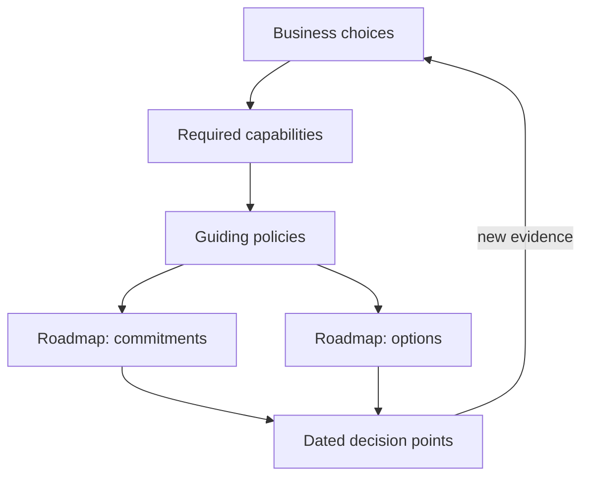
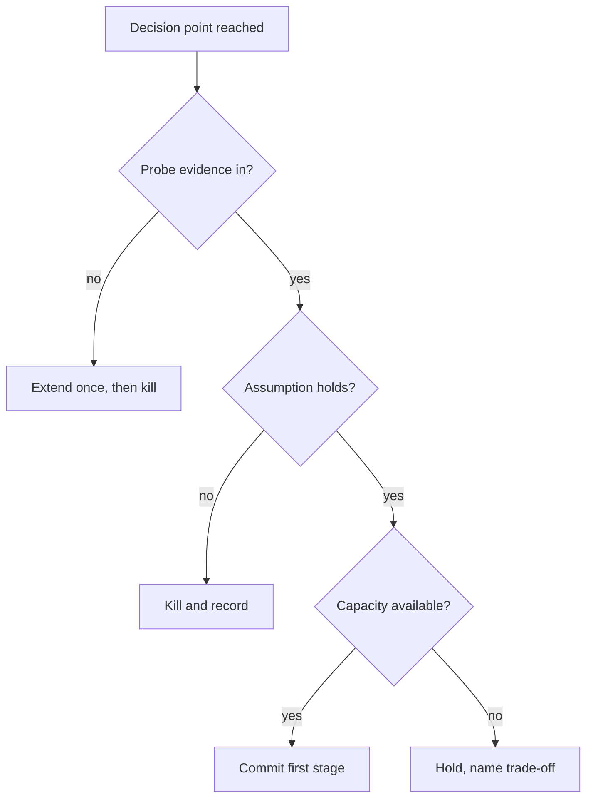
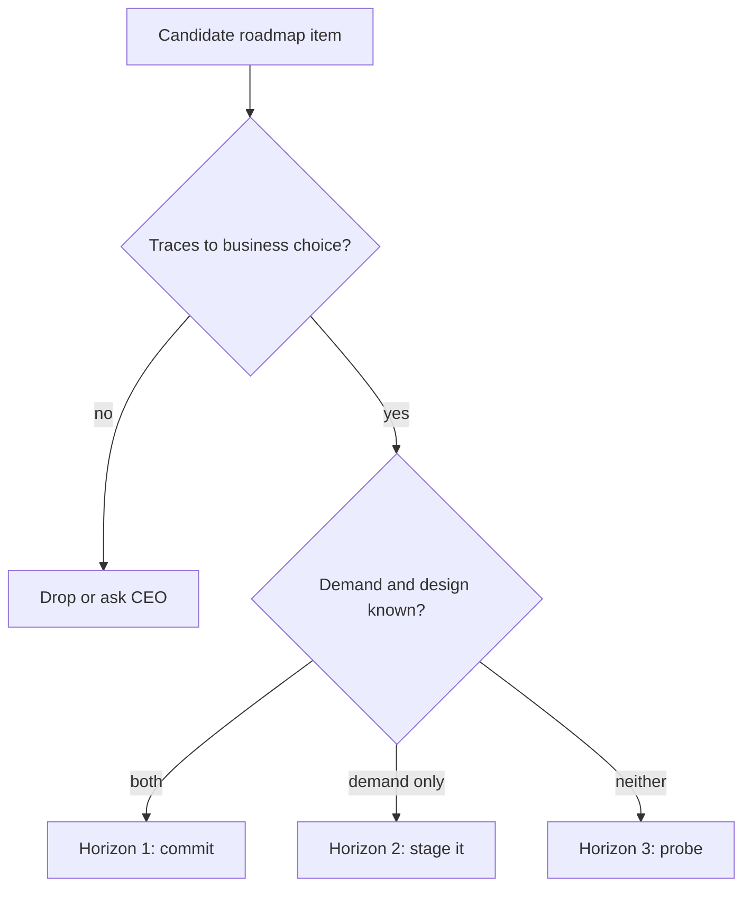

# Chapter 51 — Enterprise Technology Strategy and the Three-Year Roadmap

A director's technical strategy decides how the engineering organization builds. A CTO's technology
strategy decides what technology the company must be excellent at for its business strategy to work,
and what it will accept being merely adequate at. This chapter shows how to derive that strategy from
the business. It then turns the strategy into a three-year roadmap of commitments, options, and dated
decision points, and tests it for coherence before anyone funds it. The running example is Victor
Lindqvist, CTO of the fictional [Northstar Technologies](../../case-studies/northstar/index.md),
drafting a three-year technology strategy in weeks 46 to 49 for the week 50 board meeting.

Related chapters: [30](../06-technical-leadership/30-technical-strategy-and-technology-selection.md)
(director-level strategy, technology selection, build versus buy),
[45](../10-business-leadership/45-business-models-and-engineering-economics.md) (cost of delay, real
options), [49](../11-vp-engineering/49-multi-year-transformation-communication-and-politics.md) (staged
programs, executive communication).

## Why This Matters

At team scale, technology choices are local: a library, a queue, a test framework. A bad choice costs a
team a quarter.

At organization scale, technology choices accumulate into an estate (every system, tool, and codebase
the company runs) that every team depends on: four build systems, a monolith whose framework is out of support, integrations that read another team's tables. A
director can set policies for that estate but cannot decide what the company is trying to win at, and so
cannot say which parts deserve excellence and which only maintenance.

At executive scale, the question becomes whether the company's technology makes its business strategy
possible, and at what cost. Only the CTO can answer it. A CTO without a written technology strategy still
has one: the sum of whichever requests reached engineering first. The board learns what it was when a
renewal is lost or an acquirer's due diligence finds it.

## Learning Objectives

After this chapter you will be able to:

- Derive a technology strategy from the business strategy, with explicit choices about where to be
  excellent, where to be adequate, what to buy, and what not to do.
- Build a three-year roadmap that separates commitments from options, sorts work into horizons by kind
  of bet, and fixes the dates when each option will be decided.
- Fund the roadmap inside a capacity envelope and state what happens to it in a bad year.
- Test a draft strategy for coherence, for genericity, and for what it says no to.
- Present the strategy to executives and a board as a set of choices, not as a plan to be approved line
  by line.

## The Mental Model

> **Mental model:** A technology strategy is a short chain of choices. It runs from the business's
> choices about where to play and how to win, to the capabilities those choices require, to the few
> policies that protect them. It ends in a roadmap of commitments and options, each with the date it will
> be decided. Every link traces to the one above, and the chain says no to something someone wants.

| Link | Question it answers | Typical failure |
|---|---|---|
| Business choices | Where does the company compete, and why does it win there? | Not written down; the CTO guesses |
| Required capabilities | What must technology be excellent at for that to work? | Everything is "strategic" |
| Guiding policies | Which rules make later decisions consistent? | Values with no cost |
| Commitments and options | What is funded now, and what is only prepared? | Three years of commitments |
| Decision points | When, on what evidence, is each option exercised or dropped? | Dates without evidence, or neither |

Two ideas organize the rest. First, the strategy is derived, not invented: if the CTO cannot state the
business choices it serves, it is a wish list. Second, a three-year roadmap is mostly options. Only the
first year is committed in detail; years two and three depend on evidence that does not yet exist, so the
roadmap's real content is the decision calendar.

## Deep Conceptual Explanation

### From business strategy to technology choices

Strategy is a cascade of linked choices, and the last links are largely technology. Lafley and Martin
are known for describing that cascade: a winning aspiration, where to play, how to win, the
capabilities required, and the management systems that sustain them
([Lafley and Martin, 2013](../../references/bibliography.md#lafley2013playing)). Rumelt's kernel of
diagnosis, guiding policy, and coherent action
([Rumelt, 2011](../../references/bibliography.md#rumelt2011good)) then structures the technology part,
as Chapter 30 shows for a director. Both are **expert opinion**.

Being reliable is not a strategy. Porter argues that operational effectiveness, doing the same things
better, is necessary but is not strategy; strategy is choosing what not to do
([Porter, 1996](../../references/bibliography.md#porter1996strategy); **expert opinion**). Meeting a
contractual availability target is necessary and expensive, but no customer chooses you over a competitor
that also meets it. "Be reliable, modernize, use data" describes good operations, not choices.

The derivation works in four steps, each producing a short list:

1. **State the business choices** in the CEO's words: target customers, the reason they buy, how the
   company intends to grow. If they are not written, write your reading and ask the CEO to correct it.
   The correction is the most valuable thing you will get.
2. **Derive required capabilities**: what technology must do, at what level, for those choices to
   hold. "Invoices are correct and payments reach a final state" is a capability; "microservices" is not.
3. **Sort every significant technology area** into four bins: *excellent* (differentiating; build and
   invest above parity), *adequate* (parity with competitors; standardize and keep current), *buy*
   (commodity or externally driven; contract it), and *not doing* (ruled out for the strategy's life).
4. **Write two to four guiding policies** that protect the excellent bin and keep the adequate bin
   cheap.

The four bins force Porter's trade-offs. McKinley's "innovation tokens" make the same point at
engineering scale: spend scarce attention on new technology only where it differentiates
([McKinley, 2015](../../references/bibliography.md#mckinley2015boring); **expert opinion**).

### What the research on alignment supports

Fit between technology and business strategy seems to pay, mainly by making the firm quicker to
respond. After years of conflicting results, the better studies link alignment to performance through
agility ([Gerow et al., 2014](../../references/bibliography.md#gerow2014alignment); see also
[Chan and Reich, 2007](../../references/bibliography.md#chan2007alignment) and
[Tallon and Pinsonneault, 2011](../../references/bibliography.md#tallon2011alignment)). These are
correlational **research findings**: they do not show that writing a strategy causes anything. The
practical reading (**this book's recommendation**): buy the ability to change course as deliberately as
you buy fit to today's plan.

### Deliberate and emergent strategy

The CTO's strategy is the deliberate part, and it must leave room for the emergent part
([Mintzberg and Waters, 1985](../../references/bibliography.md#mintzberg1985deliberate)). In a technology
organization, emergent strategy is what the estate becomes through hundreds of team-level decisions.
Revise the deliberate strategy when emergent patterns show a better direction: three teams independently
adopting the same event-based integration is evidence worth considering.

### Horizons as kinds of bet, not as years

Horizons should describe how much is known, not when work happens. The three
[horizons](../../glossary.md#horizons) of growth are improving the existing business, extending it to new
customers or markets, and creating options for the future
([Baghai et al., 1999](../../references/bibliography.md#baghai1999alchemy)). Many organizations tied each
to a delivery window. Blank argues the time element no longer holds, because a horizon 3 idea can now ship
as fast as a horizon 1 improvement
([Blank, 2019](../../references/bibliography.md#blank2019flaw); **expert opinion**). This book keeps the
categories and drops the time element:

| Horizon | Kind of bet | What is known | How it is funded |
|---|---|---|---|
| 1. Strengthen | Today's platform for today's customers | Demand and design | Committed for the year, in detail |
| 2. Extend | Existing capabilities for adjacent needs | Demand, not the design or size | Committed in stages, each with a gate |
| 3. Explore | Options on futures that may not arrive | Neither demand nor design | Small probes with kill criteria |

All three horizons start in year one. A roadmap that schedules horizon 3 for year three has confused
"uncertain" with "later", and it will reach year three with no information.

### Commitments, options, and decision points

Every item beyond the first year's commitments is an option, and an option needs four fields. The idea
combines Chapter 45's real options
([Dixit and Pindyck, 1994](../../references/bibliography.md#dixit1994investment)), discovery-driven
planning's tested assumptions
([McGrath and MacMillan, 1995](../../references/bibliography.md#mcgrath1995discovery)), and the split
between reversible and irreversible decisions
([Bezos, 2017](../../references/bibliography.md#bezos2016letter)).

| Field | Content |
|---|---|
| Assumption | What must be true for this to be worth doing |
| Probe | The cheapest work that tests the assumption, with its cost |
| Decision point | A date, the evidence expected by then, and who decides |
| Kill criterion | The evidence that ends the option, written now |

Use the layered technology roadmap, which links market drivers, products, and technologies on one time
axis ([Phaal et al., 2004](../../references/bibliography.md#phaal2004roadmapping)), and add a fourth
layer: the decision calendar. A roadmap without one is read as a promise.

| Branch | Rule (this book's recommendation) |
|---|---|
| No evidence by the date | One extension, with a new date; a second miss kills the option |
| Assumption fails | Kill it and record why, so it is not reopened without new evidence |
| Assumption holds, no capacity | The CTO names what would be displaced and takes the choice to the executive team |
| Assumption holds, capacity exists | Commit one stage, as in Chapter 49, not the whole investment |

### Coherence tests

A draft strategy should pass seven tests before it reaches executives (**this book's recommendation**,
adapted from Rumelt, Porter, and
[Larson, 2023](../../references/bibliography.md#larson2023engstrategy)).

1. **Trace.** Every capability, policy, and roadmap item traces to a business choice. Orphans are
   either missing business choices or pet projects.
2. **Says no.** The "not doing" list contains at least two things that a named executive or customer
   wants.
3. **Genericity.** Replace the company's name with a competitor's. If the document still reads true,
   it is not a strategy.
4. **Arithmetic.** The roadmap fits the capacity envelope in every year, with the assumptions stated.
5. **Stress.** The strategy says what gives way in a bad year, and it is not the excellent bin.
6. **Reinforcement.** No two commitments compete for the same scarce people.
7. **Premortem.** Assume the plan has failed and ask the people who will execute it why. Klein's
   premortem surfaces reservations people would otherwise keep to themselves
   ([Klein, 2007](../../references/bibliography.md#klein2007premortem); **expert opinion**).

The arithmetic and stress tests catch the optimism that three-year estimates attract
([Flyvbjerg, 2006](../../references/bibliography.md#flyvbjerg2006nobel)).

## Engineering Organization Example

!!! info "Northstar so far"
    Week 46 of the director's first year. [Unplanned work](../../glossary.md#unplanned-work) fell from
    34 to 25 percent of capacity; the year-2 proposals are drafted and none is decided. See the
    [timeline](../../case-studies/northstar/timeline.md).
    New to Northstar? Read [the year in brief](../../case-studies/northstar/year-in-brief.md), the
    [cast](../../case-studies/northstar/cast.md), and the
    [quarter 4 briefing](../../case-studies/northstar/quarter-4-briefing.md).

Northstar's three-year allocation shows how a strategy funds growth without headcount. The figures are
**illustrative**. Assumptions:

- The planning basis is 79 engineers. It is open and could move by one either way, depending on
  undecided year-2 choices.
- One engineer-year costs $185,000, Northstar's [fully loaded cost](../../glossary.md#fully-loaded-cost).
- Year 2 runs from week 53 to week 104, year 3 to week 156, year 4 to week 208.
- Prevention in year 2 averages 5.5 [FTE](../../glossary.md#fte) (full-time equivalent engineers),
  the mean of [the continuation](../../glossary.md#the-continuation)'s quarterly 6, 6, 5, and 5. The
  continuation is the director's proposal to keep funding the quality program in stages.
- Platform keeps quarter 3's 4.5 FTE.

Victor's draft allocation, in FTE averaged over each year:

| Line | Horizon | Year 2 | Year 3 | Year 4 |
|---|---|---|---|---|
| Unplanned work | 1 | 17.4 (22%) | 14.2 (18%) | 12.6 (16%) |
| Prevention | 1 | 5.5 | 3.0 | 3.0 |
| Platform | 1 | 4.5 | 5.0 | 5.0 |
| Estate currency (framework, libraries) | 1 | 2.0 | 1.5 | 1.5 |
| Product work for today's customers | 1 | 37.6 | 37.3 | 35.9 |
| Extend | 2 | 10.0 | 14.0 | 16.0 |
| Explore | 3 | 2.0 | 4.0 | 5.0 |
| Total | | 79.0 | 79.0 | 79.0 |
| Share by horizon (1 / 2 / 3) | | 85 / 13 / 3% | 77 / 18 / 5% | 73 / 20 / 6% |

Three things follow from the table.

**Growth is funded by the reliability dividend, not by headcount.** From year 2 to year 4, unplanned
work and prevention together fall by 7.3 FTE (22.9 to 15.6), which goes mostly to horizons 2 and 3. The strategy
therefore depends on unplanned work falling, an assumption that needs a decision point of its own.

**The bad year is written in advance.** If unplanned work stays at quarter 3's 25 percent through year
2, it takes about 19.8 FTE, 2.4 more than planned. The shortfall comes from horizon 2, which drops to 7.6
FTE, never from prevention or horizon 3. Horizon 3's 2 FTE buy the information that decides years 3 and
4; cutting them saves 2.5 percent of capacity and leaves those decisions blind.

**Money is mostly existing capacity.** Horizon 2 in year 2 is $1.85M of capacity and horizon 3 is
$370,000, all from engineers already employed. Victor's draft asks for no new spending beyond the
continuation's $150,000 of tooling, which Rajiv Menon (CFO) is already deciding. Presenting $1.85M
without that sentence would be read as a request for new money (Chapter 49).

## Decision Framework

Use the framework below to place each candidate item on the roadmap. It is **this book's
recommendation**; the thresholds are starting points.

| Question | If yes | If no |
|---|---|---|
| Does it trace to a stated business choice? | Continue | Drop it, or take the missing choice to the CEO |
| Is it in the excellent bin? | Build; fund above parity | Standardize, buy, or keep at parity |
| Is it irreversible (a contract, a data model, a public API)? | Probe first; decide at a dated point | Decide quickly and correct later |
| Is the [cost of delay](../../glossary.md#cost-of-delay) high and rising? | Pull the decision point earlier | Leave it at its natural date |
| Does it depend on horizon 1 health (unplanned work, ownership)? | Make that a condition of its stage | Schedule on its own evidence |
| Does it need more than about 10 [FTE-quarters](../../glossary.md#fte-quarter)? | Fund one stage at a time (Chapter 49) | Commit within the year's plan |

The last threshold is a judgment: for 79 engineers, 10 FTE-quarters is about 3 percent of a year's
capacity, enough that a wrong commitment hurts.

## Trade-offs

**Derived against inspired.** Derivation can make the CTO a follower who never proposes what technology
makes possible. The opposite failure, technology the business never chose, is more common. Bring
technology-enabled opportunities to the CEO as proposed business choices, then derive from the decision.

**Fit against flexibility.** Tight fit to this year's plan can make the estate rigid. Spend some capacity
on flexibility (contracts and events rather than shared tables, a single pipeline) even when no plan
requires it.

**Commitment against credibility.** Boards like dates, and a roadmap of options can look like a refusal
to commit. Commit firmly to year one and to the decision dates, with the evidence each will use.

**Few policies against coverage.** Two to four policies leave most decisions to teams, which is the
point. A CTO who writes twelve has written a standards manual.

**Horizon 3 against focus.** Probes cost focus as well as capacity. Keep them few, small, owned, and
dated.

## Failure Modes

**The orphan strategy.** The technology strategy cites no business choice, because none is written and
the CTO did not ask. Early sign: the first page is about technology.

**Everything is strategic.** Every area is in the excellent bin; nothing is bought or ruled out. Early
sign: an empty "not doing" list, or one containing only things nobody wanted.

**The three-year Gantt chart.** Years two and three are scheduled as firmly as year one, with no
options or decision points. Early sign: horizon 3 items start in year three.

**Funding by hope.** Horizon 2 grows on capacity that only appears if unplanned work falls, but no
document says so. Early sign: no stress case.

**Options that never die.** Probes outlive their decision dates and become small permanent teams. Early
sign: a decision point passed without a recorded decision.

**The CTO's own exception.** The CTO makes a casual decision that contradicts a policy ("read the
tables for now"), and teams learn the policy is for others. Early sign: the CTO's past decisions are not
tested against the draft.

## Enterprise Application

At 50 to 150 engineers, the CTO writes the strategy with the director or VP, the staff engineers, and the
head of IT where IT is separate, in two to four pages. Three arrangements fit this size:

- **One template, two levels.** The [engineering strategy template](../../templates/engineering-strategy.md)
  serves both: the CTO's version names business choices, the director's names estate policies that serve
  them.
- **Horizon lines in the quarterly plan.** Put them in the
  [capacity planning model](../../templates/capacity-planning-model.md), so a quarter that starves
  horizon 3 is a visible decision. Allocate coarsely and change rarely
  ([Larson, 2023](../../references/bibliography.md#larson2023planning)).
- **Named evidence owners.** There is no strategy office. Book each decision point in an existing
  executive meeting, with one named person (often a staff engineer) owning its evidence.

## CTO Perspective

Writing the strategy is one of the few tasks only the CTO can do
([Chapter 50](50-what-a-cto-actually-does.md)): it needs the CEO's confirmation of the business choices
and authority over the engineering allocation
([Larson, 2024](../../references/bibliography.md#larson2024primer)). A strategy with no people lane is
incomplete; Kane and colleagues argue that transformation depends more on people and organization than on
technology ([Kane et al., 2019](../../references/bibliography.md#kane2019technology); **expert opinion**).

### The board version

At a board, the strategy is a set of choices to discuss, not a plan to approve. The board approves the
[operating plan](../../glossary.md#operating-plan) (the year's targets, headcount, and budget) and the
[budget envelope](../../glossary.md#budget-envelope) (the total spending limit). The strategy explains what
that envelope buys and what it forgoes. Keep the board document to one page plus an appendix, in this
order (**this book's recommendation**):

1. **The business choices it serves**, as the CEO confirmed them, in three lines.
2. **The four bins**, one line each, with the "not doing" list in full.
3. **The policies**, two to four, each with its cost.
4. **The horizon split** for each year, with reallocated capacity and new money on separate lines.
5. **The decision calendar**: the next four to six dated decisions and the evidence each will use.
6. **The ask**: what the board is invited to discuss or challenge, and anything it must approve.

The roadmap itself is a layered table, the decision calendar as its last row. An **illustrative** sketch of Victor's draft:

| Layer | Year 2 | Year 3 | Year 4 |
|---|---|---|---|
| Business drivers | Keep the largest 40 customers | Larger cross-border distributors, if the board chooses | Growth from year 3's choice |
| Capabilities | Correct money, available paths | Multi-currency, if exercised | Ordering API, if exercised |
| Options and probes | Currency probe, availability tier probe | First stages of exercised options | Exercised options at scale |
| Decisions | Weeks 56, 60, 70, 78, 104 | Annual rewrite | Annual rewrite |

Data and AI choices ([Chapter 54](54-data-and-ai-strategy.md)) enter as options like any other.

At [Halvard Systems](../../glossary.md#halvard-systems), the fictional 500-engineer company with four
product groups and a 70-engineer platform organization, the CTO's strategy cannot list every group's
roadmap. It sets company-level capabilities and policies, each horizon's share of capacity, and the
platform organization's mandate; each vice president derives a group strategy beneath it. Firms tend to
spread resources evenly across however many units they have
([Bardolet et al., 2011](../../references/bibliography.md#bardolet2011capital); **research finding**). A
Halvard strategy that gives each group the same share of horizon 2 has let the org chart do the allocating.

## Practical Playbook

1. **Write the business choices first**, one paragraph each: where the company plays, why customers
   choose it, how it intends to grow. Send them to the CEO as "my reading; please correct".
2. **Derive the required capabilities** and the level each needs, in customer terms.
3. **Sort every significant technology area into the four bins**, and put at least two things a named
   person wants in "not doing".
4. **Write two to four guiding policies**, each with its cost and an owner, and test your own past
   decisions against them.
5. **Build the three-year allocation by horizon** inside the capacity envelope, with every assumption
   stated, and write the stress case.
6. **List the options** with assumption, probe, decision point, and kill criterion.
7. **Book the decision calendar** into existing executive forums.
8. **Run the seven coherence tests**, including a premortem with the people who will execute.
9. **Take it to the executive team** before the board, and record each executive's position.
10. **Present it to the board as choices**, separating reallocated capacity from new spending.
11. **Rewrite it each year** with the operating plan, and revise it at any decision point that changes
    the diagnosis.

## Case Study

These Northstar events are **illustrative** and fictional; quarter 4 decisions are open.

**The situation.** You are Victor Lindqvist, Northstar's CTO, in week 46. The board meets in week 50 to
approve the year-2 operating plan and budget envelope. Your one agenda item is a three-year technology
strategy, for discussion. The director's year-2 proposals are on your desk, none decided. Six of the 40
largest customers, about $7.0M of [ARR](../../glossary.md#arr) (annual recurring revenue), renew in
quarters 5 to 8.

**Week 46: the business choices.** Northstar has no written statement of where it plays and how it
wins. You write your reading in three lines and send it to Helena Marsh (CEO):

- Northstar serves mid-market wholesale distributors. The largest 40 (a third of revenue) are the
  customers whose loss would hurt most.
- Customers choose Northstar because it can be trusted with their money: correct invoices, payments
  that reach a final state, and clean integration with their accounting systems and banks.
- Growth comes from larger distributors with cross-border operations.

Helena confirms the first two and changes the third. Year 2 is about keeping the largest 40; growth into
larger distributors is a year-3 question for the board.

**The draft.** Your week 47 draft, with year-2 inputs supplied by the director at your request:

| Bin | Areas |
|---|---|
| Excellent | Financial correctness of orders, invoices, and payments; availability of the order and payment paths; integration with customers' accounting systems and banks; safe weekly change |
| Adequate | Web and mobile ordering screens; internal reporting; Core's module structure (kept, not redesigned) |
| Buy | Tax rate content; CI and observability tooling; corporate business systems (IT, under the CFO) |
| Not doing, three years | A Core rewrite; multi-region active-active hosting; customer-specific code branches for large accounts; a new runtime or datastore for a tier 1 component without retiring one |

Guiding policies:

1. *Reliability before reach*: horizon 2 grows only when unplanned work meets its target at the gate.
2. *Money data moves by contract*: every integration reads ledger data through a versioned contract or
   posting events, never tables.
3. *Converge before adding*: no new runtime, datastore, or build system for a tier 1 component without
   retiring one. It extends the director's policy to the whole company.
4. *Stage anything above 10 FTE-quarters*.

Policy 2 contradicts your own words: in week 14 you told Elena Sokolova (manager, Payments and
Integrations) to "read the tables now and clean it up later". [ADR-0001](../../glossary.md#adr-0001), the
architecture decision on how integrations read ledger data, is still open. You write the reversal into
the draft and propose deciding ADR-0001 by week 60, because two options depend on it.

| Option | Horizon | Assumption | Probe and cost | Decision point |
|---|---|---|---|---|
| Ledger posting events | 2 | More integrations will be sold than a contract can serve | Depends on ADR-0001 | Week 60 |
| Multi-currency invoicing and ledger | 2 | Larger cross-border distributors are a year-3 market | 6 engineer-weeks, about $21,000 | Week 78 |
| Higher availability tier for top accounts | 3 | Some of the six renewals will ask for more than 99.9 percent | 4 engineer-weeks, about $14,000 | Week 70 |
| Ordering API for distributors' largest buyers | 3 | Buyers want to order from their own procurement systems | Up to 2 FTE from week 53 to week 78 (about 50 engineer-weeks), within horizon 3 | Week 78 |
| Core boundary: extract order-capture | 1 | Co-change data still favors extraction | None; existing data | Week 104 |

Probe costs use the book's planning rate of $3,558 per
[engineer-week](../../glossary.md#engineer-week-engineer-day-engineer-year). The decision calendar also
carries the continuation's gates (weeks 56, 78, and 104), where the CI (continuous integration) target
is chosen at week 78.

**Week 48: the premortem.** You ask the director and the three staff engineers: "It is week 156 and the
strategy failed. Why?" Three stories dominate:

- Kwame Mensah (staff engineer, infrastructure and reliability): unplanned work stalled at 25 percent,
  horizon 2 was cut every quarter, and the strategy quietly became the continuation program.
- Li Na Zhou (staff engineer, data and integration): ADR-0001 was never decided, every new connector
  read tables, and the year-3 multi-currency work had to unpick them.
- Ines Carvalho (staff engineer, Core domain): the ledger's currency and rounding still depended on one
  person, a dependency already on the risk register, and that person left in year 3.

You add the stress rule: shortfalls come from horizon 2, never horizon 3 or prevention. You make
unplanned work a named assumption, checked at the week 56 and week 78 gates. You add a people line: by
week 104, every excellent-bin area has at least two people who can change it safely.

**Week 49: the executive team.** You table the draft alongside the continuation proposal.

- Amara Okafor (CPO) objects to "adequate" for ordering screens. A sample of corrections earlier in the
  quarter found ordering errors in about 1.1 percent of orders; 70 of the 340 errors sampled were duplicate
  submissions. You split the line. Ordering correctness (idempotent submission, price and unit
  validation) moves to excellent; visual design stays adequate.
- Greg Tanaka (VP Sales) objects to "no customer-specific code branches", arguing that two open deals
  need custom behavior. You keep the policy, offer configuration within the product as the alternative,
  and leave his objection on the record.
- Rajiv Menon confirms with you that the strategy asks for no headcount or spending beyond the
  continuation's $150,000.

**What is open.** The draft goes into the week 50 board pack as a discussion item. It depends on the
year-2 organization, the continuation, the VP question, and ADR-0001, none decided. How the board
responds is not recorded.

## Exercises

Worked solutions are in the [Chapter 51 solutions](../../solutions/ch51-solutions.md).

### Foundational

**F1.** Victor's first internal draft, before week 46, opened with these lines: "Northstar will be
reliable, secure, and modern. We will use data to drive decisions. We will invest in our platform and our
people." Apply the genericity, trace, and says-no tests to each sentence. Then rewrite the paragraph so
that it passes all three, using only facts from the case study.

**F2.** Sort these candidate items into horizon 1, 2, or 3, or drop them. Justify each placement by what
is known about demand and design. The items: the Core framework migration (120 to 180 engineer-days), ledger
posting events, an ordering API for distributors' largest buyers, idempotent order submission,
multi-region active-active hosting, CI consolidation, and a higher availability tier for top accounts.

**F3.** Using the Engineering Organization Example's allocation table, recompute year 3 under two
scenarios: unplanned work reaches only 22 percent instead of 18 percent, and unplanned work reaches 15
percent. Apply the draft's stress rule in the first case. State in each case how much horizon 2 receives
and what that means for the multi-currency option's week 78 decision.

### Applied Leadership

**A1.** Write the full option record for "multi-currency invoicing and ledger". Give the assumption in
testable form, a probe that fits 6 engineer-weeks, the evidence expected by week 78, who decides, the kill
criterion, and the first stage if it is exercised. Explain why the option depends on ADR-0001 and what
you would do if ADR-0001 is still open at week 78.

**A2.** You are the Engineering Director in week 47, and Victor has asked you for the year-2 inputs to
his strategy. The facts you need:

- **Organization**: the main proposal gives 79 engineers; alternative B 80, C 78, D 77. Decision due
  week 46, review week 64.
- **VP question**: a VP takes one of the 87 engineering seats (engineers plus managers plus the
  director, held flat), so engineers fall from 79 to 78 under the main proposal. Recommendation due
  week 48.
- **Continuation**: stage 2 holds 6 FTE of prevention in quarters 5 and 6, and 5 FTE in quarters 7 and
  8, with gates at weeks 56, 78, and 104. Greg Tanaka asked for two of the prevention engineers on deal
  features; the director wrote that in as an option (4 FTE of prevention plus 2 on deal features).
  Stage 3's $100,000 of tooling depends on choosing a CI target.
- **Workforce plan**: draft due week 49. Option C would hold two requisitions ahead of leavers, which
  would need an exception to the 87-seat rule.
- **ADR-0001**: proposed decision by week 60.

Map these proposals onto the strategy's horizons and decision calendar. Identify at least two places
where one proposal's outcome changes another's arithmetic, and say how the strategy should present them
while they are open.

**A3.** Greg Tanaka objects to "no customer-specific code branches for large accounts", saying two open
deals need custom behavior and that the policy will cost Northstar revenue. Draft Victor's written reply,
including what Northstar offers instead, what evidence would make Victor revisit the policy, and how the
objection is recorded. Consider what the policy protects in the excellent bin.

### Executive Decision-Making

**X1.** You are Victor Lindqvist on the evening of week 49. Helena Marsh has placed growth into larger
distributors in year 3; Amara Okafor's objection has changed one bin; Greg Tanaka's objection stands; the
year-2 organization and the VP question are still undecided. Decide what the board document says, in
what order, and which open decisions it names. Write the first paragraph the board will read, and state
what you will not show the board and why.

**X2.** You are CTO of Halvard Systems. Suppose (a scenario, not part of Halvard's record) the four
product-group vice presidents each submit a three-year roadmap. Together they request 31 percent of
company capacity for horizon 2 and 9 percent for horizon 3, and each asks for close to an equal share.
The platform organization wants a company-wide policy that every group adopt its deployment platform
within two years. Design the company-level strategy structure, decide how to allocate horizon 2 across
groups, and explain how you would avoid letting the org chart do the allocating.

## Reflection Questions

1. Could you write your company's business choices in three sentences today, and would your CEO sign
   them without changes?
2. Which areas of your estate do you fund at excellence that customers would not notice at parity?
3. What is on your "not doing" list that someone senior actually wants? If nothing, what have you
   chosen?
4. Which of your past casual decisions would fail your own strategy's policies, and have you said so?
5. If unplanned work in your organization stayed where it is for a year, which part of your roadmap would
   silently disappear?

## Key Takeaways

- Derive technology strategy from written business choices; if they are not written, write your reading
  and get the CEO to correct it.
- Sort technology into excellent, adequate, buy, and not doing. A strategy that disappoints nobody has
  chosen nothing.
- Operational effectiveness, including reliability, is necessary and is not strategy.
- Treat horizons as kinds of bet, not as years: all three start now, at different sizes.
- Commit year one in detail; make years two and three options with assumptions, probes, decision dates,
  and kill criteria.
- Fund the roadmap inside the capacity envelope, name the assumption that funds growth, and write the
  bad-year rule in advance.
- Test for trace, says-no, genericity, arithmetic, stress, reinforcement, and with a premortem.
- Present the strategy as choices; separate reallocated capacity from new spending; test your own past
  decisions against it.

## References and Further Reading

- [Lafley and Martin, 2013](../../references/bibliography.md#lafley2013playing): the strategy choice
  cascade.
- [Rumelt, 2011](../../references/bibliography.md#rumelt2011good): diagnosis, guiding policy, coherent
  action, and the signs of bad strategy.
- [Porter, 1996](../../references/bibliography.md#porter1996strategy): strategy as trade-offs, distinct
  from operational effectiveness.
- [Larson, 2023](../../references/bibliography.md#larson2023engstrategy): engineering strategy in
  practice.
- [Larson, 2023](../../references/bibliography.md#larson2023planning): executive planning and coarse,
  stable allocation.
- [Larson, 2024](../../references/bibliography.md#larson2024primer): the engineering executive's job,
  including strategy.
- [Kane et al., 2019](../../references/bibliography.md#kane2019technology): transformation as people and
  organization.
- [Chan and Reich, 2007](../../references/bibliography.md#chan2007alignment): what is disputed in
  alignment research.
- [Gerow et al., 2014](../../references/bibliography.md#gerow2014alignment): meta-analysis of alignment
  and performance.
- [Tallon and Pinsonneault, 2011](../../references/bibliography.md#tallon2011alignment): alignment,
  agility, and performance.
- [Mintzberg and Waters, 1985](../../references/bibliography.md#mintzberg1985deliberate): deliberate and
  emergent strategy.
- [Baghai et al., 1999](../../references/bibliography.md#baghai1999alchemy) and
  [Blank, 2019](../../references/bibliography.md#blank2019flaw): the three horizons and the case against
  tying them to time.
- [Phaal et al., 2004](../../references/bibliography.md#phaal2004roadmapping): layered technology
  roadmaps.
- [Dixit and Pindyck, 1994](../../references/bibliography.md#dixit1994investment): irreversibility and
  the value of waiting.
- [McGrath and MacMillan, 1995](../../references/bibliography.md#mcgrath1995discovery): planning around
  tested assumptions.
- [Bezos, 2017](../../references/bibliography.md#bezos2016letter): reversible and irreversible decisions.
- [Klein, 2007](../../references/bibliography.md#klein2007premortem): the premortem.
- [Flyvbjerg, 2006](../../references/bibliography.md#flyvbjerg2006nobel): optimism bias and strategic
  misrepresentation in long-range estimates.
- [McKinley, 2015](../../references/bibliography.md#mckinley2015boring): innovation tokens.
- [Bardolet et al., 2011](../../references/bibliography.md#bardolet2011capital): even allocation across
  business units.
