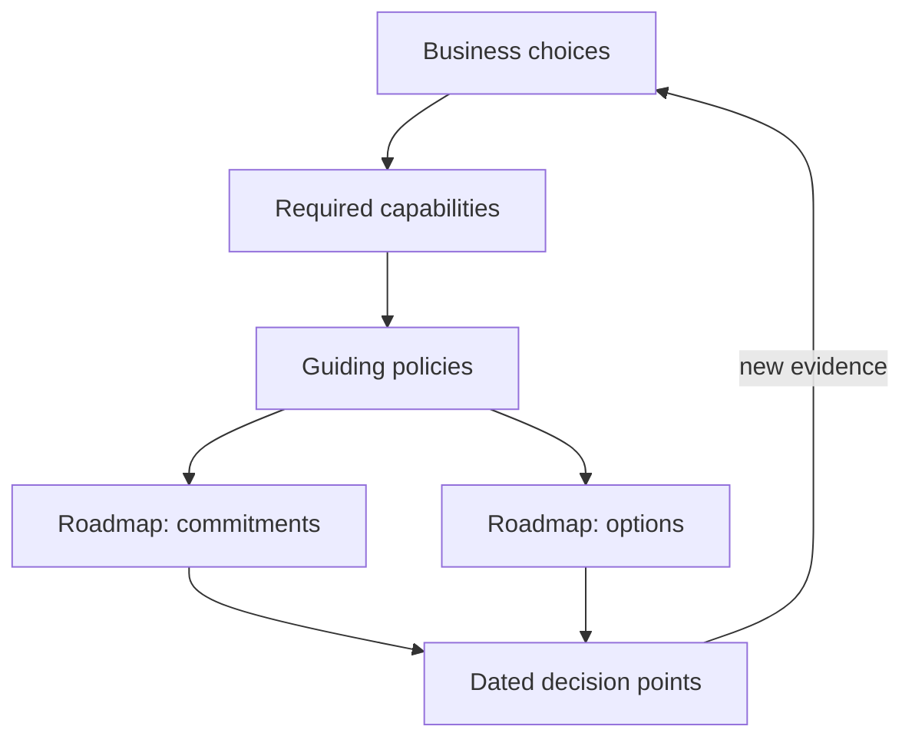
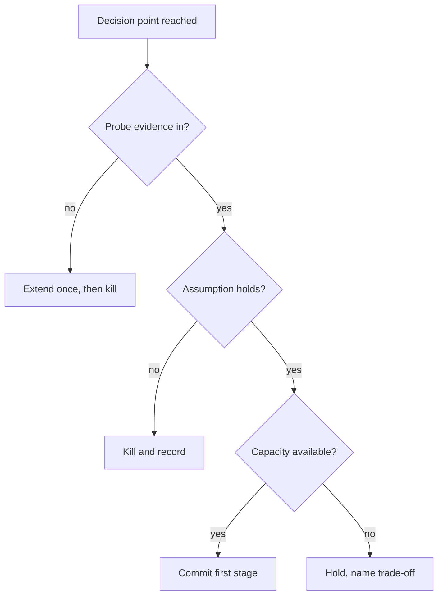
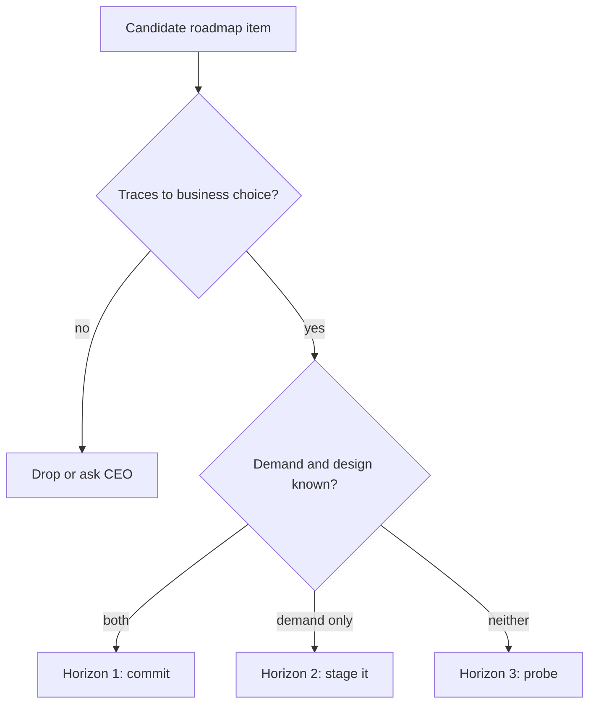

# Chapter 51 — Enterprise Technology Strategy and the Three-Year Roadmap

A director's technical strategy decides how the engineering organization builds; a CTO's technology
strategy decides what technology the company must be excellent at for its business strategy to work,
and what it will accept being merely adequate at. This chapter covers deriving that strategy from the
business, turning it into a three-year roadmap made of commitments, options, and dated decision points,
and testing it for coherence before anyone funds it. [Chapter 30](../06-technical-leadership/30-technical-strategy-and-technology-selection.md)
owns the director-level strategy kernel, technology selection, and build versus buy;
[Chapter 45](../10-business-leadership/45-business-models-and-engineering-economics.md) owns cost of
delay and real options; [Chapter 49](../11-vp-engineering/49-multi-year-transformation-communication-and-politics.md)
owns staged transformation programs and executive communication. The running example is Victor
Lindqvist, CTO of the fictional [Northstar Technologies](../../case-studies/northstar/index.md), drafting
a three-year technology strategy in weeks 46 to 49 for the week 50 board meeting.

## Why This Matters

At team scale, technology choices are local: a library, a queue, a test framework. A bad choice costs a
team a quarter.

At organization scale, technology choices accumulate into an estate that every team depends on: four
build systems, a monolith whose framework is out of support, integrations that read another team's
tables. A director can set policies for that estate, but cannot decide what the company is trying to
win at, and so cannot say which parts of the estate deserve excellence and which deserve only
maintenance.

At executive scale, the question becomes whether the company's technology makes its business strategy
possible, and at what cost. The CTO is the only executive who can answer it, because the CEO owns the
business choices and the engineering organization owns the execution. A CTO without a written
technology strategy still has one: it is the sum of whichever requests reached engineering first, and
the board learns what it was only when a renewal is lost or an acquisition's due diligence finds it.

## Learning Objectives

After this chapter you will be able to:

- Derive a technology strategy from the business strategy, with explicit choices about where to be
  excellent, where to be adequate, what to buy, and what not to do.
- Build a three-year roadmap that separates commitments from options, sorts work into horizons by kind
  of bet, and fixes the dates when each option will be decided.
- Fund the roadmap inside a capacity envelope and state what happens to it in a bad year.
- Test a draft strategy for coherence, for genericity, and for what it says no to.
- Present the strategy to executives and a board as a set of choices, not as a plan to be approved line
  by line.

## The Mental Model

> **Mental model:** A technology strategy is a short chain of choices: the business's choices about
> where to play and how to win, the technology capabilities those choices require, the few policies that
> protect those capabilities, and a roadmap of commitments and options, each with the date on which it
> will be decided. Every link must trace back to the one above it, and the chain must say no to
> something someone wants.

| Link | Question it answers | Typical failure |
|---|---|---|
| Business choices | Where does the company compete, and why does it win there? | Not written down; the CTO guesses |
| Required capabilities | What must technology be excellent at for that to work? | Everything is "strategic" |
| Guiding policies | Which rules make later decisions consistent? | Values with no cost |
| Commitments and options | What is funded now, and what is only prepared? | Three years of commitments |
| Decision points | When, on what evidence, is each option exercised or dropped? | Dates without evidence, or neither |

Two ideas organize the rest of the chapter. First, the technology strategy is derived, not invented: if
the CTO cannot state the business choices it serves, the strategy is a wish list. Second, a three-year
roadmap is mostly options. Only the first year should be committed in detail; years two and three are
bets whose size depends on evidence that does not yet exist, so the roadmap's real content is the
decision calendar.

## Deep Conceptual Explanation

### From business strategy to technology choices

Lafley and Martin are known for describing strategy as a cascade of linked choices: a winning
aspiration, where to play, how to win, the capabilities required, and the management systems that
sustain them ([Lafley and Martin, 2013](../../references/bibliography.md#lafley2013playing)). For a CTO
the cascade is useful because its last two links, capabilities and management systems, are largely
technology. Rumelt's kernel of diagnosis, guiding policy, and coherent action
([Rumelt, 2011](../../references/bibliography.md#rumelt2011good)) then structures the technology part,
as [Chapter 30](../06-technical-leadership/30-technical-strategy-and-technology-selection.md) shows for a
director. Both are **expert opinion**.

Porter's essay argues that operational effectiveness, doing the same things better, is necessary but is
not strategy, that strategy is making trade-offs, and that its essence is choosing what not to do
([Porter, 1996](../../references/bibliography.md#porter1996strategy); publisher page read). That
distinction matters to a CTO who has just led a reliability program. Meeting a contractual availability
target is operational effectiveness: necessary, expensive, and not a reason any customer chooses you
over a competitor that also meets it. A technology strategy that is only "be reliable, modernize, use
data" describes good operations, not choices.

The derivation works in four steps, each producing a short list:

1. **State the business choices** in the CEO's words: target customers, the reason they buy, how the
   company intends to grow. If they are not written, write your reading and ask the CEO to correct it.
   A correction is the most valuable thing you will get in the whole exercise.
2. **Derive required capabilities**: what technology must do, at what level, for those choices to
   hold. "Invoices are correct and payments reach a final state" is a capability; "microservices" is not.
3. **Sort every significant technology area** into four bins: *excellent* (differentiating; build and
   invest above parity), *adequate* (parity with competitors; standardize and keep current), *buy*
   (commodity or externally driven; contract it), and *not doing* (ruled out for the strategy's life).
4. **Write two to four guiding policies** that protect the excellent bin and keep the adequate bin
   cheap.

The four bins force the trade-offs Porter describes. McKinley's "innovation tokens" essay makes the same
point at engineering scale: each new technology spends a scarce budget of attention, so spend it where
it differentiates ([McKinley, 2015](../../references/bibliography.md#mckinley2015boring); **expert
opinion**).

### What the research on alignment does and does not say

The academic name for this derivation is IT-business strategic alignment. Henderson and Venkatraman's
model frames it as fit between external choices (business and IT strategy) and internal
infrastructure, and integration between business and IT domains
([Henderson and Venkatraman, 1993](../../references/bibliography.md#henderson1993alignment); a
conceptual model, abstract read). Studies of whether alignment pays produced conflicting results for
years, and a review describes challenges to the value of the whole research stream
([Chan and Reich, 2007](../../references/bibliography.md#chan2007alignment)).

Two later results are worth knowing. A meta-analysis found all mean corrected correlations between
alignment dimensions and financial performance, productivity, and customer benefit positive, and
concluded there is not much of an "alignment paradox"
([Gerow et al., 2014](../../references/bibliography.md#gerow2014alignment); **research finding**,
abstract read). A survey of executives in 241 firms found alignment associated with agility, and
agility with performance, with the effect of alignment on performance running entirely through
agility; infrastructure flexibility was associated with agility as strongly as alignment was
([Tallon and Pinsonneault, 2011](../../references/bibliography.md#tallon2011alignment); **research
finding**, abstract read).

Both are correlational and survey-based. They support a modest claim: firms whose technology and
business strategies fit tend to do better, and fit seems to work by making the firm quicker to respond,
not by locking in a plan. They do not show that writing a strategy document causes anything. The
practical reading, which is **this book's recommendation**, is that a technology strategy should buy
the ability to change course (flexible infrastructure, options, short decision cycles) at least as
deliberately as it buys fit to today's business plan.

### Deliberate and emergent strategy

Mintzberg and Waters describe deliberate and emergent strategies as two ends of a continuum along which
real strategies lie ([Mintzberg and Waters, 1985](../../references/bibliography.md#mintzberg1985deliberate);
abstract read). In a technology organization, emergent strategy is what the estate becomes through
hundreds of team-level decisions; the director's policies in Chapter 30 shape it. The CTO's three-year
strategy is the deliberate part. It should be small enough that emergent strategy has room, and it
should be revised when emergent patterns show a better direction: three teams independently adopting
the same event-based integration is evidence the strategy should consider.

### Horizons as kinds of bet, not as years

Baghai, Coley, and White are known for the three horizons of growth: improving the existing business,
extending it to new customers or markets, and creating options for the future
([Baghai et al., 1999](../../references/bibliography.md#baghai1999alchemy)). Many organizations tied
each horizon to a delivery window. Blank argues that the time element no longer holds, because a
horizon 3 idea can now be delivered as fast as a horizon 1 improvement, while keeping the model as a
useful way to prioritize ([Blank, 2019](../../references/bibliography.md#blank2019flaw); **expert
opinion**). In a comment on the post, Mehrdad Baghai, identifying himself as a co-author of the model,
disputes the "fatal flaw" framing and says the book left each company to decide the right timing for
each horizon.

This book takes Blank's side on time and keeps the categories. In a technology roadmap, horizons are
kinds of bet, distinguished by how much is known:

| Horizon | Kind of bet | What is known | How it is funded |
|---|---|---|---|
| 1. Strengthen | Today's platform for today's customers | Demand and design | Committed for the year, in detail |
| 2. Extend | Existing capabilities for adjacent needs | Demand, not the design or size | Committed in stages, each with a gate |
| 3. Explore | Options on futures that may not arrive | Neither demand nor design | Small probes with kill criteria |

All three horizons start in year one. A three-year roadmap that schedules horizon 3 for year three has
confused "uncertain" with "later" and will reach year three with no information.

### Commitments, options, and decision points

Chapter 45 owns real options; its practitioner rules (buy information before irreversible commitments,
stage large investments, value flexibility only if someone will use it) follow Dixit and Pindyck's
emphasis on irreversibility and the value of waiting for better information
([Dixit and Pindyck, 1994](../../references/bibliography.md#dixit1994investment)). McGrath and
MacMillan's discovery-driven planning is known for planning ventures around explicit assumptions tested
at checkpoints before more money is committed
([McGrath and MacMillan, 1995](../../references/bibliography.md#mcgrath1995discovery)). Bezos's
distinction between reversible and irreversible decisions sets how much process each needs
([Bezos, 2017](../../references/bibliography.md#bezos2016letter); **documented practice**).

Put together, every item beyond the first year's commitments needs four fields:

| Field | Content |
|---|---|
| Assumption | What must be true for this to be worth doing |
| Probe | The cheapest work that tests the assumption, with its cost |
| Decision point | A date, the evidence expected by then, and who decides |
| Kill criterion | The evidence that ends the option, written now |

Phaal and colleagues are known for the layered technology roadmap that links market drivers, products,
and technologies on one time axis ([Phaal et al., 2004](../../references/bibliography.md#phaal2004roadmapping)).
The layered form is worth adopting; add a fourth layer, the decision calendar, because a roadmap without
it is read as a promise.

| Branch | Rule (this book's recommendation) |
|---|---|
| No evidence by the date | One extension, with a new date; a second miss kills the option |
| Assumption fails | Kill it and record why, so it is not reopened without new evidence |
| Assumption holds, no capacity | The CTO names what would be displaced and takes the choice to the executive team |
| Assumption holds, capacity exists | Commit one stage, as in Chapter 49, not the whole investment |

### Coherence tests

A draft strategy should pass seven tests before it reaches executives. Most are adapted from Rumelt's
signs of bad strategy, Porter's trade-offs, and Larson's advice that policies be applicable and
enforced ([Larson, 2023](../../references/bibliography.md#larson2023engstrategy)); the set is **this
book's recommendation**.

1. **Trace.** Every capability, policy, and roadmap item traces to a business choice. Orphans are
   either missing business choices or pet projects.
2. **Says no.** The "not doing" list contains at least two things that a named executive or customer
   wants. If nobody is disappointed, nothing was chosen.
3. **Genericity.** Replace the company's name with a competitor's. If the document still reads true,
   it is not a strategy.
4. **Arithmetic.** The roadmap fits the capacity envelope in every year, with the assumptions stated.
5. **Stress.** The strategy says what gives way in a bad year, and it is not the excellent bin.
6. **Reinforcement.** The actions support each other; two commitments that compete for the same scarce
   people are a contradiction.
7. **Premortem.** Klein's premortem asks a team to assume the plan has failed and explain why, which
   surfaces reservations people would otherwise keep to themselves
   ([Klein, 2007](../../references/bibliography.md#klein2007premortem); **expert opinion**). Run one
   with the people who will execute the roadmap.

Three-year estimates attract both optimism bias and strategic misrepresentation
([Flyvbjerg, 2006](../../references/bibliography.md#flyvbjerg2006nobel)); the arithmetic and stress
tests are where both are caught.

## Engineering Organization Example

The figures are **illustrative**, from the Northstar case. Assumptions: the planning basis is 79
engineers, the headcount under the director's main year-2 organization proposal (80 under alternative B,
78 if a VP of Engineering takes a seat; all three are open decisions); one engineer-year costs $185,000;
year 2 runs from week 53 to week 104, year 3 to week 156, year 4 to week 208. Prevention in year 2
averages the continuation proposal's (6 + 6 + 5 + 5) ÷ 4 = 5.5 FTE. Platform keeps quarter 3's 4.5 FTE.

Victor's draft allocation, in FTE averaged over each year:

| Line | Horizon | Year 2 | Year 3 | Year 4 |
|---|---|---|---|---|
| Unplanned work | 1 | 17.4 (22%) | 14.2 (18%) | 12.6 (16%) |
| Prevention | 1 | 5.5 | 3.0 | 3.0 |
| Platform | 1 | 4.5 | 5.0 | 5.0 |
| Estate currency (framework, libraries) | 1 | 2.0 | 1.5 | 1.5 |
| Product work for today's customers | 1 | 37.6 | 37.3 | 35.9 |
| Extend | 2 | 10.0 | 14.0 | 16.0 |
| Explore | 3 | 2.0 | 4.0 | 5.0 |
| Total | | 79.0 | 79.0 | 79.0 |

Check: 79 × 22% = 17.38, 79 × 18% = 14.22, 79 × 16% = 12.64. Year 2: 17.4 + 5.5 + 4.5 + 2.0 + 37.6 +
10.0 + 2.0 = 79.0. Year 3: 14.2 + 3.0 + 5.0 + 1.5 + 37.3 + 14.0 + 4.0 = 79.0. Year 4: 12.6 + 3.0 + 5.0 +
1.5 + 35.9 + 16.0 + 5.0 = 79.0. By horizon: year 2 is 67.0 / 10.0 / 2.0 FTE (84.8, 12.7, and 2.5
percent); year 4 is 58.0 / 16.0 / 5.0 (73.4, 20.3, and 6.3 percent).

Three things follow from the table.

**Growth is funded by the reliability dividend, not by headcount.** From year 2 to year 4, unplanned work
falls by 17.4 − 12.6 = 4.8 FTE and prevention by 5.5 − 3.0 = 2.5 FTE, releasing 7.3 FTE. They go to
horizon 2 (+6.0), horizon 3 (+3.0), and platform (+0.5), less estate (−0.5) and product for today's
customers (−1.7): 6.0 + 3.0 + 0.5 − 0.5 − 1.7 = 7.3. The whole strategy therefore depends on one
assumption, that unplanned work keeps falling. That assumption needs a decision point of its own.

**The bad year is written in advance.** If unplanned work stays at quarter 3's 25 percent through year
2, it takes 79 × 25% = 19.75, about 19.8 FTE, 2.4 more than planned. The draft's rule takes the
shortfall from horizon 2 (10.0 − 2.4 = 7.6 FTE), never from prevention or horizon 3. Horizon 3 is
protected because its 2 FTE buy the information that decides years 3 and 4; cutting it saves 2.5 percent
of capacity and leaves the year-3 decisions blind.

**Money is mostly existing capacity.** Horizon 2 in year 2 is 10 × $185,000 = $1.85M of capacity and
horizon 3 is 2 × $185,000 = $370,000, all from engineers already employed. Victor's draft asks for no new
spending beyond the continuation proposal's $150,000 of stage 2 tooling, which Rajiv Menon is already
deciding. Presenting $1.85M without that sentence would be read as a request for new money, the trap
Chapter 49 describes.

## Decision Framework

Use the framework below to place each candidate item on the roadmap. It is **this book's
recommendation**; the thresholds are starting points.

| Question | If yes | If no |
|---|---|---|
| Does it trace to a stated business choice? | Continue | Drop it, or take the missing choice to the CEO |
| Is it in the excellent bin? | Build; fund above parity | Standardize, buy, or keep at parity |
| Is it irreversible (a contract, a data model, a public API)? | Probe first; decide at a dated point | Decide quickly and correct later |
| Is the cost of delay high and rising (Chapter 45)? | Pull the decision point earlier | Leave it at its natural date |
| Does it depend on horizon 1 health (unplanned work, ownership)? | Make that a condition of its stage | Schedule on its own evidence |
| Does it need more than about 10 FTE-quarters? | Fund one stage at a time (Chapter 49) | Commit within the year's plan |

The last row's threshold is a judgment: about 10 FTE-quarters is roughly 3 percent of a year's capacity
for a 79-engineer organization (79 × 4 = 316 FTE-quarters), large enough that a wrong commitment hurts.

## Trade-offs

**Derived against inspired.** Deriving technology strategy from business strategy can make the CTO a
follower who never proposes what technology makes possible. The alternative failure, a CTO pursuing
technology the business never chose, is more common. Bring technology-enabled opportunities to the CEO
as proposed business choices, then derive from whatever is decided.

**Fit against flexibility.** Tight fit to this year's business plan can make the estate rigid. The
alignment research suggests fit pays through agility; spend some capacity on flexibility (contracts and
events rather than shared tables, a single pipeline) even when no current plan requires it.

**Commitment against credibility.** Executives and boards like dates. A roadmap of options can look
like a refusal to commit. The answer is to commit firmly to year one and to the decision dates, and to
show what each decision will be based on.

**Few policies against coverage.** Two to four policies leave most decisions to teams, which is the
point; Chapter 30's director policies and the emergent strategy fill the rest. A CTO who writes twelve
policies has written a standards manual.

**Horizon 3 against focus.** Probes cost focus as well as capacity. Keep them few, small, owned, and
dated, and kill them on schedule.

## Failure Modes

**The orphan strategy.** The technology strategy cites no business choice, because none is written and
the CTO did not ask. Early sign: the first page is about technology.

**Everything is strategic.** Every area is in the excellent bin; nothing is bought or ruled out. Early
sign: an empty "not doing" list, or one containing only things nobody wanted.

**The three-year Gantt chart.** Years two and three are scheduled as firmly as year one, with no
options or decision points. Early sign: horizon 3 items start in year three.

**Operational effectiveness presented as strategy.** "Reliable, modern, secure, data-driven." Early
sign: the genericity test passes for every competitor.

**Funding by hope.** Horizon 2 grows on capacity that only appears if unplanned work falls, but no
document says so. Early sign: no stress case.

**Options that never die.** Probes outlive their decision dates and become small permanent teams. Early
sign: a decision point passed without a recorded decision.

**The CTO's own exception.** The CTO makes a casual decision that contradicts a policy ("read the
tables for now"), and teams learn the policy is for others. Early sign: the CTO's past decisions are not
tested against the draft.

## Enterprise Application

In an organization of 50 to 150 engineers, the CTO usually writes the technology strategy with the
engineering director or VP, the staff engineers, and the head of IT where IT is separate. A practical
shape:

- **Two to four pages**, in this order: business choices (confirmed by the CEO), required capabilities,
  the four bins, two to four guiding policies, the three-year allocation by horizon with its stress
  case, the decision calendar.
- **A director's technical strategy beneath it**: the [engineering strategy template](../../templates/engineering-strategy.md)
  serves both levels; the CTO's version names business choices, the director's version names estate
  policies that serve them.
- **An annual rewrite and gate-driven revisions**: rewritten once a year with the operating plan, and
  revised at any decision point where the evidence changes the diagnosis.
- **The allocation in the quarterly plan**: horizon lines appear in the
  [capacity planning model](../../templates/capacity-planning-model.md), so a quarter that starves
  horizon 3 is a visible decision. Larson recommends allocating capacity coarsely and changing
  allocations rarely, because frequent changes turn planning into a zero-sum contest
  ([Larson, 2023](../../references/bibliography.md#larson2023planning)).
- **A decision calendar in the executive team's forum**: each decision point booked in an existing
  meeting, with the evidence owner named.

Project 7 asks you to write the director-level 12-month strategy that sits inside such a document.

## CTO Perspective

Writing the strategy is one of the few tasks only the CTO can do
([Chapter 50](50-what-a-cto-actually-does.md) covers the rest of that list), because it needs both the CEO's
confirmation of the business choices and authority over the engineering allocation. Larson's
*Engineering Executive's Primer* is known for treating strategy and planning as core parts of the
engineering executive's job ([Larson, 2024](../../references/bibliography.md#larson2024primer)). Kane
and colleagues are known for arguing that digital transformation depends more on people, culture, and
organization than on technology ([Kane et al., 2019](../../references/bibliography.md#kane2019technology));
a technology strategy with no organization or people lane is incomplete.

At a board, the strategy is a set of choices to discuss, not a plan to approve: the board approves the
operating plan and budget envelope, and the strategy explains what that envelope buys and what it
forgoes. [Chapter 55](55-boards-due-diligence-and-executive-decision-making.md) owns board
communication; [Chapter 52](52-technology-investment-budgeting-and-financial-literacy.md) owns the
financial statements behind the envelope; [Chapter 53](53-risk-governance-regulation-and-security-strategy.md)
owns the technology risk register at enterprise level; [Chapter 54](54-data-and-ai-strategy.md) owns data
and AI choices, which should enter this strategy as options with decision points like any other.

At Halvard Systems, the fictional 500-engineer company of
[Chapter 35](../07-organization-design/35-designing-organizations-at-four-scales.md), with four product
groups and a 70-engineer platform organization, the CTO's strategy cannot list every group's roadmap. It
sets company-level capabilities and policies, the share of capacity for each horizon across the company,
and the platform organization's mandate, and lets each vice president derive a group strategy beneath it.
The capital-allocation research warns that firms tend to spread resources evenly over however many units
they are divided into ([Bardolet et al., 2011](../../references/bibliography.md#bardolet2011capital);
**research finding**, abstract read). A Halvard strategy that gives each product group the same share of
horizon 2 has probably let the org chart, not the business choices, do the allocating.

## Practical Playbook

1. **Write the business choices first**, one paragraph each: where the company plays, why customers
   choose it, how it intends to grow. Send them to the CEO as "my reading; please correct".
2. **Derive the required capabilities** and the level each needs, in customer terms.
3. **Sort every significant technology area into the four bins**, and put at least two things a named
   person wants in "not doing".
4. **Write two to four guiding policies**, each with its cost and an owner, and test your own past
   decisions against them.
5. **Build the three-year allocation by horizon** inside the capacity envelope, with every assumption
   stated, and write the stress case.
6. **List the options** with assumption, probe, decision point, and kill criterion.
7. **Book the decision calendar** into existing executive forums.
8. **Run the seven coherence tests**, including a premortem with the people who will execute.
9. **Take it to the executive team** before the board, and record each executive's position.
10. **Present it to the board as choices**, separating reallocated capacity from new spending.
11. **Rewrite it each year** and revise it at any decision point that changes the diagnosis.

## Case Study

These Northstar events are **illustrative** and fictional. The canon is on
[the first quarter](../../case-studies/northstar/first-quarter.md) page; the strategy draft and its
weeks 46 to 49 history are this chapter's additions. Quarter 4 runs from week 40 to week 52, the latest
measured results are quarter 3, and every quarter 4 decision is open.

**The situation.** You are Victor Lindqvist, Northstar's CTO, in week 46. The board meets in week 50 to
approve the year-2 operating plan and budget envelope; your one agenda item will be a three-year
technology strategy, as a discussion item. On your desk are the director's year-2 proposals, none
decided: the organization proposal (decision due this week), the quality continuation (executive team in
week 49), the workforce plan draft (week 49), the VP question (recommendation due week 48), the CI
target, and ADR-0001. Quarter 3 delivered 14 Sev1 and Sev2 incidents, 99.89 percent availability against
a 99.9 percent contract, and unplanned work of 25 percent. Six of the 40 largest customers, about 6 ×
$1.17M = $7.0M of annual recurring revenue, renew in quarters 5 to 8.

**Week 46: the business choices.** Northstar has no written statement of where it plays and how it wins;
the year-2 operating plan draft states financial targets and the renewals focus. You write your reading
in three lines and send it to Helena Marsh: mid-market wholesale distributors, with the largest 40 (a
third of revenue) as the customers whose loss would hurt most; customers choose Northstar because it can
be trusted with their money (correct invoices, payments that reach a final state, clean integration with
their accounting systems and banks); growth comes from larger distributors with cross-border operations.
Helena confirms the first two and changes the third: year 2 is about keeping the largest 40, and growth
into larger distributors is a year-3 question for the board.

**The draft.** Your week 47 draft, with year-2 inputs supplied by the director at your request:

| Bin | Areas |
|---|---|
| Excellent | Financial correctness of orders, invoices, and payments; availability of the order and payment paths; integration with customers' accounting systems and banks; safe weekly change |
| Adequate | Web and mobile ordering screens; internal reporting; Core's module structure (kept, not redesigned) |
| Buy | Tax rate content; CI and observability tooling; corporate business systems (IT, under the CFO) |
| Not doing, three years | A Core rewrite; multi-region active-active hosting; customer-specific code branches for large accounts; a new runtime or datastore for a tier 1 component without retiring one |

Guiding policies: (1) *reliability before reach*: horizon 2 grows only when unplanned work meets its
target at the gate; (2) *money data moves by contract*: every integration reads ledger data through a
versioned contract or posting events, never tables; (3) *converge before adding*, extending the
director's quarter 2 policy to the whole company; (4) *stage anything above 10 FTE-quarters*.

Policy 2 contradicts your own week 14 remark to Elena Sokolova to "read the tables now and clean it up
later". You write that into the draft as a reversal, and propose that ADR-0001 be decided by week 60,
because two of the options below depend on it.

| Option | Horizon | Assumption | Probe and cost | Decision point |
|---|---|---|---|---|
| Ledger posting events | 2 | More integrations will be sold than a contract can serve | Depends on ADR-0001 | Week 60 |
| Multi-currency invoicing and ledger | 2 | Larger cross-border distributors are a year-3 market | 6 engineer-weeks, about $21,000 | Week 78 |
| Higher availability tier for top accounts | 3 | Some of the six renewals will ask for more than 99.9 percent | 4 engineer-weeks, about $14,000 | Week 70 |
| Ordering API for distributors' largest buyers | 3 | Buyers want to order from their own procurement systems | Up to 2 FTE from week 53 to week 78 (about 50 engineer-weeks), within horizon 3 | Week 78 |
| Core boundary: extract order-capture | 1 | Co-change data still favors extraction | None; existing data | Week 104 |

Probe costs at $3,558 an engineer-week: 6 × $3,558 = $21,348 and 4 × $3,558 = $14,232. The decision
calendar also carries the canon dates: the stage 1 gate (week 56), the organization review (week 64),
the stage 2 gate (week 78, where the draft asks for the CI target to be chosen), and the stage 3 gate
(week 104).

**Week 48: the premortem.** You run a 90-minute premortem with the director and the three staff
engineers: "It is week 156 and the strategy failed. Why?" Three stories dominate. Kwame Mensah: unplanned
work stalled at 25 percent, horizon 2 was cut every quarter, and the strategy quietly became the
continuation program. Li Na Zhou: ADR-0001 was never decided, every new connector read tables, and the
year-3 multi-currency work had to unpick them. Ines Carvalho: the ledger's currency and rounding still
depended on one person (TR-07), who left in year 3. You add the stress rule (shortfalls come from horizon
2, never horizon 3 or prevention), make unplanned work a named assumption with the week 56 and week 78
gates as its checks, and add a people line: by week 104, every excellent-bin area has at least two people
who can change it safely.

**Week 49: the executive team.** You table the draft alongside the continuation proposal.
Amara Okafor objects to "adequate" for ordering screens, citing the week 40 finding that about 1.1
percent of orders contain an ordering error, 70 of the 340 sampled errors being duplicate submissions.
You split the line: ordering correctness (idempotent submission, price and unit validation) moves to
excellent; visual design stays adequate. Greg Tanaka objects to "no customer-specific code branches",
arguing that two open deals need custom behavior; you keep it and offer configuration within the product
as the alternative, leaving his objection on the record. Rajiv Menon asks for confirmation that the
strategy carries no headcount or spending request beyond the continuation's $150,000; you confirm.

**What is open.** The draft goes into the week 50 board pack as a discussion item. It depends on
decisions not yet made (the year-2 organization, the continuation, the VP question, ADR-0001), and its
year-3 growth line depends on Helena's board question. Whether the board engages with it, and what it
asks for, is not recorded.

## Exercises

Worked solutions are in the [Chapter 51 solutions](../../solutions/ch51-solutions.md).

### Foundational

**F1.** Victor's first internal draft, before week 46, opened with these lines: "Northstar will be
reliable, secure, and modern. We will use data to drive decisions. We will invest in our platform and our
people." Apply the genericity, trace, and says-no tests to each sentence. Then rewrite the paragraph so
that it passes all three, using only facts from the case study.

**F2.** Sort these candidate items into horizon 1, 2, or 3, or drop them, and justify each placement by
what is known about demand and design: the Core framework migration (120 to 180 engineer-days), ledger
posting events, an ordering API for distributors' largest buyers, idempotent order submission,
multi-region active-active hosting, CI consolidation, and a higher availability tier for top accounts.

**F3.** Using the case study's allocation table, recompute year 3 under two scenarios: unplanned work
reaches only 22 percent instead of 18 percent, and unplanned work reaches 15 percent. Apply the draft's
stress rule in the first case. State in each case how much horizon 2 receives and what that means for the
multi-currency option's week 78 decision.

### Applied Leadership

**A1.** Write the full option record for "multi-currency invoicing and ledger": the assumption in
testable form, a probe that fits 6 engineer-weeks, the evidence expected by week 78, who decides, the kill
criterion, and the first stage if it is exercised. Explain why the option depends on ADR-0001 and what
you would do if ADR-0001 is still open at week 78.

**A2.** You are the Engineering Director in week 47, and Victor has asked you for the year-2 inputs to
his strategy. Map the open year-2 proposals (organization, continuation, workforce plan, VP question, CI
target, ADR-0001) onto the strategy's horizons and decision calendar. Identify at least two places where
one proposal's outcome changes another's arithmetic, and say how the strategy should present them while
they are open.

**A3.** Greg Tanaka objects to "no customer-specific code branches for large accounts", saying two open
deals need custom behavior and that the policy will cost Northstar revenue. Draft Victor's written reply,
including what Northstar offers instead, what evidence would make Victor revisit the policy, and how the
objection is recorded. Consider what the policy protects in the excellent bin.

### Executive Decision-Making

**X1.** You are Victor Lindqvist on the evening of week 49. Helena Marsh has placed growth into larger
distributors in year 3; Amara Okafor's objection has changed one bin; Greg Tanaka's objection stands; the
year-2 organization and the VP question are still undecided. Decide what the board document says, in
what order, and which open decisions it names. Write the first paragraph the board will read, and state
what you will not show the board and why.

**X2.** You are CTO of Halvard Systems. Suppose (a scenario, not canon) the four product-group vice
presidents each submit a three-year roadmap; together they request 31 percent of company capacity for horizon 2 and 9 percent for horizon 3,
and each asks for close to an equal share. The platform organization wants a company-wide policy that
every group adopt its deployment platform within two years. Design the company-level strategy structure,
decide how to allocate horizon 2 across groups, and explain how you would avoid letting the org chart do
the allocating.

## Reflection Questions

1. Could you write your company's business choices in three sentences today, and would your CEO sign
   them without changes?
2. Which areas of your estate do you fund at excellence that customers would not notice at parity?
3. What is on your "not doing" list that someone senior actually wants? If nothing, what have you
   chosen?
4. Which of your past casual decisions would fail your own strategy's policies, and have you said so?
5. When did an option on your roadmap last die on its decision date, rather than fade?
6. If unplanned work in your organization stayed where it is for a year, which part of your roadmap would
   silently disappear?

## Key Takeaways

- Derive technology strategy from written business choices; if they are not written, write your reading
  and get the CEO to correct it.
- Sort technology into excellent, adequate, buy, and not doing. A strategy that disappoints nobody has
  chosen nothing.
- Operational effectiveness, including reliability, is necessary and is not strategy.
- Treat horizons as kinds of bet, not as years: all three start now, at different sizes.
- Commit year one in detail; make years two and three options with assumptions, probes, decision dates,
  and kill criteria.
- Fund the roadmap inside the capacity envelope, name the assumption that funds growth, and write the
  bad-year rule in advance.
- Test for trace, says-no, genericity, arithmetic, stress, reinforcement, and with a premortem.
- Present the strategy as choices; separate reallocated capacity from new spending; test your own past
  decisions against it.

## References and Further Reading

- [Lafley and Martin, 2013](../../references/bibliography.md#lafley2013playing): the strategy choice
  cascade (idea level).
- [Rumelt, 2011](../../references/bibliography.md#rumelt2011good): diagnosis, guiding policy, coherent
  action, and the signs of bad strategy.
- [Porter, 1996](../../references/bibliography.md#porter1996strategy): strategy as trade-offs, distinct
  from operational effectiveness.
- [Larson, 2023](../../references/bibliography.md#larson2023engstrategy): engineering strategy in
  practice.
- [Larson, 2023](../../references/bibliography.md#larson2023planning): executive planning and coarse,
  stable allocation.
- [Larson, 2024](../../references/bibliography.md#larson2024primer): the engineering executive's job,
  including strategy (idea level).
- [Kane et al., 2019](../../references/bibliography.md#kane2019technology): transformation as people and
  organization (idea level).
- [Henderson and Venkatraman, 1993](../../references/bibliography.md#henderson1993alignment): the
  strategic alignment model.
- [Chan and Reich, 2007](../../references/bibliography.md#chan2007alignment): what is disputed in
  alignment research.
- [Gerow et al., 2014](../../references/bibliography.md#gerow2014alignment): meta-analysis of alignment
  and performance.
- [Tallon and Pinsonneault, 2011](../../references/bibliography.md#tallon2011alignment): alignment,
  agility, and performance.
- [Mintzberg and Waters, 1985](../../references/bibliography.md#mintzberg1985deliberate): deliberate and
  emergent strategy.
- [Baghai et al., 1999](../../references/bibliography.md#baghai1999alchemy) and
  [Blank, 2019](../../references/bibliography.md#blank2019flaw): the three horizons and the case against
  tying them to time.
- [Phaal et al., 2004](../../references/bibliography.md#phaal2004roadmapping): layered technology
  roadmaps (idea level).
- [Dixit and Pindyck, 1994](../../references/bibliography.md#dixit1994investment): irreversibility and
  the value of waiting.
- [McGrath and MacMillan, 1995](../../references/bibliography.md#mcgrath1995discovery): planning around
  tested assumptions (idea level).
- [Bezos, 2017](../../references/bibliography.md#bezos2016letter): reversible and irreversible decisions.
- [Klein, 2007](../../references/bibliography.md#klein2007premortem): the premortem.
- [Flyvbjerg, 2006](../../references/bibliography.md#flyvbjerg2006nobel): optimism bias and strategic
  misrepresentation in long-range estimates.
- [McKinley, 2015](../../references/bibliography.md#mckinley2015boring): innovation tokens.
- [Bardolet et al., 2011](../../references/bibliography.md#bardolet2011capital): even allocation across
  business units.
