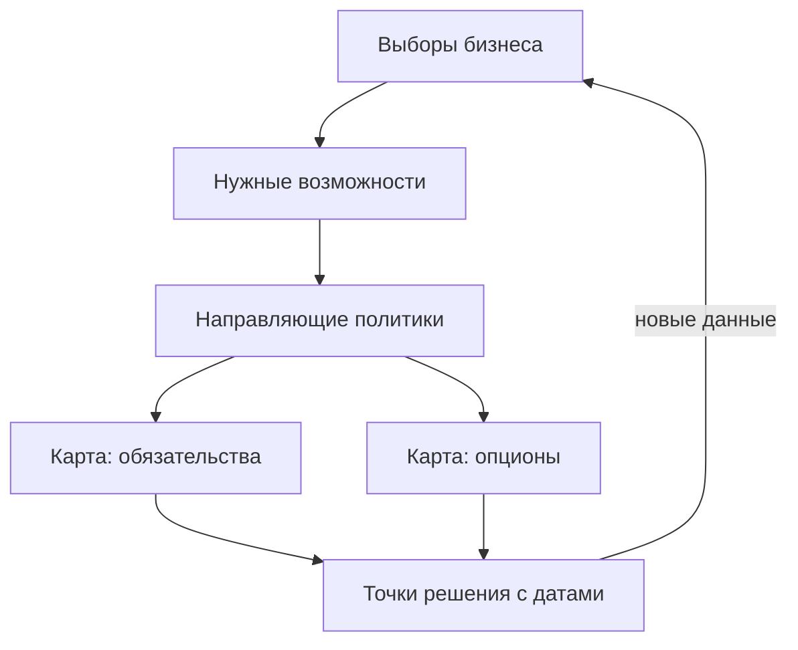
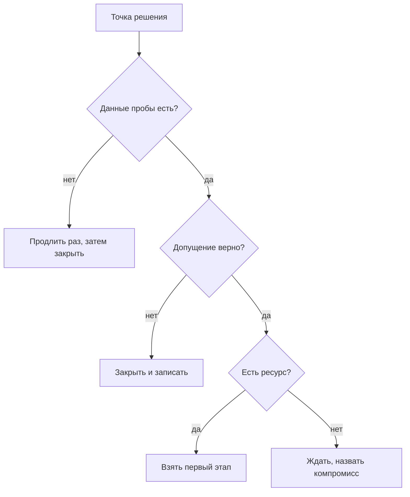
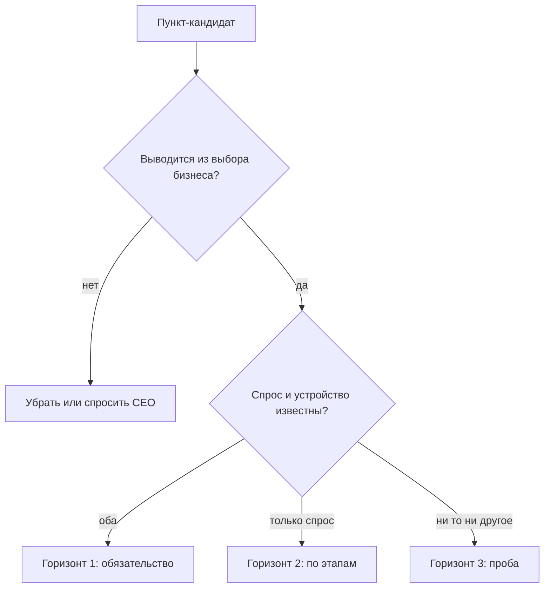

# Глава 51 — Технологическая стратегия компании и трёхлетняя дорожная карта { #chapter-51-enterprise-technology-strategy-and-the-three-year-roadmap }

Техническая стратегия директора определяет, как инженерной организации строить системы. Технологическая
стратегия CTO отвечает на другой вопрос: в каких технологиях компания должна быть превосходной, чтобы
работала её бизнес-стратегия, и где ей хватит достаточного уровня. В этой главе такую стратегию выводят
из бизнеса, превращают в трёхлетнюю дорожную карту из обязательств, опционов и точек решения с датами и
проверяют на согласованность ещё до того, как кто-то выделит на неё деньги. Сквозной пример — Victor
Lindqvist, CTO (технический директор) вымышленной компании
[Northstar Technologies](../../case-studies/northstar/index.md). В недели 46–49 он готовит трёхлетнюю
технологическую стратегию к заседанию совета директоров на неделе 50.

Связанные главы: [30](../06-technical-leadership/30-technical-strategy-and-technology-selection.md)
(стратегия на уровне директора, выбор технологий, «разработать или купить»),
[45](../10-business-leadership/45-business-models-and-engineering-economics.md) (стоимость задержки,
реальные опционы), [49](../11-vp-engineering/49-multi-year-transformation-communication-and-politics.md)
(поэтапные программы, коммуникация с руководством).

## Почему это важно { #why-this-matters }

**В команде** технологический выбор локален: библиотека, очередь, тестовый фреймворк. Неудачный выбор
обходится команде в квартал.

**В организации** технологические решения складываются в технологический ландшафт (все системы,
инструменты и кодовые базы, которые эксплуатирует компания), и от него зависит каждая команда: четыре
системы сборки, монолит на фреймворке без поддержки, интеграции, которые читают таблицы чужой команды.
Директор может задавать правила для этого ландшафта, но решить, в чём компания хочет выигрывать, он не
может. А значит, не может и сказать, какие части заслуживают превосходства, а каким хватит поддержки.

**Для высшего руководства** вопрос звучит так: делают ли технологии бизнес-стратегию компании
возможной и какой ценой? Ответить на него может только CTO. Если CTO не написал технологическую
стратегию, она у него всё равно есть: это сумма запросов, которые первыми дошли до разработки. Какой
она была, совет директоров узнаёт, когда компания теряет продление или когда эту стратегию обнаруживает
due diligence (комплексная проверка) покупателя.

## Цели главы { #learning-objectives }

После этой главы вы сможете:

- Выводить технологическую стратегию из бизнес-стратегии и явно выбирать, где быть превосходным, где
  достаточным, что покупать и чего не делать.
- Строить трёхлетнюю дорожную карту, где обязательства отделены от опционов, работа разложена по
  горизонтам в зависимости от вида ставки, а у каждого опциона есть дата решения.
- Финансировать дорожную карту в рамках доступного ресурса и заранее говорить, что с ней будет в плохой
  год.
- Проверять черновик стратегии на согласованность, на шаблонность и на то, от чего он отказывается.
- Представлять стратегию руководству и совету директоров как набор выборов, а не как план для
  построчного утверждения.

## Ментальная модель { #the-mental-model }

> **Ментальная модель:** технологическая стратегия — короткая цепочка выборов. Она начинается с выборов
> бизнеса (где играть и как выигрывать), ведёт к возможностям, которых эти выборы требуют, и к нескольким
> политикам, которые эти возможности защищают. Заканчивается цепочка дорожной картой из обязательств и
> опционов, и у каждого из них есть дата решения. Каждое звено выводится из предыдущего, и вся цепочка
> говорит «нет» чему-то, чего кто-то хочет.

| Звено | На какой вопрос отвечает | Типичный провал |
|---|---|---|
| Выборы бизнеса | Где компания конкурирует и почему там выигрывает? | Не записаны; CTO догадывается |
| Нужные возможности | В чём технологии должны быть превосходны, чтобы это работало? | Всё «стратегическое» |
| Направляющие политики | Какие правила делают последующие решения согласованными? | Ценности, за которые ничем не платят |
| Обязательства и опционы | Что финансируется сейчас, а что только готовится? | Три года обязательств |
| Точки решения | Когда и по каким данным каждый опцион исполняют или закрывают? | Даты без данных или нет ни того ни другого |

Всё остальное держится на двух идеях. Первая: стратегию выводят, а не придумывают. Если CTO не может
назвать выборы бизнеса, которым она служит, перед вами список желаний. Вторая: трёхлетняя дорожная карта
состоит в основном из опционов. В деталях закреплён только первый год; второй и третий зависят от данных,
которых ещё нет. Поэтому настоящее содержание дорожной карты — календарь решений.

## Подробный разбор { #deep-conceptual-explanation }

### От бизнес-стратегии к технологическим выборам { #from-business-strategy-to-technology-choices }

Стратегия — каскад связанных выборов, и последние его звенья в основном технологические. Lafley и Martin
известны тем, что описали этот каскад: выигрышная цель, где играть, как выигрывать, необходимые
возможности и системы управления, которые их поддерживают
([Lafley and Martin, 2013](../../references/bibliography.md#lafley2013playing)). Технологическую часть
затем упорядочивает «ядро» стратегии (kernel) по Rumelt: диагноз, направляющая политика и согласованные
действия ([Rumelt, 2011](../../references/bibliography.md#rumelt2011good)). Как это выглядит у директора,
показано в главе 30. Оба источника — **мнение эксперта**.

Надёжность — не стратегия. Porter утверждает, что операционная эффективность (делать то же самое лучше)
необходима, но стратегией не является: стратегия — это выбор того, чего не делать
([Porter, 1996](../../references/bibliography.md#porter1996strategy); **мнение эксперта**). Выполнять
договорную цель по доступности необходимо, и это дорого, но ни один клиент не предпочтёт вас конкуренту,
который выполняет её тоже. «Быть надёжными, модернизироваться, использовать данные» — описание хорошей
эксплуатации, а не выбор.

Стратегию выводят за четыре шага, и каждый даёт короткий список:

1. **Сформулируйте выборы бизнеса** словами CEO (генерального директора): кто целевые клиенты, почему
   они покупают и как компания собирается расти. Если выборы не записаны, запишите, как вы их понимаете,
   и попросите CEO поправить. Эта правка — самое ценное, что вы получите.
2. **Выведите нужные возможности**: что и на каком уровне должны делать технологии, чтобы эти выборы
   держались. «Счета корректны, а платежи доходят до конечного состояния» — это возможность;
   «микросервисы» — нет.
3. **Разложите каждую значимую технологическую область** по четырём группам: *отлично* (дифференцирует;
   разрабатываем сами и вкладываем больше, чем конкуренты), *достаточно* (паритет с конкурентами;
   стандартизируем и поддерживаем в актуальном состоянии), *покупать* (типовое или зависит от внешних
   причин; отдаём по контракту) и *не делать* (исключено на весь срок действия стратегии).
4. **Напишите от двух до четырёх направляющих политик**: они защищают группу «отлично» и не дают
   группе «достаточно» дорожать.

Четыре группы вынуждают идти на те самые компромиссы, о которых пишет Porter. «Жетоны на инновации»
(innovation tokens) McKinley — о том же в масштабе разработки: тратьте дефицитное внимание на новые
технологии только там, где они отличают вас от конкурентов
([McKinley, 2015](../../references/bibliography.md#mckinley2015boring); **мнение эксперта**).

### Что подтверждают исследования согласованности { #what-the-research-on-alignment-supports }

Соответствие технологий бизнес-стратегии, по-видимому, окупается, и главным образом потому, что компания
быстрее реагирует на перемены. Результаты долго противоречили друг другу, но более качественные
исследования связывают согласованность (alignment) с результатами компании через гибкость (agility)
([Gerow et al., 2014](../../references/bibliography.md#gerow2014alignment); см. также
[Chan and Reich, 2007](../../references/bibliography.md#chan2007alignment) и
[Tallon and Pinsonneault, 2011](../../references/bibliography.md#tallon2011alignment)). Это корреляционные
**научные результаты**: они не показывают, что написанная стратегия сама к чему-то приводит. Практический
вывод (**рекомендация книги**): покупайте способность сменить курс так же осознанно, как покупаете
соответствие сегодняшнему плану.

### Преднамеренная и эмерджентная стратегия { #deliberate-and-emergent-strategy }

Стратегия CTO — преднамеренная, и в ней должно оставаться место для эмерджентной, то есть возникающей
по ходу дела ([Mintzberg and Waters, 1985](../../references/bibliography.md#mintzberg1985deliberate)). В
технологической организации эмерджентная стратегия — это то, чем становится ландшафт после сотен решений
на уровне команд. Пересматривайте преднамеренную стратегию, когда складывающиеся снизу закономерности
указывают лучшее направление. Например, если три команды независимо друг от друга перешли на одну и ту же
интеграцию через события, к этому стоит присмотреться.

### Горизонты как виды ставок, а не годы { #horizons-as-kinds-of-bet-not-as-years }

Горизонты должны описывать, сколько известно, а не когда идёт работа. Три
[горизонта](../../glossary.md#horizons) роста — это улучшение существующего бизнеса, его расширение на
новых клиентов или рынки и создание опционов на будущее
([Baghai et al., 1999](../../references/bibliography.md#baghai1999alchemy)). Многие организации
привязывали каждый горизонт к своему окну поставки. Blank утверждает, что такая привязка ко времени
больше не работает: идею горизонта 3 теперь можно выпустить так же быстро, как улучшение горизонта 1
([Blank, 2019](../../references/bibliography.md#blank2019flaw); **мнение эксперта**). Книга сохраняет
категории и отбрасывает время:

| Горизонт | Вид ставки | Что известно | Как финансируется |
|---|---|---|---|
| 1. Укрепить | Сегодняшняя платформа для сегодняшних клиентов | Спрос и устройство решения | Обязательство на год, в деталях |
| 2. Расширить | Существующие возможности для смежных потребностей | Спрос, но не устройство и не размер | Обязательство по этапам, у каждого своя контрольная точка |
| 3. Исследовать | Опционы на будущее, которое может и не наступить | Ни спрос, ни устройство | Небольшие пробы с критериями закрытия |

Все три горизонта начинаются в первый год. Дорожная карта, которая ставит горизонт 3 на третий год,
путает «неопределённое» с «более поздним» и подойдёт к третьему году без всякой информации.

### Обязательства, опционы и точки решения { #commitments-options-and-decision-points }

Всё, что выходит за обязательства первого года, — опцион, и у опциона должно быть четыре поля. Эта идея
объединяет три источника: реальные опционы из главы 45
([Dixit and Pindyck, 1994](../../references/bibliography.md#dixit1994investment)), проверяемые допущения
из планирования через открытия (discovery-driven planning)
([McGrath and MacMillan, 1995](../../references/bibliography.md#mcgrath1995discovery)) и различие между
обратимыми и необратимыми решениями ([Bezos, 2017](../../references/bibliography.md#bezos2016letter)).

| Поле | Содержание |
|---|---|
| Допущение | Что должно быть правдой, чтобы это стоило делать |
| Проба | Самая дешёвая работа, которая проверяет допущение, и её стоимость |
| Точка решения | Дата, данные, которые к ней ожидаются, и кто решает |
| Критерий закрытия | Данные, при которых опцион закрывают; записываются сейчас |

Возьмите за основу многоуровневую технологическую дорожную карту: она связывает рыночные факторы,
продукты и технологии на одной оси времени
([Phaal et al., 2004](../../references/bibliography.md#phaal2004roadmapping)). Добавьте к ней четвёртый
уровень — календарь решений. Без календаря дорожную карту читают как обещание.

| Ветка | Правило (рекомендация книги) |
|---|---|
| К дате данных нет | Одно продление с новой датой; второй пропуск закрывает опцион |
| Допущение не подтвердилось | Закройте опцион и запишите почему, чтобы его не открывали снова без новых данных |
| Допущение верно, ресурса нет | CTO называет, что будет вытеснено, и выносит выбор на команду высшего руководства |
| Допущение верно, ресурс есть | Обязательство берут на один этап, как в главе 49, а не на всю инвестицию |

### Проверки на согласованность { #coherence-tests }

Прежде чем черновик стратегии попадёт к руководству, он должен пройти семь проверок (**рекомендация
книги**, по мотивам Rumelt, Porter и
[Larson, 2023](../../references/bibliography.md#larson2023engstrategy)).

1. **Прослеживаемость.** Каждая возможность, политика и пункт дорожной карты выводятся из какого-то
   выбора бизнеса. Пункт-сирота означает одно из двух: либо пропущен выбор бизнеса, либо это чей-то
   любимый проект.
2. **Отказ.** В списке «не делать» есть хотя бы два пункта, которых хочет конкретный руководитель или
   клиент.
3. **Шаблонность.** Замените название компании на название конкурента. Если документ по-прежнему звучит
   верно, это не стратегия.
4. **Арифметика.** Дорожная карта помещается в рамки ресурса в каждом году, а допущения названы.
5. **Стресс.** Стратегия говорит, чем придётся пожертвовать в плохой год, и это не группа «отлично».
6. **Взаимное усиление.** Никакие два обязательства не конкурируют за одних и тех же дефицитных людей.
7. **Премортем.** Предположите, что план провалился, и спросите тех, кто будет его исполнять, почему.
   Премортем по Klein выводит на свет сомнения, которые люди иначе оставили бы при себе
   ([Klein, 2007](../../references/bibliography.md#klein2007premortem); **мнение эксперта**).

Проверки арифметикой и стрессом ловят оптимизм, к которому так склонны трёхлетние оценки
([Flyvbjerg, 2006](../../references/bibliography.md#flyvbjerg2006nobel)).

## Пример из инженерной организации { #engineering-organization-example }

!!! info "Northstar: что уже известно"
    Неделя 46 первого года директора. [Незапланированная работа](../../glossary.md#unplanned-work)
    сократилась с 34 до 25% ресурса; предложения на второй год написаны, но ни одно не принято. См.
    [хронологию](../../case-studies/northstar/timeline.md).
    Впервые читаете о Northstar? Прочитайте [«Год вкратце»](../../case-studies/northstar/year-in-brief.md),
    [действующих лиц](../../case-studies/northstar/cast.md) и
    [брифинг квартала 4](../../case-studies/northstar/quarter-4-briefing.md).

Трёхлетнее распределение ресурса в Northstar показывает, как стратегия финансирует рост без найма. Цифры —
**иллюстрация**. Допущения:

- Плановая база — 79 инженеров. Она не окончательна и может сдвинуться на одного в любую сторону в
  зависимости от ещё не принятых решений по второму году.
- Инженеро-год стоит $185 000; это [полная стоимость сотрудника](../../glossary.md#fully-loaded-cost) в
  Northstar.
- Год 2 длится с недели 53 по неделю 104, год 3 — до недели 156, год 4 — до недели 208.
- Профилактика во втором году занимает в среднем 5,5 [FTE](../../glossary.md#fte) (эквивалент полной
  занятости инженеров): это среднее квартальных значений 6, 6, 5 и 5 в
  [продолжении](../../glossary.md#the-continuation). Продолжение — это предложение директора и дальше
  финансировать программу качества поэтапно.
- За платформой остаются 4,5 FTE, как в квартале 3.

Черновое распределение Victor, в FTE, усреднённых за каждый год:

| Строка | Горизонт | Год 2 | Год 3 | Год 4 |
|---|---|---|---|---|
| Незапланированная работа | 1 | 17.4 (22%) | 14.2 (18%) | 12.6 (16%) |
| Профилактика | 1 | 5.5 | 3.0 | 3.0 |
| Платформа | 1 | 4.5 | 5.0 | 5.0 |
| Актуальность ландшафта (фреймворк, библиотеки) | 1 | 2.0 | 1.5 | 1.5 |
| Продуктовая работа для нынешних клиентов | 1 | 37.6 | 37.3 | 35.9 |
| Расширение | 2 | 10.0 | 14.0 | 16.0 |
| Исследование | 3 | 2.0 | 4.0 | 5.0 |
| Итого | | 79.0 | 79.0 | 79.0 |
| Доля по горизонтам (1 / 2 / 3) | | 85 / 13 / 3% | 77 / 18 / 5% | 73 / 20 / 6% |

Из таблицы следуют три вывода.

**Рост оплачивает дивиденд надёжности, а не найм.** Со второго по четвёртый год незапланированная работа
и профилактика вместе сокращаются на 7,3 FTE (с 22,9 до 15,6), и высвободившийся ресурс уходит в основном
в горизонты 2 и 3. Значит, стратегия держится на допущении, что незапланированной работы станет меньше, и
этому допущению нужна собственная точка решения.

**Плохой год расписан заранее.** Если незапланированная работа весь второй год останется на уровне
квартала 3 (25%), она займёт около 19,8 FTE, на 2,4 больше плана. Недостачу покрывает горизонт 2,
который сокращается до 7,6 FTE, но никогда не профилактика и не горизонт 3. Горизонт 3 с его 2 FTE
покупает информацию, от которой зависят решения по годам 3 и 4. Урезав его, компания сэкономит
2,5% ресурса и будет принимать эти решения вслепую.

**Деньги — это в основном уже существующий ресурс.** Горизонт 2 во втором году — это $1,85 млн ресурса,
горизонт 3 — $370 000, и всё это инженеры, которые уже работают в компании. Новых расходов черновик Victor
не просит, кроме $150 000 на инструменты в рамках продолжения, а решение по ним уже принимает Rajiv Menon
(CFO, финансовый директор). Если показать $1,85 млн без этой оговорки, цифру прочитают как запрос новых
денег (глава 49).

## Как принимать решение { #decision-framework }

Схема ниже помогает решить, куда на дорожной карте поставить каждый пункт-кандидат. Это
**рекомендация книги**; пороги — отправная точка.

| Вопрос | Если да | Если нет |
|---|---|---|
| Выводится ли пункт из названного выбора бизнеса? | Продолжайте | Уберите его или вынесите недостающий выбор на CEO |
| Входит ли он в группу «отлично»? | Разрабатывайте сами; финансируйте выше паритета | Стандартизируйте, покупайте или держите на уровне паритета |
| Необратим ли он (контракт, модель данных, публичный API)? | Сначала проба; решение в точке с датой | Решайте быстро, исправляйте потом |
| Высока ли [стоимость задержки](../../glossary.md#cost-of-delay) и растёт ли она? | Перенесите точку решения раньше | Оставьте её на естественной дате |
| Зависит ли он от здоровья горизонта 1 (незапланированная работа, владение)? | Сделайте это условием его этапа | Планируйте по его собственным данным |
| Нужно ли ему больше примерно 10 [FTE-кварталов](../../glossary.md#fte-quarter)? | Финансируйте по одному этапу (глава 49) | Обязательство в рамках годового плана |

Последний порог — вопрос суждения. При 79 инженерах 10 FTE-кварталов — это около 3% годового ресурса:
ошибочное обязательство такого размера уже ощутимо.

## Компромиссы { #trade-offs }

**Выведенная стратегия или вдохновлённая.** Если стратегию только выводят, CTO рискует стать ведомым и
никогда не предлагать того, что делают возможным технологии. Но обратный провал встречается чаще:
технологии, которых бизнес никогда не выбирал. Приносите CEO то, что открывают технологии, в виде
предлагаемых выборов бизнеса, а стратегию выводите уже из принятого решения.

**Соответствие или гибкость.** Жёсткая подгонка под план этого года может сделать ландшафт негибким.
Тратьте часть ресурса на гибкость (контракты и события вместо общих таблиц, единый пайплайн), даже если
ни один план этого не требует.

**Обязательства или доверие.** Советы директоров любят даты, и дорожная карта из опционов может выглядеть
как отказ брать обязательства. Берите твёрдые обязательства по первому году и по датам решений и
называйте данные, на которые опрётся каждое решение.

**Мало политик или полный охват.** Две–четыре политики оставляют большинство решений командам, и в этом
их смысл. CTO, который написал двенадцать политик, написал руководство по стандартам.

**Горизонт 3 или фокус.** Пробы отнимают не только ресурс, но и фокус. Их должно быть мало, они должны
быть маленькими, и у каждой — владелец и дата.

## Типичные провалы { #failure-modes }

**Стратегия-сирота.** Технологическая стратегия не ссылается ни на один выбор бизнеса: ни один не
записан, а CTO не спросил. Как заметить: первая страница посвящена технологиям.

**Всё стратегическое.** Каждая область попала в группу «отлично»; ничего не покупают и ничего не
исключают. Как заметить: список «не делать» пуст или в нём только то, чего никто и не хотел.

**Трёхлетняя диаграмма Ганта.** Второй и третий годы расписаны так же жёстко, как первый, без опционов и
точек решения. Как заметить: пункты горизонта 3 начинаются в третьем году.

**Финансирование надеждой.** Горизонт 2 растёт за счёт ресурса, который появится, только если
незапланированной работы станет меньше, но ни в одном документе это не сказано. Как заметить: нет
стрессового сценария.

**Бессмертные опционы.** Пробы переживают свои даты решений и превращаются в маленькие постоянные
команды. Как заметить: точка решения пройдена, а решение не записано.

**Исключение для самого CTO.** CTO мимоходом принимает решение вопреки политике («пока читайте
таблицы»), и команды усваивают, что политика писана для других. Как заметить: прошлые решения CTO не
проверены на соответствие черновику.

## Применение в крупной организации { #enterprise-application }

При 50–150 инженерах CTO пишет стратегию вместе с директором или VP, staff-инженерами и руководителем
ИТ, если ИТ — отдельная функция; объём — от двух до четырёх страниц. Для организации такого размера
подходят три приёма:

- **Один шаблон, два уровня.** [Шаблон инженерной стратегии](../../templates/engineering-strategy.md)
  годится для обоих: версия CTO называет выборы бизнеса, версия директора — правила для ландшафта,
  которые им служат.
- **Строки горизонтов в квартальном плане.** Внесите их в
  [модель планирования ресурсов](../../templates/capacity-planning-model.md): тогда квартал, оставивший
  горизонт 3 без ресурса, будет виден как решение. Распределяйте ресурс крупными долями и меняйте их
  редко ([Larson, 2023](../../references/bibliography.md#larson2023planning)).
- **Названные владельцы данных.** Офиса стратегии нет. Каждую точку решения ставьте в повестку уже
  существующей встречи руководства и назначайте одного человека (часто staff-инженера), который отвечает
  за данные к ней.

## Взгляд CTO { #cto-perspective }

Написать стратегию — одна из немногих задач, которые может выполнить только CTO
([глава 50](50-what-a-cto-actually-does.md)): для этого нужны подтверждённые CEO выборы бизнеса и
власть над распределением инженерного ресурса
([Larson, 2024](../../references/bibliography.md#larson2024primer)). Без раздела о людях стратегия
неполна. Kane и коллеги утверждают, что трансформация зависит от людей и организации больше, чем от
технологий ([Kane et al., 2019](../../references/bibliography.md#kane2019technology); **мнение
эксперта**).

### Версия для совета директоров { #the-board-version }

Для совета директоров стратегия — набор выборов для обсуждения, а не план для утверждения. Совет
утверждает [операционный план](../../glossary.md#operating-plan) (цели года, численность и бюджет) и
[рамки бюджета](../../glossary.md#budget-envelope) (общий лимит расходов). Стратегия объясняет, что на
эти деньги покупается и от чего приходится отказаться. Документ для совета — одна страница плюс
приложение, в таком порядке (**рекомендация книги**):

1. **Выборы бизнеса, которым служит стратегия**, в том виде, в каком их подтвердил CEO, в трёх строках.
2. **Четыре группы**, по строке на каждую; список «не делать» — полностью.
3. **Политики**, от двух до четырёх, у каждой указана её цена.
4. **Распределение по горизонтам** на каждый год; перераспределённый ресурс и новые деньги — отдельными
   строками.
5. **Календарь решений**: ближайшие четыре–шесть решений с датами и данные, на которые опрётся каждое.
6. **Запрос**: что совету предлагается обсудить или оспорить и что он должен утвердить, если такое есть.

Сама дорожная карта — многоуровневая таблица, в последней строке которой стоит календарь решений.
**Иллюстрация**, набросок черновика Victor:

| Уровень | Год 2 | Год 3 | Год 4 |
|---|---|---|---|
| Бизнес-факторы | Удержать 40 крупнейших клиентов | Более крупные трансграничные дистрибьюторы, если совет это выберет | Рост по выбору года 3 |
| Возможности | Корректные деньги, доступные пути | Мультивалютность, если опцион исполнен | API заказов, если опцион исполнен |
| Опционы и пробы | Проба по валютам, проба по уровню доступности | Первые этапы исполненных опционов | Исполненные опционы в полном масштабе |
| Решения | Недели 56, 60, 70, 78, 104 | Ежегодная переработка | Ежегодная переработка |

Выборы в области данных и ИИ ([глава 54](54-data-and-ai-strategy.md)) попадают в карту как опционы,
наравне с остальными.

[Halvard Systems](../../glossary.md#halvard-systems) — вымышленная компания с 500 инженерами, четырьмя
продуктовыми группами и платформенной организацией из 70 инженеров. Её CTO не может перечислить в
стратегии дорожные карты всех групп. Стратегия задаёт возможности и политики уровня компании, долю
ресурса для каждого горизонта и мандат платформенной организации, а каждый вице-президент выводит из неё
стратегию своей группы. Компании склонны делить ресурсы поровну между подразделениями, сколько бы их ни
было ([Bardolet et al., 2011](../../references/bibliography.md#bardolet2011capital); **научный
результат**). Стратегия Halvard, дающая каждой группе одинаковую долю горизонта 2, уже отдала
распределение ресурса оргструктуре.

## Практический плейбук { #practical-playbook }

1. **Сначала запишите выборы бизнеса**, по абзацу на каждый: где компания играет, почему клиенты её
   выбирают, как она собирается расти. Отправьте их CEO с пометкой «как я это понимаю; поправьте,
   пожалуйста».
2. **Выведите нужные возможности** и уровень, который нужен каждой, на языке клиента.
3. **Разложите каждую значимую технологическую область по четырём группам** и внесите в «не делать» хотя
   бы два пункта, которых хочет конкретный человек.
4. **Напишите от двух до четырёх направляющих политик**, у каждой — цена и владелец, и проверьте на них
   собственные прошлые решения.
5. **Постройте трёхлетнее распределение по горизонтам** в рамках ресурса, назвав каждое допущение, и
   напишите стрессовый сценарий.
6. **Перечислите опционы** с допущением, пробой, точкой решения и критерием закрытия.
7. **Поставьте календарь решений** в повестку существующих форумов руководства.
8. **Проведите семь проверок на согласованность**, включая премортем с теми, кто будет исполнять план.
9. **Обсудите стратегию с командой высшего руководства** до совета директоров и запишите позицию каждого.
10. **Представьте её совету как набор выборов**, отделив перераспределённый ресурс от новых расходов.
11. **Переписывайте её каждый год** вместе с операционным планом и пересматривайте в любой точке
    решения, которая меняет диагноз.

## Кейс { #case-study }

Эти события Northstar — **иллюстрация** и вымысел; решения квартала 4 пока не приняты.

**Ситуация.** Вы — Victor Lindqvist, CTO Northstar, неделя 46. На неделе 50 совет директоров соберётся,
чтобы утвердить операционный план и рамки бюджета на второй год. Ваш единственный пункт повестки —
трёхлетняя технологическая стратегия, вынесенная на обсуждение. Предложения директора на второй год лежат
у вас на столе, ни одно не принято. Шесть из 40 крупнейших клиентов, около $7,0 млн
[ARR](../../glossary.md#arr) (годовой регулярной выручки), продлевают контракты в кварталах 5–8.

**Неделя 46: выборы бизнеса.** У Northstar нет письменной формулировки того, где она играет и как
выигрывает. Вы записываете своё понимание в три строки и отправляете Helena Marsh (CEO):

- Northstar обслуживает оптовых дистрибьюторов среднего размера. Больнее всего ударит потеря
  40 крупнейших клиентов (треть выручки).
- Клиенты выбирают Northstar, потому что ей можно доверить свои деньги: корректные счета, платежи,
  которые доходят до конечного состояния, и чистая интеграция с их бухгалтерскими системами и банками.
- Рост идёт за счёт более крупных дистрибьюторов с трансграничными операциями.

Helena подтверждает первые два пункта и меняет третий. Второй год посвящён удержанию 40 крупнейших
клиентов; рост за счёт более крупных дистрибьюторов — вопрос третьего года, и решать его совету.

**Черновик.** Ваш черновик недели 47; данные по второму году по вашей просьбе дал директор:

| Группа | Области |
|---|---|
| Отлично | Финансовая корректность заказов, счетов и платежей; доступность путей заказа и оплаты; интеграция с бухгалтерскими системами и банками клиентов; безопасные еженедельные изменения |
| Достаточно | Экраны заказа в вебе и мобильном приложении; внутренняя отчётность; модульная структура Core (сохраняется, не перепроектируется) |
| Покупать | Данные о налоговых ставках; инструменты CI и наблюдаемости; корпоративные бизнес-системы (ИТ, под CFO) |
| Не делать три года | Переписывание Core; мультирегиональный хостинг active-active; клиентские ветки кода для крупных клиентов; новая среда выполнения или хранилище данных для компонента tier 1 без вывода из эксплуатации существующего |

Направляющие политики:

1. *Надёжность прежде охвата*: горизонт 2 растёт, только если незапланированная работа на контрольной
   точке укладывается в свою цель.
2. *Денежные данные передаются по контракту*: любая интеграция читает данные ledger через
   версионированный контракт или события проводок, но никогда не через таблицы.
3. *Сначала сократить, потом добавлять*: никакой новой среды выполнения, хранилища данных или системы
   сборки для компонента tier 1 без вывода из эксплуатации существующего. Эта политика распространяет
   правило директора на всю компанию.
4. *Всё, что больше 10 FTE-кварталов, — поэтапно*.

Политика 2 противоречит вашим собственным словам: на неделе 14 вы сказали Elena Sokolova (руководитель
команды Payments and Integrations): «Читайте таблицы сейчас, а приберёмся потом».
[ADR-0001](../../glossary.md#adr-0001), архитектурное решение о том, как интеграции читают данные
ledger, всё ещё открыта. Вы прямо пишете в черновике, что отменяете то указание, и предлагаете решить
ADR-0001 к неделе 60, потому что от неё зависят два опциона.

| Опцион | Горизонт | Допущение | Проба и стоимость | Точка решения |
|---|---|---|---|---|
| События проводок ledger | 2 | Интеграций продадут больше, чем способен обслужить контракт | Зависит от ADR-0001 | Неделя 60 |
| Мультивалютные счета и ledger | 2 | Более крупные трансграничные дистрибьюторы — рынок года 3 | 6 инженеро-недель, около $21,000 | Неделя 78 |
| Более высокий уровень доступности для крупнейших клиентов | 3 | Часть из шести продлений потребует больше 99.9 процента | 4 инженеро-недели, около $14,000 | Неделя 70 |
| API заказов для крупнейших покупателей дистрибьюторов | 3 | Покупатели хотят заказывать из собственных систем закупок | До 2 FTE с недели 53 по неделю 78 (около 50 инженеро-недель), в пределах горизонта 3 | Неделя 78 |
| Граница Core: выделить order-capture | 1 | Данные о совместных изменениях по-прежнему говорят в пользу выделения | Не нужна; данные уже есть | Неделя 104 |

Стоимость проб посчитана по плановой ставке книги: $3 558 за
[инженеро-неделю](../../glossary.md#engineer-week-engineer-day-engineer-year). В календаре решений есть и
контрольные точки продолжения (недели 56, 78 и 104); на неделе 78 выбирают целевую систему CI
(continuous integration, непрерывной интеграции).

**Неделя 48: премортем.** Вы спрашиваете директора и трёх staff-инженеров: «Сейчас неделя 156, и
стратегия провалилась. Почему?» Чаще всего звучат три истории:

- Kwame Mensah (staff-инженер, инфраструктура и надёжность): незапланированная работа застряла на 25%,
  горизонт 2 урезали каждый квартал, и стратегия незаметно превратилась в программу продолжения.
- Li Na Zhou (staff-инженер, данные и интеграции): ADR-0001 так и не решили, каждый новый коннектор читал
  таблицы, и мультивалютной работе третьего года пришлось всё это распутывать.
- Ines Carvalho (staff-инженер, домен Core): валюты и округление в ledger по-прежнему зависели от одного
  человека (эта зависимость уже значилась в реестре рисков), и на третьем году этот человек ушёл.

Вы добавляете правило на случай стресса: недостачу покрывает горизонт 2, но никогда не горизонт 3 и не
профилактика. Незапланированную работу вы делаете названным допущением, которое проверяют на
контрольных точках недель 56 и 78. И добавляете строку о людях: к неделе 104 у каждой области из группы
«отлично» должно быть хотя бы два человека, способных безопасно её менять.

**Неделя 49: команда высшего руководства.** Вы выносите черновик на обсуждение вместе с предложением о
продолжении.

- Amara Okafor (CPO, директор по продукту) возражает против «достаточно» для экранов заказа. Выборка
  исправлений в начале квартала показала ошибки примерно в 1,1% заказов; 70 из 340 проверенных ошибок
  были повторными отправками. Вы делите строку: корректность заказов (идемпотентная отправка, проверка
  цены и единиц) переходит в «отлично», визуальный дизайн остаётся в «достаточно».
- Greg Tanaka (VP по продажам) возражает против «никаких клиентских веток кода»: по его словам, двум
  открытым сделкам нужно особое поведение. Вы сохраняете политику, предлагаете вместо веток настройку
  внутри продукта и фиксируете его возражение в записи.
- Rajiv Menon сверяется с вами и подтверждает, что стратегия не просит ни численности, ни расходов сверх
  $150 000 продолжения.

**Что остаётся открытым.** Черновик попадает в пакет для совета директоров недели 50 как пункт для
обсуждения. Он зависит от организации второго года, продолжения, вопроса о VP и ADR-0001, и ни одно из
этих решений не принято. Как отреагирует совет, не записано.

## Упражнения { #exercises }

Разборы упражнений: [решения к главе 51](../../solutions/ch51-solutions.md).

### Базовый уровень { #foundational }

**F1.** Первый внутренний черновик Victor, написанный до недели 46, начинался так: «Northstar будет
надёжной, защищённой и современной. Мы будем принимать решения на основе данных. Мы будем инвестировать в
нашу платформу и наших людей». Проверьте каждое предложение на шаблонность, прослеживаемость и отказ.
Затем перепишите абзац так, чтобы он прошёл все три проверки, используя только факты из кейса.

**F2.** Разложите эти пункты-кандидаты по горизонтам 1, 2 и 3 или уберите их. Обоснуйте каждое место
тем, что известно о спросе и устройстве решения. Пункты: миграция фреймворка Core (от 120 до 180
инженеро-дней), события проводок ledger, API заказов для крупнейших покупателей дистрибьюторов,
идемпотентная отправка заказов, мультирегиональный хостинг active-active, консолидация CI и более
высокий уровень доступности для крупнейших клиентов.

**F3.** По таблице распределения из раздела «Пример из инженерной организации» пересчитайте год 3 для
двух сценариев: незапланированная работа снижается только до 22% вместо 18%; незапланированная работа
снижается до 15%. В первом случае примените правило черновика на случай стресса. Для каждого случая
укажите, сколько получает горизонт 2 и что это значит для решения по мультивалютному опциону на
неделе 78.

### Прикладное лидерство { #applied-leadership }

**A1.** Напишите полную запись опциона «мультивалютные счета и ledger». Укажите допущение в проверяемом
виде, пробу, которая укладывается в 6 инженеро-недель, данные, которых вы ждёте к неделе 78, того, кто
решает, критерий закрытия и первый этап на случай, если опцион исполнят. Объясните, почему опцион
зависит от ADR-0001 и что вы сделаете, если к неделе 78 ADR-0001 всё ещё будет открыта.

**A2.** Вы — директор по разработке, неделя 47, и Victor попросил у вас данные по второму году для своей
стратегии. Нужные вам факты:

- **Организация**: основное предложение даёт 79 инженеров; альтернатива B — 80, C — 78, D — 77. Решение
  должно быть принято на неделе 46, пересмотр — на неделе 64.
- **Вопрос о VP**: VP занимает одно из 87 мест в разработке (инженеры, руководители и директор, без
  роста численности), поэтому по основному предложению инженеров становится не 79, а 78. Рекомендация —
  к неделе 48.
- **Продолжение**: этап 2 сохраняет 6 FTE на профилактике в кварталах 5 и 6 и 5 FTE в кварталах 7 и 8,
  с контрольными точками на неделях 56, 78 и 104. Greg Tanaka попросил двух инженеров профилактики на
  функции для сделок; директор вписал это как вариант (4 FTE на профилактику плюс 2 на функции для
  сделок). $100 000 на инструменты в этапе 3 зависят от выбора целевой системы CI.
- **План по персоналу**: черновик — к неделе 49. Вариант C предусматривает две заявки на найм до ухода
  сотрудников, а для этого нужно исключение из правила 87 мест.
- **ADR-0001**: решение предлагается принять к неделе 60.

Разложите эти предложения по горизонтам и календарю решений стратегии. Найдите хотя бы два места, где
исход одного предложения меняет арифметику другого, и скажите, как стратегия должна показывать такие
связи, пока решения не приняты.

**A3.** Greg Tanaka возражает против «никаких клиентских веток кода для крупных клиентов»: по его словам,
двум открытым сделкам нужно особое поведение, и эта политика будет стоить Northstar выручки. Напишите
письменный ответ от имени Victor: что Northstar предлагает взамен, какие данные заставили бы Victor
пересмотреть политику и как фиксируется возражение. Подумайте, что эта политика защищает в группе
«отлично».

### Решения на уровне руководства { #executive-decision-making }

**X1.** Вы — Victor Lindqvist, вечер недели 49. Helena Marsh перенесла рост за счёт более крупных
дистрибьюторов на третий год; возражение Amara Okafor изменило одну группу; возражение Greg Tanaka
остаётся в силе; организация второго года и вопрос о VP всё ещё не решены. Решите, что говорит документ
для совета, в каком порядке и какие открытые решения он называет. Напишите первый абзац, который прочтёт
совет, и скажите, что вы совету не покажете и почему.

**X2.** Вы — CTO Halvard Systems. Предположим (это сценарий, а не часть истории Halvard), что все четыре
вице-президента продуктовых групп прислали трёхлетние дорожные карты. Вместе они просят 31% ресурса
компании на горизонт 2 и 9% на горизонт 3, и каждый хочет примерно равную долю. Платформенная
организация хочет политику для всей компании: каждая группа в течение двух лет переходит на её
платформу развёртывания. Спроектируйте структуру стратегии на уровне компании, решите, как распределить
горизонт 2 между группами, и объясните, как не дать оргструктуре распределять ресурс за вас.

## Вопросы для размышления { #reflection-questions }

1. Смогли бы вы сегодня записать выборы бизнеса своей компании в трёх предложениях, и подписал бы их ваш
   CEO без правок?
2. Какие области вашего ландшафта вы финансируете на уровне «отлично», хотя при паритете клиенты не
   заметили бы разницы?
3. Что в вашем списке «не делать» действительно нужно кому-то из старших руководителей? Если ничего, то
   что вы на самом деле выбрали?
4. Какие из ваших прошлых решений, принятых мимоходом, не прошли бы проверку политиками вашей же
   стратегии, и сказали ли вы об этом?
5. Если бы незапланированная работа в вашей организации целый год оставалась на нынешнем уровне, какая
   часть дорожной карты тихо исчезла бы?

## Главное { #key-takeaways }

- Выводите технологическую стратегию из записанных выборов бизнеса; если они не записаны, запишите, как
  вы их понимаете, и добейтесь, чтобы CEO поправил.
- Раскладывайте технологии по группам «отлично», «достаточно», «покупать» и «не делать». Стратегия,
  которая никого не разочаровала, ничего не выбрала.
- Операционная эффективность, включая надёжность, необходима, но стратегией не является.
- Считайте горизонты видами ставок, а не годами: все три начинаются сейчас, просто в разном размере.
- Берите обязательства по первому году в деталях; второй и третий годы стройте из опционов с
  допущениями, пробами, датами решений и критериями закрытия.
- Финансируйте дорожную карту в рамках ресурса, назовите допущение, за счёт которого оплачивается рост,
  и заранее напишите правило на плохой год.
- Проверяйте стратегию на прослеживаемость, отказ, шаблонность, арифметику, стресс, взаимное усиление и
  премортемом.
- Представляйте стратегию как выборы; отделяйте перераспределённый ресурс от новых расходов;
  проверяйте на ней собственные прошлые решения.

## Источники и что почитать { #references-and-further-reading }

- [Lafley and Martin, 2013](../../references/bibliography.md#lafley2013playing): каскад стратегических
  выборов.
- [Rumelt, 2011](../../references/bibliography.md#rumelt2011good): диагноз, направляющая политика,
  согласованные действия и признаки плохой стратегии.
- [Porter, 1996](../../references/bibliography.md#porter1996strategy): стратегия как компромиссы, в
  отличие от операционной эффективности.
- [Larson, 2023](../../references/bibliography.md#larson2023engstrategy): инженерная стратегия на
  практике.
- [Larson, 2023](../../references/bibliography.md#larson2023planning): планирование на уровне высшего
  руководства и крупное, устойчивое распределение ресурса.
- [Larson, 2024](../../references/bibliography.md#larson2024primer): работа руководителя разработки
  высшего уровня, включая стратегию.
- [Kane et al., 2019](../../references/bibliography.md#kane2019technology): трансформация как вопрос людей
  и организации.
- [Chan and Reich, 2007](../../references/bibliography.md#chan2007alignment): что остаётся спорным в
  исследованиях согласованности.
- [Gerow et al., 2014](../../references/bibliography.md#gerow2014alignment): метаанализ связи
  согласованности и результатов компании.
- [Tallon and Pinsonneault, 2011](../../references/bibliography.md#tallon2011alignment): согласованность,
  гибкость и результаты.
- [Mintzberg and Waters, 1985](../../references/bibliography.md#mintzberg1985deliberate): преднамеренная
  и эмерджентная стратегия.
- [Baghai et al., 1999](../../references/bibliography.md#baghai1999alchemy) и
  [Blank, 2019](../../references/bibliography.md#blank2019flaw): три горизонта и доводы против их
  привязки ко времени.
- [Phaal et al., 2004](../../references/bibliography.md#phaal2004roadmapping): многоуровневые
  технологические дорожные карты.
- [Dixit and Pindyck, 1994](../../references/bibliography.md#dixit1994investment): необратимость и
  ценность ожидания.
- [McGrath and MacMillan, 1995](../../references/bibliography.md#mcgrath1995discovery): планирование
  вокруг проверяемых допущений.
- [Bezos, 2017](../../references/bibliography.md#bezos2016letter): обратимые и необратимые решения.
- [Klein, 2007](../../references/bibliography.md#klein2007premortem): премортем.
- [Flyvbjerg, 2006](../../references/bibliography.md#flyvbjerg2006nobel): оптимистическое искажение и
  стратегическое искажение данных в долгосрочных оценках.
- [McKinley, 2015](../../references/bibliography.md#mckinley2015boring): «жетоны на инновации».
- [Bardolet et al., 2011](../../references/bibliography.md#bardolet2011capital): равномерное
  распределение ресурсов между бизнес-подразделениями.
