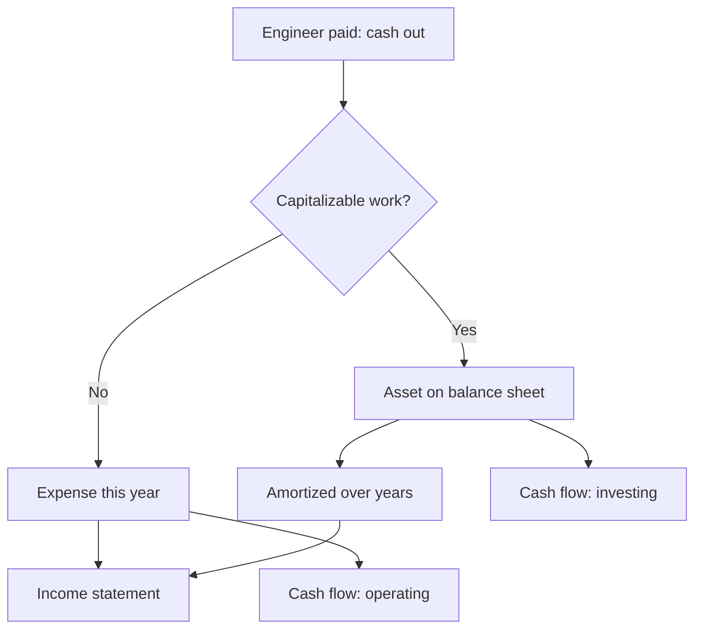
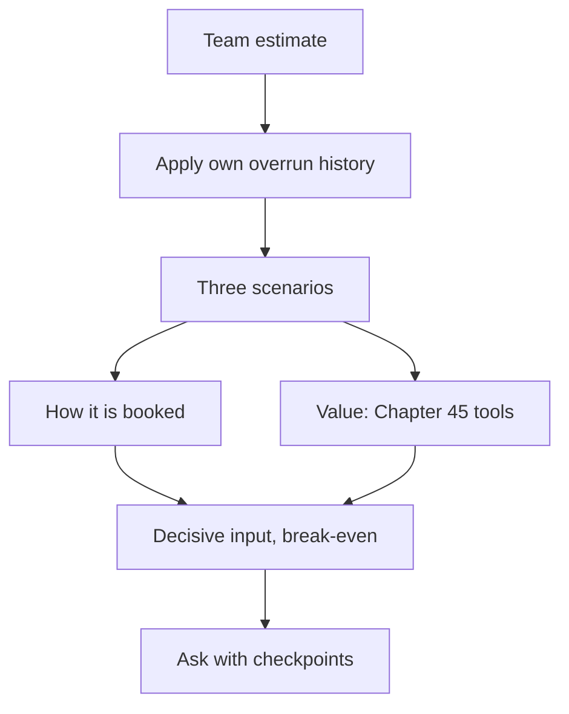
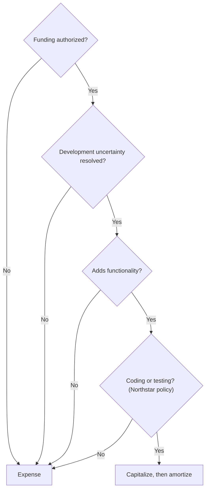

# Chapter 52 — Technology Investment, Budgeting, and Financial Literacy

A CTO controls one of the largest budgets in a software company and is often the executive least
practiced at reading where that money shows up. This chapter teaches the three
financial statements as a technology leader needs them, the engineering budget as an annual contract
with finance, the accounting choice between capitalizing and expensing software work, and the
investment case written with scenarios instead of a single hopeful number. Chapter 45 owns the
economics underneath (cost of delay, opportunity cost, payback, net present value); this chapter owns
how those economics are booked, budgeted, and defended. The running example is Victor Lindqvist, CTO
of the fictional [Northstar Technologies](../../case-studies/northstar/index.md), in quarter 4 of the
Engineering Director's first year, as Finance prepares the year-2 budget for the week 50 board.

## Why This Matters

At team scale, money is invisible. Engineers are paid whatever the team works on, and a manager can
go years without seeing a cost line. The first time a manager meets finance is often a request to tag
tickets for "capitalization" that nobody explains.

At organization scale, the director's budget is mostly people, and most of the job is spending it
well: allocation among product, prevention, and platform (Chapter 38), backfills and vacancy
(Chapter 48). Money becomes visible at the edges: a tooling purchase above the discretionary limit,
a cloud bill that grew, a request from the CFO for an output-per-engineer figure.

At executive scale, the CTO answers for a large share of operating expense and for numbers the board
reads directly. At Northstar, engineering personnel plus cloud and tooling are $20.3M a year, about 14
percent of revenue. The board reads that spending through operating income, EBITDA, and cash; the CFO
books part of it as an asset; investors may value the company on a multiple of a figure that
engineering's time sheets change. A CTO who cannot follow a dollar of engineering salary through the
income statement, balance sheet, and cash-flow statement cannot tell when an accounting presentation
makes an investment look cheaper than it is, and cannot defend a budget in the room where it is cut.

## Learning Objectives

After this chapter you will be able to:

- Read an income statement, balance sheet, and cash-flow statement and locate every place technology
  spending appears in them.
- Explain capitalized versus expensed software work, apply the current US standard's criteria to real
  work items, and predict the effect of a capitalization policy on operating income, EBITDA, and cash.
- Build an engineering budget in both views finance uses (by function and by accounting treatment),
  separate the forecast from the target, and defend it in variance reviews.
- Write an investment case with scenarios, stated assumptions, and the input that would change the
  decision, and show how it will be booked as well as what it is worth.
- Detect the common ways budgets and capitalization are gamed, including by engineering leaders.

## The Mental Model

> **Mental model:** One set of events, three lenses. The income statement asks whether the company
> earned money in a period, the balance sheet what it owns and owes at a moment, the cash-flow
> statement whether money actually arrived. Accounting choices, above all capitalization, move
> engineering spending between the lenses and across years. They change timing and presentation, not
> economics: the cash left when the engineers were paid, and the capacity was spent when they worked.

The first consequence: before arguing about any figure, ask which lens it comes from. "Engineering
personnel costs $16.1M" is a cash and budget figure; "R&D expense is $16.4M" is an income-statement figure that
includes other things and excludes the capitalized part. Both are right, and a CTO who confuses them
loses the argument to whoever does not.

The second consequence: the decision and the booking are separate questions. Chapter 45 decides
whether an investment is worth its capacity. This chapter adds how it will look in the statements and
the budget, which matters because executives and boards are measured on the statements. A project can
be a good decision and look expensive, or a poor one and look cheap.

| Path | Income statement | Balance sheet | Cash-flow statement |
|---|---|---|---|
| Expensed work | Full cost this year, inside R&D or cost of revenue | Nothing | Operating outflow this year |
| Capitalized work | Nothing until the software is in service, then amortization over its useful life (Northstar amortizes each year's amount over the following three years) | An asset that shrinks as it is amortized | Investing outflow this year; operating cash flow looks higher |

The cash leaves in the same week either way. What changes is which line shows it and in which year.

## Deep Conceptual Explanation

### The three statements, read by a technology leader

The US Securities and Exchange Commission's introductory guide names four main statements (balance
sheet, income statement, cash-flow statement, statement of shareholders' equity) and the identity
behind the balance sheet: assets equal liabilities plus shareholders' equity
([SEC, 2014](../../references/bibliography.md#sec2014beginners)). These are **standard** definitions.

**The income statement** reports revenue earned over a period and the costs of earning it; operating
profit is what remains after operating expenses are deducted from gross profit (SEC, 2014). Read it
top-down:

| Line | What it is | Where technology sits |
|---|---|---|
| Revenue | Subscription and services revenue recognized in the period | Service credits usually reduce it directly |
| Cost of revenue | Costs of delivering the service | Production hosting, support, third-party fees, often amortization of capitalized software |
| Gross margin | Revenue minus cost of revenue, as a share of revenue | Hosting efficiency and incident load move it |
| Operating expenses | Research and development (R&D), sales and marketing, general and administrative (G&A) | Most engineering salaries in R&D; corporate IT in G&A |
| Operating income | Gross profit minus operating expenses | The figure "flat operating expense" protects |
| EBITDA | Earnings before interest, tax, depreciation, and amortization | Adds back amortization, so capitalization raises it |

Revenue is not ARR: annual recurring revenue is the run rate of contracts in force at a moment
(Chapter 45), revenue what was earned over a period. They diverge whenever the business grows or
shrinks.

**The balance sheet** is a snapshot. Three lines matter to a CTO of a subscription company.
**Deferred revenue** is a liability: customers paid in advance for service not yet delivered. It is
why subscription companies can hold more cash than their profits suggest, and why a renewal lost to
unreliability stops cash before it stops revenue. **Capitalized software** is an asset: engineering
work expected to pay off over several years. **Cash** funds next year's choices.

**The cash-flow statement** has operating, investing, and financing sections. It shows whether the
company generated cash, which is related to but not the same as net income, and the operating section
adds back non-cash items such as depreciation (SEC, 2014). Capitalized software is an investing
outflow, so operating cash flow alone flatters a company that capitalizes heavily. **Free cash flow**,
in this book operating cash flow minus capital spending including capitalized software, removes that
effect; companies define the term differently, so ask which definition a deck uses.

Finance books for non-financial managers stress that these numbers rest on estimates and judgment, so
reading them well means knowing where the judgment sits
([Berman and Knight, 2006](../../references/bibliography.md#berman2006financial); idea level). For a
technology leader the largest such judgment is capitalization, and engineering supplies its data.

### Capitalized versus expensed software

**Expensing** puts a cost in the income statement when it occurs. **Capitalizing** records an asset and
spreads the cost over its useful life as amortization (SEC, 2014). Which software work qualifies is
answered by accounting standards, applied by finance, and checked by auditors. Engineering's job is to
describe the work accurately. This chapter is not accounting advice.

**US GAAP.** Software developed to be sold, leased, or licensed falls under ASC 985-20. Software for a
company's own operations, and software it uses to provide a service to customers (a "cloud computing
arrangement", which includes software as a service), falls under ASC 350-40, internal-use software
([FASB, 2025](../../references/bibliography.md#fasb2025asu202506), BC13). A software-as-a-service
company is, in accounting terms, mostly an internal-use software company.

The older guidance capitalized according to project stage: a preliminary stage (evaluating options),
an application development stage (design of the chosen path, coding, installation, testing), and a
post-implementation stage (training, maintenance). Stakeholders told the FASB that the stages did not
fit iterative development, which made it hard to decide when to start capitalizing, so Accounting
Standards Update (ASU) 2025-06 removes them. Capitalization now starts when management has authorized
and committed to funding the project and it is probable the project will be completed and the
software used as intended (FASB, 2025, Summary). That threshold is not met while **significant
development uncertainty** remains: novel or unproven features not yet resolved through coding and
testing, or significant performance requirements not yet identified or still being substantially
revised (paragraph 350-40-25-12A). Capitalization stops when the software is substantially complete.

| Capitalizable once the threshold is met | Expensed |
|---|---|
| Payroll and payroll-related costs of employees working directly on the project, for that time | General, administrative, and overhead costs |
| External direct costs (contractors, purchased software, related travel) | Training |
| Upgrades and enhancements that add functionality the software did not have | Maintenance, and minor upgrades not separable from it at reasonable cost |
| Software that converts old data for new systems | Other data conversion |

If completion stops being probable, capitalization stops and the asset is impaired; the standard
presumes uncompleted software is worth zero and lists signs such as no budgeted spending, unresolved
programming difficulties, and significant cost overruns (paragraph 350-40-35-3). An abandoned
capitalized project returns as a write-off. The update applies to annual periods beginning after
December 15, 2027, with early adoption allowed; the FASB expects little change for most software but
possibly less capitalization for software delivered as a cloud service (FASB, 2025, Summary). These are
**standard** statements; their application is a judgment for each company and its auditors.

**IFRS.** IAS 38 expenses research-phase spending and recognizes development-phase spending as an
asset when specified criteria are met; finite-life intangibles are amortized and tested for impairment
([IFRS Foundation, IAS 38](../../references/bibliography.md#ifrs-ias38), summary). The engineering
question is similar: is this new capability, with the uncertainty resolved?

**Evidence.** Aboody and Lev studied US companies capitalizing development of software to be sold under
the older standard. Capitalized amounts were associated with stock returns and the capitalized asset
with prices; they found no support for the claim that the judgment involved harms earnings quality;
analysts' forecast errors rose with capitalization intensity; and by 1995 amortization of past
capitalization roughly offset new capitalization's effect on reported profitability
([Aboody and Lev, 1998](../../references/bibliography.md#aboody1998software), abstract). That is a
**research finding** about public packaged-software companies decades ago, correlational, and not about
cloud software. Its last point generalizes by arithmetic.

### What capitalization does and does not change

Will Larson describes the practice from the engineering executive's seat: capitalizable work is
measured by ticket or by project, often a hybrid, while fixed percentages per role are viewed
skeptically by many finance teams and auditors. His three tests for a method are that it is easy to
justify to an auditor, available in time for reporting, and cheap to run for finance and engineering;
most finance teams, he notes, care more about compliance than about maximizing capitalization
([Larson, 2023b](../../references/bibliography.md#larson2023capitalize); **expert opinion**).

Four effects follow from the mechanics (**this book's recommendation** for reading them):

1. **Cash and capacity do not change.** A capitalized engineer-week costs the same cash and displaces
   the same alternative as an expensed one.
2. **EBITDA rises by the full capitalized amount** every year, compared with expensing.
3. **Operating income rises only while capitalization grows.** In steady state, amortization roughly
   equals new capitalization, the arithmetic Aboody and Lev observed.
4. **Capitalization creates obligations**: an amortization tail later years absorb, and an impairment
   if a project is abandoned.

Effect 2 makes capitalization a board topic wherever the company is valued on EBITDA.

### The engineering budget

A budget is a quantitative plan of when and how much cash or other resources will be received and
spent; it serves communication, planning, control, and evaluation of managers. The same textbook names
the recurring problems (**practitioner consensus**, in textbook form): top-down budgets are drawn up by people who do not know the operations,
bottom-up ones by people who may misunderstand the strategy, padding creates budgetary slack, and
managers may set targets low enough to be sure of hitting them
([Franklin et al., 2019](../../references/bibliography.md#franklin2019managerial)). Larson
divides executive planning into an annual financial plan including headcount, a portfolio allocation of
engineering capacity, and a roadmap agreed with product and sales, and recommends changing allocations
rarely, partly because frequent changes make teams compete for them
([Larson, 2023a](../../references/bibliography.md#larson2023planning); **expert opinion**). Within that
annual plan, the engineering budget is the part a CTO is expected to own.

Finance needs the engineering budget in two views at once:

| View | Lines | Reader |
|---|---|---|
| By function and kind | Seats, contractors, production hosting, development tooling, licenses | CTO, finance planning, the board's operating plan |
| By accounting treatment | Cost of revenue or operating expense; expensed or capitalized; recurring or one-time | Controller, auditors, the board's income statement |

Four distinctions decide most budget arguments:

- **Budget, forecast, and target differ.** The budget is the approved plan, the forecast the current
  best estimate, a target what someone is rewarded for. Hansen, Otley, and Van der Stede describe two
  practitioner responses to budgeting's shortcomings: improve the process, addressing planning
  problems, or abandon the budget, addressing performance-evaluation problems
  ([Hansen et al., 2003](../../references/bibliography.md#hansen2003budgeting), abstract); Hope and
  Fraser argued for abandonment
  ([Hope and Fraser, 2003](../../references/bibliography.md#hope2003budgets), summary). Most CTOs work
  inside an annual budget regardless. The usable lesson (**this book's recommendation**): reward nobody
  for the forecast, so it can move honestly while the budget stays fixed.
- **Fixed versus variable.** Salaries are fixed within the year; hosting varies with load and with
  engineering decisions. The FinOps Foundation frames cloud cost management as shared financial
  accountability between engineering, finance, and business teams
  ([FinOps Foundation](../../references/bibliography.md#finops-what-is)). A variable cost needs an owner
  who sees it weekly.
- **Committed versus discretionary.** Last year's hiring commits most of the budget, which is why small
  discretionary caps, such as Northstar's $250,000 tooling allowance, matter.
- **Seats versus dollars.** Seat budgets hide vacancy, approved money unspent and capacity lost
  (Chapter 48); dollar budgets expose it and tempt finance to bank it.

**Variance**, the gap between budget and actual, has three possible causes: the plan was wrong,
conditions changed, or execution differed. Vacancy underspend is not efficiency; a cloud overspend
from a new customer's load may be good news. Credibility comes from explaining variances before
finance finds them.

### Investment cases with scenarios

Chapter 45 owns valuation and the
[technology investment business case template](../../templates/technology-investment-business-case.md)
gives the fields. A CTO-level case adds scenarios, the booking, and protection against the author's
own bias.

Flyvbjerg explains inaccurate project forecasts by optimism bias, an unintended tendency to judge the
future more favorably than experience warrants, and strategic misrepresentation, deliberately
understating costs to win approval; his remedy, reference class forecasting, places a project in the
distribution of outcomes of comparable past projects
([Flyvbjerg, 2006](../../references/bibliography.md#flyvbjerg2006nobel)). His evidence is public
infrastructure, not software, so the transfer is **this book's recommendation**: use your own
organization's estimate history as the reference class. Kahneman, Lovallo, and Sibony are known for a
checklist a decision maker runs against a team's proposal to expose its biases
([Kahneman et al., 2011](../../references/bibliography.md#kahneman2011bigdecision); idea level).

| Scenario | Built from | Purpose |
|---|---|---|
| Base | The estimate, uplifted by the organization's typical overrun | What you expect |
| Pessimistic | Top of the range, worst observed overrun, the most likely failure | What you would have to absorb |
| Optimistic | Bottom of the range, no overrun | What the sponsor believes |

Two further lines separate a CTO case from a team request: **the booking** (expensed or capitalized,
cost of revenue or operating expense, one-time or recurring, inside or outside the envelope), and **the
decisive input with its break-even**, computed with Chapter 45's tools and the sensitivity testing the
finance textbook recommends
([Dahlquist and Knight, 2022](../../references/bibliography.md#dahlquist2022finance)).

The ask ends in checkpoints, where Chapter 49's staging meets the budget: each checkpoint releases or
holds funds.

## Engineering Organization Example

The following figures are **illustrative**. Northstar's ARR, gross margin, engineering costs, service
credits, discount rate, and the statements below are canon
([first quarter page](../../case-studies/northstar/first-quarter.md), Finances); all are fictional.
Northstar's fiscal year coincides with the director's year (FY1 is weeks 1 to 52), it reports under
US GAAP, and its statements are audited. In week 46, Rajiv Menon (CFO) sends the executive team
Finance's FY1 latest estimate (quarters 1 to 3 actual, quarter 4 forecast) and the draft FY2 envelope
for the week 50 board. You are Victor Lindqvist in week 47, reading it before your one-on-one with
Rajiv.

**The income statement, FY1 latest estimate ($M).**

| Line | FY1 LE | Note |
|---|---|---|
| Subscription revenue, net of service credits | 140.0 | ARR roughly flat at about $140M |
| Professional services revenue | 5.0 | Implementation and onboarding |
| **Total revenue** | **145.0** | |
| Cost of revenue | 40.6 | Support and success 18.0, services staff 8.5, payment and data fees 6.0, production hosting 3.1, amortization of capitalized software 2.1, other 2.9 |
| **Gross profit** | **104.4** | 72 percent gross margin |
| Research and development | 16.4 | Engineering personnel expensed 13.7, development tooling 1.1, product management 1.6 |
| Sales and marketing | 46.0 | |
| General and administrative | 21.0 | Includes corporate IT and Joon Park's security function |
| **Operating income** | **21.0** | 14.5 percent of revenue |
| EBITDA | 23.9 | 21.0 + 2.1 amortization + 0.8 depreciation |
| Net income | 16.8 | After 1.4 interest income and 25 percent tax |

**Where the $20.3M of engineering spending is.** Of the $16.1M of personnel, $13.7M is R&D expense and
$2.4M is capitalized (about 15.3 FTE-years at $157,250, which is 85 percent of the $185,000 fully loaded
cost, because office, equipment, and recruiting overhead may not be capitalized). Of the $4.2M of cloud
and tooling, production hosting ($3.1M) is in cost of revenue and development tooling ($1.1M) in R&D.
Earlier years' capitalized work returns as $2.1M of amortization in cost of revenue. No line equals
engineering's budget, so the two views need a reconciliation the CTO and the controller both sign.

**What the credits did.** Service credits are netted against revenue, so every dollar of credit is a
dollar of operating income. The baseline quarter's $410,000 ran at $1.64M a year; quarter 3's $60,000
runs at $240,000. The difference, about $1.4M a year, is 6.7 percent of FY1 operating income
($1.4M ÷ $21.0M), with no headcount added: the year-1 quality program in the CFO's lens.

**The balance sheet ($M).**

| Line | End FY0 | End FY1 LE |
|---|---|---|
| Cash | 56.0 | 73.5 |
| Accounts receivable | 17.0 | 17.5 |
| Prepaid and other | 3.0 | 3.0 |
| Capitalized software, net | 4.4 | 4.7 |
| Property and equipment, net | 2.4 | 2.4 |
| **Total assets** | **82.8** | **101.1** |
| Payables and accrued expenses | 6.0 | 6.2 |
| Accrued compensation | 7.0 | 7.3 |
| Deferred revenue | 54.0 | 55.0 |
| **Total liabilities** | **67.0** | **68.5** |
| **Shareholders' equity** | **15.8** | **32.6** |

Deferred revenue is about 39 percent of ARR because most customers pay a year in advance: $55M of
service Northstar owes, and the reason a lost renewal reaches cash before revenue. Equity rose by 16.8,
exactly net income, since there were no distributions or new investment.

**The cash-flow statement, FY1 LE ($M).** Net income 16.8, plus amortization and depreciation 2.9,
plus working capital 1.0 (mostly the growth in deferred revenue) gives operating cash flow of 20.7.
Investing: capitalized software −2.4 and equipment −0.8. Financing: none. Cash rises by 17.5; free cash
flow is 17.5.

**The capitalization test.** Finance has capitalized $1.8M, $2.1M, $2.4M, and $2.4M in FY−2 to FY1,
amortizing each year's amount over the next three years:

| FY1 measure | As reported | If everything were expensed | Change |
|---|---|---|---|
| Operating income | 21.0 | 20.7 | −0.3 (capitalized 2.4 minus amortization 2.1) |
| EBITDA | 23.9 | 21.5 | −2.4 |
| Operating cash flow | 20.7 | 18.3 | −2.4 (ignoring tax effects) |
| Free cash flow | 17.5 | 17.5 | none |

Northstar's capitalization is in steady state: it barely moves operating income, moves EBITDA by 10
percent, and changes no cash. If Calder Ridge Partners or a future buyer values Northstar on EBITDA,
the policy is worth real money, and the engineering time data under it is a CTO responsibility.

**What Victor takes to Rajiv.** A reconciliation of the $20.3M to the statements, so "engineering
cost" means one thing in the board pack; the credits line as the year-1 result in operating-income
terms; and a warning. If the year-2 pack compares investments by income-statement cost, prevention will
look far more expensive than features: a prevention engineer-year shows $185,000 of expense in the
year, a fully capitalized feature engineer-year only the $27,750 of overhead that cannot be capitalized,
with the rest arriving as amortization later. The cash is identical. Victor asks that the pack compare
investments in cash and capacity and show the accounting effect separately.

## Decision Framework

Use the lens that fits the question, and say which one you are using.

| Question | Lens | Figure | Common mistake |
|---|---|---|---|
| Can we afford it this year? | Budget and cash | Cash cost, inside or outside the envelope | Treating capitalized cost as "not really spent" |
| Is it worth doing? | Economics (Chapter 45) | Capacity at the fully loaded rate, value, cost of delay | Letting the booking decide the economics |
| How will the board see it? | Income statement and EBITDA | Expensed cost, amortization, capitalized amount | Presenting only the most flattering line |
| What does it commit us to later? | Balance sheet and future budgets | Amortization tail, recurring run cost, impairment risk | Ignoring year-2 and year-3 effects |
| Did we execute? | Variance against budget and forecast | Explained variance by cause | Calling vacancy savings efficiency |

For classifying work, Northstar's policy (coding and testing on budget-authorized projects that add
functionality) sits inside the current, stage-based guidance, which Finance still applies; the amended
standard Finance is assessing reaches similar answers for these items, with its threshold shown below.
Engineering describes the work; finance and the auditors decide.

| Northstar work item | Likely treatment (Northstar policy) | Why |
|---|---|---|
| Bulk ordering, after scope was fixed | Capitalize the coding and testing | Authorized, requirements settled, new functionality |
| Its discovery and prototyping weeks | Expense | Preliminary stage under the current guidance; unresolved requirements under the amended one |
| Prevention allocation, incident response, flaky-test repair | Expense | Maintenance; no new functionality |
| Permissions extraction inside Core | Expense, unless it delivers new capability | Restructuring that the software could already do |
| Core framework migration (TR-01) | Expense | Keeps existing function on a supported version |
| Training the quality engineers | Expense | Training is excluded |
| Internal tool for service-credit statements | Capitalize if authorized and probable | Internal-use software for Northstar's own operations |

Two guards (**this book's recommendation**): a work item's treatment is recorded when the project is
authorized, not argued after the quarter closes; and the person who benefits from a classification is
never its only author.

## Trade-offs

**Capitalizing versus expensing.** Capitalization raises EBITDA and, while growing, operating income,
which some investors and lenders reward. It costs time tracking, audit scrutiny, an amortization tail,
and impairment risk. Expensing everything is simpler and conservative but understates investment in
the product. The choice is finance's within the standard; the CTO owes accurate data and visible
consequences.

**Tracking precision versus its cost.** Ticket tagging is defensible but noisy and resented; project
codes are cheaper and coarser; role percentages are cheapest and least trusted by auditors (Larson,
2023b). Use the cheapest method the auditor accepts, and keep it stable.

**Annual budget versus rolling forecast.** An annual budget is a stable contract and yardstick; a
rolling forecast adapts but needs continual updating (Franklin et al., 2019). The common hybrid, an
annual budget with quarterly reforecasts, works if nobody is paid on the forecast.

**Seats versus dollars.** Budget in seats to protect capacity, and report vacancy in dollars with an
agreed rule for its use.

**Cloud commitments versus flexibility.** A committed-use discount lowers unit cost and turns a variable
cost into a fixed one: right for a stable baseline, wrong for load you may move or remove.

## Failure Modes

**Capitalization drift.** Maintenance relabeled as enhancement as targets tighten. Signal: the
capitalized share rises while unplanned work is flat or rising. Detect: reconcile the capitalized share
with the capacity model's categories each quarter.

**The amortization tail and impairment surprise.** A heavy capitalization year flatters itself and
burdens the next three; a stalled project shows the standard's impairment signs (no budgeted spending,
unresolved difficulties, large overruns) and becomes an unplanned write-off. Detect: a three-year
amortization schedule with every budget, and a review of capitalized projects at each stage gate.

**Sandbagging and use-it-or-lose-it.** Padding creates slack, finance answers with across-the-board
cuts, and everyone pads more; quarter 4 purchases cluster to protect next year's baseline. Detect:
publish forecast accuracy by line, and allow justified underspend to carry forward by agreement.

**Vacancy counted as efficiency.** Unfilled-seat underspend reported as savings and removed from next
year's budget, which then cannot fund the seats. Detect: report vacancy separately, in weeks and dollars.

**EBITDA mistaken for cash.** A plan that "improves EBITDA" by capitalizing more spends the same cash.
Detect: free cash flow next to EBITDA in every board view.

**The single-point case.** One number, written by its sponsor, equal to the budget request. Detect:
require three scenarios built from the organization's own overrun history.

**The unowned variable cost.** Cloud spend reviewed annually by finance instead of weekly by the teams
whose decisions drive it. Detect: weekly cost per service with a named owner.

## Enterprise Application

In an organization of 50 to 150 engineers, financial literacy is a practice shared by the engineering
leader, a finance business partner, and the controller.

- **One reconciliation** from the engineering budget to the three statements, agreed with the
  controller and updated quarterly; every engineering number in the board pack comes from it.
- **A written capitalization method**: which projects are authorized as capitalizable, how time is
  recorded, who classifies a project and when, how the capacity model's categories map to accounting
  treatment, and how the method was explained to the auditor. Reviewed annually and when the standard
  changes, as it does with ASU 2025-06.
- **A quarterly variance and reforecast review** inside the operating reviews of
  [Chapter 39](../08-management-operating-system/39-reviews-decision-logs-escalation-and-executive-reporting.md):
  variance by cause, vacancy in weeks and dollars, cloud cost per service.
- **A case threshold**: above a set size (say a quarter of a team's capacity, or anything outside the
  discretionary allowance), the business case template with scenarios and the booking line.

The transition costs a quarter to agree the reconciliation and method, and engineers' goodwill if time
tracking is imposed without its purpose. Track at the coarsest level the auditor accepts.

## CTO Perspective

First, **the CTO negotiates the envelope, not the lines.** The board approves an operating plan and a
budget envelope; management allocates inside it. Leverage is greatest while Finance assembles the
draft and smallest after the board meets, when every change is a reallocation from a peer.

Second, **the CTO answers for the integrity of engineering's numbers in the statements.** Capitalization
rests on engineering's records; if the method cannot survive an audit or due diligence ([Chapter 55](55-boards-due-diligence-and-executive-decision-making.md)),
the CTO's credibility falls with it. Where finance prefers maximization to compliance, the CTO is the
person who says no.

Third, **the CTO translates between economics and accounting.** Capacity is priced by what it displaces
(Chapter 45), but executives are measured in accounting terms. Presenting investments in cash and
capacity, with the accounting effect separate, prevents a quiet bias toward whatever is capitalizable.

Fourth, **technology strategy becomes a capital allocation story.** [Chapter 51](51-enterprise-technology-strategy.md)'s three-year strategy
needs this chapter's financial form: cash per horizon, the recurring share, the booking, and the effect
on margin, EBITDA, and free cash flow.

## Practical Playbook

1. **Meet the controller.** Get the audited statements, the accounts engineering touches, and the
   capitalization policy in writing.
2. **Build and agree the reconciliation** from the engineering budget to each statement.
3. **Learn three numbers**: gross margin, operating margin, and what the company is valued on.
4. **Map capacity categories to accounting treatment** before the year starts.
5. **Choose the cheapest tracking the auditor accepts**, write it down, and keep it stable.
6. **Budget in both views**, with a three-year amortization schedule.
7. **Separate budget, forecast, and target**; publish forecast accuracy by line.
8. **Report vacancy and variable cost** each quarter, with causes.
9. **Write large investments with three scenarios**, the booking line, and the decisive input's
   break-even, uplifted by your own estimate history.
10. **Lead with cash and capacity** in every executive and board document; accounting effect second.

[Project 8](../../projects/p8-cto-technology-investment-proposal.md) applies this playbook: you build a
CTO technology investment proposal for Northstar, with scenarios and an accounting note.

## Case Study

This case is **illustrative**. The register item TR-01, its 120 to 180 engineer-day estimate, the $800
engineer-day rate, the 15 to 35 percent growth of Orders' features between start and delivery, the
10 percent discount rate, the quarter 4 calendar, the TR-01 cost scenarios, and the year-2 budget draft
are canon. The extended-support price is an assumption for this case. Nothing is decided: the week 50 board's
decision on the year-2 envelope is not recorded, and neither is whether TR-01 is funded.

**The situation.** You are Victor Lindqvist in week 48. TR-01 has been on the technology risk register
since quarter 2: Core's application framework is a major version past free community support, with no
extended support bought (Chapter 30). The migration is estimated at 120 to 180 engineer-days. The
draft year-2 envelope holds engineering personnel at $16.73M at full seats ($16.10M, plus a 3 percent
merit increase of $0.483M and a $0.15M reserve for promotions and market adjustments: $16.733M), $16.31M
after Chapter 48's expected vacancy of $0.427M ($16.733M − $0.427M = $16.306M), and cloud and tooling at $4.2M, inside which Rajiv Menon wants
the quality continuation's $150,000 of tooling offset. You must decide whether TR-01 is a funded item
in the year-2 plan, and how to describe it to Rajiv and, if asked, the board.

**Three scenarios.** Northstar has a small reference class of its own: recent features grew 15 to 35
percent between start and delivery. Using it as the uplift (a judgment, since a framework migration is
not a feature):

| Scenario | Engineer-days | Cost at $800 | Engineer-weeks displaced | Story |
|---|---|---|---|---|
| Optimistic | 120 | $96,000 | 24 | Low end, no growth |
| Base | about 190 | $152,000 | 38 | Midpoint 150 × 1.25 |
| Pessimistic | about 243 | $194,400 | about 49 | 180 × 1.35, plus a regression found late |

**The booking.** The migration adds no functionality, so it is expensed: $96,000 to $194,400 of FY2
operating expense, 0.5 to 0.9 percent of FY1 operating income. The personnel are already budgeted, so
it reallocates capacity rather than adding money. Bundling it with a feature to capitalize part of it
would be capitalization drift.

**The alternative.** Extended commercial support, priced here at an assumed $60,000 a year (the
illustrative figure Chapter 30's exercise uses; no quote exists), is also operating expense, but new
money: it falls outside the personnel budget and inside the $4.2M Rajiv wants held flat. It buys time
and patches; it does not remove the obligation to migrate.

**The decisive input.** The economic case rests on the expected loss the migration avoids: unpatched
vulnerabilities in a tier 1 framework, under remediation service levels of 7 days for critical
internet-facing issues (Chapter 26), with no upstream fix. At the base cost, the migration breaks even
over three years at Finance's 10 percent rate if it avoids an expected loss of about $61,100 a year
($152,000 ÷ 2.487, Chapter 45's annuity factor), for example a 1-in-10 annual chance of a $611,000
event. Nobody at Northstar can yet defend a probability, so the case states the break-even and asks
Joon Park and Ines Carvalho whether they believe the risk exceeds it.

**The real price.** Money is not the constraint: 24 to 49 engineer-weeks of the few people who can
change Core safely are, displacing other Core work for one or two quarters. That opportunity cost is
the line Amara Okafor will read first.

**Victor's draft note to Rajiv (one possible version).** "TR-01 is a reallocation inside the personnel
budget, not new money: base cost $152,000 of capacity (range $96,000 to $194,000), expensed, with no
effect on cash beyond salaries we already pay. The alternative, extended support at an assumed $60,000
a year, would be new operating expense inside cloud and tooling and still leaves the migration ahead
of us. I propose funding TR-01 from Core capacity in quarters 5 and 6, with a checkpoint after the first
40 engineer-days that compares progress with the scenarios; if it is tracking pessimistic, we decide
then whether to buy support for a year. The price is about 38 engineer-weeks of Core work; Amara and I
will name what moves."

**What is open.** Whether Victor sends that note, whether Rajiv accepts a capacity-funded item in an
envelope he wants flat, how the item interacts with the quality continuation's stage 2 (Chapter 49)
and the year-2 organization (Chapters 35 and 36), and what the week 50 board approves.

## Exercises

Worked solutions are in the [Chapter 52 solutions](../../solutions/ch52-solutions.md).

### Foundational

**F1.** Using Northstar's FY1 latest estimate in the Engineering Organization Example, compute gross
margin, operating margin, EBITDA margin, and free cash flow as a share of revenue. Then explain to an
engineering manager, in no more than five sentences, why operating cash flow (20.7) is higher than net
income (16.8), and why that does not mean Northstar is hiding profit.

**F2.** Classify each of the following Northstar work items as capitalize, expense, or "depends, ask
finance", and give the reason in one line under Northstar's policy and the amended standard: the accounting-system
integration's new erp-sync connector; the 140 quarantined flaky tests and their fixes; the contract
tests on tier 1 boundaries; the self-service test environments Platform Operations built; and the
proposed deployment-event store. Add two hypothetical items that are not canon: suppose Orders had
spent six weeks defining bulk ordering's scope with the renewal customer before the requirements
settled, and suppose a migration of customer records into a new schema needed a one-off data
conversion.

**F3.** Suppose Finance proposed that Northstar stop capitalizing entirely from the start of FY2, while
the engineering work stays the same as in FY1. Using the chapter's capitalization history, describe
the effect on FY2 operating income, EBITDA, operating cash flow, and free cash flow, and explain which
of those changes Calder Ridge Partners would care about and why.

### Applied Leadership

**A1.** Rajiv Menon wants the quality continuation's $150,000 of stage 2 tooling offset inside the
$4.2M cloud and tooling budget. Draft three offset options (one in production hosting, one in
development tooling, one using expected personnel vacancy), with the assumptions each requires, its
effect on gross margin or operating expense, and its risk. Recommend one and write the paragraph you
would send Rajiv.

**A2.** Chapter 30's tax-svc decision has three options: build out (120 engineer-days upfront, then 0.5
FTE a year), buy a commercial engine ($150,000 a year subscription, 80 engineer-days of integration,
0.15 FTE), or a hybrid ($45,000 a year rate content, 70 engineer-days, 0.25 FTE). For year 1 of each,
show the likely effect on operating expense, EBITDA, and cash, assuming the build-out's upfront work is
capitalizable and the integrations are not. Then explain which option each of Rajiv Menon, Greg Tanaka,
and Victor Lindqvist would find most attractive on those figures, and why the figures should not
decide it.

**A3.** In week 47, Greg Tanaka argues that moving 2 of the 6 prevention engineers to his deal features
in quarters 5 and 6 "costs the company nothing and actually improves profit, because feature work gets
capitalized". Using the chapter's figures, assess each part of that claim, and write the three or four
sentences the director should put in the continuation proposal so the executive team compares the
options correctly.

### Executive Decision-Making

**X1.** You are Victor Lindqvist in week 48. Using the Case Study, decide whether to put TR-01 in the
year-2 plan, buy extended support, or do both in sequence, and set the checkpoint rule. Then write the
two-sentence version you would use if a board member asked about it in week 50, and state what evidence
would make you reverse your decision during year 2.

**X2.** Suppose, hypothetically, that you are CTO of Halvard Systems (500 engineers, payroll about
$102.9M) and the CFO proposes raising the capitalized share of engineering payroll from 18 to 28
percent ahead of a debt refinancing priced on EBITDA, by reclassifying platform and reliability work as
enhancements. This scenario is not part of the Halvard canon. Quantify the effect on EBITDA and cash,
assess it against the standard's criteria, and write your response to the CFO, including what you
would offer instead.

## Reflection Questions

1. Could you reconcile your organization's engineering budget to the income statement today? If not,
   who in your company can, and what does that say about who controls engineering's story?
2. Which of your organization's projects would look different if prevention and features were compared
   in cash and capacity rather than income-statement cost?
3. When did you last pad an estimate, and what in your budget process rewarded it?
4. Does anyone in engineering see the cloud bill weekly? If cost were a quality attribute, who would
   own it?
5. If an auditor or an acquirer asked tomorrow how your capitalized hours were recorded, would the
   answer survive the question that follows?

## Key Takeaways

- One set of events, three lenses: income statement, balance sheet, cash flow. Say which lens a
  number comes from before arguing about it.
- Capitalization changes timing and presentation, never cash or capacity. Decide on economics; report
  the booking separately.
- In steady state, capitalization barely moves operating income but raises EBITDA by the full
  capitalized amount. Know your company's rate and its trend.
- Software-as-a-service development falls under US internal-use software guidance; capitalization
  starts at authorized funding and probable completion, covers direct work on new functionality, and
  excludes maintenance, training, and overhead. Finance and auditors decide; engineering's records must
  be accurate.
- Build the budget in two views, by function and by accounting treatment, with one reconciliation
  table both the CTO and the controller sign.
- Keep budget, forecast, and target separate, and report vacancy and variable cost explicitly.
- Write investment cases with three scenarios, your organization's own overrun history, the booking
  line, and the decisive input's break-even.
- Service credits are refunded revenue: reliability improvements reach operating income dollar for
  dollar, which is often the strongest sentence a CTO can give a board.

## References and Further Reading

- [SEC, 2014](../../references/bibliography.md#sec2014beginners). The SEC's beginners' guide to the
  financial statements; clear standard definitions, free.
- [FASB, 2025](../../references/bibliography.md#fasb2025asu202506). ASU 2025-06 on internal-use
  software; its four-page summary is readable by engineers and states the new capitalization threshold.
- [IFRS Foundation, IAS 38](../../references/bibliography.md#ifrs-ias38). The international standard
  for intangible assets, for companies reporting under IFRS.
- [Aboody and Lev, 1998](../../references/bibliography.md#aboody1998software). The classic study of
  software capitalization and investors; read for the steady-state effect and its limits.
- [Larson, 2023b](../../references/bibliography.md#larson2023capitalize). An engineering executive's
  practical account of capitalization tracking methods and how to choose one.
- [Larson, 2023a](../../references/bibliography.md#larson2023planning). Annual financial planning from
  the engineering executive's seat: the annual plan, portfolio allocation, and roadmap.
- [Larson, 2024](../../references/bibliography.md#larson2024primer). The engineering executive's job
  as a whole, including planning.
- [Franklin et al., 2019](../../references/bibliography.md#franklin2019managerial). An open textbook
  chapter on why and how managers budget, including slack and gaming.
- [Hansen et al., 2003](../../references/bibliography.md#hansen2003budgeting). Research perspective on
  improving versus abandoning budgets.
- [Hope and Fraser, 2003](../../references/bibliography.md#hope2003budgets). The case against
  traditional budgeting, from the Beyond Budgeting movement.
- [Berman and Knight, 2006](../../references/bibliography.md#berman2006financial). Financial
  statements for non-financial managers, with an emphasis on where judgment enters.
- [Flyvbjerg, 2006](../../references/bibliography.md#flyvbjerg2006nobel). Optimism bias, strategic
  misrepresentation, and reference class forecasting; the basis for scenario uplifts.
- [Kahneman et al., 2011](../../references/bibliography.md#kahneman2011bigdecision). Checking a team's
  recommendation for bias before a large decision.
- [Dahlquist and Knight, 2022](../../references/bibliography.md#dahlquist2022finance). Payback and NPV,
  with the advice to test sensitivity.
- [FinOps Foundation](../../references/bibliography.md#finops-what-is). The practitioner framework for
  shared financial accountability in cloud spending.
