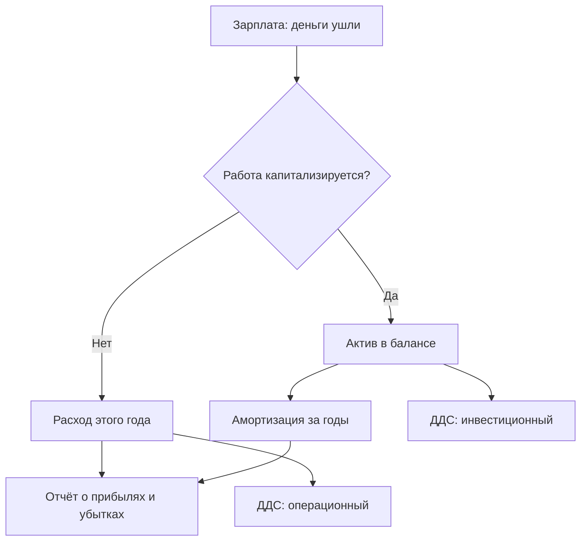
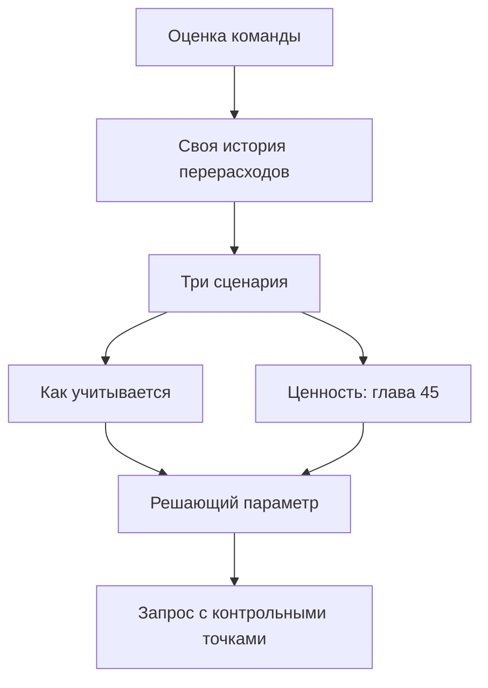
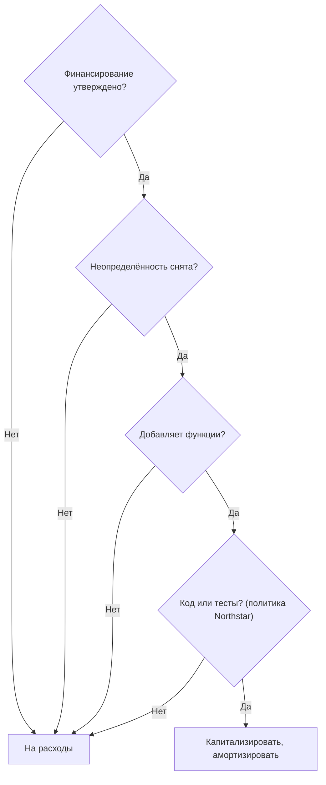

# Глава 52 — Инвестиции в технологии, бюджетирование и финансовая грамотность { #chapter-52-technology-investment-budgeting-and-financial-literacy }

CTO распоряжается одним из крупнейших бюджетов софтверной компании, но часто хуже других руководителей
понимает, где эти деньги отражаются в отчётности. Глава не предполагает финансовой подготовки. Она
объясняет три финансовых отчёта, а бюджет разработки показывает как годовой договор с финансами. Затем
разбирает выбор между капитализацией работ над ПО и их списанием на расходы и учит писать инвестиционное
обоснование со сценариями, а не с одним оптимистичным числом. Сквозной пример — Victor Lindqvist, CTO
(технический директор) вымышленной компании [Northstar Technologies](../../case-studies/northstar/index.md),
в квартале 4 первого года директора по разработке, когда финансы готовят бюджет года 2 к заседанию
совета директоров на неделе 50.

Связанные главы: [45](../10-business-leadership/45-business-models-and-engineering-economics.md)
(экономика, на которую опирается эта глава: стоимость задержки, срок окупаемости, чистая приведённая
стоимость), 48 (вакансии и планы по персоналу) и 49 (поэтапное финансирование).

## Почему это важно { #why-this-matters }

**В команде** денег не видно. Инженерам платят, чем бы ни занималась команда, а первая встреча
руководителя с финансами часто сводится к просьбе, ничем не объяснённой, помечать тикеты для
«капитализации».

**В организации** бюджет директора — это в основном люди, и задача директора — разумно его тратить
(главы 38 и 48). Деньги видны только по краям: покупка инструментов сверх лимита, выросший счёт за
облако, просьба CFO назвать выпуск на одного инженера.

**Для высшего руководства** CTO отвечает за большую долю операционных расходов и за цифры, которые совет
директоров читает напрямую. В Northstar инженерный персонал вместе с облаком и инструментами обходится в
$20,3 млн в год, около 14% выручки. Совет видит эти расходы через операционную прибыль,
[EBITDA](../../glossary.md#ebitda) (прибыль до вычета процентов, налогов и амортизации) и денежные
средства. Часть расходов CFO отражает как актив, а инвесторы могут оценивать компанию по мультипликатору
показателя, который зависит от табелей учёта времени инженеров. CTO, который не может проследить доллар
зарплаты через три отчёта, не заметит, когда в бухгалтерском представлении инвестиция выглядит дешевле,
чем есть. И не сможет защитить бюджет там, где его урезают.

## Цели главы { #learning-objectives }

После этой главы вы сможете:

- Читать отчёт о прибылях и убытках, баланс и отчёт о движении денежных средств и находить в них все
  места, где отражаются расходы на технологии.
- Объяснять разницу между капитализацией работ над ПО и их списанием на расходы, применять критерии
  действующего американского стандарта к реальным задачам и предсказывать, как политика капитализации
  скажется на операционной прибыли, EBITDA и денежных средствах.
- Составлять бюджет разработки в обоих разрезах, которыми пользуются финансы (по функциям и по способу
  учёта), отделять прогноз от цели и защищать бюджет на разборах отклонений.
- Писать инвестиционное обоснование со сценариями, явными допущениями и входным параметром, который
  изменил бы решение, и показывать не только ценность инвестиции, но и то, как она будет учтена.
- Замечать распространённые способы подгонки бюджетов и капитализации, в том числе со стороны
  руководителей разработки.

## Ментальная модель { #the-mental-model }

> **Ментальная модель:** один набор событий, три ракурса. Отчёт о прибылях и убытках отвечает на вопрос,
> заработала ли компания деньги за период; баланс — чем она владеет и что должна в конкретный момент;
> отчёт о движении денежных средств — пришли ли деньги на самом деле. Учётные решения, и прежде всего
> капитализация, переносят расходы на разработку между ракурсами и между годами. Они меняют момент
> признания и подачу, но не экономику: деньги ушли, когда инженерам заплатили, а ресурс был потрачен,
> когда они работали.

Первое следствие: прежде чем спорить о любой цифре, спросите, из какого она ракурса. «Инженерный
персонал стоит $16,1 млн» — это цифра денежных средств и бюджета. «Расходы на R&D составляют
$16,4 млн» — цифра из отчёта о прибылях и убытках: она включает и другие статьи, а капитализированную
часть не включает. Верны обе.

Второе следствие: решение и его учёт — разные вопросы. Глава 45 отвечает, стоит ли инвестиция того
ресурса, который на неё уйдёт; эта глава добавляет, как инвестиция будет выглядеть в отчётах, по которым
оценивают руководителей. Хороший проект может выглядеть дорогим, а плохой — дешёвым.

| Путь | Отчёт о прибылях и убытках | Баланс | Отчёт о движении денежных средств |
|---|---|---|---|
| Работа списана на расходы | Полная стоимость в этом году, в R&D или в себестоимости выручки | Ничего | Операционный отток в этом году |
| Работа капитализирована | Ничего, пока ПО не введено в эксплуатацию, затем амортизация в течение срока полезного использования (Northstar амортизирует сумму каждого года в течение трёх следующих лет) | Актив, который уменьшается по мере амортизации | Инвестиционный отток в этом году; операционный денежный поток выглядит выше |

В обоих случаях деньги уходят в одну и ту же неделю. Меняется только то, в какой строке и в каком году
они видны.

!!! note "Термины этой главы"
    - **Амортизация (amortization и depreciation)**: распределение стоимости актива на годы, в течение
      которых он используется. По-английски amortization относится к нематериальным активам, например
      к капитализированному ПО, а depreciation — к материальным, например к ноутбукам и серверам;
      по-русски обе называют амортизацией (нематериальных активов, НМА, и основных средств, ОС). Ни та
      ни другая не означает денежного платежа.
    - **[Полная стоимость сотрудника](../../glossary.md#fully-loaded-cost)** (fully loaded cost): полная
      годовая стоимость одного сотрудника, то есть зарплата плюс льготы, налоги на фонд оплаты труда и
      расходы на рабочее место. Northstar берёт $185 000 на инженеро-год.
    - **Оборотный капитал (working capital)**: деньги, связанные в повседневной деятельности, например
      суммы, которые должны клиенты, за вычетом сумм, которые компания должна поставщикам. Когда клиенты
      больше платят вперёд, оборотный капитал высвобождает деньги.
    - **Финансовый контролёр (controller)**: руководитель в финансах, который ведёт учёт, закрывает каждый
      период и работает с аудиторами; обычно подчиняется CFO (финансовому директору).
    - **[Ставка дисконтирования](../../glossary.md#discount-rate-and-hurdle-rate)** (discount rate):
      годовая ставка, которая приводит будущие деньги к сегодняшней стоимости. Финансы Northstar
      используют 10%.
    - **Коэффициент аннуитета (annuity factor)**: переводит ежегодную сумму в сегодняшние деньги по ставке
      дисконтирования. Для трёх лет при 10% он равен 2,487, поэтому $1 в год в течение трёх лет сегодня
      стоит около $2,49 (глава 45).
    - **Финансовые годы**: финансы обозначают годы как FY (fiscal year). FY1 — это год 1 (первый год
      директора, недели 1–52), FY2 — год 2, FY0 — год до прихода директора. В тексте пишем «год 1» и
      «год 2», в таблицах сохраняем обозначения финансов.
    - **FASB и GAAP**: FASB (Financial Accounting Standards Board, Совет по стандартам финансового
      учёта) — орган, который пишет правила бухгалтерского учёта в США; GAAP (generally accepted
      accounting principles, общепринятые принципы бухгалтерского учёта) — свод правил, который он ведёт.

## Подробный разбор { #deep-conceptual-explanation }

### Три отчёта глазами технологического руководителя { #the-three-statements-read-by-a-technology-leader }

Определения здесь — **стандарт**: они взяты из вводного руководства Комиссии по ценным бумагам и биржам
США ([SEC, 2014](../../references/bibliography.md#sec2014beginners)). В основе баланса лежит одно
тождество: активы равны обязательствам плюс собственный капитал.

**Отчёт о прибылях и убытках** (income statement) показывает выручку, заработанную за период, и затраты,
понесённые ради неё. Читайте его сверху вниз:

| Строка | Что это | Где здесь технологии |
|---|---|---|
| Выручка | Подписочная выручка и выручка от услуг, признанные за период | Сервисные кредиты обычно уменьшают её напрямую |
| Себестоимость выручки | Затраты на предоставление сервиса | Продакшен-хостинг, поддержка, комиссии третьих сторон, часто амортизация капитализированного ПО |
| Валовая маржа | Выручка минус себестоимость, в доле от выручки | Её двигают эффективность хостинга и нагрузка от инцидентов |
| Операционные расходы | Исследования и разработка (R&D), продажи и маркетинг, общие и административные расходы (G&A) | Большая часть зарплат инженеров — в R&D; корпоративные ИТ — в G&A |
| Операционная прибыль | Валовая прибыль минус операционные расходы | Та цифра, которую защищают «операционные расходы без роста» |
| EBITDA | Прибыль до вычета процентов, налогов и амортизации | Прибавляет амортизацию обратно, поэтому капитализация её повышает |

Выручка — это не [ARR](../../glossary.md#arr). Годовая регулярная выручка — это
[годовой темп](../../glossary.md#run-rate) (run-rate) контрактов, действующих в данный момент, то есть
их годовая стоимость, если бы ничего не менялось (глава 45). Выручка же — то, что заработано за период.
Они расходятся всякий раз, когда бизнес растёт или сокращается.

**Баланс** (balance sheet) — это снимок. Для CTO подписочной компании важны три строки. **Отложенная
выручка** (deferred revenue) — обязательство: клиенты заплатили вперёд за сервис, который ещё не оказан.
Поэтому продление, потерянное из-за ненадёжности, останавливает поступление денег раньше, чем выручку.
**Капитализированное ПО** — актив: инженерная работа, которая, как ожидается, будет окупаться несколько
лет. **Денежные средства** финансируют выборы следующего года.

**Отчёт о движении денежных средств** (cash-flow statement) состоит из трёх разделов: операционного,
инвестиционного и финансового. Он показывает, принесла ли компания деньги, а это не то же самое, что
чистая прибыль: в операционном разделе к прибыли прибавляют неденежные статьи, например амортизацию
(SEC, 2014). Капитализированное ПО — инвестиционный отток, поэтому операционный денежный поток сам по
себе приукрашивает компанию, которая много капитализирует. **Свободный денежный поток** (free cash flow)
убирает этот эффект; в этой книге это операционный денежный поток минус капитальные затраты, включая
капитализированное ПО. Компании определяют его по-разному, поэтому спрашивайте, какое определение
используется в презентации.

Эти цифры опираются на оценки и суждения, поэтому читать их хорошо — значит знать, где именно в них
заложено суждение ([Berman and Knight, 2006](../../references/bibliography.md#berman2006financial)). Для
технологического руководителя самое крупное суждение — капитализация, а данные для неё поставляет
разработка.

### Капитализация ПО и списание на расходы { #capitalized-versus-expensed-software }

**Списание на расходы** (expensing) отражает затраты в отчёте о прибылях и убытках в момент их
возникновения. **Капитализация** (capitalizing) учитывает их как актив и распределяет на срок его
полезного использования в виде амортизации (SEC, 2014). Какие работы над ПО можно капитализировать,
решают стандарты бухгалтерского учёта; финансы их применяют, аудиторы проверяют. Задача разработки —
точно описать работу. Эта глава — не консультация по бухгалтерскому учёту.

**Правило для инженера.** По действующим правилам FASB с поправками 2025 года большинство случаев решают
три вопроса (**стандарт**, изложенный словами книги)
([FASB, 2025](../../references/bibliography.md#fasb2025asu202506)):

1. Утвердило ли руководство проект и взяло ли на себя обязательство его финансировать?
2. Вероятно ли завершение, и не осталось ли **существенной неопределённости разработки** (significant
   development uncertainty)? Неопределённость сохраняется, пока новые функции не подтверждены кодом и
   тестами или пока основные требования к производительности ещё неизвестны или меняются.
3. Добавляет ли работа функциональность, которой у ПО не было?

Если на все три вопроса ответ «да», перечисленные ниже прямые затраты капитализируются, пока ПО не будет
по существу завершено. В противном случае их списывают на расходы.

| Капитализируется после прохождения порога | Списывается на расходы |
|---|---|
| Зарплата и связанные с ней расходы сотрудников, которые работают непосредственно над проектом, за это время | Общие, административные и накладные расходы |
| Внешние прямые затраты (подрядчики, купленное ПО, связанные с проектом командировки) | Обучение |
| Обновления и улучшения, которые добавляют функциональность, которой у ПО не было | Сопровождение, а также мелкие обновления, которые нельзя отделить от него при разумных затратах |
| ПО, которое конвертирует старые данные для новых систем | Прочая конвертация данных |

**Какие правила применяются.** ПО, с помощью которого компания SaaS (software-as-a-service, ПО как
услуга) обслуживает клиентов, подпадает под правила для ПО для внутреннего использования; для ПО, которое
продают или лицензируют клиентам, действуют свои правила. Поэтому с точки зрения учёта компания SaaS —
в основном компания с ПО для внутреннего использования. Обновление 2025 года заменило описанным выше
порогом прежние стадии проекта (предварительную, разработку приложения и стадию после внедрения): они
плохо подходили к итеративной разработке. Пока обновление не вступило в силу, большинство компаний,
включая Northstar, продолжают применять правила, основанные на стадиях; FASB ожидает, что для
большинства ПО мало что изменится. Ссылки на кодификацию приведены в разделе источников.

**Когда проект застопорился.** Если завершение перестаёт быть вероятным, капитализация прекращается, а
актив обесценивается (impairment), то есть снижают его балансовую стоимость. Стандарт исходит из того, что
незавершённое ПО стоит ноль, а среди предупреждающих признаков называет отсутствие расходов в бюджете,
нерешённые трудности программирования и крупные перерасходы. Брошенный капитализированный проект
возвращается в виде списания.

За пределами США МСФО (IFRS, стандарт IAS 38) задаёт похожие инженерные вопросы
([IFRS Foundation, IAS 38](../../references/bibliography.md#ifrs-ias38)): появилась ли новая
возможность и снята ли неопределённость? Исследование производителей коробочного ПО, отчитывавшихся по
прежнему американскому стандарту, показало: когда капитализация выходила на устойчивый режим,
амортизация прошлых лет примерно уравновешивала влияние новой капитализации на прибыль
([Aboody and Lev, 1998](../../references/bibliography.md#aboody1998software)). Это старый
корреляционный **научный результат**, но вывод об устойчивом режиме верен просто по арифметике.

### Что капитализация меняет и чего не меняет { #what-capitalization-does-and-does-not-change }

Капитализируемую работу измеряют по тикетам, по проектам или смешанным способом; фиксированным
процентам по ролям многие финансовые команды и аудиторы не доверяют. Larson предлагает три критерия для
метода учёта: его легко обосновать перед аудитором, данные готовы к сроку отчётности, а применять метод
дёшево. По его наблюдению, большинству финансовых команд соответствие требованиям важнее, чем
максимальная капитализация ([Larson, 2023b](../../references/bibliography.md#larson2023capitalize);
**мнение эксперта**).

Из самой механики следуют четыре эффекта (как их читать — **рекомендация книги**):

1. **Денежные средства и ресурс не меняются.** Капитализированная инженеро-неделя стоит столько же денег
   и вытесняет ту же альтернативу, что и списанная на расходы.
2. **EBITDA растёт на всю капитализированную сумму** каждый год по сравнению со списанием на расходы.
3. **Операционная прибыль растёт, только пока растёт капитализация.** В устойчивом режиме амортизация
   примерно равна новой капитализации.
4. **Капитализация создаёт обязательства на будущее**: «хвост» амортизации, который ляжет на следующие
   годы, и обесценение, если проект бросят.

Из-за эффекта 2 капитализация становится темой для совета директоров везде, где компанию
оценивают по EBITDA.

### Бюджет разработки { #the-engineering-budget }

Бюджет — это количественный план того, когда и сколько денег будет получено и потрачено. У бюджетов есть
известные проблемы (**консенсус практиков**): запас в оценках создаёт резерв (slack), а руководители
ставят себе цели, которых наверняка достигнут
([Franklin et al., 2019](../../references/bibliography.md#franklin2019managerial)). Larson помещает бюджет
разработки внутрь годового плана, куда входят численность, распределение ресурсов и дорожная карта, и
советует менять распределение редко
([Larson, 2023a](../../references/bibliography.md#larson2023planning); **мнение эксперта**). Владеть
бюджетом разработки, как ожидается, должен CTO.

Финансам бюджет разработки нужен сразу в двух разрезах:

| Разрез | Строки | Кто читает |
|---|---|---|
| По функциям и видам | Места, подрядчики, продакшен-хостинг, инструменты разработки, лицензии | CTO, финансовое планирование, операционный план совета директоров |
| По способу учёта | Себестоимость выручки или операционные расходы; списано или капитализировано; регулярное или разовое | Финансовый контролёр, аудиторы, отчёт о прибылях и убытках для совета директоров |

Большинство споров о бюджете снимают четыре различия:

- **Бюджет, прогноз и цель — разные вещи.** Бюджет — утверждённый план, прогноз — текущая лучшая оценка,
  цель — то, за что кого-то вознаграждают. Некоторые авторы призывают вообще отказаться от бюджетов
  ([Hansen et al., 2003](../../references/bibliography.md#hansen2003budgeting);
  [Hope and Fraser, 2003](../../references/bibliography.md#hope2003budgets)), но большинство CTO работают
  внутри бюджета. Полезный вывод (**рекомендация книги**): никого не вознаграждайте за прогноз, тогда
  прогноз сможет честно меняться, а бюджет — оставаться неизменным.
- **Постоянные и переменные затраты.** Зарплаты внутри года постоянны; хостинг меняется вместе с
  нагрузкой и с инженерными решениями. Затраты на облако — общая ответственность разработки и финансов
  ([FinOps Foundation](../../references/bibliography.md#finops-what-is)), и у переменных затрат должен
  быть владелец, который видит их каждую неделю.
- **Обязательные и дискреционные расходы.** Прошлогодний найм заранее связывает большую часть бюджета,
  поэтому даже небольшие лимиты на дискреционные расходы имеют значение.
- **Места и доллары.** Бюджет в местах скрывает вакансии, то есть утверждённые, но не потраченные деньги
  и потерянный ресурс (глава 48). Бюджет в долларах их показывает, но создаёт у финансов соблазн забрать
  эти деньги.

**Отклонение** (variance), то есть разница между бюджетом и фактом, возникает по трём причинам.
Объясняйте каждое отклонение раньше, чем его найдут финансы. Примеры — **иллюстрация**:

| Причина | Пример | Что говорит CTO |
|---|---|---|
| План был ошибочным | Хостинг заложили по нагрузке прошлого года; для обновления понадобились более крупные базы данных | Оценка это упустила; вот новый прогноз и исправление в том, как мы оцениваем |
| Изменились условия | Новый крупный клиент удвоил объём заказов | Расходы выросли вместе с выручкой; стоимость одного заказа снизилась |
| Исполнение пошло иначе | Двое новых сотрудников вышли на квартал позже | Недорасход — это вакансии, а не экономия: потеряно 26 инженеро-недель ресурса |

### Инвестиционные обоснования со сценариями { #investment-cases-with-scenarios }

Как оценивать ценность, разбирает глава 45, а поля даёт
[шаблон бизнес-кейса для инвестиций в технологии](../../templates/technology-investment-business-case.md).
Обоснование уровня CTO добавляет к ним сценарии, способ учёта и защиту от предвзятости автора.

Прогнозы ошибаются по двум причинам. Первая — оптимистическое искажение (optimism bias): будущее
оценивают благосклоннее, чем позволяет опыт. Вторая — стратегическое искажение данных (strategic
misrepresentation): затраты занижают, чтобы получить одобрение. Средство Flyvbjerg — прогнозирование по
референтному классу (reference class forecasting): проект сравнивают с фактическими итогами сопоставимых
прошлых проектов ([Flyvbjerg, 2006](../../references/bibliography.md#flyvbjerg2006nobel)). Его данные
относятся к государственной инфраструктуре, а не к ПО, поэтому перенос на разработку —
**рекомендация книги**: используйте как референтный класс историю оценок своей организации. Kahneman,
Lovallo и Sibony предлагают чек-лист, по которому тот, кто принимает решение, проверяет предложение
команды на искажения
([Kahneman et al., 2011](../../references/bibliography.md#kahneman2011bigdecision)).

| Сценарий | Из чего строится | Зачем |
|---|---|---|
| Базовый | Оценка, увеличенная на типичный для организации перерасход | Чего вы ожидаете |
| Пессимистичный | Верх диапазона, худший наблюдавшийся перерасход, самый вероятный сбой | Что придётся выдержать |
| Оптимистичный | Низ диапазона, без перерасхода | Во что верит спонсор |

От запроса команды обоснование CTO отличается ещё двумя строками. **Способ учёта** говорит, списываются
затраты на расходы или капитализируются, регулярные они или разовые, укладываются в рамки бюджета или
выходят за них. **Решающий параметр** — допущение, от которого зависит решение, вместе с его точкой
безубыточности и проверкой на чувствительность
([Dahlquist and Knight, 2022](../../references/bibliography.md#dahlquist2022finance)).

Запрос заканчивается контрольными точками, и здесь поэтапность из главы 49 встречается с бюджетом: на
каждой контрольной точке средства либо выделяют, либо придерживают.

## Пример из инженерной организации { #engineering-organization-example }

!!! info "Northstar: что уже известно"
    Неделя 47 первого года директора. Сервисные кредиты снизились с $410 000 до $60 000 в квартал при
    неизменной численности в 80 инженеров. Бюджет года 2 подготовлен в черновике, но не утверждён.
    См. [хронологию](../../case-studies/northstar/timeline.md).
    Впервые читаете о Northstar? Прочитайте [«Год вкратце»](../../case-studies/northstar/year-in-brief.md),
    [действующих лиц](../../case-studies/northstar/cast.md) и
    [брифинг квартала 4](../../case-studies/northstar/quarter-4-briefing.md).

Цифры — **иллюстрация** и вымысел; они взяты из
[финансовых данных Northstar](../../case-studies/northstar/first-quarter.md#finances-chapter-52).
Northstar отчитывается по US GAAP, и её отчётность проходит аудит. На неделе 46 Rajiv Menon (CFO)
рассылает команде высшего руководства последнюю оценку финансов за год 1 (LE, latest estimate: кварталы
1–3 — факт, квартал 4 — прогноз). К ней он прикладывает черновик
[рамок бюджета](../../glossary.md#budget-envelope) на год 2, то есть лимита расходов, который совет
директоров утвердит на неделе 50. Вы — Victor Lindqvist (CTO), неделя 47, читаете всё это перед
встречей один на один с Rajiv.

**Отчёт о прибылях и убытках, последняя оценка FY1 ($M).** Вывод: разработка — небольшая доля затрат, и
её расходы разнесены по трём строкам.

| Строка | FY1 LE | Примечание |
|---|---|---|
| Подписочная выручка за вычетом сервисных кредитов | 140.0 | ARR почти не меняется, около $140M |
| Выручка от профессиональных услуг | 5.0 | Внедрение и онбординг |
| **Общая выручка** | **145.0** | |
| Себестоимость выручки | 40.6 | Персонал поддержки, работы с клиентами и услуг 26.5, продакшен-хостинг 3.1, амортизация капитализированного ПО 2.1, комиссии и прочее 8.9 |
| **Валовая прибыль** | **104.4** | Валовая маржа 72 процента |
| Исследования и разработка | 16.4 | Инженерный персонал, списанный на расходы, 13.7, инструменты разработки 1.1, управление продуктом 1.6 |
| Продажи и маркетинг | 46.0 | |
| Общие и административные расходы | 21.0 | Включая корпоративные ИТ и службу безопасности Joon Park |
| **Операционная прибыль** | **21.0** | 14.5 процента выручки |
| EBITDA | 23.9 | 21.0 + 2.1 амортизация НМА + 0.8 амортизация ОС |
| Чистая прибыль | 16.8 | С учётом процентного дохода 1.4 и налога 25 процентов |

**Где отражаются $20,3 млн расходов на разработку.** Вывод: ни одна строка отчётов не равна бюджету
разработки. Таблица показывает два разреза бюджета рядом: функциональный слева, учётный справа.

| Расходы на разработку | $M | Где отражаются |
|---|---|---|
| Персонал, списано на расходы | 13.7 | Расходы на R&D |
| Персонал, капитализировано | 2.4 | Актив в балансе (около 15.3 [FTE](../../glossary.md#fte)-года по $157,250) |
| Продакшен-хостинг | 3.1 | Себестоимость выручки |
| Инструменты разработки | 1.1 | Расходы на R&D |
| **Итого** | **20.3** | |

Ставка капитализации — 85% от полной стоимости сотрудника в $185 000, потому что накладные расходы на
офис, оборудование и рекрутинг капитализировать нельзя. Капитализированная работа прошлых лет
возвращается в себестоимость выручки как $2,1 млн амортизации. Ни одна строка не равна бюджету
разработки, поэтому двум разрезам нужна сверка, которую подписывают и CTO, и финансовый контролёр.

**Что дали кредиты.** Сервисные кредиты вычитаются из выручки, поэтому каждый доллар кредитов — это
доллар операционной прибыли. В базовом квартале кредиты составили $410 000, что соответствует годовому
темпу $1,64 млн; в квартале 3 — $60 000, или $240 000 в годовом темпе. Разница, около $1,4 млн в год, —
это 6,7% операционной прибыли FY1, и численность при этом не росла. Так выглядит программа качества
года 1 в ракурсе CFO.

**Баланс и движение денежных средств в двух предложениях.** Отложенная выручка составляет $55 млн, около
39% ARR, потому что большинство клиентов платят на год вперёд: это сервис, который Northstar ещё должна
оказать, и именно поэтому потерянное продление бьёт по деньгам раньше, чем по выручке. Свободный денежный
поток — $17,5 млн при операционном денежном потоке $20,7 млн, потому что $2,4 млн капитализированного
ПО и $0,8 млн оборудования учитываются как инвестиции.

??? note "Полный баланс и отчёт о движении денежных средств"
    **Баланс ($M).**

    | Строка | Конец FY0 | Конец FY1 LE |
    |---|---|---|
    | Денежные средства | 56.0 | 73.5 |
    | Дебиторская задолженность | 17.0 | 17.5 |
    | Предоплаты и прочее | 3.0 | 3.0 |
    | Капитализированное ПО, нетто | 4.4 | 4.7 |
    | Основные средства, нетто | 2.4 | 2.4 |
    | **Итого активы** | **82.8** | **101.1** |
    | Кредиторская задолженность и начисленные расходы | 6.0 | 6.2 |
    | Начисленные вознаграждения | 7.0 | 7.3 |
    | Отложенная выручка | 54.0 | 55.0 |
    | **Итого обязательства** | **67.0** | **68.5** |
    | **Собственный капитал** | **15.8** | **32.6** |

    Собственный капитал вырос на 16,8, то есть ровно на чистую прибыль: выплат акционерам и новых
    инвестиций не было.

    **Отчёт о движении денежных средств, FY1 LE ($M).**

    | Строка | FY1 LE | Примечание |
    |---|---|---|
    | Чистая прибыль | 16.8 | Из отчёта о прибылях и убытках |
    | Амортизация НМА и ОС | +2.9 | Неденежные затраты прибавлены обратно |
    | Оборотный капитал | +1.0 | В основном рост отложенной выручки |
    | **Операционный денежный поток** | **20.7** | |
    | Капитализированное ПО | −2.4 | Инвестиционная деятельность |
    | Оборудование | −0.8 | Инвестиционная деятельность |
    | Финансовая деятельность | 0.0 | Нет |
    | **Изменение денежных средств** | **17.5** | Это же и свободный денежный поток, поскольку финансовой деятельности нет |

**Проверка капитализации.** Вывод: капитализация двигает EBITDA, а не деньги. Финансы капитализировали
$1,8 млн, $2,1 млн, $2,4 млн и $2,4 млн за четыре года до года 1 включительно и амортизировали сумму
каждого года в течение трёх следующих лет:

| Показатель FY1 | В отчётности | Если бы всё списывалось на расходы | Изменение |
|---|---|---|---|
| Операционная прибыль | 21.0 | 20.7 | −0.3 (капитализировано 2.4 минус амортизация 2.1) |
| EBITDA | 23.9 | 21.5 | −2.4 |
| Операционный денежный поток | 20.7 | 18.3 | −2.4 (без учёта налоговых эффектов) |
| Свободный денежный поток | 17.5 | 17.5 | нет |

Капитализация в Northstar вышла на устойчивый режим: она почти не двигает операционную прибыль, меняет
EBITDA на 10% и совсем не меняет денежные средства. Миноритарный инвестор Northstar, фонд роста (growth
equity) Calder Ridge Partners, занимает два места в совете директоров. Если он или будущий покупатель
оценивает Northstar по EBITDA, политика капитализации оборачивается реальными деньгами, а за данные об
учёте времени инженеров, на которых она держится, отвечает CTO.

**С чем Victor идёт к Rajiv.** С тремя вещами. Первая — сверка $20,3 млн с отчётами, чтобы «затраты на
разработку» в пакете для совета директоров означали что-то одно. Вторая — строка кредитов как результат
года 1, выраженный в операционной прибыли. Третья — предупреждение: если пакет на год 2 будет сравнивать
инвестиции по их стоимости в отчёте о прибылях и убытках, профилактика будет выглядеть намного дороже
функций. Инженеро-год профилактики даёт в этом году $185 000 расходов. Полностью капитализированный
инженеро-год работы над функцией даёт только накладные расходы, которые нельзя капитализировать
($185 000 × 15% = $27 750), а остальное придёт позже в виде амортизации. Денег уходит одинаково, поэтому
Victor просит сравнивать инвестиции в пакете по деньгам и ресурсу, а эффект на учёт показывать отдельно.

## Как принимать решение { #decision-framework }

Пользуйтесь тем ракурсом, который подходит к вопросу, и говорите, каким именно.

| Вопрос | Ракурс | Цифра | Типичная ошибка |
|---|---|---|---|
| Можем ли мы позволить себе это в этом году? | Бюджет и денежные средства | Денежные затраты, в рамках бюджета или сверх них | Считать капитализированные затраты «на самом деле не потраченными» |
| Стоит ли это делать? | Экономика (глава 45) | Ресурс по полной стоимости, ценность, стоимость задержки | Позволять способу учёта решать вопрос экономики |
| Как это увидит совет директоров? | Отчёт о прибылях и убытках и EBITDA | Затраты, списанные на расходы, амортизация, капитализированная сумма | Показывать только самую выигрышную строку |
| К чему это обязывает нас в будущем? | Баланс и будущие бюджеты | «Хвост» амортизации, регулярные затраты на эксплуатацию, риск обесценения | Игнорировать последствия в годах 2 и 3 |
| Выполнили ли мы план? | Отклонение от бюджета и прогноза | Отклонение, объяснённое по причинам | Называть экономию на вакансиях эффективностью |

Как классифицировать работу: по политике Northstar капитализируются написание кода и тестирование в
утверждённых бюджетом проектах, которые добавляют функциональность. Финансы по-прежнему применяют
руководство, основанное на стадиях, а стандарт с поправками даёт для этих задач похожие ответы.
Разработка описывает работу; решают финансы и аудиторы.

| Задача Northstar | Вероятный способ учёта (политика Northstar) | Почему |
|---|---|---|
| Массовый заказ после фиксации объёма | Капитализировать написание кода и тестирование | Утверждено, требования устоялись, новая функциональность |
| Недели discovery и прототипирования для него же | На расходы | Предварительная стадия по действующему руководству; нерешённые требования по стандарту с поправками |
| Выделение на профилактику, реагирование на инциденты, починка нестабильных тестов | На расходы | Сопровождение; новой функциональности нет |
| Выделение permissions внутри Core | На расходы, если не даёт новой возможности | Реструктуризация того, что ПО уже умело делать |
| Перевод Core (монолита Northstar) с неподдерживаемого фреймворка | На расходы | Сохраняет существующую функциональность на поддерживаемой версии |
| Обучение инженеров по качеству | На расходы | Обучение исключено |
| Внутренний инструмент для выписок по сервисным кредитам | Капитализировать, если утверждён и завершение вероятно | ПО для внутреннего использования в собственной деятельности Northstar |

Две страховки (**рекомендация книги**): способ учёта задачи фиксируют при утверждении проекта, а не
оспаривают после закрытия квартала; тот, кому выгодна классификация, никогда не определяет её в
одиночку.

## Компромиссы { #trade-offs }

**Капитализация или списание на расходы.** Капитализация повышает EBITDA, и некоторые инвесторы и
кредиторы это ценят. Платить за это приходится учётом времени, вниманием аудиторов, «хвостом» амортизации
и риском обесценения. Списывать всё на расходы проще, но тогда инвестиции в продукт выглядят меньше, чем
есть. Выбор за финансами; CTO обязан дать точные данные.

**Точность учёта или его стоимость.** Пометку тикетов легко защитить при проверке, но данные получаются
шумными, а инженеров это раздражает. Коды проектов дешевле и грубее. Проценты по ролям дешевле всего, но
и аудиторы доверяют им меньше всего (Larson, 2023b). Используйте самый дешёвый метод, который принимает
аудитор, и не меняйте его.

**Годовой бюджет или скользящий прогноз.** Годовой бюджет — стабильная точка отсчёта; скользящий прогноз
подстраивается под обстоятельства, но требует постоянного обновления. Распространённый гибрид —
квартальный пересмотр прогноза внутри годового бюджета; он работает, если никому не платят за прогноз.

**Места или доллары.** Составляйте бюджет в местах, чтобы защитить ресурс, а вакансии показывайте в
долларах, с согласованным правилом, как эти деньги можно использовать.

**Обязательства перед облаком или гибкость.** Скидка за обязательство по потреблению (committed-use
discount: более низкая цена за обещание облачному провайдеру минимального объёма расходов на один–три
года) превращает переменные затраты в постоянные. Для стабильной базовой нагрузки это оправдано, для
нагрузки, которую вы можете перенести или убрать, — нет.

## Типичные провалы { #failure-modes }

**Дрейф капитализации.** Когда цели ужесточаются, сопровождение начинают называть улучшениями. Признак:
доля капитализации растёт, а незапланированная работа не снижается или растёт. Как заметить: каждый
квартал сверяйте долю капитализации с категориями модели ресурсов.

**«Хвост» амортизации и внезапное обесценение.** Год с большой капитализацией приукрашивает себя и
нагружает три следующих года; застопорившийся проект превращается в незапланированное списание. Как
заметить: к каждому бюджету прикладывайте график амортизации на три года, а капитализированные проекты
пересматривайте на каждой контрольной точке.

**Запас в оценках и «используй или потеряешь».** Запас в оценках провоцирует урезание всех строк
поровну; в ответ все закладывают ещё больше, а покупки скапливаются в квартале 4, чтобы защитить базу
следующего года. Как заметить: публикуйте точность прогноза по строкам и по договорённости разрешайте
переносить обоснованный недорасход на следующий год.

**Вакансии, засчитанные как эффективность.** Недорасход на незанятых местах выдают за экономию и
вычёркивают из бюджета следующего года, а потом этих мест уже нечем финансировать. Как заметить:
показывайте вакансии отдельно, в неделях и долларах.

**EBITDA, принятая за деньги.** План, который «улучшает EBITDA» за счёт большей капитализации, тратит
те же деньги. Как заметить: в каждом материале для совета директоров рядом с EBITDA должен стоять
свободный денежный поток.

**Обоснование с одной цифрой.** Единственное число, которое написал спонсор и которое равно
запрошенному бюджету. Как заметить: требуйте трёх сценариев, построенных на собственной истории
перерасходов организации.

**Переменные затраты без владельца.** Расходы на облако раз в год смотрят финансы, а не каждую неделю те
команды, чьи решения их определяют. Как заметить: еженедельные затраты по каждому сервису с названным
владельцем.

## Применение в крупной организации { #enterprise-application }

При 50–150 инженерах финансовой команды внутри разработки нет. Финансовая грамотность здесь — общая
практика руководителя разработки, финансового бизнес-партнёра и финансового контролёра, и держится она
на четырёх артефактах:

- **Одна сверка** бюджета разработки с тремя отчётами, которая обновляется раз в квартал; из неё берётся
  каждая инженерная цифра в [пакете для совета директоров](../../glossary.md#board-pack) (материалах,
  которые рассылают членам совета перед заседанием).
- **Письменный метод капитализации**: какие проекты капитализируются, как учитывается время, кто и когда
  классифицирует проект. Пересматривайте его раз в год и при изменении стандарта, как сейчас, с
  обновлением 2025 года.
- **Квартальный разбор отклонений** в рамках операционных обзоров из
  [главы 39](../08-management-operating-system/39-reviews-decision-logs-escalation-and-executive-reporting.md).
- **Порог для обоснования**: начиная с заданного размера (скажем, четверти ресурса команды) — шаблон
  бизнес-кейса со сценариями и строкой о способе учёта.

Переход занимает квартал. Если ввести учёт времени, не объяснив, зачем он нужен, это будет стоить
доброй воли инженеров.

## Взгляд CTO { #cto-perspective }

Во-первых, **CTO договаривается о рамках, а не о строках.** Совет директоров утверждает
[операционный план](../../glossary.md#operating-plan) (цели года, численность и бюджет) и рамки бюджета,
а менеджмент распределяет средства внутри них. Влиять на рамки проще всего, пока финансы готовят
черновик, и труднее всего после заседания совета.

Во-вторых, **CTO отвечает за достоверность цифр разработки.** Капитализация опирается на записи
разработки. Если метод не выдержит аудита или due diligence (комплексной проверки)
([глава 55](55-boards-due-diligence-and-executive-decision-making.md)), вместе с ним рухнет и доверие к
CTO.

В-третьих, **CTO переводит с языка экономики на язык учёта и обратно.** Если представлять инвестиции в
деньгах и ресурсе, а эффект на учёт показывать отдельно, не возникнет тихого перекоса в пользу всего,
что можно капитализировать.

В-четвёртых, **технологическая стратегия становится историей о распределении капитала.** Трёхлетней
стратегии из [главы 51](51-enterprise-technology-strategy.md) нужна финансовая форма из этой главы:
деньги по горизонтам, доля регулярных затрат, способ учёта и влияние на маржу, EBITDA и свободный
денежный поток.

## Практический плейбук { #practical-playbook }

1. **Встретьтесь с финансовым контролёром.** Получите аудированную отчётность, список счетов, которых
   касается разработка, и письменную политику капитализации.
2. **Постройте и согласуйте сверку** бюджета разработки с каждым отчётом.
3. **Выучите три числа**: валовую маржу, операционную маржу и показатель, по которому оценивают компанию.
4. **Сопоставьте категории ресурса со способами учёта** до начала года.
5. **Выберите самый дешёвый метод учёта, который принимает аудитор**, запишите его и не меняйте.
6. **Составляйте бюджет в обоих разрезах**, с графиком амортизации на три года.
7. **Разделите бюджет, прогноз и цель**; публикуйте точность прогноза по строкам.
8. **Каждый квартал показывайте вакансии и переменные затраты** с указанием причин.
9. **Крупные инвестиции описывайте в трёх сценариях**, со строкой о способе учёта и точкой
   безубыточности решающего параметра, с поправкой на собственную историю оценок.
10. **В каждом документе для руководства и совета директоров начинайте с денег и ресурса**, а эффект на
    учёт показывайте вторым.

[Проект 8](../../projects/p8-cto-technology-investment-proposal.md) применяет этот плейбук: вы готовите
для Northstar предложение CTO об инвестиции в технологии со сценариями и примечанием об учёте.

## Кейс { #case-study }

Этот кейс — **иллюстрация** и вымысел. Цена расширенной поддержки — допущение этого кейса; остальные
цифры взяты из данных Northstar. Ничего не решено: не записаны ни решение совета на неделе 50 о рамках
бюджета года 2, ни то, финансируется ли TR-01.

**Ситуация.** Вы — Victor Lindqvist, неделя 48. TR-01 стоит в реестре технологических рисков с
квартала 2: [Core](../../glossary.md#core), монолит Northstar, работает на прикладном фреймворке, который
на одну мажорную версию отстал от версий с бесплатной поддержкой сообщества, а расширенная поддержка не
куплена (глава 30). Миграцию оценивают в 120–180 инженеро-дней. Затраты здесь считаются по **дневной
ставке финансов**: $800 за инженеро-день ($185 000 ÷ примерно 230 рабочих дней). В пересчёте на день
она выше плановой ставки книги в $3 558 за инженеро-неделю, потому что финансы считают только рабочие
дни. Черновик рамок бюджета на год 2:

| Строка | Год 2 ($M) |
|---|---|
| Инженерный персонал при полностью занятых местах | 16.73 |
| Минус ожидаемые вакансии (глава 48) | −0.43 |
| **Персонал с учётом вакансий** | **16.31** |
| Облако и инструменты | 4.2 |

Полностью занятые места: $16,10 млн плюс 3% на повышения по результатам (merit increase, $0,483 млн)
плюс резерв $0,15 млн на повышения в должности и рыночные корректировки.

Rajiv Menon хочет, чтобы $150 000 на инструменты в рамках продолжения программы качества были
компенсированы экономией внутри тех же $4,2 млн. ([Продолжение](../../glossary.md#the-continuation) —
поэтапное предложение директора о том, чтобы программа качества получала финансирование и в году 2.)
Вам нужно решить, станет ли TR-01 профинансированным пунктом плана года 2 и как описать его Rajiv и,
если спросят, совету директоров.

**Три сценария.** У Northstar есть небольшой собственный референтный класс: недавние функции Orders
выросли на 15–35% между началом работы и поставкой. Использовать его для поправки — вопрос суждения:
миграция фреймворка — не функция.

| Сценарий | Инженеро-дни | Стоимость по $800 в день | Основание |
|---|---|---|---|
| Оптимистичный | 120 | $96,000 | Нижняя граница, без роста |
| Базовый | около 190 | $152,000 | Середина 150 × 1.25 |
| Пессимистичный | около 243 | $194,400 | 180 × 1.35, плюс поздно найденная регрессия |

В инженеро-неделях, которые вытеснит миграция, это 24, 38 и около 49.

**Способ учёта.** Миграция не добавляет функциональности, поэтому её списывают на расходы: от $96 000 до
$194 400 операционных расходов FY2. Персонал уже заложен в бюджет, так что миграция перераспределяет
ресурс, а не добавляет денег. Связать её с функцией, чтобы часть капитализировать, значит допустить
дрейф капитализации.

**Альтернатива.** Расширенная коммерческая поддержка за предполагаемые $60 000 в год (коммерческого
предложения нет) — тоже операционные расходы, но это новые деньги: они попадают внутрь тех самых
$4,2 млн, которые Rajiv хочет сохранить без роста. Поддержка покупает время и патчи, но не миграцию.

**Решающий параметр.** Экономическое обоснование опирается на ожидаемые потери, которых миграция
позволяет избежать. Фреймворк уровня [tier 1](../../glossary.md#tier-1) без исправлений от его
разработчиков накапливает незакрытые уязвимости, а срок устранения в Northstar для критических проблем, доступных из
интернета, — 7 дней (глава 26). При базовой стоимости миграция окупается за три года при ставке 10%,
если предотвращает ожидаемые потери примерно в $61 100 в год ($152 000, делённые на коэффициент
аннуитета для трёх лет, 2,487). Это, например, вероятность 1 из 10 в год для события стоимостью
$611 000. Обосновать вероятность пока не может никто в Northstar. Обоснование называет точку
безубыточности и спрашивает Joon Park (руководитель ИТ-безопасности) и Ines Carvalho (staff-инженер,
домен Core), верят ли они, что риск её превышает.

**Настоящая цена.** Ограничение здесь не деньги, а 24–49 инженеро-недель тех немногих людей, которые
могут безопасно менять Core; на один-два квартала эта работа вытеснит другую работу над Core. Именно
строку с этими альтернативными издержками первой прочтёт Amara Okafor (CPO, директор по продукту).

**Черновик записки Victor для Rajiv (один из возможных вариантов).** «TR-01 — перераспределение внутри
бюджета на персонал, а не новые деньги. Базовая стоимость — $152 000 ресурса (диапазон от $96 000 до
$194 000), она списывается на расходы, и денежного эффекта сверх зарплат, которые мы и так платим, нет.
Расширенная поддержка за предполагаемые $60 000 в год стала бы новыми операционными расходами внутри
строки облака и инструментов, а миграция всё равно осталась бы впереди. Предлагаю финансировать TR-01 за
счёт ресурса Core в кварталах 5 и 6. Контрольная точка после первых 40 инженеро-дней сравнит прогресс
со сценариями; если дело пойдёт по пессимистичному сценарию, тогда и решим, покупать ли поддержку на год.
Цена — около 38 инженеро-недель работы над Core; мы с Amara назовём, что сдвигается».

**Что остаётся открытым.** Отправит ли Victor эту записку и согласится ли Rajiv на пункт, который
финансируется ресурсом, в рамках бюджета, которые он хочет сохранить без роста. Как этот пункт связан с
этапом 2 продолжения и организацией года 2 и что утвердит совет на неделе 50 (см.
[брифинг квартала 4](../../case-studies/northstar/quarter-4-briefing.md)).

## Упражнения { #exercises }

Разборы упражнений: [решения к главе 52](../../solutions/ch52-solutions.md).

### Базовый уровень { #foundational }

**F1.** По последней оценке FY1 для Northstar из раздела «Пример из инженерной организации» рассчитайте
валовую маржу, операционную маржу, маржу по EBITDA и свободный денежный поток в доле от выручки. Затем
объясните руководителю разработки не более чем в пяти предложениях, почему операционный денежный поток
(20,7) выше чистой прибыли (16,8) и почему это не значит, что Northstar прячет прибыль.

**F2.** Отнесите каждую задачу Northstar из списка ниже к одной из категорий: капитализировать, списать на
расходы или «зависит от обстоятельств, спросите финансы». Укажите причину одной строкой, исходя из
политики Northstar и стандарта с поправками.

- Новый коннектор erp-sync: четыре инженера Payments and Integrations построили его ради обязательства
  по продлению, в рамках утверждённого проекта; он отправляет проведённые счета в бухгалтерскую систему
  клиента с ежедневной сверкой.
- 140 нестабильных тестов на карантине и их исправление.
- [Контрактные тесты](../../glossary.md#contract-test) на границах tier 1, которые проверяют, что
  сервисы сохраняют интерфейсы, на которые полагаются их потребители.
- Тестовые окружения самообслуживания, которые построила Platform Operations, чтобы команды перестали
  ждать общих.
- Предлагаемое хранилище событий развёртывания: общий журнал развёртываний для измерения поставки,
  около шести инженеро-недель из выделения на профилактику, не утверждённый бюджетом проект.

Добавьте две гипотетические задачи, которых нет в данных Northstar. Предположим, команда Orders шесть
недель уточняла с клиентом, продлевающим контракт, объём массового заказа, прежде чем требования
устоялись. Предположим также, что перенос записей о клиентах в новую схему потребовал разовой
конвертации данных.

**F3.** Предположим, финансы предложили Northstar полностью прекратить капитализацию с начала FY2, а
инженерная работа осталась такой же, как в FY1. Опираясь на историю капитализации из главы, опишите
влияние на операционную прибыль, EBITDA, операционный денежный поток и свободный денежный поток в FY2.
Объясните, какие из этих изменений будут волновать Calder Ridge Partners и почему.

### Прикладное лидерство { #applied-leadership }

**A1.** Rajiv Menon хочет, чтобы $150 000 на инструменты этапа 2 продолжения программы качества были
компенсированы экономией внутри бюджета на облако и инструменты в $4,2 млн. Подготовьте три варианта
компенсации (один за счёт продакшен-хостинга, один за счёт инструментов разработки, один за счёт
ожидаемых вакансий) и для каждого укажите нужные допущения, влияние на валовую маржу или операционные
расходы и риск. Порекомендуйте один вариант и напишите абзац, который вы отправили бы Rajiv.

**A2.** У решения по tax-svc из главы 30 (как Northstar рассчитывает налог с продаж) три варианта:

- разработать самим: 120 инженеро-дней на старте, затем 0,5 FTE в год;
- купить коммерческий движок: подписка $150 000 в год, 80 инженеро-дней на интеграцию, 0,15 FTE;
- гибридный вариант: $45 000 в год за данные о ставках, 70 инженеро-дней, 0,25 FTE.

Для первого года каждого варианта покажите вероятное влияние на операционные расходы, EBITDA и денежные
средства. Считайте, что начальная работа при собственной разработке капитализируется, а интеграция —
нет. Затем объясните, какой вариант по этим цифрам покажется самым привлекательным Rajiv Menon, Greg
Tanaka и Victor Lindqvist, и почему решать по этим цифрам не следует.

**A3.** На неделе 47 Greg Tanaka утверждает, что перевод 2 из 6 инженеров профилактики на его функции
для сделок в кварталах 5 и 6 «ничего не стоит компании и даже повышает прибыль, потому что работа над
функциями капитализируется». Опираясь на цифры главы, оцените каждую часть этого утверждения и напишите
три-четыре предложения, которые директору стоит включить в предложение о продолжении, чтобы команда
высшего руководства сравнивала варианты правильно.

### Решения на уровне руководства { #executive-decision-making }

**X1.** Вы — Victor Lindqvist, неделя 48. Опираясь на кейс, решите, включить ли TR-01 в план года 2,
купить расширенную поддержку или сделать и то и другое последовательно, и задайте правило для
контрольной точки. Затем напишите версию из двух предложений на случай, если член совета директоров
спросит об этом на неделе 50, и назовите данные, которые заставили бы вас отменить решение в течение
года 2.

**X2.** Предположим гипотетически, что вы CTO Halvard Systems (500 инженеров, фонд оплаты труда около
$102,9 млн). Условия рефинансирования долга будут зависеть от EBITDA. CFO предлагает поднять
капитализируемую долю фонда оплаты труда разработки с 18 до 28%, переклассифицировав работу над
платформой и надёжностью в улучшения. Этого сценария нет в истории Halvard. Оцените в цифрах влияние на
EBITDA и денежные средства, сопоставьте предложение с критериями стандарта и напишите ответ CFO, включая
то, что вы предложили бы взамен.

## Вопросы для размышления { #reflection-questions }

1. Смогли бы вы сегодня сверить бюджет разработки своей организации с отчётом о прибылях и убытках? Если
   нет, кто в компании может это сделать и что это говорит о том, в чьих руках история разработки?
2. Какие проекты вашей организации выглядели бы иначе, если бы профилактику и функции сравнивали в
   деньгах и ресурсе, а не по стоимости в отчёте о прибылях и убытках?
3. Когда вы в последний раз закладывали запас в оценку и что в вашем бюджетном процессе это
   вознаграждало?
4. Видит ли кто-нибудь в разработке счёт за облако каждую неделю? Если бы затраты были атрибутом
   качества, кто бы ими владел?
5. Если бы завтра аудитор или покупатель спросил, как учитывались ваши капитализированные часы, выдержал
   бы ваш ответ следующий вопрос?

## Главное { #key-takeaways }

- Один набор событий, три ракурса: отчёт о прибылях и убытках, баланс, движение денежных средств.
  Прежде чем спорить о цифре, скажите, из какого она ракурса.
- Капитализация меняет момент признания и подачу, но никогда не меняет деньги и ресурс. Решайте по
  экономике, а способ учёта показывайте отдельно.
- В устойчивом режиме капитализация почти не двигает операционную прибыль, но повышает EBITDA на всю
  капитализированную сумму. Знайте долю капитализации в своей компании и её динамику.
- Капитализируйте только утверждённую работу, по которой снята неопределённость и которая добавляет
  функциональность; сопровождение, обучение и накладные расходы списываются на расходы. Решают финансы и
  аудиторы, а записи разработки должны быть точными.
- Составляйте бюджет в двух разрезах, по функциям и по способу учёта, с одной таблицей сверки, которую
  подписывают и CTO, и финансовый контролёр.
- Разделяйте бюджет, прогноз и цель, а вакансии и переменные затраты показывайте явно.
- Пишите инвестиционные обоснования в трёх сценариях, с собственной историей перерасходов организации,
  строкой о способе учёта и точкой безубыточности решающего параметра.
- Сервисные кредиты — это возвращённая выручка: улучшения надёжности доходят до операционной прибыли
  доллар в доллар, и часто это самая сильная фраза, которую CTO может сказать совету директоров.

## Источники и что почитать { #references-and-further-reading }

- [SEC, 2014](../../references/bibliography.md#sec2014beginners). Руководство SEC для начинающих по
  финансовой отчётности: ясные стандартные определения, доступно бесплатно.
- [FASB, 2025](../../references/bibliography.md#fasb2025asu202506). Обновление стандартов (Accounting
  Standards Update, ASU) 2025-06 о ПО для внутреннего использования, которое вносит поправки в
  ASC 350-40 (ПО, которое продают или лицензируют, подпадает под ASC 985-20). Его четырёхстраничное
  резюме понятно инженерам и формулирует новый порог капитализации (пункт 350-40-25-12A о
  неопределённости разработки, 350-40-35-3 об обесценении, BC13 об облачных соглашениях). Применяется к
  годовым периодам, начинающимся после 15 декабря 2027 года; досрочное применение разрешено.
- [IFRS Foundation, IAS 38](../../references/bibliography.md#ifrs-ias38). Международный стандарт по
  нематериальным активам для компаний, отчитывающихся по МСФО (IFRS).
- [Aboody and Lev, 1998](../../references/bibliography.md#aboody1998software). Классическое исследование
  капитализации ПО и инвесторов; читать ради эффекта устойчивого режима и его ограничений.
- [Larson, 2023b](../../references/bibliography.md#larson2023capitalize). Практический рассказ
  руководителя разработки высшего уровня о методах учёта для капитализации и о том, как выбрать метод.
- [Larson, 2023a](../../references/bibliography.md#larson2023planning). Годовое финансовое планирование с
  позиции руководителя разработки высшего уровня: годовой план, распределение портфеля и дорожная карта.
- [Larson, 2024](../../references/bibliography.md#larson2024primer). Работа руководителя разработки
  высшего уровня в целом, включая планирование.
- [Franklin et al., 2019](../../references/bibliography.md#franklin2019managerial). Глава открытого
  учебника о том, зачем и как руководители составляют бюджеты, включая резервы и подгонку.
- [Hansen et al., 2003](../../references/bibliography.md#hansen2003budgeting). Взгляд исследователей на
  выбор между улучшением бюджетов и отказом от них.
- [Hope and Fraser, 2003](../../references/bibliography.md#hope2003budgets). Доводы против традиционного
  бюджетирования от движения Beyond Budgeting.
- [Berman and Knight, 2006](../../references/bibliography.md#berman2006financial). Финансовая отчётность
  для руководителей без финансового образования, с акцентом на то, где в неё входят суждения.
- [Flyvbjerg, 2006](../../references/bibliography.md#flyvbjerg2006nobel). Оптимистическое искажение,
  стратегическое искажение данных и прогнозирование по референтному классу; основа для поправок в
  сценариях.
- [Kahneman et al., 2011](../../references/bibliography.md#kahneman2011bigdecision). Как проверить
  рекомендацию команды на предвзятость перед крупным решением.
- [Dahlquist and Knight, 2022](../../references/bibliography.md#dahlquist2022finance). Срок окупаемости и
  NPV, с советом проверять чувствительность.
- [FinOps Foundation](../../references/bibliography.md#finops-what-is). Практическая рамка для общей
  финансовой ответственности за расходы на облако.
