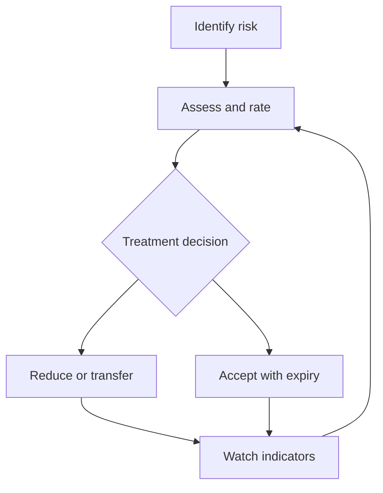
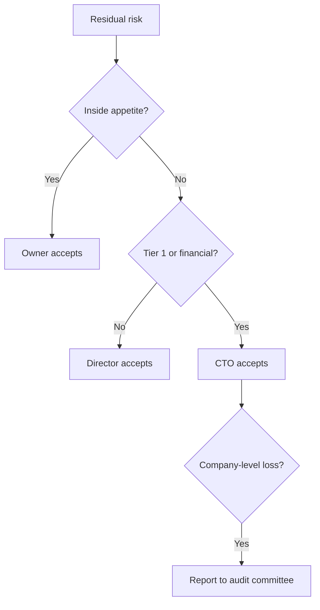
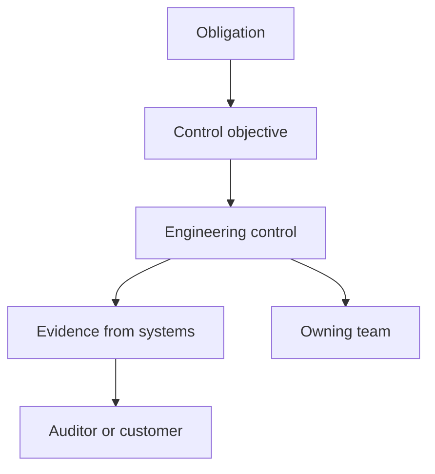

# Chapter 53 — Risk, Governance, Regulation, and Security Strategy

A CTO is accountable for technology risks that nobody in engineering can see whole. Examples: an
unsupported framework, secrets in a file on a build host, a missing audit report a customer needs, a
security function that reports to finance. This chapter shows how to keep those risks
in one enterprise register with owners and treatment decisions. It then covers setting a security
strategy with recognized frameworks, meeting regulatory and contractual obligations through engineering
controls rather than paperwork, and reporting all of it to people who are not specialists. The running
example is Northstar Technologies, the fictional company in the
[case study](../../case-studies/northstar/index.md), in quarter 4 of the director's first year.

Related chapters: [26](../05-engineering-quality/26-security-and-software-supply-chain-quality.md)
(security in the delivery pipeline), [30](../06-technical-leadership/30-technical-strategy-and-technology-selection.md)
(the first technology risk register), 48 (enterprise policies), and
[55](55-boards-due-diligence-and-executive-decision-making.md) (the board).

## Why This Matters

At team scale, risk is a list of things that might break, and the people who would fix them are in the
room. Most decisions are obvious.

At organization scale, risks cross team lines and stop having a natural owner. A single Jenkins
controller is Platform Operations' problem until it stops every team's releases. Without a register that
names an owner and a decision for each risk, the organization accepts risks by default: nobody chose
them, so nobody can say whether they are acceptable.

At executive scale, risk becomes a governance question. A body above the CTO, usually the
[audit committee](../../glossary.md#audit-committee) (the board committee that oversees financial
reporting and risk), oversees it. Customers, auditors, and regulators want evidence rather than
reassurance.
A CTO who can say which ten technology risks matter, who owns each, and what the company accepts gives
the board something to govern. One amber square called "cyber" gives it nothing.

## Learning Objectives

After this chapter you will be able to:

- Build and maintain an enterprise technology risk register in which every risk has a cause, an
  owner, a treatment decision, an indicator, and a review date.
- Set a security strategy by using three public frameworks (the NIST Cybersecurity Framework, the
  Secure Software Development Framework, and SLSA) as maps for a gap analysis, and express it as a small
  number of funded outcomes.
- Meet regulatory and contractual obligations by designing engineering controls that produce evidence
  as a side effect of normal work.
- Decide who may accept which risk, and write a risk appetite that makes those decisions consistent.
- Report technology risk to executives and an audit committee in business terms, without heat maps
  that hide the differences that matter.

## The Mental Model

> **Mental model:** A risk register is a decision record, not an inventory. Each line exists to force
> one decision (reduce, transfer, avoid, or accept) by a named person with the authority to make it,
> and to show later whether that decision still holds.

The first idea is that risk management is a loop, not a document. Risks are identified, assessed,
treated, and watched through indicators that tell you when the assessment is wrong. A register
assembled once a year for a committee is the first two steps performed as theater.

The second idea is that **governance is about who decides**. Every risk has two people: an owner who
manages it day to day, and an accepter with the authority to live with the residual risk. The accepter
must be senior enough to own the consequence. A team lead cannot accept the risk that the company loses
its largest customer; a CTO should not be asked to accept a two-week delay on a minor library upgrade.

## Deep Conceptual Explanation

### What an enterprise technology risk register is

Chapter 30 introduced a [risk register](../../glossary.md#risk-register) for one engineering
organization: end-of-life components, single points of knowledge, concentration. An **enterprise**
register differs in three ways.

1. **Scope.** It covers every technology risk that could hurt the company, including corporate IT,
   security, compliance, and vendors, not only what engineering can fix.
2. **Altitude.** Items are stated as business consequences ("a large customer leaves at renewal"),
   with technical causes underneath, because the people who decide think in consequences.
3. **Connection.** It feeds the company's risk register, so technology risk is weighed against the
   company's other risks.

A NIST standard describes this structure for cybersecurity: registers at system and organizational
levels, rolled up so that cybersecurity risk is managed alongside other enterprise risks
([Quinn et al., 2025](../../references/bibliography.md#nist2025ir8286r1); **standard**).

Rolling up does not mean copying every line upward. Each level keeps the risks it can treat and passes
up only those that need a higher authority, grouped by consequence.

A useful entry states the risk as cause, event, and consequence: "Because X, Y may happen, which would
cause Z". It lists the lower-level items it groups. It names an owner, an accepter, a rating (with an
exposure range where one can be defended), a treatment, an indicator that moves before the risk does,
and a review date. The [risk register template](../../templates/risk-register.md) gives the fields with
a worked Northstar example.

### Treatment decisions and who may make them

Four responses to a risk are **practitioner consensus**: **reduce** likelihood or impact; **transfer**
part of the consequence through insurance or a contract (never customer trust); **avoid** the activity;
or **accept** it, explicitly and for a period.

Acceptance is where governance fails most often. A risk in the register for six quarters with the
same rating and no action has been accepted, but nobody accepted it. This book recommends three rules:

1. Every acceptance has a named accepter, a reason, and an expiry of at most two quarters (Chapter 20's
   limit for standards exemptions).
2. The accepter's level depends on the residual risk, not on who raised it.
3. An expired acceptance is escalated one level, never quietly renewed.

A [risk appetite](../../glossary.md#risk-appetite) makes these decisions consistent: it states what
kinds and amounts of risk the company will carry in pursuit of its goals. Most appetite statements are
too vague to use ("low appetite for cyber risk"). A usable one is written in the units of the
indicators. For example: "no [known-exploited vulnerability](../../glossary.md#known-exploited-vulnerability-kev)
open on an internet-facing [tier 1](../../glossary.md#tier-1) component for more than 7 days without a
compensating control and an exception signed by the CTO". A known-exploited vulnerability is one on a
public list of vulnerabilities attackers are actively using. A compensating control is a substitute
safeguard, such as blocking access at the load balancer, that reduces the risk while the real fix
waits. The board or its audit committee sets appetite on management's proposal; the CTO drafts the
technology lines.

### Rating risk without fooling yourself

Most companies rate risk on a likelihood-impact matrix: five points each, multiplied, colored red,
amber, and green. It is familiar and fast, and its weaknesses are documented. Cox's mathematical
analysis (**research finding**) found that risk matrices:

- have poor resolution, rating risks of very different sizes identically;
- can rate quantitatively smaller risks higher;
- can do worse than random when frequency and severity are negatively correlated;
- depend on inputs that different raters read differently.

He advised using them with caution and with the judgments explained
([Cox, 2008](../../references/bibliography.md#cox2008risk)).

So stop at matrices less often rather than banning them. Use the matrix to separate the ten risks that
matter from the forty that do not, not to order the ten. Put a dollar range on risks that can carry one.
Write the reasoning beside every score, so two risks rated 12 for different reasons say so.

Quantitative methods go further, expressing information risk in money with calibrated estimates
([The Open Group, Open FAIR](../../references/bibliography.md#opengroup-open-fair), **standard**;
[Hubbard and Seiersen, 2023](../../references/bibliography.md#hubbard2023cybersecurity), **expert
opinion**). At Northstar's size, quantifying the top three or four risks is usually worth it; every line
is not. Assessments exist to help senior leaders choose responses
([Joint Task Force, 2012](../../references/bibliography.md#nist2012sp800-30r1); **standard**), so a
rating that changes no response has not done its job.

### Security strategy with recognized frameworks

Chapter 26 used three frameworks as maps for a director's gap analysis. All are **standards**:

- **[NIST CSF](../../glossary.md#nist-csf) 2.0**, the Cybersecurity Framework from the US National
  Institute of Standards and Technology, organizes security outcomes under six functions: Govern at the
  center, then Identify, Protect, Detect, Respond, and Recover. It compares a current profile with a
  target profile to produce a prioritized plan ([NIST, 2024](../../references/bibliography.md#nist2024csf)).
- **The [SSDF](../../glossary.md#ssdf)**, the Secure Software Development Framework, describes secure
  development practices in four groups
  ([Souppaya, Scarfone, and Dodson, 2022](../../references/bibliography.md#nist2022ssdf);
  [NIST, SSDF project](../../references/bibliography.md#nist-ssdf-project)).
- **[SLSA](../../glossary.md#slsa)**, Supply-chain Levels for Software Artifacts, sets levels for
  proving which source and build produced a running artifact, on separate Build and Source tracks
  ([SLSA, v1.2](../../references/bibliography.md#slsa-spec)). SLSA Build L2 means each build produces
  signed provenance: a tamper-evident record, generated by the build service, of how the artifact was
  built.

At CTO level the same frameworks serve three purposes.

**A shared vocabulary with outsiders.** Customers, auditors, insurers, and acquirers ask questions in
framework terms.

**A way to choose a few outcomes.** A security strategy, like any strategy, is a diagnosis, a guiding
policy, and a few coherent actions (Chapter 30). The frameworks make gaps visible; they do not choose
the actions, and CSF 2.0 says its Core is not a checklist. The CTO picks three to five target outcomes
for the next year, each with a measure, an owner, and a cost.

**A structure for governance.** CSF 2.0's Govern function is where the CTO's work lives: roles, risk
appetite, policy, and oversight of supply-chain risk.

Frameworks fail predictably at this level: every subcategory is answered in a spreadsheet, and the
spreadsheet is called the strategy. Start instead from the outcomes whose loss would hurt customers or
revenue, then ask which framework outcomes protect them.

A short worked form of a security strategy, as this book recommends it:

| Element | Content |
|---|---|
| Diagnosis | Three findings with evidence: where exposure is, why it persists, what customers ask that cannot be answered |
| Guiding policies | Two to four rules that resolve recurring choices (for example, "security evidence comes from systems, not from people's memory") |
| Target outcomes | Three to five, stated in CSF, SSDF, or SLSA terms where useful, each with a measure and an owner |
| Funding | Capacity and cash for each, and what is displaced |
| Governance | Who accepts which risk; appetite lines; reporting cadence and audience |

Security outcomes belong to the teams that own systems. The security function sets policy, runs
tools, tests, and audits the teams' classifications.

### Regulation and contracts through engineering controls

Obligations reach a software company through law, customer contracts, required standards, and
reports the company chooses to obtain. Examples for an order-to-cash platform:

- **Contractual availability and service credits.** Already engineering's daily concern.
- **Payment card data.** The PCI Data Security Standard sets baseline requirements for anyone who
  stores, processes, or transmits cardholder data, or could affect its security
  ([PCI SSC, PCI DSS](../../references/bibliography.md#pci-dss); **standard**). The first engineering
  question is scope: where card data flows, and which systems could affect it.
- **SOC 2 reports.** A [SOC 2](../../glossary.md#soc-2) report is an examination of controls relevant
  to security, availability, processing integrity, confidentiality, or privacy. An independent CPA
  (certified public accountant) performs it under the AICPA's (American Institute of CPAs) Trust
  Services Criteria ([AICPA, Trust Services Criteria](../../references/bibliography.md#aicpa-tsc2022);
  [AICPA, 2026](../../references/bibliography.md#aicpa2026tsc-proposal); **standard**). A revision of
  the criteria is proposed; check its status before planning an audit cycle.
- **Public-company disclosure.** In the United States, the SEC's 2023 rules require listed companies to
  report material cybersecurity incidents, generally within four business days of deciding they are
  material. The annual report must describe how the board oversees cybersecurity risk
  ([SEC, 2023](../../references/bibliography.md#sec2023cyberrule); **standard**). A private company is
  not bound, but acquirers and investors preparing for a listing ask the same questions.

This chapter does not survey privacy and data-protection law, which varies by jurisdiction and needs
legal advice; the evidence here is thin. Nor does it cover business continuity or cyber insurance beyond
their place in the register. The engineering method is the same for every obligation.

A **control** is a recurring, checkable behavior of a system or a team: every production change passes
review in the pipeline, every production secret lives in the secrets manager. A control that produces
its own evidence (a pipeline log, a scanner record) is cheap to audit and hard to fake. A control that
relies on someone filling in a form is expensive and, as Chapter 20 showed, often untrue.

**This book's recommendation** is to **design for evidence once and reuse it for every obligation**.
The same pipeline log answers a SOC 2 auditor's change-management question, a customer questionnaire,
and an SSDF practice.

| Obligation | Engineering control | Evidence produced by |
|---|---|---|
| 99.9 percent availability with credits | SLOs, error budgets, tier 1 minimums (Chapter 24) | Synthetic checks, incident tracker |
| Change management (SOC 2, questionnaires) | Reviewed changes through an auditable pipeline | Pipeline and repository logs |
| Vulnerability management | Remediation service levels and exceptions (Chapter 26) | Scanner records, exception register |
| Supply-chain questions (SBOM, SSDF) | [SBOM](../../glossary.md#sbom) (software bill of materials, a machine-readable list of a build's components) per build; provenance | Build artifacts |
| Card data protection | Scope boundary; tokenization; access control | Network and access configuration, scope review |
| Incident disclosure readiness | Severity definitions with a materiality escalation path | Incident records, decision log |

### Reporting risk to non-specialists

Executives and audit committee members judge risk and read financial statements well; most are not
technologists. Four rules (**this book's recommendation**, consistent with Chapters 39 and 55):

1. **Lead with the decision needed.** "We ask the committee to adopt three appetite lines and to note
   one risk outside appetite" before any chart.
2. **State risks as business consequences with ranges.** "Losing one of the six large customers
   renewing next year would remove about $1.17M of annual revenue" rather than "reliability risk:
   high".
3. **Show trend and indicator, not just rating.** A risk rated 15 and falling is a different story
   from one rated 15 and rising.
4. **Name what is accepted.** An audit committee's job is oversight; it cannot oversee acceptance it
   is never told about.

Security reporting drifts toward activity measures (training completion, phishing click rates) that
are easy to move and say little about exposure. Report exposure instead: criticals past service level,
known-exploited items open, tier 1 control coverage, exceptions by age. Pair it with a check on whoever
classifies the findings (Chapter 18).

## Engineering Organization Example

!!! info "Northstar so far"
    Week 43 of the director's first year. Sev1 and Sev2 incidents fell from 30 a quarter to 14 in
    quarter 3, and availability reached 99.89 percent, just under the 99.9 percent contract. Security sits
    in Corporate IT, outside engineering, and Northstar has no SOC 2 report. See the
    [timeline](../../case-studies/northstar/timeline.md) and the
    [quarter 4 briefing](../../case-studies/northstar/quarter-4-briefing.md).

The following is **fictional**. The questionnaire figures, ratings, and exposure ranges are
illustrative.

**The situation in week 43.** Northstar's corporate risk register is kept by the finance team of Rajiv
Menon (CFO). The audit committee, chaired by Margaret Lin (independent director, former CFO), reviews it
twice a year. It holds 12 risks on a five-by-five matrix. Technology appears as one line, "Cyber attack
or IT outage", owned by Marta Kowalczyk (Head of IT), rated 12 (likelihood 3, impact 4), amber, unchanged
at its last four reviews. Engineering's own register is not referenced. Joon Park (IT security lead)
runs a two-person security function that reports to Marta, who reports to Rajiv. His quarterly report
lists penetration test findings, phishing click rate, and training completion. Northstar's only
independent assurance is an annual external penetration test.

Engineering's register, drafted in quarter 2 (Chapter 30), has nine items:

| ID | Technology risk | Owner |
|---|---|---|
| TR-01 | Core's application framework is a major version past community support | Ines Carvalho |
| TR-02 | One Jenkins controller with about 60 plugins (INC-428: all Jenkins deploys failed until a restart) | Tom Becker |
| TR-03 | Core's Java runtime has free updates promised for only about 12 more months | Ines Carvalho |
| TR-04 | Core's XML library is unmaintained upstream and held the oldest critical vulnerability | Ines Carvalho |
| TR-05 | The configuration server is a single instance, two major versions behind | Kwame Mensah |
| TR-06 | Shell-script deploys are understood by one engineer | Tom Becker |
| TR-07 | Ledger currency and rounding: one person can respond or change it | Marcus Oyelaran |
| TR-08 | One partner bank route with no fallback (INC-413: a bank outage left payments queued) | Elena Sokolova |
| TR-09 | tax-svc rate tables maintained by hand by one engineer (INC-414, a tax-rate error) | Marcus Oyelaran |

In week 43 Margaret Lin asks, through Rajiv, for a technology risk session at the committee's week 50
meeting: the top technology risks in business terms, their owners, what is being done, and what the
company is accepting. Victor Lindqvist (CTO) asks the director to draft an enterprise technology
register with Marta and Joon, for his review in week 48.

**The inputs.** In week 44 Kwame Mensah (staff engineer, infrastructure) and Joon Park produce a
security snapshot, and Joon tallies a year of customer security questionnaires. auth-svc, the
authentication service, still deploys by script and carries a known-exploited critical vulnerability.

| Week 44 measure | Day 90 | Week 44 |
|---|---|---|
| Components with dependency scanning | 20 in pipeline, 4 by weekly scan | unchanged |
| Open critical vulnerabilities | 3, all under exceptions | 2, both under exceptions: auth-svc (known-exploited, restricted at the load balancer, exception to week 52) and one Core item that waits on TR-01 |
| Open highs past the 90-day service level | not measured | 9 |
| Tier 1 components with an SBOM per build | 6 of 15 | 14 of 15 (all but auth-svc) |
| Tier 1 components with signed build provenance (SLSA Build L2) | not measured | 0 of 15 |
| Script services with secrets in plain files | 2 | 2 |
| Questionnaires, last four quarters | not measured | 34; 11 asked for a SOC 2 report, 6 for an SBOM or SSDF evidence; about 14 hours each |

The questionnaires cost about 476 hours a year, about 0.26 FTE. That excludes Victor's own 2 hours a
week on security reviews ([Chapter 50](50-what-a-cto-actually-does.md)). In week 42, Greg Tanaka (VP
Sales) reported a prospect worth about $310,000 a year whose terms require a SOC 2 report within 12
months of signature.

**Consolidation.** The director collects 22 candidate items: TR-01 to TR-09, six security findings,
four items from Marta's IT list, two compliance items (no SOC 2 report; the questionnaire load), and the
reliability record. Grouping by consequence yields nine enterprise risks.

| ID | Risk (consequence) | Sources | Owner | Treatment |
|---|---|---|---|---|
| ER-01 | A large customer leaves at renewal over reliability | Reliability record, TR-05, TR-08 | Engineering Director | Reduce: quality continuation (Chapter 49) |
| ER-02 | A financial error reaches customers | TR-07, TR-09 | Marcus Oyelaran | Reduce: pairing plan, tax-svc decision |
| ER-03 | A known vulnerability on an internet-facing tier 1 component is exploited | auth-svc, Core critical, highs past service level | Tom Becker (auth-svc), Ines Carvalho (Core) | Reduce; accepted meanwhile by exception |
| ER-04 | The build and deploy path is compromised or lost | TR-02, TR-06, plain-file secrets, no signed provenance | Kwame Mensah | Reduce: CI consolidation phase 1, secrets manager |
| ER-05 | The Core platform cannot be patched | TR-01, TR-03, TR-04 | Ines Carvalho | Accept with patches until a migration decision |
| ER-06 | Missing assurance costs deals and renewals | No SOC 2 report, questionnaire load | Victor Lindqvist | Decision open |
| ER-07 | Card data scope is wider than believed | Scope never reviewed since integration | Joon Park | Reduce: scope review |
| ER-08 | A corporate identity compromise reaches production | Two IT items | Marta Kowalczyk | Reduce |
| ER-09 | Corporate business systems are lost | Two IT items | Marta Kowalczyk | Reduce: restore tests |

| ID | L | I | Score | Exposure (illustrative) |
|---|---|---|---|---|
| ER-01 | 4 | 5 | 20 | One top-40 customer: about $1.17M ARR, $842,000 a year of gross margin; credits $240,000 to $380,000 a year |
| ER-02 | 3 | 4 | 12 | Not quantified; Sev1 by definition |
| ER-03 | 3 | 5 | 15 | Not quantified |
| ER-04 | 3 | 5 | 15 | Not quantified |
| ER-05 | 4 | 3 | 12 | Migration $96,000 to $194,400 (Chapter 52) |
| ER-06 | 4 | 3 | 12 | At least one $310,000 deal; 0.26 FTE a year |
| ER-07 | 2 | 4 | 8 | Review about 5 days |
| ER-08 | 3 | 4 | 12 | Not quantified |
| ER-09 | 2 | 3 | 6 | Not quantified |

L is likelihood and I impact, each 1 to 5. ER-01 is rated likely because six large renewals fall in
quarters 5 to 8 and availability has been below 99.9 percent in every measured quarter. The derivations
are in the solutions.

Three observations. First, four risks score 12 and have nothing in common: a financial error, an
unpatchable platform, a commercial assurance gap, and an identity compromise. This is Cox's resolution
problem in one column, and why each score carries a sentence of reasoning. Second, only ER-01 carries a
dollar range that Northstar's numbers support; for the security risks the honest entry is "not
quantified". Third, the old corporate line is now five risks with named owners, and the highest score
in the register (ER-01, 20) is not a security risk at all.

## Decision Framework

The first decision is what level a risk belongs at. Use three questions:

| Question | If yes |
|---|---|
| Could the consequence affect a customer contract, revenue at renewal, financial correctness, or a legal obligation? | Enterprise register |
| Does the treatment need money, capacity, or authority beyond one director? | Enterprise register |
| Does accepting it need someone above the owner? | Record the accepter at that level |
| None of the above | Keep it in the team or engineering register |

The second decision is the treatment. Choose by what changes the consequence most per unit of cost,
and by who can act:

| Situation | Usual treatment |
|---|---|
| A cheap, owned fix exists | Reduce now; do not discuss it at committee |
| The fix is large and the risk is rising | Reduce in stages, with an interim compensating control and a dated acceptance |
| The consequence is financial and insurable or contractual | Transfer part of it, and reduce the rest; transfer never removes reputational or customer impact |
| The activity creates more risk than value | Avoid: retire the integration, drop the feature, decline the deal term |
| Residual risk is inside appetite and treatment is expensive | Accept, with an accepter, an expiry, and an indicator |

The third decision is whether to pursue a SOC 2 report. This book recommends three tests, all
necessary:

1. **Demand.** Are customers or prospects asking for it, in numbers or values that matter? One deal
   is a signal; a third of questionnaires is a pattern.
2. **Control readiness.** Do the controls the audit would examine already run and produce evidence? If
   not, the first year's money buys controls, not a report.
3. **Cost of the alternative.** What do questionnaires, lost deals, and renewal friction cost?

Real demand and low readiness: fund readiness first, with a dated decision on the audit. Real demand
and high readiness: the report is mostly an audit fee. Weak demand: invest in the evidence pipeline that
makes questionnaires cheap, and revisit.

## Trade-offs

**Completeness against attention.** A register with 60 items is complete and unread; one with 8 to 12
is read but hides detail below. Keep the roll-up auditable through the sources column.

**Matrices against quantification.** A matrix takes minutes and misleads at the top. Quantifying every
risk takes weeks and gives false precision. Quantify the few that drive decisions.

**SOC 2 against engineering.** A SOC 2 program costs fees, tooling, and staff time, some spent
collecting evidence rather than reducing risk. It also forces controls to run consistently and opens
doors in procurement.

**Security under IT against security under engineering.** Security inside IT sees corporate systems well
and is independent of the engineers it audits. It sees product and pipeline risk poorly and has no
authority over the teams that change code. Moving it under the CTO gains authority and loses some
independence. Neither placement fixes a two-person function's capacity.

## Failure Modes

**The amber square.** All technology risk sits in one line, rated the same for years. Signal: the line
has not changed rating in four reviews while incidents, exposure, and customer demands changed.
Countermeasure: split by consequence, one owner each.

**Acceptance by default.** Risks stay open for quarters without anyone deciding to accept them, or a
"temporary" exception is quietly renewed. Signal: items older than two quarters with no progress; the
same exception with a new date and the same approver. Countermeasure: the acceptance rules above.

**Framework as strategy.** A spreadsheet maps every CSF subcategory and nothing in engineering changes.
Signal: the strategy has no funded actions.

**Activity reporting.** The committee sees training completion and click rates. Signal: no reported
measure would move if a tier 1 component became exposed. Countermeasure: exposure measures.

**Evidence by hand.** Each questionnaire or audit is answered from memory and screenshots. Signal: two
answers to the same question differ. Countermeasure: controls that emit evidence; one evidence library
reused for every obligation.

## Enterprise Application

At 50 to 150 engineers, the CTO usually has no risk or compliance staff, and a small security function
that may sit elsewhere. Run the register through the existing management system, with owners named by
role:

| Role | Owns |
|---|---|
| CTO | The enterprise technology register and the technology appetite lines |
| Engineering director or VP | The engineering register and most reduce actions |
| Head of IT | Corporate IT risks |
| Security lead | Policy, testing, classification audits, questionnaires, the SOC 2 process, and the evidence library |

Review the engineering register monthly in the quality review (Chapter 27) and the enterprise register
quarterly with the CFO and head of IT. Report to the audit committee twice a year, or at each meeting if
a risk is outside appetite.

**Vendors and suppliers.** At this size much technology risk sits in vendors: a cloud provider, a
partner bank, a payments processor. Record each material vendor as a source under the consequence it
could cause, note concentration (TR-08's single bank route is one), and ask vendors for their own
evidence, such as their SOC 2 report, rather than accepting a questionnaire answer.

## CTO Perspective

Three things in this area belong to the CTO alone.

**Translate between engineering and governance.** The CTO is the only person who reads both the
vulnerability report and the company's risk register, and can say which technical facts change a
business risk.

**Draft the technology appetite with its price.** Appetite is the board's to set, but it needs a
proposal in measurable terms with the cost of each line stated. A line the company cannot afford to meet
is a statement of intent, not appetite.

**Advise on the security function's placement.** Where security reports, how large it is, and whether
the company needs a CISO (chief information security officer, a dedicated security executive) are
choices the CEO often makes. The CTO should say plainly what the current placement cannot see.

The CTO's credibility rests on reporting risks before they materialize and never presenting a
reassuring number that a sample would contradict. At Halvard's size the same roles hold, but each vice
president's register feeds the CTO's, and vendor contracts become a risk category of their own.

## Practical Playbook

1. **Collect** every existing risk list: engineering, IT, security findings, compliance demands, and
   the company register's technology lines.
2. **Group by consequence** into eight to twelve enterprise risks, with a sources column, and list
   material vendors under the consequences they could cause.
3. **Name an owner and an accepter** for each, at the right level.
4. **Rate for triage** on the company's matrix, then add a dollar range where finance numbers support
   one, and a sentence of reasoning for every score.
5. **Decide treatment** for each: reduce, transfer, avoid, or accept, with cost, date, and expiry.
6. **Choose an indicator** for each that would move before the risk does.
7. **Draft appetite lines** in the indicators' units for the risks that need board-level limits.
8. **Map obligations to controls** and list each control's evidence source.
9. **Write the security strategy** as diagnosis, guiding policies, three to five outcomes, funding, and
   governance.
10. **Replace activity measures** in security reporting with exposure measures and a classification
    audit.
11. **Report** to the audit committee: decision needed first, then risks outside appetite, then trend.
12. **Put the register to work**: acceptances expire on dates, and expiry escalates.

## Case Study

This case is **fictional** and continues the Engineering Organization Example in weeks 45 to 49; the
audit committee's week 50 session has no recorded outcome.

**The draft.** By week 47 the director's draft for Victor has the nine enterprise risks, three proposed
appetite lines, and a one-page security strategy.

The appetite lines:

1. Contractual availability on the order and payment paths is planned at or above 99.9 percent every
   quarter; a quarter below it is reported to the committee with cause and treatment.
2. No known-exploited vulnerability stays open on an internet-facing tier 1 component for more than 7
   days without a compensating control and an exception signed by the CTO, and no such exception lasts
   longer than one quarter.
3. Every production change to a tier 1 component passes an auditable pipeline; exceptions are listed
   in the committee's report by name.

Line 2 puts ER-03 outside appetite at once. The director recorded the auth-svc exception in quarter 1
as lasting "until the migration" (Chapter 26). Joon Park wrote the week 52 date into the record in week
44, with no new signature. Nobody above the director has signed it, and it has lasted far longer than
one quarter. Line 3 puts ER-04 outside appetite while auth-svc deploys by script. The director writes
both into the draft rather than softening the lines.

The strategy's diagnosis has three findings. Exposure is concentrated in the build path and one
service with no owner until recently. Security evidence is assembled by hand (476 hours a year of
questionnaires). And the security function sees corporate IT well and product risk poorly. Its target
outcomes for year 2:

- auth-svc on an auditable pipeline;
- production secrets for all script services in the secrets manager;
- signed provenance for tier 1 artifacts (SLSA Build L2) on whichever CI target is chosen;
- an evidence library owned by Joon Park, with Kwame Mensah proposed as engineering evidence owner, so
  questionnaires stop reaching Victor by default;
- a card data scope review.

**The SOC 2 question.** Joon Park obtains two informal quotes, treated here as illustrative: $45,000
to $70,000 a year for the audit and about $30,000 a year for a compliance automation tool. Internal
effort in year 1 would be about 0.5 FTE in engineering and 0.5 FTE in IT, about $185,000 of capacity. The
cash would compete with the $150,000 of tooling in the
[continuation](../../glossary.md#the-continuation), the director's staged proposal to keep funding the
quality program, which Rajiv wants offset inside the $4.2M cloud and tooling budget.

Applying the three tests: demand is real (11 of 34 questionnaires, one $310,000 deal, six large renewals
ahead). Readiness is partial: scanning, SBOMs, and certificate ownership run; signed provenance,
auth-svc's pipeline, and an evidence library do not. The alternative costs about 0.26 FTE a year plus
unknown deal friction. The director drafts three options:

- **A**: commit to a SOC 2 audit in year 2.
- **B**: readiness in quarters 5 and 6, with a decision at the continuation's week 78 gate.
- **C**: no SOC 2 report; invest in the evidence library only.

The draft recommends B and says what would change it: two more prospects making a report a condition of
signature.

**The reporting line.** Marta Kowalczyk agrees with the register but not with the third finding. She
argues that security belongs in IT precisely because it audits engineering; moving it would remove the
only independent check on "not affected" decisions. The director records her view beside three options,
with no recommendation, because the decision belongs to Helena Marsh (CEO) and Rajiv as much as to
Victor:

- keep the line and add an application security role with a dotted line to the CTO;
- move security under the CTO;
- create a head of security reporting to the CEO.

**Week 48.** Victor reviews the draft in the same week as the VP recommendation. He keeps the nine
risks and the three appetite lines, and asks for ER-06 to show the deal value and questionnaire hours
side by side. Then he asks the question the director had not answered: who is the accepter for ER-03
today? The honest answer is the director, in quarter 1; nobody at CTO level has signed it. Victor says he
will either sign it before week 50 or have auth-svc restricted further, and the committee will hear
which.

The committee's decision, Victor's choice among A, B, and C, and the reporting line are not recorded
(see the [quarter 4 briefing](../../case-studies/northstar/quarter-4-briefing.md)). What the case shows
is narrower: an amber square became nine owned risks, two outside a proposed appetite, and the CTO goes
to the committee knowing which acceptances are his.

## Exercises

Worked solutions are in the [Chapter 53 solutions](../../solutions/ch53-solutions.md). Northstar data
is fictional; the facts you need are in the Engineering Organization Example.

### Foundational

**F1.** Northstar's corporate risk register has one technology line, "Cyber attack or IT outage",
owned by Marta Kowalczyk and rated 12 at its last four reviews. Rewrite it as three or more cause,
event, and consequence statements using Northstar facts. Then propose the two technology lines the
corporate register most clearly lacks: risks that are not about attacks or outages, drawn from the
TR-01 to TR-09 table in the Engineering Organization Example. Write them the same way. For every statement name an owner, an
accepter, and an indicator that would move before the risk materializes.

**F2.** In the director's draft register, ER-02, ER-05, ER-06, and ER-08 all score 12. Explain, with
reference to the known weaknesses of risk matrices, why presenting them to the audit committee as four
equal amber risks would mislead. Propose what the committee should see for each instead, and say which
of the four you would discuss first and why.

**F3.** For Northstar, take four obligations: the 99.9 percent availability contract; the change
management criterion a SOC 2 audit would examine if Northstar pursued one; card data protection; and a
renewal customer's request for an SBOM and SSDF evidence. For each, name the engineering control, the
system that produces its evidence, the owning team, and one way the evidence could be true on paper
while the control fails.

### Applied Leadership

**A1.** Suppose (hypothetically) that in week 51 Tom Becker (Platform Operations manager) asks to extend
the auth-svc exception (known-exploited critical, restricted at the load balancer) from week 52 to week
65, because CI consolidation phase 1 has slipped.
Using the chapter's acceptance rules and the draft appetite lines, decide who may approve the
extension, what you require before it is approved, and what the audit committee is told.

**A2.** Joon Park's quarterly security report to Marta Kowalczyk lists penetration test findings,
phishing simulation click rate, and security training completion. Design the replacement report for
Marta and Rajiv Menon, and the shorter version for the audit committee. For each measure, state how it
could be gamed and what you pair it with.

**A3.** Greg Tanaka asks you, in week 47, to confirm in writing to the $310,000 prospect that Northstar
will deliver a SOC 2 report within 12 months of signature. No decision on a SOC 2 audit has been made.
Write the reply to Greg, including what Northstar can honestly offer the prospect now and what decision
would have to be made, by whom and when, before the commitment could be given.

### Executive Decision-Making

**X1.** You are Victor Lindqvist in week 48. Use the case study's options A, B, and C for SOC 2, the
illustrative costs, the questionnaire load, and the competing $150,000 tooling ask. Decide what you
propose to the executive team and how you present it to the audit committee in week 50. State what you
would need to believe for option A to be right.

**X2.** Suppose that after the week 50 session Helena Marsh asks you whether Joon Park's function
should move from IT to engineering. This is a hypothetical scenario. Write your
recommendation in no more than 300 words, considering independence, authority over the teams that
change code, capacity, and what Marta Kowalczyk's objection protects. Say what you would need to see
in two quarters to know the choice was right.

**X3.** You are CTO of Halvard Systems, with five vice presidents, about 60 vendor engineers on two
contracts, and six enterprise policies, one of which is vulnerability remediation service levels. Each
vice president keeps a risk list; together they hold over 200 items. Design the roll-up to an
enterprise technology register for the audit committee: which items reach it, how vendor risk is
represented, who accepts what, and how you keep the register under a dozen lines without hiding a
risk.

## Reflection Questions

1. Which risks in your organization have been accepted without anyone deciding to accept them?
2. If your audit committee asked tomorrow for your top five technology risks with owners, how much of
   the answer would come from a system and how much from memory?
3. Which of your security measures would improve if exposure got worse?
4. Where does your security function report, and what can it not see from there?
5. Which acceptance on your register would you be uncomfortable explaining after an incident?

## Key Takeaways

- Treat the risk register as a decision record: every line forces a treatment decision by someone
  with the authority to make it, and every acceptance expires.
- State risks as business consequences, group lower-level items under them, and keep the roll-up
  auditable.
- Use the matrix for triage, not ranking; add dollar ranges where they can be defended and reasoning
  where they cannot.
- Write risk appetite in the units of your indicators, so it can be checked.
- Use CSF 2.0, the SSDF, and SLSA for vocabulary and gap analysis; a strategy is three to five funded
  outcomes, not a mapped spreadsheet.
- Meet obligations with controls that produce their own evidence, and reuse that evidence for every
  audit and questionnaire.
- Report exposure, not activity, and tell the audit committee what is outside appetite before it is
  found.

## References and Further Reading

- [Quinn et al., 2025](../../references/bibliography.md#nist2025ir8286r1). NIST IR 8286 Rev. 1:
  cybersecurity risk registers and rolling risk up to the enterprise level.
- [Joint Task Force, 2012](../../references/bibliography.md#nist2012sp800-30r1). NIST SP 800-30 Rev. 1:
  risk assessment as input to senior leaders' choice of responses.
- [Cox, 2008](../../references/bibliography.md#cox2008risk). The mathematical case against relying on
  risk matrices for ranking; read before designing any heat map.
- [The Open Group, Open FAIR](../../references/bibliography.md#opengroup-open-fair) and
  [Hubbard and Seiersen, 2023](../../references/bibliography.md#hubbard2023cybersecurity). Expressing
  information risk in economic terms; quantification for people who doubt it is possible.
- [NIST, 2024](../../references/bibliography.md#nist2024csf). CSF 2.0: functions, Govern at the center,
  profiles.
- [Souppaya, Scarfone, and Dodson, 2022](../../references/bibliography.md#nist2022ssdf) and
  [NIST, SSDF project](../../references/bibliography.md#nist-ssdf-project). Secure development
  vocabulary for suppliers and purchasers.
- [SLSA, v1.2](../../references/bibliography.md#slsa-spec). Supply-chain integrity levels by track.
- [AICPA, Trust Services Criteria](../../references/bibliography.md#aicpa-tsc2022) and
  [AICPA, 2026](../../references/bibliography.md#aicpa2026tsc-proposal). The criteria behind SOC 2
  reports and the proposed 2027 revision.
- [PCI SSC, PCI DSS](../../references/bibliography.md#pci-dss). Applicability and purpose of the card
  data standard; start with scope.
- [SEC, 2023](../../references/bibliography.md#sec2023cyberrule). Public-company cybersecurity disclosure
  rules; what acquirers and investors will ask even of a private company.
