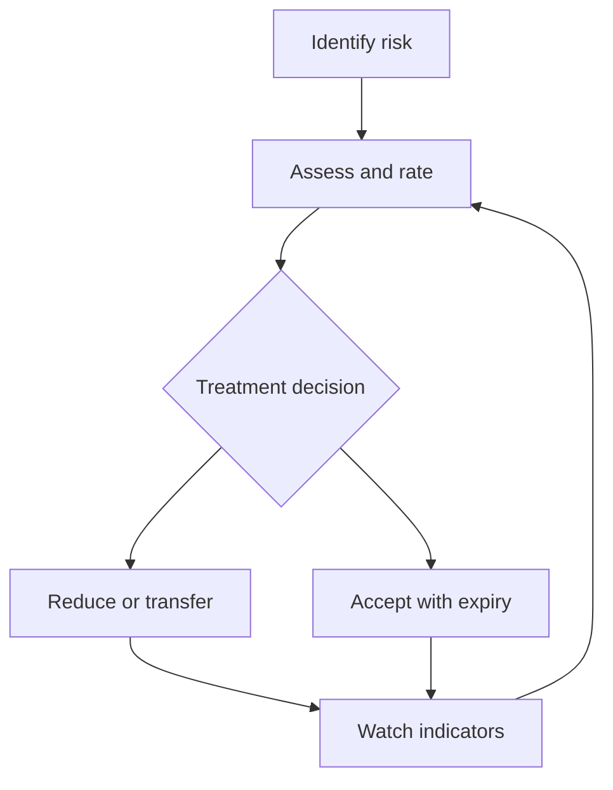
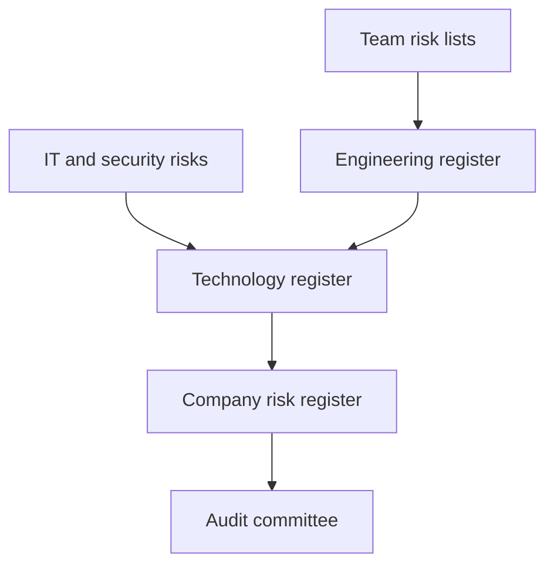
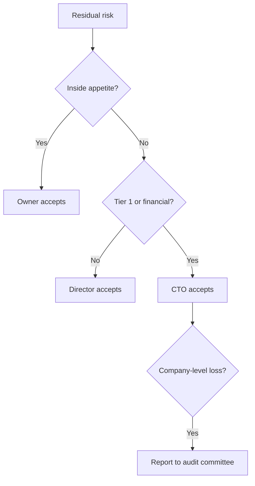
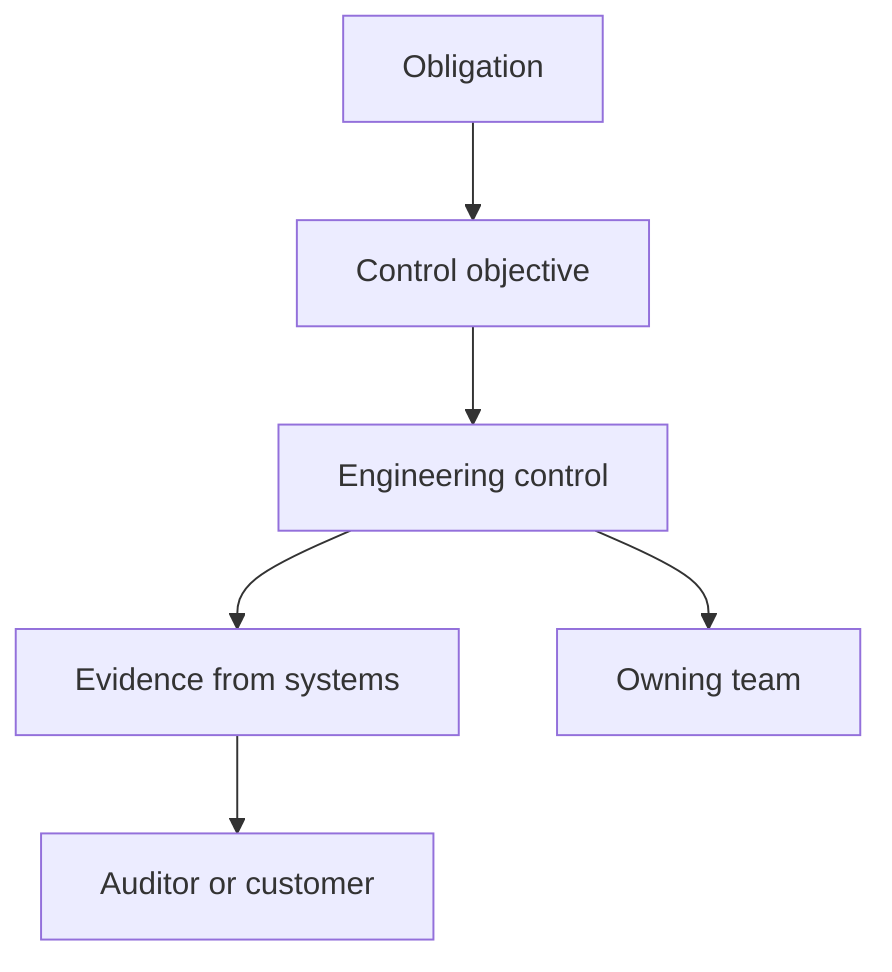

# Chapter 53 — Risk, Governance, Regulation, and Security Strategy

A CTO is accountable for technology risks that nobody in engineering can see whole: an unsupported
framework, a build host with secrets in a file, a missing audit report that a customer's procurement
team needs, a security function that reports to finance. This chapter covers how to keep those risks
in one enterprise register with owners and treatment decisions, how to set a security strategy with
recognized frameworks, how to meet regulatory and contractual obligations through engineering controls
rather than paperwork, and how to report all of it to people who are not specialists. Chapter 26 owns
security in the delivery pipeline, Chapter 30 the first technology risk register, Chapter 48
enterprise policies, and [Chapter 55](55-boards-due-diligence-and-executive-decision-making.md) the board itself. The running example is Northstar Technologies,
the fictional company in the [case study](../../case-studies/northstar/index.md), in quarter 4 of the
director's first year.

## Why This Matters

At team scale, risk is a list of things that might break, and the people who would fix them are in the
room. Most items are cheap and most decisions are obvious.

At organization scale, risks cross team lines and stop having a natural owner. A single Jenkins
controller is Platform Operations' problem until it stops every team's releases. A credential in a
plain file on a build host is nobody's problem until it is everyone's. Without a register that names an
owner and a decision for each risk, the organization accepts risks by default: nobody chose them, so
nobody can say whether they are acceptable.

At executive scale, risk becomes a governance question. A body above the CTO, usually an audit
committee, oversees it, and customers, auditors, and regulators want evidence rather than reassurance.
A CTO who can say which ten technology risks matter, who owns each, and what the company has chosen to
accept gives the board something to govern. A heat map with one amber square called "cyber" gives it
nothing.

## Learning Objectives

After this chapter you will be able to:

- Build and maintain an enterprise technology risk register in which every risk has a cause, an
  owner, a treatment decision, an indicator, and a review date.
- Set a security strategy by using NIST CSF 2.0, the SSDF, and SLSA as maps for a gap analysis, and
  express it as a small number of funded outcomes.
- Meet regulatory and contractual obligations by designing engineering controls that produce evidence
  as a side effect of normal work.
- Decide who may accept which risk, and write a risk appetite that makes those decisions consistent.
- Report technology risk to executives and an audit committee in business terms, without heat maps
  that hide the differences that matter.

## The Mental Model

> **Mental model:** A risk register is a decision record, not an inventory. Each line exists to force
> one decision (reduce, transfer, avoid, or accept) by a named person with the authority to make it,
> and to show later whether that decision still holds.

The first idea is that risk management is a loop, not a document. Risks are identified, assessed,
assigned a treatment, acted on, and watched through indicators that tell you when the assessment is
wrong. A register that is assembled once a year for an audit committee is the first two steps
performed as theater.

The second idea is that **governance is about who decides**. Every risk in the register has two
people: an owner who manages it day to day, and an accepter who has the authority to live with the
residual risk. The accepter must be senior enough to own the consequence. A team lead cannot accept
the risk that the company loses its largest customer; a CTO should not be asked to accept a two-week
delay on a tier 3 library upgrade. The rest of the chapter is the machinery that keeps those two names
honest.

## Deep Conceptual Explanation

### What an enterprise technology risk register is

Chapter 30 introduced a technology risk register for one engineering organization: end-of-life
components, single points of knowledge, concentration. An **enterprise** register differs in three
ways.

1. **Scope.** It covers every technology risk that could hurt the company, including corporate IT,
   security, compliance, and vendor dependencies, not only the risks engineering can fix.
2. **Altitude.** Items are stated as consequences to the business ("a large customer leaves at
   renewal"), with the technical causes listed underneath, because the people who decide on treatment
   think in consequences.
3. **Connection.** It feeds the company's risk register, the one an audit committee reviews, so that
   technology risk is weighed against the company's other risks rather than in a separate world.

NIST IR 8286 Rev. 1 describes this structure for cybersecurity: risk registers at system and
organizational levels whose measures are rolled up to the enterprise level, so that cybersecurity risk
is managed alongside other enterprise risks against mission and business objectives
([Quinn et al., 2025](../../references/bibliography.md#nist2025ir8286r1); **standard**, read at
abstract level). It supersedes the 2020 edition, withdrawn in December 2025.

Rolling up does not mean copying every line upward. Each level keeps the risks it can treat and
passes up only those whose treatment or acceptance needs a higher authority, grouped by consequence.
Nine engineering items about pipelines and frameworks may become two enterprise risks; a single item
about card data may stay a single item because its consequence is distinct.

A useful entry states the risk as cause, event, and consequence ("Because X, Y may happen, which
would cause Z"), lists the lower-level items it groups, and names an owner, an accepter, a rating with
an exposure range where one can be defended, a treatment, an indicator that moves before the risk does,
its fit with the risk appetite, and a review date. The
[risk register template](../../templates/risk-register.md) gives the fields with a worked Northstar
example.

### Treatment decisions and who may make them

Four responses to a risk are **practitioner consensus**: **reduce** likelihood or impact;
**transfer** part of the consequence through insurance, a contract, or a vendor (transfer never moves
customer trust); **avoid** the activity that creates it; or **accept** it, explicitly and for a
period.

Acceptance is where governance fails most often. A risk that has been in the register for six quarters
with the same rating and no action has been accepted, but nobody accepted it. This book recommends
three rules. Every acceptance has a named accepter, a reason, and an expiry of at most two quarters,
the same limit Chapter 20 sets for standards exemptions. The accepter's level depends on the residual
risk, not on who raised it. And an expired acceptance is escalated one level, never quietly renewed.

A **risk appetite** is the statement that makes these decisions consistent: what kinds and amounts of
risk the company is willing to carry in pursuit of its goals. Most appetite statements are useless
because they are vague ("low appetite for cyber risk"). A usable one is written in the same units as
the indicators: "no known-exploited vulnerability open on an internet-facing tier 1 component for more
than 7 days without a compensating control and an exception signed by the CTO". Appetite is set by the
board or its audit committee on management's proposal; the CTO drafts the technology lines.

### Rating risk without fooling yourself

Most companies rate risk on a likelihood-impact matrix: five points each, multiplied, colored red,
amber, and green. It is familiar and fast, and its weaknesses are documented. Cox analyzed risk
matrices mathematically and found that they have poor resolution (they can rate risks of very
different sizes identically), can assign higher ratings to quantitatively smaller risks, can perform
worse than random when frequency and severity are negatively correlated, and depend on inputs that
different raters interpret differently. He concluded that they should be used with caution and with
explanations of the judgments behind them
([Cox, 2008](../../references/bibliography.md#cox2008risk); **research finding**, mathematical
analysis read at abstract level).

The consequence is not to ban matrices but to stop at them less often: use the matrix to separate the
ten risks that matter from the forty that do not, not to order the ten; put a dollar range on risks
that can carry one (credits, revenue at renewal, and remediation cost are already in dollars); and
write the reasoning beside every score, so two risks rated 12 for different reasons say so.

Quantitative methods go further. Open FAIR, The Open Group's standard, is a taxonomy and analysis
method meant to express information risk in the same economic terms as other business risks ([The Open Group, Open FAIR](../../references/bibliography.md#opengroup-open-fair);
**standard**). Hubbard and Seiersen argue that cybersecurity risk can and should be measured with
calibrated probability estimates and simple quantitative models rather than ordinal scores
([Hubbard and Seiersen, 2023](../../references/bibliography.md#hubbard2023cybersecurity); **expert
opinion**, credited for the idea only). At Northstar's size, quantifying the top three or four risks
with honest ranges is usually worth it; quantifying every line is not. NIST's guide frames the purpose:
assessments give senior leaders the information to choose responses
([Joint Task Force, 2012](../../references/bibliography.md#nist2012sp800-30r1); **standard**, read at
official-summary level). A rating that changes no response has not done its job.

### Security strategy with recognized frameworks

Chapter 26 used NIST CSF 2.0, the SSDF, and SLSA as maps for a director's gap analysis. At CTO level
the same frameworks serve three different purposes.

**A shared vocabulary with outsiders.** Customers, auditors, insurers, and acquirers ask questions in
framework terms. CSF 2.0 organizes outcomes under six functions, with Govern at the center informing
Identify, Protect, Detect, Respond, and Recover, and describes a Current Profile, a Target Profile, and
a gap analysis that yields a prioritized plan
([NIST, 2024](../../references/bibliography.md#nist2024csf); **standard**). The SSDF provides the
equivalent vocabulary for secure software development, in four practice groups
([Souppaya, Scarfone, and Dodson, 2022](../../references/bibliography.md#nist2022ssdf);
[NIST, SSDF project](../../references/bibliography.md#nist-ssdf-project); **standard**). SLSA gives
levels for supply-chain integrity on separate Build and Source tracks
([SLSA, v1.2](../../references/bibliography.md#slsa-spec); **standard**).

**A way to choose a few outcomes.** A security strategy, like any strategy, is a diagnosis, a guiding
policy, and a few coherent actions (Chapter 30). The frameworks help with the diagnosis by making gaps
visible. They do not choose the actions. CSF 2.0 says explicitly that its Core is not a checklist and
that the order of functions implies neither sequence nor importance. The CTO's strategy picks three to
five target outcomes for the next year, each with a measure, an owner, and a cost.

**A structure for governance.** The Govern function, at the center of CSF 2.0, is where the CTO's
work lives: roles, risk appetite, policy, and oversight of supply-chain risk.

Frameworks fail predictably at this level: one is adopted as a compliance program, every subcategory
is answered in a spreadsheet, and the spreadsheet is called the strategy. Start instead from which
outcomes, if lost, would hurt customers or revenue, then ask which framework outcomes protect them.

A short worked form of a security strategy, as this book recommends it:

| Element | Content |
|---|---|
| Diagnosis | Three findings with evidence: where exposure is, why it persists, what customers ask that cannot be answered |
| Guiding policies | Two to four rules that resolve recurring choices (for example, "security evidence comes from systems, not from people's memory") |
| Target outcomes | Three to five, stated in CSF, SSDF, or SLSA terms where useful, each with a measure and an owner |
| Funding | Capacity and cash for each, and what is displaced |
| Governance | Who accepts which risk; appetite lines; reporting cadence and audience |

AWS's Well-Architected Framework, vendor guidance, treats security as one of six design pillars,
reviewed in conversation with a workload's owners rather than audited
([AWS, Well-Architected Framework](../../references/bibliography.md#aws-well-architected)). At
strategy level: security outcomes belong to the teams that own systems; the security function sets
policy, runs tools, tests, and audits the teams' classifications.

### Regulation and contracts through engineering controls

Obligations reach a software company from four directions: law and regulation, contracts with
customers, standards that customers or partners require, and attestations the company chooses to
obtain. Examples relevant to an order-to-cash platform:

- **Contractual availability and service credits.** Already engineering's daily concern.
- **Payment card data.** The PCI Data Security Standard provides baseline technical and operational
  requirements to protect payment account data, and applies to entities that store, process, or
  transmit cardholder data, or that could affect the security of the cardholder data environment;
  whether and how an entity must validate compliance is set by payment brands and acquirers
  ([PCI SSC, PCI DSS](../../references/bibliography.md#pci-dss); **standard**). The first engineering
  question is scope: where card data flows, and which systems could affect it.
- **Independent assurance reports.** A SOC 2 report is an examination by an independent, licensed CPA
  under AICPA attestation standards of controls relevant to security, availability, processing
  integrity, confidentiality, or privacy
  ([AICPA, 2026](../../references/bibliography.md#aicpa2026tsc-proposal)). The criteria used are the
  AICPA's Trust Services Criteria, organized in those five categories
  ([AICPA, Trust Services Criteria](../../references/bibliography.md#aicpa-tsc2022); **standard**). An
  AICPA exposure draft proposes revised criteria for engagements beginning on or after December 31,
  2027, with comments open until January 15, 2027; check its status before planning an audit cycle.
- **Public-company disclosure.** In the United States, the SEC's 2023 rules require registrants to
  report material cybersecurity incidents, generally within four business days of determining that an
  incident is material, and to describe in the annual report the board's oversight of cybersecurity
  risk and management's role in assessing and managing it
  ([SEC, 2023](../../references/bibliography.md#sec2023cyberrule); official summary of a binding SEC
  rule). A private company is not bound by these rules, but acquirers and
  investors preparing for a listing ask the same questions.

This chapter does not survey privacy and data-protection law, which varies by jurisdiction and needs
legal advice; it is listed as a gap in this chapter's evidence matrix. The engineering method is the
same for every obligation.

A **control** is a recurring, checkable behavior of a system or a team: every production change passes
review in the pipeline; every production secret lives in the secrets manager; every certificate has an
owner and an expiry alert. A control that produces its own evidence (a pipeline log, a scanner record,
an alert history) is cheap to audit and hard to fake. A control that relies on someone filling in a
form is expensive and, as Chapter 20 showed with Northstar's pull request checklist, often untrue.

**This book's recommendation** is to **design for evidence once and reuse it for every
obligation**. The same pipeline log answers an assurance auditor's change-management question, a
customer questionnaire, and an SSDF practice. Treating each obligation as a separate project builds the
same evidence three times by hand, with three different answers.

| Obligation | Engineering control | Evidence produced by |
|---|---|---|
| 99.9 percent availability with credits | SLOs, error budgets, tier 1 minimums (Chapter 24) | Synthetic checks, incident tracker |
| Change management (assurance report, questionnaires) | Reviewed changes through an auditable pipeline | Pipeline and repository logs |
| Vulnerability management | Remediation service levels and exceptions (Chapter 26) | Scanner records, exception register |
| Supply-chain questions (SBOM, SSDF) | SBOM per build; provenance | Build artifacts |
| Card data protection | Scope boundary; tokenization; access control | Network and access configuration, scope review |
| Incident disclosure readiness | Severity definitions with a materiality escalation path | Incident records, decision log |

### Reporting risk to non-specialists

Executives and audit committee members judge risk and read financial statements well; most are not
technologists. Four rules, all **this book's recommendation**, consistent with Chapter 39's executive
reporting and [Chapter 55](55-boards-due-diligence-and-executive-decision-making.md)'s board communication:

1. **Lead with the decision needed.** "We ask the committee to adopt three appetite lines and to note
   one risk outside appetite" before any chart.
2. **State risks as business consequences with ranges.** "Losing one of the six large customers
   renewing next year would remove about $1.17M of annual revenue" rather than "reliability risk:
   high".
3. **Show trend and indicator, not just rating.** A risk rated 15 and falling is a different story
   from one rated 15 and rising.
4. **Name what is accepted.** An audit committee's job is oversight; it cannot oversee acceptance it
   is never told about.

Security reporting drifts toward activity measures (training completion, phishing click rates, scans
run) that are easy to move and say little about exposure. Report exposure instead (criticals past
service level, known-exploited items open, tier 1 control coverage, exceptions by age), paired with a
check on whoever classifies the findings, as Chapter 18's gaming rule requires.

## Engineering Organization Example

The following is **fictional**. Canonical facts come from the
[Northstar overview](../../case-studies/northstar/index.md), the
[baseline data](../../case-studies/northstar/baseline-data.md), and
[the first quarter](../../case-studies/northstar/first-quarter.md), including its quarter 4 risk,
security, and compliance facts (the corporate register, the week 44 snapshot, the audit committee's
request). The questionnaire tally's arithmetic, the ratings, and the exposure ranges are illustrative.

**The situation in week 43.** Northstar's corporate risk register is kept by Rajiv Menon's finance team
and reviewed by the audit committee, chaired by Margaret Lin, twice a year. It holds 12 risks on a
five-by-five matrix. Technology appears as one line, "Cyber attack or IT outage", owned by Marta
Kowalczyk, Head of IT, rated likelihood 3, impact 4, score 12, amber, unchanged at its last four
reviews. Engineering's own register (TR-01 to TR-09, from Chapter 30) is not referenced. Joon Park's
two-person security function reports to Marta, who reports to Rajiv; its quarterly report to Marta
lists penetration test findings, phishing simulation click rate, and security training completion.
Northstar holds no SOC 2 report or other independent attestation of its controls; its assurance is the
annual external penetration test.

In week 43 Margaret Lin asks, through Rajiv, for a technology risk session at the audit committee's
week 50 meeting: the top technology risks in business terms, their owners, what is being done, and
what the company is accepting. Victor Lindqvist takes the request and asks the director to draft an
enterprise technology register with Marta Kowalczyk and Joon Park, for his review in week 48.

**The inputs.** In week 44 Kwame Mensah and Joon Park produce a security snapshot, and Joon tallies
the trailing four quarters of customer security questionnaires.

| Week 44 measure | Day 90 | Week 44 |
|---|---|---|
| Components with dependency scanning | 20 in pipeline, 4 by weekly scan | unchanged |
| Open critical vulnerabilities | 3, all under exceptions | 2, both under exceptions: auth-svc (known-exploited, restricted at the load balancer, exception to week 52) and one Core item that waits on the framework migration (TR-01) |
| Open highs past the 90-day service level | not measured | 9 |
| Tier 1 components with an SBOM per build | 6 of 15 | 14 of 15 (all but auth-svc, still deployed by script) |
| Tier 1 components with signed build provenance (SLSA Build L2) | not measured | 0 of 15 |
| Script services with secrets in plain files | 2 | 2 |
| Questionnaires, trailing four quarters | not measured | 34; 11 asked for an independent assurance report, 6 for an SBOM or SSDF evidence; about 14 hours each of IT security and engineering time |

The questionnaire load is 34 × 14 = 476 hours a year, about 0.26 FTE at 1,840 working hours (230 days
of 8 hours). That excludes Victor's own time: customers send questionnaires to the CTO, and he spent
about 2 hours a week on security reviews in weeks 44 to 46 ([Chapter 50](50-what-a-cto-actually-does.md)). In week 42, Greg Tanaka reported a prospective distributor, worth about $310,000 a year,
whose procurement terms require a SOC 2 report within 12 months of signature.

**Consolidation.** The director collects 22 candidate items: TR-01 to TR-09 (9), six security findings
from the snapshot, four items from Marta's IT risk list, two compliance items (no attestation; the
questionnaire load), and the reliability record. Grouping by consequence yields nine enterprise risks.

| ID | Risk (consequence) | Sources | Owner | L | I | Score | Exposure (illustrative) | Treatment |
|---|---|---|---|---|---|---|---|---|
| ER-01 | A large customer leaves at renewal over reliability | Reliability record, TR-05, TR-08 | Engineering Director | 4 | 5 | 20 | One top-40 customer about $1.17M ARR, about $842,000 a year of gross margin; credits $240,000 to $380,000 a year | Reduce: quality continuation (Chapter 49) |
| ER-02 | A financial error reaches customers | TR-07, TR-09 | Marcus Oyelaran | 3 | 4 | 12 | Not quantified; Sev1 by definition | Reduce: pairing plan, tax-svc decision |
| ER-03 | A known vulnerability on an internet-facing tier 1 component is exploited | auth-svc, Core critical, highs past service level | Tom Becker (auth-svc), Ines Carvalho (Core) | 3 | 5 | 15 | Not quantified | Reduce; current acceptance by exception |
| ER-04 | The build and deploy path is compromised or lost | TR-02, TR-06, plain-file secrets, no signed provenance | Kwame Mensah | 3 | 5 | 15 | Not quantified | Reduce: CI consolidation phase 1, secrets manager |
| ER-05 | The Core platform cannot be patched | TR-01, TR-03, TR-04 | Ines Carvalho | 4 | 3 | 12 | Migration $96,000 to $194,400 (Finance's scenarios, Chapter 52) | Accept with patches until a migration decision |
| ER-06 | Missing assurance costs deals and renewals | No attestation, questionnaire load | Victor Lindqvist | 4 | 3 | 12 | At least one $310,000 deal; 0.26 FTE a year | Decision open |
| ER-07 | Card data scope is wider than believed | Card scope never reviewed since integration | Joon Park | 2 | 4 | 8 | Review about 5 days | Reduce: scope review |
| ER-08 | A corporate identity compromise reaches production | Two IT items | Marta Kowalczyk | 3 | 4 | 12 | Not quantified | Reduce |
| ER-09 | Corporate business systems are lost | Two IT items | Marta Kowalczyk | 2 | 3 | 6 | Not quantified | Reduce: restore tests |

**Arithmetic.** Six of the 40 largest customers renew in quarters 5 to 8, at about $1.17M each, so
$7.02M of annual revenue is at renewal; losing one removes about $1.17M, and at the 72 percent gross
margin about $842,000 a year. Credits ran at $95,000 in quarter 2 and $60,000 in quarter 3, or $380,000
and $240,000 a year at those rates. TR-01's migration uses Finance's week 46–48 scenarios of 120, 190, and 243
engineer-days at $800 a day ($96,000, $152,000, $194,400; [Chapter 52](52-technology-investment-budgeting-and-financial-literacy.md)) rather than Chapter 30's earlier
estimate of 120 to 180 days, so the register and the budget pack show one range. ER-01 is rated
likelihood 4 because six large renewals fall in quarters 5 to 8 and availability was below 99.9 percent
in every quarter in which it was measured (99.86 and 99.89 percent); a loss is judged likely, not
certain.

Three observations. First, four risks score 12 and have nothing in common: a financial error (ER-02),
an unpatchable platform (ER-05), a commercial assurance gap (ER-06), and an identity compromise
(ER-08). This is Cox's resolution problem in one column, and why the director adds an exposure column
and a sentence of reasoning to each. Second, only ER-01 carries a dollar range that canon numbers
support; for the security risks the honest exposure entry is "not quantified", because Northstar has
no defensible estimate of breach cost and this book cites none. Third, the old corporate line
("Cyber attack or IT outage", 12) is now five separate risks (ER-03, ER-04, ER-07, ER-08, ER-09) with
named owners, and the highest-scoring risk in the whole register (ER-01, 20) is not a security risk at
all.

## Decision Framework

The first decision is what level a risk belongs at. Use three questions:

| Question | If yes |
|---|---|
| Could the consequence affect a customer contract, revenue at renewal, financial correctness, or a legal obligation? | Enterprise register |
| Does the treatment need money, capacity, or authority beyond one director? | Enterprise register |
| Does accepting it need someone above the owner? | Record the accepter at that level |
| None of the above | Keep it in the team or engineering register |

The second decision is the treatment. Choose by what changes the consequence most per unit of cost,
and by who can act:

| Situation | Usual treatment |
|---|---|
| A cheap, owned fix exists | Reduce now; do not discuss it at committee |
| The fix is large and the risk is rising | Reduce in stages, with an interim compensating control and a dated acceptance |
| The consequence is financial and insurable or contractual | Transfer part of it, and reduce the rest; transfer never removes reputational or customer impact |
| The activity creates more risk than value | Avoid: retire the integration, drop the feature, decline the deal term |
| Residual risk is inside appetite and treatment is expensive | Accept, with an accepter, an expiry, and an indicator |

The third decision is whether to pursue an independent attestation such as SOC 2. This book recommends
three tests, all necessary:

1. **Demand.** Are customers or prospects asking for it, in numbers or values that matter? A single
   deal is a signal; a third of questionnaires is a pattern.
2. **Control readiness.** Do the controls the attestation would examine already run and produce
   evidence? If not, the first year's money buys controls, not a report, and the honest step is
   readiness work.
3. **Cost of the alternative.** What do questionnaires, lost or delayed deals, and renewal friction
   cost without it?

If demand is real and readiness is low, fund readiness first, with a dated decision on the audit
itself. If demand is real and readiness is high, the attestation is mostly an audit fee. If demand is
weak, invest in the evidence pipeline that makes questionnaires cheap, and revisit.

## Trade-offs

**Completeness against attention.** An enterprise register with 60 items is complete and unread. One
with 8 to 12 is read, at the cost of hiding detail in the lower registers. Keep the roll-up auditable
through the sources column, so anyone can see what a line contains.

**Matrices against quantification.** A five-by-five matrix takes minutes and misleads at the top.
Quantifying every risk takes weeks and produces false precision for risks nobody can price. Quantify
the few that drive decisions and say "not quantified" for the rest.

**Attestation against engineering.** A SOC 2 program costs fees, tooling, and staff time, some of it
spent collecting evidence rather than reducing risk. It also forces controls to run consistently and
opens doors in procurement. Demand and readiness decide the trade, not fashion.

**Security under IT against security under engineering.** A security function inside IT, reporting to
the CFO, sees corporate systems well and has independence from the people it audits in engineering. It
sees product and pipeline risk poorly and has no authority over the teams that change code. Moving it
under the CTO gives authority and context and loses some independence. Neither placement fixes a
two-person function's capacity.

## Failure Modes

**The amber square.** All technology risk sits in one line, rated the same for years. Signal: the line
has not changed rating in four reviews while incidents, exposure, and customer demands changed.
Countermeasure: split by consequence, one owner each.

**Acceptance by default.** Risks stay open for quarters without action and without anyone deciding to
accept them. Signal: items older than two quarters with no treatment progress. Countermeasure: every
acceptance has an accepter and an expiry; expiry escalates.

**The exception that never ends.** A compensating control was recorded as temporary and renewed
quietly. Signal: the same exception with a new date, approved by the same person. Countermeasure:
renewal requires the next level up and a dated plan for the real fix. Chapter 13 describes the same
pattern in Northstar's core/permissions exemption.

**Framework as strategy.** A spreadsheet maps every CSF subcategory and nothing in engineering changes.
Signal: the strategy has no funded actions. Countermeasure: three to five outcomes, each with a measure,
an owner, and a cost.

**Activity reporting.** The audit committee sees training completion and phishing click rates. Signal:
no reported measure would move if a tier 1 component became exposed. Countermeasure: exposure measures,
paired with audits of classifications.

**Evidence by hand.** Each questionnaire or audit is answered from memory and screenshots. Signal: two
answers to the same question differ. Countermeasure: controls that emit evidence; one evidence library
reused for every obligation.

## Enterprise Application

In an organization of 50 to 150 engineers, the CTO usually has no risk or compliance staff and a
small security function that may sit elsewhere. Run the register through the existing management
system.

**Owners.** The CTO owns the enterprise technology register and drafts the technology appetite lines.
The engineering director (or VP) owns the engineering register and most reduce actions. The head of IT
owns corporate IT risks. The security lead owns policy, testing, classification audits, and the
questionnaire and attestation process.

**Cadence.** Engineering register reviewed monthly in the quality review (Chapter 27); enterprise
register reviewed quarterly by the CTO with the CFO and head of IT; reported to the audit committee
twice a year, or at each meeting if a risk is outside appetite.

**Policies.** Chapter 48's externality test decides which risk controls become enterprise policies.
Vulnerability service levels, tier 1 minimums, an auditable pipeline, and secrets in a secrets manager
usually pass; they are the controls most obligations examine.

**Evidence library.** One place, maintained by the security lead with engineering, where each control's
evidence source is listed. Questionnaires and audits draw from it.

## CTO Perspective

Only the CTO can do four things in this area.

**Translate between engineering and governance.** The CTO is the only person who reads both the
vulnerability report and the company's risk register, and can say which technical facts change a
business risk.

**Draft the technology appetite.** Appetite is the board's to set, but it needs a proposal written in
measurable terms, with the cost of each line stated. A line the company cannot afford to meet is a
statement of intent, not appetite.

**Decide placement of the security function.** Where security reports, how large it is, and whether
the company needs a CISO are organizational choices the CTO advises on and, in many companies, the CEO
decides. The CTO should say plainly what the current placement cannot see.

**Accept or escalate the largest technology risks.** Some residual risks belong to the CTO by name. The
discipline is to accept them in writing, with expiry, and to tell the audit committee about the ones
outside appetite before they are found.

The CTO's credibility here rests on reporting risks before they materialize and never presenting a
reassuring number that a sample would contradict.

## Practical Playbook

1. **Collect** every existing risk list: engineering registers, IT's list, security findings,
   compliance demands, the company register's technology lines.
2. **Group by consequence** into eight to twelve enterprise risks, keeping a sources column.
3. **Name an owner and an accepter** for each, at the right level.
4. **Rate for triage** on the company's matrix, then add a dollar range where canon or finance numbers
   support one, and a sentence of reasoning for every score.
5. **Decide treatment** for each: reduce, transfer, avoid, or accept, with cost, date, and expiry.
6. **Choose an indicator** for each that would move before the risk does.
7. **Draft appetite lines** in the indicators' units for the risks that need board-level limits.
8. **Map obligations to controls** and list each control's evidence source.
9. **Write the security strategy** as diagnosis, guiding policies, three to five outcomes, funding, and
   governance.
10. **Replace activity measures** in security reporting with exposure measures and a classification
    audit.
11. **Report** to the audit committee: decision needed first, then risks outside appetite, then trend.
12. **Put the register to work**: items in the monthly quality review, acceptances expiring on dates,
    and a quarterly review with the CFO and head of IT.

## Case Study

This case is **fictional** and continues the Engineering Organization Example. It is set in weeks 45
to 49; the audit committee's week 50 session has no recorded outcome.

**The draft.** By week 47 the director's draft for Victor Lindqvist has the nine enterprise risks,
three proposed appetite lines, and a one-page security strategy.

The appetite lines:

1. Contractual availability on the order and payment paths is planned at or above 99.9 percent every
   quarter; a quarter below it is reported to the committee with cause and treatment.
2. No known-exploited vulnerability stays open on an internet-facing tier 1 component for more than 7
   days without a compensating control and an exception signed by the CTO, and no such exception lasts
   longer than one quarter.
3. Every production change to a tier 1 component passes an auditable pipeline; exceptions are listed
   in the committee's report by name.

Line 2 puts ER-03 outside appetite immediately: the auth-svc exception has a compensating control and
carries a week 52 date, but the director recorded it in quarter 1 as lasting "until the migration"
(Chapter 26); the week 52 date, the end of the director's first year, was written into the record by
Joon Park in week 44 when he built the snapshot, with no new signature. Nobody above the director has
signed it, and it has lasted far longer than one quarter. Line
3 puts ER-04 outside appetite while auth-svc deploys by script. The director writes both into the
draft rather than softening the lines.

The strategy's diagnosis has three findings: exposure is concentrated in the build path and one
orphan-era service; security evidence is assembled by hand (476 hours a year of questionnaires); and the
security function sees corporate IT well and product risk poorly. Its target outcomes for year 2:
auth-svc on an auditable pipeline; production secrets for all script services in the secrets manager;
signed provenance for tier 1 artifacts (SLSA Build L2) on whichever CI target is chosen; an evidence
library covering the controls in the obligations table, owned by Joon Park with Kwame Mensah proposed as
the engineering evidence owner, so that questionnaires stop reaching Victor by default ([Chapter 50](50-what-a-cto-actually-does.md)); and
a card data scope review.

**The SOC 2 question.** Joon Park obtains two informal quotes, which this chapter treats as
illustrative: $45,000 to $70,000 a year for the audit and about $30,000 a year for a compliance
automation tool. He estimates internal effort in year 1 at about 0.5 FTE in engineering and 0.5 FTE in
IT, about $185,000 of capacity. Cash of $75,000 to $100,000 a year would compete with the $150,000
tooling ask in the continuation proposal, which Rajiv already wants offset inside the $4.2M cloud and
tooling budget.

Applying the three tests: demand is real (11 of 34 questionnaires, one $310,000 deal, six large renewals
ahead); readiness is partial (scanning, SBOMs, and certificate ownership run; signed provenance,
auth-svc's pipeline, and an evidence library do not); and the alternative costs about 0.26 FTE a year
plus unknown deal friction. The director drafts three options for Victor: A, commit to an audit in year
2; B, readiness in quarters 5 and 6 with a decision at the week 78 gate already in the continuation
proposal; C, no attestation, invest in the evidence library only. The draft recommends B and says what
would change it: two more prospects making a report a condition of signature.

**The reporting line.** Marta Kowalczyk agrees with the register but not with the strategy's third
finding. She argues that security belongs in IT precisely because it audits engineering, and that
moving it would remove the only independent check on "not affected" decisions. The director records
her view beside three options (keep the line and add an application security role with a dotted line
to the CTO; move security under the CTO; create a head of security role reporting to the CEO), with
no recommendation, because the decision belongs to Helena Marsh and Rajiv Menon as much as to Victor.

**Week 48.** Victor reviews the draft in the same week as the VP recommendation. He keeps the nine
risks and the three appetite lines, asks for ER-06 to show the deal value and the questionnaire hours
side by side, and asks one question the director had not answered: who is the accepter for ER-03 today?
The honest answer is the director, in quarter 1, under a rule that let a director accept it; nobody at
CTO level has signed it. Victor says he
will either sign it before week 50 or have auth-svc restricted further, and that the committee will
hear which.

What the committee decides in week 50, whether Victor chooses option A, B, or C, and whether the
reporting line changes are not recorded. What the case shows is narrower: an amber square became nine
owned risks, two of them outside a proposed appetite, and the CTO goes to the committee knowing which
acceptances are his.

## Exercises

Worked solutions are in the [Chapter 53 solutions](../../solutions/ch53-solutions.md). Northstar data
is fictional; the quarter 4 facts used here are on [the first quarter](../../case-studies/northstar/first-quarter.md)
page and in the Engineering Organization Example.

### Foundational

**F1.** Northstar's corporate risk register has one technology line, "Cyber attack or IT outage",
owned by Marta Kowalczyk and rated 12 at its last four reviews. Rewrite it as three or more cause,
event, and consequence statements using Northstar facts. Then propose the two technology lines the
corporate register is most clearly missing (risks that are not about attacks or outages, drawn from
engineering's TR-01 to TR-09) and write them the same way. For every statement name an owner, an
accepter, and an indicator that would move before the risk materializes.

**F2.** In the director's draft register, ER-02, ER-05, ER-06, and ER-08 all score 12. Explain, with
reference to the known weaknesses of risk matrices, why presenting them to the audit committee as four
equal amber risks would mislead. Propose what the committee should see for each instead, and say which
of the four you would discuss first and why.

**F3.** For Northstar, take four obligations: the 99.9 percent availability contract; the change
management criterion a SOC 2 audit would examine if Northstar pursued one; card data protection; and a
renewal customer's request for an SBOM and SSDF evidence. For each, name the engineering control, the
system that produces its evidence, the owning team, and one way the evidence could be true on paper
while the control fails.

### Applied Leadership

**A1.** Suppose (a hypothetical scenario, not canon) that in week 51 Tom Becker asks to extend the auth-svc exception (known-exploited critical,
restricted at the load balancer) from week 52 to week 65, because CI consolidation phase 1 has slipped.
Using the chapter's acceptance rules and the draft appetite lines, decide who may approve the
extension, what you require before it is approved, and what the audit committee is told.

**A2.** Joon Park's quarterly security report to Marta Kowalczyk lists penetration test findings,
phishing simulation click rate, and security training completion. Design the replacement report for
Marta and Rajiv Menon, and the shorter version for the audit committee. For each measure, state how it
could be gamed and what you pair it with.

**A3.** Greg Tanaka asks you, in week 47, to confirm in writing to the $310,000 prospect that Northstar
will deliver a SOC 2 report within 12 months of signature. No decision on attestation has been made.
Write the reply to Greg, including what Northstar can honestly offer the prospect now and what decision
would have to be made, by whom and when, before the commitment could be given.

### Executive Decision-Making

**X1.** You are Victor Lindqvist in week 48. Using the case study's options A, B, and C for SOC 2, the
illustrative costs, the questionnaire load, and the competing $150,000 tooling ask, decide what you
propose to the executive team and how you present it to the audit committee in week 50. State what you
would need to believe for option A to be right.

**X2.** Suppose that after the week 50 session Helena Marsh asks you whether Joon Park's function
should move from IT to engineering. This is a hypothetical scenario, not canon. Write your
recommendation in no more than 300 words, considering independence, authority over the teams that
change code, capacity, and what Marta Kowalczyk's objection protects. Say what you would need to see
in two quarters to know the choice was right.

**X3.** You are CTO of Halvard Systems, with five vice presidents, about 60 vendor engineers on two
contracts, and six enterprise policies, one of which is vulnerability remediation service levels. Each
vice president keeps a risk list; together they hold over 200 items. Design the roll-up to an
enterprise technology register for the audit committee: which items reach it, how vendor risk is
represented, who accepts what, and how you keep the register under a dozen lines without hiding a
risk.

## Reflection Questions

1. Which risks in your organization have been accepted without anyone deciding to accept them?
2. If your audit committee asked tomorrow for your top five technology risks with owners, how much of
   the answer would come from a system and how much from memory?
3. Which of your security measures would improve if exposure got worse?
4. Where does your security function report, and what can it not see from there?
5. Which obligation do you currently meet by hand that a control could meet by design?
6. Which acceptance on your register would you be uncomfortable explaining after an incident?

## Key Takeaways

- Treat the risk register as a decision record: every line forces a treatment decision by someone
  with the authority to make it.
- State risks as business consequences, group lower-level items under them, and keep the roll-up
  auditable.
- Every acceptance has an accepter, a reason, and an expiry of at most two quarters; expiry escalates.
- Use the matrix for triage, not ranking; add dollar ranges where they can be defended and reasoning
  where they cannot.
- Write risk appetite in the units of your indicators, so it can be checked.
- Use CSF 2.0, the SSDF, and SLSA for vocabulary and gap analysis; a strategy is three to five funded
  outcomes, not a mapped spreadsheet.
- Meet obligations with controls that produce their own evidence, and reuse that evidence for every
  audit and questionnaire.
- Report exposure, not activity, and tell the audit committee what is outside appetite before it is
  found.

## References and Further Reading

- [Quinn et al., 2025](../../references/bibliography.md#nist2025ir8286r1). NIST IR 8286 Rev. 1:
  cybersecurity risk registers and rolling risk up to the enterprise level.
- [Joint Task Force, 2012](../../references/bibliography.md#nist2012sp800-30r1). NIST SP 800-30 Rev. 1:
  risk assessment as input to senior leaders' choice of responses.
- [Cox, 2008](../../references/bibliography.md#cox2008risk). The mathematical case against relying on
  risk matrices for ranking; read before designing any heat map.
- [The Open Group, Open FAIR](../../references/bibliography.md#opengroup-open-fair) and
  [Hubbard and Seiersen, 2023](../../references/bibliography.md#hubbard2023cybersecurity). Expressing
  information risk in economic terms; quantification for people who doubt it is possible.
- [NIST, 2024](../../references/bibliography.md#nist2024csf). CSF 2.0: functions, Govern at the center,
  profiles.
- [Souppaya, Scarfone, and Dodson, 2022](../../references/bibliography.md#nist2022ssdf) and
  [NIST, SSDF project](../../references/bibliography.md#nist-ssdf-project). Secure development
  vocabulary for suppliers and purchasers.
- [SLSA, v1.2](../../references/bibliography.md#slsa-spec). Supply-chain integrity levels by track.
- [AICPA, Trust Services Criteria](../../references/bibliography.md#aicpa-tsc2022) and
  [AICPA, 2026](../../references/bibliography.md#aicpa2026tsc-proposal). The criteria behind SOC 2
  reports and the proposed 2027 revision.
- [PCI SSC, PCI DSS](../../references/bibliography.md#pci-dss). Applicability and purpose of the card
  data standard; start with scope.
- [SEC, 2023](../../references/bibliography.md#sec2023cyberrule). Public-company cybersecurity disclosure
  rules; what acquirers and investors will ask even of a private company.
- [AWS, Well-Architected Framework](../../references/bibliography.md#aws-well-architected). Security as
  a design pillar reviewed with workload owners.
