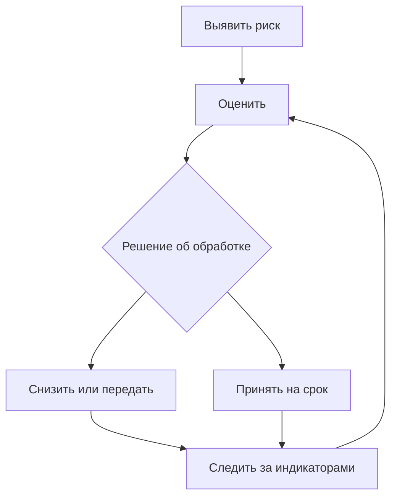
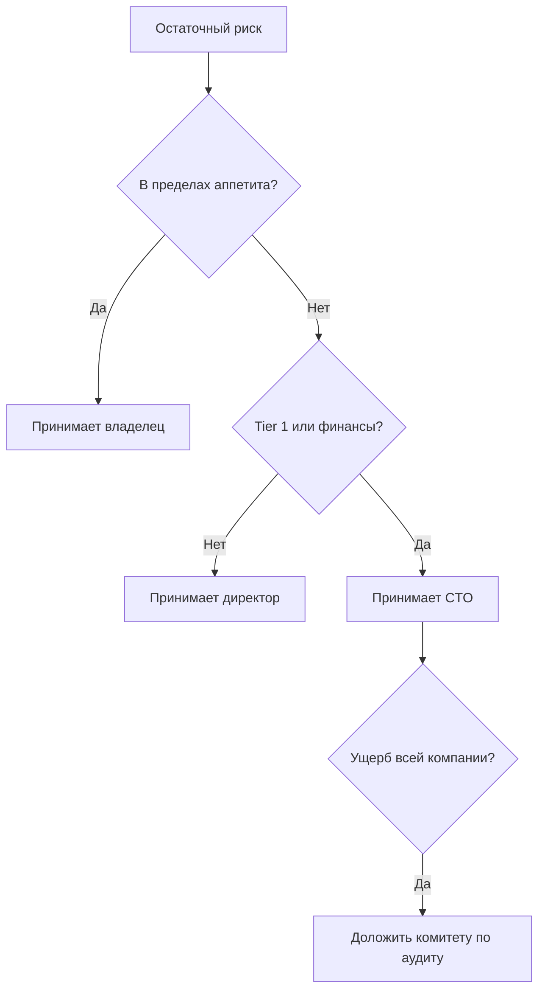
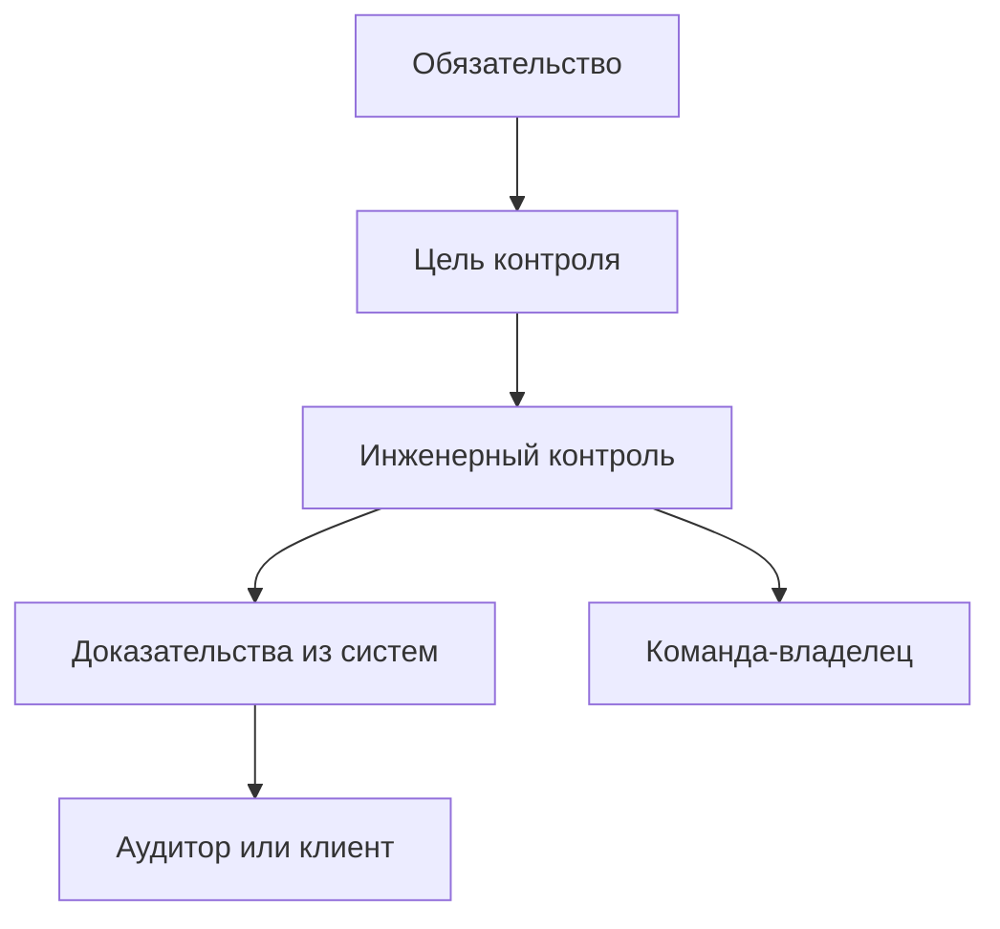

# Глава 53 — Риски, корпоративное управление, регулирование и стратегия безопасности { #chapter-53-risk-governance-regulation-and-security-strategy }

CTO отвечает за технологические риски, которые никто в разработке не видит целиком. Например: фреймворк
без поддержки, секреты в файле на сборочном хосте, аудиторский отчёт, которого ждёт клиент, а его нет,
служба безопасности в подчинении у финансов. Глава показывает, как свести такие риски в один
корпоративный реестр, где у каждого риска есть владелец и решение об обработке. Затем она разбирает, как
задать стратегию безопасности с опорой на признанные фреймворки, как выполнять регуляторные и договорные
обязательства с помощью инженерных механизмов контроля, а не бумаг, и как докладывать обо всём этом
неспециалистам. Сквозной пример — Northstar Technologies, вымышленная компания из
[кейса](../../case-studies/northstar/index.md), в квартале 4 первого года директора.

Связанные главы: [26](../05-engineering-quality/26-security-and-software-supply-chain-quality.md)
(безопасность в пайплайне поставки), [30](../06-technical-leadership/30-technical-strategy-and-technology-selection.md)
(первый реестр технологических рисков), 48 (корпоративные политики) и
[55](55-boards-due-diligence-and-executive-decision-making.md) (совет директоров).

## Почему это важно { #why-this-matters }

В команде риск — это список того, что может сломаться, а чинить будут люди из той же комнаты.

В организации риски пересекают границы команд и теряют естественного владельца. Единственный контроллер
Jenkins остаётся проблемой Platform Operations, пока не остановит релизы всех команд. Если нет реестра, где
у каждого риска названы владелец и решение, организация принимает риски по умолчанию: их никто не
выбирал, поэтому никто не может сказать, допустимы ли они.

Для высшего руководства риск становится вопросом корпоративного управления. Надзор за ним ведёт орган
выше CTO, обычно [комитет по аудиту](../../glossary.md#audit-committee) (комитет совета директоров,
который надзирает за финансовой отчётностью и рисками). Клиентам, аудиторам и регуляторам нужны
доказательства, а не заверения. Если CTO может назвать десять важных технологических рисков, их
владельцев и то, какие риски компания принимает, у совета директоров есть чем управлять. Один жёлтый
квадрат с надписью «кибер» не даёт ничего.

## Цели главы { #learning-objectives }

После этой главы вы сможете:

- Построить и вести корпоративный реестр технологических рисков, где у каждого риска есть причина,
  владелец, решение об обработке, индикатор и дата пересмотра.
- Задать стратегию безопасности, используя три публичных фреймворка (NIST Cybersecurity Framework,
  Secure Software Development Framework и SLSA) как карты для анализа разрывов, и выразить её через
  небольшое число профинансированных результатов.
- Выполнять регуляторные и договорные обязательства, проектируя инженерные механизмы контроля, которые
  выдают доказательства как побочный продукт обычной работы.
- Решать, кто какой риск вправе принимать, и сформулировать риск-аппетит, который делает эти решения
  последовательными.
- Докладывать о технологических рисках руководству и комитету по аудиту на языке бизнеса, без
  тепловых карт, скрывающих важные различия.

## Ментальная модель { #the-mental-model }

> **Ментальная модель:** реестр рисков — это журнал решений, а не опись. Каждая строка существует,
> чтобы названный человек с нужными полномочиями принял одно решение (снизить, передать, избежать или
> принять риск) и чтобы потом было видно, остаётся ли оно в силе.

Первая идея: управление рисками — это петля, а не документ. Риски выявляют, оценивают, обрабатывают и
отслеживают по индикаторам, которые подскажут, когда оценка оказалась неверной. Реестр, который собирают
раз в год для комитета, — это первые два шага, разыгранные как спектакль.

Вторая идея: **корпоративное управление — это вопрос о том, кто решает**. У каждого риска есть два
человека: владелец, который ведёт его изо дня в день, и принимающий риск — тот, у кого есть полномочия
жить с остаточным риском. Принимающий должен стоять достаточно высоко, чтобы отвечать за последствия.
Тимлид не может принять риск потери крупнейшего клиента компании, а CTO не стоит просить принять
двухнедельную задержку обновления второстепенной библиотеки.

## Подробный разбор { #deep-conceptual-explanation }

### Что такое корпоративный реестр технологических рисков { #what-an-enterprise-technology-risk-register-is }

В главе 30 [реестр рисков](../../glossary.md#risk-register) охватывал одну инженерную организацию:
компоненты, у которых кончается поддержка, единые точки отказа по знаниям, концентрацию.
**Корпоративный** реестр отличается в трёх отношениях.

1. **Охват.** Он включает все технологические риски, которые могут навредить компании, в том числе
   корпоративное ИТ, безопасность, соответствие требованиям (compliance) и вендоров, а не только то, что
   может исправить разработка.
2. **Уровень обзора.** Пункты сформулированы как последствия для бизнеса («крупный клиент уходит при
   продлении»), а технические причины лежат уровнем ниже: те, кто принимает решения, мыслят
   последствиями.
3. **Связь.** Он питает общий реестр рисков компании, поэтому технологические риски взвешивают вместе со
   всеми остальными.

Такой подъём рисков наверх для кибербезопасности описывает стандарт NIST
([Quinn et al., 2025](../../references/bibliography.md#nist2025ir8286r1); **стандарт**). Поднимать риски
наверх не значит копировать каждую строку: каждый уровень оставляет себе риски, которые может обработать
сам, а наверх передаёт, сгруппировав по последствиям, только те, которым нужны более высокие полномочия.

Полезная запись описывает риск через причину, событие и последствие: «Из-за X может произойти Y, что
приведёт к Z». Она перечисляет пункты нижнего уровня, которые объединяет, и называет владельца,
принимающего риск, оценку (с диапазоном возможного ущерба там, где его можно обосновать), способ
обработки, индикатор, который сдвигается раньше самого риска, и дату пересмотра.
[Шаблон реестра рисков](../../templates/risk-register.md) даёт эти поля с разобранным примером Northstar.

### Решения об обработке и кто вправе их принимать { #treatment-decisions-and-who-may-make-them }

Четыре способа обработки риска — **консенсус практиков**: **снизить** вероятность или ущерб;
**передать** часть последствий через страховку или договор (но никогда не доверие клиентов);
**избежать** — отказаться от самой деятельности; **принять** — явно и на срок.

Чаще всего управление ломается именно на принятии: риск, который шесть кварталов висит без действий,
фактически принят, хотя никто этого не решал. Книга рекомендует три правила:

1. У каждого принятия есть названный принимающий, причина и срок действия не больше двух кварталов
   (тот же предел, что для исключений из стандартов в главе 20).
2. Уровень принимающего зависит от остаточного риска, а не от того, кто риск поднял.
3. Истёкшее принятие эскалируют на уровень выше и никогда не продлевают втихую.

[Риск-аппетит](../../glossary.md#risk-appetite) делает эти решения последовательными: он определяет,
какие виды риска и в каком объёме компания готова нести ради своих целей. Большинство формулировок
аппетита слишком расплывчаты, чтобы ими пользоваться («низкий аппетит к киберрискам»). Рабочую
формулировку пишут в единицах индикаторов. Например: «ни одна
[активно эксплуатируемая уязвимость](../../glossary.md#known-exploited-vulnerability-kev) не остаётся
открытой на доступном из интернета компоненте [tier 1](../../glossary.md#tier-1) дольше 7 дней без
компенсирующей меры и исключения, подписанного CTO». Активно эксплуатируемая уязвимость — это уязвимость
из публичного списка тех, что злоумышленники уже используют. Компенсирующая мера — замещающая защита,
которая снижает риск, пока настоящее исправление ждёт своей очереди; например, блокировка доступа на
балансировщике нагрузки. Аппетит устанавливает совет директоров или его комитет по аудиту по предложению
менеджмента; технологические строки готовит CTO.

### Как оценивать риск и не обманывать себя { #rating-risk-without-fooling-yourself }

Большинство компаний оценивают риск по матрице «вероятность × ущерб»: по пять баллов на каждую ось, баллы
перемножают и красят в красный, жёлтый или зелёный. Метод привычный и быстрый, но его слабые места
задокументированы. Cox математически показал (**научный результат**), что матрицы рисков:

- обладают низкой разрешающей способностью и одинаково оценивают риски очень разного размера;
- могут ставить выше риски, которые количественно меньше;
- могут работать хуже случайного выбора, когда частота и тяжесть последствий отрицательно коррелируют;
- зависят от входных данных, которые разные оценщики понимают по-разному.

Он советовал пользоваться ими осторожно и пояснять каждое суждение
([Cox, 2008](../../references/bibliography.md#cox2008risk)).

Поэтому не запрещайте матрицы, а реже останавливайтесь на них. Используйте матрицу, чтобы отделить
десять важных рисков от сорока неважных, а не чтобы упорядочить эти десять. Где риску можно приписать
диапазон в долларах, приписывайте. Рядом с каждой оценкой пишите обоснование: тогда у двух рисков с
оценкой 12, полученной по разным причинам, будет видна разница.

Количественные методы выражают риск в деньгах с помощью калиброванных оценок
([The Open Group, Open FAIR](../../references/bibliography.md#opengroup-open-fair), **стандарт**;
[Hubbard and Seiersen, 2023](../../references/bibliography.md#hubbard2023cybersecurity), **мнение
эксперта**). В компании размера Northstar оценивайте в деньгах три-четыре главных риска, а не каждую
строку. Оценка, после которой не изменился ни один способ обработки, своей задачи не выполнила
([Joint Task Force, 2012](../../references/bibliography.md#nist2012sp800-30r1); **стандарт**).

### Стратегия безопасности на основе признанных фреймворков { #security-strategy-with-recognized-frameworks }

В главе 26 три фреймворка служили картами для анализа разрывов на уровне директора. Все три —
**стандарты**:

- **[NIST CSF](../../glossary.md#nist-csf) 2.0**, Cybersecurity Framework Национального института
  стандартов и технологий США (NIST), группирует результаты в области безопасности по шести функциям: в
  центре Govern (управлять), вокруг Identify, Protect, Detect, Respond и Recover (выявлять, защищать,
  обнаруживать, реагировать, восстанавливать). Сравнение текущего профиля с целевым даёт план с
  приоритетами ([NIST, 2024](../../references/bibliography.md#nist2024csf)).
- **[SSDF](../../glossary.md#ssdf)**, Secure Software Development Framework (фреймворк безопасной
  разработки ПО), описывает практики безопасной разработки в четырёх группах
  ([Souppaya, Scarfone, and Dodson, 2022](../../references/bibliography.md#nist2022ssdf);
  [NIST, SSDF project](../../references/bibliography.md#nist-ssdf-project)).
- **[SLSA](../../glossary.md#slsa)**, Supply-chain Levels for Software Artifacts (уровни целостности
  цепочки поставки для программных артефактов), задаёт на двух отдельных треках, Build и Source, уровни
  того, насколько можно доказать, из какого исходного кода и какой сборкой получен работающий артефакт
  ([SLSA, v1.2](../../references/bibliography.md#slsa-spec)). SLSA Build L2 означает, что каждая сборка
  выдаёт подписанные сведения о происхождении (provenance): защищённую от подделки запись о том, как
  собран артефакт; формирует её сам сервис сборки.

На уровне CTO те же фреймворки служат трём целям.

**Общий словарь** с клиентами, аудиторами, страховщиками и покупателями компании, которые формулируют
вопросы на языке фреймворков.

**Способ выбрать несколько результатов.** Фреймворки делают разрывы видимыми, но действий не выбирают; в
CSF 2.0 прямо сказано, что его ядро (Core) — не чек-лист. CTO выбирает на следующий год три-пять целевых
результатов, и у каждого есть метрика, владелец и стоимость. Начинайте с результатов, потеря которых
ударит по клиентам или выручке, а затем спрашивайте, какие результаты фреймворков их защищают.

**Каркас для управления.** Функция Govern в CSF 2.0 — это и есть работа CTO: роли, риск-аппетит,
политики и надзор за рисками цепочки поставки.

Краткая форма стратегии безопасности, которую рекомендует книга, с содержанием каждого элемента:

| Элемент | Содержание |
|---|---|
| Диагноз | Три вывода с доказательствами: где система уязвима, почему это не исправляется, о чём спрашивают клиенты, а ответить нечего |
| Направляющая политика | Два-четыре правила, которые разрешают повторяющиеся выборы (например, «доказательства безопасности берутся из систем, а не из памяти людей») |
| Целевые результаты | Три-пять, где полезно — в терминах CSF, SSDF или SLSA, у каждого метрика и владелец |
| Финансирование | Ресурс и деньги на каждый результат и то, что ими вытесняется |
| Управление | Кто какой риск принимает; строки аппетита; ритм и адресаты отчётности |

Результатами в области безопасности владеют команды — владельцы систем. Служба безопасности задаёт
политику, ведёт инструменты, тестирует и проверяет, как команды классифицируют находки.

### Регулирование и договоры через инженерные механизмы контроля { #regulation-and-contracts-through-engineering-controls }

Обязательства приходят к софтверной компании из законов, клиентских договоров, обязательных стандартов, а
также из отчётов, которые она решает получить сама. Примеры для платформы order-to-cash («от заказа до
оплаты»):

- **Договорная доступность и сервисные кредиты.** Это и так ежедневная забота разработки.
- **Данные платёжных карт.** PCI Data Security Standard (стандарт безопасности данных индустрии платёжных
  карт) задаёт базовые требования ко всем, кто хранит, обрабатывает или передаёт данные держателей карт
  либо может повлиять на их безопасность ([PCI SSC, PCI DSS](../../references/bibliography.md#pci-dss);
  **стандарт**). Первый инженерный вопрос — границы применения: где проходят данные карт и какие системы
  могут на них повлиять.
- **Отчёты SOC 2.** Отчёт [SOC 2](../../glossary.md#soc-2) — это проверка механизмов контроля, которые
  относятся к безопасности, доступности, целостности обработки, конфиденциальности или приватности. Её
  проводит независимый CPA (certified public accountant, дипломированный аудитор) по критериям Trust
  Services Criteria института AICPA (American Institute of CPAs, Американский институт дипломированных
  бухгалтеров) ([AICPA, Trust Services Criteria](../../references/bibliography.md#aicpa-tsc2022);
  [AICPA, 2026](../../references/bibliography.md#aicpa2026tsc-proposal); **стандарт**). Предложена новая
  редакция критериев; прежде чем планировать цикл аудита, проверьте, в каком она статусе.
- **Раскрытие информации публичными компаниями.** В США правила SEC (Комиссии по ценным бумагам и биржам)
  2023 года требуют от компаний, чьи акции торгуются на бирже, сообщать о существенных инцидентах
  кибербезопасности, как правило, в течение четырёх рабочих дней после того, как компания признала
  инцидент существенным. «Существенный» здесь значит настолько важный, что о нём захотел бы знать
  разумный инвестор. Годовой отчёт должен описывать, как совет директоров надзирает за рисками
  кибербезопасности ([SEC, 2023](../../references/bibliography.md#sec2023cyberrule); **стандарт**).
  Частную компанию эти правила не связывают, но покупатели и инвесторы, готовящие компанию к выходу на
  биржу, задают те же вопросы.

Законы о приватности и защите данных эта глава не обозревает: они зависят от юрисдикции, требуют
юридической консультации, и данных по ним мало. Зато инженерный метод для любого обязательства один и тот
же.

**Механизм контроля** (control) — это повторяющееся и проверяемое поведение системы или команды: каждое
изменение в продакшене проходит ревью в пайплайне, каждый продакшен-секрет хранится в менеджере секретов.
Механизм, который сам выдаёт доказательства (лог пайплайна, запись сканера), дёшево проверять и трудно
подделать. Механизм, который держится на заполнении форм, обходится дорого и, как показала глава 20,
часто расходится с действительностью.

**Рекомендация книги** — **один раз спроектировать получение доказательств и использовать их для всех
обязательств**. Один и тот же лог пайплайна отвечает на вопрос аудитора SOC 2 об управлении изменениями,
на вопрос клиентского опросника, а заодно подтверждает практику SSDF.

| Обязательство | Инженерный механизм контроля | Откуда берутся доказательства |
|---|---|---|
| Доступность 99.9 процента с кредитами | [SLO](../../glossary.md#sli-slo-and-sla), [бюджеты ошибок](../../glossary.md#error-budget-and-burn-rate), операционные минимумы tier 1 (глава 24) | Синтетические проверки, трекер инцидентов |
| Управление изменениями (SOC 2, опросники) | Изменения с ревью через пайплайн с журналом аудита | Логи пайплайна и репозитория |
| Управление уязвимостями | Сроки устранения и исключения (глава 26) | Записи сканера, реестр исключений |
| Вопросы о цепочке поставки (SBOM, SSDF) | [SBOM](../../glossary.md#sbom) (software bill of materials, перечень компонентов ПО: машиночитаемый список компонентов сборки) для каждой сборки; сведения о происхождении | Артефакты сборки |
| Защита данных карт | Граница применения; токенизация; контроль доступа | Конфигурация сети и доступа, проверка границ применения |
| Готовность к раскрытию инцидентов | Определения серьёзности с путём эскалации для оценки существенности | Записи об инцидентах, журнал решений |

### Реагирование на взлом и непрерывность бизнеса: что должно быть готово { #breach-response-and-continuity-what-must-be-ready }

Когда случается взлом или долгий простой, у CTO нет времени проектировать процесс, поэтому три вещи
должны быть готовы заранее (**рекомендация книги**; само реагирование на инциденты разбирает
[глава 25](../05-engineering-quality/25-incidents-postmortems-and-change-failure-analysis.md)).

1. **Путь от инцидента к раскрытию.** Письменное правило: какие технические события доходят до CEO,
   юристов и совета директоров и как быстро. Подозрение на утечку данных уходит наверх в течение
   нескольких часов, ещё до того, как известны все факты: кто-то вне разработки должен решить,
   существенно ли это и кому нужно сообщить. Назовите этого человека и его заместителя.
2. **Штабные учения (tabletop exercise).** Дважды в год прогоняйте команду высшего руководства через
   бумажный сценарий: утёкший ключ, записка вымогателей, платёжный провайдер, который лежит целые сутки.
   Результат — список пробелов (до кого не удалось дозвониться, какой клиентский договор никто не нашёл),
   и у каждого пробела есть владелец.
3. **План непрерывности для путей, которые приносят деньги.** Для путей заказа и оплаты и для пути сборки
   запишите, сколько бизнес продержится без каждого из них, как восстанавливается сервис и когда
   восстановление в последний раз проверяли. Резервная копия, из которой ни разу не восстанавливались, —
   это надежда, а не механизм контроля.

Все три дают доказательства (журнал эскалаций, протокол учений, проверку восстановления), и место им в
библиотеке доказательств; киберстраховщики спрашивают именно об этом.

### Как докладывать о рисках неспециалистам { #reporting-risk-to-non-specialists }

Руководители и члены комитета по аудиту хорошо судят о рисках и читают финансовую отчётность, но
большинство из них не технологи. Четыре правила (**рекомендация книги**, согласуется с главами 39 и 55):

1. **Начинайте с нужного решения.** «Просим комитет утвердить три строки аппетита и принять к сведению
   один риск за пределами аппетита» — до любых графиков.
2. **Формулируйте риски как последствия для бизнеса с диапазонами.** «Потеря одного из шести крупных
   клиентов, которые продлевают контракты в следующем году, лишит компанию примерно $1,17 млн годовой
   выручки», а не «риск надёжности: высокий».
3. **Показывайте тренд и индикатор, а не только оценку.** Оценка 15, которая снижается, и оценка 15,
   которая растёт, — это разные истории.
4. **Называйте то, что принято.** Работа комитета по аудиту — надзор, а надзирать за принятием, о котором
   ему не сообщают, он не может.

Докладывайте об уязвимости системы, а не об активности. Долю прошедших обучение и долю кликов в
фишинговых рассылках легко сдвинуть, но говорят они мало. А вот критические уязвимости с просроченным
сроком устранения, открытые активно эксплуатируемые уязвимости, покрытие компонентов tier 1 механизмами
контроля и исключения по возрасту показывают, что может пойти не так. Добавьте к ним проверку того, кто
классифицирует находки (глава 18).

## Пример из инженерной организации { #engineering-organization-example }

!!! info "Northstar: что уже известно"
    Неделя 43 первого года директора. Доступность достигла 99,89% — чуть ниже договорных 99,9%.
    Безопасность находится в корпоративном ИТ, вне разработки, и отчёта SOC 2 у Northstar нет.
    См. [хронологию](../../case-studies/northstar/timeline.md).
    Впервые читаете о Northstar? Прочитайте [«Год вкратце»](../../case-studies/northstar/year-in-brief.md),
    [действующих лиц](../../case-studies/northstar/cast.md) и
    [брифинг квартала 4](../../case-studies/northstar/quarter-4-briefing.md).

Дальнейшее — **вымысел**. Цифры опросников, оценки и диапазоны ущерба — **иллюстрация**.

**Ситуация на неделе 43.** Корпоративный реестр рисков Northstar ведёт финансовая служба Rajiv Menon
(CFO, финансовый директор). Комитет по аудиту под председательством Margaret Lin (независимый директор,
бывший CFO) рассматривает его дважды в год. В реестре 12 рисков на матрице пять на пять. Технологии
представлены одной строкой «Кибератака или сбой ИТ». Её владелец — Marta Kowalczyk (руководитель ИТ),
оценка 12 (вероятность 3, ущерб 4), цвет жёлтый, и на последних четырёх пересмотрах она не менялась.
Ссылок на реестр разработки в нём нет. Joon Park (руководитель ИТ-безопасности) возглавляет службу
безопасности из двух человек, которая подчиняется Marta, а та — Rajiv. В квартальном отчёте Joon —
находки пентеста, доля кликов в фишинговых рассылках и доля прошедших обучение. Единственный источник
независимых гарантий у Northstar — ежегодный внешний пентест.

В реестре разработки, составленном в квартале 2 (глава 30), девять пунктов. Из этого сырья и собран
корпоративный реестр ниже:

| ID | Технологический риск |
|---|---|
| TR-01 | Фреймворк приложения Core отстал на мажорную версию от той, что поддерживает сообщество |
| TR-02 | Один контроллер сборки Jenkins примерно с 60 плагинами; однажды он уже остановил все развёртывания |
| TR-03 | Бесплатные обновления среды выполнения Java для Core обещаны лишь примерно на 12 месяцев вперёд |
| TR-04 | XML-библиотеку Core больше не сопровождают в апстриме; в ней сидела самая старая критическая уязвимость |
| TR-05 | Сервер конфигурации работает в одном экземпляре и отстаёт на две мажорные версии |
| TR-06 | Развёртывания через shell-скрипты понимает один инженер |
| TR-07 | Валюты и округление в ledger: реагировать или вносить изменения может один человек |
| TR-08 | Один маршрут через банк-партнёр без резервного; сбой банка уже оставлял платежи в очереди |
| TR-09 | Таблицы налоговых ставок tax-svc вручную ведёт один инженер; ошибка в ставке налога уже привела к инциденту |

На неделе 43 Margaret Lin через Rajiv просит посвятить сессию на заседании комитета на неделе 50
технологическим рискам: главные технологические риски на языке бизнеса, их владельцы, что с ними делают и
что компания принимает. Victor Lindqvist (CTO, технический директор) поручает директору подготовить
вместе с Marta и Joon корпоративный реестр технологических рисков и показать ему на неделе 48.

**Исходные данные.** На неделе 44 Kwame Mensah (staff-инженер, инфраструктура) и Joon Park составляют
срез состояния безопасности, а Joon подсчитывает клиентские опросники по безопасности за год. Сервис
аутентификации auth-svc по-прежнему развёртывается скриптом, и в нём остаётся критическая активно
эксплуатируемая уязвимость.

| Показатель | Конец квартала 1 | Неделя 44 |
|---|---|---|
| Компоненты со сканированием зависимостей | 20 в пайплайне, 4 еженедельным сканом | без изменений |
| Открытые критические уязвимости | 3, все под исключениями | 2 под исключениями: auth-svc (активно эксплуатируемая, доступ ограничен на балансировщике) и пункт в Core, который ждёт TR-01 |
| Открытые высокие уязвимости сверх 90-дневного срока устранения | не измерялось | 9 |
| Компоненты tier 1 с SBOM на каждую сборку | 6 из 15 | 14 из 15 (все, кроме auth-svc) |
| Компоненты tier 1 с подписанными сведениями о происхождении сборки (SLSA Build L2) | не измерялось | 0 из 15 |
| Сервисы на скриптах с секретами в открытых файлах | 2 | 2 |
| Опросники за последние четыре квартала | не измерялось | 34 (в 11 просили SOC 2, в 6 — доказательства по SBOM или SSDF), около 14 часов на каждый |

Опросники отнимают около 476 часов в год, то есть примерно 0,26 FTE. Сюда не входят 2 часа в неделю,
которые сам Victor тратит на проверки безопасности ([глава 50](50-what-a-cto-actually-does.md)). На
неделе 42 Greg Tanaka (VP по продажам) сообщил о потенциальном клиенте примерно на $310 000 в год; по его
условиям отчёт SOC 2 нужен в течение 12 месяцев после подписания.

**Консолидация.** Сначала главный вывод: 22 разрозненных пункта превращаются в девять рисков,
сформулированных как последствия для бизнеса, и самая высокая оценка — не у риска безопасности. Директор
собирает TR-01–TR-09, шесть находок по безопасности, четыре пункта из списка Marta по ИТ, два пункта по
соответствию требованиям (нет отчёта SOC 2; нагрузка от опросников) и историю надёжности, а затем
группирует их по последствиям.

| ID | Риск (последствие) | Объединённые источники | Владелец | Оценка |
|---|---|---|---|---|
| ER-01 | Крупный клиент уходит при продлении из-за надёжности | История надёжности, TR-05, TR-08 | Директор по разработке | 20 |
| ER-02 | Финансовая ошибка доходит до клиентов | TR-07, TR-09 | Marcus Oyelaran (руководитель Billing) | 12 |
| ER-03 | Эксплуатация известной уязвимости в доступном из интернета компоненте tier 1 | auth-svc, критическая в Core, просроченные высокие | Tom Becker (руководитель Platform Operations), Ines Carvalho (staff-инженер, домен Core) | 15 |
| ER-04 | Путь сборки и развёртывания скомпрометирован или потерян | TR-02, TR-06, секреты в открытых файлах, нет сведений о происхождении | Kwame Mensah | 15 |
| ER-05 | Платформу Core невозможно обновлять | TR-01, TR-03, TR-04 | Ines Carvalho | 12 |
| ER-06 | Из-за отсутствия гарантий компания теряет сделки и продления | Нет отчёта SOC 2, нагрузка от опросников | Victor Lindqvist | 12 |
| ER-07 | Границы данных карт шире, чем считается | Границы ни разу не проверялись | Joon Park | 8 |
| ER-08 | Компрометация корпоративных учётных записей доходит до продакшена | Два пункта ИТ | Marta Kowalczyk | 12 |
| ER-09 | Потеря корпоративных бизнес-систем | Два пункта ИТ | Marta Kowalczyk | 6 |

Оценка — произведение вероятности и ущерба, каждый от 1 до 5. Большинство решений об обработке —
«снизить»; ER-03 пока принят через исключение, ER-05 принят с установкой патчей до решения о миграции, а
по ER-06 решения нет. Оценки ущерба, опирающиеся на цифры Northstar, — иллюстрация:

- **ER-01:** один клиент из топ-40 (один из 40 крупнейших) — это примерно $1,17 млн ARR (годовой
  регулярной выручки). При валовой марже 72% это около $842 000 в год плюс $240 000–380 000 в год
  сервисных кредитов по темпам кварталов 3 и 2. Риск оценён как вероятный: на кварталы 5–8 приходится шесть
  крупных продлений, а доступность была ниже 99,9% в каждом измеренном квартале.
- **ER-05:** миграция, от $96 000 до $194 400 ([глава 52](52-technology-investment-budgeting-and-financial-literacy.md)).
- **ER-06:** как минимум одна сделка на $310 000 плюс 0,26 FTE в год на опросники.
- Остальные риски количественно не оценены; ER-02 по определению был бы Sev1.

Три наблюдения. Во-первых, у четырёх рисков оценка 12, но общего у них нет: финансовая ошибка,
необновляемая платформа, коммерческий пробел в гарантиях и компрометация учётных записей. Это та самая
проблема разрешающей способности, о которой писал Cox, уместившаяся в одном столбце; поэтому к каждой
оценке приложено предложение с обоснованием. Во-вторых, только у ER-01 есть долларовый диапазон, который
подтверждают цифры Northstar; для рисков безопасности честная запись — «количественно не оценено».
В-третьих, прежняя корпоративная строка превратилась в пять рисков с названными владельцами, а самая
высокая оценка в реестре (ER-01, 20) вообще не у риска безопасности.

## Как принимать решение { #decision-framework }

Первое решение — на каком уровне находится риск. Задайте три вопроса:

| Вопрос | Если да |
|---|---|
| Может ли последствие затронуть клиентский договор, выручку при продлении, финансовую корректность или юридическое обязательство? | Корпоративный реестр |
| Нужны ли для обработки деньги, ресурс или полномочия сверх тех, что есть у одного директора? | Корпоративный реестр |
| Нужен ли для принятия риска кто-то выше владельца? | Запишите принимающего на этом уровне |
| Ничего из перечисленного | Оставьте риск в реестре команды или разработки |

Второе решение — способ обработки. Выбирайте то, что сильнее всего меняет последствия на единицу затрат,
с учётом того, кто может действовать:

| Ситуация | Обычный способ обработки |
|---|---|
| Есть дешёвое исправление, у которого есть владелец | Снизить сейчас; не обсуждать на комитете |
| Исправление большое, а риск растёт | Снижать поэтапно, с временной компенсирующей мерой и принятием с датой окончания |
| Последствия финансовые и страхуемые или регулируемые договором | Передать часть и снизить остальное; передача никогда не снимает ущерба для репутации и клиентов |
| Деятельность создаёт больше риска, чем ценности | Избежать: вывести из эксплуатации интеграцию, убрать функцию, отказаться от условия сделки |
| Остаточный риск в пределах аппетита, а обработка дорогая | Принять, с принимающим, сроком действия и индикатором |

Третье решение — добиваться ли отчёта SOC 2. Книга рекомендует три проверки, и пройти нужно все:

1. **Спрос.** Просят ли его клиенты или потенциальные клиенты так часто или на такие суммы, что это имеет
   значение? Одна сделка — сигнал; треть опросников — закономерность.
2. **Готовность механизмов контроля.** Работают ли уже те механизмы, которые проверит аудит, и выдают ли
   они доказательства? Если нет, деньги первого года уйдут на механизмы контроля, а не на отчёт.
3. **Стоимость альтернативы.** Во что обходятся опросники, потерянные сделки и трения при продлениях?

Спрос реальный, готовность низкая: сначала профинансируйте готовность и назначьте дату решения об аудите.
Спрос реальный, готовность высокая: отчёт — это в основном плата аудитору. Спрос слабый: постройте
пайплайн доказательств, который удешевит ответы на опросники, и вернитесь к вопросу позже.

## Компромиссы { #trade-offs }

**Полнота против внимания.** Реестр на 60 пунктов полон, но его не читают; реестр на 8–12 пунктов читают,
но детали нижнего уровня скрывает. Сохраняйте столбец источников, чтобы подъём рисков наверх можно было
проверить.

**Матрицы против количественной оценки.** Матрица занимает минуты, но вводит в заблуждение на верхних
строках. Количественная оценка каждого риска занимает недели и даёт ложную точность. Оценивайте в деньгах
те немногие риски, от которых зависят решения.

**SOC 2 против разработки.** Программа SOC 2 стоит денег на аудит, инструменты и время сотрудников, и
часть этого времени уходит на сбор доказательств, а не на снижение рисков. Зато она заставляет механизмы
контроля работать стабильно и открывает двери в закупках клиентов.

**Безопасность в ИТ против безопасности в разработке.** Служба безопасности внутри ИТ хорошо видит
корпоративные системы и независима от инженеров, которых проверяет. Риски продукта и пайплайна она видит
плохо и не имеет власти над командами, которые меняют код. Перевод под CTO даёт власть, но отнимает часть
независимости. Но при любом подчинении в службе остаются два человека, и проблема ёмкости не решается.

## Типичные провалы { #failure-modes }

**Жёлтый квадрат.** Все технологические риски годами сидят в одной строке с неизменной оценкой. Как
заметить: оценка строки не менялась четыре пересмотра подряд, хотя инциденты, уязвимость системы и
требования клиентов менялись. Что делать: разбить строку по последствиям, у каждого свой владелец.

**Принятие по умолчанию.** Риски кварталами остаются открытыми, а решения принять их никто не принимает;
или «временное» исключение втихую продлевают. Как заметить: пункты старше двух кварталов без движения; то
же исключение с новой датой и тем же утверждающим. Что делать: правила принятия, описанные выше.

**Фреймворк вместо стратегии.** В электронной таблице сопоставлена каждая подкатегория CSF, а в
разработке ничего не меняется. Как заметить: в стратегии нет профинансированных действий.

**Отчётность об активности.** Ни одна метрика, которую видит комитет, не сдвинется, если компонент tier 1
окажется уязвим. Что делать: метрики уязвимости системы.

**Доказательства вручную.** На каждый опросник или аудит отвечают по памяти и по скриншотам. Как
заметить: два ответа на один и тот же вопрос расходятся. Что делать: механизмы контроля, которые сами
выдают доказательства; одна библиотека доказательств для всех обязательств.

## Применение в крупной организации { #enterprise-application }

При 50–150 инженерах у CTO обычно нет сотрудников по рискам и compliance, а небольшая служба
безопасности может находиться в другом подразделении. Ведите реестр через существующую систему
управления, назначая владельцев по ролям:

| Роль | Чем владеет |
|---|---|
| CTO | Корпоративным реестром технологических рисков и технологическими строками аппетита |
| Директор по разработке или VP | Реестром разработки и большинством действий по снижению |
| Руководитель ИТ | Рисками корпоративного ИТ |
| Руководитель безопасности | Политикой, тестированием, аудитом классификации, опросниками, процессом SOC 2 и библиотекой доказательств |

Пересматривайте реестр разработки ежемесячно на обзоре качества (глава 27), а корпоративный реестр —
ежеквартально вместе с CFO и руководителем ИТ. Докладывайте комитету по аудиту дважды в год, а если
какой-то риск вышел за пределы аппетита, — на каждом заседании.

**Вендоры и поставщики.** При таком размере значительная часть технологических рисков сидит у вендоров:
облачного провайдера, банка-партнёра, платёжного процессора. Существенный вендор — тот, чей сбой
остановит денежный путь или раскроет данные клиентов. Записывайте каждого как источник под тем
последствием, которое он может вызвать, и запрашивайте его собственные доказательства, например отчёт
SOC 2, а не довольствуйтесь ответом на опросник. Взвешивайте концентрацию против стоимости переключения
(**рекомендация книги**). Второй банковский маршрут (пробел TR-08) обойдётся в работу по интеграции и
второй договор. Добавляйте его там, где сбой нарушил бы клиентский договор; в остальных случаях
принимайте зависимость с письменным запасным планом.

## Взгляд CTO { #cto-perspective }

В этой области три вещи принадлежат только CTO.

**Переводить между разработкой и корпоративным управлением.** CTO — единственный, кто читает и отчёт об
уязвимостях, и реестр рисков компании и может сказать, какие технические факты меняют риск для бизнеса.

**Готовить технологический аппетит вместе с его ценой.** Устанавливает аппетит совет директоров, но ему
нужно предложение в измеримых величинах, где у каждой строки указана стоимость. Строка, соблюдение
которой компании не по карману, — это декларация намерений, а не аппетит.

**Давать совет о месте службы безопасности.** Кому подчиняется безопасность, насколько она велика и нужен
ли компании [CISO](../../glossary.md#ciso) (chief information security officer, директор по
информационной безопасности, отдельный руководитель безопасности), часто решает CEO. CTO должен прямо
сказать, чего не видно с нынешнего места.

В компании размера Halvard роли те же, но реестр каждого вице-президента питает реестр CTO, а договоры с
вендорами становятся отдельной категорией риска.

## Практический плейбук { #practical-playbook }

1. **Соберите** все существующие списки рисков: разработки, ИТ, находки по безопасности, требования
   compliance и технологические строки реестра компании.
2. **Сгруппируйте по последствиям** в восемь-двенадцать корпоративных рисков со столбцом источников и
   впишите существенных вендоров под последствия, которые они могут вызвать.
3. **Назовите владельца и принимающего** для каждого риска, на нужном уровне.
4. **Оцените для сортировки** риски по матрице компании, затем добавьте диапазон в долларах там, где его
   подтверждают финансовые цифры, и предложение с обоснованием к каждой оценке.
5. **Решите, как обрабатывать** каждый риск: снизить, передать, избежать или принять, со стоимостью,
   датой и сроком действия.
6. **Выберите индикатор** для каждого риска: такой, который сдвинется раньше самого риска.
7. **Подготовьте строки аппетита** в единицах индикаторов для рисков, которым нужны пределы на уровне
   совета директоров.
8. **Сопоставьте обязательства с механизмами контроля** и для каждого механизма укажите источник
   доказательств.
9. **Напишите стратегию безопасности**: диагноз, направляющая политика, три-пять результатов,
   финансирование и управление.
10. **Замените метрики активности** в отчётности по безопасности метриками уязвимости системы и аудитом
    классификации.
11. **Доложите** комитету по аудиту: сначала нужное решение, затем риски за пределами аппетита, затем
    тренд.
12. **Заставьте реестр работать**: принятия истекают в назначенные даты, а истечение запускает эскалацию.

## Кейс { #case-study }

Этот кейс — **вымысел**; он продолжает пример из инженерной организации на неделях 45–49. Чем закончилась
сессия комитета по аудиту на неделе 50, не записано.

**Черновик.** К неделе 47 в черновике директора для Victor есть девять корпоративных рисков, три
предлагаемые строки аппетита и одностраничная стратегия безопасности.

Строки аппетита:

1. Договорная доступность путей заказа и оплаты планируется на уровне 99,9% или выше в каждом квартале;
   о квартале ниже этого уровня сообщают комитету с причиной и способом обработки.
2. Ни одна активно эксплуатируемая уязвимость не остаётся открытой на доступном из интернета компоненте
   tier 1 дольше 7 дней без компенсирующей меры и исключения, подписанного CTO, и ни одно такое
   исключение не действует дольше одного квартала.
3. Каждое изменение компонента tier 1 в продакшене проходит через пайплайн с журналом аудита; исключения
   перечисляются в отчёте комитету поимённо.

Строка 2 сразу выводит ER-03 за пределы аппетита. Директор записал исключение для auth-svc в квартале 1
как действующее «до миграции» (глава 26). На неделе 44 Joon Park вписал в запись дату, неделю 52, но
новой подписи не было. Никто выше директора исключение не подписывал, и действует оно гораздо дольше
одного квартала. Строка 3 выводит за пределы аппетита ER-04, пока auth-svc развёртывается скриптом.
Директор не смягчает строки, а вписывает оба факта в черновик.

В диагнозе стратегии три вывода. Уязвимость системы сосредоточена в пути сборки и в одном сервисе,
у которого до недавнего времени не было владельца. Доказательства безопасности собирают вручную
(476 часов в год на опросники). Служба безопасности хорошо видит корпоративное ИТ и плохо — риски
продукта. Целевые результаты на второй год:

- auth-svc переведён на пайплайн с журналом аудита;
- продакшен-секреты всех сервисов на скриптах хранятся в менеджере секретов;
- подписанные сведения о происхождении для артефактов tier 1 (SLSA Build L2) — на той целевой системе
  CI, которую выберут;
- библиотека доказательств, владелец которой — Joon Park, а владельцем доказательств со стороны
  разработки предложен Kwame Mensah, чтобы опросники перестали по умолчанию попадать к Victor;
- проверка границ применения для данных карт.

**Вопрос о SOC 2.** Joon Park получает два неформальных коммерческих предложения, которые здесь служат
иллюстрацией: $45 000–70 000 в год за аудит и около $30 000 в год за инструмент автоматизации compliance.
Внутренние затраты в первый год составят около 0,5 FTE в разработке и 0,5 FTE в ИТ, то есть примерно
$185 000 ресурса. Деньги пришлось бы делить с $150 000 на инструменты из
[продолжения](../../glossary.md#the-continuation) — поэтапного предложения директора финансировать
программу качества и дальше, — а эти $150 000 Rajiv хочет компенсировать внутри бюджета
$4,2 млн на облако и инструменты.

Применим три проверки. Спрос реальный (11 из 34 опросников, одна сделка на $310 000, впереди шесть
крупных продлений). Готовность частичная: сканирование, SBOM и владение сертификатами работают;
подписанных сведений о происхождении, пайплайна для auth-svc и библиотеки доказательств нет. Альтернатива
обходится примерно в 0,26 FTE в год плюс трения в сделках, размер которых неизвестен. Директор готовит
три варианта:

- **A**: взять обязательство пройти аудит SOC 2 во второй год.
- **B**: подготовка в кварталах 5 и 6 с решением на контрольной точке продолжения в неделю 78.
- **C**: без отчёта SOC 2; вкладываться только в библиотеку доказательств.

Черновик рекомендует B и называет, что изменило бы выбор: ещё два потенциальных клиента, для которых
отчёт станет условием подписания.

**Линия подчинения.** Marta Kowalczyk согласна с реестром, но не с третьим выводом. По её словам,
безопасность должна быть в ИТ именно потому, что служба проверяет разработку; перевод уберёт единственную
независимую проверку решений «не затронуты». Директор записывает её позицию рядом с тремя вариантами и
рекомендации не даёт, ведь решать это Helena Marsh (CEO, генеральный директор) и Rajiv в той же мере, что
и Victor:

- оставить подчинение и добавить роль по безопасности приложений с пунктирной линией подчинения CTO;
- перевести безопасность под CTO;
- создать должность руководителя безопасности, подчинённого CEO.

**Неделя 48.** Victor разбирает черновик на той же неделе, что и рекомендацию по VP. Он оставляет девять
рисков и три строки аппетита и просит показать в ER-06 рядом стоимость сделки и часы на опросники. Затем
он задаёт вопрос, на который директор не ответил: кто сегодня принимает ER-03? Честный ответ — директор,
в квартале 1; на уровне CTO никто его не подписывал. Victor говорит, что до недели 50 либо подпишет его
сам, либо добьётся дальнейшего ограничения доступа к auth-svc, и комитет узнает, что именно он выбрал.

Решение комитета, выбор Victor между A, B и C и линия подчинения не записаны (см.
[брифинг квартала 4](../../case-studies/northstar/quarter-4-briefing.md)). Кейс показывает вещь более
узкую: жёлтый квадрат превратился в девять рисков с владельцами, два из них — за пределами предложенного
аппетита, и CTO идёт на комитет, зная, какие принятия — его.

## Упражнения { #exercises }

Разборы упражнений: [решения к главе 53](../../solutions/ch53-solutions.md). Данные Northstar
вымышлены; нужные факты есть в примере из инженерной организации.

### Базовый уровень { #foundational }

**F1.** В корпоративном реестре рисков Northstar одна технологическая строка, «Кибератака или сбой ИТ»;
её владелец — Marta Kowalczyk, а оценка на последних четырёх пересмотрах — 12. Перепишите её в виде трёх
или более формулировок «причина, событие, последствие», используя факты Northstar. Затем предложите две
технологические строки, которых корпоративному реестру явно не хватает: риски, не связанные с атаками или
сбоями, взятые из таблицы TR-01–TR-09 в примере из инженерной организации. Сформулируйте их так же. Для
каждой формулировки назовите владельца, принимающего риск и индикатор, который сдвинется раньше, чем риск
реализуется.

**F2.** В черновике реестра директора у ER-02, ER-05, ER-06 и ER-08 одинаковая оценка 12. Опираясь на
известные слабости матриц рисков, объясните, почему подавать их комитету по аудиту как четыре равных
жёлтых риска значит вводить его в заблуждение. Предложите, что комитет должен увидеть вместо этого по
каждому из них, и скажите, какой из четырёх вы обсудили бы первым и почему.

**F3.** Возьмите для Northstar четыре обязательства: договор о доступности 99,9%; критерий управления
изменениями, который проверил бы аудит SOC 2, если бы Northstar на него пошла; защиту данных карт; запрос
клиента на продление о SBOM и доказательствах по SSDF. Для каждого назовите инженерный механизм контроля,
систему, которая выдаёт доказательства, команду-владельца и один способ, при котором доказательства
выглядят верными на бумаге, а механизм не работает.

### Прикладное лидерство { #applied-leadership }

**A1.** Предположим (гипотетически), что на неделе 51 Tom Becker (руководитель Platform Operations) просит
продлить исключение для auth-svc (критическая активно эксплуатируемая уязвимость, доступ ограничен на
балансировщике) с недели 52 до недели 65, потому что этап 1 консолидации CI сдвинулся. Опираясь на
правила принятия из главы и черновые строки аппетита, решите, кто может утвердить продление, что вы
потребуете до утверждения и что сообщат комитету по аудиту.

**A2.** В квартальном отчёте Joon Park для Marta Kowalczyk — находки пентеста, доля кликов в учебных
фишинговых рассылках и доля прошедших обучение по безопасности. Спроектируйте отчёт на замену для Marta и
Rajiv Menon и более короткую версию для комитета по аудиту. Для каждой метрики укажите, как её можно
подогнать и с какой метрикой вы её объедините в пару.

**A3.** На неделе 47 Greg Tanaka просит вас письменно подтвердить потенциальному клиенту на $310 000, что
Northstar предоставит отчёт SOC 2 в течение 12 месяцев после подписания. Решения об аудите SOC 2 пока нет.
Напишите ответ Greg: что Northstar может честно предложить этому клиенту уже сейчас и какое решение, кем и
когда должно быть принято, прежде чем такое обязательство можно будет дать.

### Решения на уровне руководства { #executive-decision-making }

**X1.** Вы — Victor Lindqvist, неделя 48. Возьмите варианты A, B и C по SOC 2 из кейса, иллюстративные
затраты, нагрузку от опросников и конкурирующий запрос на $150 000 на инструменты. Решите, что вы
предложите команде высшего руководства и как представите это комитету по аудиту на неделе 50. Скажите,
во что вам нужно было бы верить, чтобы правильным оказался вариант A.

**X2.** Предположим, что после сессии на неделе 50 Helena Marsh спрашивает вас, стоит ли перевести службу
Joon Park из ИТ в разработку. Это гипотетический сценарий. Напишите рекомендацию не длиннее 300 слов,
учитывая независимость, власть над командами, которые меняют код, ёмкость службы и то, что защищает
возражение Marta Kowalczyk. Скажите, что вам нужно увидеть через два квартала, чтобы понять, что выбор
был верным.

**X3.** Вы — CTO Halvard Systems: пять вице-президентов, около 60 инженеров вендоров по двум договорам и
шесть корпоративных политик, одна из которых задаёт сроки устранения уязвимостей. Каждый вице-президент
ведёт свой список рисков; вместе в них больше 200 пунктов. Спроектируйте подъём рисков в корпоративный
реестр технологических рисков для комитета по аудиту: какие пункты туда попадают, как представлен риск
вендоров, кто что принимает и как удержать реестр в пределах дюжины строк, не скрыв ни одного риска.

## Вопросы для размышления { #reflection-questions }

1. Какие риски в вашей организации приняты без того, чтобы кто-то решил их принять?
2. Если бы комитет по аудиту завтра запросил пять главных технологических рисков с владельцами, какая
   часть ответа пришла бы из системы, а какая из памяти?
3. Какие из ваших метрик безопасности улучшились бы, если бы уязвимость системы выросла?
4. Кому подчиняется ваша служба безопасности и чего ей не видно с этого места?
5. Какое принятие риска в вашем реестре вам было бы неловко объяснять после инцидента?

## Главное { #key-takeaways }

- Относитесь к реестру рисков как к журналу решений: каждая строка требует решения об обработке от
  того, у кого есть полномочия его принять, и у каждого принятия есть срок действия.
- Формулируйте риски как последствия для бизнеса, группируйте под ними пункты нижнего уровня и
  сохраняйте возможность проверить подъём рисков наверх.
- Используйте матрицу для сортировки, а не для ранжирования; добавляйте диапазоны в долларах там, где их
  можно обосновать, и обоснование там, где нельзя.
- Пишите риск-аппетит в единицах своих индикаторов, чтобы его можно было проверить.
- Используйте CSF 2.0, SSDF и SLSA как словарь и для анализа разрывов; стратегия — это три-пять
  профинансированных результатов, а не заполненная таблица соответствий.
- Выполняйте обязательства с помощью механизмов контроля, которые сами выдают доказательства, и
  используйте эти доказательства для всех аудитов и опросников.
- Докладывайте об уязвимости системы, а не об активности, и сообщайте комитету по аудиту о том, что
  вышло за пределы аппетита, раньше, чем он обнаружит это сам.

## Источники и что почитать { #references-and-further-reading }

- [Quinn et al., 2025](../../references/bibliography.md#nist2025ir8286r1). NIST IR 8286 Rev. 1:
  реестры рисков кибербезопасности и подъём рисков на уровень всего предприятия.
- [Joint Task Force, 2012](../../references/bibliography.md#nist2012sp800-30r1). NIST SP 800-30 Rev. 1:
  оценка рисков как основа, на которой высшее руководство выбирает способы реагирования.
- [Cox, 2008](../../references/bibliography.md#cox2008risk). Математические доводы против того, чтобы
  ранжировать риски по матрицам; прочитайте, прежде чем проектировать любую тепловую карту.
- [The Open Group, Open FAIR](../../references/bibliography.md#opengroup-open-fair) и
  [Hubbard and Seiersen, 2023](../../references/bibliography.md#hubbard2023cybersecurity). Как выразить
  информационные риски в экономических величинах; количественная оценка для тех, кто сомневается, что она
  возможна.
- [NIST, 2024](../../references/bibliography.md#nist2024csf). CSF 2.0: функции, Govern в центре,
  профили.
- [Souppaya, Scarfone, and Dodson, 2022](../../references/bibliography.md#nist2022ssdf) и
  [NIST, SSDF project](../../references/bibliography.md#nist-ssdf-project). Словарь безопасной
  разработки для поставщиков и покупателей ПО.
- [SLSA, v1.2](../../references/bibliography.md#slsa-spec). Уровни целостности цепочки поставки по
  трекам.
- [AICPA, Trust Services Criteria](../../references/bibliography.md#aicpa-tsc2022) и
  [AICPA, 2026](../../references/bibliography.md#aicpa2026tsc-proposal). Критерии, на которых строятся
  отчёты SOC 2, и предложенная редакция 2027 года.
- [PCI SSC, PCI DSS](../../references/bibliography.md#pci-dss). Область применения и назначение стандарта
  для данных карт; начинайте с границ применения.
- [SEC, 2023](../../references/bibliography.md#sec2023cyberrule). Правила раскрытия информации о
  кибербезопасности для публичных компаний; о чём покупатели и инвесторы спросят даже частную компанию.
