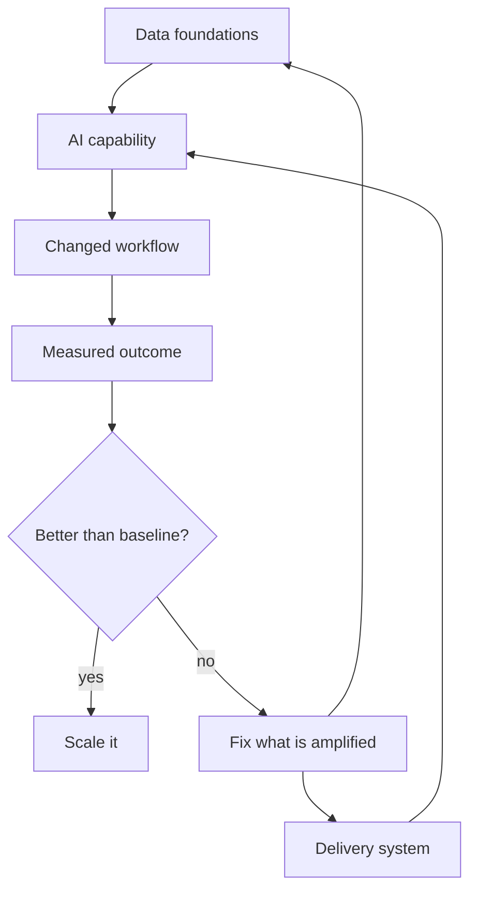
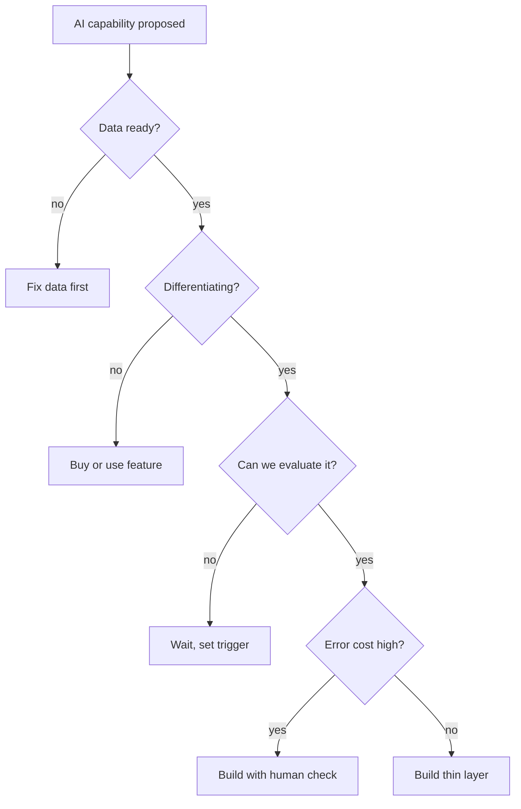

# Chapter 54 — Data and AI Strategy

Every executive team now asks its technology leader the same question: what is our AI strategy? The
honest answer is usually that the company lacks the data, the controls, and the measurements to have
one yet. The first year of an AI strategy is mostly data work, policy work, and evaluation work. This
chapter covers the CTO's part: judging whether data foundations can carry an AI initiative, choosing
where to buy, build, or wait, governing how engineers use AI tools, and testing productivity claims. The
running example is Victor Lindqvist, CTO of Northstar Technologies, the fictional company in the
[case study](../../case-studies/northstar/index.md), in quarter 4 of the director's first year.

Related chapters: [18](../04-execution/18-measuring-engineering-productivity.md) (productivity
measurement and metric gaming),
[30](../06-technical-leadership/30-technical-strategy-and-technology-selection.md) (build versus buy),
and [26](../05-engineering-quality/26-security-and-software-supply-chain-quality.md) (security in the
pipeline).

## Why This Matters

**For a team**, AI tools are already in use whether or not anyone approved them. The questions are
practical: which tool, on what code, with what data, and who is accountable for what it produces.

**For an organization**, AI raises the value of data that was never managed as an asset: a model fed
inconsistent data reproduces the inconsistency at machine speed. Meanwhile AI requests arrive from
product, sales, and support, each sounding urgent and cheap.

**For an executive**, AI is a claim on budget and headcount plans. Vendors quote large productivity
numbers; customers ask whether their data reaches AI providers. The CTO must separate what the evidence
supports from what is being sold.

## Learning Objectives

After this chapter you will be able to:

- Assess whether data foundations (ownership, definitions, quality, lineage, permitted use) can support
  a proposed AI initiative, and say what must be fixed first.
- Decide whether to buy, build, or wait on an AI capability, using differentiation, cost of error, and
  the option value of waiting.
- Write an AI-assisted engineering policy that sets data rules, accountability, and pipeline controls
  without banning the tools.
- Evaluate an AI productivity claim by the setting, population, and outcome it measured, and design an
  internal evaluation at team and system level.
- Answer an executive who wants to bank AI productivity in a headcount plan, with stated assumptions.

## The Mental Model

> **Mental model:** AI is an amplifier. It multiplies the data, workflows, and engineering system it is
> attached to, good or bad. An AI strategy is therefore mostly a strategy for what is being amplified:
> data with owners and definitions, a delivery system that absorbs more change safely, and measurement
> that can tell a real gain from a perceived one.

DORA, the long-running research program on software delivery, summarizes its 2025 finding as AI
magnifying an organization's existing strengths and weaknesses, with the greatest returns coming from the
organizational system rather than the tools
([DORA, 2025](../../references/bibliography.md#dora2025state); **industry research**).

Data foundations decide what an AI capability can know and whether its outputs can be trusted. The
delivery system decides whether more code, produced faster, reaches customers safely or arrives as a
longer review queue and more failed releases. The loop closes only through a measured outcome compared
with a baseline. Otherwise the organization learns only how its engineers feel about AI, which, as the
evidence below shows, is a poor measure of what AI delivers.

The second idea: AI decisions are ordinary technology decisions with two unusual properties. The
frontier moves every few months, which gives waiting real option value. Outputs are probabilistic, which
makes the cost of an error, and who catches it, the central design question.

## Deep Conceptual Explanation

### Data foundations come first

AI projects fail more often from data than from models. Interviews with 53 AI practitioners in
high-stakes domains describe **data cascades**: compounding downstream failures caused by data problems,
reported by 92 percent of interviewees, invisible, delayed, and often avoidable
([Sambasivan et al., 2021](../../references/bibliography.md#sambasivan2021data); qualitative **research
finding**). Others frame the same problem as technical debt specific to machine-learning systems, such
as undeclared data consumers and hidden feedback loops
([Sculley et al., 2015](../../references/bibliography.md#sculley2015hidden); **expert opinion**). DORA's
AI capabilities model lists "healthy data ecosystems" among its seven capabilities
([Storer and DeBellis, 2025](../../references/bibliography.md#dora2025aicapabilities); survey-based
**industry research**).

This does not mean a data-governance program must precede everything. It means a short readiness test
for the specific data an initiative will use (**this book's recommendation**, building on
[Chapter 31](../06-technical-leadership/31-service-boundaries-and-ownership.md)'s ownership principles):

| Question | Ready | Not ready |
|---|---|---|
| **Owner of meaning** | A named person decides what a field means and approves changes | The pipeline team owns the jobs; nobody owns the definitions |
| **Definition** | Written, discoverable, used the same way by every consumer | Two reports compute "revenue" differently and are reconciled by hand |
| **Quality measured** | Freshness, completeness, accuracy against a source of truth | Quality discovered when a customer complains |
| **Lineage and contract** | Consumers read a versioned interface | Consumers read source tables; a migration breaks them silently |
| **Permitted use** | Data classified; allowed classes per tool written down | Personal data copied wherever convenient |

A learning model adds a sixth question: **are there labels?** The labeled examples an organization
assumed it had often turn out to be a few hundred hand-classified rows. Most of what the test finds is
worth fixing whether or not the AI initiative proceeds, which makes data work the low-regret first stage
of almost every AI plan.

### Three kinds of AI decision, and buy, build, or wait

"AI strategy" blurs three decisions with different owners and risks. Treating them as one produces a
blanket ban or blanket enthusiasm.

| Kind | Examples | Main risks |
|---|---|---|
| AI in the engineering process | Coding assistants, review aids | Quality, security, data leaving the company |
| AI in internal operations | Support summaries, finance aids, usually a feature of another function's system | Data terms, relied-upon errors |
| AI in the product | Features customers use | Customer-visible correctness, cost per transaction, a model provider inside the product's promise |

Product AI carries four obligations the other two kinds do not; the next subsection covers them.

Chapter 30's build-versus-buy method still applies. AI adds four factors (**this book's
recommendation**):

- **Differentiation lives in data and workflow, not models.** Companies win by attaching a bought model
  to proprietary data and a workflow customers depend on. "Build" usually means the data pipeline,
  evaluation, and integration around a bought model.
- **The frontier is jagged.** In a preregistered experiment with 758 consultants, GPT-4 users completed
  12.2 percent more tasks, 25.1 percent faster, on tasks inside the model's capability. They were 19
  percent less likely to be correct on a task outside it
  ([Dell'Acqua et al., 2026](../../references/bibliography.md#dellacqua2026jagged); **research
  finding**). The lesson is the shape, not the numbers: evaluate on your own tasks.
- **Waiting has option value**, if it is a decision with a trigger and a review date, not a shrug.
- **The cost of an error decides the design.** A wrong support summary costs a re-read; a wrong invoice
  is a financial record the customer sees. The higher the cost, the more the design needs a human
  confirmation step, an evaluation set (a fixed collection of real cases with known right answers), and a
  rollback.

A request that fails the data test is not rejected; it becomes the data work that would make it
possible.

### AI in the product: cost, provider, regulation, evaluation

An AI feature in the product is a running cost, a dependency, a legal obligation, and a quality promise
at once. Each needs an owner before launch (**this book's recommendation** unless marked).

**Inference cost is a cost-of-revenue line.** Every call to a model costs money, so an AI feature lowers
[gross margin](../../glossary.md#gross-margin) in proportion to use (Chapter 52 shows where cost of
revenue sits). Price it per business transaction before building. An **illustrative** example: a feature
that makes 4 model calls per order at $0.01 each costs $0.04 an order; at 500,000 orders a month that is
$20,000 a month, or $240,000 a year, which must be covered by price, retention, or saved support cost.
Usage grows with success, so model the cost at the volume you hope for, not the pilot's.

**Provider dependence is a change you do not control.** Providers change prices, retire model versions,
and alter behavior between versions. Keep the model behind one internal interface, pin versions, and
negotiate data terms (retention, training use) and notice of retirement in the contract. Rerun the
evaluation set on every model change before switching. A second provider kept usable is an option with
a cost; buy it only where an outage or a price change would break a customer promise.

**Regulation is arriving, unevenly.** The EU AI Act, Regulation (EU) 2024/1689, sorts AI uses into
four risk levels: prohibited practices, high-risk uses with strict obligations before sale, uses with
transparency duties, and minimal-risk uses with no new rules. Chatbot users must be told they are talking
to a machine, and generative AI output must be identifiable. Its obligations phase in from 2025 to 2028,
and the dates have already moved once ([European Commission, 2026](../../references/bibliography.md#ec2026aiact);
**standard**). An order-to-cash feature is unlikely to be high-risk, but that is a legal judgment: list
each AI feature, its risk level, and the duties it triggers, and have counsel confirm. NIST's AI Risk
Management Framework gives a voluntary structure for the same work
([NIST, 2023](../../references/bibliography.md#nist2023airmf)). Customers' contracts may add their own
terms on AI and their data.

**Evaluation is the quality gate.** Before launch, build an evaluation set from real cases, agree with
the product owner what error rate is acceptable and which errors are unacceptable at any rate, and
measure. After launch, sample live outputs against the same criteria, because inputs drift. A feature
with no evaluation set has no definition of working, which is why the decision framework below gives a
high-error-cost feature no external date until one exists.

### Governing AI use in engineering

Banning AI coding tools moves their use to personal accounts, where the company has no data terms and no
visibility. DORA's capabilities model puts a "clear and communicated AI stance" first
([Storer and DeBellis, 2025](../../references/bibliography.md#dora2025aicapabilities); **industry
research**). A workable policy has six parts (**this book's recommendation**):

1. **Approved tools under company terms** stating retention, training use, and data location; no personal
   accounts for company code.
2. **Data classes**: credentials, customer personal data, and production logs stay out of every external
   tool; source code enters approved tools only.
3. **Accountability unchanged**: the author owns AI-assisted code as if they had typed it; review rules do
   not relax.
4. **Pipeline controls, not trust.** In a user study with an earlier model, participants with an AI
   assistant wrote less secure code and were more likely to believe it secure
   ([Perry et al., 2023](../../references/bibliography.md#perry2023insecure); **research finding**).
   Code-generating models also reference packages that do not exist, at average rates of at least 5.2
   percent for commercial and 21.7 percent for open-source models in one large sample
   ([Spracklen et al., 2025](../../references/bibliography.md#spracklen2025package); **research
   finding**). An attacker who registers a commonly invented name gets installed. Chapter 26's controls
   (blocking dependency scans, an approved registry, lockfiles, secret scanning) apply to AI-assisted
   changes without exception.
5. **Disclosure**, so the company can answer customers truthfully about AI and their data.
6. **Owners and a six-month review**, because these tools change faster than the rest of the toolchain.

Two public **standards** help show a customer or auditor that the policy covers recognized ground. NIST's
voluntary AI Risk Management Framework organizes AI risk work into four functions: Govern, Map, Measure,
and Manage ([NIST, 2023](../../references/bibliography.md#nist2023airmf)). A generative AI profile
extends the [SSDF](../../glossary.md#ssdf), the Secure Software Development Framework
([NIST SSDF project](../../references/bibliography.md#nist-ssdf-project);
[Souppaya et al., 2022](../../references/bibliography.md#nist2022ssdf)). Neither writes your policy.

### What the evidence on AI productivity says

This is the chapter's most contested question: the evidence points in different directions. RCT means
randomized controlled trial.

| Study | Setting | Outcome | Result |
|---|---|---|---|
| [Peng et al., 2023](../../references/bibliography.md#peng2023copilot) | Controlled experiment; one greenfield task (an HTTP server in JavaScript) | Time to complete | 55.8 percent faster |
| [Cui et al., 2026](../../references/bibliography.md#cui2026effects) | Three field RCTs at large companies; 4,867 developers | Completed tasks | 26.08 percent more (standard error 10.3); larger gains for less experienced developers |
| [Paradis et al., 2024](../../references/bibliography.md#paradis2024google) | RCT; 96 engineers at one company; one enterprise task | Time on task | About 21 percent less, wide interval |
| [Becker et al., 2025](../../references/bibliography.md#becker2025metr) | RCT; 16 experienced open-source developers; 246 tasks in their own mature repositories | Completion time | 19 percent slower; forecast 24 percent faster, believed afterwards 20 percent faster |
| [Harvey and DeBellis, 2024](../../references/bibliography.md#dora2024announcing) | DORA survey | Associations with adoption | Better documentation, code quality, review speed; an estimated 1.5 percent lower throughput and 7.2 percent lower stability as adoption increased |

Four readings matter to a CTO.

**The settings differ more than the results.** Large speedups come from well-specified tasks and less
experienced developers. The slowdown comes from experienced developers in large codebases they knew well,
which resembles most established product companies more than a greenfield server does.

**Task output is not delivery.** Completed tasks and time on task are output. Chapter 18's chain from
effort to output to outcome to impact ([Orosz and Beck, 2023](../../references/bibliography.md#orosz2023measuring))
applies: faster output becomes outcome only if the delivery system absorbs it. DORA's survey associates
rising adoption with lower estimated stability (correlational **industry research**).

**Perception is not measurement.** Developers in the METR trial believed they were faster while being
slower ([Becker et al., 2025](../../references/bibliography.md#becker2025metr); small sample, preprint).
The acceptance rate of suggestions tracks *perceived* productivity
([Ziegler et al., 2022](../../references/bibliography.md#ziegler2022productivity); **research
finding**). A survey asking "does AI make you faster?" and a vendor's acceptance dashboard measure the
same thing: how the tool feels.

**Vendors are involved and the evidence ages fast.** Several strong studies have vendor-employed authors,
and DORA is run by a cloud provider with AI products.
The studies cover tools from 2022 to early 2025. A result about one tool generation is weak evidence
about the next, in either direction, so measure your own use continuously.

### Evaluating a claim and running your own evaluation

When someone says "AI makes engineers 30 percent more productive", ask in order (**this book's
recommendation**):

1. What was measured: time, tasks, perception, or delivery?
2. In what setting: codebase maturity, developer experience, tool generation?
3. Compared with what: a randomized control, before and after, or a survey of believers?
4. What happened downstream: review load, [change failure rate](../../glossary.md#change-failure-rate),
   escaped defects?
5. Where does freed time go? If the constraint is review or release, faster coding queues in front of it
   ([Chapter 16](../04-execution/16-flow-lead-time-dependencies-and-unplanned-work.md)).

An internal evaluation uses Chapter 18's rules: team and system level, paired metrics,
[DORA's delivery measures](../../glossary.md#dora-metrics)
([DORA metrics guide](../../references/bibliography.md#dora-metrics-guide)) beside stability and
quality, and developer experience surveyed across several dimensions
([Forsgren et al., 2021](../../references/bibliography.md#forsgren2021space);
[Noda et al., 2023](../../references/bibliography.md#noda2023devex)). Acceptance rate, lines of code, and
AI-generated share are never targets. They rise with use whether or not value does, and as targets they
reward using the tool rather than delivering with it
([Campbell, 1979](../../references/bibliography.md#campbell1979assessing)).

## Engineering Organization Example

!!! info "Northstar so far"
    Week 41 of the director's first year. Sev1 and Sev2 incidents fell from 30 a quarter to 14 in
    quarter 3, with headcount flat at 80 engineers. A top-40 distributor has complained about correcting
    orders, and a sample of 400 corrected orders found 340 errors. See the
    [timeline](../../case-studies/northstar/timeline.md) and the
    [quarter 4 briefing](../../case-studies/northstar/quarter-4-briefing.md).

All figures below are **illustrative** and fictional.

**The data estate (week 41).** Farah Haddad (Data and Analytics manager, the team's data architect)
inventoried the warehouse:

- 46 nightly pipelines, 29 of them reading [Core](../../glossary.md#core) tables directly through read
  replicas. Among them are the 12 ledger tables that [ADR-0001](../../glossary.md#adr-0001), the still-open
  decision on how integrations read ledger data, concerns.
- 212 tables, 38 with a written description, none with a named owner of meaning.
- In the 91 nights of quarter 3 the load failed or was partial on 11 nights, 7 traced to Core schema
  changes or migrations.
- Month-end revenue differs from Finance's ledger close by 0.3 to 0.6 percent, reconciled by hand in
  about two days a month.
- Customer personal data sits in 14 unclassified tables.
- The only labeled erroneous orders are the 400 corrections sampled in weeks 40 and 41 (340 errors).

The order and ledger data fail the readiness test on owner, lineage, and permitted use.

**AI use (the week 42 survey).** The director and Li Na Zhou (staff engineer, data and integration) ran
an anonymous AI-use survey; 63 of 80 engineers responded. 41 use an AI coding assistant at least weekly,
29 of them on personal or free accounts. 17 have pasted Northstar code into a chat tool and 6 have pasted
customer data. 34 of the 41 weekly users say AI makes them faster. There is no AI policy. In week 41 a
top-40 customer's renewal security questionnaire asked whether Northstar uses generative AI and whether
customer data reaches AI providers. The truthful answer was "informally, with no policy".

**The requests, weeks 43 to 45.**

| Week | From | Request | Kind |
|---|---|---|---|
| 43 | Greg Tanaka (VP Sales) | An "AI order assistant" turning a customer's emailed order into a draft order, with a year-2 date for two open deals | Product |
| 43 | Amara Okafor (CPO) | "AI order checking" to flag likely errors before submission | Product |
| 44 | Sofia Alvarez (VP Customer Success) | The summarization add-on in Customer Success's support ticketing system, administered by IT | Internal operations |
| 45 | Rajiv Menon (CFO) | Whether AI assistants let the year-2 workforce plan hold two backfills open ("the vendor says 30 percent") | Engineering process |

In week 45 Victor asks the director for a one-page AI position to sit beside the week 49 workforce plan;
the draft reaches him in week 47.

**Decomposing order checking.** The weeks 40 to 41 sample found 340 errors:

| Cause | Errors | Share | Fix that needs no AI |
|---|---|---|---|
| Price changes | 130 | 38.2% | Price-list effective dates (sized by Orders at 14 engineer-weeks) |
| Wrong unit | 85 | 25.0% | Rule: flag quantities far outside the customer's history |
| Duplicate submissions | 70 | 20.6% | An idempotency key on order submission |
| Wrong delivery site | 35 | 10.3% | Rule: flag a site the customer has not used for the product |
| Other | 20 | 5.9% | Unknown |

Price changes and duplicates, 59 percent of errors, are fixed by engineering already identified. Unit and
site errors, 35 percent, suit simple rules first; 400 labeled rows are far too few to train a model. The
request is real, but its first stage is not AI.

**Pricing Rajiv's question.** Assume writing and testing code is about 35 percent of an engineer's time
(never measured at Northstar), so 28 of the 80 engineers' capacity is coding.

| Scenario | Effect on coding time | Capacity freed ([FTE](../../glossary.md#fte)) |
|---|---|---|
| Vendor's claim | 30 percent faster | +8.4 |
| Best controlled study (an output measure treated as time, which flatters it) | 26 percent more tasks | +7.3 |
| Slowdown study | 19 percent slower | −5.3 |

Core is 1.4 million lines, 11 years old, and worked on by people who know it: closer to the slowdown
study's setting. At baseline a Core merge request waited a median 21 working hours for first review, and
Core's change failure rate was 23 percent in quarter 2. Faster code meets review and the
[release train](../../glossary.md#release-train) first. Two held backfills save $370,000 a year at
$185,000 each; if the gain does not appear, the plan loses two engineers' work in a year when six of the
40 largest customers renew. Licenses for 80 seats at an assumed $40 per seat per month (not a vendor
quote) cost $38,400 a year.

The licenses and a measured trial are easy to justify; holding backfills on an unmeasured effect is not.

## Decision Framework

| Request type | Owner | First question | Default | Evidence to go further |
|---|---|---|---|---|
| Engineering process | CTO, via director and staff engineers | Policy and pipeline controls in place? | Approve tools under policy; measure | Team-level delivery and stability over a trial |
| Internal operations | Owning function, with IT and security | Do data terms meet our data classes? | Buy the feature if errors are cheap | Error rate on a sample of real work |
| Product, low error cost | CPO and CTO | Differentiating, and can we evaluate it? | Buy or wait | An evaluation set from real cases, criteria agreed first |
| Product, high error cost | CPO and CTO, with legal and security | Data ready, and who confirms each output? | Fix data; build with human confirmation | Error rate on an evaluation set; a rollback path |
| Productivity claim in a plan | CTO and CFO | What was measured, where? | Do not bank it in headcount | Internal measured result over at least a quarter |

Three rules sit above the table (**this book's recommendation**). A request that fails the readiness test
becomes data work with a date. A product AI capability with customer-visible error cost gets no external
date before an evaluation set exists, which is Northstar's "no customer date without an engineering
estimate" rule applied to a probabilistic feature. No workforce plan counts an AI gain the company has not
measured itself.

## Trade-offs

**Adoption speed against control.** A permissive policy learns faster; a restrictive one pushes use
underground. The real choice is between governed and ungoverned use.

**Buying against building.** Buying is fast and keeps pace with the frontier, but sends data to a
provider, ties a product promise to someone else's model, and gives competitors the same capability. A
thin built layer keeps the differentiating parts in-house but needs evaluation discipline.

**Data work against visible AI work.** Contracts, ownership, and classification take quarters and produce
nothing to demo; skipping them produces demos that fail in production.

**Measuring and waiting against moving.** A proper evaluation takes a quarter; waiting avoids building
what will be commoditized. Both risk a competitor learning faster, and both work only with a date.

## Failure Modes

**The pilot without a baseline.** Licenses, a "pilot", a satisfaction survey. The survey is positive and
nothing is learned. Signal: nobody can name the delivery measure the pilot should move.

**AI on unowned data.** An assistant pointed at the warehouse gives confident answers from inconsistent
definitions and loses trust within a quarter. Signal: two reports compute one figure differently and nobody
may decide which is right.

**The headcount pre-commitment.** A vendor's percentage enters the budget as fewer backfills; when the gain
fails to appear, delivery breaks and AI is blamed. Signal: a percentage in a workforce plan with no internal
source.

**Activity metrics as targets.** Acceptance rate or AI-generated share reported upward as success. Signal:
an AI dashboard in the leadership pack with no delivery or stability measure beside it.

**Ban and bypass.** A prohibition drives use to personal devices. Signal: the policy says "not allowed"
and the survey says most engineers use AI weekly.

**Demo-driven commitments.** A competitor's demo becomes a customer date for a high-error-cost feature.
Signal: an AI feature on a roadmap with a date and no definition of acceptable error.

## Enterprise Application

At 50 to 150 engineers, AI strategy should be small and concrete: one policy, one measured trial, a
readiness test and a decision log entry for each product request. There is rarely a case for an "AI
team". The scarce skill is data engineering and evaluation, usually in a data team already carrying other
teams' requests.

The CTO owns the AI position and, with the CPO, product AI decisions. The director or VP runs the policy and
the trial. A staff engineer with a data mandate owns data classes and readiness tests; another owns pipeline
controls. Security reviews vendor terms; legal reviews contract language on AI and data.

A cross-team AI initiative counts against the same work-in-progress limit as any other
([Chapter 42](../09-engineering-directorship/42-cross-functional-dependencies-portfolio-and-influence.md)).
The data team's foundation work needs a funded line in the capacity plan, or it loses every week to
requests that look more urgent.

## CTO Perspective

**Hold the evidence line.** Boards and executives bring numbers from vendors and peers. The CTO says what
each measured, where, and what the company would have to observe to believe it applies.

**Own data as a company asset.** Finance owns its ledger, product its features, the data team its pipelines;
nobody owns meaning. The CTO asks for named owners for the few datasets that matter and puts the data
foundation in the technology strategy
([Chapter 51](51-enterprise-technology-strategy.md)) with a cost and a date.

**Answer customers truthfully** from a written policy, not a survey of what engineers happen to do. This ties
AI governance to the company's risk and compliance posture
([Chapter 53](53-risk-governance-regulation-and-security-strategy.md)).

**Keep the workforce plan honest.** The most expensive AI mistake available to a CTO is funding fewer
engineers on an unmeasured gain. The answer to a CFO is not "no" but a measured trial with a decision
date.

## Practical Playbook

1. **Survey actual use** anonymously (tools, accounts, data entered) and treat the result as a baseline, not
   an offense.
2. **Write an interim policy within a month**: approved tools, data classes, accountability, pipeline
   controls, owners, a review date.
3. **Run the readiness test** on the datasets the first requests depend on; name owners, write definitions,
   measure quality.
4. **Decompose each AI request** into the outcome and its causes; fund the non-AI fixes first when they
   cover most of the problem.
5. **Classify and route** each request by kind, using the decision framework.
6. **Design a measured trial**: staggered rollout by team, paired team-level measures, outcomes and decision
   rules written before it starts.
7. **Keep productivity out of headcount** until the trial reports; give the CFO the date and the threshold.
8. **Record every AI decision**, including decisions to wait, with a review trigger.
9. **Review policy and evidence every six months**, and answer customers from the written policy.

## Case Study

**Victor Lindqvist's week 47 AI position (fictional).** You are Victor Lindqvist, reading the director's
one-page draft. Nothing in it has been decided; the decisions stay open into the week 49 workforce plan
and beyond (see the [quarter 4 briefing](../../case-studies/northstar/quarter-4-briefing.md)). It makes
five proposals:

1. **Interim policy**, effective on your approval. One approved assistant under an enterprise agreement
   with no training on Northstar data. No personal accounts for Northstar code. No customer data,
   credentials, or production logs in any engineering AI tool, approved or not. The author owns
   AI-assisted code, and review rules are unchanged. Blocking dependency scans, plus a check that new
   packages exist in the approved registry. Owners: Li Na Zhou (data classes), Kwame Mensah (staff
   engineer; pipeline controls), Joon Park (IT security lead; vendor terms).
2. **A measured trial** in quarter 5: three teams in weeks 53 to 58, the other three in weeks 59 to 64.
   It compares team-level deployment frequency, lead time, Core change failure rate, first-review wait,
   escaped defects, and a developer experience survey. Cost: about $9,600 of licenses (all 80 seats for
   the quarter, an upper bound) and about 3 engineer-weeks of analysis, about $10,700.
3. **Order checking, staged**: the idempotency key and price-list effective dates first, plus two rules for
   unit and site; an AI check considered only for what remains after a quarter of the corrected-order measure.
4. **Order assistant: wait, with a trigger.** No year-2 date until the data passes the readiness test and a
   discovery step has built an evaluation set from real emailed orders. Any output is a draft a person
   confirms, because an unconfirmed wrong order becomes a wrong invoice, a customer-visible wrong financial
   record that Northstar's severity definitions rate Sev1.
5. **Support summaries: buy**, subject to Joon Park's review of the vendor's data terms.

And one answer: **no backfills held on AI in the year-2 workforce plan**, revisited at the trial's decision
date.

The positions are predictable. Rajiv Menon will want a date when the backfill question returns, and he
is right that "we will measure" without a date never answers. Greg Tanaka will say "wait" loses his two
deals; a competitor's demo is a real commercial signal, though it says nothing about error rates on
Northstar's customers' emails. Amara Okafor gains roadmap items she can report as delivered. Joon Park
will ask about the six respondents who pasted customer data. Farah Haddad will note that the readiness
work lands on her team, whose manager role has no succession cover. It also receives search-svc in week
54 if the year-2 organization proposal is approved.

The draft has weaknesses. Its second wave starts after the week 53 reporting-line change, if approved,
so the waves are confounded with the reorganization. Six teams in two waves can detect a large effect or
clear harm, not a modest gain. And it says nothing about AI in Data and Analytics' analysis work, where customer personal
data is most likely to meet an AI tool. What you decide is exercise X1.

## Exercises

Worked solutions are in the [Chapter 54 solutions](../../solutions/ch54-solutions.md).

### Foundational

**F1.** Apply the five readiness questions to two Northstar datasets as described in the Engineering
Organization Example: the order and ledger data in the warehouse, and the 400 labeled corrections from
weeks 40 and 41. For each question, rate the dataset ready, partly ready, or not ready, give the evidence
from the chapter, and name the single fix you would fund first for each dataset, with its owner.

**F2.** Rajiv Menon forwards a vendor slide claiming that developers "code 55 percent faster" with an AI
assistant, and asks whether Northstar can plan on that. Using the evidence table, write a reply of no
more than 200 words. Say what the 55 percent measured, in what setting, and how it compares with the
other studies. Say what Northstar would need to observe before planning on any gain.

**F3.** In the week 42 survey, 34 of the 41 weekly users say AI makes them faster. A manager proposes
reporting "83 percent of engineers say AI makes them faster" in the monthly report to Victor Lindqvist.
Explain what the figure does and does not show, using the perception evidence in the chapter, and propose
two team-level measures, each with a paired measure, that you would report instead.

**F4.** A product manager proposes an AI feature that drafts a reply to every customer support ticket.
Assume (illustratively) 120,000 tickets a month, 3 model calls per ticket at $0.015 a call, and that a
drafted reply saves an agent 2 minutes at a loaded cost of $40 an hour, on the 60 percent of drafts
agents accept. Compute the yearly inference cost and the yearly saving, state which assumption the case
is most sensitive to, and list what you would require on provider terms and evaluation before launch.

### Applied Leadership

**A1.** Suppose about 30 analysts outside engineering (an assumption for this exercise) query the
warehouse alongside Data and Analytics engineers. The warehouse
holds customer personal data in 14 unclassified tables. Several analysts already use a chat tool to draft
SQL. Write the section of Northstar's AI-assisted engineering policy that covers analysis work: what data
may enter which tool, what has to happen to the warehouse first, and who owns each rule. State what you
would do about the six survey respondents who pasted customer data into chat tools.

**A2.** Greg Tanaka asks for the AI order assistant with a date on the year-2 roadmap for two open deals.
Run the buy, build, or wait analysis from this chapter on his request, including the data readiness test
and the cost of an error. Then write what you would say to Greg in a five-minute conversation, including
what you can offer him that is not a date.

**A3.** Redesign the coding-assistant trial in the director's draft to deal with its weaknesses. One is
the week 53 reorganization; another is having only six teams in two waves. A third is the release train:
Core ships on one weekly train carrying every ready change from all the teams that work in Core, so a
Core measure such as change failure rate mixes changes from teams in both waves. The other services
deploy independently. Specify the rollout, the measures and their pairs, what result would justify full
rollout, what would stop it, and the decision date. State the smallest effect your design could
plausibly detect, and why.

### Executive Decision-Making

**X1.** You are Victor Lindqvist in week 47 with the director's draft. Decide which of the five proposals
you approve, change, or reject, and whether you accept the answer on backfills. Write the decision log
entries, including review triggers, and the two sentences you will give Rajiv Menon about when the backfill
question returns. Then draft the answer to the top-40 customer's questionnaire that your decisions make
truthful.

**X2.** Suppose you are CTO of Halvard Systems (a hypothetical scenario). Each of the four product
groups has bought a different AI coding assistant. One VP reports a 25 percent productivity gain from
acceptance-rate and survey data. On that basis the VP proposes ending one of the two vendor contracts
that supply about 60 contract engineers. Design the company-level AI governance and evaluation you would put in place, decide
what to tell the VP about the vendor contract, and explain how you keep four product groups from turning
AI metrics into a contest.

## Reflection Questions

1. If your organization's AI tools were switched off tomorrow, which delivery measure would change, and
   how do you know?
2. Which dataset in your company has two competing definitions, and who has the right to decide between
   them?
3. When you last heard an AI productivity number, did you ask what it measured and in what setting? What
   stopped you?
4. Is your organization's real AI policy the written one or the one engineers follow? How would you find
   out without punishing honesty?
5. Which AI request would you be most tempted to approve because saying no would look like falling behind?

## Key Takeaways

- AI amplifies the data, delivery system, and measurement it is attached to; most of an AI strategy is a
  strategy for those.
- Test data readiness first: owner of meaning, definition, measured quality, lineage and contract,
  permitted use, and labels for learning models.
- Separate AI in engineering, in internal operations, and in the product; each has its own owner, risk,
  and default.
- Buy the undifferentiated, build the data, evaluation, and integration around bought models, and treat
  waiting as a decision with a trigger.
- Govern AI coding tools with a usable policy and pipeline controls; bans move use to personal accounts.
- Controlled studies show task-level speedups in some settings and a slowdown in one close to a mature
  product company's; survey evidence associates adoption with lower delivery stability.
- Self-reported speed and acceptance rates measure how the tool feels, not what it delivers; measure at
  team level with paired metrics.
- Never bank an unmeasured AI gain in a headcount plan; offer a measured trial with a decision date.

## References and Further Reading

- [DORA, 2025](../../references/bibliography.md#dora2025state): AI as an amplifier.
- [Storer and DeBellis, 2025](../../references/bibliography.md#dora2025aicapabilities): DORA's seven AI
  capabilities.
- [Harvey and DeBellis, 2024](../../references/bibliography.md#dora2024announcing): AI adoption, quality,
  throughput, and stability in DORA 2024.
- [Peng et al., 2023](../../references/bibliography.md#peng2023copilot): the source of the most quoted
  speedup.
- [Cui et al., 2026](../../references/bibliography.md#cui2026effects): the largest randomized field evidence.
- [Paradis et al., 2024](../../references/bibliography.md#paradis2024google): an enterprise RCT on one task.
- [Becker et al., 2025](../../references/bibliography.md#becker2025metr): experienced developers, and the
  gap between perceived and measured speed.
- [Ziegler et al., 2022](../../references/bibliography.md#ziegler2022productivity): acceptance rate and
  perceived productivity.
- [Perry et al., 2023](../../references/bibliography.md#perry2023insecure): insecure code and overconfidence.
- [Spracklen et al., 2025](../../references/bibliography.md#spracklen2025package): hallucinated packages.
- [Dell'Acqua et al., 2026](../../references/bibliography.md#dellacqua2026jagged): the jagged frontier.
- [Sambasivan et al., 2021](../../references/bibliography.md#sambasivan2021data): data cascades.
- [Sculley et al., 2015](../../references/bibliography.md#sculley2015hidden): technical debt in ML systems.
- [NIST, 2023](../../references/bibliography.md#nist2023airmf): the AI Risk Management Framework.
- [European Commission, 2026](../../references/bibliography.md#ec2026aiact): the EU AI Act's risk levels
  and timeline, from the Commission's summary page.
- [NIST SSDF project](../../references/bibliography.md#nist-ssdf-project) and
  [Souppaya et al., 2022](../../references/bibliography.md#nist2022ssdf): secure development, with a
  generative AI profile.
- [Forsgren et al., 2021](../../references/bibliography.md#forsgren2021space),
  [Noda et al., 2023](../../references/bibliography.md#noda2023devex), and the
  [DORA metrics guide](../../references/bibliography.md#dora-metrics-guide): measures for an internal
  evaluation.
- [Orosz and Beck, 2023](../../references/bibliography.md#orosz2023measuring) and
  [Campbell, 1979](../../references/bibliography.md#campbell1979assessing): output versus outcome, and
  indicator gaming.
