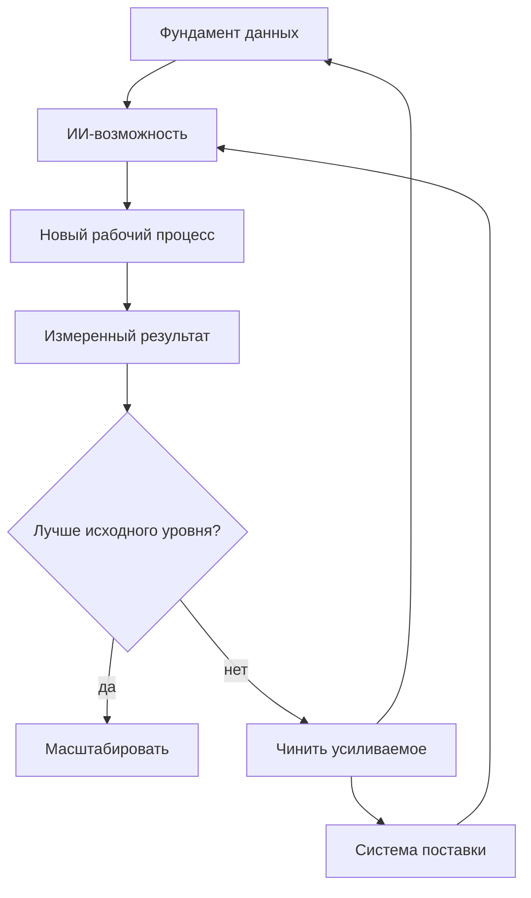
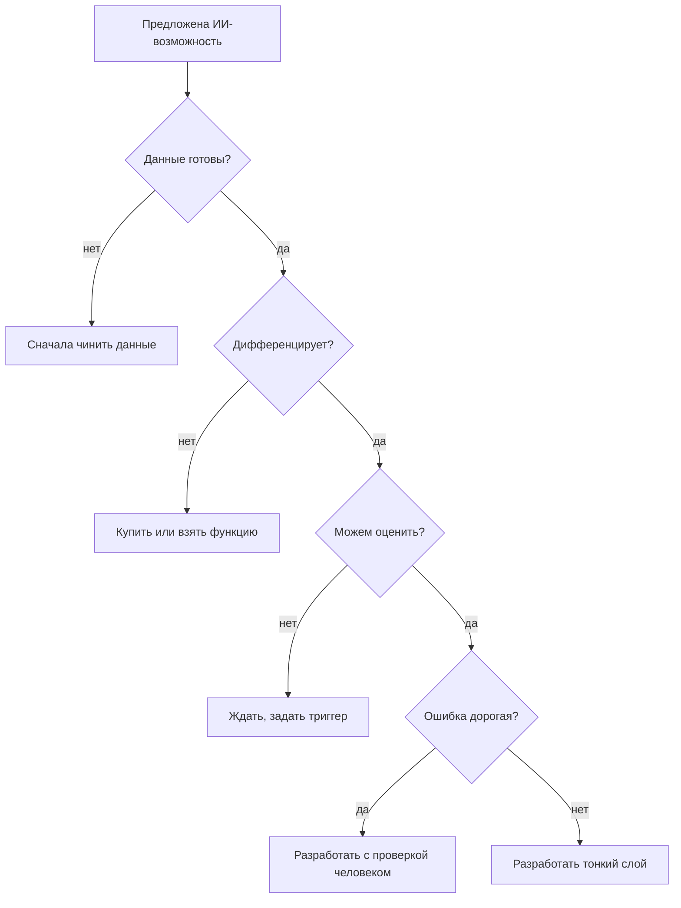

# Глава 54 — Стратегия данных и ИИ { #chapter-54-data-and-ai-strategy }

Сегодня любая команда высшего руководства задаёт своему технологическому лидеру один и тот же вопрос:
какая у нас стратегия в области ИИ? Честный ответ обычно такой: чтобы она появилась, компании пока не
хватает данных, механизмов контроля и измерений. Первый год стратегии ИИ — это в основном работа с
данными, политиками и оценкой результатов. Глава разбирает роль CTO: как судить, выдержит ли фундамент
данных ИИ-инициативу, где покупать, где разрабатывать, а где подождать, как управлять использованием
ИИ-инструментов в разработке и как проверять заявления о росте продуктивности. Сквозной пример — Victor
Lindqvist, CTO (технический директор) Northstar Technologies, вымышленной компании из
[кейса](../../case-studies/northstar/index.md), в квартале 4 первого года директора.

Связанные главы: [18](../04-execution/18-measuring-engineering-productivity.md) (измерение
продуктивности и подгонка метрик),
[30](../06-technical-leadership/30-technical-strategy-and-technology-selection.md) («разработать или
купить») и [26](../05-engineering-quality/26-security-and-software-supply-chain-quality.md) (безопасность
в пайплайне).

## Почему это важно { #why-this-matters }

**В команде** ИИ-инструментами уже пользуются, одобрил их кто-нибудь или нет. Вопросы практические:
какой инструмент, на каком коде, с какими данными и кто отвечает за то, что он выдаёт.

**В организации** ИИ повышает ценность данных, которыми никогда не управляли как активом: модель, которой
дают противоречивые данные, тиражирует противоречия с машинной скоростью. Тем временем запросы на ИИ
приходят от продукта, продаж и поддержки, и каждый подаётся как срочный и дешёвый.

**Для высшего руководства** ИИ претендует на бюджет и на планы численности. Вендоры называют большие
цифры роста продуктивности, а клиенты спрашивают, попадают ли их данные к ИИ-провайдерам. CTO должен
отделить то, что подтверждают данные, от того, что продают.

## Цели главы { #learning-objectives }

После этой главы вы сможете:

- Оценивать, выдержит ли фундамент данных (владение, определения, качество, прослеживаемость, разрешённое
  использование) предложенную ИИ-инициативу, и говорить, что нужно исправить в первую очередь.
- Решать, купить ИИ-возможность, разработать её или подождать, с учётом дифференциации, стоимости ошибки
  и опционной ценности ожидания.
- Написать политику разработки с помощью ИИ, которая задаёт правила для данных, ответственность и
  механизмы контроля в пайплайне, не запрещая сами инструменты.
- Оценивать заявление о росте продуктивности от ИИ по тому, в каких условиях, на какой выборке и какой
  результат в нём измеряли, и проектировать внутреннюю оценку на уровне команд и системы.
- Отвечать руководителю, который хочет заложить рост продуктивности от ИИ в план численности, с явно
  названными допущениями.

## Ментальная модель { #the-mental-model }

> **Ментальная модель:** ИИ — это усилитель. Он умножает то, к чему подключён: данные, рабочие процессы и
> инженерную систему, будь они хорошими или плохими. Поэтому стратегия ИИ — это в основном стратегия
> того, что усиливается: данных с владельцами и определениями, системы поставки, которая безопасно
> принимает больше изменений, и измерений, способных отличить реальный выигрыш от воображаемого.

DORA, многолетняя исследовательская программа по поставке ПО, формулирует свой вывод 2025 года так: ИИ
усиливает уже имеющиеся сильные и слабые стороны организации, а наибольшую отдачу даёт организационная
система, а не инструменты ([DORA, 2025](../../references/bibliography.md#dora2025state); **отраслевое
исследование**).

Фундамент данных определяет, что может знать ИИ-возможность и можно ли доверять её результатам. Система
поставки определяет, дойдёт ли до клиентов безопасно код, которого теперь пишут больше и быстрее, или он
превратится в более длинную очередь на ревью и новые неудачные релизы. Петля замыкается только через
измеренный результат, сравнённый с исходным уровнем. Иначе организация узнаёт лишь то, что её инженеры
думают об ИИ, а это, как показывают данные ниже, плохая мера того, что ИИ даёт на самом деле.

Вторая идея: решения об ИИ — обычные технологические решения с двумя необычными свойствами. Передний
край сдвигается каждые несколько месяцев, поэтому у ожидания есть реальная опционная ценность. Результаты
вероятностны, поэтому центральный вопрос проектирования — во что обходится ошибка и кто её поймает.

## Подробный разбор { #deep-conceptual-explanation }

### Сначала фундамент данных { #data-foundations-come-first }

ИИ-проекты проваливаются из-за данных чаще, чем из-за моделей. Из 53 практиков ИИ, с которыми провели
интервью, 92% рассказали о **каскадах данных** (data cascades): проблемах с данными, которые нарастают
ниже по цепочке и проявляются поздно, хотя часто их можно было избежать
([Sambasivan et al., 2021](../../references/bibliography.md#sambasivan2021data); качественный **научный
результат**). О том же говорят работа о техническом долге в машинном обучении и возможность DORA
«здоровые экосистемы данных» ([Sculley et al., 2015](../../references/bibliography.md#sculley2015hidden);
[Storer and DeBellis, 2025](../../references/bibliography.md#dora2025aicapabilities)).

Отсюда не следует, что программа управления данными должна предшествовать всему остальному. Следует
другое: конкретным данным, которые использует инициатива, нужна короткая проверка готовности
(**рекомендация книги**, развивающая принципы владения из
[главы 31](../06-technical-leadership/31-service-boundaries-and-ownership.md)):

| Вопрос | Готово | Не готово |
|---|---|---|
| **Владелец смысла** | Названный человек решает, что означает поле, и утверждает изменения | Команда пайплайнов владеет заданиями; определениями не владеет никто |
| **Определение** | Записано, его легко найти, все потребители используют его одинаково | Два отчёта считают «выручку» по-разному, и их сверяют вручную |
| **Качество измеряется** | Свежесть, полнота, точность относительно эталонного источника | О проблемах с качеством узнают, когда жалуется клиент |
| **Прослеживаемость и контракт** | Потребители читают версионируемый интерфейс | Потребители читают исходные таблицы; миграция молча их ломает |
| **Разрешённое использование** | Данные классифицированы; для каждого инструмента записано, какие классы разрешены | Персональные данные копируют туда, куда удобно |

Для обучаемой модели добавляется шестой вопрос: **есть ли разметка?** Нередко выясняется, что размеченные
примеры, на которые рассчитывала организация, — это несколько сотен строк, классифицированных вручную.
Большую часть того, что находит проверка, стоит исправить независимо от того, пойдёт ли ИИ-инициатива дальше.
Поэтому работа с данными — первый этап почти любого плана по ИИ, и об этом этапе вряд ли придётся
пожалеть.

### Стратегия данных за пределами проверки готовности { #data-strategy-beyond-readiness }

Проверка готовности оценивает один набор данных для одной инициативы. Стратегия данных один раз для всей
компании решает, кто владеет данными и как их предоставляют (**рекомендация книги**). На уровне CTO важны
четыре выбора.

1. **Кто владеет смыслом.** Определением факта владеет та функция, которая этот факт создаёт: финансы
   владеют выручкой и ledger, продукт — статусами заказов, Customer Success — категориями обращений.
   Команда данных владеет пайплайнами и платформой, а не определениями. Запишите владельца для каждого из
   десяти-двадцати наборов данных, на которых держится компания, а остальные сознательно оставьте без
   владельца.
2. **Продукт или побочный продукт.** Набор данных, от которого зависят другие команды, — это продукт: у
   него, как у сервиса, есть версионируемый интерфейс, метрика качества и список потребителей. Всё
   остальное — побочный продукт системы, которая эти данные создала. Большинству компаний нужна лишь
   горстка продуктов данных.
3. **Где находится команда данных.** При 50–150 инженерах она обычно входит в разработку как
   платформенная команда, которая обслуживает аналитиков и продуктовые команды. Подчиняйте её финансам
   или продукту, только если эта функция — её главный клиент, и тогда запишите, кто решает вопросы
   платформы.
4. **Выбор платформы.** Выбирайте хранилище данных, инструменты трансформации и каталог как пункт группы
   «достаточно» ([глава 51](51-enterprise-technology-strategy.md)): стандартное, покупное и редко
   меняющееся. Дифференцирующая работа — это контракты данных и определения, а не инструменты.

У каждого выбора есть владелец и дата пересмотра в технологической стратегии, как у любой другой
политики.

### Три вида решений об ИИ и выбор «купить, разработать или подождать» { #three-kinds-of-ai-decision-and-buy-build-or-wait }

«Стратегия ИИ» смешивает три решения с разными владельцами и рисками. Если считать их одним решением,
получается либо запрет на всё, либо энтузиазм по поводу всего.

| Вид | Примеры | Главные риски |
|---|---|---|
| ИИ в процессе разработки | Ассистенты для написания кода, помощники на ревью | Качество, безопасность, данные, уходящие из компании |
| ИИ во внутренних операциях | Сводки обращений в поддержку, помощники для финансов, обычно функция системы другого подразделения | Условия использования данных, ошибки, на которые полагаются |
| ИИ в продукте | Функции, которыми пользуются клиенты | Корректность, видимая клиентам, стоимость транзакции, провайдер модели внутри обещания продукта |

На ИИ в продукте лежат четыре обязательства, которых нет у двух других видов; о них — в следующем
подразделе.

Метод «разработать или купить» из главы 30 по-прежнему работает. ИИ добавляет четыре фактора
(**рекомендация книги**):

- **Дифференциация живёт в данных и рабочих процессах, а не в моделях.** Компании выигрывают, когда
  подключают купленную модель к собственным данным и к рабочему процессу, от которого зависят клиенты.
  «Разработать» обычно значит построить пайплайн данных, оценку и интеграцию вокруг купленной модели.
- **Граница возможностей зубчатая (jagged frontier).** В эксперименте с 758 консультантами, проведённом с
  предварительной регистрацией (план анализа опубликовали до получения данных), пользователи GPT-4 на
  задачах в пределах возможностей модели выполнили на 12,2% больше задач и справились на 25,1% быстрее.
  На задаче за этими пределами вероятность правильного ответа у них оказалась на 19% ниже
  ([Dell'Acqua et al., 2026](../../references/bibliography.md#dellacqua2026jagged); **научный
  результат**). Урок — в форме зависимости, а не в цифрах: оценивайте на собственных задачах.
- **У ожидания есть опционная ценность**, если ожидание — это решение с триггером и датой пересмотра, а
  не пожатие плечами.
- **Стоимость ошибки определяет архитектуру.** Ошибочная сводка обращения обходится повторным прочтением;
  ошибочный счёт — это финансовый документ, который видит клиент. Чем выше стоимость, тем нужнее в
  архитектуре шаг подтверждения человеком, оценочный набор (evaluation set: фиксированная коллекция
  реальных случаев с известными правильными ответами) и откат.

Запрос, не прошедший проверку данных, не отклоняют: он превращается в работу с данными, которая сделает
его возможным.

### ИИ в продукте: стоимость, провайдер, регулирование, оценка { #ai-in-the-product-cost-provider-regulation-evaluation }

ИИ-функция в продукте — это одновременно текущие расходы, зависимость, юридическое обязательство и
обещание качества. У каждого из этих аспектов до запуска должен появиться владелец (**рекомендация
книги**, если не указано иное).

**Стоимость инференса — строка себестоимости выручки.** Каждый вызов модели стоит денег, поэтому
ИИ-функция снижает [валовую маржу](../../glossary.md#gross-margin) пропорционально использованию (где
находится себестоимость выручки, показывает глава 52). Посчитайте цену на одну бизнес-транзакцию ещё до
разработки. **Иллюстрация**: функция, которая делает 4 вызова модели на заказ по $0,01, стоит $0,04 на
заказ. При 500 000 заказов в месяц это $240 000 в год, и их должны покрыть цена, удержание клиентов или
сэкономленные расходы на поддержку. Использование растёт вместе с успехом, поэтому моделируйте стоимость
при том объёме, на который надеетесь, а не при объёме пилота.

**Зависимость от провайдера — это изменения, которые вы не контролируете.** Провайдеры меняют цены,
выводят версии моделей из эксплуатации и меняют их поведение от версии к версии. Держите модель за
одним внутренним интерфейсом, фиксируйте версии и закрепляйте в договоре условия по данным (хранение,
использование для обучения) и уведомление о выводе версий. При каждой смене модели прогоняйте оценочный
набор заново, прежде чем переключаться. Второй провайдер, поддерживаемый в рабочем состоянии, — это опцион,
у которого есть цена; покупайте его только там, где сбой или изменение цены нарушит обещание клиенту.

**Регулирование приходит, но неравномерно.** EU AI Act, Регламент (ЕС) 2024/1689, делит применения ИИ на
четыре уровня риска: запрещённые практики, применения высокого риска со строгими обязательствами до
выхода на рынок, применения с обязанностями по прозрачности и применения минимального риска без новых
правил. Пользователям чат-ботов нужно сообщать, что они говорят с машиной, а результаты генеративного
ИИ должны быть распознаваемыми. Обязательства вводятся поэтапно с 2025 по 2028 год, и сроки уже один раз
сдвигались ([European Commission, 2026](../../references/bibliography.md#ec2026aiact); **стандарт**).
Функция order-to-cash («от заказа до оплаты») вряд ли относится к высокому риску, но это юридическая
оценка: перечислите все ИИ-функции, их уровни риска и обязанности, которые они влекут, и попросите
юристов это подтвердить. NIST AI Risk Management Framework даёт для той же работы добровольную
структуру ([NIST, 2023](../../references/bibliography.md#nist2023airmf)). Договоры с клиентами могут
добавлять собственные условия об ИИ и клиентских данных.

**Оценка — это контрольная точка качества.** До запуска соберите оценочный набор из реальных случаев,
договоритесь с владельцем продукта, какая доля ошибок допустима и какие ошибки недопустимы при любой
доле, и измерьте. После запуска сверяйте выборку рабочих результатов с теми же критериями, потому что
входные данные дрейфуют. У функции без оценочного набора нет определения того, что значит «работает».
Поэтому в схеме принятия решений ниже функция с высокой стоимостью ошибки не получает внешней даты, пока
такой набор не появится.

### Как управлять использованием ИИ в разработке { #governing-ai-use-in-engineering }

Запрет ИИ-инструментов для написания кода переносит их использование в личные аккаунты, где у компании
нет ни условий по данным, ни возможности что-либо увидеть. Модель возможностей DORA ставит на первое
место «ясную и донесённую до всех позицию по ИИ»
([Storer and DeBellis, 2025](../../references/bibliography.md#dora2025aicapabilities); **отраслевое
исследование**). Рабочая политика состоит из шести частей (**рекомендация книги**):

1. **Одобренные инструменты на условиях компании**, где оговорены хранение данных, использование для
   обучения и место хранения; никаких личных аккаунтов для кода компании.
2. **Классы данных**: учётные данные, персональные данные клиентов и продакшен-логи не попадают ни в один
   внешний инструмент; исходный код попадает только в одобренные.
3. **Ответственность не меняется**: автор отвечает за код, написанный с помощью ИИ, так, будто набрал его
   сам; правила ревью не смягчаются.
4. **Механизмы контроля в пайплайне, а не доверие.** В исследовании с пользователями, проведённом на
   более ранней модели, участники с ИИ-ассистентом писали менее безопасный код и чаще считали его
   безопасным ([Perry et al., 2023](../../references/bibliography.md#perry2023insecure); **научный
   результат**). Кроме того, модели, генерирующие код, ссылаются на несуществующие пакеты: в одной
   большой выборке в среднем как минимум в 5,2% случаев у коммерческих моделей и в 21,7% у моделей с
   открытым кодом ([Spracklen et al., 2025](../../references/bibliography.md#spracklen2025package);
   **научный результат**). Злоумышленник, зарегистрировавший имя, которое модели часто выдумывают,
   попадает в установку. Механизмы контроля из главы 26 (блокирующее сканирование зависимостей,
   одобренный реестр пакетов, lock-файлы, сканирование на секреты) применяются к изменениям, сделанным с
   помощью ИИ, без исключений.
5. **Раскрытие**, чтобы компания могла правдиво отвечать клиентам об ИИ и их данных.
6. **Владельцы и пересмотр раз в полгода**, потому что эти инструменты меняются быстрее остального
   инструментария.

**Агентам, которые действуют сами, нужны свои правила.** Агенты для написания кода, которые открывают
пул-реквесты, запускают команды или вносят многошаговые изменения, ставят три вопроса, которых не ставит
ассистент (**рекомендация книги**). Первый — права доступа: дайте агенту собственную учётную запись с
минимальными нужными правами (ни в коем случае не учётные данные инженера) и закройте ему путь к
продакшен-секретам. Второй — нагрузка на ревью: агент может открыть за день больше пул-реквестов, чем
команда способна хорошо проверить, поэтому ограничьте число его открытых изменений и учитывайте его
выпуск как нагрузку на очередь ревью, а не как бесплатный ресурс. Третий — авторство: в каждом изменении
агента указан человек, который его запросил и который за него отвечает, так что правило об
ответственности выше продолжает действовать.

Два публичных **стандарта** помогают показать клиенту или аудитору, что политика покрывает признанную
территорию. Добровольный NIST AI Risk Management Framework организует работу с рисками ИИ по четырём
функциям: Govern, Map, Measure и Manage (управлять, картировать, измерять, обрабатывать)
([NIST, 2023](../../references/bibliography.md#nist2023airmf)). Профиль для генеративного ИИ расширяет
[SSDF](../../glossary.md#ssdf), Secure Software Development Framework (фреймворк безопасной разработки
ПО) ([NIST SSDF project](../../references/bibliography.md#nist-ssdf-project);
[Souppaya et al., 2022](../../references/bibliography.md#nist2022ssdf)). Ни один из них не напишет вашу
политику за вас.

### Что говорят данные о продуктивности с ИИ { #what-the-evidence-on-ai-productivity-says }

Это самый спорный вопрос главы: данные указывают в разные стороны. RCT (randomized controlled trial) —
рандомизированное контролируемое испытание.

| Исследование | Условия | Результат | Итог |
|---|---|---|---|
| [Peng et al., 2023](../../references/bibliography.md#peng2023copilot) | Контролируемый эксперимент; одна задача с нуля (HTTP-сервер на JavaScript) | Время выполнения | На 55.8 процента быстрее |
| [Cui et al., 2026](../../references/bibliography.md#cui2026effects) | Три полевых RCT в крупных компаниях; 4,867 разработчиков | Выполненные задачи | На 26.08 процента больше (стандартная ошибка 10.3); выигрыш больше у менее опытных разработчиков |
| [Paradis et al., 2024](../../references/bibliography.md#paradis2024google) | RCT; 96 инженеров одной компании; одна корпоративная задача | Время на задачу | Примерно на 21 процент меньше, широкий интервал |
| [Becker et al., 2025](../../references/bibliography.md#becker2025metr) | RCT; 16 опытных разработчиков open source; 246 задач в их собственных зрелых репозиториях | Время выполнения | На 19 процентов медленнее; прогноз — на 24 процента быстрее, после испытания считали, что на 20 процентов быстрее |
| [Harvey and DeBellis, 2024](../../references/bibliography.md#dora2024announcing) | Опрос DORA | Связь с внедрением | Лучше документация, качество кода, скорость ревью; по оценке, пропускная способность на 1.5 процента ниже и стабильность на 7.2 процента ниже по мере роста внедрения |

Стандартная ошибка показывает, насколько далеко истинный эффект может правдоподобно отстоять от оценки:
выигрыш в 26% при стандартной ошибке 10,3 по обычному правилу двух стандартных ошибок в каждую сторону
может оказаться где угодно примерно от 6 до 46%. «Широкий интервал» в результате Paradis означает то же
самое. Для CTO важны четыре вывода.

**Условия различаются сильнее, чем результаты.** Большие ускорения получены на хорошо описанных задачах и
у менее опытных разработчиков. Замедление же получено у опытных разработчиков в больших кодовых базах,
которые они хорошо знали, и такие условия больше похожи на большинство устоявшихся продуктовых компаний,
чем сервер, написанный с нуля.

**Выпуск задач — ещё не поставка.** Выполненные задачи и время на задачу — это выпуск (output). Здесь
работает цепочка из главы 18: усилия, выпуск, результат, влияние
([Orosz and Beck, 2023](../../references/bibliography.md#orosz2023measuring)). Более быстрый выпуск
становится результатом (outcome), только если система поставки его принимает. Опрос DORA связывает рост
внедрения с более низкой оценкой стабильности (корреляционное **отраслевое исследование**).

**Восприятие — не измерение.** Разработчики в испытании METR считали, что работают быстрее, хотя работали
медленнее ([Becker et al., 2025](../../references/bibliography.md#becker2025metr); выборка маленькая, а
статья — препринт, то есть ещё не прошла рецензирование). Доля принятых подсказок отражает
*воспринимаемую* продуктивность
([Ziegler et al., 2022](../../references/bibliography.md#ziegler2022productivity); **научный
результат**). Опрос «Делает ли ИИ вас быстрее?» и дашборд вендора с долей принятых подсказок измеряют
одно и то же: каким инструмент ощущается.

**Вендоры причастны к исследованиям, а данные быстро стареют.** Среди авторов нескольких сильных исследований есть
сотрудники вендоров, а DORA ведёт облачный провайдер, у которого есть ИИ-продукты. Исследования
охватывают инструменты с 2022 по начало 2025 года. Результат, полученный на одном поколении инструментов,
мало говорит о следующем, причём в любую сторону; поэтому измеряйте собственное использование постоянно.

### Как оценить заявление и провести собственную оценку { #evaluating-a-claim-and-running-your-own-evaluation }

Когда кто-то говорит «ИИ делает инженеров на 30% продуктивнее», задайте по порядку такие вопросы
(**рекомендация книги**):

1. Что измеряли: время, задачи, восприятие или поставку?
2. В каких условиях: зрелость кодовой базы, опыт разработчиков, поколение инструментов?
3. С чем сравнивали: с рандомизированной контрольной группой, с состоянием «до», с опросом тех, кто уже
   верит?
4. Что произошло дальше по цепочке: нагрузка на ревью,
   [доля неудачных изменений](../../glossary.md#change-failure-rate), пропущенные дефекты?
5. Куда уходит освободившееся время? Если узкое место — ревью или релиз, ускоренно написанный код просто
   встаёт в очередь перед ним
   ([глава 16](../04-execution/16-flow-lead-time-dependencies-and-unplanned-work.md)).

Внутренняя оценка следует правилам главы 18: уровень команд и системы, парные метрики,
[метрики поставки DORA](../../glossary.md#dora-metrics)
([DORA metrics guide](../../references/bibliography.md#dora-metrics-guide)) рядом с метриками
стабильности и качества и опрос об опыте разработчиков по нескольким измерениям
([Forsgren et al., 2021](../../references/bibliography.md#forsgren2021space);
[Noda et al., 2023](../../references/bibliography.md#noda2023devex)). Доля принятых подсказок, строки
кода и доля кода, сгенерированного ИИ, никогда не становятся целями. Они растут вместе с использованием
независимо от того, растёт ли ценность, а став целями, поощряют пользоваться инструментом, а не
поставлять с его помощью ([Campbell, 1979](../../references/bibliography.md#campbell1979assessing)).

## Пример из инженерной организации { #engineering-organization-example }

!!! info "Northstar: что уже известно"
    Неделя 41 первого года директора, численность неизменна — 80 инженеров. Дистрибьютор из топ-40
    (один из 40 крупнейших клиентов) пожаловался на то, что ему приходится исправлять заказы. См.
    [хронологию](../../case-studies/northstar/timeline.md).
    Впервые читаете о Northstar? Прочитайте [«Год вкратце»](../../case-studies/northstar/year-in-brief.md),
    [действующих лиц](../../case-studies/northstar/cast.md) и
    [брифинг квартала 4](../../case-studies/northstar/quarter-4-briefing.md).

Все цифры ниже — **иллюстрация** и вымысел.

**Данные компании (неделя 41).** Farah Haddad (руководитель Data and Analytics, фактически архитектор
данных команды) провела инвентаризацию хранилища данных:

- 46 ночных пайплайнов, 29 из них читают таблицы [Core](../../glossary.md#core) напрямую через реплики
  для чтения. Среди них 12 таблиц ledger, которых касается [ADR-0001](../../glossary.md#adr-0001) — всё
  ещё открытое решение о том, как интеграции читают данные ledger.
- 212 таблиц, у 38 есть письменное описание, ни у одной нет названного владельца смысла.
- За 91 ночь квартала 3 загрузка завершилась ошибкой или прошла частично в 11 ночей, 7 из них — из-за
  изменений схемы Core или миграций.
- Выручка на конец месяца расходится с закрытием ledger у финансов на 0,3–0,6%; расхождение сверяют
  вручную примерно два дня в месяц.
- Персональные данные клиентов лежат в 14 неклассифицированных таблицах.
- Единственные размеченные ошибочные заказы — 400 исправлений из выборки недель 40 и 41 (340 ошибок).

Данные заказов и ledger не проходят проверку готовности по владельцу, прослеживаемости и разрешённому
использованию.

**Использование ИИ (опрос недели 42).** Директор и Li Na Zhou (staff-инженер, данные и интеграции)
провели анонимный опрос об использовании ИИ. Ответили 63 из 80 инженеров. Хотя бы раз в неделю
ИИ-ассистентом для кода пользуется 41 человек, из них 29 — на личных или бесплатных аккаунтах. Код
Northstar вставляли в чат-инструмент 17 человек, данные клиентов — 6. Из 41 еженедельного пользователя 34
говорят, что ИИ делает их быстрее. Политики по ИИ нет. На неделе 41 клиент из топ-40 прислал к продлению
опросник по безопасности: использует ли Northstar генеративный ИИ и попадают ли данные клиентов к
ИИ-провайдерам? Правдивый ответ был «неформально, без политики».

**Запросы, недели 43–45.**

| Неделя | От кого | Запрос | Вид |
|---|---|---|---|
| 43 | Greg Tanaka (VP по продажам) | «ИИ-ассистент для заказов», который превращает заказ клиента из письма в черновик заказа, с датой в году 2 ради двух открытых сделок | Продукт |
| 43 | Amara Okafor (CPO) | «Проверка заказов с помощью ИИ», которая помечает вероятные ошибки до отправки | Продукт |
| 44 | Sofia Alvarez (VP по работе с клиентами) | Дополнение для суммаризации в системе обращений поддержки Customer Success, которую администрирует ИТ | Внутренние операции |
| 45 | Rajiv Menon (CFO) | Позволят ли ИИ-ассистенты плану по персоналу на год 2 держать две замены незаполненными («вендор говорит о 30 процентах») | Процесс разработки |

На неделе 45 Victor просит директора подготовить одностраничную позицию по ИИ, которая ляжет рядом с
планом по персоналу на неделе 49; черновик доходит до него на неделе 47.

**Разбираем проверку заказов.** В выборке недель 40–41 нашлось 340 ошибок:

| Причина | Ошибки | Доля | Исправление без ИИ |
|---|---|---|---|
| Изменения цен | 130 | 38.2% | Даты вступления прайс-листов в силу (Orders оценила в 14 инженеро-недель) |
| Не та единица измерения | 85 | 25.0% | Правило: помечать количества, сильно выходящие за историю клиента |
| Повторная отправка | 70 | 20.6% | Ключ идемпотентности при отправке заказа |
| Не та площадка доставки | 35 | 10.3% | Правило: помечать площадку, которую клиент не использовал для этого товара |
| Прочее | 20 | 5.9% | Неизвестно |

Изменения цен и дубликаты (59% ошибок) устраняет инженерная работа, которая уже определена. Ошибки единиц
и площадок (35%) сначала стоит закрыть простыми правилами: 400 размеченных строк слишком мало, чтобы
обучить модель. Запрос настоящий, но первым этапом здесь будет не ИИ.

**Оцениваем вопрос Rajiv в деньгах.** Допустим, написание и тестирование кода занимает около 35%
времени инженера (в Northstar это ни разу не измеряли), то есть на код приходится ёмкость 28 из
80 инженеров.

| Сценарий | Влияние на время написания кода | Освободившийся ресурс ([FTE](../../glossary.md#fte)) |
|---|---|---|
| Заявление вендора | На 30 процентов быстрее | +8.4 |
| Лучшее контролируемое исследование (метрика выпуска, принятая за время, что её приукрашивает) | На 26 процентов больше задач | +7.3 |
| Исследование с замедлением | На 19 процентов медленнее | −5.3 |

Core — это 1,4 млн строк, 11 лет истории и люди, которые его знают, то есть условия ближе к исследованию
с замедлением. В базовом квартале мерж-реквест в Core ждал первого ревью в среднем (по медиане)
21 рабочий час, а доля неудачных изменений в Core в квартале 2 составляла 23%. Ускоренно написанный код
сначала упрётся в ревью и в [релизный поезд](../../glossary.md#release-train). Две придержанные замены
экономят $370 000 в год, по $185 000 за каждую; если выигрыш не появится, план недосчитается двух
инженеров в тот год, когда продлевают контракты шесть из 40 крупнейших клиентов. Лицензии на 80 мест по
предполагаемым $40 за место в месяц (это не предложение вендора) стоят $38 400 в год.

Лицензии и измеряемый пилот легко обосновать; придерживать замены в расчёте на неизмеренный эффект — нет.

## Как принимать решение { #decision-framework }

| Тип запроса | Владелец | Первый вопрос | По умолчанию | Что нужно, чтобы идти дальше |
|---|---|---|---|---|
| Процесс разработки | CTO через директора и staff-инженеров | Есть ли политика и механизмы контроля в пайплайне? | Одобрить инструменты в рамках политики; измерять | Поставка и стабильность на уровне команд за время пилота |
| Внутренние операции | Функция-владелец вместе с ИТ и безопасностью | Соответствуют ли условия по данным нашим классам данных? | Купить функцию, если ошибки дешёвые | Доля ошибок на выборке реальной работы |
| Продукт, низкая стоимость ошибки | CPO и CTO | Дифференцирует ли, и можем ли мы это оценить? | Купить или подождать | Оценочный набор из реальных случаев, критерии согласованы заранее |
| Продукт, высокая стоимость ошибки | CPO и CTO вместе с юристами и безопасностью | Готовы ли данные и кто подтверждает каждый результат? | Исправить данные; разработать с подтверждением человеком | Доля ошибок на оценочном наборе; путь отката |
| Заявление о продуктивности в плане | CTO и CFO | Что измеряли и где? | Не закладывать в численность | Внутренний измеренный результат минимум за квартал |

Над таблицей стоят три правила (**рекомендация книги**). Запрос, не прошедший проверку готовности,
становится работой с данными со сроком. ИИ-возможность в продукте, ошибки которой видны клиентам, не
получает внешней даты, пока не появится оценочный набор: это правило Northstar «никакой даты для клиента
без инженерной оценки», применённое к вероятностной функции. Ни один план по персоналу не учитывает
выигрыш от ИИ, который компания не измерила сама.

## Компромиссы { #trade-offs }

**Скорость внедрения против контроля.** Разрешительная политика учится быстрее; запретительная загоняет
использование в подполье. Настоящий выбор — между управляемым и неуправляемым использованием.

**Покупка против разработки.** Покупка быстра и позволяет держаться переднего края, но отправляет данные
провайдеру, привязывает обещание продукта к чужой модели и даёт конкурентам ту же возможность. Тонкий
собственный слой оставляет дифференцирующие части внутри компании, но требует дисциплины в оценке.

**Работа с данными против заметной работы над ИИ.** Контракты, владение и классификация занимают
кварталы, а показать на демо нечего; но если их пропустить, получатся демо, которые проваливаются в
продакшене.

**Измерение и ожидание против движения вперёд.** Нормальная оценка занимает квартал; ожидание позволяет
не строить то, что скоро станет массовым товаром. В обоих случаях есть риск, что конкурент научится
быстрее, и оба подхода работают только со сроком.

## Типичные провалы { #failure-modes }

**Пилот без исходного уровня.** Лицензии, «пилот», опрос удовлетворённости. Опрос дал положительный
результат, но организация ничему не научилась. Как заметить: никто не может назвать метрику поставки,
которую должен сдвинуть пилот.

**ИИ на бесхозных данных.** Ассистент, подключённый к хранилищу данных, уверенно отвечает на основе
противоречивых определений и за квартал теряет доверие. Как заметить: два отчёта считают одну цифру
по-разному, и никто не вправе решить, какой из них прав.

**Численность, обещанная заранее.** Процент, названный вендором, попадает в бюджет как меньшее число
замен; когда выигрыш не появляется, поставка ломается, а виноватым назначают ИИ. Как заметить: процент в
плане по персоналу без внутреннего источника.

**Метрики активности как цели.** Долю принятых подсказок или долю кода, сгенерированного ИИ, докладывают
наверх как успех. Как заметить: дашборд по ИИ в пакете для руководства без метрики поставки или
стабильности рядом.

**Запрет и обход.** Запрет переносит использование на личные устройства. Как заметить: в политике
написано «не разрешено», а опрос показывает, что большинство инженеров пользуются ИИ еженедельно.

**Обязательства из-за демо.** После демо конкурента клиенту обещают дату по функции с высокой стоимостью
ошибки. Как заметить: ИИ-функция в дорожной карте с датой, но без определения допустимой ошибки.

## Применение в крупной организации { #enterprise-application }

При 50–150 инженерах стратегия ИИ должна быть небольшой и конкретной: одна политика, один измеряемый
пилот, проверка готовности и запись в журнале решений для каждого продуктового запроса. Отдельная
«ИИ-команда» оправдана редко. Дефицитные навыки — инженерия данных и оценка, и обычно они сосредоточены
в команде данных, которая и так везёт запросы других команд.

CTO владеет позицией по ИИ и вместе с CPO — решениями об ИИ в продукте. Политику и пилот ведёт директор
или VP. Staff-инженер с мандатом на данные владеет классами данных и проверками готовности; другой —
механизмами контроля в пайплайне. Безопасность проверяет условия вендоров, юристы — формулировки
договоров об ИИ и данных.

Межкомандная ИИ-инициатива входит в тот же лимит незавершённой работы, что и любая другая
([глава 42](../09-engineering-directorship/42-cross-functional-dependencies-portfolio-and-influence.md)).
Фундаментальной работе команды данных нужна профинансированная строка в плане ресурсов, иначе она каждую
неделю проигрывает запросам, которые выглядят срочнее.

## Взгляд CTO { #cto-perspective }

**Держать планку доказательств.** Совет директоров и руководители приносят цифры от вендоров и коллег.
CTO объясняет, что и где измеряла каждая цифра и что компании нужно было бы увидеть у себя, чтобы
поверить, что цифра к ней применима.

**Владеть данными как активом компании.** CTO добивается, чтобы для немногих важных наборов данных были
названы владельцы смысла, и включает фундамент данных в технологическую стратегию
([глава 51](51-enterprise-technology-strategy.md)) со стоимостью и сроком.

**Отвечать клиентам правдиво** на основе письменной политики, а не опроса о том, что инженеры делают
на практике. Это связывает управление ИИ с позицией компании по рискам и соответствию требованиям
([глава 53](53-risk-governance-regulation-and-security-strategy.md)).

**Держать план по персоналу честным.** Самая дорогая ошибка с ИИ, которую может совершить CTO, —
профинансировать меньше инженеров в расчёте на неизмеренный выигрыш. Ответ CFO — не «нет», а измеряемый
пилот с датой решения.

## Практический плейбук { #practical-playbook }

1. **Опросите анонимно, как ИИ используют на самом деле** (инструменты, аккаунты, вводимые данные), и
   считайте результат исходным уровнем, а не проступком.
2. **Напишите временную политику в течение месяца**: одобренные инструменты, классы данных,
   ответственность, механизмы контроля в пайплайне, владельцы, дата пересмотра.
3. **Проведите проверку готовности** для наборов данных, от которых зависят первые запросы; назовите
   владельцев, запишите определения, измерьте качество.
4. **Разложите каждый ИИ-запрос** на результат и его причины; если исправления без ИИ закрывают большую
   часть проблемы, финансируйте сначала их.
5. **Классифицируйте и направляйте** каждый запрос по виду, пользуясь схемой принятия решений.
6. **Спроектируйте измеряемый пилот**: поэтапная раскатка по командам, парные метрики на уровне команд,
   результаты и правила решения записаны до начала.
7. **Не закладывайте продуктивность в численность**, пока пилот не дал результатов; назовите CFO дату и
   порог.
8. **Записывайте каждое решение об ИИ**, в том числе решения подождать, с условием пересмотра.
9. **Пересматривайте политику и данные раз в полгода** и отвечайте клиентам на основе письменной
   политики.

## Кейс { #case-study }

**Позиция по ИИ для Victor Lindqvist, неделя 47 (вымысел).** Вы — Victor Lindqvist и читаете
одностраничный черновик директора. Ничего из него пока не решено: вопросы остаются открытыми до плана по
персоналу на неделе 49 и дольше (см.
[брифинг квартала 4](../../case-studies/northstar/quarter-4-briefing.md)). В черновике пять предложений:

1. **Временная политика**, вступающая в силу с вашего одобрения. Один одобренный ассистент по
   корпоративному соглашению, без обучения на данных Northstar. Никаких личных аккаунтов для кода
   Northstar. Никаких данных клиентов, учётных данных или продакшен-логов ни в одном ИИ-инструменте
   разработки, одобренном или нет. Автор отвечает за код, написанный с помощью ИИ, правила ревью не
   меняются. Блокирующее сканирование зависимостей плюс проверка того, что новые пакеты есть в одобренном
   реестре. Владельцы: Li Na Zhou (классы данных), Kwame Mensah (staff-инженер; механизмы контроля в
   пайплайне), Joon Park (руководитель ИТ-безопасности; условия вендоров).
2. **Измеряемый пилот** в квартале 5: три команды на неделях 53–58, остальные три — на неделях 59–64.
   На уровне команд сравниваются частота развёртываний, lead time, доля неудачных изменений в Core,
   ожидание первого ревью, пропущенные дефекты, а также опрос об опыте разработчиков. Стоимость: около $9 600 на
   лицензии (все 80 мест на квартал, верхняя граница) и около 3 инженеро-недель на анализ, примерно
   $10 700.
3. **Поэтапная проверка заказов**: сначала ключ идемпотентности и даты вступления прайс-листов в силу
   плюс два правила для единиц и площадок; проверку с помощью ИИ рассматривают только для того, что
   останется после квартала измерений по исправленным заказам.
4. **Ассистент для заказов: подождать, с триггером.** Никакой даты во втором году, пока данные не пройдут
   проверку готовности, а этап discovery не соберёт оценочный набор из реальных заказов, пришедших
   письмами. Любой результат — черновик, который подтверждает человек, потому что неподтверждённый
   ошибочный заказ становится ошибочным счётом, то есть видимой клиенту ошибочной финансовой записью, а
   такие записи определения серьёзности Northstar относят к Sev1.
5. **Сводки обращений в поддержку: купить** при условии, что Joon Park проверит условия вендора по
   данным.

И один ответ: **в плане по персоналу на второй год никаких замен, придержанных в расчёте на ИИ**; к
вопросу вернутся в дату решения по пилоту.

Позиции предсказуемы. Rajiv Menon захочет дату, когда вопрос о заменах вернётся, и он прав: «мы будем
измерять» без даты никогда не отвечает на вопрос. Greg Tanaka скажет, что «подождать» обойдётся ему в две
сделки; демо конкурента — настоящий коммерческий сигнал, хотя о доле ошибок на письмах клиентов Northstar
оно ничего не говорит. Amara Okafor получает пункты дорожной карты, о выполнении которых сможет
отчитаться. Joon Park спросит о шести респондентах, вставлявших данные клиентов. Farah Haddad заметит,
что работа по готовности ложится на её команду, а её собственная должность руководителя не покрыта
преемниками. Кроме того, если предложение по организации на второй год утвердят, на неделе 54 её команда
получит search-svc.

У черновика есть слабые места. Вторая волна начинается после смены линии подчинения на неделе 53 (если её
утвердят), поэтому волны смешаны с реорганизацией: два изменения приходят одновременно, и их эффекты
невозможно разделить. Шесть команд в двух волнах позволяют заметить большой эффект или явный вред, но не
умеренный выигрыш. И в черновике ничего не сказано об ИИ в аналитической работе Data and Analytics, где
персональные данные клиентов вероятнее всего попадут в ИИ-инструмент. Ваше решение — тема упражнения X1.

## Упражнения { #exercises }

Разборы упражнений: [решения к главе 54](../../solutions/ch54-solutions.md).

### Базовый уровень { #foundational }

**F1.** Примените пять вопросов готовности к двум наборам данных Northstar, описанным в примере из
инженерной организации: данным заказов и ledger в хранилище и 400 размеченным исправлениям недель 40 и 41.
По каждому вопросу оцените набор как готовый, частично готовый или неготовый, приведите доказательства
из главы и назовите для каждого набора одно исправление, которое вы профинансировали бы первым, с его
владельцем.

**F2.** Rajiv Menon пересылает слайд вендора, где утверждается, что с ИИ-ассистентом разработчики «пишут
код на 55% быстрее», и спрашивает, может ли Northstar на это рассчитывать. Опираясь на таблицу
исследований, напишите ответ не длиннее 200 слов. Скажите, что измеряли эти 55%, в каких условиях и как
это соотносится с другими исследованиями. Скажите, что Northstar нужно было бы увидеть, прежде чем
закладывать в план хоть какой-то выигрыш.

**F3.** В опросе недели 42 из 41 еженедельного пользователя 34 говорят, что ИИ делает их быстрее.
Руководитель предлагает написать в ежемесячном отчёте для Victor Lindqvist: «83% инженеров говорят, что
ИИ делает их быстрее». Объясните, что эта цифра показывает и чего не показывает, опираясь на данные главы
о восприятии, и предложите вместо неё две метрики на уровне команд, каждую со своей парной метрикой.

**F4.** Продакт-менеджер предлагает ИИ-функцию, которая готовит черновик ответа на каждое обращение в
поддержку. Допустим (для иллюстрации), что обращений 120 000 в месяц, на каждое приходится 3 вызова
модели по $0,015 за вызов, а черновик экономит сотруднику поддержки 2 минуты при полной стоимости $40 в
час — для тех 60% черновиков, которые сотрудники принимают. Посчитайте годовую стоимость инференса и
годовую экономию, скажите, к какому допущению расчёт наиболее чувствителен, и перечислите, что вы
потребуете в условиях провайдера и в оценке до запуска.

### Прикладное лидерство { #applied-leadership }

**A1.** Допустим, около 30 аналитиков вне разработки (допущение этого упражнения) делают запросы к
хранилищу данных наряду с инженерами Data and Analytics. В хранилище лежат персональные данные клиентов
в 14 неклассифицированных таблицах. Несколько аналитиков уже пишут черновики SQL в чат-инструменте.
Напишите раздел политики Northstar по разработке с помощью ИИ, посвящённый аналитической работе: какие
данные в какой инструмент можно вводить, что сначала нужно сделать с хранилищем и кто владеет каждым
правилом. Скажите, что вы сделаете с шестью респондентами опроса, которые вставляли данные клиентов в
чат-инструменты.

**A2.** Greg Tanaka просит включить ИИ-ассистент для заказов в дорожную карту второго года с датой ради
двух открытых сделок. Проведите по его запросу анализ «купить, разработать или подождать» из этой главы,
включая проверку готовности данных и стоимость ошибки. Затем напишите, что вы скажете Greg за
пятиминутный разговор, в том числе что вы можете ему предложить, кроме даты.

**A3.** Перепроектируйте пилот ассистента для кода из черновика директора так, чтобы устранить его слабые
места. Одно из них — реорганизация на неделе 53; другое — всего шесть команд в двух волнах. Третье —
релизный поезд: Core выходит одним еженедельным поездом, который везёт все готовые изменения всех команд,
работающих в Core, поэтому метрика Core вроде доли неудачных изменений смешивает изменения команд из
обеих волн. Остальные сервисы развёртываются независимо. Опишите раскатку, метрики и их пары, какой
результат оправдал бы полную раскатку, что остановило бы её, и дату решения. Назовите наименьший эффект,
который ваш дизайн мог бы правдоподобно обнаружить, и объясните почему.

### Решения на уровне руководства { #executive-decision-making }

**X1.** Вы — Victor Lindqvist, неделя 47, у вас черновик директора. Решите, какие из пяти предложений вы
одобряете, меняете или отклоняете и принимаете ли ответ про замены. Напишите записи в журнал решений с
условиями пересмотра и два предложения, которые вы скажете Rajiv Menon о том, когда вопрос о заменах
вернётся. Затем подготовьте ответ на опросник клиента из топ-40, который станет правдивым благодаря
вашим решениям.

**X2.** Предположим, вы CTO Halvard Systems (гипотетический сценарий). Каждая из четырёх продуктовых
групп купила свой ИИ-ассистент для кода. Один VP сообщает о 25-процентном росте продуктивности по данным
о доле принятых подсказок и опросам. На этом основании VP предлагает расторгнуть один из двух договоров с
вендорами, которые поставляют около 60 инженеров-подрядчиков. Спроектируйте управление ИИ и оценку на
уровне компании, решите, что сказать VP о договоре с вендором, и объясните, как не дать четырём
продуктовым группам превратить метрики ИИ в соревнование.

## Вопросы для размышления { #reflection-questions }

1. Если бы завтра ИИ-инструменты в вашей организации отключили, какая метрика поставки изменилась бы и
   откуда вы это знаете?
2. У какого набора данных в вашей компании два конкурирующих определения и у кого есть право выбрать
   между ними?
3. Когда вы в последний раз слышали цифру о продуктивности с ИИ, спросили ли вы, что именно и в каких
   условиях измеряли? Если нет, что вас остановило?
4. Настоящая политика вашей организации по ИИ — письменная или та, которой следуют инженеры? Как это
   выяснить, не наказывая за честность?
5. Какой ИИ-запрос вам больше всего захотелось бы одобрить только потому, что отказ выглядел бы как
   отставание?

## Главное { #key-takeaways }

- ИИ усиливает данные, систему поставки и измерения, к которым подключён; большая часть стратегии ИИ —
  это стратегия для них.
- Сначала проверяйте готовность данных: владелец смысла, определение, измеряемое качество,
  прослеживаемость и контракт, разрешённое использование и разметка для обучаемых моделей.
- Разделяйте ИИ в разработке, во внутренних операциях и в продукте; у каждого вида свой владелец, свой
  риск и свой вариант по умолчанию.
- Покупайте недифференцирующее, разрабатывайте данные, оценку и интеграцию вокруг купленных моделей и
  относитесь к ожиданию как к решению с триггером.
- Управляйте ИИ-инструментами для кода через рабочую политику и механизмы контроля в пайплайне; запреты
  переносят использование в личные аккаунты.
- Контролируемые исследования показывают ускорение на уровне задач в одних условиях и замедление в
  одном случае, близком к условиям зрелой продуктовой компании; данные опросов связывают внедрение с более низкой
  стабильностью поставки.
- Самооценка скорости и доля принятых подсказок измеряют, каким инструмент ощущается, а не что он даёт;
  измеряйте на уровне команд с парными метриками.
- Никогда не закладывайте неизмеренный выигрыш от ИИ в план численности; предлагайте измеряемый пилот с
  датой решения.

## Источники и что почитать { #references-and-further-reading }

- [DORA, 2025](../../references/bibliography.md#dora2025state): ИИ как усилитель.
- [Storer and DeBellis, 2025](../../references/bibliography.md#dora2025aicapabilities): семь возможностей
  DORA для ИИ.
- [Harvey and DeBellis, 2024](../../references/bibliography.md#dora2024announcing): внедрение ИИ,
  качество, пропускная способность и стабильность в DORA 2024.
- [Peng et al., 2023](../../references/bibliography.md#peng2023copilot): источник самого цитируемого
  ускорения.
- [Cui et al., 2026](../../references/bibliography.md#cui2026effects): самые масштабные рандомизированные
  полевые данные.
- [Paradis et al., 2024](../../references/bibliography.md#paradis2024google): корпоративное RCT на одной
  задаче.
- [Becker et al., 2025](../../references/bibliography.md#becker2025metr): опытные разработчики и разрыв
  между воспринимаемой и измеренной скоростью.
- [Ziegler et al., 2022](../../references/bibliography.md#ziegler2022productivity): доля принятых
  подсказок и воспринимаемая продуктивность.
- [Perry et al., 2023](../../references/bibliography.md#perry2023insecure): небезопасный код и излишняя
  уверенность.
- [Spracklen et al., 2025](../../references/bibliography.md#spracklen2025package): выдуманные пакеты.
- [Dell'Acqua et al., 2026](../../references/bibliography.md#dellacqua2026jagged): зубчатая граница
  возможностей.
- [Sambasivan et al., 2021](../../references/bibliography.md#sambasivan2021data): каскады данных.
- [Sculley et al., 2015](../../references/bibliography.md#sculley2015hidden): технический долг в системах
  машинного обучения.
- [NIST, 2023](../../references/bibliography.md#nist2023airmf): AI Risk Management Framework.
- [European Commission, 2026](../../references/bibliography.md#ec2026aiact): уровни риска и сроки EU AI
  Act по странице-резюме Еврокомиссии.
- [NIST SSDF project](../../references/bibliography.md#nist-ssdf-project) и
  [Souppaya et al., 2022](../../references/bibliography.md#nist2022ssdf): безопасная разработка, включая
  профиль для генеративного ИИ.
- [Forsgren et al., 2021](../../references/bibliography.md#forsgren2021space),
  [Noda et al., 2023](../../references/bibliography.md#noda2023devex) и
  [DORA metrics guide](../../references/bibliography.md#dora-metrics-guide): метрики для внутренней
  оценки.
- [Orosz and Beck, 2023](../../references/bibliography.md#orosz2023measuring) и
  [Campbell, 1979](../../references/bibliography.md#campbell1979assessing): выпуск и результат, подгонка
  индикаторов.
