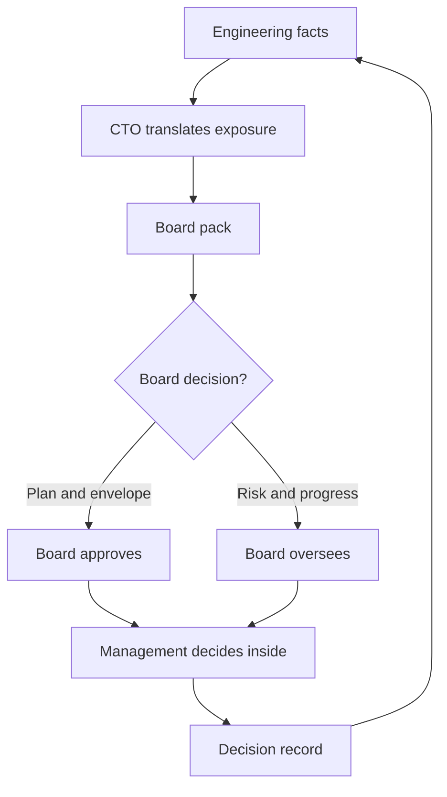
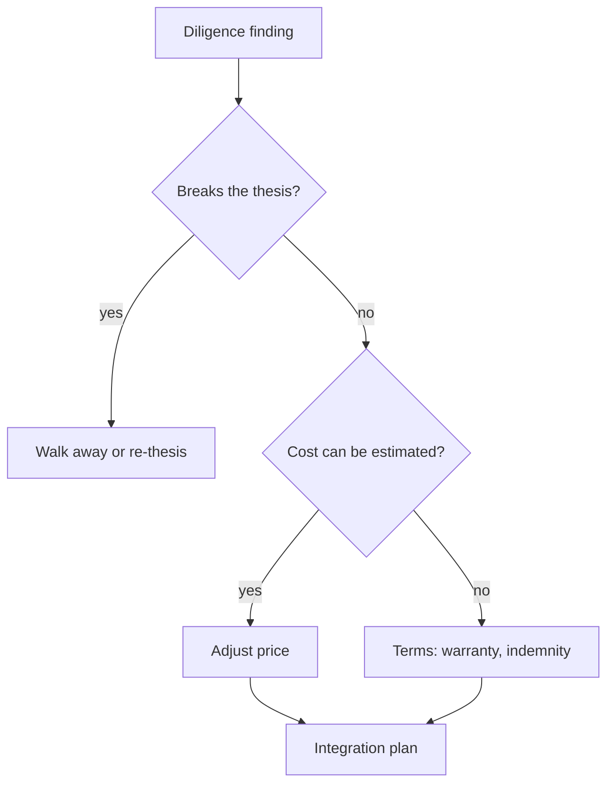
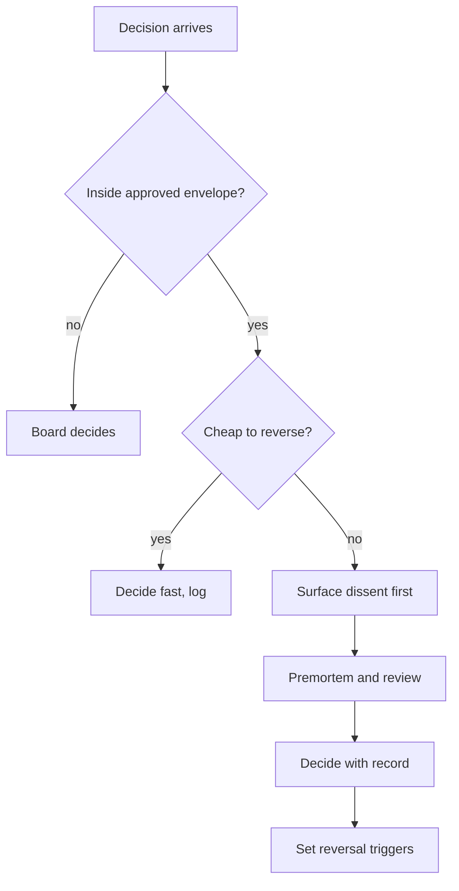

# Chapter 55 — Boards, Due Diligence, and Executive Decision-Making

Three situations test a CTO's judgment in front of people who cannot check the work: the board meeting,
where directors oversee technology they do not run; technology due diligence, where a buyer or investor
tries to find in four weeks what took years to build; and the executive decision made with incomplete
information over the objection of capable colleagues. Each rewards the same habits: say what you know
and how you know it, translate engineering facts into the company's exposure, and leave a record that
lets someone judge the decision later by how it was made rather than by how it turned out. Chapter 39
owns the executive report and the organization decision log, Chapter 46 stakeholder negotiation, Chapter
49 executive proposals and constructive politics, and Chapter 53 the technology risk register and
security strategy. This chapter builds on them at the top of the company. The running example is
Victor Lindqvist, CTO of Northstar Technologies (the fictional company in the
[case study](../../case-studies/northstar/index.md)), preparing for the week 50 board meeting.

## Why This Matters

At team scale, a decision that goes badly is discussed in a retrospective by the people who made it,
and the record is the code and the tickets.

At organization scale, decisions cross teams and quarters. A director who cannot show why a decision
was made finds it reopened by every new stakeholder, and a director whose reports change definitions
from quarter to quarter loses the executive team's trust in every number.

At executive scale, the audience changes in kind. A board approves the operating plan and budget
envelope, hires and evaluates the CEO, and oversees risk; it does not manage engineering and sees it
four times a year. Investors and buyers price the company partly on what technology diligence finds.
The CTO's decisions commit years of capacity and can be reversed only at great cost. Here the
engineering facts are the same as the director's; what changes is who must understand them, in what
units, and how much depends on that understanding being accurate.

## Learning Objectives

After this chapter you will be able to:

- Communicate technology status and risk to a board in its own terms: exposure, commitments against
  what was said last time, and the few decisions that are the board's to make.
- Separate what a board decides from what it oversees and what stays with management, and design the
  board pack and the conversations before the meeting around that line.
- Run technology due diligence on a target, turning every finding into price, terms, integration work,
  or a reason to walk away.
- Prepare an engineering organization to survive diligence by keeping its evidence ready and its
  disclosures consistent with what the board has been told.
- Make and record executive decisions under uncertainty and disagreement, judging decision quality
  separately from outcome and recording dissent in a form that can be checked later.

## The Mental Model

> **Mental model:** The CTO is a translator of exposure and a keeper of the record. A board, a buyer,
> and an executive team each need the same engineering facts converted into what they decide about:
> money at risk, commitments, and options. Each conversion must be consistent with the last one, and
> every decision must be written down with what was known, who disagreed, and what would change it.

The same incident count serves three readers. To the director it is a signal about change safety. To the
board it is evidence about whether the reliability the company sells to customers will hold through the
renewals that fund next year. To a buyer it is one input to how much the platform will cost to keep
running. The translation changes the units, never the number, and never the definition from one
quarter to the next.

| Arrow | What it carries | How it fails |
|---|---|---|
| Facts to translation | Measures with stable definitions | A definition changes silently between quarters |
| Translation to pack | Exposure in money, dates, and customers | Engineering detail the board cannot judge |
| Pack to board | Items marked for decision, discussion, or information | Everything presented as information, so nothing is decided |
| Board to management | An envelope and stated concerns | The board decides inside the envelope, or management asks it to |
| Record back to facts | What was decided, on what assumptions | Next quarter's report cannot be compared with what was said |

## Deep Conceptual Explanation

### What a board does with technology

A board of directors has a small number of formal powers: it appoints and evaluates the CEO, approves
strategy, the operating plan, and major transactions, and oversees how management handles risk. In
a privately held company with an investor on the board, as at Northstar, it also represents the
investor's interest in the value of the company. Directors are part-time and see the business through
the board pack and a few hours of meeting a quarter.

Technology arrives at the board in three forms. **Commitments**: what the operating plan promised
(reliability, delivery, cost) and whether it is being kept. **Exposure**: what could go wrong and what
it would cost (an outage on the payment path, a breach, a platform that cannot be changed safely).
**Options**: investments or decisions that change future value (a modernization, an acquisition, a
build-or-buy choice). Nolan and McFarlan's article on IT and the board opens by arguing that boards had
grown more concerned about their companies' dependence on IT while remaining poorly informed about IT
spending and strategy ([Nolan and McFarlan, 2005](../../references/bibliography.md#nolan2005itboard))
(**expert opinion**, official summary). Two decades later the concern has become a duty in some
jurisdictions: since 2023, US public companies must describe in their annual report how the board
oversees cybersecurity risk and how management assesses and manages it, and must report material
cybersecurity incidents, generally within four business days of deciding an incident is material
([SEC, 2023](../../references/bibliography.md#sec2023cyberrule)) (official summary of a binding SEC
rule). A private company is not bound by that rule, but its
directors read the same governance literature and bring the same expectations.

NIST's Cybersecurity Framework 2.0 places its GOVERN function at the center of the other five, because
governance informs how an organization carries out the rest
([NIST, 2024](../../references/bibliography.md#nist2024csf)) (**standard**). Chapter 53 owns security
strategy and the enterprise risk register; this chapter's concern is how their content reaches the
board.

### Reporting to a board: exposure, consistency, and the ask

Chapter 39 gives the structure of an executive report: headline, commitments, measures, risks, decisions
needed. A board report keeps that structure and changes three things.

**The currency is exposure.** The National Association of Corporate Directors' handbook on cyber-risk
oversight advises management to move beyond technical updates toward standardized, quantitative
reports, aligned with the company's enterprise risk process and using the same language, cadence, and
metrics as other material risks; it recommends reporting at least quarterly, with escalation thresholds
that trigger an update between meetings, and treating reporting as a dialogue in which directors can
challenge assumptions ([NACD, 2026](../../references/bibliography.md#nacd2026cyber)) (**practitioner
consensus** from a directors' association, official summary). The advice generalizes beyond security.
"Change failure rate 23 percent" is not exposure; "about $7.0M of annual recurring revenue renews in
the next four quarters with six of our largest customers, on a product whose reliability is written into
their contracts, and we are 13 minutes a quarter short of the contract" is.

**Consistency beats polish.** A board compares this quarter's pack with the last one. A measure whose
definition changed, a target restated without saying so, or a risk that vanished from the list without
a recorded decision is noticed, and it costs more trust than a missed target honestly reported. The
rule (**this book's recommendation**): every board measure carries its definition and source; any
change of definition is stated on the page where the measure appears, with the old and new values side
by side for one quarter.

**Every item is labeled.** For decision (the board is asked to approve something), for discussion (the
board's view is sought before management decides), or for information. A pack in which everything is
information invites directors to turn information into decisions in the meeting, which is how boards
end up managing engineering.

Keil and colleagues report that powerful sponsors make status reports less candid and that reported bad
news is sometimes ignored ([Keil et al., 2014](../../references/bibliography.md#keil2014pitfalls))
(**research finding**, summarized by the researchers). At board level the CTO is the sponsor of
everything engineering reports, so the discipline Chapter 39 asks of the director applies to the CTO's
own pack: state the missed measure before a director finds it.

### The line between oversight and management

A board decides the envelope; management decides inside it. At Northstar the week 50 board is asked to
approve the year-2 operating plan and budget envelope, while the year-2 organization, the quality
continuation, and the workforce plan stay with management. The line protects both sides. A board that
decides the reporting structure of engineering teams takes responsibility it cannot discharge, and a CTO
who brings such a decision to the board is asking for cover, not oversight.

Two patterns blur the line. The **expert director**, often a former technology executive, asks for
engineering detail and offers to review the architecture; the expertise is valuable and the CTO should
use it, between meetings, as advice, with decisions staying where they belong. The **pre-meeting
decision** happens when one-on-ones with directors settle the outcome before the board meets. Meeting
directors beforehand is good practice (the chair should never be surprised), but Chapter 49's transcript
test applies: every director should be able to read the notes of every conversation and find the same
facts.

Larson's *The Engineering Executive's Primer* is a practitioner guide to this layer of the job, including
how an engineering executive reports to a board on engineering's impact and progress
([Larson, 2024](../../references/bibliography.md#larson2024primer)) (**expert opinion**, idea level).
Berman and Knight's *Financial Intelligence* is known for teaching non-financial managers to read the
numbers a board reads ([Berman and Knight, 2006](../../references/bibliography.md#berman2006financial))
(**expert opinion**, idea level); Chapter 52 owns financial statements, and a CTO who cannot follow the
CFO's pages cannot place engineering's exposure on them.

### Technology due diligence

Due diligence is the investigation a buyer or investor makes before committing money, to test whether
what it has been told is true and what it would inherit. Technology diligence asks whether the product
works as claimed, who owns the code, what it costs to run and change, what risks it carries, and whether
the people who understand it will stay.

Larson argues that engineering carries much of an acquisition's long-term cost, so the engineering
executive should evaluate deals rigorously and say "no" when the evidence says so, while accepting that
engineering usually has one vote among many rather than a veto. He recommends starting from a written
acquisition thesis, the assumptions that must hold for the deal to make sense, and testing them with a
base template covering product implementation, intellectual property, security, compliance, integration
mismatches, costs and scalability, and engineering culture, plus questions specific to the deal; among
his failure modes are deal teams rewarded for closing, sunk-cost pressure, and overlooked risks such as
unaudited compliance claims or unknown breaches
([Larson, 2023](../../references/bibliography.md#larson2023ma)) (**expert opinion**).

| Area | What the acquirer checks | Evidence that settles it |
|---|---|---|
| Product and architecture | It works as demonstrated and can carry the thesis's growth | Hands-on use, architecture walk-through, load history |
| Intellectual property | The code is the target's, and open source licenses are honored | Repository history, contributor agreements, a license scan |
| Security | Known vulnerabilities, past breaches, secrets handling | Scan results, incident history, penetration test reports |
| Compliance | Claimed attestations and regulatory duties are real | The reports themselves, not a summary of them |
| Operations | Reliability and the cost of keeping it | Incident records, availability against contracts, credits paid |
| Cost and scale | Cloud and tooling cost per unit of business | Bills, unit costs, growth curves |
| People | Who can change what; who might leave | Knowledge maps, attrition, key-person dependencies |
| Debt and roadmap | What the roadmap assumes about the platform | Debt register, end-of-support dates, migration estimates |

Two standards make parts of this checkable. ISO/IEC 5230, which grew out of the OpenChain project,
defines the requirements of an open source license compliance program: where compliance processes
should exist, who holds which role, and how the processes are sustained
([OpenChain Project, 2020](../../references/bibliography.md#openchain-iso5230)) (**standard**, official
summary). A software bill of materials (SBOM), with the minimum elements NTIA set out (supplier,
component, version, identifiers, dependency relationships, author, timestamp), lets a buyer see what a
product is built from without reading its code
([NTIA, 2021](../../references/bibliography.md#ntia2021sbom)) (**standard**). Chapter 26 covers both in
the delivery pipeline.

**What findings become.** A finding is useful only when it changes the deal. Each one ends in one of four
places: the price, the terms (specific warranties, indemnities, escrow, a closing condition), the
integration plan and its budget, or the decision to walk away.

| Branch | Example |
|---|---|
| Breaks the thesis | The thesis assumes the platform takes a second product; the core cannot be changed safely by anyone left |
| Cost can be estimated | A framework past end of support with a credible migration estimate |
| Cost cannot be estimated | A suspected but uninvestigated breach; unclear code ownership |
| Integration plan | Two deployment systems to converge; on-call to merge |

The best public illustration of the second and third branches is a breach. The SEC found that Yahoo's
security team learned within days of a December 2014 intrusion that data from hundreds of millions of
user accounts had been stolen, that the breach was not disclosed until 2016, while Yahoo was closing the
sale of its operating business to Verizon, and that Yahoo had failed to maintain controls ensuring that
its security team's reports were assessed for disclosure; Yahoo, renamed Altaba, paid a $35 million
penalty without admitting or denying the findings
([SEC, 2018](../../references/bibliography.md#sec2018altaba)) (**documented practice**, a regulator's
settled findings). Before closing, the two companies amended the agreement: the price fell by $350
million to about $4.48 billion, certain data security incidents were disregarded in deciding whether a
material adverse effect had occurred, and certain resulting liabilities were allocated between the
parties ([Yahoo, 2017](../../references/bibliography.md#yahoo2017amendment8k)) (**documented practice**,
the company's filing). One finding moved price and terms at once. The lesson for the CTO on either side
is the SEC's: there must be a path from what the security team knows to the people who decide what the
board, auditors, and counterparties are told.

**Surviving diligence.** On the target's side the CTO's job is to make the true picture quick to verify.
Three rules (**this book's recommendation**). First, the data room must agree with the board packs; a
risk the board has never seen that appears in diligence damages the CTO with both. Second, disclose
known problems with their remediation plans and owners; a buyer who finds a problem prices the problem
and the concealment. Third, protect the organization's work: diligence is confidential and usually
known to few people, so the CTO and a small group answer most questions, and the rest of engineering
keeps delivering. A company that keeps its evidence current (an SBOM, a license inventory, the risk
register, incident and availability history, a knowledge map) answers in days; one that assembles it
under deadline answers in weeks and looks worse than it is.

### Deciding under uncertainty and disagreement

An executive decision differs from a team decision in three ways: it is made with less of the relevant
information in the decider's own head, its effects arrive late, and the people who disagree are often
peers with their own authority. Chapter 13 covers decision methods in teams and Chapter 28 architecture
decisions; this section is about the CTO's own.

**Judge the decision, not the outcome.** In five studies, people who knew they had all the information
the decision maker had still rated the same decision's reasoning as better, and the decision maker as
more competent, when the outcome was favorable; asked, they said they should not consider outcomes, but
they did ([Baron and Hershey, 1988](../../references/bibliography.md#baron1988outcome)) (**research
finding**, abstract level, with student subjects). A board that reviews a CTO's decision a year later
will do the same unless the record shows what was known, what was assumed, and what would have changed
the choice.

**Size the process to the reversibility.** Chapter 13 covers the distinction between decisions that are
cheap to reverse and those that are not, and deciding with about 70 percent of the information one would
like ([Bezos, 2017](../../references/bibliography.md#bezos2016letter)) (**documented practice**). At
executive level the useful question is not "do we have enough information?" but "what does waiting cost,
and what would reversing cost?"

**Get the disagreement into the room.** The hidden-profile research that
[Chapter 13](../03-high-performing-teams/13-decision-making-in-teams.md) teaches (groups discuss what
members already share and fail to pool what only one knows;
[Stasser and Titus, 1985](../../references/bibliography.md#stasser1985pooling);
[Lu et al., 2012](../../references/bibliography.md#lu2012hiddenprofiles)) applies to an executive team
as much as to an engineering team. What is new at this level: disagreement about the task itself is not
the enemy. A meta-analysis of
116 studies found task conflict more positively related to performance in top management teams and when
performance was measured as decision quality
([de Wit et al., 2012](../../references/bibliography.md#dewit2012paradox)) (**research finding**,
correlational). Drucker's *The Effective Executive* is known for insisting that good decisions come from
the clash of dissenting views, not from early consensus
([Drucker, 1967](../../references/bibliography.md#drucker1967effective)) (**expert opinion**, idea
level). Harvey's Abilene paradox names the opposite failure, a group agreeing to what none of its
members wants ([Harvey, 1974](../../references/bibliography.md#harvey1974abilene)) (idea level).

Two techniques draw out what an executive team will not volunteer. The **premortem**, which Chapter 51
applies to the three-year strategy, asks the team to assume that the decision has already failed and to
write down why ([Klein, 2007](../../references/bibliography.md#klein2007premortem)) (**expert
opinion**). Laboratory work on prospective hindsight found that framing an outcome as certain, rather
than placing it in the past, produced longer explanations with more episodic reasons
([Mitchell et al., 1989](../../references/bibliography.md#mitchell1989prospective)) (**research
finding**, abstract level); the premortem's value comes from stating the failure as certain. The
**recommendation review** asks, before approving a team's proposal,
whether the team has reasons to err, whether it considered alternatives, and whether it anchored on an
initial number; Kahneman, Lovallo, and Sibony are known for a checklist of this kind
([Kahneman et al., 2011](../../references/bibliography.md#kahneman2011bigdecision)) (**expert opinion**,
idea level).

**Speed is not the enemy of rigor.** Eisenhardt's study of strategic decisions in fast-moving firms is
known for the argument that speed and rigor need not trade off
([Eisenhardt, 1989](../../references/bibliography.md#eisenhardt1989fast)) (credited for the idea
only). In this book's terms: when an executive team cannot agree in the time available, the accountable
executive decides and the others commit, which is disagree and commit as Bezos's letter describes it,
including the boss committing to a decision they argued against.

**Record the decision with its dissent.** Chapter 39's decision log and Chapter 28's architecture
decision records hold most decisions. The CTO's own consequential decisions need four extra fields:

| Field | Why it matters at executive level |
|---|---|
| What we would have to believe | The assumptions that make this option best, each checkable later |
| Dissent, attributed with consent | Who disagreed and why, in their words; protects them and the decision |
| Reversal triggers | The evidence that would reopen the decision, set before the outcome is known |
| Review date | When the decision is judged against what was known then, not what happened |

Rogers and Blenko are known for arguing that performance depends on clear decision roles
([Rogers and Blenko, 2006](../../references/bibliography.md#rogers2006whohasd)) (**expert opinion**);
the record makes the role visible after the fact.

## Engineering Organization Example

The figures are **illustrative**, from the Northstar case; every number below is canon or derived from
canon, with the arithmetic shown. The example converts the engineering page of a board pack from
engineering measures into exposure.

**The engineering measures, quarter 3** (the latest measured quarter): 14 Sev1 and Sev2 incidents (2 Sev1,
12 Sev2) against 30 at baseline; availability on the contractual paths 99.89 percent against a 99.9
percent commitment; service credits $60,000; unplanned work 25 percent; 13 of 15 tier 1 components
meeting the four operational minimums.

| Engineering measure | Board translation | Arithmetic |
|---|---|---|
| 99.89% availability | About 13 minutes a quarter short of the contract | 91-day quarter = 131,040 minutes; 0.11% is about 144 unavailable; 99.9% allows about 131 |
| Credits $60,000 a quarter | About $240,000 a year at the current rate, against $1.64M at baseline | $60,000 × 4; $410,000 × 4 |
| Six top-40 renewals in quarters 5–8 | About $7.0M of annual recurring revenue renewing with customers for whom reliability matters | 6 × $1.17M = $7.02M |
| 14 Sev1 and Sev2 | Mandate met for the first time (at most 15); one quarter is not a trend | |
| Unplanned work 25% | About 20 of 80 engineers' capacity on recovery and interrupts | 80 × 25% |
| Engineering spend | About $20.3M a year, about 14.5% of ARR | $16.1M + $4.2M = $20.3M; $20.3M ÷ $140M |

The board does not need Core's change failure rate or flaky-test counts. It needs to know that the
contractual promise is nearly but not yet kept, what that is worth in renewals and credits, what keeping
it costs, and what management will do if it slips. Prevention in stage 2 of the continuation proposal
(Chapter 49) is 6 FTE, about $1.11M a year of existing capacity (6 × $185,000), plus $150,000 of new
tooling; the board sees the $150,000 inside the budget envelope it approves and the 6 FTE as a choice
management makes inside it.

**The headline as a decision under uncertainty.** Victor Lindqvist proposed "Sev1 and Sev2 incidents
below 10 per quarter"; the director's draft counter is "at or below 40 over year 2 as a rolling
four-quarter total", paired with 99.9 percent every quarter (Chapter 46). Treating incident counts as
roughly Poisson (an assumption used only to show the size of chance variation):

| True average per quarter | Meets "below 10" in one quarter | Meets it all four quarters | Annual total at or below 40 |
|---|---|---|---|
| 9 | 59% | 12% | 78% |
| 10 | 46% | 4% | 54% |
| 12 | 24% | under 1% | 14% |

Check: with a true mean of 9, P(X ≤ 9) ≈ 0.587 and 0.587⁴ ≈ 0.119; with an annual mean of 36, P(Y ≤ 40)
≈ 0.777; with an annual mean of 40, P(Y ≤ 40) ≈ 0.542; with an annual mean of 48, P(Y ≤ 40) ≈ 0.138.

Neither headline is free of risk. A quarterly target fails by chance even in a year that improves; an
annual total reports later and gives the board less to react to each quarter. The decision is Victor's,
and the record should show which risk he chose.

**A hypothetical diligence read.** Suppose, purely as a scenario for the reader (no transaction is part
of the Northstar case), that a buyer's technology team read Northstar's estate. Using facts already in
the canon, the triage would look like this:

| Finding (canon source) | Likely branch | Why |
|---|---|---|
| Core framework past free community support; migration 120 to 180 engineer-days (TR-01, quarter 2 register) | Price or integration plan | Estimable cost |
| Four build and deploy paths, one of them shell scripts; CI target undecided | Integration plan | Known work, a decision away |
| Integrations read 12 core/ledger tables directly; ADR-0001 open | Integration plan; terms if data correctness is warranted | Correctness risk is hard to size |
| Four critical roles with no succession cover (week 44) | Terms (retention) and integration plan | Key-person risk |
| SBOM per build on 14 of 15 tier 1 components (all but auth-svc, still script-deployed); no signed provenance (0 of 15), week 44 | Integration plan | Known work, partly done |
| Availability 99.89% against 99.9%; credits $60,000 a quarter | Price | Estimable, and falling |

Nothing here breaks a plausible thesis. Most of it is the visible cost of an 11-year-old product, and
every item already has an owner in a register or a proposal. That is the point of surviving diligence:
the findings were already in the board's view.

## Decision Framework

Use the table to place a technology decision before deciding how to make it. The levels are
**this book's recommendation** for a company of Northstar's shape; adjust them to your board's charter.

| Decision | Who decides | Board's role | Example at Northstar |
|---|---|---|---|
| Operating plan and budget envelope | Board, on the CEO's proposal | Decides | Year-2 plan, week 50 |
| Major transaction | Board | Decides | An acquisition or sale (none in the case) |
| Risk outside the approved appetite | CTO accepts in writing with an expiry (Chapter 53) | Audit committee is told and may direct treatment | The auth-svc exception, before the week 50 session |
| Commitments the plan reports against | CEO and CTO | Discusses; sees results | The year-2 reliability headline |
| Organization, programs, workforce inside the envelope | CTO, with the executive team | Informed | Year-2 organization, quality continuation, workforce plan |
| Technical direction, architecture | CTO or delegated deciders | Not involved unless risk is material | CI target, ADR-0001 |

For decisions on the "not cheap to reverse" branch:

| Question | Evidence | If the answer is no |
|---|---|---|
| Has everyone who holds unique information spoken? | Written positions collected before the meeting | Delay until they have; ask each in turn |
| Has the strongest alternative been argued by its supporter? | The dissenter's own case, in writing | Ask for it; do not argue it yourself |
| Do we know what we would have to believe? | A list of assumptions, each checkable | Write it before deciding |
| Is waiting cheaper than being wrong? | Cost of delay against cost of reversal (Chapter 45) | Decide now with the 70 percent you have |
| Can the dissent be recorded, with consent? | The dissenter has read the entry | Agree wording before publishing |

## Trade-offs

**Transparency against alarm.** Reporting every risk to the board in full invites directors to manage
it; reporting only conclusions hides the evidence they need to oversee. Report exposure and treatment,
and keep detail available on request.

**Pre-meetings against fairness.** Briefing the chair and the expert director before the meeting avoids
surprises and improves the questions; briefing some directors more than others creates two boards.
Brief everyone on the same facts, even if not at the same length.

**Diligence readiness against delivery.** A permanently current data room (SBOM, license inventory,
registers, history) costs a few engineer-weeks a year and pays off in customer questionnaires as well
as transactions. Building it only when a deal appears is cheaper in quiet years and expensive in the
one that matters.

**Speed against inclusion.** Collecting written positions and running a premortem costs days. For
decisions that are cheap to reverse, that is waste; for the rest, it is the cheapest insurance
available.

**Recording dissent against cohesion.** A named dissent can harden positions and invite "I told you
so". An unrecorded one gets relitigated. Record it with the dissenter's agreed wording and an explicit
commitment to the decision.

**One vote against a veto in diligence.** A CTO who opposes every deal loses the vote; one who never
opposes loses credibility. State findings and their price; argue against the deal only when a finding
breaks the thesis.

## Failure Modes

**The engineering pack.** The board section is the director's operational dashboard with a new cover.
Early sign: a director asks "what does this mean for us?" about a measure on the page.

**The moving definition.** A measure is redefined between quarters and the change is not stated. Early
sign: last quarter's value cannot be recomputed from this quarter's definition.

**Asking the board for cover.** A management decision is brought to the board so that the board shares
the blame. Early sign: an item marked "for decision" that sits inside the approved envelope.

**The captured expert.** An expert director's preferences become engineering direction through
side conversations. Early sign: teams cite a director's opinion as a reason.

**The diligence surprise.** A risk appears in the data room that the board has never seen. Early sign: a
risk register with items that never appeared in a board pack.

**The deal-team yes.** Technology diligence is scheduled after the price is agreed, so findings can only
be absorbed, not priced. Early sign: engineering is invited to diligence in the last week.

**Outcome-based review.** A good decision that turned out badly is reversed, and a lucky one is copied.
Early sign: decision reviews that discuss only results.

**Consensus by fatigue.** The executive team agrees because the meeting has run long. Early sign: a
decision nobody will defend a week later (the Abilene paradox).

## Enterprise Application

In a company with 50 to 150 engineers, the CTO usually attends the board for one item a quarter, and the
CEO's pack carries a few engineering figures every month. A workable practice:

- **A standing technology page** in every board pack: three to five measures with definitions and
  sources, the same each quarter; the change since last quarter; risks above an agreed threshold with
  owner and treatment; items labeled for decision, discussion, or information. The
  [executive update template](../../templates/executive-update.md) is a starting point.
- **An escalation threshold** agreed with the CEO and the audit committee chair: which events (a Sev1 on
  the payment path above a duration, a suspected breach, a missed contractual measure) reach directors
  between meetings, and how fast.
- **A pre-meeting rhythm**: the chair a week before, the expert director on technical substance, the
  audit committee chair on risk, each given the same facts.
- **A diligence-ready evidence set**, maintained as part of normal work: SBOM, open source license
  inventory, the risk register, incident and availability history, a knowledge map, the decision log.
- **A CTO decision record** for decisions that commit more than a quarter of capacity or cannot be
  reversed cheaply, kept alongside the organization decision log of
  [Chapter 39](../08-management-operating-system/39-reviews-decision-logs-escalation-and-executive-reporting.md).

## CTO Perspective

At Northstar's size the CTO is often the only person who sees engineering, the board, and customers'
technical relationships at once, which makes them the translator by default. The risk is becoming the
filter: smoothing bad news on the way up and board anxiety on the way down until neither side knows the
other.

At Halvard Systems, the fictional 500-engineer company of
[Chapter 35](../07-organization-design/35-designing-organizations-at-four-scales.md), the board sees
five vice presidents' organizations through one CTO page. A CTO there must decide which group-level
measures roll up without losing meaning, and resist letting each vice president present separately to
directors, which turns the board into an arbiter of internal budget fights. Acquisitions are also more
likely at that scale: the CTO runs diligence as an acquirer and must budget integration (Chapter 58
covers integrating an acquired team) before the price is agreed.

The CTO's own decisions are the hardest to record honestly, because nobody above them asks. A CTO whose
decisions appear in the log with their dissent and reversal triggers makes the decision system credible
for everyone below; one who decides in hallways teaches directors that the log is for other people.

## Practical Playbook

1. **Agree the board's measures once**, with definitions and sources, and keep them stable; state any
   change on the page.
2. **Translate every measure into exposure**: money, customers, dates, contractual promises.
3. **Label every item** for decision, discussion, or information; check that every "decision" is the
   board's to make.
4. **State the miss first**, in minutes or dollars, with the treatment.
5. **Brief the chair, then the directors with a stake**, on the same facts; run the transcript test.
6. **Agree escalation thresholds** for events that reach directors between meetings.
7. **Keep the diligence evidence set current** as part of normal operations.
8. **When running diligence, write the thesis first**, then test it; turn every finding into price,
   terms, integration plan, or a walk-away.
9. **When surviving diligence, make the data room agree with the board packs**; disclose known problems
   with owners and plans.
10. **For decisions that are hard to reverse, collect written positions, run a premortem, decide, and
    record** assumptions, dissent, reversal triggers, and a review date. The [architecture decision record template](../../templates/architecture-decision-record.md) has the fields; the [CTO competency matrix](../../templates/cto-competency-matrix.md) shows how a board-facing CTO is assessed.
11. **Review decisions against what was known**, not against outcomes.

## Case Study

This case is **fictional**. The board, its cadence, the directors' concerns, and the week 50 meetings are on the
[Northstar overview](../../case-studies/northstar/index.md) and in the quarter 4 and Part XII tables of
[the first quarter](../../case-studies/northstar/first-quarter.md) page. It is set in weeks 46 to 49;
the meeting's outcome is not recorded, and the decisions below are the reader's.

**The meeting.** In week 50 the board is asked to approve the year-2 operating plan and budget envelope,
presented by Helena Marsh. Its engineering page was drafted by the director in weeks 41 to 45 at Victor
Lindqvist's request. Victor's own agenda item is a discussion of the three-year technology strategy
(Chapter 51). The year-2 organization, the quality continuation, the workforce plan, and the VP question
are management decisions inside the envelope; none is on the agenda for decision. The pack goes to
directors at the end of week 49, a few days before the meeting. In the same week the audit committee,
chaired by Margaret Lin, holds the technology risk session she requested in week 43 (Chapter 53); its
outcome is not recorded either.

**The directors' known concerns,** gathered by Victor in calls in weeks 46 to 48:

| Director | Concern | What it asks of the engineering page |
|---|---|---|
| Anders Holm (chair, co-founder) | Whether the year-1 gains depend on a few people | Succession cover: 4 of 10 critical roles with none (week 44) |
| Helena Marsh (CEO) | Renewals: six of the 40 largest customers renew in quarters 5 to 8 | Reliability against contract through those quarters |
| Natalie Brooks (Calder Ridge Partners) | What a buyer's technology diligence would find, and whether Northstar could answer it quickly | Known estate risks and their owners; evidence readiness |
| Samuel Osei (Calder Ridge Partners) | Whether flat headcount can carry the roadmap | Capacity for product work in year 2 |
| Margaret Lin (independent, audit committee chair) | That the measures mean the same thing every quarter | Definitions, sources, the severity audit |
| David Ferrante (independent, former payments technology executive) | The payment path, the availability miss, Core's unsupported framework | Technical substance he can probe; he offered to review the architecture himself |

Natalie Brooks's question is about readiness, not a transaction; no sale or investment is part of the
case.

**The open choice on the page.** The draft at week 48 carries two forms of the reliability headline side
by side: Victor's "Sev1 and Sev2 below 10 per quarter" and the director's counter, "at or below 40 over
year 2 as a rolling four-quarter total, reported with the severity audit, and 99.9 percent availability
every quarter". Victor must choose one before the pack goes out. The director has argued, with the
arithmetic in the example above, that the quarterly form will be missed by chance even in a good year
and that Margaret Lin will ask how the count is protected from re-rating. Victor's original request, in
week 41, was for a number the board can check every quarter.

**What Victor has prepared.**

- A one-page exposure translation of the quarter 3 measures (the table in the example above), with the
  definition and source of each measure printed beneath it.
- The availability miss stated in minutes (about 144 against about 131 allowed) in the first paragraph,
  before any improvement.
- A note for the chair on succession, pointing to the continuation proposal's requirement that no
  critical role be without cover by week 78 (Chapter 49), with the proposal's status stated as
  undecided.
- For the audit committee session, the director's enterprise technology risk register draft (ER-01 to
  ER-09) with its three draft appetite lines, and the auth-svc exception decision he committed to in
  week 48: sign it before week 50 or have auth-svc restricted further (Chapter 53). Both are open.
- An answer for Natalie Brooks that lists the estate risks in the enterprise technology risk register
  draft (ER-01 to ER-09, Chapter 53), whose sources include TR-01 to TR-09 (Chapter 30), and the evidence Northstar can and cannot produce today, without
  claiming readiness it has not tested.
- For David Ferrante, an offer of a working session with Kwame Mensah and Ines Carvalho after the
  meeting, as advice to management, rather than an architecture review whose conclusions would carry a
  director's authority.
- A draft CTO decision record for the headline choice, with the decision field blank:

| Field | Draft entry |
|---|---|
| Decision | Which reliability headline goes on the year-2 engineering page (open) |
| Options | A: below 10 per quarter. B: at or below 40 over year 2, rolling, with 99.9% every quarter |
| What we would have to believe for A | The true quarterly average is near 9 or lower, and the board accepts a chance miss without pressure on ratings |
| What we would have to believe for B | The board accepts an annual commitment reported quarterly, and the rolling total is read correctly |
| Dissent | Left blank until Victor decides; whoever does not prevail writes it in their own words |
| Reversal triggers | Two consecutive quarters above 12 reopen the prevention allocation (from the director's counter) |
| Review date | After quarter 6 (week 78), judged against this record |

**What is open.** Which headline Victor puts in the pack; whether he records the director's dissent if
he keeps his own; how he answers Natalie Brooks without either alarming the board or overstating
readiness; how he uses David Ferrante's expertise without handing him engineering decisions; and what
the board approves in week 50.

## Exercises

Worked solutions are in the [Chapter 55 solutions](../../solutions/ch55-solutions.md).

### Foundational

**F1.** The director's first draft of Northstar's engineering page lists: Core change failure rate 23
percent in quarter 2; 140 flaky tests quarantined; 13 of 15 tier 1 components meeting the operational
minimums; Sev1 and Sev2 at 14; availability 99.89 percent; credits $60,000; unplanned work 25 percent;
the CI consolidation target undecided. Rewrite it as a board page: choose at most five measures, translate
each into exposure with arithmetic, label every item for decision, discussion, or information, and say
what you removed and why.

**F2.** You run technology diligence for an acquirer buying a 25-engineer software company (a scenario
for the reader, not part of the case). Findings: the main product runs on a database version past end
of support, with a migration estimate; one engineer wrote and alone understands the billing engine;
a license scan shows a strongly copyleft library linked into the distributed product; the target says it
holds a security attestation but has sent only a summary letter; cloud cost per customer has doubled in
a year. Assign each finding to price, terms, integration plan, or walk away, and explain what further
evidence would change your assignment.

**F3.** Place each of these Northstar decisions in the decision framework: the year-2 operating plan and
budget envelope; the year-2 organization proposal; the $150,000 of stage 2 tooling with or without an
offset; workforce option C, which would need an exception to the 87-seat rule; the CI consolidation
target; the reliability headline on the board page. For each, name the decider, say whether it is cheap
to reverse, and say what, if anything, the board should see.

### Applied Leadership

**A1.** You are Victor Lindqvist in week 47. David Ferrante calls to say he would like to review Core's
architecture himself before the board meeting, asks for the full incident list for quarter 3, and
mentions that at his former company the payment path was never on a weekly release train. Decide what you
give him, what you decline, and how you keep his expertise useful without his views becoming engineering
direction. Write what you say to him and what, if anything, you tell the chair.

**A2.** Suppose (a hypothetical scenario, not part of the case) that in quarter 5 Natalie Brooks tells
Victor that Calder Ridge Partners may bring in an outside firm for a technology review of Northstar in
quarter 6, to prepare for a possible future transaction. Plan eight weeks of readiness work that does not
disrupt stage 2 of the quality program. Say what evidence you would assemble, who would know, how you
would present the Core framework risk and any open vulnerability exceptions, and what you would refuse
to do.

**A3.** Suppose (hypothetically) that on the Thursday of week 49, the day before the pack goes out, Joon
Park tells Victor that a webhook signing key may have been exposed in a log file accessible to a
contractor, and that he cannot yet say whether it was used. Decide who must know before the board
meeting and in what order, what goes into the pack, what Victor says if a director asks about security
in week 50, and what record he keeps. Use the Yahoo case in the chapter to explain your reasoning.

### Executive Decision-Making

**X1.** You are Victor Lindqvist at the end of week 49. Choose the reliability headline for the engineering
page: your own "below 10 per quarter" or the director's rolling annual counter. Complete the draft decision
record from the case study, including the dissent in the words of whoever did not prevail. Then write the
paragraph that will appear on the board page, and the one sentence you will say if Margaret Lin asks how
the count is protected from re-rating.

**X2.** You are CTO of Halvard Systems (a scenario for the reader, not part of the Halvard canon). The CEO plans to acquire a 60-engineer company whose product
would become a fifth product group; the deal team has a target price and wants technology diligence done
in four weeks. Write the acquisition thesis as you understand it, design the diligence (scope, team,
evidence, meetings), and decide what you will tell the CEO if, in week three, you find that the target's
claimed compliance attestation covers a different product from the one being bought. Address the fact
that engineering has one vote, not a veto.

## Reflection Questions

1. If your board compared your last four technology reports side by side, would every measure mean the
   same thing in each? Which would not, and did you say so at the time?
2. Which risk in your register has never appeared in a board pack? What would happen if a buyer found it
   first?
3. When did you last judge a decision by its outcome alone? What would the record have needed to show
   for you to judge it fairly?
4. Who on your executive team holds information you never hear in meetings, and how would you know?
5. Which of your decisions would you be comfortable having reviewed, with your reasoning and the
   dissent, by a board a year from now?

## Key Takeaways

- Translate engineering measures into exposure (money, customers, dates, contracts) without changing
  the number or its definition.
- Keep board measures stable; state any definition change on the page, with old and new values.
- Label every board item for decision, discussion, or information; bring the board only what is the
  board's to decide.
- State the miss first; the CTO is the sponsor of everything engineering reports.
- Use expert directors as advisers between meetings; keep decisions where the charter puts them.
- In diligence, write the thesis first and turn every finding into price, terms, integration plan, or a
  walk-away.
- Make diligence boring by keeping the evidence current and the data room consistent with what the
  board has already seen.
- Judge decisions by how they were made: record assumptions, dissent, reversal triggers, and a review
  date before the outcome is known.
- Size the process to the reversibility; draw out dissent before deciding, and commit afterwards.

## References and Further Reading

- [Nolan and McFarlan, 2005](../../references/bibliography.md#nolan2005itboard): boards' dependence on
  IT and how poorly informed they are (official summary).
- [SEC, 2023](../../references/bibliography.md#sec2023cyberrule): US public-company disclosure of board
  oversight of cyber risk and material incidents.
- [NACD, 2026](../../references/bibliography.md#nacd2026cyber): how management should measure and
  report cyber risk to a board; generalizes to technology risk.
- [NIST, 2024](../../references/bibliography.md#nist2024csf): the GOVERN function at the center of
  CSF 2.0.
- [Larson, 2024](../../references/bibliography.md#larson2024primer): practitioner guide to the
  engineering executive's job (idea level).
- [Larson, 2023](../../references/bibliography.md#larson2023ma): engineering's role in acquisitions,
  from thesis to integration.
- [Berman and Knight, 2006](../../references/bibliography.md#berman2006financial): reading the numbers a
  board reads (idea level).
- [Keil et al., 2014](../../references/bibliography.md#keil2014pitfalls): why status reports lose
  candor.
- [SEC, 2018](../../references/bibliography.md#sec2018altaba) and
  [Yahoo, 2017](../../references/bibliography.md#yahoo2017amendment8k): a breach that moved an
  acquisition's price and terms, and the disclosure controls that failed.
- [OpenChain Project, 2020](../../references/bibliography.md#openchain-iso5230) and
  [NTIA, 2021](../../references/bibliography.md#ntia2021sbom): license compliance programs and SBOMs as
  diligence evidence.
- [Baron and Hershey, 1988](../../references/bibliography.md#baron1988outcome): outcome bias in judging
  decisions.
- [Bezos, 2017](../../references/bibliography.md#bezos2016letter): reversible decisions, 70 percent of
  the information, disagree and commit.
- [Stasser and Titus, 1985](../../references/bibliography.md#stasser1985pooling) and
  [Lu et al., 2012](../../references/bibliography.md#lu2012hiddenprofiles): why groups fail to pool
  unique information.
- [de Wit et al., 2012](../../references/bibliography.md#dewit2012paradox): task conflict and decision
  quality in top management teams.
- [Drucker, 1967](../../references/bibliography.md#drucker1967effective): decisions from dissent (idea
  level).
- [Harvey, 1974](../../references/bibliography.md#harvey1974abilene): the Abilene paradox (idea level).
- [Klein, 2007](../../references/bibliography.md#klein2007premortem) and
  [Mitchell et al., 1989](../../references/bibliography.md#mitchell1989prospective): the premortem and
  prospective hindsight.
- [Kahneman et al., 2011](../../references/bibliography.md#kahneman2011bigdecision): reviewing a team's
  recommendation for bias (idea level).
- [Eisenhardt, 1989](../../references/bibliography.md#eisenhardt1989fast): fast strategic decisions and
  consensus with qualification (idea level).
- [Rogers and Blenko, 2006](../../references/bibliography.md#rogers2006whohasd): clear decision roles.
