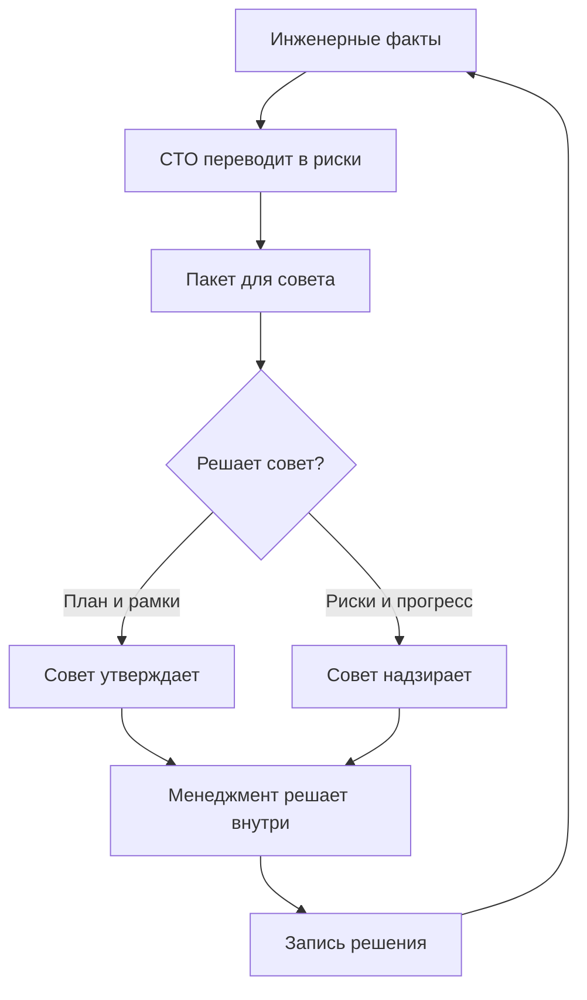
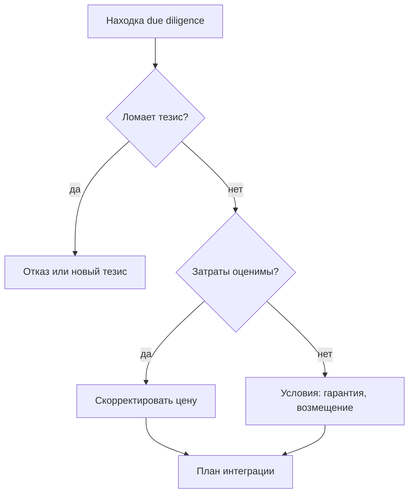
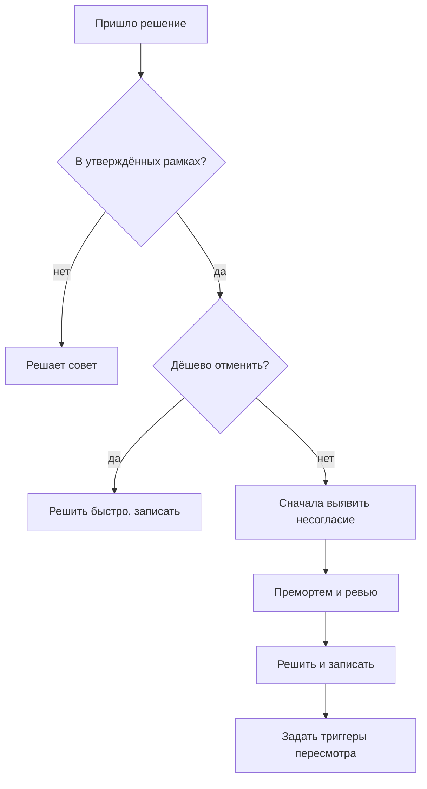

# Глава 55 — Совет директоров, due diligence и решения высшего уровня { #chapter-55-boards-due-diligence-and-executive-decision-making }

В трёх ситуациях суждения CTO оценивают люди, которые не могут проверить его работу. На заседании совета
директоров его члены надзирают за технологиями, которыми сами не управляют. На технологической due
diligence (комплексной проверке) покупатель или инвестор за четыре недели пытается разобраться в том,
что строилось годами. Принимая решение высшего уровня, CTO выбирает при неполной информации и вопреки
возражениям сильных коллег. Во всех трёх случаях выручают одни и те же привычки. Говорите, что вы знаете
и откуда. Переводите инженерные факты на язык подверженности риску (exposure): что компания может
потерять и сколько. Оставляйте запись, чтобы решение потом оценивали по тому, как его принимали, а не по
тому, чем оно обернулось. Сквозной пример — Victor Lindqvist, CTO (технический директор) Northstar
Technologies (вымышленной компании из [кейса](../../case-studies/northstar/index.md)), который готовится
к заседанию совета директоров на неделе 50.

Связанные главы: 39 (отчёты для руководства и журнал решений), 46 (переговоры), 49 (предложения для
высшего руководства) и [53](53-risk-governance-regulation-and-security-strategy.md) (реестр рисков,
стратегия безопасности и правила раскрытия информации).

## Почему это важно { #why-this-matters }

В команде неудачное решение разбирают на ретроспективе те же люди, что его принимали, а записью о нём
служат код и тикеты.

В организации решения выходят за границы команд и кварталов. Если директор не может показать, почему
решение приняли, каждый новый стейкхолдер открывает его заново. Если в отчётах директора определения
меняются от квартала к кварталу, команда высшего руководства перестаёт верить любой его цифре.

На уровне высшего руководства меняется сама аудитория. Совет директоров утверждает
[операционный план](../../glossary.md#operating-plan) (цели, численность и бюджет на год) и
[рамки бюджета](../../glossary.md#budget-envelope) (общий лимит расходов), нанимает и оценивает CEO и
надзирает за рисками; разработку он видит четыре раза в год. Инвесторы и покупатели оценивают компанию
отчасти по тому, что находит технологическая due diligence. Решения CTO связывают ресурс на годы
вперёд. Инженерные факты те же, что у директора. Меняется другое: кто должен их понять, в каких
единицах и сколько от этого понимания зависит.

## Цели главы { #learning-objectives }

После этой главы вы сможете:

- Докладывать совету директоров о состоянии технологий и рисках на его языке: подверженность риску,
  выполнение обещанного в прошлый раз и те немногие решения, которые принимает сам совет.
- Отделять то, что совет решает, от того, за чем он надзирает, и от того, что остаётся за
  менеджментом, и строить вокруг этой границы пакет для совета директоров и разговоры перед
  заседанием.
- Проводить технологическую due diligence компании-цели и превращать каждую находку в цену, условия
  сделки, работу по интеграции или причину отказаться от сделки.
- Готовить инженерную организацию к due diligence: держать доказательства наготове, а раскрываемую
  информацию — в согласии с тем, что уже слышал совет.
- Принимать и записывать решения высшего уровня в условиях неопределённости и разногласий: оценивать
  качество решения отдельно от исхода и фиксировать несогласие в форме, которую потом можно проверить.

## Ментальная модель { #the-mental-model }

> **Ментальная модель:** CTO переводит инженерные факты на язык риска и хранит запись. Совету
> директоров, покупателю и команде высшего руководства нужны одни и те же инженерные факты,
> пересчитанные в то, о чём каждый из них принимает решения: деньги под риском, обязательства и
> опционы. Каждый пересчёт должен совпадать с предыдущим. Каждое решение записывается вместе с тем,
> что было известно, кто был не согласен и что заставило бы его пересмотреть.

Одно и то же число инцидентов служит трём читателям. Директору оно говорит о безопасности изменений.
Совету — выдержит ли обещанная клиентам надёжность продления следующего года. Покупателю — во что
обойдётся поддерживать платформу в рабочем состоянии. Перевод меняет единицы, но никогда не меняет ни
числа, ни его определения.

| Стрелка | Что передаёт | Как ломается |
|---|---|---|
| От фактов к переводу | Метрики со стабильными определениями | Определение тихо меняется |
| От перевода к пакету | Риск в деньгах, датах и клиентах | Подробности, о которых совет не может судить |
| От пакета к совету | Пункты с пометкой «для решения», «для обсуждения» или «для информации» | Ничего не помечено «для решения» |
| От совета к менеджменту | Рамки и высказанные опасения | Совет решает внутри рамок |
| От записи обратно к фактам | Что решили и на каких допущениях | Следующий квартал нельзя сравнить с этим |

## Подробный разбор { #deep-conceptual-explanation }

### Что совет директоров делает с технологиями { #what-a-board-does-with-technology }

Формальных полномочий у совета директоров немного. Он назначает и оценивает CEO, утверждает стратегию,
операционный план и крупные сделки и надзирает за тем, как менеджмент управляет рисками. В частной
компании с инвестором в совете, как в Northstar, совет ещё и представляет интерес этого инвестора к
стоимости компании. Члены совета работают в нём не полный день. Бизнес они видят через
[пакет для совета директоров](../../glossary.md#board-pack) (материалы, которые рассылают перед каждым
заседанием) и несколько часов заседаний в квартал.

Технологии попадают в совет в трёх видах:

- **Обязательства**: что обещал операционный план (надёжность, поставка, затраты) и выполняется ли
  обещанное.
- **Подверженность риску**: что может пойти не так и во что это обойдётся, например сбой на пути оплаты
  или утечка данных.
- **Опционы**: инвестиции или решения, которые меняют будущую стоимость, например модернизация или
  поглощение.

За чем совет обязан надзирать, включая правила раскрытия информации, описано в
[главе 53](53-risk-governance-regulation-and-security-strategy.md). Эта глава — о том, как всё это
доходит до совета.

### Отчёт для совета: подверженность риску, последовательность и запрос { #reporting-to-a-board-exposure-consistency-and-the-ask }

Структуру отчёта для руководства задаёт глава 39: главный вывод, обязательства, метрики, риски, нужные
решения. Отчёт для совета сохраняет эту структуру, но меняет в ней три вещи.

**Валюта — подверженность риску.** National Association of Corporate Directors (Национальная ассоциация
корпоративных директоров) советует менеджменту докладывать о технологическом риске в тех же
количественных показателях, что и о других существенных рисках, не реже раза в квартал. Нужны и пороги:
если их превысили, совет узнаёт об этом между заседаниями
([NACD, 2026](../../references/bibliography.md#nacd2026cyber); **консенсус практиков**, написано для
киберриска). «Доля неудачных изменений 23%» — это не подверженность риску. Подверженность риску звучит
иначе: «в ближайшие четыре квартала шесть наших крупнейших клиентов продлевают контракты на продукт,
надёжность которого прописана в этих контрактах; это около $7,0 млн годовой регулярной выручки, а до
уровня контракта нам не хватает 13 минут в квартал».

**Последовательность важнее лоска.** Совет сравнивает пакет этого квартала с прошлым. Изменённое
определение, тихо пересмотренная цель или риск, исчезнувший без записанного решения, подрывают доверие
сильнее, чем честно показанная недостигнутая цель. Правило (**рекомендация книги**): у каждой метрики
для совета указаны определение и источник. Любое изменение определения объявляют на самой странице, и в
течение одного квартала старое и новое значения показывают рядом.

**Каждый пункт помечен**: для решения (совет просят что-то утвердить), для обсуждения (мнение совета
нужно до того, как решит менеджмент) или для информации. Если в пакете всё помечено «для информации»,
члены совета начинают принимать решения прямо на заседании. Так советы в итоге и берутся управлять
разработкой.

Влиятельные спонсоры делают отчёты о статусе менее откровенными, а к плохим новостям, даже когда о них
сообщают, иногда не прислушиваются
([Keil et al., 2014](../../references/bibliography.md#keil2014pitfalls); **научный результат**). CTO —
спонсор всего, о чём докладывает разработка, поэтому отстающую метрику называйте сами, пока её не нашёл
член совета.

### Граница между надзором и управлением { #the-line-between-oversight-and-management }

Совет определяет рамки; менеджмент решает внутри них. В Northstar совет на неделе 50 просят утвердить
операционный план и рамки бюджета на год 2. Организация разработки на год 2, продолжение программы
качества и план по персоналу остаются за менеджментом. Если совет решает, кому подчиняются инженерные
команды, он берёт на себя ответственность, которую не может нести. А CTO, принёсший ему такой вопрос,
ищет прикрытия.

Границу размывают два паттерна. **Член совета — эксперт**, часто бывший технологический руководитель,
просит инженерных подробностей и предлагает сам посмотреть архитектуру. Пользуйтесь его экспертизой
между заседаниями как советом, но решения оставляйте там, где им положено быть. **Решение до заседания**
получается, когда встречи один на один с членами совета предрешают исход ещё до того, как совет
собрался. Встречаться с членами совета заранее — хорошая практика, но здесь действует тест стенограммы
из главы 49: каждый член совета мог бы прочитать заметки о любом разговоре и найти в них те же факты.
Этот слой работы Larson описывает по опыту практика
([Larson, 2024](../../references/bibliography.md#larson2024primer); **мнение эксперта**).

### Этика на уровне совета: вводящий в заблуждение главный показатель и раскрытие информации { #ethics-at-board-level-the-misleading-headline-and-disclosure }

Долг CTO перед советом — точная картина, даже когда есть более лестная и кто-то из высшего руководства
предпочёл бы её (**рекомендация книги**). Давление редко требует ложной цифры. Оно требует верной
цифры, выбранной или поданной так, чтобы ввести в заблуждение. Примеры: главная цель, которую, скорее
всего, обеспечат случай или переоценка серьёзности (переоценка — понижение серьёзности инцидента
задним числом, после чего он выпадает из подсчёта); метрика, переопределённая в том самом квартале,
когда цель по ней была бы провалена; недостигнутая цель, перенесённая в приложение; известная
уязвимость, которую не вносят на страницу рисков, «пока её не исправят».

Большую часть этого ловят три теста. Заставит ли страница внимательного члена совета поверить в то, что,
как вы знаете, неправда? Будет ли вам спокойно, если член совета потом увидит отвергнутый вами вариант?
Найдёт ли команда due diligence покупателя в data room (комнате данных) что-то, чего совету никогда не
показывали? Если на первый или третий вопрос ответ «да» или на второй — «нет», страницу нужно менять.

Когда коллега или CEO просит смягчить страницу, прямо скажите, что эта правка скроет, и предложите
честную подачу: недостигнутая цель, названная первой вместе с мерами, обычно убедительнее умолчания.
Если по существенному вопросу ваше мнение отклонили, запишите, что вы советовали и почему. Существенная
известная проблема, например подозрение на взлом или невыполнение договорного показателя, должна
дойти до тех, кто решает, что сообщить совету, аудиторам и контрагентам. Таков урок дела Yahoo, о
котором речь пойдёт ниже ([SEC, 2018](../../references/bibliography.md#sec2018altaba)). Если обычный
путь не срабатывает, обращаться нужно к председателю комитета по аудиту и юристам компании. На самом
верху именно CTO отвечает за то, чтобы отчёты о статусе оставались честными.

### Технологическая due diligence { #technology-due-diligence }

[Due diligence](../../glossary.md#due-diligence) — проверка, которую покупатель или инвестор проводит,
прежде чем вложить деньги: правда ли то, что ему рассказали, и что он унаследует? Технологическая due
diligence выясняет, работает ли продукт, кому принадлежит код, сколько стоит его эксплуатация и
останутся ли люди, которые в нём разбираются.

Larson утверждает, что на разработку приходится значительная часть долгосрочных затрат на поглощение.
Поэтому руководитель разработки высшего уровня должен строго оценивать сделки и говорить «нет», когда к
этому ведут доказательства. Обычно у разработки один голос из многих, а не право вето. Larson советует
начинать с письменного **тезиса сделки** (acquisition thesis) — допущений, которые должны быть верны,
чтобы сделка имела смысл, — и проверять его область за областью. Среди типичных провалов он называет
команды сделки, которых вознаграждают за закрытие, давление невозвратных затрат и непроверенные
заявления о соответствии требованиям
([Larson, 2023](../../references/bibliography.md#larson2023ma); **мнение эксперта**).

| Область | Что проверяет покупатель | Какие доказательства закрывают вопрос |
|---|---|---|
| Продукт и архитектура | Работает так, как показывали, и выдержит рост, заложенный в тезис | Работа с продуктом своими руками, разбор архитектуры, история нагрузки |
| Интеллектуальная собственность | Код принадлежит компании-цели, лицензии open source соблюдаются | История репозитория, соглашения с контрибьюторами, сканирование лицензий |
| Безопасность | Известные уязвимости, прошлые взломы, работа с секретами | Результаты сканирования, история инцидентов, отчёты о пентестах |
| Соответствие требованиям | Заявленные подтверждения и регуляторные обязанности реальны | Сами отчёты, а не их краткое изложение |
| Эксплуатация | Надёжность и цена её поддержания | Записи об инцидентах, доступность относительно контрактов, выплаченные кредиты |
| Затраты и масштаб | Затраты на облако и инструменты на единицу бизнеса | Счета, удельные затраты, кривые роста |
| Люди | Кто что может менять; кто может уйти | Карты знаний, текучесть, зависимость от ключевых людей |
| Долг и дорожная карта | Что дорожная карта предполагает о платформе | Реестр долга, даты окончания поддержки, оценки миграций |

Отчасти эти вопросы можно проверить по двум **стандартам**: ISO/IEC 5230 описывает программу
соблюдения лицензий open source
([OpenChain Project, 2020](../../references/bibliography.md#openchain-iso5230)), а
[SBOM](../../glossary.md#sbom) (software bill of materials, перечень компонентов ПО) показывает, из
чего собран продукт ([NTIA, 2021](../../references/bibliography.md#ntia2021sbom)).

**Во что превращаются находки.** Находка полезна, только если она меняет сделку. Каждая находка оседает
в одном из четырёх мест: в цене, в условиях, в плане интеграции и его бюджете или в решении отказаться
от сделки.

!!! note "Условия сделки простыми словами"
    - **[Гарантия](../../glossary.md#warranty-indemnity-and-escrow)** (warranty): письменное обещание
      продавца, что некий факт верен («нераскрытых взломов не было»). Если факт окажется ложным,
      покупатель может требовать возмещения убытков.
    - **Возмещение убытков** (indemnity): продавец соглашается заплатить, если названная проблема позже
      обойдётся покупателю в деньги, например лицензионная претензия.
    - **Эскроу** (escrow): часть цены, которую третья сторона удерживает на определённый срок, чтобы
      оплатить такие претензии.
    - **Условие закрытия сделки**: то, что должно быть верно или сделано до завершения сделки,
      например ключевой инженер подписывает соглашение об удержании.
    - **Существенное неблагоприятное изменение** (material adverse effect): серьёзное изменение в
      бизнесе компании-цели между подписанием и закрытием, которое позволяет покупателю выйти из
      сделки или пересмотреть её условия.
    - **Копилефт-лицензия**: лицензия open source, которая требует, чтобы распространяемое ПО,
      построенное на этом коде, выпускали на тех же условиях; лицензии «сильного копилефта» применяют
      это требование широко.

| Ветка | Пример |
|---|---|
| Ломает тезис | Тезис предполагает, что платформа примет второй продукт, но из оставшихся людей никто не может безопасно менять ядро |
| Затраты оценимы | Фреймворк, поддержка которого закончилась, и правдоподобная оценка миграции |
| Затраты не оценимы | Подозрение на взлом, которое не расследовали; неясное владение кодом |
| План интеграции | Две системы развёртывания, которые нужно свести в одну; дежурства, которые нужно объединить |

Лучше всего вторую и третью ветки иллюстрирует публичная история взлома Yahoo (**задокументированная
практика**: по выводам регулятора, зафиксированным при урегулировании дела, и по отчётности самой
компании). По данным SEC (Комиссии по ценным бумагам и биржам США):

- Через несколько дней после вторжения в декабре 2014 года служба безопасности Yahoo узнала, что
  украдены данные сотен миллионов учётных записей пользователей.
- О взломе не сообщали до 2016 года, когда Yahoo уже закрывала сделку о продаже операционного бизнеса
  компании Verizon.
- Yahoo не поддерживала механизмы контроля, которые гарантировали бы, что отчёты службы
  безопасности оценивают с точки зрения раскрытия. Yahoo, переименованная в Altaba, заплатила штраф
  $35 млн, не признавая и не отрицая выводов
  ([SEC, 2018](../../references/bibliography.md#sec2018altaba)).

Ещё до закрытия сделки стороны изменили соглашение. Цена снизилась на $350 млн, примерно до $4,48 млрд.
Договорились, что некоторые инциденты безопасности данных не учитываются при оценке того, произошло ли
существенное неблагоприятное изменение. Часть вытекающих из них обязательств разделили между сторонами
([Yahoo, 2017](../../references/bibliography.md#yahoo2017amendment8k)). Одна находка сдвинула и цену, и
условия. Урок для CTO, на какой бы стороне сделки он ни был, тот же, что и в выводах SEC: должен
существовать путь от того, что знает служба безопасности, к тем, кто решает, что сообщить совету,
аудиторам и контрагентам.

**Как пройти due diligence.** На стороне компании-цели задача CTO — сделать так, чтобы истинную картину
можно было быстро проверить. Три правила (**рекомендация книги**):

1. Data room (набор документов, которые передают покупателю) должен совпадать с пакетами для совета
   директоров. Риск, который всплыл на due diligence, но так и не дошёл до совета, подрывает доверие к
   CTO и у покупателя, и у совета.
2. Раскрывайте известные проблемы вместе с планами их устранения и владельцами. Если покупатель находит
   проблему сам, он закладывает в цену и саму проблему, и то, что её скрывали.
3. Берегите работу организации. Due diligence конфиденциальна, поэтому на большинство вопросов отвечают
   CTO и небольшая группа, а остальная разработка продолжает поставку.

Если доказательства (SBOM, перечень лицензий, реестр рисков, история инцидентов, карта знаний)
поддерживают в актуальном состоянии, компания отвечает за дни. Если их собирают в последний момент,
ответ занимает недели, и компания выглядит хуже, чем она есть.

### Решения в условиях неопределённости и разногласий { #deciding-under-uncertainty-and-disagreement }

Решение высшего уровня отличается от командного тремя вещами. У решающего в голове меньшая часть нужной
информации, последствия проявляются поздно, а несогласные часто — коллеги того же уровня с собственными
полномочиями. Знакомые инструменты по-прежнему работают, от способов принятия решений
([глава 13](../03-high-performing-teams/13-decision-making-in-teams.md)) до премортема
([глава 51](51-enterprise-technology-strategy.md)). Новыми на этом уровне становятся четыре вещи.

**Оценивайте решение, а не исход.** В пяти исследованиях люди считали одно и то же рассуждение более
удачным, а решающего — более компетентным, если исход был благоприятным. Так было, хотя они располагали
всей информацией, которая была у принимавшего решение
([Baron and Hershey, 1988](../../references/bibliography.md#baron1988outcome); **научный результат**,
испытуемые — студенты). На прямой вопрос они отвечали, что исход учитывать не следует, но учитывали.
Совет, разбирая решение CTO через год, поступит так же, если запись не покажет, что было известно, что
предполагалось и что изменило бы выбор.

**Разногласия по существу задачи помогают на самом верху.** Метаанализ 116 исследований показал, что в
командах высшего руководства разногласия по поводу задачи сильнее положительно связаны с
результативностью. Связь была сильнее и тогда, когда результативность измеряли как качество решений
([de Wit et al., 2012](../../references/bibliography.md#dewit2012paradox); корреляционный **научный
результат**). Добейтесь, чтобы разногласия прозвучали на встрече: соберите письменные позиции заранее
и попросите несогласного отстаивать сильнейшую альтернативу. Противоположный провал — консенсус от
усталости, когда группа соглашается на то, чего не хочет ни один из её участников.

**«Не согласен, но действую» (disagree and commit).** Когда команда высшего руководства не может
договориться за отведённое время, решает ответственный руководитель, а остальные обязуются исполнять
решение. Это относится и к начальнику: он тоже берётся исполнять решение, против которого возражал
([Bezos, 2017](../../references/bibliography.md#bezos2016letter); **задокументированная практика**).
Спрашивайте не о том, хватает ли информации, а о том, во что обойдётся ожидание и во что — разворот.

**Записывайте решение вместе с несогласием.** Большинство решений записывают в журнал решений из
главы 39 и в записи архитектурных решений (ADR) из главы 28. Собственным значимым решениям CTO нужны
четыре дополнительных поля:

| Поле | Почему это важно на уровне высшего руководства |
|---|---|
| Во что нам пришлось бы поверить | Допущения, при которых этот вариант лучший; каждое можно потом проверить |
| Особое мнение, с указанием автора и с его согласия | Кто был не согласен и почему, его словами; это защищает и его, и решение |
| Триггеры пересмотра | Доказательства, при которых решение откроют заново; их задают до того, как исход известен |
| Дата разбора | Когда решение оценят по тому, что было известно тогда, а не по тому, что случилось |

Кроме того, запись и задним числом показывает, за кем было решение, а ясность в этом влияет на
результативность ([Rogers and Blenko, 2006](../../references/bibliography.md#rogers2006whohasd);
**мнение эксперта**).

## Пример из инженерной организации { #engineering-organization-example }

!!! info "Northstar: что уже известно"
    Неделя 48 первого года директора. Число [инцидентов Sev1 и Sev2](../../glossary.md#severity-sev1-sev2-sev3)
    в квартале 3 снизилось до 14: это первый квартал в пределах лимита [мандата](../../glossary.md#the-mandate),
    15 инцидентов. Совет директоров собирается на неделе 50. См. [хронологию](../../case-studies/northstar/timeline.md).
    Впервые читаете о Northstar? Прочитайте [«Год вкратце»](../../case-studies/northstar/year-in-brief.md),
    [действующих лиц](../../case-studies/northstar/cast.md) и
    [брифинг квартала 4](../../case-studies/northstar/quarter-4-briefing.md).

Цифры — **иллюстрация** и вымысел, они взяты из хроники Northstar. Пример переводит инженерную
страницу пакета для совета директоров с языка инженерных метрик на язык риска.

**Инженерные метрики, квартал 3** (последний измеренный квартал):

- 14 инцидентов Sev1 и Sev2 (2 Sev1, 12 Sev2) против 30 в базовом квартале;
- доступность на договорных путях 99,89% при обязательстве 99,9%;
- [сервисные кредиты](../../glossary.md#service-credits) (компенсации по SLA) на $60 000;
- незапланированная работа — 25%;
- 13 из 15 компонентов [tier 1](../../glossary.md#tier-1) соответствуют четырём
  [операционным минимумам](../../glossary.md#tier-1-operational-minimums) (базовым практикам
  надёжности, обязательным для каждого компонента tier 1).

| Инженерная метрика | Перевод для совета | Расчёт |
|---|---|---|
| Доступность 99.89% | Около 13 минут в квартал до уровня контракта | 144 минуты простоя при 131 допустимой |
| Кредиты $60,000 в квартал | Около $240,000 в год при нынешнем темпе против $1.64M в базовом периоде | $60,000 × 4; $410,000 × 4 |
| Шесть продлений из топ-40 в кварталах 5–8 | Около $7.0M [ARR](../../glossary.md#arr) (годовой регулярной выручки) продлевается у клиентов, для которых важна надёжность | 6 × $1.17M = $7.02M |
| 14 Sev1 и Sev2 | Мандат выполнен впервые (не более 15); один квартал — ещё не тренд | Нет |
| Незапланированная работа 25% | Ресурс около 20 из 80 инженеров уходит на восстановление и прерывания | 80 × 25% |
| Расходы на разработку | Около $20.3M в год, около 14.5% ARR | $16.1M + $4.2M = $20.3M; $20.3M ÷ $140M |

Совету не нужны ни доля неудачных изменений Core, ни число нестабильных тестов. Ему нужно знать четыре
вещи: что договорное обещание почти, но ещё не выполнено; какие деньги на кону в продлениях и кредитах;
во что обходится выполнение обещания; что сделает менеджмент, если показатель просядет. Этап 2
[продолжения](../../glossary.md#the-continuation) — предложения директора и дальше финансировать
программу качества — задействует 6 FTE существующего ресурса (около $1,11 млн в год) плюс $150 000 на
новые инструменты. $150 000 совет видит внутри утверждаемых им рамок, а 6 FTE — это выбор менеджмента в
пределах этих рамок.

**Главный показатель как решение в условиях неопределённости.** Сначала простая мысль: квартальный
порог, близкий к истинному среднему, часто срывается просто по случайности, а пройти его четыре квартала
подряд почти никогда не удаётся. Victor предложил «инцидентов Sev1 и Sev2 меньше 10 в квартал». Директор
в главе 46 подготовил встречное предложение как ответ на этот якорь: «не более 40 за год 2 скользящей
суммой за четыре квартала» в паре с доступностью 99,9% в каждом квартале.

| Истинное среднее за квартал | «Меньше 10» в одном квартале | Во всех четырёх кварталах | Сумма за год не более 40 |
|---|---|---|---|
| 9 | 59% | 12% | 78% |
| 10 | 46% | 4% | 54% |
| 12 | 24% | менее 1% | 14% |

Цифры получены по модели Пуассона — стандартной модели числа независимых случайных событий. Чтобы
получить вероятность пройти все четыре квартала, вероятность для одного квартала возводят в четвёртую
степень (0,59 × 0,59 × 0,59 × 0,59 — примерно 0,12).

Ни один из вариантов не свободен от риска. Квартальная цель проваливается по случайности даже в год,
когда всё улучшается. Годовая сумма даёт ответ позже, и в каждом квартале у совета меньше поводов
реагировать. Решение за Victor, и запись должна показать, какой риск он выбрал.

**Гипотетическая due diligence.** Предположим, исключительно как сценарий (никакой сделки в кейсе
Northstar нет), что технологическая команда покупателя изучила системы Northstar. По фактам из хроники
Northstar сортировка находок выглядела бы так:

| Находка (источник) | Вероятная ветка | Почему |
|---|---|---|
| Фреймворк Core вышел из бесплатной поддержки сообщества; миграция — от 120 до 180 инженеро-дней (TR-01, реестр квартала 2) | Цена или план интеграции | Затраты оценимы |
| Четыре пути сборки и развёртывания, один из них — shell-скрипты; целевая система CI не выбрана | План интеграции | Известная работа, до неё одно решение |
| Интеграции напрямую читают 12 таблиц ledger; [ADR-0001](../../glossary.md#adr-0001) (решение о том, как им следует их читать) остаётся открытой | План интеграции; условия, если корректность данных покрывается гарантией | Риск для корректности трудно оценить |
| У четырёх из десяти критических ролей нет покрытия преемниками (неделя 44) | Условия (удержание) и план интеграции | Риск ключевых людей |
| SBOM на каждую сборку у 14 из 15 компонентов tier 1 (у всех, кроме auth-svc — сервиса аутентификации, который развёртывается скриптами); подписанных сведений о происхождении нет (0 из 15), неделя 44 | План интеграции | Известная работа, частично сделана |
| Доступность 99.89% при 99.9%; кредиты $60,000 в квартал | Цена | Оценимо, и снижается |

Ни одна находка здесь не ломает правдоподобный тезис. Большая часть списка — видимая цена продукта,
которому 11 лет. У каждого пункта уже есть владелец, и каждый из них совет уже видел.

## Как принимать решение { #decision-framework }

Прежде чем выбирать, как принимать технологическое решение, определите по таблице его уровень. Уровни —
**рекомендация книги** для компании такого профиля, как Northstar; подстройте их под устав своего
совета.

| Решение | Кто решает | Роль совета | Пример в Northstar |
|---|---|---|---|
| Операционный план и рамки бюджета | Совет, по предложению CEO | Решает | План на год 2, неделя 50 |
| Крупная сделка | Совет | Решает | Поглощение или продажа (в кейсе нет) |
| Риск за пределами утверждённого риск-аппетита | CTO принимает письменно, со сроком действия (глава 53) | Комитет по аудиту получает информацию и может предписать обработку | Исключение для auth-svc до сессии на неделе 50 |
| Обязательства, по которым отчитывается план | CEO и CTO | Обсуждает; видит результаты | Главный показатель надёжности на год 2 |
| Организация, программы, персонал внутри рамок | CTO с командой высшего руководства | Получает информацию | Организация на год 2, продолжение программы качества, план по персоналу |
| Техническое направление, архитектура | CTO или те, кому делегированы решения | Не участвует, если риск не существенный | Целевая система CI, ADR-0001 |

Для решений на ветке «дорого отменить»:

| Вопрос | Доказательство | Если ответ «нет» |
|---|---|---|
| Высказались ли все, у кого есть уникальная информация? | Письменные позиции, собранные до встречи | Отложите, пока не выскажутся; спросите каждого по очереди |
| Отстоял ли сторонник сильнейшую альтернативу? | Собственное обоснование несогласного, письменно | Попросите его; не отстаивайте её сами |
| Знаем ли мы, во что нам пришлось бы поверить? | Список допущений, каждое проверяемо | Запишите его до решения |
| Ждать дешевле, чем ошибиться? | Стоимость задержки против стоимости отмены (глава 45) | Решайте сейчас с тем, что есть |
| Можно ли записать несогласие с согласия автора? | Несогласный прочитал запись | Согласуйте формулировку до публикации |

## Компромиссы { #trade-offs }

**Прозрачность против тревоги.** Если сообщать о каждом риске во всех подробностях, члены совета
начнут им управлять. Если сообщать только выводы, они не увидят нужных им доказательств. Сообщайте о
подверженности риску и мерах обработки, а подробности давайте по запросу.

**Готовность к due diligence против поставки.** Постоянно актуальный набор доказательств обходится в
несколько инженеро-недель в год и окупается не только в сделках, но и в опросниках клиентов. Собирать
его только под сделку дешевле в спокойные годы и дорого в тот год, когда это важно.

**Запись несогласия против сплочённости.** Особое мнение с именем автора может закрепить позиции, но
если его не записать, спор начнут заново. Записывайте его в формулировке, согласованной с несогласным,
вместе с явным обязательством исполнять решение.

**Один голос против вето в due diligence.** CTO, выступающий против каждой сделки, проигрывает
голосования; тот, кто не возражает никогда, теряет доверие. Выступайте против сделки, только когда
находка ломает тезис.

## Типичные провалы { #failure-modes }

**Инженерный пакет.** Раздел для совета — операционный дашборд директора в новой обложке. Как заметить:
член совета спрашивает о метрике на странице: «Что это значит для нас?»

**Плавающее определение.** Метрику переопределили между кварталами, а об изменении не сказали. Как
заметить: значение прошлого квартала нельзя пересчитать по определению этого квартала.

**Прикрытие у совета.** Решение менеджмента приносят совету, чтобы тот разделил вину. Как заметить:
пункт с пометкой «для решения» лежит внутри утверждённых рамок.

**Сюрприз на due diligence.** В data room появляется риск, которого совет никогда не видел. Как
заметить: в реестре рисков есть пункты, которые ни разу не попадали в пакет для совета.

**«Да» команды сделки.** Технологическую due diligence назначают после того, как цена согласована,
поэтому находки остаётся только проглотить: заложить их в цену уже нельзя. Как заметить: разработку
зовут на due diligence в последнюю неделю.

**Разбор по исходу.** Хорошее решение, обернувшееся плохо, отменяют, а удачное копируют. Как заметить:
на разборах решений обсуждают только результаты.

**Консенсус от усталости.** Команда соглашается, потому что встреча затянулась. Как заметить: через
неделю решение никто не защищает.

## Применение в крупной организации { #enterprise-application }

При 50–150 инженерах CTO обычно приходит на заседание совета ради одного пункта в квартал, а в
ежемесячном пакете CEO есть несколько инженерных цифр. Что работает на практике:

- **Постоянная технологическая страница** в каждом пакете для совета: от трёх до пяти стабильных
  метрик с определениями, изменение с прошлого квартала, риски выше порога и помеченные пункты.
  Отправная точка — [шаблон отчёта для руководства](../../templates/executive-update.md).
- **Порог эскалации**, согласованный с CEO и председателем комитета по аудиту: какие события доходят
  до членов совета между заседаниями и как быстро. Примеры: долгий инцидент Sev1 на пути оплаты,
  подозрение на взлом, невыполненный договорный показатель.
- **Ритм подготовки к заседанию**: встреча с председателем за неделю до заседания, разговор по существу
  с членом совета — экспертом, разговор о рисках с председателем комитета по аудиту; все получают одни и
  те же факты.
- **Набор доказательств, готовый к due diligence**, который поддерживают в ходе обычной работы.
- **Запись решений CTO** для решений, которые связывают больше квартала ресурса или которые нельзя
  дёшево отменить. Её ведут рядом с журналом решений из
  [главы 39](../08-management-operating-system/39-reviews-decision-logs-escalation-and-executive-reporting.md).

## Взгляд CTO { #cto-perspective }

В компании размера Northstar CTO часто единственный, кто одновременно видит разработку, совет и
клиентов, и поэтому по умолчанию становится переводчиком. Опасность — превратиться в фильтр, который
сглаживает плохие новости на пути наверх и тревогу совета на пути вниз.

В [Halvard Systems](../../glossary.md#halvard-systems), вымышленной компании на 500 инженеров, совет
видит организации пяти вице-президентов через одну страницу CTO. Если позволить каждому
вице-президенту выступать отдельно, совет превратится в арбитра бюджетных споров. При таком масштабе
поглощения вероятнее, поэтому CTO закладывает бюджет на интеграцию (глава 58) до того, как согласована
цена.

Собственные решения CTO честно записать труднее всего, потому что сверху никто не спрашивает. Если
решения CTO попадают в журнал вместе с особыми мнениями, системе решений начинают доверять все, кто
ниже.

## Практический плейбук { #practical-playbook }

1. **Один раз согласуйте метрики для совета** с определениями и источниками и держите их стабильными;
   о любом изменении говорите на странице.
2. **Переводите каждую метрику на язык риска**: деньги, клиенты, даты, договорные обещания.
3. **Помечайте каждый пункт**: для решения, для обсуждения или для информации. Проверяйте, что каждое
   «решение» действительно принимает совет.
4. **Называйте недостигнутую цель первой**, в минутах или долларах, вместе с мерами.
5. **Проинформируйте председателя, затем членов совета, которых вопрос касается**, опираясь на одни и те
   же факты; проведите тест стенограммы.
6. **Согласуйте пороги эскалации** для событий, которые доходят до членов совета между заседаниями.
7. **Держите набор доказательств для due diligence актуальным** в ходе обычной работы.
8. **Проводя due diligence, сначала запишите тезис**, затем проверяйте его. Превращайте каждую находку
   в цену, условия, план интеграции или отказ от сделки.
9. **Проходя due diligence, приведите data room в согласие с пакетами для совета**; раскрывайте
   известные проблемы вместе с владельцами и планами.
10. **Для решений, которые трудно отменить, соберите письменные позиции, проведите премортем, решите
    и запишите** допущения, особое мнение, триггеры пересмотра и дату разбора. Нужные поля есть в
    [шаблоне записи архитектурного решения](../../templates/architecture-decision-record.md), а
    [матрица компетенций CTO](../../templates/cto-competency-matrix.md) показывает, как оценивают
    CTO, работающего с советом.
11. **Разбирайте решения по тому, что было известно**, а не по исходам.

## Кейс { #case-study }

Этот кейс — **вымысел**, действие происходит на неделях 46–49. Исход заседания не записан; решения
принимает читатель.

**Заседание.** На неделе 50 совет просят утвердить операционный план и рамки бюджета на год 2; их
представляет Helena Marsh (CEO). Инженерную страницу по просьбе Victor подготовил директор. Собственный
пункт Victor — трёхлетняя технологическая стратегия с пометкой «для обсуждения» (глава 51).
Управленческие решения на год 2 укладываются в рамки, и ни одно из них не вынесено на решение совета.
Пакет уходит членам совета в конце недели 49. На той же неделе
[комитет по аудиту](../../glossary.md#audit-committee) проводит сессию по технологическим рискам
(глава 53).

**Известные опасения членов совета**, которые Victor собрал на звонках на неделях 46–48:

| Член совета | Опасение | Что это требует от инженерной страницы |
|---|---|---|
| Anders Holm (председатель, сооснователь) | Не держатся ли достижения года 1 на нескольких людях | Покрытие преемниками: у 4 из 10 критических ролей его нет (неделя 44) |
| Helena Marsh (CEO) | Продления: шесть из 40 крупнейших клиентов продлевают контракты в кварталах с 5 по 8 | Надёжность относительно контракта на протяжении этих кварталов |
| Natalie Brooks (Calder Ridge Partners, миноритарный инвестор, фонд роста) | Что нашла бы технологическая due diligence покупателя и смогла бы Northstar быстро ответить | Известные риски ландшафта и их владельцы; готовность доказательств |
| Samuel Osei (Calder Ridge Partners) | Вытянет ли дорожную карту численность без роста | Ресурс на продуктовую работу на год 2 |
| Margaret Lin (независимый директор, бывший CFO, председатель комитета по аудиту) | Чтобы метрики значили одно и то же каждый квартал | Определения, источники, аудит серьёзности (еженедельная проверка того, что серьёзность инцидентов оценена правильно) |
| David Ferrante (независимый директор, бывший технологический руководитель в платёжной сфере) | Путь оплаты, недобор доступности, неподдерживаемый фреймворк Core | Техническая суть, которую он может проверить; он предложил сам посмотреть архитектуру |

Вопрос Natalie Brooks касается готовности; никакой сделки в кейсе нет.

**Открытый выбор на странице.** В черновике недели 48 рядом стоят два варианта главного показателя
надёжности. Первый — вариант Victor: «Sev1 и Sev2 меньше 10 в квартал». Второй — встречное предложение
директора: «не более 40 за год 2 скользящей суммой за четыре квартала, с отчётом вместе с аудитом
серьёзности, и доступность 99,9% в каждом квартале». Victor должен выбрать до рассылки пакета. Директор,
опираясь на таблицу из примера, доказывает, что даже в хороший год квартальную цель провалят по
случайности. Victor хочет число, которое совет сможет проверять каждый квартал. Margaret Lin спросит,
как подсчёт защищён от переоценки серьёзности.

**Что подготовил Victor.** Таблицу перевода на язык риска из примера, с определением и источником
каждой метрики; недобор доступности назван в минутах в первом же абзаце. Для комитета по аудиту —
черновик реестра рисков директора с тремя линиями риск-аппетита и обязательство Victor подписать исключение по
безопасности для auth-svc до недели 50 или ещё сильнее ограничить сервис (глава 53). Для Natalie Brooks
— технологические риски из реестра и перечень доказательств: какие Northstar может предъявить сегодня, а
какие нет; заявлений о непроверенной готовности в нём нет. Для David Ferrante — рабочую сессию после
заседания с Kwame Mensah и Ines Carvalho (staff-инженерами) в формате совета менеджменту, а не
архитектурного ревью силами члена совета. И черновик записи решения о главном показателе, где поле
«Решение» пока не заполнено:

| Поле | Черновик |
|---|---|
| Решение | Какой главный показатель надёжности идёт на инженерную страницу на год 2 (открыто) |
| Варианты | A: меньше 10 в квартал. B: не более 40 за год 2, скользящей суммой, с 99.9% в каждом квартале |
| Во что нам пришлось бы поверить для A | Истинное среднее за квартал около 9 или ниже, и совет примет случайный провал, не давя на оценки серьёзности |
| Во что нам пришлось бы поверить для B | Совет примет годовое обязательство с ежеквартальной отчётностью, и скользящую сумму будут читать правильно |
| Особое мнение | Пусто, пока Victor не решит; тот, чей вариант не пройдёт, напишет его своими словами |
| Триггеры пересмотра | Два квартала подряд выше 12 заново открывают вопрос о выделении на профилактику (из встречного предложения директора) |
| Дата разбора | После квартала 6 (неделя 78), оценка по этой записи |

**Открытый выбор.** Какой главный показатель пойдёт в пакет и будет ли записано особое мнение
проигравшей стороны. Как Victor ответит Natalie Brooks, не встревожив совет и не преувеличив
готовность, и как воспользуется экспертизой David Ferrante, не передавая ему инженерных решений.

## Упражнения { #exercises }

Разборы упражнений: [решения к главе 55](../../solutions/ch55-solutions.md).

### Базовый уровень { #foundational }

**F1.** В первом черновике инженерной страницы Northstar, который подготовил директор, восемь пунктов:
доля неудачных изменений Core — 23% в квартале 2; 140 нестабильных тестов на карантине; 13 из
15 компонентов tier 1 соответствуют операционным минимумам; Sev1 и Sev2 — 14; доступность 99,89%;
кредиты $60 000; незапланированная работа — 25%; целевая система консолидации CI не выбрана. Перепишите
его как страницу для совета. Выберите не больше пяти метрик, переведите каждую на язык риска с расчётом
и пометьте каждый пункт: для решения, для обсуждения или для информации. Объясните, что вы убрали и
почему.

**F2.** Вы проводите технологическую due diligence для покупателя, который приобретает софтверную
компанию на 25 инженеров (гипотетический сценарий). Находки:

- основной продукт работает на версии базы данных, поддержка которой закончилась; есть оценка
  миграции;
- биллинговый движок написал и понимает только один инженер;
- сканирование лицензий показывает библиотеку с сильным копилефтом, слинкованную с распространяемым
  продуктом;
- компания-цель утверждает, что у неё есть отчёт SOC 2, но прислала только письмо с его кратким
  изложением;
- затраты на облако в расчёте на одного клиента за год удвоились.

Отнесите каждую находку к цене, условиям, плану интеграции или отказу от сделки и объясните, какие
дополнительные доказательства изменили бы ваше распределение.

**F3.** Отнесите каждое из этих решений Northstar к строке таблицы из раздела «Как принимать
решение». Вам понадобятся два факта: число мест в разработке (инженеры, руководители и директор)
зафиксировано на уровне 87; в черновике плана по персоналу четыре варианта, и вариант C открыл бы две
заявки на найм на опережение ожидаемых уходов. Решения:

- операционный план и рамки бюджета на год 2;
- предложение по организации на год 2;
- $150 000 на инструменты этапа 2 — с компенсирующей экономией внутри бюджета на облако и
  инструменты или без неё;
- вариант C плана по персоналу, для которого понадобилось бы исключение из правила 87 мест;
- целевая система консолидации CI (к какой системе сборки сводится Northstar);
- главный показатель надёжности на странице для совета.

Для каждого назовите решающего, скажите, дёшево ли его отменить, и что из этого, если вообще что-то,
должен увидеть совет.

### Прикладное лидерство { #applied-leadership }

**A1.** Вы — Victor Lindqvist, неделя 47. Звонит David Ferrante: он хотел бы до заседания совета сам
посмотреть архитектуру Core и просит полный список инцидентов за квартал 3. Он упоминает, что в его
прежней компании путь оплаты никогда не выпускали еженедельным релизным поездом. Решите, что вы ему
дадите, в чём откажете и как сохраните пользу от его экспертизы, не позволив его взглядам задавать
направление разработке. Напишите, что вы ему скажете и что, если вообще что-то, сообщите председателю.

**A2.** Предположим (гипотетически), что в квартале 5 Natalie Brooks сообщает Victor: Calder Ridge
Partners может привлечь внешнюю фирму для технологической проверки Northstar в квартале 6, чтобы
подготовиться к возможной будущей сделке. Спланируйте восемь недель подготовки, не сорвав при этом
этап 2 программы качества. Скажите, какие доказательства вы соберёте, кто будет в курсе, как вы
представите риск фреймворка Core и открытые исключения по уязвимостям и что вы откажетесь делать.

**A3.** Предположим (гипотетически), что в четверг недели 49, за день до рассылки пакета, Joon Park
(руководитель ИТ-безопасности) сообщает Victor, что ключ подписи вебхуков, возможно, попал в лог-файл,
доступный подрядчику. Использовали ли ключ, он пока сказать не может. Решите, кто и в каком порядке
должен узнать об этом до заседания совета, что попадёт в пакет, что Victor скажет, если на неделе 50
член совета спросит о безопасности, и какую запись он сохранит. Обоснуйте ответ, опираясь на дело Yahoo
из этой главы.

### Решения на уровне руководства { #executive-decision-making }

**X1.** Вы — Victor Lindqvist в конце недели 49. Выберите главный показатель надёжности для
инженерной страницы: свой «меньше 10 в квартал» или встречный годовой скользящий вариант директора.
Заполните черновик записи решения из кейса, включая особое мнение словами того, чей вариант не прошёл.
Затем напишите абзац, который появится на странице для совета, и одну фразу, которую вы скажете, если
Margaret Lin спросит, как подсчёт защищён от переоценки серьёзности.

**X2.** Вы — CTO Halvard Systems (гипотетический сценарий). CEO планирует купить компанию на
60 инженеров, чей продукт станет пятой продуктовой группой. У команды сделки есть целевая цена, и она
хочет, чтобы технологическая due diligence заняла четыре недели. Запишите тезис сделки так, как вы его
понимаете, и спроектируйте due diligence (охват, команда, доказательства, встречи). Затем решите, что
вы скажете CEO, если на третьей неделе обнаружите, что заявленный компанией-целью отчёт о соответствии
требованиям охватывает не тот продукт, который покупают. Учтите, что у разработки один голос, а не
право вето.

## Вопросы для размышления { #reflection-questions }

1. Если бы ваш совет положил рядом четыре последних отчёта о технологиях, значила бы каждая метрика в
   каждом из них одно и то же? Какая не значила бы, и сказали ли вы об этом тогда?
2. Какой риск из вашего реестра ни разу не появлялся в пакете для совета? Что произойдёт, если первым
   его найдёт покупатель?
3. Когда вы в последний раз оценили решение только по исходу? Что должна была бы показать запись,
   чтобы вы оценили его справедливо?
4. У кого в вашей команде высшего руководства есть информация, которую вы никогда не слышите на
   встречах, и как бы вы об этом узнали?
5. Какое из ваших решений вы спокойно отдали бы на разбор совету через год — вместе с вашими
   рассуждениями и особым мнением?

## Главное { #key-takeaways }

- Переводите инженерные метрики на язык риска (деньги, клиенты, даты, контракты), не меняя ни числа,
  ни его определения.
- Держите метрики для совета стабильными; о любом изменении определения говорите на странице и
  показывайте старое и новое значения.
- Помечайте каждый пункт для совета: для решения, для обсуждения или для информации. Приносите совету
  только то, что решать ему.
- Называйте недостигнутую цель первой. Пользуйтесь членами совета — экспертами как советниками между
  заседаниями, а решения оставляйте там, где их помещает устав.
- На due diligence сначала запишите тезис, а затем превращайте каждую находку в цену, условия, план
  интеграции или отказ от сделки.
- Никогда не выбирайте и не подавайте верное число так, чтобы ввести в заблуждение. Существенная
  известная проблема должна дойти до тех, кто решает о раскрытии.
- Сделайте due diligence скучной: держите доказательства актуальными, а data room — в согласии с тем,
  что совет уже видел.
- Оценивайте решения по тому, как их принимали: записывайте допущения, особое мнение, триггеры
  пересмотра и дату разбора до того, как станет известен исход.
- Выявляйте несогласие до решения, а после него исполняйте решение.

## Источники и что почитать { #references-and-further-reading }

- [NACD, 2026](../../references/bibliography.md#nacd2026cyber): как менеджменту измерять киберриск и
  докладывать о нём совету; подход переносится на технологический риск в целом.
- [Larson, 2024](../../references/bibliography.md#larson2024primer): практическое руководство по
  работе руководителя разработки высшего уровня.
- [Larson, 2023](../../references/bibliography.md#larson2023ma): роль разработки в поглощениях, от
  тезиса до интеграции.
- [Keil et al., 2014](../../references/bibliography.md#keil2014pitfalls): почему отчёты о статусе
  теряют откровенность.
- [SEC, 2018](../../references/bibliography.md#sec2018altaba) и
  [Yahoo, 2017](../../references/bibliography.md#yahoo2017amendment8k): взлом, который сдвинул цену и
  условия поглощения, и механизмы контроля раскрытия, которые не сработали.
- [OpenChain Project, 2020](../../references/bibliography.md#openchain-iso5230) и
  [NTIA, 2021](../../references/bibliography.md#ntia2021sbom): программы соблюдения лицензий и SBOM
  как доказательства для due diligence.
- [Baron and Hershey, 1988](../../references/bibliography.md#baron1988outcome): ошибка оценки по
  исходу (outcome bias), когда судят о решениях.
- [Bezos, 2017](../../references/bibliography.md#bezos2016letter): «не согласен, но действую».
- [de Wit et al., 2012](../../references/bibliography.md#dewit2012paradox): разногласия по существу
  задачи и качество решений в командах высшего руководства.
- [Rogers and Blenko, 2006](../../references/bibliography.md#rogers2006whohasd): чёткие роли в
  принятии решений.
