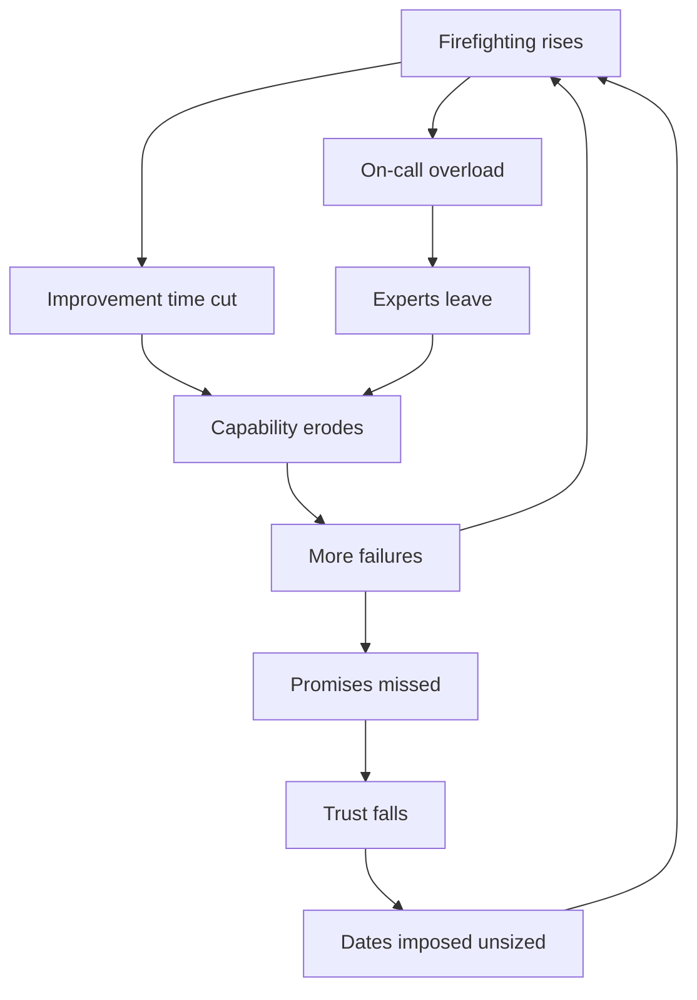
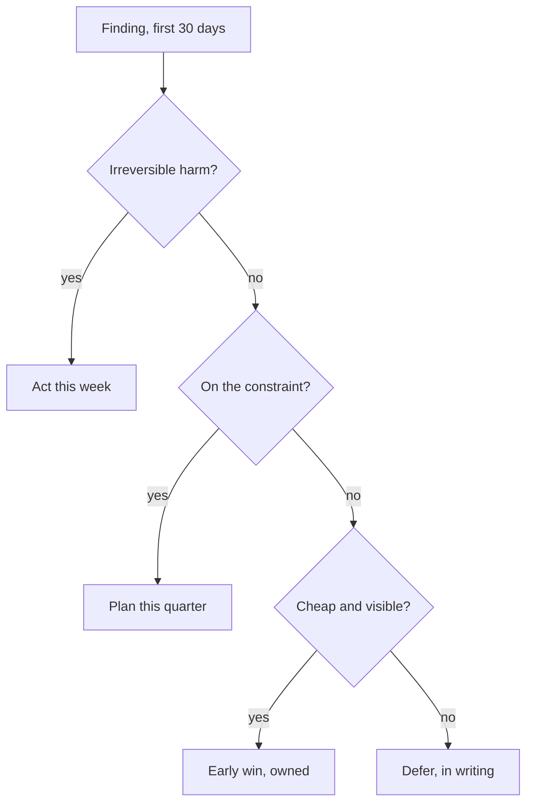
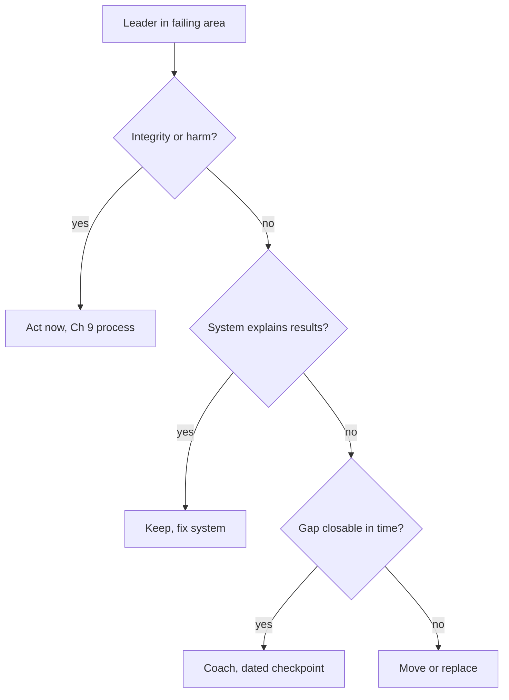

# Chapter 56 — Recovering a Failing Engineering Organization

!!! warning "Awaiting human review"
    This chapter has passed the book's automated validation and an editorial self-review, but not yet
    the human review in which each cited claim is checked against its source. Treat it as a reviewed
    draft. Corrections are welcome; see the repository's CONTRIBUTING file.

Some leaders inherit an organization that works and needs tuning. Others inherit one that is breaking
its promises: outages written into contracts, a roadmap that ships less than half of what it commits,
experts leaving, and executives who no longer believe the dates. This chapter is about the second
case. It covers three things that standard practice does not: triaging a failing organization in the
first 30 days, reversing quality decline while rebuilding stakeholder trust at the same time, and
deciding which of the inherited leaders to keep, coach, or replace. Other chapters own the pieces this
one assembles: the first 90 days in a new role ([Chapter 2](../01-foundations/02-from-individual-contributor-to-leader.md)
and [Chapter 40](../09-engineering-directorship/40-the-directors-job.md)), the quality transformation
itself ([Chapter 27](../05-engineering-quality/27-quality-transformation-at-enterprise-scale.md)),
underperformance ([Chapter 9](../02-people-management/09-performance-management-and-underperformance.md)),
managing managers ([Chapter 41](../09-engineering-directorship/41-managing-and-developing-engineering-managers.md)),
and leading change ([Chapter 43](../09-engineering-directorship/43-leading-change-and-director-failure-patterns.md)).
The running examples are Northstar Technologies at the director's arrival, read as a failing
organization, and the Payroll group at Halvard Systems, a 90-engineer group under a new vice
president. Both companies are fictional; see the [case study](../../case-studies/northstar/index.md)
and [Halvard](../../case-studies/northstar/halvard.md).

## Why This Matters

At team scale, a failing team is visible to its manager every day, and one person can change most of
what matters: the backlog, the on-call rotation, the way the team talks about mistakes.

At organization scale, failure is distributed. No single team is the cause, the numbers that describe
it are unreliable, and the managers who would have to carry a recovery are the same people who were
running the organization while it failed. The new leader has to diagnose through them, decide quickly
which of them can lead the recovery, and do it without the knowledge of the history that they have.

At executive scale, a failing engineering organization is a commercial and a governance problem.
Customers renew or leave on it, the CFO pays its service credits, and the board asks whether the
leadership can fix it. The engineering leader is judged on two clocks at once: the slow one on which
quality actually recovers, and the fast one on which executives decide whether to keep believing.

## Learning Objectives

After this chapter you will be able to:

- Distinguish an organization that is failing its commitments from one that is merely declining or
  underperforming, and choose a turnaround or a realignment approach accordingly.
- Triage a failing organization in the first 30 days: separate what must stop this week from what goes
  on the constraint and what waits, with evidence you can defend.
- Run quality recovery and trust recovery as two parallel tracks with different clocks, using small
  promises kept and bad news told first.
- Decide whether to keep, coach, move, or replace each inherited leader, from evidence about the
  system and the person, on a dated schedule.
- Report a recovery honestly when the counts are small and the gains are fragile.

## The Mental Model

> **Mental model:** A failing organization is held in place by reinforcing loops running in the wrong
> direction: firefighting eats the time that would prevent fires, missed promises make executives
> impose dates that cause more misses, and on-call load drives out the experts who held the system
> together. Recovery is triage first, then breaking the loops in order, while making only promises
> small enough to keep.

The diagram shows three loops sharing one node, failure. The **capability loop** (firefighting, cut
improvement, eroded capability) is the one Repenning and Sterman describe for manufacturing and
service improvement programs. The **trust loop** runs through stakeholders: after enough misses, they
stop asking for estimates and start dictating dates, which guarantees more misses. The **people loop**
runs through the on-call rotation: the few people who can fix the system carry the pages, and the
organization loses exactly the knowledge it most needs. Each loop is self-sustaining, so pushing on
one while the other two run usually fails. A new leader's first job is to find which loop is
strongest here and which one is closest to doing irreversible damage.

## Deep Conceptual Explanation

### What "failing" means, and why it matters which kind

"Failing" is used loosely. This book uses a narrow definition (**this book's recommendation**): an
engineering organization is failing when it is breaking commitments that someone outside engineering
relies on (contractual availability, data correctness, customer dates, regulatory obligations) and its
own trajectory will not close the gap without a change in how it is run. That is different from
**declining** (getting worse, perhaps still within commitments) and from **underperforming** (worse
than it could be, by some benchmark, without broken promises). The distinction decides the approach.

Michael Watkins's work on leadership transitions is known for classifying the situation a new leader
enters, and for arguing that the right strategy depends on the situation
([Watkins, 2003](../../references/bibliography.md#watkins2003first); idea level). In an IMD article,
Watkins and colleagues place turnaround on the downward slope after realignment, say that the crisis
mode of a turnaround "invites an action-oriented and often more directive approach", and recommend
engaging people in fixing the problem, rather than telling them what is wrong, for a realignment
([Watkins et al., 2014](../../references/bibliography.md#watkins2014hit)). They also note that people
often disagree about what stage the business is in, and that not every leader handles every stage
equally well. That is **expert opinion**, and it matches what engineering leaders report: a
directive style that rescues a breaking system alienates an organization that only needed
realignment, and a consultative style that suits realignment is too slow when customers are leaving.

Real organizations are often mixed. One part is in turnaround (a contractual breach, a correctness
failure) while another part needs only realignment (a delivery process that is mediocre but stable).
Diagnosing each part separately is the first piece of triage.

### What turnaround research says, and what it cannot say

Most of the research on organizational decline and turnaround studies whole firms, measured by
financial performance. Trahms, Ndofor, and Sirmon reviewed twenty years of it and describe a field that
is "empirically and theoretically fragmented"; they report that recent work has added managerial
cognition, strategic leadership, and stakeholder management, and has identified simultaneous and
complex resource-based actions beyond the older two-stage model of retrenchment followed by recovery
([Trahms et al., 2013](../../references/bibliography.md#trahms2013decline)). That is a **research
finding** about the state of the literature, and it carries two lessons for engineering leaders. First,
the clean sequence "cut, then grow" is no longer the field's only model: the review reports research
identifying simultaneous and complex actions, which is consistent with running quality and trust in
parallel below. Second, stakeholders and leadership cognition are part of the recovery, not background to it.

The research cannot tell you what to do in an 80-engineer organization. It studies firms, not
engineering groups, and its outcomes are financial. Anything this chapter says about the inside of a
turnaround is **practitioner consensus** or **this book's recommendation**, and is labeled as such.

### Why failing organizations stay failing

**The capability trap.** Repenning and Sterman, from more than a dozen case studies and system dynamics models,
describe two ways to close a performance gap: work harder (more time on production) or work smarter
(more time on improvement, which pays off only after a delay and makes things worse first). Cutting
improvement time to meet today's targets erodes capability and forces still more reliance on working
harder ([Repenning and Sterman, 2001](../../references/bibliography.md#repenning2001nobody)). They also
argue that because the link between skipped improvement and later failure is long and hard to see,
managers tend to blame the workers and respond with more pressure. **Research finding** (case studies
and models). In engineering, the trap shows as a rising share of unplanned work and a debt list that
nobody funds.

**Threat rigidity.** Staw, Sandelands, and Dutton summarized evidence at the individual, group, and
organizational levels for a general threat-rigidity effect: under threat, information processing
narrows and control is constricted toward the top
([Staw et al., 1981](../../references/bibliography.md#staw1981threat)). **Research finding**, from a
multilevel review. A failing engineering organization is under threat, and you can see the effect: the
most senior engineer runs every severe incident personally, decisions wait for one person, and status
reports carry less information as the situation gets worse. The new leader is exposed to the same
effect and has to resist it deliberately, because centralizing everything feels like control and
removes the managers' chance to show what they can do.

**Bad news that does not travel.** Smith and Keil argue that losses on troubled software projects grow
because people are reluctant to pass negative status up the hierarchy, so the decision makers who could
change course do not know the true state
([Smith and Keil, 2003](../../references/bibliography.md#smith2003reluctance)). Interviews by Milliken
and colleagues found that most employees had stayed silent about a concern, most often for fear of being
labeled negatively ([Milliken et al., 2003](../../references/bibliography.md#milliken2003silence)).
DORA's description of Westrum's typology distinguishes cultures by how they treat messengers, punished,
neglected, or trained, and states that high-trust cultures that promote information flow predict
delivery and organizational performance
([DORA, generative culture](../../references/bibliography.md#dora-cap-generative-culture)); **industry
research**. A failing organization has usually been punishing or neglecting messengers for a while, so
the leader's early numbers are optimistic and the early interviews guarded.

The novels that most engineering leaders have read on this subject make the same points as fiction.
*The Goal* is known for teaching that improvement anywhere except the constraint is wasted
([Goldratt and Cox, 1984](../../references/bibliography.md#goldratt1984goal)), and *The Phoenix
Project* for dramatizing an IT organization in crisis that recovers by finding its constraint,
limiting work in progress, and protecting improvement time
([Kim, Behr, and Spafford, 2013](../../references/bibliography.md#kim2013phoenix)). Both are credited
here at idea level; they are illustrations, not evidence.

### The 30-day triage

Triage, borrowed from emergency medicine, sorts cases by urgency so that scarce attention goes first
where delay causes irreversible harm. Applied to an organization (**this book's recommendation**), the
first 30 days produce four outputs, not a transformation plan:

| Output | What it contains | Test |
|---|---|---|
| A diagnosis on one page | Which commitments are broken, by how much, and which loop drives each | A peer outside engineering can repeat it |
| Stop-the-bleeding actions | Three to five actions against irreversible harm, each with an owner | Each would be defensible even if the rest of the diagnosis is wrong |
| A "not yet" list | What you have decided not to change in the first quarter, and why | Written and shared with your managers |
| One promise you can keep | A commitment to your manager and stakeholders, small and dated | You would bet your credibility on it |

**What counts as irreversible.** Four kinds of harm do not wait: wrong financial or customer data
reaching customers (correction costs grow with every day of spread), exploitable security exposure,
a key person about to leave with knowledge nobody else holds, and a contractual or regulatory breach
that triggers termination rights. Everything else, including most of the technical debt and most of
the process, can wait a quarter while you learn.

**How to gather evidence in 30 days.** Three sources, used against each other. Data first, with its
production method checked (which numbers are counted by a system, which are joined by hand, which are
sampled). Interviews second: every manager, the staff engineers, a sample of engineers chosen by you
rather than by their managers, and every executive stakeholder. Firsthand observation third: attend
incidents as an observer, read the last twenty incident reviews, sit in one planning session per team.
[Chapter 40](../09-engineering-directorship/40-the-directors-job.md) owns how a director builds signal
sources; the triage version is shorter and biased toward the places where interviews and data
disagree.

**What triage is not.** It is not a reorganization: [Chapter 36](../07-organization-design/36-reorganizations-evolution-and-succession.md)
treats a reorganization as a large, irreversible batch, and in the first month it would ship on the
least information you will ever have. It is not a set of new rules for everyone. It is not a speech about culture. Each of those may
come later, after the diagnosis has been tested.

### Quality and trust: two tracks, two clocks

Quality recovers on a slow clock. [Chapter 27](../05-engineering-quality/27-quality-transformation-at-enterprise-scale.md)
treats quality as a stock changed by flows: you can shut off the inflow of new defects within weeks,
but draining the stock of fragile components, missing tests, and unowned systems takes quarters.
Stakeholder trust moves on a faster clock. Executives and customers decide within weeks whether the new
leader is different from the last one, and they decide on evidence they can see: what you say, whether
it turns out true, and whether you told them before they found out.

Running the tracks in sequence fails both ways. Fixing quality first and communicating later leaves
stakeholders to fill the silence with the old story, and they keep imposing dates, which feeds the
trust loop. Rebuilding trust first with promises about outcomes spends credibility the quality track
has not yet earned. The answer is to run both from the first week, with different kinds of promises
on each.

**What trust is made of.** Mayer, Davis, and Schoorman's integrative model of organizational trust is
known for distinguishing three factors of trustworthiness: ability, benevolence, and integrity
([Mayer et al., 1995](../../references/bibliography.md#mayer1995integrative); idea level). The split is
useful in a recovery because each stakeholder has usually lost confidence in a different factor. The
CFO doubts ability (can engineering stop the credits?), the sales leader doubts benevolence (does
engineering care about my deals?), customer success doubts integrity (will engineering tell me the
truth during an incident?). Each needs different evidence.

**How trust is repaired.** Kim and colleagues found in two studies that trust was repaired more
successfully when the mistrusted party apologized for a violation concerning competence but denied
culpability for one concerning integrity
([Kim et al., 2004](../../references/bibliography.md#kim2004removing)); **research finding**, from
experiments, not from engineering organizations. For a new leader the practical point is narrower:
acknowledge the organization's competence failures plainly ("we caused 19 of 30 incidents with our own
changes"), because acknowledgment of a competence failure is what repair needs, and do not let an
integrity question (did we hide incidents from customers?) be answered by a vague apology. Investigate
it and answer with facts.

Dirks and Ferrin's meta-analysis of four decades of research on trust in leadership (k = 106) reports
that direct leaders, such as supervisors, appear to be a particularly important referent of trust
([Dirks and Ferrin, 2002](../../references/bibliography.md#dirks2002trust)); **research finding**. Inside
the organization, the engineers' trust in recovery runs mostly through their own managers, not through
the new leader's all-hands. That is one more reason to decide quickly about those managers, and to
equip the ones you keep.

**Promises on each track.** On the quality track, promise process and direction, not outcomes: "every
Sev1 gets a tracked review within ten working days", "we will publish the incident count weekly with
the severity audit". On the trust track, promise behavior that is fully in your control: "you will
hear about a customer-visible incident from us before a customer tells you", "no date leaves
engineering without an estimate and an owner". Weick's essay on small wins is known for arguing that
recasting a large problem as a series of small, concrete, completed outcomes makes it tractable and
builds momentum ([Weick, 1984](../../references/bibliography.md#weick1984small); idea level). In a
recovery, the small wins are kept promises, counted.

### Keep, coach, move, or replace

The leaders you inherit ran the organization while it failed. Some of them caused part of the failure;
most were caught in the same loops as everyone else. Getting this decision wrong in either direction is
expensive.

**Leaders matter, and measurably.** Lazear, Shaw, and Stanton, using one company's productivity data,
estimate that replacing a supervisor in the bottom 10 percent of quality with one in the top 10 percent
raises a team's output by more than adding a tenth worker to a nine-person team
([Lazear et al., 2015](../../references/bibliography.md#lazear2015value)). Hoffman and Tadelis, at a
large high-tech firm, found that managers' people-management skills have a strong negative relation to
employee turnover, with designs that support a causal reading
([Hoffman and Tadelis, 2021](../../references/bibliography.md#hoffman2021people)). Both are **research
findings** from single firms. In a failing organization where attrition is part of the problem, the
manager is one of the few levers that acts on it.

**Coaching works, on average.** Theeboom and colleagues' meta-analysis found positive effects of
coaching on performance and skills, well-being, coping, work attitudes, and goal-directed
self-regulation, with effect sizes from g = 0.43 to g = 0.74
([Theeboom et al., 2014](../../references/bibliography.md#theeboom2014coaching)); Jones and colleagues
found an overall positive effect on organizational outcomes (delta = 0.36) for coaching by internal or
external coaches, excluding coaching by a person's own manager
([Jones et al., 2016](../../references/bibliography.md#jones2016coaching)). **Research findings**, with
two caveats: studies measure people who entered coaching, usually willingly, and the time horizons are
months, which may be longer than a recovery can wait.

**Replacing has a cost too.** Mockus found in one large software project that proximity to an
organizational change was associated with a higher probability of customer-reported defects, and that
recent departures were associated with more defects as well
([Mockus, 2010](../../references/bibliography.md#mockus2010volatility)); **research finding**, one
project. Replacing a manager in the middle of a quality crisis is itself an organizational change, and
the new manager arrives without the knowledge the old one had.

**One person can harm a group.** Felps and colleagues review how a single persistently negative group
member, one who withholds effort, expresses negative affect, or violates important interpersonal norms,
can reduce teammates' trust and cooperation
([Felps et al., 2006](../../references/bibliography.md#felps2006bad)); a review and model, not a single
study. A manager who belittles people in public is that member with authority, and the harm runs through
everyone below them.

From this evidence the book draws a rule (**this book's recommendation**): **do not replace a leader in
the first 30 days, except for integrity or harm to people.** Use the first 30 days to separate the
system from the person, using Chapter 9's four causes (system, skill, will, role fit) applied to the
leader. Decide by day 60 to 90, on evidence the leader knew you were collecting. Four outcomes are
possible:

| Decision | When it fits | What it requires |
|---|---|---|
| Keep | The system explains the results; the leader sees the problem clearly | Fix the system; give the leader a visible part in the recovery |
| Coach | A skill or habit gap, the leader wants to close it, and it can close within the time the recovery allows | A written expectation, one development focus, a dated checkpoint ([Chapter 41](../09-engineering-directorship/41-managing-and-developing-engineering-managers.md)) |
| Move | Strong in a neighboring role, struggling in this one, or this stage of the situation | A real role, offered with respect; often a return to a senior individual-contributor track |
| Replace | Integrity, harm to people, or a gap that will not close in time after a fair chance | Chapter 9's process, HR involvement, and an interim plan for the team |

"Keep" is a decision too, and needs evidence. Keeping everyone by default because the evidence is
messy is the most common error in a recovery, followed closely by replacing the most visible leader to
show that something is changing.

## Engineering Organization Example

The figures are **illustrative**: Halvard Systems is fictional. Halvard's Payroll group (its
fourth product group: payroll and time-tracking software for customers' hourly workforces)
has 90 engineers, 11 first-line manager seats of which two are vacant, and two directors: Rhys Gallagher
(Pay Calculation, 6 manager seats, 50 engineers) and Beatriz Quintero (Time and Attendance,
5 manager seats, 40 engineers). Its principal engineer is Hiroshi Takeda. Ngozi Adeyemi joins from
outside as vice president, after her predecessor left. Weeks count from her first day.

What she finds, from the group's records for the last three quarters:

| Measure | Value | Arithmetic or note |
|---|---|---|
| Sev1 and Sev2 incidents per quarter | 9, 16, 23 | Rising for three quarters; last quarter 15 in Pay Calculation, 8 in Time and Attendance |
| Of the last quarter's 23 | 14 change-induced, 11 customer-detected (48%), 7 Sev1 | 11 ÷ 23 = 47.8% |
| Availability, pay-run path | 99.71% against 99.9% by contract | 0.29% of 131,040 minutes = 380 minutes unavailable, against about 131 allowed |
| Largest 10 customers in formal escalation | 3 | One, worth $4.2M in annual recurring revenue, renews in week 30 and has opened a review |
| Departures, trailing 12 months | 17 of 90 (18.9%) | Halvard plans on 12%, so 10.8 expected; about 6 excess. 11 of the 17 from Pay Calculation, including the two managers |
| Unplanned work (two-week sample) | 45% | 40.5 FTE; at Halvard's average cost of $205,800 ($102.9M ÷ 500), about $8.3M a year |
| Committed roadmap items delivered, last two quarters | 6 of 22 (27%) | |
| Enterprise policy compliance | Tier 1 minimums 5 of 12; tracked Sev1 reviews 4 of 11 over three quarters; 9 of 14 customer dates given before an estimate | Policies exist; nobody enforces them in this group |

**The diagnosis.** Pay Calculation is in turnaround: a contractual breach, a renewal at risk,
attrition concentrated in it, and a rising trend. Time and Attendance is in realignment: fewer
incidents, but delivery dates slip. The strongest loop is the people loop in Pay Calculation:
the departures took knowledge of the pay calculation engine, and Rhys Gallagher, who built much of it nine
years ago, ran all seven of last quarter's Sev1 bridges himself. His managers say decisions wait for
him. That is threat rigidity in one person.

**Stop the bleeding (weeks 1 to 4).** Ngozi's actions, each defensible even if her diagnosis is wrong:

1. An incident commander rotation of eight people trained in weeks 2 and 3, so that Rhys stops being
   the only one; Rhys trains them.
2. Every Sev1 reviewed within ten working days with a manager-owned corrective action, as the
   enterprise policy already requires; Hiroshi Takeda owns the review standard.
3. A weekly written status to the three escalated customers, drafted by the group and sent by Halvard's
   customer success leads, stating what failed, what changed, and what is next.
4. A freeze on new customer dates until each has an estimate and an owner, the sixth enterprise policy,
   with Ngozi signing exceptions.
5. Stay conversations with the six engineers who hold most of the remaining knowledge of the pay calculation engine.

**Her one promise to Halvard's CTO, at day 30**: weekly reporting of the incident count with the
severity audit, every Sev1 reviewed on time, and no customer date without an estimate. No outcome
target. Her "not yet" list: no reorganization of the two directorates, no rewrite of the pay calculation
engine, no new process for the whole group.

**What happened by day 90.** Sev1 and Sev2 incidents fell from 23 to 15 in her first quarter,
customer-detected incidents from 11 to 6, and open escalations from 3 to 1; two engineers left in the
quarter. Read the incident count with care: conditional on 38 incidents across the two quarters, an
even split would be 19 each with a standard deviation of about 3.1 (the square root of 38 × 0.25), so
15 is about 1.3 standard deviations below even. If nothing had changed, a drop at least this large would
happen about one time in eight, and a split at least this uneven in either direction about one time in
four (exact binomial: 0.13 one-sided, 0.26 two-sided). The count alone does not prove recovery; the mechanism measures
(Sev1 reviews done on time, the commander rotation, customer-detected share) carry the argument.

## Decision Framework

Two decisions recur in every recovery: where a finding goes in the triage, and what to do about each
inherited leader. Both frameworks are **this book's recommendation**.

| Triage question | Evidence | Typical findings |
|---|---|---|
| Can delay cause irreversible harm? | Data correctness, security scans, contracts, key-person risk | Wrong invoices reaching customers; known-exploited vulnerabilities; one expert paged every weekend |
| Is it on the constraint? | Where work waits longest; where most failures originate | A release process, a shared schema, a single team that everyone depends on |
| Is it cheap and visible, with an owner? | Effort under a few engineer-weeks; stakeholders will notice | Published severity definitions; a weekly status note; a quarantined set of flaky tests |
| None of the above | | Most debt, most process, most structure: deferred, in writing |

| Leader question | Evidence that answers it | Common mistake |
|---|---|---|
| Is there an integrity or harm problem? | Misrepresented facts after being asked directly; credible reports of belittling or retaliation | Treating it as a style issue to coach |
| Does the system explain the results? | Peers with the same system do no better; the leader named the problem before you did | Judging the leader on numbers produced by the release train or the schema |
| Is the gap skill, will, or role fit? | Chapter 9's evidence table, applied to a manager's work | Assuming "will" because the leader is defensive under threat |
| Can it close within the recovery's time? | One dated checkpoint, with observable behavior | Open-ended coaching with no date |
| What does the decision signal? | Who the organization sees as responsible for the failure | Replacing the most visible leader to look decisive |

## Trade-offs

**Speed against accuracy.** Acting in week 1 stops harm and is taken on the least information you will
ever have. The triage rule limits early action to what is defensible under any diagnosis; the cost is
that some fixable problems wait a month.

**Directive against consultative.** A turnaround needs decisions now; a realignment needs the
organization to own the diagnosis. Directing a realignment area breeds resentment; consulting in a
turnaround area lets the bleeding continue. Mixed organizations need both, applied to different parts,
and the leader has to explain why.

**Visible change against stability.** Executives want to see that something is different. Every visible
change (a new forum, a replaced manager, a new tool) is also an organizational change with its own
quality cost. The cheapest visible change is honest communication.

**Protecting improvement time against stakeholder demands.** Breaking the capability loop means taking
capacity from the roadmap while the roadmap is already late. The trade only holds if stakeholders can
see what the capacity buys, which is why the trust track has to start in week 1.

**Keeping leaders against replacing them.** Keeping a leader who cannot carry the recovery costs
quarters; replacing one who could have costs the knowledge, the team's trust, and the quality hit of
another change. A dated checkpoint limits the first cost; the 30-day rule limits the second.

**Owning the past against blaming it.** A new leader who blames the predecessor gains a quarter of
patience and loses the managers who served under them. One who owns the organization's failures from
day 1 gets less patience and more cooperation.

## Failure Modes

**The hero arrival.** The new leader takes over incident command, reviews every change, and makes every
decision. Results improve briefly and then stall, because nobody else learned anything, and the leader
has become the new single point of failure. Early sign: your calendar has more incident bridges than
one-on-ones.

**The purge.** Several leaders are replaced in the first month to show decisiveness. The organization
learns that the safest move is to hide problems, which is the opposite of what a recovery needs.
Early sign: the replacements are announced before anyone could state what each person was expected to
do differently.

**Diagnosis paralysis.** The leader collects data for a quarter while the escalated customer leaves.
Early sign: day 30 arrives with no stop-the-bleeding action taken.

**The promise binge.** To buy patience, the leader promises outcomes ("incidents halved by next
quarter") that the quality track cannot deliver on that clock. The miss arrives when trust is lowest.
Early sign: a promise with a number in it that depends on rare events.

**Quality without trust.** The engineering work is right and nobody outside engineering knows about it.
Stakeholders keep imposing dates, and the capacity for prevention is taken back in the next planning
cycle. Early sign: executives describe the organization in the same words as before you arrived.

**Trust without quality.** Excellent communication about a recovery that is not happening. It holds for
one or two quarters. Early sign: the status notes improve faster than any measure.

**Quiet coaching.** A leader is "being coached" with no written expectation, no checkpoint, and no
consequence. Months later the organization concludes that nothing will ever change at that level.
Early sign: you cannot state the coaching goal in one sentence or its checkpoint date.

**Declaring victory on small counts.** Incidents fall from 23 to 15 and the recovery is announced. The
next quarter brings 20 and the credibility goes with it. Early sign: a headline built on one quarter of
a count below 30.

## Enterprise Application

In an organization of 50 to 150 engineers, the failing organization is usually one director's whole
remit or one group within a VP's. The leader can still know every manager and most senior engineers by
name, which makes the 30-day triage feasible in person. A practical shape:

- **A 30-day plan with four outputs** (diagnosis, stop-the-bleeding actions, "not yet" list, one
  promise), agreed with your manager in week 1 so that the absence of a transformation plan at day 30
  is expected, not a surprise.
- **Two status lines from week 1**: an internal weekly operational review with the incident count,
  the severity audit, and corrective actions, and an external note for the stakeholders who lost
  confidence. The [executive update template](../../templates/executive-update.md) fits the second.
- **A stakeholder map** that records, for each executive, which trust factor they doubt (ability,
  benevolence, integrity) and the evidence that would move them
  ([stakeholder map template](../../templates/stakeholder-map.md)).
- **A leader assessment for each manager by day 30** against Chapter 9's four causes, written for
  yourself, with a dated decision point no later than day 90. The
  [engineering manager rubric](../../templates/engineering-manager-rubric.md) gives the dimensions.
- **A quality plan from day 30**, built with the
  [90-day quality transformation plan template](../../templates/ninety-day-quality-plan.md) once the
  constraint is known, not before.
- **A management team that argues in the room.** Lencioni's fable is known for placing trust and
  willingness to engage in conflict at the base of a working leadership team
  ([Lencioni, 2002](../../references/bibliography.md#lencioni2002five); idea level, **expert opinion**).
  A failing organization's managers have often stopped disagreeing openly and started blaming each
  other's teams; the leader's weekly meeting with them is where that is repaired or not.
- **A promise ledger**: every external commitment you make, with its date and whether it was kept,
  reviewed monthly. In a recovery, this is the measure stakeholders are actually running on you.

## CTO Perspective

The CTO usually does not run the recovery; the CTO decides that one is needed, picks who runs it, and
protects it. Three decisions are the CTO's.

**Recognizing failure early.** Failing organizations are rarely declared; they are tolerated. The
signals that a CTO sees first are commercial: service credits, escalations by large customers, sales
asking for exceptions to engineering's process. A CTO who waits for the engineering numbers to confirm
it waits too long, because those numbers are produced by the organization under threat.

**Choosing the leader for the stage.** The leader who built a group may not be the one to rescue it,
and the rescuer may not be the one to run it afterwards. Watkins and colleagues' point that leaders do
not handle every stage equally well ([Watkins et al., 2014](../../references/bibliography.md#watkins2014hit))
is the CTO's problem: at Halvard, appointing an outside vice president to Payroll was a decision
that the group's own directors could not carry a turnaround while also running their areas.

**Holding the board and the executive team to a realistic clock.** The board will want a date for "fixed".
The CTO's job is to translate the recovery into a sequence of verifiable steps (stop the bleeding,
hold the gains, converge), report each with its uncertainty, and resist the pressure to announce recovery
on one good quarter. [Chapter 55](../12-cto-leadership/55-boards-due-diligence-and-executive-decision-making.md)
covers board communication; in a recovery, the most valuable thing the CTO can bring to the board is a
record of promises kept.

The CTO also owns the question of whether the recovery leader is being set up to fail: a mandate with
outcome targets but no capacity, or a constraint on headcount combined with a contractual deadline. If
the mandate cannot be met, the CTO should say so before the recovery starts, not after it misses.

## Practical Playbook

1. **Agree the 30-day shape with your manager in week 1:** four outputs, no transformation plan, one
   promise at day 30.
2. **Check how every number is produced** before you believe it: system-counted, hand-joined, sampled,
   or self-reported.
3. **Interview widely and against the grain:** every manager, every staff engineer, engineers you pick,
   every executive stakeholder, and at least one large customer through customer success.
4. **Classify each part of the organization** as turnaround or realignment, and say so in the diagnosis.
5. **Name the strongest loop** (capability, trust, people) in each turnaround area.
6. **Act this week on irreversible harm only:** data correctness, exploitable security exposure, key
   people about to leave, contractual breach.
7. **Start the trust track in week 1:** one honest note to each stakeholder who lost confidence, and a
   promise about behavior you fully control.
8. **Assess each leader by day 30** against the four causes, privately and in writing; replace in the
   first 30 days only for integrity or harm.
9. **Write the "not yet" list** and share it with your managers.
10. **Make one promise at day 30** about process and direction, not outcomes.
11. **Decide on each leader by day 90** with a dated checkpoint for anyone you coach.
12. **Report every count with its uncertainty,** and lead with mechanism measures until the counts are
    large enough to mean something.

## Case Study

The Northstar facts below are **illustrative** and fictional, from the [baseline
data](../../case-studies/northstar/baseline-data.md) and [the first
quarter](../../case-studies/northstar/first-quarter.md). This case reads the organization the director
inherited as a failing organization and compares the canon's first four weeks with the triage this
chapter recommends. The keep, coach, or replace reading is this chapter's analysis; it records no
event.

**Was Northstar failing?** By this chapter's definition, the reliability side was: availability on the
contractual paths was 99.62 percent against a 99.9 percent commitment (about 8.2 hours unavailable in a
90-day quarter against about 2.2 allowed), service credits were $410,000 in the quarter ($1.64M a year
at that rate), and two renewals worth $9M of annual recurring revenue named reliability as their
concern. Of 30 Sev1 and Sev2 incidents, 19 were caused by Northstar's own changes, 14 were first detected
by customers, and 11 were recurrences.

The delivery side was stable rather than declining, but it broke promises too: 5 of the 17 committed
items had dates given to customers before sizing, and only 7 of 17 shipped. Committed roadmap items
delivered ran 6 of 15, 8 of 18, 7 of 16, then 7 of 17 (40, 44, 44, and 41 percent) over four quarters.
That is stable and poor, a realignment problem inside a failing organization: the trend is flat, so the
remedy is shared diagnosis, not crisis direction. The canon records no incident trend before the baseline quarter, so "declining"
cannot be shown for reliability either; the case for turnaround rests on broken commitments, not on a
trend. The company itself was healthy (annual recurring revenue of $140M); the engineering organization
was failing the company's promises.

**The loops at arrival.**

| Loop | Northstar evidence |
|---|---|
| Capability | Unplanned work 34 percent of capacity (27.2 engineer-years, about $5.0M); 96 corrective actions recorded over two quarters, 31 closed; a 143-item debt list with 9 closed |
| Trust | Committed items chosen by four executives distributing points with no value estimates; 5 of 17 dates given to customers before sizing; Victor Lindqvist's handover notes say he "let the two of them sort it out" about the Billing and Orders friction |
| People | Billing's 180 pages in the quarter (reconstructed later from the paging tool; at arrival the team table said only that three people carry most pages), 126 handled first by three ledger engineers, 54 of the 64 after-hours pages by the same three; one ledger engineer had resigned after three consecutive weekends of pages; currency and rounding known by one person |

**The first four weeks, read as triage.** The canon's weeks 1 to 4 map closely onto the triage outputs.

| Triage output | What the canon records (weeks 1–4) |
|---|---|
| Irreversible harm | Week 2: a one-off security scan of all 24 components (11 open criticals, 3 known-exploited, 9 live credentials found at baseline) |
| Diagnosis | Week 2: incident classification with Kwame Mensah |
| Trust track | Week 3: severity definitions written with Kwame Mensah and Sofia Alvarez, who had asked for honest status during incidents |
| Constraint | The Core release train identified as the constraint (Chapter 27; the canon does not date the call); week 4: Core main below 10 percent red time and the first 40 flaky tests quarantined |
| Ownership | Week 4: core/customer and core/scheduler given owners |
| One promise | Week 4: the capacity model agreed with Victor Lindqvist and Amara Okafor, with prevention funded at 12 FTE and the two renewal commitments protected |
| Leader coaching | Week 2: Priya Raman agrees a time budget (hands-on work capped at 8 hours a week) and delegates bulk-ordering leadership and reviews |

**What the triage missed.** The people loop in Billing was the closest to irreversible harm: the
ledger knowledge held by three engineers, one already gone, paged most weekends. The canon's director
had the qualitative signal at arrival (the team table says three people carry most of Billing's on-call
pages); the exact counts were reconstructed later from the paging tool, as [Chapter 3](../01-foundations/03-managerial-leverage-and-systems-thinking.md) records. The canon records no
action on their load in the first 30 days. Billing received the largest prevention share (25 percent)
from week 4, but the stay interviews with the three ledger engineers came in weeks 14 and 15, and in
week 20 Tomasz Wierzbicki reported an outside offer 20 percent above his base. Under this chapter's
triage rule, a key person about to leave with knowledge nobody else holds is a week-1 item.

**Keep, coach, or replace at day 30 (analysis).** Read from the baseline evidence against Chapter 9's
four causes:

| Manager | Evidence at arrival | Reading |
|---|---|---|
| Priya Raman (Orders) | Promoted eight months earlier without training; 18 hours of a 40-hour week coding and reviewing | Coach: a skill and habit gap with a willing manager. Her hands-on hours at the quarter 2 checks (8, 10, 12 against a cap of 8) show why the checkpoint has to be dated: it caught the drift that an undated coaching goal would have missed, and Chapter 41 acts on it |
| Marcus Oyelaran (Billing) | Worst team numbers; 55 percent of his time on delivery; technical direction "decided during incidents" | Keep and fix the system first: most of Billing's failures came through the release train and shared schema. Reserve judgment until the system fixes land; the week 44 succession table still shows no cover for his role |
| Elena Sokolova (Payments and Integrations) | Weekly operations review for two years; near-miss log | Keep, and use her practice as the model |
| Daniel Cho (Customer Experience) | One-on-ones held but mostly status; 6 of 8 retrospective actions about web; Mateo Arango Ríos unrecognized | Coach, on one focus: the mobile engineers |
| Farah Haddad (Data and Analytics) | Low incident rate; little contact with other teams | Keep |
| Tom Becker (Platform Operations) | Quietly reassigned 31 of Bram Verhoeven's 74 tickets while Bram's last review said "meets expectations" | Coach on performance management (Chapter 9's case) |

Nobody falls into "replace" at day 30, and that is the right answer on this evidence: no integrity or
harm finding, and the worst numbers sit where the system is worst. Replacing Marcus Oyelaran to look
decisive would have added an organizational change to the team with the most fragile knowledge.

**Results.** Sev1 and Sev2 incidents ran 30, 21, 17, then 14 in quarter 3, the first quarter at or below
the mandate's 15. Availability was 99.86 percent in quarter 2 and 99.89 percent in quarter 3, still just
below 99.9 percent (about 144 minutes unavailable against about 131 allowed in a 91-day quarter).
Credits fell to $95,000 and then $60,000 a quarter. Customer-detected share fell from 47 to 29 percent
in quarter 1 and stayed there in quarter 2. On counts this small, the trend across four quarters is
more convincing than any single step, and the availability commitment has still not been met.

## Exercises

Worked solutions are in the [Chapter 56 solutions](../../solutions/ch56-solutions.md).

### Foundational

**F1.** Using only Northstar's baseline data, sort these findings into "act this week", "plan this
quarter", "early win", and "defer": the 11 open critical vulnerabilities (3 known-exploited), the
three ledger engineers' after-hours load, the 52-rule standards page, the four CI systems, the missing
severity definitions, and the 143-item debt list. Justify each placement with the triage questions, and
name one placement where a reasonable leader could disagree.

**F2.** Ngozi Adeyemi's first quarter at Halvard's Payroll group shows Sev1 and Sev2 incidents
falling from 23 to 15. Halvard's CTO wants to tell the executive team that the group has turned around.
Explain what the count can and cannot support, which other measures from the chapter you would put
beside it, and draft the two sentences you would want the CTO to say instead.

**F3.** Apply the keep, coach, move, or replace framework to Marcus Oyelaran at day 30, using the
baseline evidence about Billing. State what you would need to see by day 90 to move him from "keep and
fix the system" to "coach", and what would move him to "replace". Explain why his team's change failure
rate of 34 percent is weak evidence about him.

### Applied Leadership

**A1.** It is week 2 at Northstar. The team table says three people carry most of Billing's on-call
pages, and HR records show that a ledger engineer resigned after three consecutive weekends of pages.
(The exact counts, 54 of 64 after-hours pages handled by three ledger engineers, were reconstructed
later from the paging tool; assume you can obtain them now.) Headcount is flat and the renewal commitments keep their dates. Design the
actions you would take in weeks 2 to 4, who owns each, what they cost in capacity, and how you would
tell Marcus Oyelaran and the three engineers.

**A2.** This scenario is hypothetical and not part of the canon. Suppose that at Halvard, Beatriz Quintero reported the integration roadmap as on track for three months
before it slipped by a quarter. She is otherwise effective, and her area's incidents are falling.
Decide whether this is an integrity problem, a skill problem, or a system problem, using the
chapter's evidence on silence and bad news. Write the conversation you would open with, and the change
to the reporting system that would make the next slip visible earlier.

**A3.** Draft the stakeholder side of the trust track for Northstar's first 30 days. For Helena Marsh,
Rajiv Menon, Amara Okafor, Greg Tanaka, and Sofia Alvarez, identify which trust factor (ability,
benevolence, integrity) each most doubts, the evidence that would move them, and the one behavioral
promise you would make to each. Check that no two promises conflict.

### Executive Decision-Making

**X1.** This scenario is hypothetical and not part of the canon. Suppose that at day 120 Rhys Gallagher
has trained the commander rotation but still overrides his managers' decisions on pay calculation
engine changes, and two of his managers have told Ngozi Adeyemi they will leave if nothing changes. Ngozi asks
you, as Halvard's CTO, to support moving Rhys out of the director role into a principal engineer role.
Decide, stating what evidence you would require, what the move would cost, and how you would announce
it.

**X2.** You are Victor Lindqvist in week 47. David Ferrante, an independent director, asks you before
the week 50 board meeting whether engineering was "a failing organization" when the director arrived
and whether it has now recovered. Using only facts available in week 47, write your answer in no more
than 200 words, stating what is recovered, what is not, and what you would not yet claim.

## Reflection Questions

1. Think of the most troubled organization you have worked in. Which of the three loops was strongest,
   and did anyone name it?
2. When you last arrived in a new role, which numbers did you believe in the first month that you later
   found were produced badly?
3. What is the smallest promise you could make to your most skeptical stakeholder this week, and are you
   certain you could keep it?
4. Which leader in your organization are you "coaching" without a written goal or a checkpoint date?
5. Under threat, where do you personally centralize control, and who loses the chance to learn when you
   do?

## Key Takeaways

- Call an organization failing only when it breaks commitments others rely on; diagnose each part as
  turnaround or realignment, because they need different leadership styles.
- In the first 30 days, produce a one-page diagnosis, a few stop-the-bleeding actions, a "not yet" list,
  and one promise, not a transformation plan.
- Act in the first week only on irreversible harm: wrong customer data, exploitable exposure, key
  people about to leave, contractual breach.
- Expect threat rigidity, in the organization and in yourself; resist taking over incident command and
  every decision.
- Run quality recovery and trust recovery in parallel: promise process and direction on the slow
  quality clock, and behavior you control on the fast trust clock.
- Diagnose which trust factor each stakeholder doubts and give each the evidence that answers it.
- Do not replace leaders in the first 30 days except for integrity or harm; decide by day 90, with a
  dated checkpoint for anyone you coach. "Keep" needs evidence too.
- Report recovery with its uncertainty; on small counts, mechanism measures and kept promises carry
  the argument.

## References and Further Reading

- [Watkins, 2003](../../references/bibliography.md#watkins2003first): leadership transitions and
  matching strategy to the situation (idea level).
- [Watkins et al., 2014](../../references/bibliography.md#watkins2014hit): turnaround versus
  realignment and why leaders differ by stage.
- [Trahms et al., 2013](../../references/bibliography.md#trahms2013decline): review of organizational
  decline and turnaround research.
- [Repenning and Sterman, 2001](../../references/bibliography.md#repenning2001nobody): the capability
  trap.
- [Staw et al., 1981](../../references/bibliography.md#staw1981threat): threat rigidity across levels.
- [Smith and Keil, 2003](../../references/bibliography.md#smith2003reluctance) and
  [Milliken et al., 2003](../../references/bibliography.md#milliken2003silence): why bad news does not
  travel up.
- [DORA, generative culture](../../references/bibliography.md#dora-cap-generative-culture): Westrum's
  typology and information flow.
- [Goldratt and Cox, 1984](../../references/bibliography.md#goldratt1984goal) and
  [Kim, Behr, and Spafford, 2013](../../references/bibliography.md#kim2013phoenix): constraints and an
  IT turnaround told as fiction (idea level).
- [Mayer et al., 1995](../../references/bibliography.md#mayer1995integrative): ability, benevolence,
  and integrity as factors of trustworthiness (idea level).
- [Kim et al., 2004](../../references/bibliography.md#kim2004removing): repairing competence and
  integrity violations.
- [Dirks and Ferrin, 2002](../../references/bibliography.md#dirks2002trust): trust in leadership,
  meta-analysis.
- [Weick, 1984](../../references/bibliography.md#weick1984small): small wins (idea level).
- [Lazear et al., 2015](../../references/bibliography.md#lazear2015value) and
  [Hoffman and Tadelis, 2021](../../references/bibliography.md#hoffman2021people): how much managers
  matter.
- [Theeboom et al., 2014](../../references/bibliography.md#theeboom2014coaching) and
  [Jones et al., 2016](../../references/bibliography.md#jones2016coaching): coaching effectiveness.
- [Mockus, 2010](../../references/bibliography.md#mockus2010volatility): organizational change and
  software defects.
- [Felps et al., 2006](../../references/bibliography.md#felps2006bad): how one negative member harms a
  group.
- [Lencioni, 2002](../../references/bibliography.md#lencioni2002five): the leadership team as a team;
  useful when rebuilding a management group that has stopped trusting each other (idea level).
