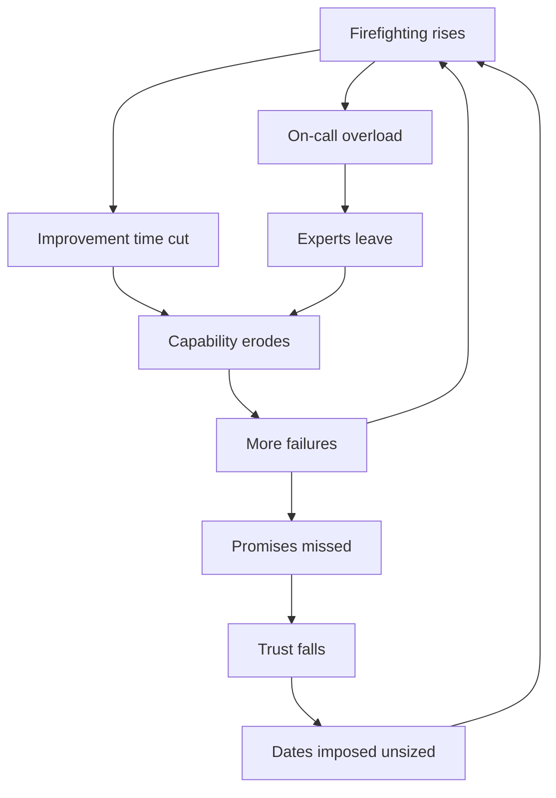
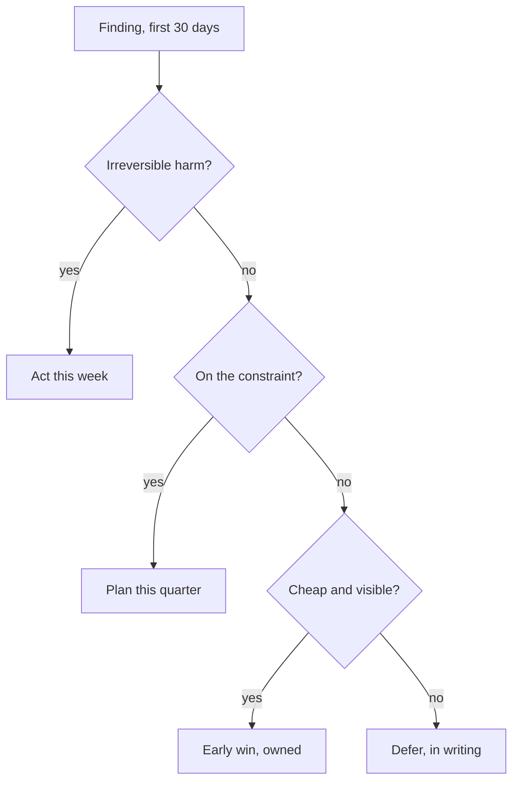
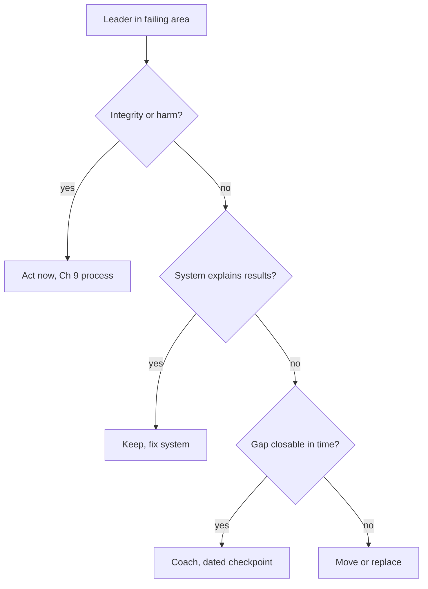

# Chapter 56 — Recovering a Failing Engineering Organization

Some leaders inherit an organization that works and needs tuning. Others inherit one that is breaking
its promises: outages written into contracts, a roadmap that ships less than half of what it commits,
experts leaving, and executives who no longer believe the dates. This chapter is about the second
case. It covers three things that standard practice does not: triaging a failing organization in the
first 30 days, reversing quality decline while rebuilding stakeholder trust, and deciding which
inherited leaders to keep, coach, move, or replace. The running examples are the Payroll group at
Halvard Systems, a 90-engineer group under a new vice president, and Northstar Technologies at the
director's arrival, read as a failing organization. Both companies are fictional; see
[Halvard](../../case-studies/northstar/halvard.md) and the
[case study](../../case-studies/northstar/index.md).

!!! note "Related chapters"
    The first 90 days in a new role are in [Chapter 2](../01-foundations/02-from-individual-contributor-to-leader.md)
    and [Chapter 40](../09-engineering-directorship/40-the-directors-job.md); the quality
    transformation in [Chapter 27](../05-engineering-quality/27-quality-transformation-at-enterprise-scale.md);
    underperformance in [Chapter 9](../02-people-management/09-performance-management-and-underperformance.md);
    managing managers in [Chapter 41](../09-engineering-directorship/41-managing-and-developing-engineering-managers.md);
    leading change in [Chapter 43](../09-engineering-directorship/43-leading-change-and-director-failure-patterns.md);
    crisis communication and trust repair in [Chapter 57](57-crises-executive-disagreement-and-resistance.md).

## Why This Matters

At team scale, a failing team is visible to its manager every day, and one person can change most of
what matters: the backlog, the on-call rotation, the way the team talks about mistakes.

At organization scale, failure is distributed. No single team is the cause, the numbers are unreliable,
and the managers who must carry a recovery ran the organization while it failed. The new leader has to
diagnose through them and decide quickly which of them can lead the recovery.

At executive scale, a failing engineering organization is a commercial and a governance problem.
Customers renew or leave on it, the CFO pays its service credits, and the board asks whether the
leadership can fix it. The engineering leader is judged on two clocks at once: the slow one on which
quality actually recovers, and the fast one on which executives decide whether to keep believing.

## Learning Objectives

After this chapter you will be able to:

- Distinguish an organization that is failing its commitments from one that is merely declining or
  underperforming, and choose a turnaround or a realignment approach accordingly.
- Triage a failing organization in the first 30 days: separate what must stop this week from what goes
  on the [constraint](../../glossary.md#constraint) (the one step that limits the whole organization's
  output) and what waits, with evidence you can defend.
- Run quality recovery and trust recovery as two parallel tracks with different clocks, using small
  promises kept and bad news told first.
- Decide whether to keep, coach, move, or replace each inherited leader, from evidence about the
  system and the person, on a dated schedule.
- Report a recovery honestly when the counts are small and the gains are fragile.

## The Mental Model

> **Mental model:** A failing organization is held in place by reinforcing loops running in the wrong
> direction: firefighting eats the time that would prevent fires, missed promises make executives
> impose dates that cause more misses, and on-call load drives out the experts who held the system
> together. Recovery is triage first, then breaking the loops in order, while making only promises
> small enough to keep.

The diagram shows three loops sharing one node, failure. The **capability loop** (firefighting, cut
improvement, eroded capability) is the [capability trap](../../glossary.md#capability-trap) described
below. The **trust loop** runs through stakeholders: after enough misses, they
stop asking for estimates and start dictating dates, which guarantees more misses. The **people loop**
runs through the on-call rotation: the few people who can fix the system carry the pages, and the
organization loses exactly the knowledge it most needs. Each loop is self-sustaining, so pushing on
one while the other two run usually fails. A new leader's first job is to find which loop is
strongest here and which one is closest to doing irreversible damage.

## Deep Conceptual Explanation

### What "failing" means, and why it matters which kind

"Failing" is used loosely. This book uses a narrow definition (**this book's recommendation**). An engineering organization is failing
when it breaks commitments that someone outside engineering relies on: contractual availability, data
correctness, customer dates, regulatory obligations. And its own trajectory will not close the gap
without a change in how it is run. That is different from
**declining** (getting worse, perhaps still within commitments) and from **underperforming** (worse
than it could be, by some benchmark, without broken promises). The distinction decides the approach.

The two situations need different leadership. Watkins argues that the right strategy for a new leader
depends on the situation entered ([Watkins, 2003](../../references/bibliography.md#watkins2003first)).
In a later article, Watkins and colleagues say a turnaround's crisis mode "invites an action-oriented
and often more directive approach", while a realignment calls for engaging people in fixing the problem
([Watkins et al., 2014](../../references/bibliography.md#watkins2014hit); **expert opinion**). A
directive style that rescues a breaking system alienates an organization that only needed realignment;
a consultative style is too slow when customers are leaving.

Real organizations are often mixed. One part is in turnaround (a contractual breach, a correctness
failure) while another part needs only realignment (a delivery process that is mediocre but stable).
Diagnosing each part separately is the first piece of triage.

**What realignment looks like in practice.** In a realignment area the leader does not hand down the
diagnosis; the area's own managers produce it. Give them the data and one question ("what would have
to be true for our dates to hold?"), and a short deadline. Then ask them to choose two changes and own
the reporting on them. The leader's job is to keep the question narrow, protect the time, and refuse to
let the work drift into a reorganization. This is **this book's recommendation**. It costs a few weeks
more than directing and buys a diagnosis its carriers believe.

### What turnaround research can and cannot say

The research on decline and turnaround studies whole firms by their financial results, and a review
calls the field fragmented ([Trahms et al., 2013](../../references/bibliography.md#trahms2013decline);
**research finding** about the literature). Two lessons carry over: recovery actions often run in
parallel rather than "cut, then grow", and stakeholders and leadership are part of the recovery. The
rest of this chapter is **practitioner consensus** or **this book's recommendation**, labeled as such.

### Why failing organizations stay failing

**The capability trap.** Cutting improvement time to meet today's targets erodes capability and forces
still more firefighting. Because the link between skipped improvement and later failure is slow and
hard to see, managers tend to blame the workers and add pressure
([Repenning and Sterman, 2001](../../references/bibliography.md#repenning2001nobody); **research
finding**, from case studies and models). In engineering, the trap shows as a rising share of
[unplanned work](../../glossary.md#unplanned-work) and a debt list that nobody funds.

**Threat rigidity.** Under threat, people and organizations narrow what information they take in and
pull control toward the top ([Staw et al., 1981](../../references/bibliography.md#staw1981threat);
**research finding**, from a review across individual, group, and organizational levels). In a failing
engineering organization you can see it: the most senior engineer runs every severe incident, decisions
wait for one person, and status reports say less as things get worse. The new leader feels the same pull
and must resist it. Centralizing everything feels like control, and it removes the managers' chance to
show what they can do.

**Bad news that does not travel.** Losses on troubled software projects grow because people are
reluctant to pass negative status upward, so decision makers do not know the true state
([Smith and Keil, 2003](../../references/bibliography.md#smith2003reluctance)). Employee silence has the
same root, as [Chapter 57](57-crises-executive-disagreement-and-resistance.md) explains. Cultures that
train messengers rather than punish or neglect them predict better delivery performance
([DORA, generative culture](../../references/bibliography.md#dora-cap-generative-culture); **industry
research**). A failing organization has usually punished or neglected messengers for a while, so the
leader's early numbers are optimistic and the early interviews guarded.

### The 30-day triage

Triage, borrowed from emergency medicine, sorts cases by urgency so that scarce attention goes first
where delay causes irreversible harm. Applied to an organization (**this book's recommendation**), the
first 30 days produce four outputs, not a transformation plan:

| Output | What it contains | Test |
|---|---|---|
| A diagnosis on one page | Which commitments are broken, by how much, and which loop drives each | A peer outside engineering can repeat it |
| Stop-the-bleeding actions | Three to five actions against irreversible harm, each with an owner | Each would be defensible even if the rest of the diagnosis is wrong |
| A "not yet" list | What you have decided not to change in the first quarter, and why | Written and shared with your managers |
| One promise you can keep | A commitment to your manager and stakeholders, small and dated | You would bet your credibility on it |

**What counts as irreversible.** Four kinds of harm do not wait: wrong financial or customer data
reaching customers (correction costs grow with every day of spread), exploitable security exposure,
a key person about to leave with knowledge nobody else holds, and a contractual or regulatory breach
that triggers termination rights. Everything else, including most of the technical debt and most of
the process, can wait a quarter while you learn.

**How to gather evidence in 30 days.** Use three sources against each other. Data first, checking how
each number is produced (system-counted, hand-joined, or sampled). Interviews second: every manager, the
staff engineers, engineers you choose rather than their managers, and every executive stakeholder.
Firsthand observation third: attend incidents and read the last twenty incident reviews. Look hardest
where interviews and data disagree.

**What triage is not.** It is not a reorganization, which is a large, irreversible batch
([Chapter 36](../07-organization-design/36-reorganizations-evolution-and-succession.md)) shipped on the
least information you will ever have. It is not new rules for everyone, or a speech about culture.

**When your own mandate cannot be met.** Triage sometimes shows that the target you were hired against
cannot be reached: an outcome promised by a date the quality clock cannot meet, or a fix that needs
capacity nobody will give. Say so at day 30, not at day 300. Bring the diagnosis, the mandate you can
meet, what it would take to meet the original one, and the one promise you will keep meanwhile. A
leader who accepts an impossible mandate in silence becomes the next failure the organization explains
away (**this book's recommendation**).

### Quality and trust: two tracks, two clocks

Quality recovers on a slow clock. [Chapter 27](../05-engineering-quality/27-quality-transformation-at-enterprise-scale.md)
treats quality as a stock changed by flows: you can shut off the inflow of new defects within weeks,
but draining the stock of fragile components, missing tests, and unowned systems takes quarters.
Stakeholder trust moves on a faster clock. Executives and customers decide within weeks whether the new leader is different from the last one.
They decide on evidence they can see: what you say, whether it turns out true, and whether you told them
first.

Running the tracks in sequence fails both ways. Fixing quality first leaves stakeholders to fill the
silence with the old story, and they keep imposing dates. Rebuilding trust first with outcome promises
spends credibility the quality track has not earned. Run both from the first week, with different
kinds of promises on each.

**What trust is made of.** Mayer, Davis, and Schoorman's model of trust distinguishes three factors:
ability, benevolence, and integrity
([Mayer et al., 1995](../../references/bibliography.md#mayer1995integrative); **expert opinion**). The
split is useful because each stakeholder has usually lost confidence in a different factor. The
CFO doubts ability (can engineering stop the credits?), the sales leader doubts benevolence (does
engineering care about my deals?), customer success doubts integrity (will engineering tell me the
truth during an incident?). Each needs different evidence.

**How trust is repaired.** Acknowledge competence failures plainly ("we caused 19 of 30 incidents with
our own changes"); answer integrity questions (did we hide incidents from customers?) with facts, not a
vague apology. That follows the experimental evidence on apology and denial covered in
[Chapter 57](57-crises-executive-disagreement-and-resistance.md#deep-conceptual-explanation)
([Kim et al., 2004](../../references/bibliography.md#kim2004removing)).

Inside the organization, engineers' trust runs mostly through their own managers. A meta-analysis of
106 studies of trust in leadership found direct supervisors a particularly important focus of trust
([Dirks and Ferrin, 2002](../../references/bibliography.md#dirks2002trust); **research finding**). The
new leader's all-hands matters less than the managers. That is one more reason to decide quickly about
them, and to equip the ones you keep.

**Promises on each track.** On the quality track, promise process and direction, not outcomes: "every
Sev1 gets a tracked review within ten working days", "we will publish the incident count weekly with
the severity audit". On the trust track, promise behavior that is fully in your control: "you will
hear about a customer-visible incident from us before a customer tells you", "no date leaves
engineering without an estimate and an owner". Weick argues that recasting a large problem as small,
completed outcomes makes it tractable ([Weick, 1984](../../references/bibliography.md#weick1984small);
**expert opinion**). In a recovery, the small wins are kept promises, counted.

### Keep, coach, move, or replace

The rule (**this book's recommendation**): **do not replace a leader in the first 30 days, except for
integrity or harm to people.** Use the first 30 days to separate the system from the person, with
Chapter 9's four causes (system, skill, will, role fit) applied to the leader. Decide by day 60 to 90,
on evidence the leader knew you were collecting.

The leaders you inherit ran the organization while it failed; most were caught in the same loops as
everyone else. Getting the decision wrong in either direction is expensive:

| Finding | Source and strength | What it means for the decision |
|---|---|---|
| Managers matter measurably: a top supervisor raises output, and good people managers lower turnover | [Lazear et al., 2015](../../references/bibliography.md#lazear2015value); [Hoffman and Tadelis, 2021](../../references/bibliography.md#hoffman2021people); research findings, single firms | Where attrition is part of the failure, the manager is one of the few levers on it |
| Coaching has moderate positive effects on average | [Theeboom et al., 2014](../../references/bibliography.md#theeboom2014coaching); [Jones et al., 2016](../../references/bibliography.md#jones2016coaching); research findings, mostly willing participants, over months | Coaching can work, but may take longer than the recovery can wait |
| Organizational change and departures go with more customer-reported defects | [Mockus, 2010](../../references/bibliography.md#mockus2010volatility); research finding, one project | Replacing a manager mid-crisis is itself a change, and the knowledge leaves |
| One persistently negative member can erode a group's trust and cooperation | [Felps et al., 2006](../../references/bibliography.md#felps2006bad); review and model | A manager who belittles people in public does that harm with authority |

Four outcomes are possible:

| Decision | When it fits | What it requires |
|---|---|---|
| Keep | The system explains the results; the leader sees the problem clearly | Fix the system; give the leader a visible part in the recovery |
| Coach | A skill or habit gap, the leader wants to close it, and it can close within the time the recovery allows | A written expectation, one development focus, a dated checkpoint ([Chapter 41](../09-engineering-directorship/41-managing-and-developing-engineering-managers.md)) |
| Move | Strong in a neighboring role, struggling in this one, or this stage of the situation | A real role, offered with respect; often a return to a senior individual-contributor track |
| Replace | Integrity, harm to people, or a gap that will not close in time after a fair chance | Chapter 9's process, HR involvement, and an interim plan for the team |

"Keep" is a decision too, and needs evidence. Keeping everyone by default because the evidence is
messy is the most common error in a recovery, followed closely by replacing the most visible leader to
show that something is changing.

## Engineering Organization Example

The figures are **illustrative**: Halvard Systems is fictional. Halvard's Payroll group builds payroll and time-tracking software for customers' hourly workforces.
It has 90 engineers, 11 first-line manager seats (two vacant), and two directors: Rhys Gallagher
(Pay Calculation, 6 manager seats, 50 engineers) and Beatriz Quintero (Time and Attendance,
5 manager seats, 40 engineers). Its principal engineer is Hiroshi Takeda. Ngozi Adeyemi joins from
outside as vice president, after her predecessor left. Weeks count from her first day.

What she finds, from the group's records for the last three quarters:

| Measure | Value |
|---|---|
| [Sev1 and Sev2](../../glossary.md#severity-sev1-sev2-sev3) incidents per quarter | 9, 16, 23 (last quarter: 15 in Pay Calculation, 8 in Time and Attendance) |
| Of the last quarter's 23 | 14 caused by changes, 11 detected by customers, 7 Sev1 |
| Availability, pay-run path | 99.71% against 99.9% by contract (about 380 minutes down, 131 allowed) |
| Largest 10 customers in formal escalation | 3; one, worth $4.2M in [annual recurring revenue](../../glossary.md#arr), renews in week 30 |
| Departures, trailing 12 months | 17 of 90, against about 11 expected; 11 of them from Pay Calculation, including two managers |
| Unplanned work (two-week sample) | 45%, about 40.5 FTE or $8.3M a year |
| Committed roadmap items delivered, last two quarters | 6 of 22 |
| Enterprise policy compliance | Tier 1 minimums 5 of 12; tracked Sev1 reviews 4 of 11; 9 of 14 customer dates given before an estimate |

Assumptions: a 13-week quarter has 131,040 minutes; Halvard plans on 12 percent
[attrition](../../glossary.md#attrition-and-regretted-attrition) a year and an average cost of $205,800
per engineer.

**The diagnosis.** Pay Calculation is in turnaround: a contractual breach, a renewal at risk,
attrition concentrated in it, and a rising trend. Time and Attendance is in realignment: fewer
incidents, but delivery dates slip. The strongest loop is the people loop in Pay Calculation:
the departures took knowledge of the pay calculation engine, and Rhys Gallagher, who built much of it nine
years ago, ran all seven of last quarter's Sev1 incident bridges (the live calls where responders
coordinate) himself. His managers say decisions wait for
him. That is threat rigidity in one person.

**Stop the bleeding (weeks 1 to 4).** Ngozi's actions, each defensible even if her diagnosis is wrong:

1. An [incident commander](../../glossary.md#incident-commander) rotation of eight people trained in weeks 2 and 3, so that Rhys stops being
   the only one; Rhys trains them.
2. Every Sev1 reviewed within ten working days with a manager-owned corrective action, as the
   enterprise policy already requires; Hiroshi Takeda owns the review standard.
3. A weekly written status to the three escalated customers, drafted by the group and sent by Halvard's
   customer success leads, stating what failed, what changed, and what is next.
4. A freeze on new customer dates until each has an estimate and an owner, the sixth enterprise policy,
   with Ngozi signing exceptions.
5. [Stay interviews](../../glossary.md#stay-interview) with the six engineers who hold most of the
   remaining knowledge of the pay calculation engine.

**Her one promise to Halvard's CTO, at day 30**: weekly reporting of the incident count with the
severity audit, every Sev1 reviewed on time, and no customer date without an estimate. No outcome
target. Her "not yet" list: no reorganization of the two directorates, no rewrite of the pay calculation
engine, no new process for the whole group.

**What happened by day 90.** Sev1 and Sev2 incidents fell from 23 to 15 in her first quarter,
customer-detected incidents from 11 to 6, and open escalations from 3 to 1. Two engineers left in the
quarter. Read the incident count with care. If the underlying rate had not changed, the 38 incidents
of the two quarters would split about 19 and 19, and a split of 15 or fewer happens by chance about one
time in eight. The count alone does not prove recovery; the mechanism measures (Sev1 reviews on time,
the commander rotation, customer-detected share) carry the argument.

## Decision Framework

Two decisions recur in every recovery: where a finding goes in the triage, and what to do about each
inherited leader. Both frameworks are **this book's recommendation**.

| Triage question | Evidence | Typical findings |
|---|---|---|
| Can delay cause irreversible harm? | Data correctness, security scans, contracts, key-person risk | Wrong invoices reaching customers; known-exploited vulnerabilities; one expert paged every weekend |
| Is it on the constraint? | Where work waits longest; where most failures originate | A release process, a shared schema, a single team that everyone depends on |
| Is it cheap and visible, with an owner? | Effort under a few engineer-weeks; stakeholders will notice | Published severity definitions; a weekly status note; a quarantined set of flaky tests |
| None of the above | | Most debt, most process, most structure: deferred, in writing |

| Leader question | Evidence that answers it | Common mistake |
|---|---|---|
| Is there an integrity or harm problem? | Misrepresented facts after being asked directly; credible reports of belittling or retaliation | Treating it as a style issue to coach |
| Does the system explain the results? | Peers with the same system do no better; the leader named the problem before you did | Judging the leader on numbers produced by the release train or the schema |
| Is the gap skill, will, or role fit? | Chapter 9's evidence table, applied to a manager's work | Assuming "will" because the leader is defensive under threat |
| Can it close within the recovery's time? | One dated checkpoint, with observable behavior | Open-ended coaching with no date |
| What does the decision signal? | Who the organization sees as responsible for the failure | Replacing the most visible leader to look decisive |

## Trade-offs

**Speed against accuracy.** Acting in week 1 stops harm and is taken on the least information you will
ever have. The triage rule limits early action to what is defensible under any diagnosis; the cost is
that some fixable problems wait a month.

**Directive against consultative.** A turnaround needs decisions now; a realignment needs the
organization to own the diagnosis. Directing a realignment area breeds resentment; consulting in a
turnaround area lets the bleeding continue. Mixed organizations need both, applied to different parts,
and the leader has to explain why.

**Protecting improvement time against stakeholder demands.** Breaking the capability loop means taking
capacity from the roadmap while the roadmap is already late. The trade only holds if stakeholders can
see what the capacity buys, which is why the trust track has to start in week 1.

**Keeping leaders against replacing them.** Keeping a leader who cannot carry the recovery costs
quarters; replacing one who could have costs knowledge and trust. A dated checkpoint limits the first
cost; the 30-day rule limits the second.

**Owning the past against blaming it.** Blaming the predecessor buys a quarter of patience and loses
the managers who served under them.

## Failure Modes

**The hero arrival.** The new leader takes over incident command, reviews every change, and makes every
decision. Results improve briefly and then stall, because nobody else learned anything, and the leader
has become the new single point of failure. Early sign: your calendar has more incident bridges than
one-on-ones.

**The purge.** Several leaders are replaced in the first month to show decisiveness, and the
organization learns to hide problems. Early sign: replacements announced before anyone could say what
each person was expected to do differently.

**Diagnosis paralysis.** The leader collects data for a quarter while the escalated customer leaves.
Early sign: day 30 with no stop-the-bleeding action.

**The promise binge.** Outcome promises ("incidents halved by next quarter") the quality clock cannot
meet. Early sign: a promise with a number that depends on rare events.

**One track only.** Quality without trust: the work is right, nobody outside engineering knows, and
prevention capacity is taken back at the next planning cycle. Trust without quality: excellent
communication about a recovery that is not happening. Early signs: executives describe the organization
as they did before you arrived, or status notes improve faster than any measure.

**Quiet coaching.** A leader is "being coached" with no written expectation, checkpoint, or
consequence. Early sign: you cannot state the coaching goal in one sentence, or its checkpoint date.

**Declaring victory on small counts.** Incidents fall from 23 to 15 and the recovery is announced. The
next quarter brings 20 and the credibility goes with it. Early sign: a headline built on one quarter of
a count below 30.

## Enterprise Application

In an organization of 50 to 150 engineers, the failing organization is usually one director's whole
remit or one group within a VP's. The leader can still know every manager and most senior engineers by
name, which makes the 30-day triage feasible in person. A practical shape:

- **A 30-day plan with four outputs**, agreed with your manager in week 1, so the absence of a
  transformation plan at day 30 is expected.
- **Two status lines from week 1**: an internal weekly operational review, and an external note for
  the stakeholders who lost confidence ([executive update template](../../templates/executive-update.md)).
- **A stakeholder map** that records, for each executive, which trust factor they doubt (ability,
  benevolence, integrity) and the evidence that would move them
  ([stakeholder map template](../../templates/stakeholder-map.md)).
- **A leader assessment for each manager by day 30** against Chapter 9's four causes, written for
  yourself, with a dated decision point no later than day 90. The
  [engineering manager rubric](../../templates/engineering-manager-rubric.md) gives the dimensions.
- **A quality plan from day 30**, once the constraint is known
  ([90-day quality plan template](../../templates/ninety-day-quality-plan.md)).
- **A management team that argues in the room.** Lencioni puts trust and open conflict at the base of a
  working leadership team ([Lencioni, 2002](../../references/bibliography.md#lencioni2002five);
  **expert opinion**). A failing organization's managers often blame each other's teams instead; the
  weekly management meeting is where that is repaired.
- **A promise ledger**: every external commitment you make, with its date and whether it was kept,
  reviewed monthly. In a recovery, this is the measure stakeholders are actually running on you.

## CTO Perspective

The CTO usually does not run the recovery; the CTO decides that one is needed, picks who runs it, and
protects it. Three decisions are the CTO's.

**Recognizing failure early.** Failing organizations are rarely declared; they are tolerated. A CTO
sees commercial signals first: service credits, escalations by large customers, sales asking for
exceptions. Waiting for engineering numbers to confirm it is too slow, because the organization under
threat produces them.

**Choosing the leader for the stage.** The leader who built a group may not be the one to rescue it,
and the rescuer may not be the one to run it afterwards. At Halvard, appointing an outside vice
president to Payroll was a judgment that the group's own directors could not carry a turnaround while
also running their areas.

**Holding the board and the executive team to a realistic clock.** The board will want a date for "fixed".
The CTO's job is to translate the recovery into a sequence of verifiable steps (stop the bleeding,
hold the gains, converge), report each with its uncertainty, and resist the pressure to announce recovery
on one good quarter. [Chapter 55](../12-cto-leadership/55-boards-due-diligence-and-executive-decision-making.md)
covers board communication; in a recovery, the most valuable thing the CTO can bring to the board is a
record of promises kept.

The CTO also owns whether the recovery leader is set up to fail, with outcome targets but no capacity,
and should hear the day-30 renegotiation described above as information, not weakness.

## Practical Playbook

1. **Agree the 30-day shape with your manager in week 1:** four outputs, no transformation plan, one
   promise at day 30.
2. **Check how every number is produced** before you believe it: system-counted, hand-joined, sampled,
   or self-reported.
3. **Interview widely and against the grain,** including engineers you pick and one large customer.
4. **Classify each part of the organization** as turnaround or realignment, and say so in the diagnosis.
5. **Name the strongest loop** (capability, trust, people) in each turnaround area.
6. **Act this week on irreversible harm only:** data correctness, exploitable security exposure, key
   people about to leave, contractual breach.
7. **Start the trust track in week 1:** one honest note to each stakeholder who lost confidence, and a
   promise about behavior you fully control.
8. **Assess each leader by day 30** against the four causes, privately and in writing; replace in the
   first 30 days only for integrity or harm.
9. **Write the "not yet" list** and share it with your managers.
10. **Make one promise at day 30** about process and direction, not outcomes.
11. **Decide on each leader by day 90** with a dated checkpoint for anyone you coach.
12. **Report every count with its uncertainty,** and lead with mechanism measures until the counts are
    large enough to mean something.

## Case Study

!!! info "Northstar so far"
    Week 1 of the director's first year. You join Northstar as Engineering Director, reporting to Victor
    Lindqvist (CTO), with a mandate to halve Sev1 and Sev2 incidents and meet 99.9 percent availability
    within a year, with flat headcount. The case follows results to quarter 3 (week 39). See the
    [timeline](../../case-studies/northstar/timeline.md). New to Northstar? Read
    [the year in brief](../../case-studies/northstar/year-in-brief.md), the
    [cast](../../case-studies/northstar/cast.md), and the
    [quarter 4 briefing](../../case-studies/northstar/quarter-4-briefing.md).

The Northstar facts below are **illustrative** and fictional, from the
[baseline data](../../case-studies/northstar/baseline-data.md) and
[the year 1 record](../../case-studies/northstar/first-quarter.md). The keep, coach, or replace reading
is this chapter's analysis, not a recorded event.

**Was Northstar failing?** By this chapter's definition, the reliability side was. Availability on the
contractual paths was 99.62 percent against a 99.9 percent commitment, service credits were $410,000 a
quarter, and two renewals worth $9M a year named reliability as their concern. Of 30 Sev1 and Sev2
incidents, 19 were caused by Northstar's own changes. The delivery side was stable and poor: 40 to 44
percent of committed roadmap items delivered, quarter after quarter. That is a realignment problem
inside a failing organization.

**The first four weeks, read as triage.** In week 2 a one-off security scan of all 24 components
covered the irreversible-harm item (it found 11 open criticals, 3 known to be exploited). In week 3,
severity definitions started the trust track. In week 4 the capacity model agreed with Victor and Amara
Okafor (CPO) funded prevention at 12 FTE and protected the two renewal commitments: the one promise.

**What the triage missed.** The people loop in Billing was the closest to irreversible harm. Three
ledger engineers held the ledger knowledge and handled 54 of the quarter's 64 after-hours pages; one
colleague had already resigned after three consecutive weekends of pages. The director had the
qualitative signal at arrival: the team table says three people carry most of Billing's pages. No action
on their load is recorded in the first 30 days. Billing got the largest prevention share (25 percent)
from week 4, but the stay interviews came in weeks 14 and 15. In week 20 Tomasz Wierzbicki, one of the
three, reported an outside offer 20 percent above his base. Under this chapter's triage rule, a key
person about to leave with knowledge nobody else holds is a week-1 item.

**Keep, coach, or replace at day 30 (analysis).** Read from the baseline evidence against Chapter 9's
four causes:

| Manager | Evidence at arrival | Reading |
|---|---|---|
| Priya Raman (Orders) | Promoted eight months earlier without training; 18 hours of a 40-hour week coding and reviewing | Coach: a skill and habit gap with a willing manager. Her hands-on hours at later checks (8, 10, 12 against a cap of 8) show why the checkpoint must be dated |
| Marcus Oyelaran (Billing) | Worst team numbers; 55 percent of his time on delivery; technical direction "decided during incidents" | Keep and fix the system first: most of Billing's failures came through the release train and shared schema |
| Elena Sokolova (Payments and Integrations) | Weekly operations review for two years; near-miss log | Keep, and use her practice as the model |
| Daniel Cho (Customer Experience) | One-on-ones held but mostly status; 6 of 8 retrospective actions about web; the informal mobile lead unrecognized | Coach, on one focus: the mobile engineers |
| Farah Haddad (Data and Analytics) | Low incident rate; little contact with other teams | Keep |
| Tom Becker (Platform Operations) | Quietly reassigned 31 of one senior engineer's 74 tickets while his last review said "meets expectations" | Coach on performance management (Chapter 9's case) |

Nobody falls into "replace" at day 30, and that is the right answer on this evidence: no integrity or
harm finding, and the worst numbers sit where the system is worst. Replacing Marcus Oyelaran to look
decisive would have added an organizational change to the team with the most fragile knowledge.

**Results.** Sev1 and Sev2 incidents ran 30, 21, 17, then 14 in quarter 3, the first quarter at or below
the mandate's 15. Availability reached 99.89 percent, still just short, and credits fell to $60,000 a quarter. On counts this small, the
four-quarter trend convinces more than any single step.

## Exercises

Worked solutions are in the [Chapter 56 solutions](../../solutions/ch56-solutions.md).

### Foundational

**F1.** Using only Northstar's baseline data, sort these findings into "act this week", "plan this
quarter", "early win", and "defer": the 11 open critical vulnerabilities (3 known to be exploited), the
three ledger engineers' after-hours load (54 of 64 after-hours pages), a 2019 standards page of 52
rules with no owners, four CI systems costing about 1.5 FTE a year to run, the missing severity
definitions, and a 143-item debt list with no owners or costs. The details are in the baseline's
[standards](../../case-studies/northstar/baseline-data.md#engineering-standards),
[debt and pipeline](../../case-studies/northstar/baseline-data.md#technical-debt-tests-and-the-pipeline),
and [ledger](../../case-studies/northstar/baseline-data.md#billing-on-call-and-ledger-knowledge)
sections. Justify each placement with the triage questions, and
name one placement where a reasonable leader could disagree.

**F2.** Ngozi Adeyemi's first quarter at Halvard's Payroll group shows Sev1 and Sev2 incidents
falling from 23 to 15. Halvard's CTO wants to tell the executive team that the group has turned around.
Explain what the count can and cannot support, which other measures from the chapter you would put
beside it, and draft the two sentences you would want the CTO to say instead.

**F3.** Apply the keep, coach, move, or replace framework to Marcus Oyelaran at day 30, using the
baseline evidence about Billing in the case study table and the baseline's
[by-team table](../../case-studies/northstar/baseline-data.md#by-team). State what you would need to see
by day 90 to move him from "keep and fix the system" to "coach", and what would move him to "replace".
Explain why his team's [change failure rate](../../glossary.md#change-failure-rate) of 34 percent, most
of it through the shared Core release train, is weak evidence about him.

### Applied Leadership

**A1.** It is week 2 at Northstar. The team table says three people carry most of Billing's on-call
pages, and HR records show that a ledger engineer resigned after three consecutive weekends of pages.
(The exact counts, 54 of 64 after-hours pages handled by three ledger engineers, were reconstructed
later from the paging tool; assume you can obtain them now.) Headcount is flat and the renewal commitments keep their dates. Design the
actions you would take in weeks 2 to 4, who owns each, what they cost in capacity, and how you would
tell Marcus Oyelaran and the three engineers.

**A2.** This scenario is hypothetical and not part of the case. Suppose that at Halvard, Beatriz Quintero reported the integration roadmap as on track for three months
before it slipped by a quarter. She is otherwise effective, and her area's incidents are falling.
Decide whether this is an integrity problem, a skill problem, or a system problem, using the
chapter's evidence on bad news that does not travel. Write the conversation you would open with, and the change
to the reporting system that would make the next slip visible earlier.

**A3.** Draft the stakeholder side of the trust track for Northstar's first 30 days. For Helena Marsh (CEO),
Rajiv Menon (CFO), Amara Okafor, Greg Tanaka (VP Sales), and Sofia Alvarez (VP Customer Success), identify which trust factor (ability,
benevolence, integrity) each most doubts, the evidence that would move them, and the one behavioral
promise you would make to each. Check that no two promises conflict.

### Executive Decision-Making

**X1.** This scenario is hypothetical and not part of the case. Suppose that at day 120 Rhys Gallagher
has trained the commander rotation but still overrides his managers' decisions on pay calculation
engine changes, and two of his managers have told Ngozi Adeyemi they will leave if nothing changes. Ngozi asks
you, as Halvard's CTO, to support moving Rhys out of the director role into a principal engineer role.
Decide, stating what evidence you would require, what the move would cost, and how you would announce
it.

**X2.** You are Victor Lindqvist in week 47. David Ferrante, an independent board member, asks you before
the week 50 board meeting whether engineering was "a failing organization" when the director arrived
and whether it has now recovered. Using only facts available in week 47, write your answer in no more
than 200 words, stating what is recovered, what is not, and what you would not yet claim.

## Reflection Questions

1. Think of the most troubled organization you have worked in. Which of the three loops was strongest,
   and did anyone name it?
2. When you last arrived in a new role, which numbers did you believe in the first month that you later
   found were produced badly?
3. What is the smallest promise you could make to your most skeptical stakeholder this week, and are you
   certain you could keep it?
4. Which leader in your organization are you "coaching" without a written goal or a checkpoint date?
5. Under threat, where do you personally centralize control, and who loses the chance to learn when you
   do?

## Key Takeaways

- Call an organization failing only when it breaks commitments others rely on; diagnose each part as
  turnaround or realignment, because they need different leadership styles.
- In the first 30 days, produce a one-page diagnosis, a few stop-the-bleeding actions, a "not yet" list,
  and one promise, not a transformation plan.
- Act in the first week only on irreversible harm: wrong customer data, exploitable exposure, key
  people about to leave, contractual breach.
- Expect threat rigidity, in the organization and in yourself; resist taking over incident command and
  every decision.
- Run quality recovery and trust recovery in parallel: promise process and direction on the slow
  quality clock, and behavior you control on the fast trust clock.
- Diagnose which trust factor each stakeholder doubts and give each the evidence that answers it.
- Do not replace leaders in the first 30 days except for integrity or harm; decide by day 90, with a
  dated checkpoint for anyone you coach. "Keep" needs evidence too.
- Report recovery with its uncertainty; on small counts, mechanism measures and kept promises carry
  the argument.

## References and Further Reading

- [Watkins, 2003](../../references/bibliography.md#watkins2003first): leadership transitions and
  matching strategy to the situation.
- [Watkins et al., 2014](../../references/bibliography.md#watkins2014hit): turnaround versus
  realignment and why leaders differ by stage.
- [Trahms et al., 2013](../../references/bibliography.md#trahms2013decline): review of organizational
  decline and turnaround research.
- [Repenning and Sterman, 2001](../../references/bibliography.md#repenning2001nobody): the capability
  trap.
- [Staw et al., 1981](../../references/bibliography.md#staw1981threat): threat rigidity across levels.
- [Smith and Keil, 2003](../../references/bibliography.md#smith2003reluctance) and
  [Milliken et al., 2003](../../references/bibliography.md#milliken2003silence): why bad news does not
  travel up.
- [DORA, generative culture](../../references/bibliography.md#dora-cap-generative-culture): Westrum's
  typology and information flow.
- [Goldratt and Cox, 1984](../../references/bibliography.md#goldratt1984goal) and
  [Kim, Behr, and Spafford, 2013](../../references/bibliography.md#kim2013phoenix): constraints and an
  IT turnaround told as fiction; illustrations, not evidence.
- [Mayer et al., 1995](../../references/bibliography.md#mayer1995integrative): ability, benevolence,
  and integrity as factors of trustworthiness.
- [Kim et al., 2004](../../references/bibliography.md#kim2004removing): repairing competence and
  integrity violations.
- [Dirks and Ferrin, 2002](../../references/bibliography.md#dirks2002trust): trust in leadership,
  meta-analysis.
- [Weick, 1984](../../references/bibliography.md#weick1984small): small wins.
- [Lazear et al., 2015](../../references/bibliography.md#lazear2015value) and
  [Hoffman and Tadelis, 2021](../../references/bibliography.md#hoffman2021people): how much managers
  matter.
- [Theeboom et al., 2014](../../references/bibliography.md#theeboom2014coaching) and
  [Jones et al., 2016](../../references/bibliography.md#jones2016coaching): coaching effectiveness.
- [Mockus, 2010](../../references/bibliography.md#mockus2010volatility): organizational change and
  software defects.
- [Felps et al., 2006](../../references/bibliography.md#felps2006bad): how one negative member harms a
  group.
- [Lencioni, 2002](../../references/bibliography.md#lencioni2002five): the leadership team as a team;
  useful when rebuilding a management group that has stopped trusting each other.
