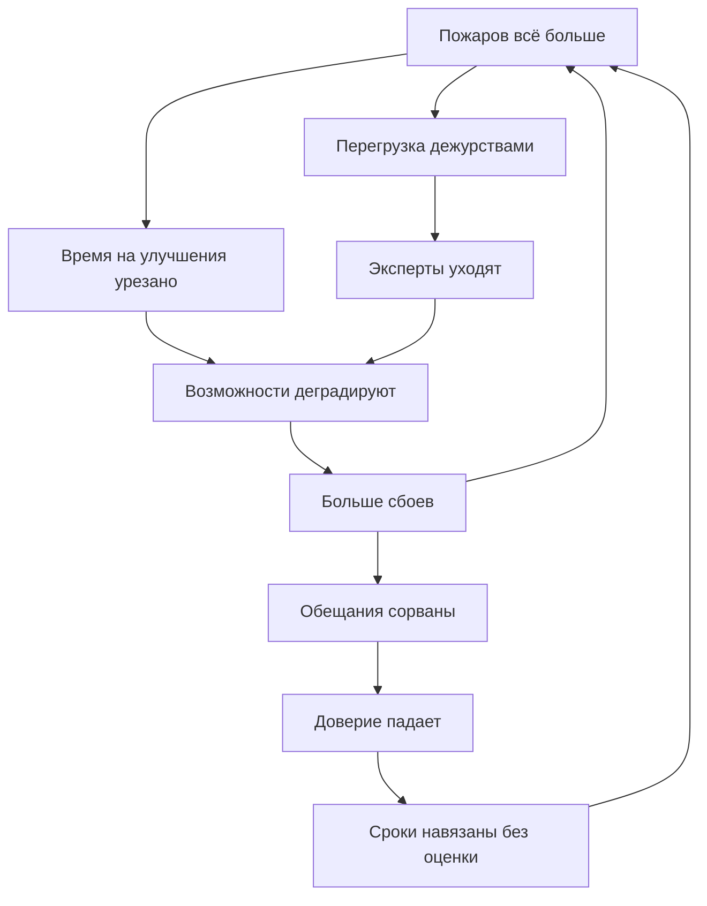
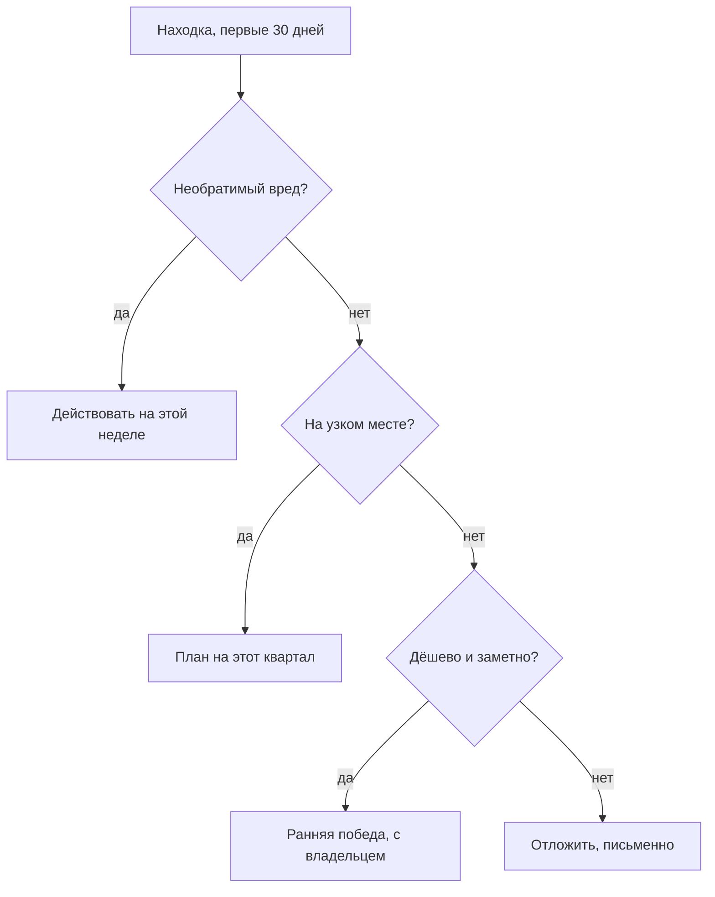
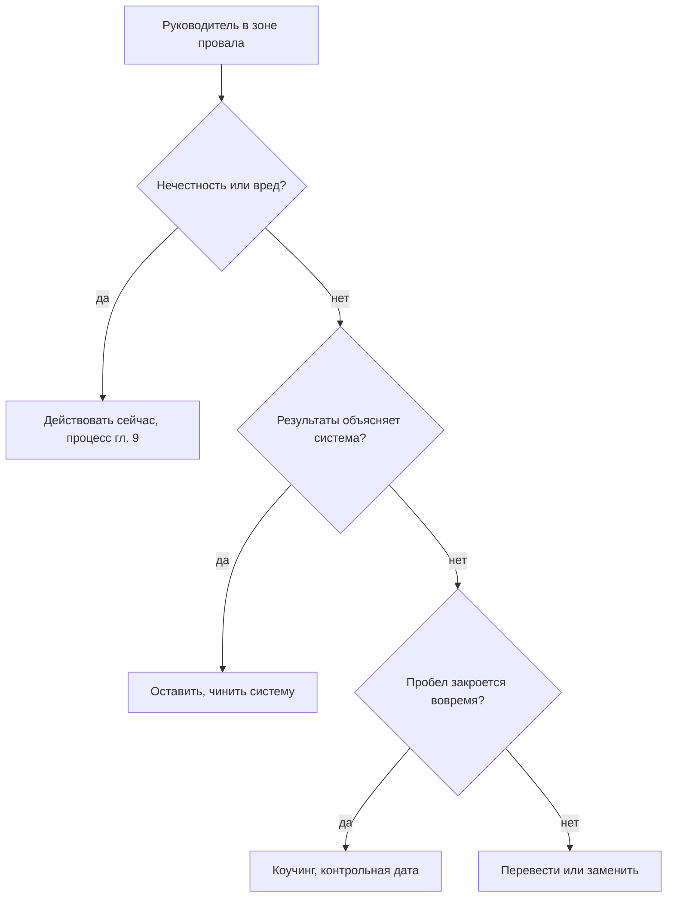

# Глава 56 — Восстановление проваливающейся инженерной организации { #chapter-56-recovering-a-failing-engineering-organization }

Одним руководителям достаётся организация, которая работает и нуждается лишь в настройке. Другим —
организация, которая не выполняет обещаний: сбои, нарушающие условия контрактов, дорожная
карта, выполненная меньше чем наполовину, уходящие эксперты и руководство компании, которое больше не
верит срокам. Эта глава — о втором случае. В ней три темы, которых нет в обычной практике: сортировка
проблем проваливающейся организации в первые 30 дней; разворот падения качества одновременно с
восстановлением доверия стейкхолдеров; решение о том, кого из унаследованных руководителей оставить, с
кем работать через коучинг, кого перевести, а кого заменить. Сквозных примеров два: группа Payroll в
Halvard Systems (90 инженеров под руководством нового вице-президента) и Northstar Technologies в момент
прихода директора, если смотреть на неё как на проваливающуюся организацию. Обе компании вымышлены; см.
[Halvard](../../case-studies/northstar/halvard.md) и [кейс](../../case-studies/northstar/index.md).

!!! note "Связанные главы"
    Первые 90 дней в новой роли описаны в [главе 2](../01-foundations/02-from-individual-contributor-to-leader.md)
    и [главе 40](../09-engineering-directorship/40-the-directors-job.md); трансформация качества — в
    [главе 27](../05-engineering-quality/27-quality-transformation-at-enterprise-scale.md);
    низкая результативность — в [главе 9](../02-people-management/09-performance-management-and-underperformance.md);
    руководство руководителями — в [главе 41](../09-engineering-directorship/41-managing-and-developing-engineering-managers.md);
    управление изменениями — в [главе 43](../09-engineering-directorship/43-leading-change-and-director-failure-patterns.md);
    кризисная коммуникация и восстановление доверия — в [главе 57](57-crises-executive-disagreement-and-resistance.md).

## Почему это важно { #why-this-matters }

Когда проваливается одна команда, руководитель видит это каждый день, и один человек может изменить
большую часть того, что важно: бэклог, график дежурств, то, как команда говорит об ошибках.

В организации провал распределён. Причина не в какой-то одной команде, цифрам нельзя доверять, а
руководители, которым предстоит вести восстановление, сами управляли организацией, пока она
проваливалась. Ставить диагноз новому руководителю приходится с их помощью, и при этом нужно быстро
решить, кто из них способен вести восстановление.

Для высшего руководства проваливающаяся инженерная организация — коммерческая проблема и проблема
корпоративного управления. От неё зависит, продлят клиенты контракты или уйдут; CFO оплачивает её
сервисные кредиты, а совет директоров спрашивает, способно ли руководство всё исправить. Руководителя
разработки судят сразу по двум часам. Медленные показывают, как в действительности восстанавливается
качество. Быстрые — когда руководство компании решит, верить ли ему дальше.

## Цели главы { #learning-objectives }

После этой главы вы сможете:

- Отличать организацию, которая не выполняет обязательства, от той, что просто деградирует или
  работает ниже своих возможностей, и выбирать подход: вывод из кризиса или перенастройку.
- Сортировать проблемы проваливающейся организации в первые 30 дней: отделять то, что нужно
  остановить на этой неделе, от того, что относится к [узкому месту](../../glossary.md#constraint)
  (единственному шагу, который ограничивает выпуск всей организации), и от того, что подождёт, — с
  доказательствами, которые можно отстоять.
- Вести восстановление качества и восстановление доверия как два параллельных трека с разными часами,
  опираясь на небольшие выполненные обещания и плохие новости, о которых вы сообщаете первыми.
- По доказательствам о системе и о человеке и по графику с датами решать, оставить ли каждого
  унаследованного руководителя, работать ли с ним через коучинг, перевести или заменить.
- Честно отчитываться о восстановлении, когда числа малы, а успехи хрупки.

## Ментальная модель { #the-mental-model }

> **Ментальная модель:** проваливающуюся организацию удерживают на месте усиливающие петли, которые
> крутятся не в ту сторону. Тушение пожаров съедает время, которое могло бы пойти на их предотвращение.
> Сорванные обещания заставляют руководство компании навязывать сроки, из-за которых срывов становится
> больше. Нагрузка дежурств выдавливает экспертов, на которых держалась система. Восстановление — это
> сначала сортировка, затем разрыв петель по очереди, а обещания на всём пути —
> только такие, которые достаточно малы, чтобы их выполнить.

На схеме три петли с общим узлом — сбоями. **Петля возможностей** (тушение пожаров, урезанное время на
улучшения, деградация возможностей) — это [ловушка возможностей](../../glossary.md#capability-trap),
описанная ниже. **Петля доверия** проходит через стейкхолдеров: пережив достаточно срывов, они перестают
спрашивать оценки и начинают диктовать сроки, а это гарантирует новые срывы. **Петля людей** проходит
через график дежурств: вызовы ложатся на тех немногих, кто умеет чинить систему, и организация теряет
именно те знания, которые нужны ей больше всего. Каждая петля поддерживает себя сама, поэтому давить на
одну, пока две другие работают, обычно бесполезно. Первая задача нового руководителя — понять, какая
петля здесь сильнее всех и какая ближе всего к необратимому ущербу.

## Подробный разбор { #deep-conceptual-explanation }

### Что значит «проваливается» и почему важно, какой это провал { #what-failing-means-and-why-it-matters-which-kind }

Словом «проваливается» пользуются вольно. В этой книге у него узкое значение (**рекомендация книги**).
Инженерная организация проваливается, если выполнены два условия. Она нарушает обязательства, на которые
рассчитывает кто-то вне разработки: договорную доступность, корректность данных, сроки для клиентов,
регуляторные требования. И при нынешней траектории разрыв не закроется, пока не изменится то, как ею
управляют. Это не то же самое, что **деградация** (организация становится хуже, но, возможно, ещё
укладывается в обязательства) или **работа ниже возможностей** (по какому-то эталону она хуже, чем могла
бы быть, но обещаний не нарушает). От этого различия зависит подход.

Две ситуации требуют разного руководства. Watkins утверждает, что правильная стратегия нового
руководителя зависит от ситуации, в которую он приходит
([Watkins, 2003](../../references/bibliography.md#watkins2003first)). В более поздней статье Watkins и
соавторы пишут, что вывод из кризиса (turnaround) с его кризисным режимом «располагает к подходу,
ориентированному на действие и зачастую более директивному», а перенастройка (realignment) требует
вовлечь людей в исправление проблемы
([Watkins et al., 2014](../../references/bibliography.md#watkins2014hit); **мнение эксперта**).
Директивный стиль спасает ломающуюся систему, но отталкивает организацию, которой нужна была лишь
перенастройка. А консультативный слишком медлителен, когда клиенты уходят.

Реальные организации часто неоднородны. Одной части нужен вывод из кризиса (нарушение контракта, ошибки
в данных), а другой — лишь перенастройка (посредственный, но стабильный процесс поставки). Поставить
диагноз каждой части отдельно — первый шаг сортировки.

**Как перенастройка выглядит на практике.** В зоне перенастройки руководитель не спускает диагноз
сверху: его ставят руководители этой зоны. Дайте им данные, один вопрос («что должно быть верно, чтобы
наши сроки выдерживались?») и короткий срок. Затем попросите выбрать два изменения и взять на себя
отчётность по ним. Задача руководителя — держать вопрос узким, защищать время и не давать работе
сползти в реорганизацию. Это **рекомендация книги**. Такой путь занимает на несколько недель больше,
чем директивный, зато даёт диагноз, в который верят те, кто будет его исполнять.

### Что могут и чего не могут сказать исследования вывода из кризиса { #what-turnaround-research-can-and-cannot-say }

Исследования упадка и вывода из кризиса изучают целые фирмы по их финансовым результатам, и один из
обзоров называет эту область раздробленной
([Trahms et al., 2013](../../references/bibliography.md#trahms2013decline); **научный результат** о
литературе). Перенести можно два урока: меры по восстановлению часто идут параллельно, а не по схеме
«сначала сократить, потом расти»; стейкхолдеры и руководство — часть восстановления. Остальное в этой
главе — **консенсус практиков** или **рекомендация книги**, и так и помечено.

### Почему проваливающиеся организации продолжают проваливаться { #why-failing-organizations-stay-failing }

**Ловушка возможностей.** Если урезать время на улучшения ради сегодняшних целей, возможности
деградируют и пожаров приходится тушить ещё больше. Пропущенные улучшения сказываются на будущих сбоях
медленно и незаметно, поэтому руководители склонны винить исполнителей и усиливать давление
([Repenning and Sterman, 2001](../../references/bibliography.md#repenning2001nobody); **научный
результат**, по кейсам и моделям). В разработке ловушка проявляется как растущая доля
[незапланированной работы](../../glossary.md#unplanned-work) и список долга, который никто не
финансирует.

**Ригидность под угрозой (threat rigidity).** Под угрозой люди и организации сужают круг информации,
которую воспринимают, и стягивают контроль наверх
([Staw et al., 1981](../../references/bibliography.md#staw1981threat); **научный результат**, по обзору
на уровне отдельных людей, групп и организаций). В проваливающейся инженерной организации это видно:
самый старший инженер ведёт каждый серьёзный инцидент, решения ждут одного человека, а отчёты о статусе
говорят тем меньше, чем хуже дела. Новый руководитель чувствует то же притяжение и должен ему
сопротивляться. Когда всё централизовано, это похоже на контроль, но руководители при этом теряют
возможность показать, на что способны.

**Плохие новости, которые не доходят наверх.** Потери в проблемных программных проектах растут, потому
что люди неохотно сообщают наверх о плохом статусе, и принимающие решения не знают истинного положения
дел ([Smith and Keil, 2003](../../references/bibliography.md#smith2003reluctance)). У молчания
сотрудников тот же корень (подробнее — в
[главе 57](57-crises-executive-disagreement-and-resistance.md)). Культура, в которой гонцов учат, а не
наказывают и не отмахиваются от них, предсказывает лучшие результаты поставки
([DORA, generative culture](../../references/bibliography.md#dora-cap-generative-culture); **отраслевое
исследование**). В проваливающейся организации гонцов обычно уже какое-то время наказывали или не
слушали, поэтому первые цифры, которые получает руководитель, оптимистичны, а первые интервью осторожны.

### Сортировка за 30 дней { #the-30-day-triage }

Сортировка (triage) пришла из неотложной медицины: случаи распределяют по срочности, чтобы дефицитное
внимание сначала шло туда, где промедление наносит необратимый вред. Применительно к организации
(**рекомендация книги**) первые 30 дней дают четыре результата, а не план трансформации:

| Результат | Что в нём | Проверка |
|---|---|---|
| Диагноз на одной странице | Какие обязательства нарушены, насколько и какая петля стоит за каждым | Коллега вне разработки может его пересказать |
| Действия, чтобы остановить кровотечение | Три–пять действий против необратимого вреда, у каждого есть владелец | Каждое можно отстоять, даже если остальной диагноз неверен |
| Список «пока нет» | Что вы решили не менять в первом квартале и почему | Записан и показан вашим руководителям |
| Одно выполнимое обещание | Небольшое обязательство с датой перед вашим руководителем и стейкхолдерами | Вы готовы поставить на него свою репутацию |

**Что считается необратимым.** Ждать не могут четыре вида вреда. Неверные финансовые или клиентские
данные, которые доходят до клиентов (стоимость исправления растёт с каждым днём распространения).
Эксплуатируемая уязвимость. Ключевой человек, который вот-вот уйдёт и унесёт знания, которых больше ни у
кого нет. Нарушение контракта или регуляторных требований, которое даёт право на расторжение. Всё
остальное, включая большую часть технического долга и процессов, может подождать квартал, пока вы
разбираетесь.

**Как собрать доказательства за 30 дней.** Сверяйте между собой три источника. Первый — данные: для
каждого числа проверьте, как оно получено (подсчитано системой, сведено вручную или взято по выборке).
Второй — интервью: все руководители, staff-инженеры, инженеры, которых выбрали вы, а не их
руководители, и все стейкхолдеры из руководства компании. Третий — личное наблюдение: участвуйте в
инцидентах и прочитайте двадцать последних разборов инцидентов. Внимательнее всего смотрите туда, где
интервью и данные расходятся.

**Чем сортировка не является.** Это не реорганизация, то есть не большая необратимая пачка изменений
([глава 36](../07-organization-design/36-reorganizations-evolution-and-succession.md)), которую
выпускают, когда информации у вас меньше, чем будет когда-либо потом. Это не новые правила для всех и не
речь о культуре.

**Когда ваш собственный мандат невыполним.** Иногда сортировка показывает, что цель, под которую вас
нанимали, недостижима: обещан результат к дате, к которой часы качества не успеют, или исправление
требует ресурса, которого никто не даст. Скажите об этом на 30-й день, а не на 300-й. Принесите диагноз,
мандат, который вы можете выполнить, перечень того, что понадобилось бы для исходного, и одно обещание,
которое выполните за это время. Если руководитель молча принимает невыполнимый мандат, он становится
очередным провалом, которому организация найдёт объяснение (**рекомендация книги**).

### Качество и доверие: два трека, двое часов { #quality-and-trust-two-tracks-two-clocks }

Качество восстанавливается по медленным часам.
[Глава 27](../05-engineering-quality/27-quality-transformation-at-enterprise-scale.md) рассматривает
качество как запас, который меняется потоками: приток новых дефектов можно перекрыть за несколько
недель, но вычерпать запас хрупких компонентов, недостающих тестов и бесхозных систем — дело кварталов.
Доверие стейкхолдеров идёт по более быстрым часам. Руководство компании и клиенты за несколько недель
решают, отличается ли новый руководитель от прежнего. Решают они по тому, что видят: что вы говорите,
оказывается ли это правдой и сказали ли вы им первыми.

Если вести треки по очереди, провал обеспечен при любом порядке. Если сначала чинить качество,
стейкхолдеры заполнят тишину старой историей и продолжат навязывать сроки. Если сначала восстанавливать
доверие обещаниями результатов, вы тратите репутацию, которую трек качества ещё не заработал. Ведите оба
с первой недели и давайте на каждом свои обещания.

**Из чего складывается доверие.** Модель доверия Mayer, Davis и Schoorman выделяет три фактора:
способности, доброжелательность и честность
([Mayer et al., 1995](../../references/bibliography.md#mayer1995integrative); **мнение эксперта**).
Разделение полезно: обычно каждый стейкхолдер разуверился в каком-то своём факторе. CFO сомневается в
способностях (может ли разработка прекратить выплаты кредитов?), руководитель продаж — в
доброжелательности (есть ли разработке дело до моих сделок?), служба работы с клиентами — в честности
(скажет ли мне разработка правду во время инцидента?). Каждому нужны свои доказательства.

**Как восстанавливают доверие.** Нарушения, связанные с компетентностью, признавайте прямо («19 из 30
инцидентов мы вызвали собственными изменениями»). На вопросы о честности (скрывали ли мы инциденты от
клиентов?) отвечайте фактами, а не расплывчатым извинением. Это следует из экспериментальных данных об
извинениях и отрицании, разобранных в
[главе 57](57-crises-executive-disagreement-and-resistance.md#deep-conceptual-explanation)
([Kim et al., 2004](../../references/bibliography.md#kim2004removing)).

Внутри организации доверие инженеров держится в основном на их собственных руководителях. Метаанализ 106
исследований доверия к руководству показал, что непосредственные руководители — особенно важный объект
доверия ([Dirks and Ferrin, 2002](../../references/bibliography.md#dirks2002trust); **научный
результат**). Руководители команд значат больше, чем общее собрание с новым руководителем. Это ещё одна
причина быстро решить, как с ними быть, и вооружить тех, кого вы оставляете.

**Обещания на каждом треке.** На треке качества обещайте процесс и направление, а не результаты:
«каждый Sev1 получает отслеживаемый разбор в течение десяти рабочих дней», «мы будем публиковать число
инцидентов еженедельно вместе с аудитом серьёзности». На треке доверия обещайте поведение, которое
полностью в вашей власти: «об инциденте, заметном клиентам, вы узнаете от нас раньше, чем вам скажет
клиент», «ни одна дата не уходит из разработки без оценки и владельца». Weick утверждает, что большая
проблема становится решаемой, если представить её как набор малых завершённых результатов
([Weick, 1984](../../references/bibliography.md#weick1984small); **мнение эксперта**). При
восстановлении малые победы — это выполненные обещания, и их считают.

### Оставить, коучинг, перевод или замена { #keep-coach-move-or-replace }

Правило (**рекомендация книги**): **не заменяйте руководителя в первые 30 дней, разве что из-за
нечестности или вреда людям.** Используйте первые 30 дней, чтобы отделить систему от человека: примените
к руководителю четыре причины из главы 9 (система, навык, желание, соответствие роли). Решение
принимайте к 60–90-му дню, по доказательствам, о сборе которых руководитель знал.

Унаследованные руководители управляли организацией, пока она проваливалась; большинство попали в те же
петли, что и все остальные. Ошибка в любую сторону обходится дорого:

| Вывод | Источник и сила | Что это значит для решения |
|---|---|---|
| Руководители заметно влияют на результат: лучший руководитель повышает выпуск, а хорошие руководители людей снижают текучесть | [Lazear et al., 2015](../../references/bibliography.md#lazear2015value); [Hoffman and Tadelis, 2021](../../references/bibliography.md#hoffman2021people); научные результаты, по одной фирме каждый | Если текучесть — часть провала, руководитель — один из немногих рычагов воздействия на неё |
| В среднем коучинг даёт умеренный положительный эффект | [Theeboom et al., 2014](../../references/bibliography.md#theeboom2014coaching); [Jones et al., 2016](../../references/bibliography.md#jones2016coaching); научные результаты, в основном участники-добровольцы, на протяжении месяцев | Коучинг может сработать, но занять больше времени, чем может ждать восстановление |
| Организационные изменения и уходы людей сопровождаются ростом числа дефектов, о которых сообщают клиенты | [Mockus, 2010](../../references/bibliography.md#mockus2010volatility); научный результат, один проект | Замена руководителя посреди кризиса — сама по себе изменение, и знания уходят |
| Один устойчиво негативный участник может подорвать доверие и сотрудничество в группе | [Felps et al., 2006](../../references/bibliography.md#felps2006bad); обзор и модель | Руководитель, который публично унижает людей, наносит этот вред, опираясь на власть |

Возможны четыре исхода:

| Решение | Когда подходит | Что требует |
|---|---|---|
| Оставить | Результаты объясняет система; руководитель ясно видит проблему | Починить систему; дать руководителю заметную роль в восстановлении |
| Коучинг | Пробел в навыке или привычке, руководитель хочет его закрыть, и закрыть его можно за то время, которое даёт восстановление | Письменное ожидание, один фокус развития, контрольная точка с датой ([глава 41](../09-engineering-directorship/41-managing-and-developing-engineering-managers.md)) |
| Перевести | Силён в соседней роли, но с трудом справляется в этой или на этом этапе ситуации | Настоящая роль, предложенная с уважением; часто это возврат на старший уровень трека индивидуального исполнителя |
| Заменить | Нечестность, вред людям или пробел, который не закроется вовремя, несмотря на честный шанс | Процесс из главы 9, участие HR и временный план для команды |

«Оставить» — тоже решение, и для него нужны доказательства. Самая частая ошибка при восстановлении —
оставить всех по умолчанию, потому что доказательства запутанны. Сразу за ней идёт замена самого
заметного руководителя, чтобы показать, что что-то меняется.

## Пример из инженерной организации { #engineering-organization-example }

Цифры — **иллюстрация**: Halvard Systems — вымышленная компания. Группа Payroll в Halvard делает ПО для
расчёта зарплаты и учёта рабочего времени почасовых сотрудников клиентов. В ней 90 инженеров, 11 мест
линейных руководителей (два вакантны) и два директора: Rhys Gallagher (Pay Calculation, 6 мест
руководителей, 50 инженеров) и Beatriz Quintero (Time and Attendance, 5 мест руководителей,
40 инженеров). Principal-инженер группы — Hiroshi Takeda. Предшественник ушёл, и на место
вице-президента извне приходит Ngozi Adeyemi. Недели отсчитываются от её первого дня.

Что она находит в записях группы за последние три квартала:

| Метрика | Значение |
|---|---|
| [Инциденты Sev1 и Sev2](../../glossary.md#severity-sev1-sev2-sev3) за квартал | 9, 16, 23 (в последнем квартале 15 в Pay Calculation, 8 в Time and Attendance) |
| Из 23 инцидентов последнего квартала | 14 вызваны изменениями, 11 обнаружены клиентами, 7 Sev1 |
| Доступность, путь расчёта зарплаты | 99.71% при 99.9% по контракту (около 380 минут простоя при 131 допустимой) |
| Из 10 крупнейших клиентов в формальной эскалации | 3; один из них, приносящий $4.2M [годовой регулярной выручки](../../glossary.md#arr), продлевает контракт на неделе 30 |
| Уходы за последние 12 месяцев | 17 из 90 при ожидаемых примерно 11; 11 из них — из Pay Calculation, включая двух руководителей |
| Незапланированная работа (выборка за две недели) | 45%, около 40.5 FTE, или $8.3M в год |
| Выполненные обещанные пункты дорожной карты, последние два квартала | 6 из 22 |
| Соблюдение корпоративных политик | Минимумы tier 1: 5 из 12; отслеживаемые разборы Sev1: 4 из 11; 9 из 14 дат для клиентов названы до оценки |

Допущения: в квартале из 13 недель 131 040 минут; Halvard закладывает в план
[текучесть](../../glossary.md#attrition-and-regretted-attrition) 12% в год и среднюю стоимость
инженера $205 800.

**Диагноз.** Pay Calculation нуждается в выводе из кризиса: нарушение контракта, продление под угрозой,
текучесть сосредоточена здесь, и тренд растёт. Time and Attendance нужна перенастройка: инцидентов
меньше, но сроки поставки сдвигаются. Сильнее всего петля людей в Pay Calculation. С ушедшими людьми
ушли и знания о движке расчёта зарплаты. Rhys Gallagher, который девять лет назад построил значительную
часть движка, в прошлом квартале сам вёл все семь созвонов по инцидентам Sev1 (живых созвонов, где
координируют работу те, кто чинит). Его руководители говорят, что решения ждут его. Это ригидность под
угрозой, воплощённая в одном человеке.

**Остановить кровотечение (недели 1–4).** Действия Ngozi, каждое из которых можно отстоять, даже если
её диагноз неверен:

1. График из восьми [координаторов инцидентов](../../glossary.md#incident-commander), обученных на
   неделях 2 и 3, чтобы Rhys перестал быть единственным; обучает их сам Rhys.
2. Каждый Sev1 разбирают в течение десяти рабочих дней, с корректирующим действием, за которое отвечает
   руководитель, как уже требует корпоративная политика; за стандарт разборов отвечает Hiroshi Takeda.
3. Еженедельный письменный статус для трёх клиентов в эскалации: его готовит группа, а отправляют
   руководители службы работы с клиентами Halvard. В нём — что сломалось, что изменилось и что будет
   дальше.
4. Заморозка новых дат для клиентов, пока у каждой нет оценки и владельца (это шестая корпоративная
   политика); исключения подписывает Ngozi.
5. [Интервью об удержании (stay interview)](../../glossary.md#stay-interview) с шестью инженерами,
   у которых большая часть оставшихся знаний о движке расчёта зарплаты.

**Её единственное обещание CTO Halvard, на 30-й день**: еженедельная отчётность о числе инцидентов
вместе с аудитом серьёзности, каждый Sev1 разобран вовремя и ни одной даты для клиента без оценки.
Никакой цели по результату. Её список «пока нет»: никакой реорганизации двух направлений, никакого
переписывания движка расчёта зарплаты, никакого нового процесса для всей группы.

**Что произошло к Дню 90.** За её первый квартал число инцидентов Sev1 и Sev2 снизилось с 23 до 15,
инцидентов, обнаруженных клиентами, — с 11 до 6, открытых эскалаций — с 3 до 1. За квартал ушли два
инженера. Число инцидентов нужно читать осторожно. Если бы истинная частота не изменилась, 38 инцидентов
за два квартала разделились бы примерно поровну, 19 и 19, и 15 или меньше во втором квартале выпадало бы
случайно примерно в одном случае из восьми. Одно это число не доказывает восстановления; аргумент
держится на метриках механизмов (разборы Sev1 вовремя, график координаторов, доля инцидентов,
обнаруженных клиентами).

## Как принимать решение { #decision-framework }

При любом восстановлении повторяются два решения: куда в сортировке отнести находку и что делать с
каждым унаследованным руководителем. Обе схемы — **рекомендация книги**.

| Вопрос сортировки | Доказательства | Типичные находки |
|---|---|---|
| Может ли промедление нанести необратимый вред? | Корректность данных, сканирование безопасности, контракты, риск ключевых людей | Неверные счета доходят до клиентов; активно эксплуатируемые уязвимости; одного эксперта вызывают каждые выходные |
| Относится ли это к узкому месту? | Где работа ждёт дольше всего; откуда идёт большинство сбоев | Релизный процесс, общая схема данных, одна команда, от которой зависят все |
| Это дёшево и заметно, и есть ли владелец? | Работы меньше чем на несколько инженеро-недель; стейкхолдеры заметят | Опубликованные определения серьёзности; еженедельная записка о статусе; набор нестабильных тестов на карантине |
| Ничего из перечисленного | | Большая часть долга, процессов, структуры: отложено, письменно |

| Вопрос о руководителе | Какие доказательства на него отвечают | Частая ошибка |
|---|---|---|
| Есть ли проблема с честностью или вредом людям? | Искажал факты, когда его спрашивали прямо; достоверные сообщения об унижении или преследовании | Считать это вопросом стиля и лечить коучингом |
| Объясняет ли результаты система? | Коллеги с той же системой справляются не лучше; руководитель назвал проблему раньше вас | Судить руководителя по цифрам, которые порождает релизный поезд или схема данных |
| В чём пробел: навык, желание или соответствие роли? | Таблица доказательств из главы 9, применённая к работе руководителя | Предполагать «желание», потому что под угрозой руководитель защищается |
| Закроется ли пробел за время восстановления? | Одна контрольная точка с датой и наблюдаемым поведением | Бессрочный коучинг без даты |
| Какой сигнал посылает решение? | Кого организация считает ответственным за провал | Заменить самого заметного руководителя, чтобы выглядеть решительным |

## Компромиссы { #trade-offs }

**Скорость против точности.** Действия на первой неделе останавливают вред, но их предпринимают, когда
информации у вас меньше всего. Правило сортировки ограничивает ранние действия тем, что можно отстоять
при любом диагнозе. Цена — некоторые поправимые проблемы ждут месяц.

**Директивный подход против консультативного.** При выводе из кризиса решения нужны сейчас; при
перенастройке организация должна сама владеть диагнозом. Директивное управление в зоне перенастройки
порождает обиду, а консультации в зоне вывода из кризиса позволяют кровотечению продолжаться. Смешанной
организации нужно и то и другое, но в разных частях, и руководитель должен объяснить почему.

**Защита времени на улучшения против требований стейкхолдеров.** Разорвать петлю возможностей — значит
забрать ресурс у дорожной карты, когда она и так отстаёт. Такой обмен выдерживает, только если
стейкхолдеры видят, что покупается на этот ресурс. Поэтому трек доверия должен начаться на первой
неделе.

**Оставить руководителей против заменить их.** Если оставить руководителя, который не вытянет
восстановление, потеряете кварталы. Если заменить того, кто мог бы вытянуть, потеряете знания и
доверие. Первую цену ограничивает контрольная точка с датой, вторую — правило 30 дней.

**Принять прошлое на себя против винить его.** Обвинив предшественника, вы купите квартал терпения, но
потеряете руководителей, которые работали под его началом.

## Типичные провалы { #failure-modes }

**Явление героя.** Новый руководитель берёт на себя координацию инцидентов, проверяет каждое изменение и
принимает каждое решение. Результаты ненадолго улучшаются, а потом застревают, потому что никто больше
ничему не научился, а сам руководитель стал новой единой точкой отказа. Как заметить: в вашем календаре
больше созвонов по инцидентам, чем встреч один на один.

**Чистка.** В первый месяц заменяют нескольких руководителей, чтобы показать решительность, и
организация учится прятать проблемы. Как заметить: о заменах объявили раньше, чем кто-либо смог
сказать, что каждый из этих людей должен был делать иначе.

**Паралич диагностики.** Руководитель квартал собирает данные, а клиент в эскалации тем временем уходит.
Как заметить: наступил 30-й день, а не предпринято ни одного действия, чтобы остановить кровотечение.

**Раздача обещаний.** Обещают результаты («к следующему кварталу инцидентов вдвое меньше»), которых часы
качества не успеют дать. Как заметить: в обещании есть число, которое зависит от редких событий.

**Только один трек.** Качество без доверия: работа идёт правильно, вне разработки об этом никто не
знает, и на следующем цикле планирования ресурс на профилактику забирают обратно. Доверие без качества:
отличная коммуникация о восстановлении, которого не происходит. Как заметить: руководство компании
описывает организацию так же, как до вашего прихода, или записки о статусе улучшаются быстрее любой
метрики.

**Коучинг втихую.** С руководителем «работают через коучинг», но нет ни письменного ожидания, ни
контрольной точки, ни последствий. Как заметить: вы не можете одной фразой назвать цель коучинга или
дату контрольной точки.

**Победа, объявленная по малым числам.** Инцидентов становится не 23, а 15, и объявляют о
восстановлении. В следующем квартале их 20, и вместе с ростом уходит доверие. Как заметить: главный
показатель построен на одном квартале при числе меньше 30.

## Применение в крупной организации { #enterprise-application }

В организации на 50–150 инженеров проваливающейся обычно оказывается вся зона ответственности одного
директора или одна группа внутри организации VP. Руководитель ещё может знать каждого руководителя и
большинство старших инженеров по именам, поэтому сортировку за 30 дней можно провести лично. На практике
это выглядит так:

- **План на 30 дней с четырьмя результатами**, согласованный с вашим руководителем на первой неделе,
  чтобы отсутствие плана трансформации на 30-й день никого не удивило.
- **Две линии статуса с первой недели**: внутренний еженедельный операционный разбор и внешняя записка
  для стейкхолдеров, которые утратили уверенность
  ([шаблон отчёта для руководства](../../templates/executive-update.md)).
- **Карта стейкхолдеров**, где для каждого руководителя записано, в каком факторе доверия он сомневается
  (способности, доброжелательность, честность) и какие доказательства его переубедят
  ([шаблон карты стейкхолдеров](../../templates/stakeholder-map.md)).
- **Оценка каждого руководителя к 30-му дню** по четырём причинам из главы 9, написанная для себя, с
  датой решения не позднее 90-го дня. Критерии даёт
  [рубрика оценки руководителя разработки](../../templates/engineering-manager-rubric.md).
- **План по качеству с 30-го дня**, когда узкое место уже известно
  ([шаблон плана по качеству на 90 дней](../../templates/ninety-day-quality-plan.md)).
- **Команда руководителей, которая спорит на встрече.** Lencioni ставит доверие и открытый конфликт в
  основание работающей команды руководителей
  ([Lencioni, 2002](../../references/bibliography.md#lencioni2002five); **мнение эксперта**).
  Руководители проваливающейся организации часто вместо этого винят команды друг друга; исправляют это
  на еженедельной встрече руководителей.
- **Журнал обещаний**: каждое внешнее обязательство, которое вы даёте, с датой и отметкой, выполнено ли
  оно; его пересматривают ежемесячно. При восстановлении стейкхолдеры в действительности оценивают вас
  именно по этой метрике.

## Взгляд CTO { #cto-perspective }

CTO обычно не ведёт восстановление сам: он решает, что оно нужно, выбирает, кто его поведёт, и защищает
его. Три решения остаются за CTO.

**Распознать провал рано.** О провале организации редко объявляют; его терпят. CTO первым видит
коммерческие сигналы: сервисные кредиты, эскалации крупных клиентов, просьбы продаж об исключениях.
Ждать, пока это подтвердят инженерные цифры, слишком долго, потому что эти цифры выдаёт та самая
организация, которая под угрозой.

**Выбрать руководителя под этап.** Тот, кто построил группу, не обязательно сумеет её спасти, а
спасатель не обязательно подойдёт, чтобы руководить ею потом. В Halvard вице-президента в Payroll взяли извне, и
за этим стояло суждение: собственные директора группы не смогут одновременно выводить её из кризиса и
управлять своими направлениями.

**Удержать совет директоров и руководство компании в реалистичном темпе.** Совет захочет дату, когда всё
будет «исправлено». Задача CTO — разложить восстановление на последовательность проверяемых шагов
(остановить кровотечение, удержать достигнутое, выйти на целевой уровень), отчитываться о каждом вместе с его
неопределённостью и сопротивляться давлению объявить о восстановлении после одного хорошего квартала. О
работе с советом говорится в
[главе 55](../12-cto-leadership/55-boards-due-diligence-and-executive-decision-making.md); при
восстановлении самое ценное, что CTO может принести совету, — это история выполненных обещаний.

CTO отвечает и за то, чтобы руководителя восстановления не обрекли на провал цели по результатам, не
подкреплённые ресурсом. Пересмотр мандата на 30-й день, о котором говорилось выше, CTO должен
воспринимать как информацию, а не как слабость.

## Практический плейбук { #practical-playbook }

1. **На первой неделе согласуйте с вашим руководителем форму первых 30 дней:** четыре результата,
   никакого плана трансформации, одно обещание на 30-й день.
2. **Проверьте, как получено каждое число,** прежде чем ему верить: подсчитано системой, сведено
   вручную, взято по выборке или сообщено самими людьми.
3. **Проводите интервью широко и против течения,** включая инженеров, которых выбрали вы, и одного
   крупного клиента.
4. **Отнесите каждую часть организации** к выводу из кризиса или к перенастройке и скажите об этом в
   диагнозе.
5. **Назовите самую сильную петлю** (возможностей, доверия, людей) в каждой зоне вывода из кризиса.
6. **На этой неделе действуйте только против необратимого вреда:** корректность данных,
   эксплуатируемые уязвимости, ключевые люди, которые вот-вот уйдут, нарушение контракта.
7. **Начните трек доверия на первой неделе:** одна честная записка каждому стейкхолдеру, который
   утратил уверенность, и обещание о поведении, которое полностью в вашей власти.
8. **Оцените каждого руководителя к 30-му дню** по четырём причинам, наедине с собой и письменно; в
   первые 30 дней заменяйте только из-за нечестности или вреда людям.
9. **Запишите список «пока нет»** и покажите его своим руководителям.
10. **Дайте одно обещание на 30-й день** — о процессе и направлении, а не о результатах.
11. **Примите решение по каждому руководителю к 90-му дню**, с контрольной точкой и датой для каждого,
    с кем работаете через коучинг.
12. **Сообщайте каждое число вместе с его неопределённостью** и начинайте с метрик механизмов, пока
    числа не станут достаточно большими, чтобы что-то значить.

## Кейс { #case-study }

!!! info "Northstar: что уже известно"
    Неделя 1 первого года директора. Вы приходите в Northstar директором по разработке, подчиняетесь
    Victor Lindqvist (CTO) и получаете мандат: за год вдвое сократить число инцидентов Sev1 и Sev2 и
    выйти на доступность 99,9% без роста численности. Кейс прослеживает результаты до квартала 3
    (неделя 39). См. [хронологию](../../case-studies/northstar/timeline.md). Впервые читаете о
    Northstar? Прочитайте [«Год вкратце»](../../case-studies/northstar/year-in-brief.md),
    [действующих лиц](../../case-studies/northstar/cast.md) и
    [брифинг квартала 4](../../case-studies/northstar/quarter-4-briefing.md).

Факты о Northstar ниже — **иллюстрация** и вымысел, они взяты из
[исходных данных](../../case-studies/northstar/baseline-data.md) и
[хроники года 1](../../case-studies/northstar/first-quarter.md). Разбор «оставить, коучинг или замена» —
анализ этой главы, а не записанное событие.

**Проваливалась ли Northstar?** По определению этой главы — да, по части надёжности. Доступность на
договорных путях была 99,62% при обязательстве 99,9%, сервисные кредиты составляли $410 000 в квартал, а
в двух продлениях на $9 млн в год клиенты указали, что их беспокоит надёжность. Из 30 инцидентов
Sev1 и Sev2 19 были вызваны собственными изменениями Northstar. Поставка была стабильной, но слабой:
квартал за кварталом выполнялось 40–44% обещанных пунктов дорожной карты. Это проблема перенастройки
внутри проваливающейся организации.

**Первые четыре недели как сортировка.** На неделе 2 разовое сканирование безопасности всех
24 компонентов закрыло пункт о необратимом вреде (оно нашло 11 открытых критических уязвимостей, 3 из
них активно эксплуатируемые). На неделе 3 определения серьёзности запустили трек доверия. На неделе 4
модель ресурсов, согласованная с Victor и Amara Okafor (CPO, директор по продукту), выделила на
профилактику 12 FTE и защитила два обязательства по продлению: это и было одно обещание.

**Что сортировка упустила.** Ближе всего к необратимому вреду была петля людей в Billing. Знания о
ledger были у трёх инженеров ledger, и на них пришлось 54 из 64 вызовов в нерабочее время за квартал;
один их коллега уже уволился после трёх выходных подряд с вызовами. Качественный сигнал у директора был
с самого прихода: в таблице команд сказано, что большую часть вызовов Billing несут три человека.
Никаких действий по их нагрузке в первые 30 дней не записано. С недели 4 Billing получила самую большую
долю профилактики (25%), но интервью об удержании прошли только на неделях 14 и 15. На неделе 20 Tomasz
Wierzbicki, один из троих, сообщил о внешнем предложении на 20% выше его базового оклада. По правилу
сортировки из этой главы ключевой человек, который вот-вот уйдёт и унесёт знания, которых больше ни у
кого нет, — дело первой недели.

**Оставить, коучинг или замена на 30-й день (анализ).** Исходные доказательства, прочитанные через
четыре причины из главы 9:

| Руководитель | Доказательства на момент прихода | Вывод |
|---|---|---|
| Priya Raman (Orders) | Повышена восемь месяцев назад без обучения; 18 часов из 40-часовой недели пишет код и делает ревью | Коучинг: пробел в навыке и привычке при готовности руководителя меняться. Её часы практической работы на последующих проверках (8, 10, 12 при лимите 8) показывают, почему контрольная точка должна быть с датой |
| Marcus Oyelaran (Billing) | Худшие показатели команды; 55 процентов времени уходит на поставку; техническое направление «определяется во время инцидентов» | Оставить и сначала починить систему: большая часть сбоев Billing шла через релизный поезд и общую схему данных |
| Elena Sokolova (Payments and Integrations) | Еженедельный операционный разбор уже два года; журнал почти-инцидентов | Оставить и сделать её практику образцом |
| Daniel Cho (Customer Experience) | Встречи один на один проводит, но в основном о статусе; 6 из 8 действий по итогам ретроспектив касаются веба; неформальный лид мобильной разработки не признан | Коучинг с одним фокусом: мобильные инженеры |
| Farah Haddad (Data and Analytics) | Мало инцидентов; мало контактов с другими командами | Оставить |
| Tom Becker (Platform Operations) | Втихую переназначил 31 из 74 тикетов одного senior-инженера, хотя в последней оценке того стояло «соответствует ожиданиям» | Коучинг по управлению результативностью (кейс главы 9) |

На 30-й день в «заменить» не попадает никто, и при таких доказательствах это правильный ответ: нет
находок о нечестности или вреде, а худшие цифры там, где хуже всего система. Заменить Marcus Oyelaran
ради видимости решительности значило бы добавить организационное изменение в команду с самыми хрупкими
знаниями.

**Результаты.** Инцидентов Sev1 и Sev2 было 30, 21, 17, а затем 14 в квартале 3 — это первый квартал,
когда число не превысило лимита мандата в 15 инцидентов. Доступность достигла 99,89%, всё ещё чуть ниже
обязательства, а кредиты снизились до $60 000 в квартал. При таких малых числах тренд за четыре квартала
убеждает больше любого отдельного шага.

## Упражнения { #exercises }

Разборы упражнений: [решения к главе 56](../../solutions/ch56-solutions.md).

### Базовый уровень { #foundational }

**F1.** Опираясь только на исходные данные Northstar, распределите эти находки по группам «действовать
на этой неделе», «план на этот квартал», «ранняя победа» и «отложить»: 11 открытых критических
уязвимостей (3 из них активно эксплуатируемые); нагрузка трёх инженеров ledger в нерабочее время
(54 из 64 вызовов); страница стандартов 2019 года из 52 правил без владельцев; четыре системы CI,
эксплуатация которых стоит около 1,5 FTE в год; отсутствие определений серьёзности; список долга из
143 пунктов без владельцев и оценок стоимости. Подробности — в разделах исходных данных о
[стандартах](../../case-studies/northstar/baseline-data.md#engineering-standards),
[долге и пайплайне](../../case-studies/northstar/baseline-data.md#technical-debt-tests-and-the-pipeline)
и [ledger](../../case-studies/northstar/baseline-data.md#billing-on-call-and-ledger-knowledge).
Обоснуйте каждое решение вопросами сортировки и назовите одно, с которым разумный руководитель мог бы
не согласиться.

**F2.** За первый квартал работы Ngozi Adeyemi в группе Payroll (Halvard) число инцидентов Sev1 и Sev2
снизилось с 23 до 15. CTO Halvard хочет сообщить руководству компании, что группа вышла из кризиса.
Объясните, что это число может подтвердить и чего не может, какие ещё метрики из главы вы поставили бы
рядом, и набросайте две фразы, которые CTO, по-вашему, стоило бы сказать вместо этого.

**F3.** Примените схему «оставить, коучинг, перевод или замена» к Marcus Oyelaran на 30-й день, опираясь
на исходные доказательства о Billing из таблицы кейса и на
[таблицу по командам](../../case-studies/northstar/baseline-data.md#by-team) в исходных данных. Скажите,
что вам нужно увидеть к 90-му дню, чтобы перевести его из «оставить и починить систему» в «коучинг», и
что перевело бы его в «заменить». Объясните, почему
[доля неудачных изменений (change failure rate)](../../glossary.md#change-failure-rate) его команды
(34%, большей частью из-за общего релизного поезда Core) — слабое доказательство, когда речь о нём
самом.

### Прикладное лидерство { #applied-leadership }

**A1.** Неделя 2 в Northstar. В таблице команд сказано, что большую часть дежурных вызовов Billing несут
три человека, а по данным HR один инженер ledger уволился после трёх выходных подряд с вызовами. (Точные
числа, 54 из 64 вызовов в нерабочее время на трёх инженеров ledger, позже восстановили по системе
оповещений; считайте, что они доступны вам уже сейчас.) Численность неизменна, а обязательства по
продлению сохраняют свои даты. Спроектируйте действия на неделях 2–4: кто отвечает за каждое, сколько
ресурса оно требует и как вы сообщите об этом Marcus Oyelaran и трём инженерам.

**A2.** Этот сценарий гипотетический и не входит в кейс. Предположим, что в Halvard Beatriz Quintero три
месяца сообщала, что дорожная карта интеграций идёт по плану, а потом карта сдвинулась на квартал. В
остальном Beatriz работает эффективно, и инцидентов в её направлении становится меньше. Решите, что это:
проблема честности, навыка или системы, опираясь на данные главы о плохих новостях, которые не доходят
наверх. Напишите, с чего вы начнёте разговор и какое изменение в системе отчётности позволит увидеть
следующий сдвиг раньше.

**A3.** Набросайте для первых 30 дней в Northstar внешнюю часть трека доверия, обращённую к
стейкхолдерам. Для Helena Marsh (CEO), Rajiv Menon (CFO), Amara Okafor, Greg Tanaka (VP Sales) и Sofia
Alvarez (VP по работе с клиентами, Customer Success) определите, в каком факторе доверия (способности,
доброжелательность, честность) каждый сомневается больше всего, какие доказательства его переубедят и
какое одно обещание о поведении вы дали бы каждому. Проверьте, что никакие два обещания не противоречат
друг другу.

### Решения на уровне руководства { #executive-decision-making }

**X1.** Этот сценарий гипотетический и не входит в кейс. Предположим, что к 120-му дню Rhys Gallagher
обучил график координаторов, но по-прежнему отменяет решения своих руководителей об изменениях в
движке расчёта зарплаты, и двое из них сказали Ngozi Adeyemi, что уйдут, если ничего не изменится.
Ngozi просит вас как CTO Halvard поддержать перевод Rhys с роли директора на роль principal-инженера.
Примите решение: скажите, каких доказательств вы потребуете, во что обойдётся этот перевод и как вы о
нём объявите.

**X2.** Вы — Victor Lindqvist, неделя 47. Перед заседанием совета директоров на неделе 50 David
Ferrante, независимый член совета, спрашивает вас, была ли разработка «проваливающейся организацией»
на момент прихода директора и восстановилась ли она теперь. Используя только факты, доступные на
неделе 47, напишите ответ не длиннее 200 слов: что восстановлено, что нет и чего вы пока не стали бы
утверждать.

## Вопросы для размышления { #reflection-questions }

1. Вспомните самую неблагополучную организацию, в которой вы работали. Какая из трёх петель была в ней
   сильнее всех, и назвал ли её кто-нибудь?
2. Когда вы в последний раз приходили на новую роль, каким цифрам верили в первый месяц, пока не
   выяснили, что получены они плохо?
3. Какое самое маленькое обещание вы могли бы дать на этой неделе своему самому скептически
   настроенному стейкхолдеру, и уверены ли вы, что сможете его выполнить?
4. С каким руководителем в вашей организации вы «работаете через коучинг» без письменной цели и без
   даты контрольной точки?
5. Где лично вы под угрозой централизуете контроль, и кто при этом теряет возможность учиться?

## Главное { #key-takeaways }

- Называйте организацию проваливающейся, только если она нарушает обязательства, на которые
  рассчитывают другие. Определяйте для каждой части, нужен ли ей вывод из кризиса или перенастройка:
  им нужны разные стили руководства.
- В первые 30 дней подготовьте диагноз на одной странице, несколько действий, чтобы остановить
  кровотечение, список «пока нет» и одно обещание, а не план трансформации.
- На первой неделе действуйте только против необратимого вреда: неверные данные клиентов,
  эксплуатируемые уязвимости, ключевые люди, которые вот-вот уйдут, нарушение контракта.
- Ожидайте ригидности под угрозой и в организации, и в себе; не забирайте себе координацию инцидентов
  и все решения.
- Ведите восстановление качества и восстановление доверия параллельно: по медленным часам качества
  обещайте процесс и направление, по быстрым часам доверия — поведение, которое в вашей власти.
- Определите, в каком факторе доверия сомневается каждый стейкхолдер, и дайте каждому доказательства,
  которые отвечают на это сомнение.
- Не заменяйте руководителей в первые 30 дней, разве что из-за нечестности или вреда людям; решайте к
  90-му дню, с контрольной точкой и датой для каждого, с кем работаете через коучинг. Решению
  «оставить» тоже нужны доказательства.
- Сообщайте о восстановлении вместе с его неопределённостью; при малых числах аргумент держится на
  метриках механизмов и выполненных обещаниях.

## Источники и что почитать { #references-and-further-reading }

- [Watkins, 2003](../../references/bibliography.md#watkins2003first): смена руководителя и выбор
  стратегии под ситуацию.
- [Watkins et al., 2014](../../references/bibliography.md#watkins2014hit): вывод из кризиса и
  перенастройка и почему на разных этапах нужны разные руководители.
- [Trahms et al., 2013](../../references/bibliography.md#trahms2013decline): обзор исследований упадка
  организаций и вывода из кризиса.
- [Repenning and Sterman, 2001](../../references/bibliography.md#repenning2001nobody): ловушка
  возможностей.
- [Staw et al., 1981](../../references/bibliography.md#staw1981threat): ригидность под угрозой на
  разных уровнях.
- [Smith and Keil, 2003](../../references/bibliography.md#smith2003reluctance) и
  [Milliken et al., 2003](../../references/bibliography.md#milliken2003silence): почему плохие новости
  не доходят наверх.
- [DORA, generative culture](../../references/bibliography.md#dora-cap-generative-culture): типология
  Westrum и поток информации.
- [Goldratt and Cox, 1984](../../references/bibliography.md#goldratt1984goal) и
  [Kim, Behr, and Spafford, 2013](../../references/bibliography.md#kim2013phoenix): ограничения и
  вывод ИТ из кризиса в форме романа; это иллюстрации, а не доказательства.
- [Mayer et al., 1995](../../references/bibliography.md#mayer1995integrative): способности,
  доброжелательность и честность как факторы того, насколько человеку можно доверять.
- [Kim et al., 2004](../../references/bibliography.md#kim2004removing): восстановление доверия после
  нарушений, связанных с компетентностью и с честностью.
- [Dirks and Ferrin, 2002](../../references/bibliography.md#dirks2002trust): метаанализ доверия к
  руководству.
- [Weick, 1984](../../references/bibliography.md#weick1984small): малые победы.
- [Lazear et al., 2015](../../references/bibliography.md#lazear2015value) и
  [Hoffman and Tadelis, 2021](../../references/bibliography.md#hoffman2021people): насколько важны
  руководители.
- [Theeboom et al., 2014](../../references/bibliography.md#theeboom2014coaching) и
  [Jones et al., 2016](../../references/bibliography.md#jones2016coaching): эффективность коучинга.
- [Mockus, 2010](../../references/bibliography.md#mockus2010volatility): организационные изменения и
  дефекты ПО.
- [Felps et al., 2006](../../references/bibliography.md#felps2006bad): как один негативный участник
  вредит группе.
- [Lencioni, 2002](../../references/bibliography.md#lencioni2002five): команда руководителей как
  команда; полезно, когда нужно заново собрать управленческую группу, участники которой перестали
  доверять друг другу.
