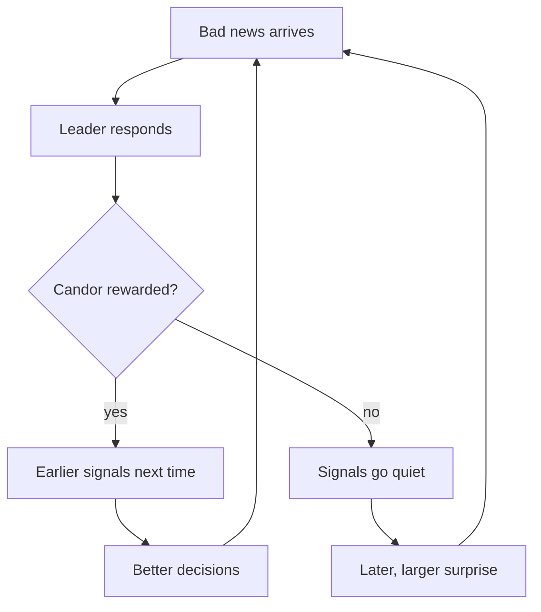
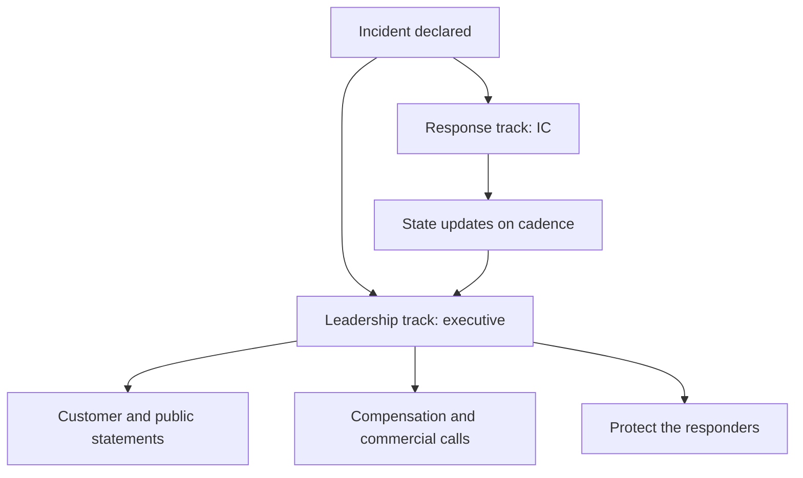
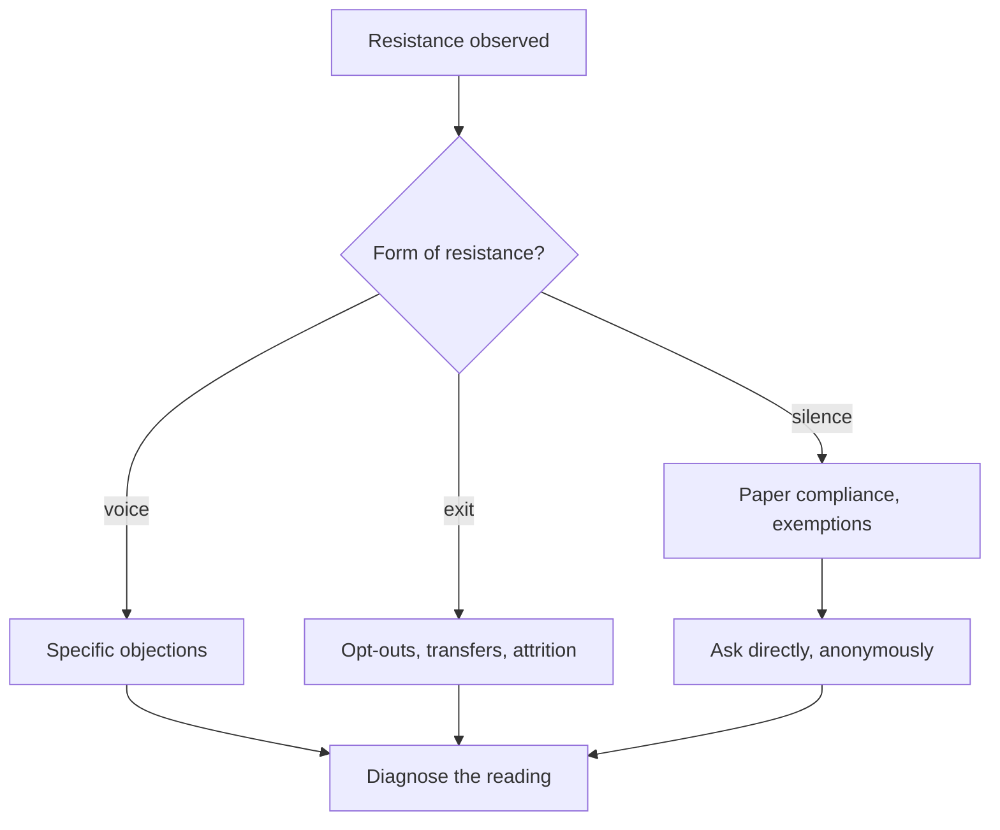
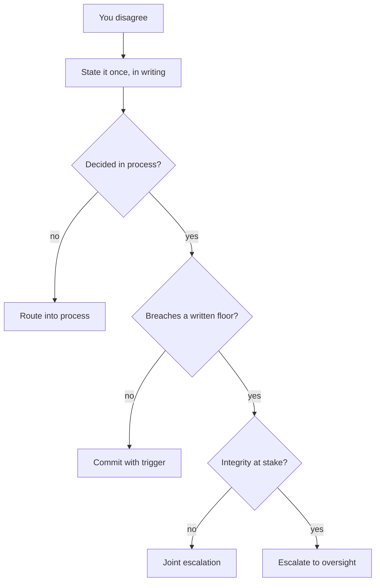

# Chapter 57 — Crises, Executive Disagreement, and Resistance to Change

Three situations test a senior engineering leader harder than any plan: a failure that customers and
the public can see, a decision by an executive you believe is wrong, and a change that the organization
is quietly refusing. They share one problem. The information the leader most needs is the information
other people are least willing to give, and the leader's own behavior decides whether they give it. This
chapter covers leading through a public failure, including what to tell customers and when; disagreeing
with executives so that the disagreement is heard once, clearly, and then committed to or escalated; and
reading resistance to change as evidence about the change. The running examples are a public Checkout
outage at Halvard Systems and the executive disagreements of Northstar Technologies' fourth quarter, both
fictional; see the [case study](../../case-studies/northstar/index.md) and the
[Halvard page](../../case-studies/northstar/halvard.md).

!!! note "Related chapters"
    [Chapter 25](../05-engineering-quality/25-incidents-postmortems-and-change-failure-analysis.md) owns
    incident response and blameless review, [Chapter 43](../09-engineering-directorship/43-leading-change-and-director-failure-patterns.md)
    the general method of leading change, and [Chapter 39](../08-management-operating-system/39-reviews-decision-logs-escalation-and-executive-reporting.md)
    escalation paths and the decision log. [Chapter 56](56-recovering-a-failing-engineering-organization.md)
    covers a failing organization, [Chapter 58](58-layoffs-reductions-and-mergers.md) reductions and
    acquisitions, and [Chapter 59](59-transformation-under-constraint-and-scaling-without-bureaucracy.md)
    a budget cut.

## Why This Matters

At team scale, a bad incident is a long night, a disagreement with your manager is a conversation, and
a team that resists a new practice tells you so in the retrospective. The costs are local and the
feedback is fast.

At organization scale, each of the three is mediated. The director hears about the incident from a
customer escalation, about disagreement through a hallway remark, and about resistance through numbers
that drift. By the time the signal is unambiguous, it is late.

At executive scale, the costs become external and durable. A public failure is judged on how the company
communicated as much as on how long the system was down. A disagreement never stated in the room becomes
two plans running in parallel. A resisted change pushed through anyway can consume a year of
credibility. In all three, the leader who controls the message instead of the information loses both.

## Learning Objectives

After this chapter you will be able to:

- Run the executive track of a public failure: protect the responders, decide what only executives can
  decide, and communicate externally on a fixed cadence without stating what you do not yet know.
- Choose an external response strategy that fits how much responsibility stakeholders will attribute,
  and keep it consistent from the first status post to the public review.
- Disagree with an executive productively: state the disagreement once, in writing, in the right room,
  then decide whether to commit or escalate using an explicit test.
- Commit to a decision you opposed without sandbagging it, and with a trigger for revisiting it.
- Diagnose resistance to change as information about the change's content, process, cost, history, or
  capacity before treating it as a problem with people.

## The Mental Model

> **Mental model:** In a crisis, a disagreement, or a resistance, the scarce resource is honest
> information arriving early. Every response a leader makes either rewards the person who brought it or
> teaches them to stay quiet next time. Tell outsiders what you know and what you do not, on a fixed
> clock. Tell executives your disagreement once, in writing, then commit or escalate where everyone can
> see. Treat resistance as data about the change before you treat it as a problem with the people.

The loop runs in all three situations. A vice president who demands a repair estimate on the incident
bridge teaches responders to guess. A CTO who punishes a dissenting director teaches the next one to
agree in the room and resist in the hallway. A director who labels objections "resistance" teaches
managers to grant exemptions instead. Each response is locally reasonable, and each degrades the
information the next decision depends on.

## Deep Conceptual Explanation

### When an incident becomes a crisis

An incident becomes a crisis when it threatens the trust of people outside engineering: customers whose
business stopped, partners blamed for it, a board, a regulator. The technical response barely changes.
What changes is a second set of decisions the incident commander should not make: what to tell
customers, whether to compensate beyond the contract, whether a disclosure obligation applies. A US public company, for example, must generally report a
material cybersecurity incident within four business days of judging it material
([SEC, 2023](../../references/bibliography.md#sec2023cyberrule); **standard**). The executive team should
know its obligations before the day.

The book's model is two tracks that touch at one point, building on the incident roles in Chapter 25
and the Google SRE book ([Stribblehill, 2017](../../references/bibliography.md#google2017managing);
**documented practice**).

| Track | Who | Owns | Must not do |
|---|---|---|---|
| Response | Incident commander and responders | Mitigation, diagnosis, the live state document, the technical update cadence | Approve public wording, promise compensation |
| Leadership | The accountable executive (VP or CTO) with communications and customer leads | External statements, the largest customers' calls, compensation, disclosure, internal messaging, shielding the bridge | Join the bridge to ask for estimates; state a cause before the bridge confirms one |

The single touch point is the communications role's scheduled update. An executive who joins the bridge
and starts directing collapses the role structure the incident process exists to hold. That is this
book's inference from Weick's study of how role structure and sensemaking collapse together under
pressure ([Weick, 1993](../../references/bibliography.md#weick1993collapse); **research finding**, a
single case). And in the first hour nobody knows the cause: failures in complex systems have several
contributing faults ([Cook, 1998](../../references/bibliography.md#cook1998complex)), so anyone who
sounds certain is guessing.

### What to tell customers, and when

The most useful evidence on external crisis communication is Timothy Coombs's Situational Crisis
Communication Theory (SCCT), built on experiments rather than case studies
([Coombs, 2007](../../references/bibliography.md#coombs2007protecting); **research finding**, mostly from
people reading crisis scenarios). Four of its points carry over to a software outage.

**Protect people before reputation.** *Instructing information* tells stakeholders what to do to
protect themselves. *Adjusting information* helps them cope: what happened, what is being done, and an
expression of concern, which is expected and is not an admission of guilt. For a merchant whose checkout
is failing, instructing information is concrete: which orders failed, whether shoppers were charged,
whether to resubmit. A status post that says only "we are investigating" contains neither.

**Responsibility is attributed, and history intensifies it.** SCCT sorts crises by how much
responsibility stakeholders attribute: victim (a rumor, a natural disaster), accidental (a technical
error), and preventable (human error, misconduct). A history of similar crises intensifies the
attribution. An outage caused by the provider's own change sits between technical and human error. This
book's reading is that customers place it nearer "preventable" whenever the company has had similar
failures recently.

**Match the strategy to the attribution, and do not mix.** SCCT groups responses as deny (denial,
scapegoating), diminish (excuse, justification), and rebuild (compensation, apology). It recommends
rebuild for preventable crises and for accidental ones with a crisis history, and warns that mixing deny
with rebuild erodes the whole response. Blaming a supplier in one message and apologizing in the next is
the textbook mix.

**More is not always better.** An overly accommodative response costs more and protects reputation no
better, and it can make stakeholders think the crisis is worse than they thought. Compensation should
follow the attribution, not the executive's anxiety.

Trust-repair research adds a sharp distinction. In two experiments, apology repaired trust better when
the violation concerned competence, and denial when it concerned integrity
([Kim et al., 2004](../../references/bibliography.md#kim2004removing); **research finding**). An outage
is a competence failure, and owning it is the repair that fits. A misleading statement
during the outage, such as blaming a partner before the cause is known, converts it into an integrity
question, which apology repairs less well and which has to be addressed by correcting the specific
statement. That is why [Chapter 25](../05-engineering-quality/25-incidents-postmortems-and-change-failure-analysis.md#communicating-during-an-incident)
insists that no cause is stated publicly until the review confirms it.

### Two public cases

Two companies published candid accounts of how they communicated during major failures (**documented
practice**: each organization's account of itself).

**Atlassian, April 2022.** A maintenance script run with the wrong kind of identifier deleted 883
customer sites belonging to 775 customers; some were without their products for up to 14 days. The
company's review says its first broad external message was a tweet about 41 hours after the deletions
began ([Viswanath, 2022](../../references/bibliography.md#atlassian2022outage)). Many customers could
not be reached at all, because their contact details had been deleted with their sites. The review
commits to keeping key contacts outside the product, and says it should have been open about what it
did not know about restoration times. The lessons: the channel you use to reach customers must not
depend on the system that failed, and "we do not yet know when" is something customers can plan around,
where silence is not.

**GitLab, January 2017.** An engineer rebuilding a database replica deleted data on the primary, and
GitLab.com was down for about 18 hours after backups turned out to have been failing silently
([GitLab, 2017](../../references/bibliography.md#gitlab2017postmortem)). The team kept a public progress
document, which initially named the engineer; the company said it would redact names in future. The
lesson: be open about the system and the timeline, and never name an individual externally.
People who expect blame stop giving the details needed to prevent the next failure
([Allspaw, 2012](../../references/bibliography.md#allspaw2012blameless)), and an external name is the
most public blame there is.

### Disagreeing with executives

Disagreement upward is a form of what researchers call *voice*: speaking up with ideas or concerns meant
to improve things. People withhold it mainly out of fear. In interviews, most employees had stayed silent
about a concern, most often for fear of being labeled negatively
([Milliken et al., 2003](../../references/bibliography.md#milliken2003silence); **research finding**,
exploratory). In a large study at one restaurant chain, managers' openness predicted employees' voice
better than inspirational leadership did, through
[psychological safety](../../glossary.md#psychological-safety)
([Detert and Burris, 2007](../../references/bibliography.md#detert2007leadership); **research finding**).
[Chapter 11](../03-high-performing-teams/11-high-performance-trust-safety-and-accountability.md) owns that
construct. Two consequences for a senior leader: you will withhold upward unless you decide not to, and
the people below you watch how you receive disagreement before offering theirs.

Albert Hirschman's *Exit, Voice, and Loyalty* is known for the idea that a dissatisfied member can leave
or speak up, and that loyalty makes speaking up more likely
([Hirschman, 1970](../../references/bibliography.md#hirschman1970exit); **expert opinion**). For a director or
vice president who disagrees with an executive decision, this book adds a third, worse option that
Hirschman's two leave out: **silent compliance**, saying yes and slow-walking the work. It looks like
loyalty and functions as a hidden veto.

The norm that resolves most disagreements is to argue fully, then commit. Andrew Grove is known for the
sequence free discussion, clear decision, full support
([Grove, 1983](../../references/bibliography.md#grove1983high); **expert opinion**). Jeff Bezos's 2016 letter
recommends "disagree and commit", including by the boss, and escalating fundamental misalignment early
rather than letting debate run until the side with more stamina wins
([Bezos, 2017](../../references/bibliography.md#bezos2016letter); **documented practice**).
[Chapter 13](../03-high-performing-teams/13-decision-making-in-teams.md) teaches the method inside a team.
Upward, three things differ.

**The room matters.** Dissent belongs where the decision is made. A meta-analysis of 116 studies found
disagreement about the task more helpful in top management teams and for decision quality
([de Wit et al., 2012](../../references/bibliography.md#dewit2012paradox); **research finding**,
correlational). Disagreement voiced in the executive meeting improves
the decision; disagreement voiced afterwards to peers only weakens its execution.

**Once, in writing.** State the disagreement in one short note: the decision you would make, why, what it
costs, and what evidence would change your mind. A note forces precision and can go in the decision
record. Repeating the argument after the decision is not voice; it is a campaign.

**Commit is an action, not a feeling.** Committing means executing the decision as your own, defending
it without "they made me", reporting results honestly, and not reopening it until an agreed trigger
fires. Agreement is not required; sabotage by delay is not allowed.

### When to commit and when to escalate

Most disagreements with an executive should end in commitment. Escalating past the executive is
justified only in narrow cases; outside them, it spends trust you will need later. The test below is **this book's recommendation**.

| The disagreement is about | Example | Move |
|---|---|---|
| A judgment within the executive's authority | Which reliability headline goes on the board page | Voice once in writing; commit with a revisit trigger |
| A decision made outside the agreed process | An answer given in passing, a private side deal | Route it back into the process; it is not yet a decision ([Chapter 39](../08-management-operating-system/39-reviews-decision-logs-escalation-and-executive-reporting.md#escalation-paths)) |
| A breach of a written floor | Reclassifying incidents to meet a target; a safety or legal rule | Refuse to carry it out; escalate jointly, in writing |
| An integrity question | Numbers reported to customers or the board that you know are wrong | Escalate to whoever oversees the reporter: CEO, then the board's audit committee |
| A pattern, not one decision | The same executive overrides the same process every quarter | Raise the pattern, with instances, in the forum that owns the process |

The middle rows need a **floor**, written before the dispute: the things not open to negotiation, such as
severity definitions, safety minimums, and the accuracy of reported measures
([Chapter 46](../10-business-leadership/46-stakeholder-management-and-negotiation.md)). Without one,
every escalation looks like a preference dressed as a principle. Escalate jointly whenever possible: both
parties write one case and take it up together. If, after commitment and escalation are both exhausted, the decision
is one you cannot carry out in good conscience, the honest remaining options are to accept it openly or
to leave. Silent compliance is not among them.

### Resistance as information

Resistance is often partly the change agent's doing, and it can be a resource. Ford, Ford, and D'Amelio
argue that the usual view, resistance as an irrational reaction of the recipients, is one-sided
([Ford et al., 2008](../../references/bibliography.md#ford2008resistance); **expert opinion**). Piderit
argues that ambivalence is common and sometimes useful
([Piderit, 2000](../../references/bibliography.md#piderit2000rethinking); **expert opinion**). A review
of 79 studies separates reactions to a change's content from reactions to its process
([Oreg et al., 2011](../../references/bibliography.md#oreg2011recipients); **research finding**). None of
this proves that resisters are right. It establishes that the question "what is this
resistance telling me?" deserves an answer before "how do I overcome it?".

The readings below are **this book's recommendation**, a diagnostic ordered from the most to the least
likely to be the change agent's own doing.

| Reading | What the resistance is saying | Evidence that points to it | Response |
|---|---|---|---|
| Content | "This will not work here" | Specific objections about mechanism, often from experts | Test the objection; change the design if it holds |
| Process | "Nobody asked us" | Objections about timing, consultation, surprise | Redesign the rollout with the carriers |
| Interest | "The cost falls on us; the benefit goes elsewhere" | Resistance concentrated where costs land | Price the cost, compensate, or redistribute it |
| History | "The last one was abandoned too" | References to past initiatives and broken promises | Small, certain commitments, kept visibly |
| Capacity | "Not this quarter" | Resistance tracks workload and calendar | Resequence or fund the change |
| Person | A pattern specific to one individual across changes | The same person, every change, no specifics | Performance conversation ([Chapter 9](../02-people-management/09-performance-management-and-underperformance.md)) |

The form of resistance matters as much as its content. Voice is the cheapest signal to read and the most
valuable to protect. Exit (opting out, transferring, leaving) arrives later and says less about why.
Silence (paper compliance, accumulating exemptions) is the most expensive: it says something is wrong
and nothing about what. When resistance goes silent, first create a safe channel, such as an anonymous
pulse with a few concrete options. Then look at your own behavior, because voice usually goes silent
after it has been ignored or punished.

## Engineering Organization Example

The figures are **illustrative**. Halvard Systems is the fictional 500-engineer comparison company; its
Commerce group (130 engineers under Nadia Brennan, VP Commerce) and the Checkout area (41 engineers under
director Owen Achterberg) are on the [Halvard page](../../case-studies/northstar/halvard.md). Assumptions: about 8,600 merchants take card payments through
Halvard Checkout; cards are 64 percent of checkout attempts, which averaged 1,500 a minute during the
outage. The contract promises 99.95 percent monthly availability, with a credit of 10 percent of the
month's checkout fees below that and 25 percent below 99.0; a minute counts as unavailable when more
than 5 percent of attempts fail. Checkout had two Sev1 incidents in the previous two quarters.

**What happened.** On a Tuesday at 14:05 UTC an engineer changed a payment-routing rule through an
administrative console. Routing configuration was outside Halvard's auditable pipeline, so the change
went to all traffic at once. From 14:10, card authorizations were sent to an endpoint that rejected
them; card checkouts failed.

| Time (UTC) | Event |
|---|---|
| 14:10 | Card checkouts begin failing |
| 14:18 | First merchant complaint on social media |
| 14:23 | Internal alert fires on checkout error rate |
| 14:26 | [Sev1](../../glossary.md#severity-sev1-sev2-sev3) declared; Ingrid Solberg, a staff engineer in Checkout, is [incident commander](../../glossary.md#incident-commander) (IC) |
| 14:44 | Nadia Brennan joins the bridge and asks for an estimated repair time |
| 14:50 | At the IC's request, Nadia moves to an executive channel fed by the IC's updates |
| 14:52 | First status page post, after waiting for VP approval |
| 15:20 | A support macro sent to about 1,100 open tickets attributes the failure to "a third-party payment provider" |
| 15:35 | The bridge identifies the routing change |
| 15:41 | Change reverted; routing nodes keep cached configuration for up to 60 minutes |
| 16:05 | Status update says "a configuration change on our side" |
| 17:00 | Nodes restarted in waves; full failure ends |
| 17:30 | Error rate below 5 percent |
| 17:55 | Error rate back to normal |

**The impact.**

| Measure | Value |
|---|---|
| Failed card attempts | About 168,000 (170 minutes of full failure, then 55 minutes at about 10 percent) |
| Shopping sessions not completed within 24 hours | About 65,000 of 112,000 affected |
| Availability for the month | 99.54 percent (200 unavailable minutes), against 99.95 percent |
| Contractual credit | 10 percent tier: $380,000 on $3.8 million of affected merchants' fees |

Assumptions are those listed above; the sessions figure is from Halvard's analytics. The lost sessions
are the merchants' losses (up to about $4.6 million of sales at a $71 average order), not Halvard's
revenue.

**Communication, measured.** Merchants knew first: the first public complaint (14:18) preceded the
internal alert (14:23). Halvard's standard calls for a first notice within 15 minutes of declaring a
Sev1. It went out 11 minutes late, because Sev1 posts needed a vice president's approval. Merchant
tickets reached about 2,300 in three hours, against a typical 150 a day.

**The integrity problem.** A support lead wrote the 15:20 macro from the bridge's first observation: the
card processor was returning errors. It was true and misleading. The processor was rejecting requests
Halvard had misrouted, and its support told merchants it saw no problem. At 16:05 Halvard's status page
named an internal change. Merchants now had one Halvard statement blaming a partner and one accepting
the cause: scapegoating mixed with rebuild, and a competence failure turned into an integrity
question.

**The leadership track afterwards.** At 20:00 UTC Nadia and Mireille Dubois (head of
communications) sent merchants a message with instructing information first: card checkouts that failed
between 14:10 and 17:55 were not charged; a list of affected sessions with contactable shoppers was
available in each merchant's dashboard; no resubmission was needed. It then said what happened in one
sentence, apologized, and gave the time of the next update. The next morning a correction went to every
ticket that had received the macro: "Our message at 15:20 said a third-party provider caused the failure.
That was wrong, and we sent it before we knew the cause. The cause was a change we made."

Compensation followed the attribution. Two Sev1s in two quarters is a crisis history, which in SCCT's
guidelines calls for rebuild strategies. Three options were priced: contract credits only
($380,000); credits plus an extra 15 percent for the 140 merchants running promotions that afternoon
($470,000 in all); or 20 percent for every affected merchant ($760,000). Halvard's CTO approved the middle option. Its logic: compensate where
the harm was largest, avoid a blanket gesture that research suggests buys no more trust, and spend the
remaining effort on making the fixes visible.

## Decision Framework

Use the three tables together: the first in the first hours of a public failure, the second when you
disagree with an executive, and the third when a change meets resistance.

**External communication by phase** (this book's recommendation, drawing on Coombs and Chapter 25):

| Phase | Say | Do not say | Who approves |
|---|---|---|---|
| First notice (within a fixed time of declaration) | We know; what is affected; what customers should do; next update time | Any cause; any estimate you have not confirmed | Pre-approved template, sent by the communications lead without executive sign-off |
| During (fixed cadence, even with no news) | Impact now; what is being done; what is still unknown | Hypotheses from the bridge | Communications lead, executive informed |
| Restoration | Restored at what time; what customers must still do | "Fully resolved" before the error rate is normal | Executive |
| Within 24 hours | Apology matched to attribution; compensation if any; date of the review | Names of individuals; blame on partners | Accountable executive and legal |
| Public review (days, not weeks) | Timeline, impact, contributing factors, corrections of anything said wrongly, dated commitments | Commitments you are not certain to keep | Accountable executive |

**Commit or escalate** (this book's recommendation):

**Reading resistance** (this book's recommendation): before acting, answer in writing which reading the
evidence supports, what form it takes, what we did to contribute, what would change our mind, and who
carries the cost. A plan that cannot point to one change made because of an objection has not listened.

## Trade-offs

**Speed against accuracy in external communication.** An early notice is incomplete; a late one lets
someone else frame the event. Separate what can be fast (acknowledgment, impact, instructions) from what
must be slow (cause, compensation).

**Transparency against exposure.** Publishing contributing factors helps customers judge the fixes and
can be read as an admission in a contract dispute. Legal review of wording is legitimate; removing facts
customers already know costs more trust than it saves.

**Compensation against signal.** Generous credits soothe and also signal a worse failure. Tie
compensation to measured harm and attribution.

**Executive presence against role clarity.** Customers and staff want to see a leader during a crisis;
the bridge needs fewer people, not more. Be visible on customer calls and in internal messages, absent
from the bridge.

**Commitment against conscience.** Committing to decisions you opposed is what makes an executive team
work; committing to everything makes your disagreement worthless. The floor is the line between them,
which is why it must be written before the dispute.

**Listening to resistance against momentum.** Every objection investigated slows the change. Time-box
the diagnosis: one round of listening, written findings, a decision on what changes, then move.

## Failure Modes

**The executive on the bridge.** A senior leader joins the incident call and asks for estimates,
redirects responders, or debates causes. Early sign: responders start addressing the executive instead
of the incident commander.

**The approved-to-death first notice.** The first customer message waits for sign-off. Early sign:
customers complain publicly before the first notice goes out.

**The speculative cause.** A hypothesis from the bridge reaches customers as fact, often blaming a
supplier. Early sign: support macros written from chat messages.

**Mixed strategies.** One message denies, the next apologizes. Early sign: different teams drafting
customer statements without a single owner.

**Naming the engineer.** An individual's name appears in a public or customer-facing account. Early sign:
a timeline written as "X ran the script" rather than "the script was run".

**The silent commit.** A leader agrees in the meeting and slow-walks the work. Early sign: the agreed
item stays "in planning" while its owner's other work moves.

**The perpetual dissenter.** Every decision is reopened. Early sign: the same argument in three meeting
notes with no new evidence.

**Escalation as threat.** "I will take this to the CEO" used to win an argument. Early sign:
escalations that arrive from one party only.

**Resistance as pathology.** Objections are labeled as attitude problems and their content is never
examined. Early sign: no change to any plan can be traced to an objection.

**The listening tour that changes nothing.** Concerns gathered, nothing visible changed. Early sign: a
second round of consultation hears the same concerns as the first.

## Enterprise Application

In an organization of 50 to 150 engineers, the director or CTO usually leads the leadership track
personally, with a customer success leader. A practical kit, prepared before it is needed:

- **A crisis role card** naming the accountable executive for each tier 1 product, a deputy, the
  communications lead, and who approves compensation. The incident commander's authority ends at the
  status template.
- **Pre-approved templates** for first notice, cadence updates, restoration, and correction, so that the
  first notice needs no sign-off. Agree with legal in advance what the templates may say.
- **An out-of-band channel** to reach customers (a status page and contact lists hosted outside the
  product), tested at least once a year. Atlassian's review is the argument for this.
- **The largest customers' operational contacts**, so customer success calls them first.
- **A written floor and an escalation rule** for executive disagreements, beside the
  [decision log](../../glossary.md#decision-log).
- **A resistance review** for any change that affects more than one team: at the first checkpoint,
  list the objections received, the reading assigned to each, and what changed because of them.

If you are a director without authority to set this policy, propose it upward before the first crisis:
a one-page role card and first-notice template for your own products, sent to your CTO or VP with a
request to approve it or name who will. A director who has to invent the leadership track on the night
is the most common cause of the failures below.

## CTO Perspective

A CTO meets all three problems at once, and the distinctions in this chapter decide where the CTO's time
goes. Incident bridges are delegable, and the CTO should be absent from them; a call with a large
customer whose business stopped may be the most important hour of the week.
[Chapter 25](../05-engineering-quality/25-incidents-postmortems-and-change-failure-analysis.md#cto-perspective)
asks the CTO to settle who approves customer statements before an incident. This chapter adds that the
CTO also decides, in advance and with the CEO, what the company will and will not compensate, so the
decision is not made by whoever is angriest on the night.

On disagreement, the CTO sits in the middle of the escalation chain. Upward, the CTO's dissent duty is to
the CEO in the executive meeting and, on integrity matters only, to the board through its
[audit committee](../../glossary.md#audit-committee). Downward, the CTO's reaction to a director's
disagreement sets the voice climate of the whole organization. Openness, more than inspirational
leadership, predicts whether people speak up.

On resistance, the CTO's distinctive problem is peer resistance: a CFO, a sales leader, or a head of IT
who objects to an engineering change. Peer objections almost always carry an interest reading and often
a content reading too. Treating them as turf loses the information.

At Halvard's scale the CTO cannot run the leadership track for every group. The useful role is to set
policy once: first notices without executive approval, one owner for customer statements per incident,
compensation rules tied to the contract, and a public review within a fixed number of days. The Checkout
outage showed what happens when a group improvises those under pressure.

## Practical Playbook

1. **Before any crisis, write the role card and templates,** with legal agreement on the templates.
2. **Test the out-of-band channel.** Can you reach your largest customers if your product, email system,
   and identity provider are all down?
3. **When a Sev1 is customer-visible, open the leadership track at once,** with the first notice sent
   from the template without waiting for you.
4. **Stay off the bridge.** Ask the incident commander what they need; usually it is protection from
   other executives.
5. **Lead with instructing information.** What customers should do, then what happened, then concern,
   then next update time.
6. **Correct anything wrong immediately and specifically.** Quote the wrong statement and replace it.
7. **Match compensation to harm and attribution**, priced in options, decided by the named approver.
8. **Publish the review in days**, with corrections, contributing factors, no names, and three to five
   commitments you are certain to keep.
9. **When you disagree with an executive, write one note**: your decision, why, its cost, what would
   change your mind. Bring it to the room where the decision is made.
10. **Apply the commit-or-escalate test.** If you commit, write the revisit trigger and tell your
    organization the decision is yours too. If you escalate, do it jointly and in writing.
11. **When a change meets resistance, classify before responding.** Assign a reading and a form to each
    objection, record what you changed, and tell the objectors.
12. **Review your own voice climate quarterly.** Count the objections you received and the plans they
    changed; if both are zero, the silence is the finding.

## Case Study

!!! info "Northstar so far"
    Weeks 41 to 49 of the director's first year. Quarter 3 brought Sev1 and Sev2 incidents to 14, the
    first quarter within the CTO's mandate of 15 or fewer, but the year-2 decisions (organization,
    quality continuation, board headline, workforce plan) are all open. See the
    [quarter 4 briefing](../../case-studies/northstar/quarter-4-briefing.md) and the
    [timeline](../../case-studies/northstar/timeline.md).

This case is **fictional**, from the quarter 4 record in
[the director's first year](../../case-studies/northstar/first-quarter.md#quarter-4). No outcome of an
open quarter 4 decision is recorded.

**The disagreement with the CTO.** In week 41 Victor Lindqvist (CTO, the director's manager) proposed
"Sev1 and Sev2 incidents below 10 per quarter" as the year-2 board headline. In week 42 the director
drafted a counter: at or below 40 over year 2 as a rolling four-quarter total, reported with the
severity audit. It adds 99.9 percent availability every quarter and a trigger that reopens prevention
after two quarters above 12. The reason is noise: a true average of 9 a quarter would still miss "below
10" in about two quarters of five
([Chapter 46](../10-business-leadership/46-stakeholder-management-and-negotiation.md) works this). By
week 48 the draft board page carries both headlines; the choice is Victor's and is open.

Read with the commit-or-escalate test, this is a judgment within the CTO's authority: the board page is
his. The director has voiced the disagreement once, in writing, with the arithmetic, which is all the
first row of the table asks. If Victor chooses his headline, the move is to commit, with a revisit
trigger and a written floor: severity definitions change only through their owners, the weekly severity
audit continues, and no manager is assessed on their team's count. It would become an escalation only
if that floor broke, for example if a quarter near the target brought pressure to re-rate incidents.
Then it is an integrity question, and the route runs to the CEO, not to another round with Victor.

The second row of the table, an answer given in passing, has its Northstar example in a week-14 remark
of Victor's on how integrations should read ledger data. The capstone tells it in full
([Chapter 60](../15-capstone/60-capstone-northstar.md#case-study)).

**Five pieces of pushback, read as information.**

| Pushback | Form | Reading | What it carries |
|---|---|---|---|
| Amara Okafor (CPO) sets three conditions on the director's working contract with product (week 42) | Voice | Interest | Product's exposure while the board pack still counts roadmap items delivered |
| Amara's objection moves ordering correctness to "excellent" in Victor's strategy draft (week 49) | Voice | Content | The week 40 evidence: 7,800 corrected orders in 28 days, 1.3 percent of submissions |
| Greg Tanaka (VP Sales) objects to "no customer date without an engineering estimate and a named owner" (week 49) | Voice | Interest, partly process | Deals close on dates; 5 of 17 dates in the baseline quarter were given before sizing |
| Marta Kowalczyk (Head of IT) objects to moving security out of IT (week 47) | Voice | Content | Security audits engineering; the move could remove the only independent check |
| Engineering Excellence Day participation falls from 64 to 41 to 23 engineers (quarter 3) | Exit, then silence | Process and capacity | No pilot, no managers in the design, a date that collided with period close |

Two patterns stand out. The most useful pushback came from executives who voiced it with evidence; in
one case (Amara's, week 49) it improved the plan the same day. The most expensive came from the
organization's own initiative, where managers' objections took the form of exemptions
([Chapter 43](../09-engineering-directorship/43-leading-change-and-director-failure-patterns.md) tells
how the director read and ended it).

Greg Tanaka is the harder case, because his objections repeat. In week 47 he wanted the prevention
engineers on deal features and privately offered support in exchange for two engineers, which the
director declined. He then objected to the estimate rule. Repetition from one executive is the last row
of the commit-or-escalate table: a pattern, to be raised with instances in the forum that owns the
process. It is also information. Every one of Greg's objections says that sales has no fast, reliable
way to get an engineering answer before a customer asks for a date. The rule already promises estimates
within five working days; whether engineering keeps that promise would turn his resistance into
support.

**What is open.** The board headline, the workforce plan with its delivery rule, the security reporting
line, and the continuation's allocation all remain undecided at week 49.

## Exercises

Worked solutions are in the [Chapter 57 solutions](../../solutions/ch57-solutions.md).

### Foundational

**F1.** Using the Halvard Checkout outage in this chapter, classify the crisis in Coombs's terms
(cluster, intensifying factors) and state which response strategy his guidelines recommend. Then identify
every point in the timeline where Halvard's communication departed from that strategy, and for each,
say whether the departure was a matter of process, of a person's judgment under pressure, or of policy
set before the day.

**F2.** Rewrite two of Halvard's messages: the first status post at 14:52 and the 15:20 support macro.
Each must contain instructing information, state what is known and unknown, and give the next update
time, without stating a cause. Then write the correction Halvard sent the next morning in a version you
think is better, and explain what you changed and why the correction must quote the wrong statement.

**F3.** Take the five pieces of Northstar pushback in the case study table. For each, state what
evidence would show your assigned reading is wrong, and what you would do differently if a different
reading were correct. Then identify which one you would have been most tempted to treat as a person
problem, and why that temptation is dangerous.

### Applied Leadership

**A1.** Suppose, as a hypothetical not in Northstar's record, that Victor Lindqvist chooses "Sev1 and
Sev2 incidents below 10 per quarter" for the board page over the director's counter. You are the
director. Write the note you send Victor the same day, the message you give the six managers, and the
revisit trigger you propose. Then describe the specific circumstance under which you would stop
committing and escalate, and to whom.

**A2.** Suppose, as a hypothetical scenario for the reader, that in week 51 a Northstar
release causes order submission to fail for 95 minutes for all customers, including three of the 40
largest, and that a customer posts about it publicly before Northstar has said anything. Using only roles
that exist in the case (Victor Lindqvist, Sofia Alvarez as VP Customer Success, the director, and the
twelve incident commanders trained in weeks 4 and 5), design the leadership track for the first four hours: who does what, the first notice,
the cadence, the largest-customer calls, and what Victor does and does not do.

**A3.** Greg Tanaka objects to the rule "no customer date without an engineering estimate and a named
owner". Treat his objection as information. Write the one-page proposal you would bring to the executive
team that keeps the rule's floor while addressing what the objection carries, including the sizing
promise engineering must keep, how it is measured, and what happens when engineering misses it.

### Executive Decision-Making

**X1.** You are Victor Lindqvist in week 49. Design Northstar's executive crisis policy for a
customer-visible Sev1: who may approve the first notice, who owns customer statements, who decides
compensation beyond contractual credits and on what basis, when a public review is published, and how
your own two hours a week of incident time (bridges and customer incident calls, measured in weeks 44 to
46) should be spent. Explain which of these decisions you would take to Helena Marsh (CEO) and why.

**X2.** You are Halvard's CTO after the Checkout outage. Suppose (a scenario for the reader, not part of
Halvard's record) that Halvard's general counsel asks that the public review describe "a configuration issue" without saying it was Halvard's change and without mentioning the
15:20 macro; Nadia Brennan disagrees and escalates jointly with the counsel to you. Decide what the
review says, justify the decision against the integrity and contract risks, and state the company-wide
policies you would set for all four product groups and the platform organization as a result.

## Reflection Questions

1. When you last disagreed with your manager's decision, did you say so in the room, after the room, or
   not at all? What did that choice teach the people who report to you?
2. Which written floor in your organization would you refuse to cross, and does your manager know where
   it is?
3. In your last incident, how long passed between the first customer complaint and the first message
   your company sent? Who had to approve that message?
4. Name a change you led that met resistance. Which reading did you assign at the time, and which
   reading would you assign now?
5. What would your team have to believe about you to tell you that your current initiative is failing?

## Key Takeaways

- A crisis has two tracks: responders fix the system; an accountable executive owns customers,
  compensation, and statements. Keep the executive off the bridge.
- Send the first notice from a pre-approved template within a fixed time. Never state a cause the
  bridge has not confirmed.
- Choose one response strategy that fits the attributed responsibility and keep it. Blaming a partner and
  then apologizing turns a competence failure into an integrity question.
- Compensate in proportion to harm and attribution.
- Disagree once, in writing, in the room where the decision is made; then commit with a revisit trigger.
- Escalate only for a decision made outside the process, a breach of a written floor, an integrity
  question, or a pattern. Escalate jointly and in writing.
- Silent compliance is a hidden veto; if you cannot commit and escalation has failed, accept openly or
  leave.
- Read resistance as information about content, process, interest, history, or capacity before treating
  it as a person problem.

## References and Further Reading

- [Coombs, 2007](../../references/bibliography.md#coombs2007protecting): Situational Crisis Communication Theory.
- [Kim et al., 2004](../../references/bibliography.md#kim2004removing): apology versus denial for competence and integrity violations.
- [Weick, 1993](../../references/bibliography.md#weick1993collapse): the collapse of role structure and sensemaking under pressure.
- [Cook, 1998](../../references/bibliography.md#cook1998complex): why failures in complex systems have several contributors and resist early explanation.
- [Stribblehill, 2017](../../references/bibliography.md#google2017managing): incident roles in the Google SRE book.
- [Allspaw, 2012](../../references/bibliography.md#allspaw2012blameless): blameless review and why naming individuals destroys information.
- [Viswanath, 2022](../../references/bibliography.md#atlassian2022outage): Atlassian's review of its April 2022 outage.
- [GitLab, 2017](../../references/bibliography.md#gitlab2017postmortem): a public recovery and the limits of transparency.
- [SEC, 2023](../../references/bibliography.md#sec2023cyberrule): disclosure rules for material cybersecurity incidents at US public companies.
- [Milliken et al., 2003](../../references/bibliography.md#milliken2003silence): why employees do not raise concerns upward.
- [Detert and Burris, 2007](../../references/bibliography.md#detert2007leadership): managerial openness, psychological safety, and voice.
- [Edmondson, 1999](../../references/bibliography.md#edmondson1999psychological): team psychological safety and learning behavior.
- [Hirschman, 1970](../../references/bibliography.md#hirschman1970exit): exit and voice.
- [Grove, 1983](../../references/bibliography.md#grove1983high): free discussion, clear decision, full support.
- [Bezos, 2017](../../references/bibliography.md#bezos2016letter): disagree and commit.
- [de Wit et al., 2012](../../references/bibliography.md#dewit2012paradox): task conflict in top management teams.
- [Ford et al., 2008](../../references/bibliography.md#ford2008resistance): resistance as partly the change agent's doing and as a resource.
- [Piderit, 2000](../../references/bibliography.md#piderit2000rethinking): ambivalence and multidimensional responses to change.
- [Oreg et al., 2011](../../references/bibliography.md#oreg2011recipients): what research says about reactions to change.
