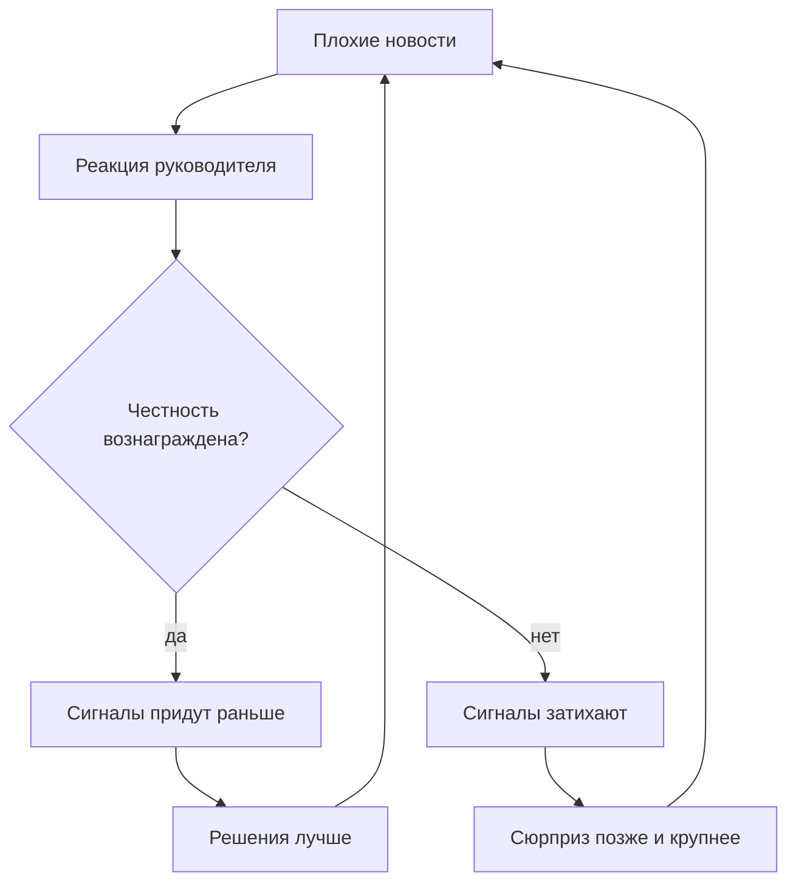
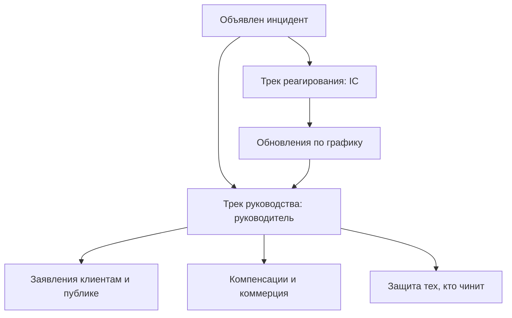
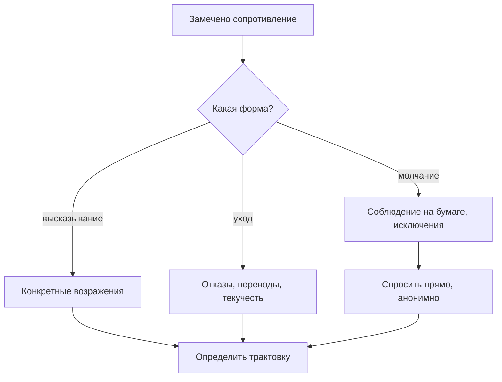
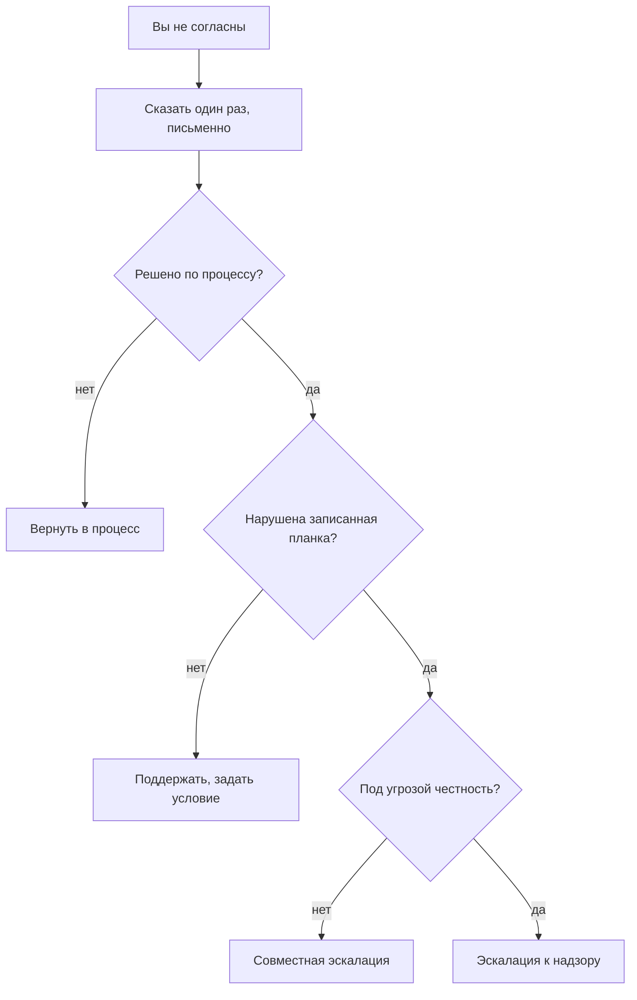

# Глава 57 — Кризисы, разногласия в руководстве и сопротивление изменениям { #chapter-57-crises-executive-disagreement-and-resistance-to-change }

Три ситуации проверяют старшего руководителя разработки строже любого плана: сбой, который видят клиенты
и публика; решение высшего руководителя, которое вы считаете ошибочным; изменение, от которого
организация молча отказывается. Проблема у них общая: информацию, которая нужнее всего руководителю, люди
отдают неохотнее всего, и отдадут ли, зависит от поведения самого руководителя. Эта глава о том, как
провести организацию через публичный сбой (в том числе что и когда говорить клиентам); как не соглашаться
с высшим руководством, чтобы несогласие прозвучало один раз и ясно, после чего вы либо поддерживаете
решение, либо эскалируете вопрос; и как читать сопротивление изменениям как свидетельство о самом
изменении. Сквозные примеры — публичный отказ Checkout в Halvard Systems и разногласия в руководстве
Northstar Technologies в четвёртом квартале; обе компании вымышлены. См.
[кейс](../../case-studies/northstar/index.md) и
[страницу Halvard](../../case-studies/northstar/halvard.md).

!!! note "Связанные главы"
    [Глава 25](../05-engineering-quality/25-incidents-postmortems-and-change-failure-analysis.md) отвечает
    за реагирование на инциденты и безобвинительный разбор, [глава 43](../09-engineering-directorship/43-leading-change-and-director-failure-patterns.md)
    — за общий метод проведения изменений, [глава 39](../08-management-operating-system/39-reviews-decision-logs-escalation-and-executive-reporting.md)
    — за пути эскалации и журнал решений. [Глава 56](56-recovering-a-failing-engineering-organization.md)
    разбирает проваливающуюся организацию, [глава 58](58-layoffs-reductions-and-mergers.md) — сокращения и
    поглощения, [глава 59](59-transformation-under-constraint-and-scaling-without-bureaucracy.md) —
    урезанный бюджет.

## Почему это важно { #why-this-matters }

В команде тяжёлый инцидент — это долгая ночь, несогласие с руководителем — разговор, а команда, которая
сопротивляется новой практике, говорит об этом на ретроспективе. Издержки локальны, обратная связь
быстрая.

В организации каждая из трёх ситуаций доходит до руководителя через посредников. Об инциденте директор
узнаёт из эскалации клиента, о несогласии — из брошенной в коридоре фразы, о сопротивлении — из цифр,
которые потихоньку ползут не туда. Когда сигнал становится однозначным, уже поздно.

Для высшего руководства издержки становятся внешними и долговременными. Публичный сбой оценивают по тому,
как компания общалась, не меньше, чем по длительности простоя. Несогласие, которое так и не прозвучало на
встрече, превращается в два плана, идущих параллельно. Изменение, проведённое вопреки сопротивлению,
может стоить года доверия. И во всех трёх случаях руководитель, который управляет не информацией, а
сообщением, теряет и то и другое.

## Цели главы { #learning-objectives }

После этой главы вы сможете:

- Вести трек руководства во время публичного сбоя: защищать тех, кто чинит, принимать решения, которые
  может принять только высшее руководство, и сообщать вовне в фиксированном ритме, не утверждая того,
  чего вы ещё не знаете.
- Выбирать стратегию внешней реакции по тому, какую ответственность припишут компании стейкхолдеры, и
  держаться её от первой публикации статуса до публичного разбора.
- Продуктивно не соглашаться с высшим руководителем: высказать несогласие один раз, письменно и там, где
  принимается решение, а затем по явному тесту решить, поддержать решение или эскалировать.
- Поддерживать решение, против которого вы выступали, не саботируя его и оговорив условие пересмотра.
- Диагностировать сопротивление изменениям как информацию о содержании изменения, его процессе,
  интересах, истории или ресурсе, прежде чем считать его проблемой людей.

## Ментальная модель { #the-mental-model }

> **Ментальная модель:** в кризисе, при разногласии и при сопротивлении дефицитный ресурс один — честная
> информация, пришедшая рано. Каждая реакция руководителя либо вознаграждает того, кто её принёс, либо
> учит его в следующий раз промолчать. Сообщайте вовне по жёсткому графику, что вы знаете и чего не
> знаете. Говорите высшему руководству о своём несогласии один раз и письменно, а затем поддержите
> решение или эскалируйте открыто, на виду у всех. Считайте сопротивление данными об изменении, прежде
> чем считать его проблемой людей.

Петля работает во всех трёх ситуациях. Вице-президент, который на бридже инцидента (живом созвоне, где
координируются те, кто чинит) требует назвать срок восстановления, учит их гадать. CTO (технический
директор), наказавший несогласного директора, учит следующего соглашаться на встрече и сопротивляться в
коридоре. Директор, называющий возражения «сопротивлением», учит руководителей не возражать, а молча
выдавать исключения. Каждая такая реакция по-своему разумна, и каждая портит информацию, от которой
зависит следующее решение.

## Подробный разбор { #deep-conceptual-explanation }

### Когда инцидент становится кризисом { #when-an-incident-becomes-a-crisis }

Инцидент становится кризисом, когда угрожает доверию людей за пределами разработки: клиентов, у которых
остановился бизнес, партнёров, на которых возлагают вину, совета директоров, регулятора. Техническое
реагирование почти не меняется. Меняется другое: появляется второй набор решений, которые координатор
инцидента (incident commander, IC) принимать не должен: что сказать клиентам, компенсировать ли ущерб
сверх договора, возникает ли обязанность раскрыть информацию. Например, публичная компания в США, как
правило, обязана сообщить о существенном инциденте кибербезопасности (таком, который разумный инвестор
счёл бы важным) в течение четырёх рабочих дней после того, как признала его существенным
([SEC, 2023](../../references/bibliography.md#sec2023cyberrule); **стандарт**). Команде высшего
руководства стоит знать свои обязанности заранее, до того как такой день наступит.

Модель книги — два трека, которые соприкасаются в одной точке. Она опирается на роли в инциденте из
главы 25 и из книги Google SRE ([Stribblehill, 2017](../../references/bibliography.md#google2017managing);
**задокументированная практика**).

| Трек | Кто | Отвечает за | Не должен |
|---|---|---|---|
| Реагирование | Координатор инцидента и те, кто чинит | Смягчение последствий, диагностику, живой документ о состоянии, ритм технических обновлений | Утверждать публичные формулировки, обещать компенсацию |
| Руководство | Ответственный руководитель (VP или CTO) вместе с руководителями коммуникаций и работы с клиентами | Внешние заявления, звонки крупнейшим клиентам, компенсации, раскрытие информации, внутренние сообщения, защиту бриджа | Подключаться к бриджу, чтобы требовать оценок; называть причину, пока бридж её не подтвердил |

Единственная точка соприкосновения — плановое обновление от ответственного за коммуникацию. Руководитель,
который подключается к бриджу и начинает командовать, разрушает ту самую ролевую структуру, ради которой
и существует процесс реагирования. Это вывод книги из исследования Weick о том, как под давлением вместе
рушатся ролевая структура и осмысление происходящего
([Weick, 1993](../../references/bibliography.md#weick1993collapse); **научный результат**, один случай).
К тому же в первый час причины не знает никто: у сбоев в сложных системах несколько сопутствующих
дефектов ([Cook, 1998](../../references/bibliography.md#cook1998complex)), поэтому всякий, кто говорит
уверенно, гадает.

### Что и когда говорить клиентам { #what-to-tell-customers-and-when }

Самые полезные данные о внешней кризисной коммуникации даёт ситуационная теория кризисной коммуникации
Timothy Coombs (Situational Crisis Communication Theory, SCCT). Она построена на экспериментах, а не на
разборе отдельных случаев ([Coombs, 2007](../../references/bibliography.md#coombs2007protecting);
**научный результат**, в основном на участниках, читавших описания кризисных сценариев). Четыре её
положения переносятся на отказ ПО.

**Сначала люди, потом репутация.** *Инструктирующая информация* (instructing information) говорит
стейкхолдерам, что сделать, чтобы защитить себя. *Адаптирующая информация* (adjusting information)
помогает им справиться с ситуацией: что произошло, что делается, плюс выражение сочувствия. Сочувствия
ждут, и оно не означает признания вины. Для продавца, у которого не работает оформление заказа,
инструктирующая информация конкретна: какие заказы не прошли, списаны ли деньги с покупателей, нужно ли
отправлять заказы заново. В публикации статуса, где сказано только «мы разбираемся», нет ни того ни
другого.

**Ответственность приписывают, а история её усиливает.** SCCT делит кризисы по тому, какую
ответственность приписывают компании стейкхолдеры: жертва (слух, стихийное бедствие), случайность
(техническая ошибка) и предотвратимый кризис (человеческая ошибка, злоупотребление). В SCCT эти группы
называются кластерами. История кризисов, то есть череда похожих кризисов в прошлом, — усиливающий фактор:
из-за неё стейкхолдеры приписывают компании больше ответственности. Отказ, вызванный собственным
изменением провайдера, находится между технической и человеческой ошибкой. В трактовке книги клиенты
относят такой отказ ближе к «предотвратимым», если у компании недавно были похожие сбои.

**Подбирайте стратегию под приписанную ответственность и не смешивайте стратегии.** SCCT делит ответы на
три группы: отрицать (отрицание, поиск козла отпущения), преуменьшать (отговорки, оправдание) и
восстанавливать (компенсация, извинение). Для предотвратимых кризисов, а также для случайных, если у
компании есть история кризисов, теория рекомендует восстановление. И предупреждает, что смешение
отрицания с восстановлением подрывает всю реакцию. Обвинить поставщика в одном сообщении и извиниться в
следующем — хрестоматийный пример такого смешения.

**Больше — не всегда лучше.** Чрезмерно уступчивая реакция стоит дороже, защищает репутацию не лучше и
может создать впечатление, что кризис серьёзнее. Компенсация должна следовать за приписанной
ответственностью, а не за тревогой руководителя.

Исследования восстановления доверия добавляют чёткое различие. В двух экспериментах извинение лучше
восстанавливало доверие, когда нарушение касалось компетентности, а отрицание — когда оно касалось
честности ([Kim et al., 2004](../../references/bibliography.md#kim2004removing); **научный результат**).
Отказ — провал компетентности, и подходящий способ восстановить доверие — признать его. Но вводящее в
заблуждение заявление во время отказа, например обвинение партнёра до того, как известна причина,
превращает провал компетентности в вопрос честности. Здесь извинение помогает хуже, и закрывать вопрос
приходится исправлением конкретного заявления. Поэтому
[глава 25](../05-engineering-quality/25-incidents-postmortems-and-change-failure-analysis.md#communicating-during-an-incident)
настаивает: никакую причину не называют публично, пока её не подтвердит разбор.

### Два публичных случая { #two-public-cases }

Две компании опубликовали откровенные рассказы о том, как они общались во время крупных сбоев
(**задокументированная практика**: каждая организация рассказывает о себе сама).

**Atlassian, апрель 2022 года.** Скрипт обслуживания, запущенный с идентификаторами не того типа, удалил
883 сайта, принадлежавших 775 клиентам; некоторые клиенты оставались без своих продуктов до 14 дней.
Согласно разбору компании, первым широким внешним сообщением стал твит примерно через 41 час после начала
удалений, а со многими клиентами не удавалось связаться, потому что их контактные данные были удалены
вместе с сайтами ([Viswanath, 2022](../../references/bibliography.md#atlassian2022outage)). Уроки такие.
Канал, по которому вы связываетесь с клиентами, не должен зависеть от отказавшей системы. А под «мы пока
не знаем когда» клиенты могут планировать, под молчание — нет.

**GitLab, январь 2017 года.** Инженер, пересоздававший реплику базы данных, удалил данные на основном
сервере. GitLab.com не работал около 18 часов: как выяснилось, резервное копирование незаметно давало
сбои ([GitLab, 2017](../../references/bibliography.md#gitlab2017postmortem)). Команда
вела публичный документ о ходе восстановления, где поначалу было названо имя инженера; компания
пообещала впредь убирать имена. Урок: будьте открыты во всём, что касается системы и хронологии, но
никогда не называйте вовне конкретного человека. Те, кто ждёт обвинений, перестают сообщать подробности,
без которых не предотвратить следующий сбой
([Allspaw, 2012](../../references/bibliography.md#allspaw2012blameless)).

### Несогласие с высшим руководством { #disagreeing-with-executives }

Несогласие, обращённое вверх, — одна из форм того, что исследователи называют *высказыванием* (voice):
человек говорит об идеях или опасениях, чтобы что-то улучшить. Удерживает от этого в основном страх. В
интервью большинство сотрудников признали, что промолчали о каком-то опасении, чаще всего из страха
получить негативный ярлык ([Milliken et al., 2003](../../references/bibliography.md#milliken2003silence);
**научный результат**, разведочное исследование). В большом исследовании в одной сети ресторанов
открытость руководителей предсказывала высказывания сотрудников лучше, чем вдохновляющее лидерство, и
действовала через [психологическую безопасность](../../glossary.md#psychological-safety)
([Detert and Burris, 2007](../../references/bibliography.md#detert2007leadership); **научный
результат**). Этот конструкт подробно разбирает
[глава 11](../03-high-performing-teams/11-high-performance-trust-safety-and-accountability.md). Для
старшего руководителя отсюда два следствия. Во-первых, вы сами будете молчать перед начальством, если не
решите иначе. Во-вторых, прежде чем высказать несогласие, ваши подчинённые смотрят, как вы принимаете
чужое.

Книга Albert Hirschman *Exit, Voice, and Loyalty* известна идеей, что недовольный участник может уйти или
высказаться, а лояльность повышает вероятность того, что он выскажется
([Hirschman, 1970](../../references/bibliography.md#hirschman1970exit); **мнение эксперта**). Для
директора или вице-президента, не согласного с решением высшего руководства, эта книга добавляет третий,
худший вариант, которого у Hirschman нет: **молчаливое подчинение**, когда человек говорит «да» и тянет с
работой. Оно выглядит как лояльность, а действует как скрытое вето.

Большинство разногласий разрешает простая норма: спорить в полную силу, а затем поддержать решение.
Andrew Grove известен последовательностью «свободное обсуждение, ясное решение, полная поддержка»
([Grove, 1983](../../references/bibliography.md#grove1983high); **мнение эксперта**). Письмо Jeff Bezos
за 2016 год рекомендует принцип «не согласен, но действую» (disagree and commit), в том числе для самого
начальника. Оно же советует эскалировать фундаментальные расхождения рано, а не тянуть спор, пока не
победит самый выносливый ([Bezos, 2017](../../references/bibliography.md#bezos2016letter);
**задокументированная практика**). Как это работает внутри команды, показывает
[глава 13](../03-high-performing-teams/13-decision-making-in-teams.md). Когда вы не согласны с
начальством, отличаются три вещи.

**Важно, где говорить.** Несогласию место там, где принимается решение. Метаанализ 116 исследований
показал, что разногласия по существу задачи полезнее в командах высшего руководства и для качества
решений ([de Wit et al., 2012](../../references/bibliography.md#dewit2012paradox); **научный результат**,
корреляционный). Несогласие, высказанное на встрече высшего руководства, улучшает решение; высказанное
потом коллегам — только ослабляет его исполнение.

**Один раз и письменно.** Изложите несогласие в одной короткой записке: какое решение приняли бы вы,
почему, во что оно обойдётся и какие данные изменили бы ваше мнение. Записка заставляет быть точным, и её
можно приложить к записи решения. Повторять аргументы после того, как решение принято, — это уже не
высказывание, а кампания.

**Поддержать — значит действовать, а не чувствовать.** Поддержать решение значит исполнять его как своё,
защищать без «меня заставили», честно сообщать о результатах и не открывать вопрос заново, пока не
сработает согласованное условие пересмотра. Соглашаться не обязательно, а саботировать затягиванием
нельзя.

### Когда поддержать, а когда эскалировать { #when-to-commit-and-when-to-escalate }

Большинство разногласий с высшим руководителем должно заканчиваться поддержкой. Эскалация через его
голову оправдана только в узких случаях; вне их она тратит доверие, которое понадобится вам позже. Тест
ниже — **рекомендация книги**.

| Предмет несогласия | Пример | Что делать |
|---|---|---|
| Суждение в пределах полномочий руководителя | Какой показатель надёжности вынести на страницу для совета директоров | Высказаться один раз письменно; поддержать с условием пересмотра |
| Решение, принятое в обход согласованного процесса | Ответ, брошенный мимоходом; частная договорённость за спиной у других | Вернуть его в процесс: это ещё не решение ([глава 39](../08-management-operating-system/39-reviews-decision-logs-escalation-and-executive-reporting.md#escalation-paths)) |
| Нарушение записанной планки | Переклассификация инцидентов ради цели; правило безопасности или требование закона | Отказаться исполнять; эскалировать совместно и письменно |
| Вопрос честности | Цифры для клиентов или совета директоров, о которых вы знаете, что они неверны | Эскалировать тому, кто надзирает за автором отчёта: CEO (генеральному директору), затем комитету по аудиту совета директоров |
| Закономерность, а не одно решение | Один и тот же руководитель каждый квартал действует в обход одного и того же процесса | Поднять вопрос о закономерности, с примерами, на форуме, который владеет процессом |

Для средних строк нужна **планка**, записанная до спора: то, что не подлежит обсуждению, например
определения серьёзности, минимальные требования безопасности и точность отчётных показателей
([глава 46](../10-business-leadership/46-stakeholder-management-and-negotiation.md)). Без неё любая
эскалация выглядит как предпочтение, выданное за принцип. По возможности эскалируйте совместно: обе
стороны пишут одно обоснование и вместе выносят его наверх. Если ни поддержка, ни эскалация не помогли, а
исполнить решение по совести вы не можете, честных вариантов остаётся два: открыто его принять или уйти.
Молчаливого подчинения среди них нет.

### Сопротивление как информация { #resistance-as-information }

Сопротивление нередко отчасти создаёт сам инициатор изменения, и к тому же оно может быть ресурсом.
Исследователи утверждают, что считать сопротивление иррациональной реакцией тех, кого касается изменение,
однобоко, а двойственное отношение встречается часто и иногда полезно
([Ford et al., 2008](../../references/bibliography.md#ford2008resistance);
[Piderit, 2000](../../references/bibliography.md#piderit2000rethinking); **мнение эксперта**). Обзор
79 исследований разделяет реакции на содержание изменения и реакции на его процесс
([Oreg et al., 2011](../../references/bibliography.md#oreg2011recipients); **научный результат**). Ничто
из этого не доказывает, что сопротивляющиеся правы. Но на вопрос «что мне говорит это сопротивление?»
стоит ответить раньше, чем на вопрос «как его преодолеть?».

Трактовки ниже — **рекомендация книги**. Это диагностика: трактовки идут от тех, при которых
сопротивление вероятнее всего вызвал сам инициатор изменения, к тем, где это наименее вероятно.

| Трактовка | Что говорит сопротивление | Какие свидетельства на неё указывают | Ответ |
|---|---|---|---|
| Содержание | «Здесь это не сработает» | Конкретные возражения о механизме, часто от экспертов | Проверить возражение; если оно подтверждается, изменить проект |
| Процесс | «Нас никто не спросил» | Возражения о сроках, консультациях, внезапности | Перепроектировать внедрение вместе с носителями |
| Интересы | «Затраты ложатся на нас, а выгода достаётся другим» | Сопротивление сосредоточено там, куда ложатся затраты | Оценить затраты, компенсировать их или перераспределить |
| История | «Прошлую инициативу тоже бросили» | Ссылки на прошлые инициативы и нарушенные обещания | Небольшие, надёжные обязательства, выполняемые на виду |
| Ресурс | «Не в этом квартале» | Сопротивление следует за нагрузкой и календарём | Изменить очерёдность или профинансировать изменение |
| Человек | Закономерность, свойственная одному человеку при любых изменениях | Один и тот же человек, при каждом изменении, без конкретики | Разговор о результативности ([глава 9](../02-people-management/09-performance-management-and-underperformance.md)) |

Форма сопротивления важна не меньше его содержания. Высказывание — сигнал, который дешевле всего
прочитать и ценнее всего защищать. Уход (отказ участвовать, перевод, увольнение) приходит позже и меньше
говорит о причинах. Молчание (соблюдение на бумаге, накопление исключений) обходится дороже всего: оно
сообщает, что что-то не так, и ничего не говорит о том, что именно. Когда сопротивление замолкает,
сначала создайте безопасный канал, например анонимный пульс-опрос с несколькими конкретными вариантами
ответа. Затем посмотрите на собственное поведение: высказывания обычно смолкают после того, как их
проигнорировали или за них наказали.

## Пример из инженерной организации { #engineering-organization-example }

Цифры — **иллюстрация**. Halvard Systems — вымышленная компания с 500 инженерами, с которой книга
сравнивает Northstar. Её группа Commerce (130 инженеров под руководством Nadia Brennan, VP of Commerce) и
направление Checkout (41 инженер под руководством директора Owen Achterberg) описаны на
[странице Halvard](../../case-studies/northstar/halvard.md). Допущения: около 8 600 продавцов принимают
оплату картами через Halvard Checkout; на карты приходится 64% попыток оформления заказа, а во время
отказа таких попыток было в среднем 1 500 в минуту. Договор обещает доступность 99,95% в месяц, с
кредитом в 10% месячных комиссий за checkout, если доступность ниже этого уровня, и в 25% — если ниже
99,0%; минута считается недоступной, если неудачны более 5% попыток. За два предыдущих квартала у
Checkout было два инцидента Sev1.

**Что произошло.** Во вторник в 14:05 UTC инженер изменил правило маршрутизации платежей через
административную консоль. Конфигурация маршрутизации находилась вне аудируемого пайплайна Halvard,
поэтому изменение сразу ушло на весь трафик. С 14:10 запросы на авторизацию карт уходили на эндпоинт,
который их отклонял, и оформление заказов с оплатой картой перестало работать.

| Время (UTC) | Событие |
|---|---|
| 14:10 | Оформления заказов с оплатой картой начинают отказывать |
| 14:18 | Первая жалоба продавца в соцсетях |
| 14:23 | Срабатывает внутренний алерт по доле ошибок оформления |
| 14:26 | Объявлен [Sev1](../../glossary.md#severity-sev1-sev2-sev3); Ingrid Solberg, staff-инженер в Checkout, становится [координатором инцидента](../../glossary.md#incident-commander) (IC) |
| 14:44 | Nadia Brennan подключается к бриджу и спрашивает, когда ожидается восстановление |
| 14:50 | По просьбе IC Nadia переходит в канал руководства, куда поступают обновления от IC |
| 14:52 | Первая публикация на странице статуса, после ожидания одобрения VP |
| 15:20 | Шаблон ответа поддержки, отправленный примерно по 1,100 открытым обращениям, приписывает сбой «стороннему платёжному провайдеру» |
| 15:35 | На бридже находят изменение маршрутизации |
| 15:41 | Изменение отменено; узлы маршрутизации хранят кешированную конфигурацию до 60 минут |
| 16:05 | Обновление статуса называет «изменение конфигурации на нашей стороне» |
| 17:00 | Узлы перезапускают волнами; полный отказ заканчивается |
| 17:30 | Доля ошибок ниже 5 процентов |
| 17:55 | Доля ошибок вернулась к норме |

**Последствия.**

| Показатель | Значение |
|---|---|
| Неудачные попытки оплаты картой | Около 168,000 (170 минут полного отказа, затем 55 минут примерно с 10 процентами ошибок) |
| Сессии покупок, не завершённые в течение 24 часов | Около 65,000 из 112,000 затронутых |
| Доступность за месяц | 99.54 процента (200 минут недоступности) при обещанных 99.95 процента |
| Кредит по договору | Уровень 10 процентов: $380,000 от $3.8 млн комиссий затронутых продавцов |

Потерянные сессии — это потери продавцов (примерно до $4,6 млн продаж при среднем заказе $71), а не выручка
Halvard.

**Коммуникация в цифрах.** Продавцы узнали первыми: первая публичная жалоба (14:18) опередила
внутренний алерт (14:23). Стандарт Halvard требует первого уведомления в течение 15 минут после
объявления Sev1. Оно вышло с опозданием на 11 минут, потому что публикации о Sev1 требовали одобрения
вице-президента. Обращений продавцов за три часа набралось около 2 300 при обычных 150 в день.

**Проблема честности.** Шаблон ответа, отправленный в 15:20, руководитель группы поддержки написал по
первому наблюдению с бриджа: процессинговая компания возвращает ошибки. Это было правдой и при этом
вводило в заблуждение. Процессинговая компания отклоняла запросы, которые Halvard сама направила не туда,
и её поддержка говорила продавцам, что никаких проблем не видит. В 16:05 страница статуса Halvard назвала
внутреннее изменение. Теперь у продавцов на руках было два заявления Halvard: одно обвиняло партнёра,
другое признавало, что причина на стороне самой Halvard. Поиск козла отпущения смешался с
восстановлением, и провал компетентности превратился в вопрос честности.

**Трек руководства после отказа.** В 20:00 UTC Nadia и Mireille Dubois (руководитель коммуникаций)
отправили продавцам сообщение, которое начиналось с инструктирующей информации: с покупателей не списаны
деньги за оформления с оплатой картой, не прошедшие между 14:10 и 17:55; в панели каждого продавца
доступен список затронутых сессий с покупателями, с которыми можно связаться; повторно отправлять ничего
не нужно. Затем одним предложением говорилось, что произошло, звучало извинение и называлось время
следующего обновления. На следующее утро во все обращения, получившие шаблонный ответ, ушло исправление:
«В нашем сообщении в 15:20 говорилось, что сбой вызвал сторонний провайдер. Это было неверно, и мы
отправили его, ещё не зная причины. Причиной стало изменение, которое внесли мы».

Компенсация следовала за приписанной ответственностью. Два Sev1 за два квартала — это история кризисов, а
в таком случае рекомендации SCCT требуют стратегий восстановления. Оценили три варианта: только кредиты
по договору ($380 000); кредиты плюс дополнительные 15% для 140 продавцов, которые в тот день проводили
акции ($470 000 в сумме); или 20% каждому затронутому продавцу ($760 000). CTO Halvard утвердил средний
вариант. Его логика: компенсировать там, где вред был наибольшим, избежать общего жеста, который, судя по
исследованиям, не покупает больше доверия, а остальные усилия направить на то, чтобы исправления были
видны.

## Как принимать решение { #decision-framework }

Используйте три таблицы вместе: первую — в первые часы публичного сбоя, вторую — когда вы не согласны с
высшим руководителем, третью — когда изменение встречает сопротивление.

**Внешняя коммуникация по фазам** (рекомендация книги, с опорой на Coombs и главу 25):

| Фаза | Что говорить | Чего не говорить | Кто утверждает |
|---|---|---|---|
| Первое уведомление (в фиксированный срок после объявления) | Мы знаем; что затронуто; что делать клиентам; время следующего обновления | Любую причину; любую оценку, которую вы не подтвердили | Заранее утверждённый шаблон, который руководитель коммуникаций отправляет без визы руководства |
| В ходе инцидента (фиксированный ритм, даже без новостей) | Каково влияние сейчас; что делается; что пока неизвестно | Гипотезы с бриджа | Руководитель коммуникаций, руководство в курсе |
| Восстановление | Во сколько восстановлено; что клиентам ещё нужно сделать | «Полностью устранено», пока доля ошибок не вернулась к норме | Высший руководитель |
| В течение 24 часов | Извинение, соответствующее приписанной ответственности; компенсация, если она есть; дата разбора | Имена людей; обвинения в адрес партнёров | Ответственный руководитель и юристы |
| Публичный разбор (через дни, а не недели) | Хронология, влияние, сопутствующие факторы, исправление всего, что было сказано неверно, обязательства с датами | Обязательства, в выполнении которых вы не уверены | Ответственный руководитель |

**Поддержать или эскалировать** (рекомендация книги):

**Трактовка сопротивления** (рекомендация книги): прежде чем действовать, письменно ответьте, какую
трактовку подтверждают свидетельства, какую форму принимает сопротивление, чем вы сами ему
способствовали, что изменило бы ваше мнение и на кого ложатся затраты. Если в плане нельзя указать ни
одного изменения, сделанного из-за возражения, значит, никого не услышали.

## Компромиссы { #trade-offs }

**Скорость против точности во внешней коммуникации.** Раннее уведомление неполно, а при позднем рамку
событию задаёт кто-то другой. Отделите то, что может быть быстрым (признание, влияние, инструкции), от
того, что должно быть медленным (причина, компенсация).

**Прозрачность против юридических рисков.** Опубликованные сопутствующие факторы помогают клиентам
оценить исправления, но в договорном споре их могут прочитать как признание. Юридическая проверка
формулировок оправдана; удаление фактов, которые клиенты и так знают, — нет.

**Присутствие руководителя против ясности ролей.** Клиенты и сотрудники хотят видеть руководителя во
время кризиса, но бриджу нужно меньше людей, а не больше. Будьте заметны на звонках клиентам и во
внутренних сообщениях, но не появляйтесь на бридже.

**Поддержка против совести.** На поддержке решений, против которых вы выступали, держится команда высшего
руководства; но если поддерживать всё подряд, ваше несогласие обесценивается. Граница проходит по планке,
поэтому её и нужно записать до спора.

**Выслушать сопротивление или сохранить темп.** Ограничьте диагностику по времени: один раунд
выслушивания, письменные выводы, решение о том, что меняется, а дальше — вперёд.

## Типичные провалы { #failure-modes }

**Руководитель на бридже.** Старший руководитель подключается к созвону по инциденту и требует оценок,
перенаправляет тех, кто чинит, или спорит о причинах. Как заметить: те, кто чинит, начинают обращаться к
руководителю, а не к координатору инцидента.

**Первое уведомление, утонувшее в согласованиях.** Первое сообщение клиентам ждёт визы. Как заметить:
клиенты публично жалуются раньше, чем выходит первое уведомление.

**Догадка вместо причины.** Гипотеза с бриджа доходит до клиентов как факт, часто с обвинением в адрес
поставщика. Как заметить: шаблоны ответов поддержки пишут по сообщениям из чата.

**Смешанные стратегии.** Одно сообщение отрицает, следующее извиняется. Как заметить: заявления для
клиентов готовят разные команды, и единого владельца у этих заявлений нет.

**Имя инженера.** Имя человека появляется в публичном рассказе или в рассказе для клиентов. Как
заметить: хронологию пишут в виде «X запустил скрипт», а не «скрипт был запущен».

**Мнимая поддержка.** Руководитель соглашается на встрече, а потом тянет с работой. Как заметить:
согласованный пункт остаётся «в планировании», а остальная работа его владельца движется.

**Эскалация как угроза.** Фразу «Я дойду с этим до CEO» используют, чтобы выиграть спор. Как заметить:
эскалации приходят только от одной стороны.

**Сопротивление как патология.** Возражения списывают на проблемы с отношением, а их содержание никто не
изучает. Как заметить: ни одно изменение ни в одном плане нельзя проследить до возражения.

**Сбор мнений, который ничего не меняет.** Опасения собрали, но ничего заметного не изменилось. Как
заметить: во втором раунде консультаций звучат те же опасения, что и в первом.

## Применение в крупной организации { #enterprise-application }

В организации из 50–150 инженеров трек руководства обычно лично ведёт директор или CTO вместе с
руководителем службы работы с клиентами. Заранее готовят такой набор:

- **Карточка кризисных ролей**, где для каждого продукта tier 1 названы ответственный руководитель, его
  заместитель, руководитель коммуникаций и тот, кто утверждает компенсации. Полномочия координатора
  инцидента заканчиваются на шаблоне статуса.
- **Заранее утверждённые шаблоны** первого уведомления, плановых обновлений, сообщения о восстановлении и
  исправления, чтобы первое уведомление не требовало визы. Заранее согласуйте с юристами, что могут
  говорить шаблоны.
- **Резервный канал связи с клиентами** (страница статуса и списки контактов, размещённые вне продукта),
  который проверяют хотя бы раз в год. Аргумент в его пользу — разбор Atlassian.
- **Операционные контакты крупнейших клиентов**, чтобы служба работы с клиентами звонила им первой.
- **Записанная планка и правило эскалации** для разногласий в высшем руководстве, рядом с
  [журналом решений](../../glossary.md#decision-log).
- **Разбор сопротивления** для любого изменения, которое затрагивает больше одной команды: на первой
  контрольной точке перечислите полученные возражения, трактовку каждого и то, что из-за них изменилось.

Если вы директор и полномочий устанавливать такую политику у вас нет, предложите её наверх до первого
кризиса: одностраничную карточку ролей и шаблон первого уведомления для своих продуктов, отправленные на
утверждение вашему CTO или VP.

## Взгляд CTO { #cto-perspective }

CTO сталкивается со всеми тремя проблемами сразу, и от различий, проведённых в этой главе, зависит, куда
уходит его время. Бриджи по инцидентам можно делегировать, и CTO на них быть не должно. А звонок крупному
клиенту, у которого остановился бизнес, может оказаться самым важным часом недели.
[Глава 25](../05-engineering-quality/25-incidents-postmortems-and-change-failure-analysis.md#cto-perspective)
просит CTO ещё до инцидента решить, кто утверждает заявления для клиентов. Эта глава добавляет: CTO также
заранее и вместе с CEO решает, что компания будет компенсировать, а что нет, чтобы в ту самую ночь его не
решал тот, кто злее всех.

В вопросах несогласия CTO находится в середине цепочки эскалации. Наверх CTO высказывает несогласие перед
CEO на встрече высшего руководства, а в вопросах честности, и только в них, — перед советом директоров
через его [комитет по аудиту](../../glossary.md#audit-committee). А вниз по цепочке климат для
высказываний во всей организации задаёт то, как CTO реагирует на несогласие директора.

В вопросах сопротивления особая проблема CTO — сопротивление равных: против изменения в разработке
возражают CFO (финансовый директор), руководитель продаж или руководитель ИТ. За возражениями равных почти
всегда стоит трактовка через интересы, а часто и через содержание. Если считать их борьбой за
территорию, информация теряется.

В масштабе Halvard CTO не может вести трек руководства для каждой группы. Полезнее один раз задать
политику: первые уведомления без одобрения руководства, один владелец заявлений для клиентов, правила
компенсаций, привязанные к договору, и публичный разбор в течение фиксированного числа дней.

## Практический плейбук { #practical-playbook }

1. **До любого кризиса напишите карточку ролей и шаблоны** и согласуйте шаблоны с юристами.
2. **Проверьте резервный канал.** Сможете ли вы связаться с крупнейшими клиентами, если не работают ваш
   продукт, почта и провайдер учётных записей?
3. **Когда Sev1 виден клиентам, сразу открывайте трек руководства**, а первое уведомление пусть уходит по
   шаблону, не дожидаясь вас.
4. **Держитесь подальше от бриджа.** Спросите координатора инцидента, что ему нужно; обычно — защита от
   других руководителей.
5. **Начинайте с инструктирующей информации.** Сначала что делать клиентам, затем что произошло, затем
   сочувствие, затем время следующего обновления.
6. **Исправляйте всё неверное сразу и конкретно.** Процитируйте неверное заявление и замените его.
7. **Соизмеряйте компенсацию с вредом и приписанной ответственностью**: варианты с оценкой стоимости,
   решение за названным утверждающим.
8. **Публикуйте разбор через несколько дней**: с исправлениями, сопутствующими факторами, без имён и с
   тремя–пятью обязательствами, которые вы точно выполните.
9. **Если вы не согласны с высшим руководителем, напишите одну записку**: ваше решение, почему, во что
   оно обойдётся, что изменило бы ваше мнение. Принесите её туда, где принимается решение.
10. **Примените тест «поддержать или эскалировать».** Если поддерживаете, запишите условие пересмотра и
    скажите своей организации, что теперь это и ваше решение. Если эскалируете, делайте это совместно и
    письменно.
11. **Когда изменение встречает сопротивление, сначала классифицируйте, потом отвечайте.** Присвойте
    каждому возражению трактовку и форму, запишите, что вы изменили, и сообщите об этом возражавшим.
12. **Раз в квартал проверяйте собственный климат для высказываний.** Посчитайте полученные возражения и
    планы, которые они изменили. Если оба числа равны нулю, ваша находка — само молчание.

## Кейс { #case-study }

!!! info "Northstar: что уже известно"
    Недели 41–49 первого года директора. В квартале 3 число инцидентов Sev1 и Sev2 снизилось до 14: это
    первый квартал в пределах мандата CTO (не более 15). Но все решения на второй год (организация,
    продолжение программы качества, главный показатель для совета директоров, план по персоналу) пока не
    приняты. См. [хронологию](../../case-studies/northstar/timeline.md). Впервые читаете о Northstar?
    Прочитайте [«Год вкратце»](../../case-studies/northstar/year-in-brief.md),
    [действующих лиц](../../case-studies/northstar/cast.md) и
    [брифинг квартала 4](../../case-studies/northstar/quarter-4-briefing.md).

Этот кейс — **вымысел**; он основан на разделах о квартале 4 из
[хроники года 1](../../case-studies/northstar/first-quarter.md#quarter-4). Ни у одного из открытых
решений квартала 4 исход не записан.

**Несогласие с CTO.** Victor Lindqvist (CTO, руководитель директора) предложил сделать главным
показателем для совета директоров на второй год формулировку «инцидентов Sev1 и Sev2 меньше 10 в
квартал». Директор подготовил встречное предложение: не более 40 за второй год по скользящей сумме за
четыре квартала с отчётностью вместе с аудитом серьёзности; плюс доступность 99,9% в каждом квартале и
условие: после двух кварталов с показателем выше 12 вопрос о профилактике открывается снова. Причина —
шум: даже при истинном среднем 9 в квартал цель «меньше 10» не будет выполнена примерно в двух кварталах
из пяти (расчёт приведён в
[главе 46](../10-business-leadership/46-stakeholder-management-and-negotiation.md)). На черновой странице
для совета стоят оба варианта; выбор за Victor, и он пока не сделан.

По тесту «поддержать или эскалировать» это суждение в пределах полномочий CTO: страница для совета — его.
Директор высказал несогласие один раз и письменно, а больше первая строка ничего и не требует. Если
Victor выберет свой вариант, следующий шаг — поддержать решение, с условием пересмотра и записанной
планкой: определения серьёзности меняются только через их владельцев, еженедельный аудит серьёзности
продолжается, и ни одного руководителя не оценивают по числу инцидентов его команды. Эскалацией это
станет, только если планку нарушат, например если в квартале, где показатель близок к цели, начнут
давить, требуя переоценить инциденты. Тогда это вопрос честности, и путь ведёт к CEO, а не к очередному
раунду с Victor.

**Пять возражений, прочитанных как информация.** Коротко о контексте. Директор отправил продукту
письменный рабочий договор о том, как две функции планируют вместе. Из жалобы дистрибьютора появился
показатель исправленных заказов. А Engineering Excellence Day, собственная инициатива директора (день
улучшений, который проводили раз в четыре недели в квартале 3), терял участников, пока его не прекратили.

| Возражение | Форма | Трактовка | Что оно несёт |
|---|---|---|---|
| Amara Okafor (CPO, директор по продукту) ставит рабочему договору три условия | Высказывание | Интересы | Совет директоров по-прежнему оценивает продукт по выполненным пунктам дорожной карты, так что риск несёт она |
| Amara доказывает, что корректности заказов место среди «отличных» возможностей в черновике стратегии Victor | Высказывание | Содержание | Данные: 7,800 исправленных заказов за 28 дней, 1.3 процента отправленных |
| Greg Tanaka (VP по продажам) возражает против правила «никакой даты клиенту без оценки разработки и названного владельца» | Высказывание | Интересы, отчасти процесс | Сделки закрываются под даты; 5 из 17 дат в базовом квартале были названы до оценки |
| Marta Kowalczyk (руководитель ИТ) возражает против выноса безопасности из ИТ | Высказывание | Содержание | Безопасность проверяет разработку; перенос может убрать единственную независимую проверку |
| Участие в Engineering Excellence Day падает с 64 до 41 и до 23 инженеров | Уход, затем молчание | Процесс и ресурс | Ни пилота, ни руководителей среди авторов замысла, и дата, совпавшая с работой Billing по закрытию периода (крайний срок месячной отчётности у финансов) |

Выделяются две закономерности. Самые полезные возражения пришли от руководителей, которые подкрепили их
данными: возражение Amara улучшило черновик стратегии в тот же день. Самыми дорогими оказались возражения
против собственной инициативы директора: там руководители возражали исключениями
([глава 43](../09-engineering-directorship/43-leading-change-and-director-failure-patterns.md)).

Greg Tanaka — случай посложнее, потому что его возражения повторяются. Он хотел перевести инженеров
профилактики на функции для сделок и с глазу на глаз предложил свою поддержку в обмен на двух инженеров;
директор отказался. Затем Greg возразил против правила об оценках. Повторяющиеся возражения одного
руководителя — это последняя строка таблицы «поддержать или эскалировать»: закономерность, которую нужно
поднять с примерами на форуме, владеющем процессом. Но это и информация. Все возражения Greg говорят об
одном: у продаж нет быстрого и надёжного способа получить ответ разработки до того, как клиент спросит о
дате. Правило уже обещает оценку в течение пяти рабочих дней. От того, будет ли разработка выполнять это
обещание, и зависит, сменится ли сопротивление Greg поддержкой.

**Что открыто.** Главный показатель для совета директоров, план по персоналу с правилом о датах для
клиентов, линия подчинения безопасности и распределение ресурса в продолжении программы на неделе 49
по-прежнему не решены.

## Упражнения { #exercises }

Разборы упражнений: [решения к главе 57](../../solutions/ch57-solutions.md).

### Базовый уровень { #foundational }

**F1.** На примере отказа Halvard Checkout из этой главы классифицируйте кризис по Coombs (кластер,
усиливающие факторы) и назовите стратегию реакции, которую рекомендуют его руководящие принципы. Затем
найдите в хронологии все моменты, где коммуникация Halvard отошла от этой стратегии, и для каждого
скажите, что за ним стоит: процесс, суждение человека под давлением или политика, заданная заранее.

**F2.** Перепишите два сообщения Halvard: первую публикацию статуса в 14:52 и шаблон ответа поддержки в
15:20. Каждое должно содержать инструктирующую информацию, говорить, что известно и что нет, и называть
время следующего обновления, не называя причины. Затем напишите свою, на ваш взгляд лучшую, версию
исправления, которое Halvard отправила на следующее утро. Объясните, что вы изменили и почему исправление
должно цитировать неверное заявление.

**F3.** Возьмите пять возражений в Northstar из таблицы кейса. Для каждого укажите, какие свидетельства
показали бы, что присвоенная вами трактовка неверна, и что вы сделали бы иначе, если бы верной оказалась
другая. Затем назовите возражение, которое вам сильнее всего захотелось бы счесть проблемой человека, и
объясните, чем опасно это искушение.

### Прикладное лидерство { #applied-leadership }

**A1.** Предположим (это гипотеза, которой нет в хронике Northstar), что Victor Lindqvist выбирает для
страницы совета директоров формулировку «инцидентов Sev1 и Sev2 меньше 10 в квартал», а не встречное
предложение директора. Вы — директор. Напишите записку, которую отправите Victor в тот же день,
сообщение шести руководителям и условие пересмотра, которое вы предложите. Затем опишите конкретное
обстоятельство, при котором вы перестанете поддерживать решение и эскалируете, и к кому.

**A2.** Предположим (гипотетический сценарий для читателя), что на неделе 51 релиз Northstar на 95 минут
ломает отправку заказов для всех клиентов, включая трёх из 40 крупнейших, и что клиент пишет об этом
публично раньше, чем Northstar что-либо сообщила. Используя только роли, которые есть в кейсе (Victor
Lindqvist, Sofia Alvarez как VP по работе с клиентами, директор и двенадцать координаторов инцидентов,
обученных на неделях 4 и 5), спроектируйте трек руководства на первые четыре часа: кто что делает,
первое уведомление, ритм, звонки крупнейшим клиентам и что Victor делает и чего не делает.

**A3.** Greg Tanaka возражает против правила «никакой даты клиенту без оценки разработки и названного
владельца». Отнеситесь к его возражению как к информации. Напишите одностраничное предложение для
команды высшего руководства, которое сохраняет планку правила и при этом отвечает на то, что несёт
возражение: какое обещание по срокам оценки разработка должна выполнять, как его измеряют и что
происходит, когда разработка его не выполняет.

### Решения на уровне руководства { #executive-decision-making }

**X1.** Вы — Victor Lindqvist, неделя 49. Спроектируйте кризисную политику руководства Northstar для
видимого клиентам Sev1: кто может утверждать первое уведомление, кто владеет заявлениями для клиентов,
кто решает о компенсации сверх договорных кредитов и на каком основании, когда публикуется публичный
разбор и как тратить ваши собственные два часа в неделю на инциденты (бриджи и звонки клиентам по
инцидентам, замеренные на неделях 44–46). Объясните, какие из этих решений вы вынесли бы к Helena Marsh
(CEO) и почему.

**X2.** Вы — CTO Halvard после отказа Checkout. Предположим (это сценарий для читателя, а не часть
хроники Halvard), что главный юрисконсульт Halvard (general counsel) просит описать в публичном разборе
«проблему конфигурации», не говоря, что это было изменение самой Halvard, и не упоминая шаблон ответа в
15:20. Nadia Brennan не согласна и вместе с юрисконсультом эскалирует вопрос к вам. Решите, что будет
сказано в разборе, обоснуйте решение с учётом рисков для честности и договорных рисков и назовите
общекорпоративные политики, которые вы в результате установите для всех четырёх продуктовых групп и
платформенной организации.

## Вопросы для размышления { #reflection-questions }

1. Когда вы в последний раз были не согласны с решением своего руководителя, вы сказали об этом на
   встрече, после неё или не сказали вовсе? Чему этот выбор научил ваших подчинённых?
2. Какую записанную планку в вашей организации вы отказались бы переступить, и знает ли ваш руководитель,
   где она проходит?
3. Сколько времени в вашем последнем инциденте прошло между первой жалобой клиента и первым сообщением
   компании? Кто должен был это сообщение утвердить?
4. Назовите изменение, которое вы вели и которое встретило сопротивление. Какую трактовку вы присвоили
   ему тогда и какую присвоили бы сейчас?
5. Что ваша команда должна думать о вас, чтобы решиться сказать, что ваша текущая инициатива
   проваливается?

## Главное { #key-takeaways }

- У кризиса два трека: те, кто чинит, исправляют систему, а ответственный руководитель отвечает за
  клиентов, компенсации и заявления. Не пускайте руководителя на бридж.
- Отправляйте первое уведомление по заранее утверждённому шаблону в фиксированный срок. Никогда не
  называйте причину, которую бридж не подтвердил.
- Выберите одну стратегию реакции, соответствующую приписанной ответственности, и держитесь её. Если
  сначала обвинить партнёра, а потом извиниться, провал компетентности превращается в вопрос честности.
- Компенсируйте соразмерно вреду и приписанной ответственности.
- Высказывайте несогласие один раз, письменно, там, где принимается решение; затем поддержите решение с
  условием пересмотра.
- Эскалируйте только решение, принятое в обход процесса, нарушение записанной планки, вопрос честности
  или закономерность. Эскалируйте совместно и письменно.
- Молчаливое подчинение — это скрытое вето. Если вы не можете поддержать решение, а эскалация не помогла,
  примите его открыто или уйдите.
- Читайте сопротивление как информацию о содержании, процессе, интересах, истории или ресурсе, прежде
  чем считать его проблемой человека.

## Источники и что почитать { #references-and-further-reading }

- [Coombs, 2007](../../references/bibliography.md#coombs2007protecting). Ситуационная теория кризисной
  коммуникации (SCCT).
- [Kim et al., 2004](../../references/bibliography.md#kim2004removing). Извинение и отрицание при
  нарушениях, связанных с компетентностью и с честностью.
- [Weick, 1993](../../references/bibliography.md#weick1993collapse). Как под давлением рушатся ролевая
  структура и осмысление происходящего.
- [Cook, 1998](../../references/bibliography.md#cook1998complex). Почему у сбоев в сложных системах
  несколько сопутствующих факторов и почему их трудно объяснить сразу.
- [Stribblehill, 2017](../../references/bibliography.md#google2017managing). Роли в инциденте в книге
  Google SRE.
- [Allspaw, 2012](../../references/bibliography.md#allspaw2012blameless). Безобвинительный разбор и
  почему называние имён уничтожает информацию.
- [Viswanath, 2022](../../references/bibliography.md#atlassian2022outage). Разбор Atlassian об отказе в
  апреле 2022 года.
- [GitLab, 2017](../../references/bibliography.md#gitlab2017postmortem). Публичное восстановление и
  пределы прозрачности.
- [SEC, 2023](../../references/bibliography.md#sec2023cyberrule). Правила раскрытия информации о
  существенных инцидентах кибербезопасности для публичных компаний США.
- [Milliken et al., 2003](../../references/bibliography.md#milliken2003silence). Почему сотрудники не
  говорят начальству о своих опасениях.
- [Detert and Burris, 2007](../../references/bibliography.md#detert2007leadership). Открытость
  руководителя, психологическая безопасность и высказывание.
- [Edmondson, 1999](../../references/bibliography.md#edmondson1999psychological). Психологическая
  безопасность команды и поведение, направленное на обучение.
- [Hirschman, 1970](../../references/bibliography.md#hirschman1970exit). Уход и высказывание (exit and
  voice).
- [Grove, 1983](../../references/bibliography.md#grove1983high). Свободное обсуждение, ясное решение,
  полная поддержка.
- [Bezos, 2017](../../references/bibliography.md#bezos2016letter). «Не согласен, но действую» (disagree
  and commit).
- [de Wit et al., 2012](../../references/bibliography.md#dewit2012paradox). Конфликт по существу задачи
  в командах высшего руководства.
- [Ford et al., 2008](../../references/bibliography.md#ford2008resistance). Сопротивление как отчасти
  дело рук инициатора изменения и как ресурс.
- [Piderit, 2000](../../references/bibliography.md#piderit2000rethinking). Двойственное отношение и
  многомерные реакции на изменения.
- [Oreg et al., 2011](../../references/bibliography.md#oreg2011recipients). Что исследования говорят о
  реакциях на изменения.
