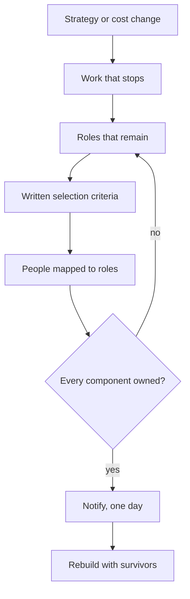
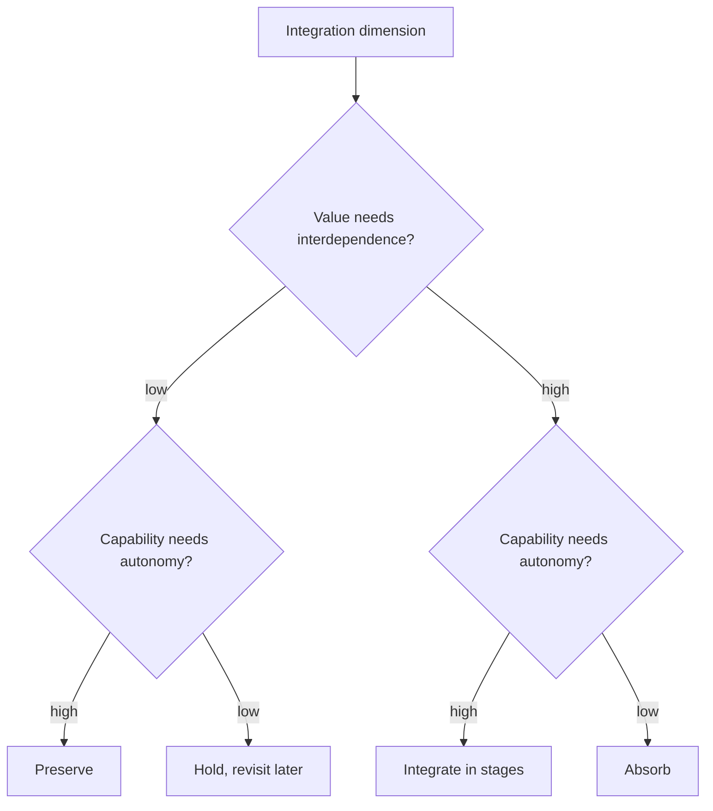
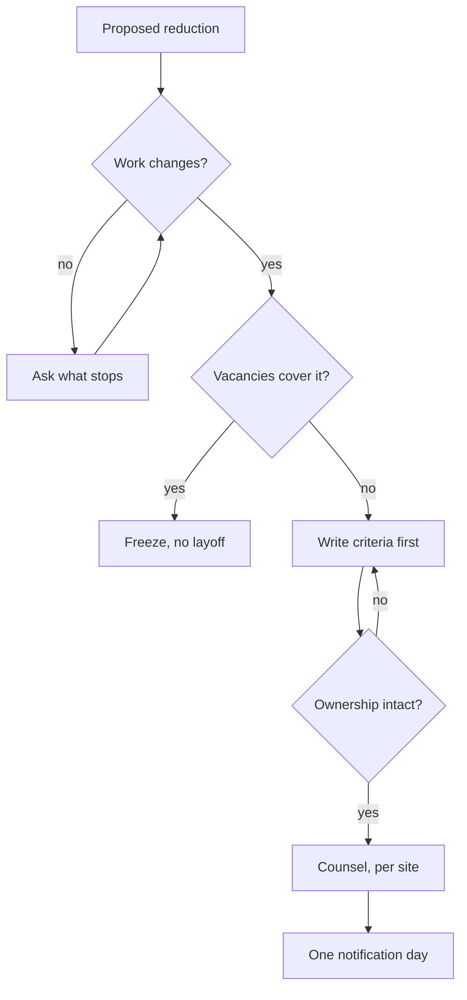

# Chapter 58 — Layoffs, Reductions, and Mergers and Acquisitions

A reduction in force and an acquisition look like opposites: one removes people, the other adds them.
For an engineering leader they are the same problem from two sides. Both change who owns which running
system faster than ownership normally changes, both are decided partly above the engineering
organization, and both are judged afterwards by the people who stayed. This chapter covers planning a
reduction responsibly (selection criteria, communication, continuity of ownership), leading the
organization that remains, and integrating an acquired engineering team and its technology. Chapter 9
owns underperformance, which is a different process with different rules; Chapter 36 owns
reorganizations and succession; Chapter 48 owns workforce planning; Chapter 55 owns acquisition due
diligence. Within this part, [Chapter 56](56-recovering-a-failing-engineering-organization.md) covers
recovering a failing organization, [Chapter 57](57-crises-executive-disagreement-and-resistance.md)
crises and executive disagreement, and [Chapter 59](59-transformation-under-constraint-and-scaling-without-bureaucracy.md)
transformation under a shrinking budget, the usual alternative to a reduction; the
[capstone](../15-capstone/60-capstone-northstar.md) returns to Northstar. The running examples are two groups of Halvard Systems, the book's fictional 500-engineer
[comparison company](../../case-studies/northstar/halvard.md).

!!! note "Not legal advice"
    Employment law differs by country, state, and sometimes city, and changes over time. This chapter
    cites a few official sources to show the kinds of obligations that exist. It does not tell you what
    applies to you. Every reduction and every acquisition needs employment counsel for each jurisdiction
    involved, engaged before the plan is fixed.

## Why This Matters

At team scale, a reduction is the worst conversation a manager has, and an acquisition is a group of
strangers with a different build system. The manager's job is to be honest with individuals and keep the
team's systems running.

At organization scale, both events move ownership. A reduction of fifteen percent can remove the only
person who has changed a billing component in a year; an acquisition can add eleven services that nobody
in the acquiring company has ever paged for. The director decides whether ownership is moved on purpose
or lost by accident.

At executive scale, the decision is economic and the consequences are cultural. A reduction is usually
justified by cost or strategy, and an acquisition by a thesis about growth. Whether either delivers
depends on what the remaining people believe about how it was done. A leader who runs a reduction badly
pays for it in voluntary departures for a year; one who integrates an acquisition badly pays the price of
the deal and loses the people it bought.

## Learning Objectives

After this chapter you will be able to:

- Plan a reduction by deciding which work stops before deciding which people leave, with written
  selection criteria that survive legal and fairness review.
- Check continuity of ownership for every production component before anyone is notified, and repair
  the gaps the check finds.
- Run notification day as one sequence in which affected people hear first, from their manager, in
  person or by video, before anything else changes.
- Lead the remaining organization through the following two quarters, measuring trust, attrition, and
  reliability rather than assuming them.
- Design the integration of an acquired engineering team by choosing how much autonomy to preserve,
  which enterprise rules apply on day one, and when to decide platform consolidation.

## The Mental Model

> **Mental model:** Decide the work before the people. A reduction or an integration is a change in
> which work the organization does and who owns it. Name the work that stops, starts, or moves; derive
> the roles from the work; fill the roles by criteria written down in advance; then check that every
> running system still has an owner. The people who stay will judge the whole sequence, and their
> judgment decides what it costs.

The order matters because the reverse order is the default. Under cost pressure, the first artifact is
usually a spreadsheet of names, produced by asking each manager for their lowest performers or by applying
a percentage to every team. Both start from people, and both leave the work unchanged: the organization
keeps all its commitments with fewer people to meet them.

| Step | Question it answers | What goes wrong when it is skipped |
|---|---|---|
| Work that stops | What will we no longer do? | The same commitments with fewer people |
| Roles that remain | What does the remaining work need? | Cuts spread evenly, every team weakened |
| Written criteria | Why this person and not that one? | Selection by manager preference, legal exposure |
| Ownership check | Does every running system keep an owner? | The only expert leaves; the next incident finds out |
| One notification day | Who hears what, when, from whom? | Rumor, lost access before the conversation |
| Rebuild | Do survivors believe it was fair and is over? | Departures and silence for a year |

The second idea applies to acquisitions: **integration is a choice about autonomy, made per dimension**.
People, product, platform, and policy can each be integrated at a different speed. Forcing all four to
move on day one is the most common way to destroy what was bought.

## Deep Conceptual Explanation

### What the research says about reductions

The evidence on downsizing is large, mostly outside software, and mostly about consequences rather than
technique. Datta and colleagues reviewed the field and organized it into antecedents of downsizing and its
effects on individuals and organizations, identifying patterns and contradictions across studies
([Datta et al., 2010](../../references/bibliography.md#datta2010downsizing)) (**research finding**, a
review). Three findings matter most for an engineering leader.

**Reductions predict voluntary departures.** Using organization-level data across industries, Trevor and
Nyberg tested whether downsizing predicts voluntary turnover rates, whether lower organizational
commitment carries the effect, and whether HR practices change it. Their abstract reports support for all
three: practices that embed employees or convey procedural fairness were hypothesized to weaken the link,
and practices that develop careers to strengthen it (this book's reading: such practices may make people
more employable elsewhere) ([Trevor and Nyberg, 2008](../../references/bibliography.md#trevor2008downsizing))
(**research finding**). The practical reading: plan for higher attrition after a cut, and know that the
remedy is fairness and attachment, not a training budget.

**Survivors watch how the people who left were treated.** Brockner and colleagues found, in a laboratory
study and a field survey, that survivors reacted most negatively when they identified with the people laid
off and believed them inadequately compensated; the reaction appeared as lower performance in the
laboratory and lower commitment in the field
([Brockner et al., 1987](../../references/bibliography.md#brockner1987survivors)) (**research finding**).
In a later field study, survivors who said the reasons had been explained clearly reported better changes
in commitment, effort, and intention to stay, and the effect was strongest when uncertainty was high and
the decision mattered to them
([Brockner et al., 1990](../../references/bibliography.md#brockner1990explain)) (**research finding**).
Severance and explanation are therefore not only obligations to the people leaving. They are the main
levers on the people staying.

**Insecurity and restructuring harm people, and organizations notice.** A meta-analysis found job
insecurity harmful to job attitudes, organizational attitudes, health, and to some extent behavior
toward the organization ([Sverke et al., 2002](../../references/bibliography.md#sverke2002insecurity)), and
a systematic review of longitudinal studies found restructuring, with or without staff reductions, mainly
harmful to well-being, with communication, information, and procedural justice among the factors that
intervened ([de Jong et al., 2016](../../references/bibliography.md#dejong2016restructuring)) (**research
finding**, both). A long period of rumor before a reduction is not neutral waiting; it is insecurity
imposed on everyone, including the people who will stay.

What the research does not give is a tested recipe for running a reduction in a software organization.
The procedures below are **this book's recommendation**, built on the findings above and on the software
evidence about knowledge loss.

### Knowledge loss is the engineering-specific risk

Software organizations hold much of their operational knowledge in people. Avelino and colleagues estimated
truck factors (the minimum number of developers whose departure would leave a project in serious trouble)
from version-control history for 133 popular open-source projects and found about 65 percent had a truck
factor of 2 or less ([Avelino et al., 2016](../../references/bibliography.md#avelino2016truck)). Rigby and
colleagues measured files abandoned when their knowledgeable developers left, in Chrome and a project at
Avaya, and found losses that could exceed several times the expected loss; recommending successors reduced
expected loss ([Rigby et al., 2016](../../references/bibliography.md#rigby2016turnover)). Mockus found, in
one large project, that proximity to organizational change and recent departures were associated with more
customer-reported defects ([Mockus, 2010](../../references/bibliography.md#mockus2010volatility))
(**research finding**, all three, in limited settings).

Voluntary turnover removes one person at a time and leaves time for handover. A reduction removes many at
once, often with access revoked the same day. The ownership check in the mental model exists because of
this asymmetry: it is the only point at which knowledge loss can be prevented rather than discovered.

### Selection criteria

A reduction needs a defensible answer to "why me?" for every affected person and "why not them?" for every
person who stays. Four families of criteria are common, and the EEOC's guidance on severance waivers notes
that employers select by seniority, by individual criteria such as performance or experience, or by
eliminating a whole position, division, or department
([EEOC, 2009](../../references/bibliography.md#eeoc2009waivers)) (**standard**: official US agency
guidance, which states that it does not have the force of law).

| Criterion family | Strength | How it fails |
|---|---|---|
| Work eliminated (role-based) | Follows the strategy; easy to explain | Used as cover to remove individuals from roles that continue |
| Skills needed for remaining work | Keeps capability where the work is | Skills judged by impression, not by evidence |
| Documented performance | Keeps stronger performers | Ratings never calibrated, or written after the decision |
| Seniority or tenure | Simple and predictable | Ignores fit to the remaining work; may conflict with fairness goals |

This book recommends role-based selection first, skill fit second, and documented performance only where it
was recorded before the reduction was contemplated. A reduction must not be used to remove people whose
managers never addressed performance; Chapter 9 explains why that damages both processes
([Chapter 9](../02-people-management/09-performance-management-and-underperformance.md)).

Whatever the criteria, a selection list must be reviewed for disparate effects on protected groups before
it is final, by HR and counsel, not by the engineering leader alone. In the United States, for example, a
waiver of age claims requested from a group of laid-off employees requires disclosing the decisional unit
(the group from which people were chosen) and the job titles and ages of those selected and not selected
in it ([EEOC, 2009](../../references/bibliography.md#eeoc2009waivers)). Whether or not such a disclosure
applies, the test is useful: if you would be uncomfortable showing who was selected from which unit, the
criteria are not doing the work.

### Notice and consultation obligations

Many jurisdictions regulate collective dismissals. Two official sources show the range. The US Department
of Labor's employer guide describes the federal WARN Act as requiring at least 60 calendar days' written
notice of covered plant closings and mass layoffs by covered employers (broadly, 100 or more full-time
workers), with thresholds measured at a single site, over 30 days, and with smaller layoffs aggregated over
90 days unless they have separate causes; it also states that WARN does not override laws or agreements
giving more notice, and that it is not an official interpretation or a substitute for counsel
([US DOL, 2003](../../references/bibliography.md#dol2003warnemployer)) (**standard**: official agency
guidance on a binding statute, not an official interpretation of it). Many US states have their own laws with different thresholds.

In the European Union, the collective redundancies directive requires an employer contemplating collective
redundancies to consult workers' representatives in good time with a view to reaching an agreement, on ways
of avoiding or reducing the redundancies and mitigating their effects, and to give them in writing the
reasons, numbers, timing, and proposed selection criteria; projected redundancies take effect no earlier
than 30 days after notifying the public authority
([Council of the EU, 1998](../../references/bibliography.md#eu1998collective)) (**standard**: an official
legal text, binding on Member States). The directive defines collective redundancies by thresholds, for
example at least 10 dismissals over 30 days in an establishment of 21 to 99 workers, or at least 20 over
90 days, and works through national law, which differs by country.

The engineering consequence is about sequence. Where consultation is required, the plan cannot be final
before consultation, so the selection list is a proposal, and the timeline in that jurisdiction is longer.
A global announcement on one day may be unlawful in some places and merely unkind in others.

### Integrating an acquired team

The evidence on acquisitions is sobering at the firm level. King and colleagues' meta-analyses found that,
on average, acquiring firms' performance does not improve with acquisition activity and is modestly
negatively affected, with much of the variance unexplained
([King et al., 2004](../../references/bibliography.md#king2004metaanalyses)) (**research finding**). That
is not proof that acquisitions fail; it says the average deal does not pay, and that what distinguishes the
deals that do is not well understood.

For technology acquisitions specifically, three findings bear on engineering:

- **Structural integration slows innovation early.** Puranam, Singh, and Zollo found that structurally
  integrating an acquired technology firm reduced the likelihood of new product introductions immediately
  after acquisition and for firms that had not yet launched products, with the effect fading as the
  acquired firm's innovation matured ([Puranam et al., 2006](../../references/bibliography.md#puranam2006organizing))
  (**research finding**).
- **Integration disrupts the people who lose status.** In a study of 3,933 inventors in acquired
  pharmaceutical firms, Paruchuri, Nerkar, and Hambrick report that integration impaired productivity,
  most for those who lost the most status and centrality in the combined firm
  ([Paruchuri et al., 2006](../../references/bibliography.md#paruchuri2006integration)) (**research
  finding**; the transfer from patent counts to software engineers is this book's inference).
- **Acquired leaders carry value.** Graebner's study of eight technology acquisitions found acquired
  managers played a key role in realizing both the expected value and unexpected value
  ([Graebner, 2004](../../references/bibliography.md#graebner2004momentum)) (**research finding**,
  theory-building from cases). Ranft and Lord's grounded model of seven high-technology acquisitions links
  the nature of the acquired firm's knowledge and the way implementation is run to whether the acquirer
  actually obtains the technology and capabilities ([Ranft and Lord, 2002](../../references/bibliography.md#ranft2002acquiring)).

Haspeslagh and Jemison's book is known for classifying integration approaches by two needs, how much
autonomy the acquired firm requires to keep its capabilities and how much interdependence the deal's value
requires ([Haspeslagh and Jemison, 1991](../../references/bibliography.md#haspeslagh1991managing))
(**expert opinion**, idea level). This
chapter applies that idea per dimension rather than per deal. Larson, writing as a practitioner, suggests
running the acquired stack as it is for about six months while consolidating where feasible, and writing
the plan down so the deal team and staff share the same assumptions
([Larson, 2023](../../references/bibliography.md#larson2023ma)) (**expert opinion**).

Conway's essay adds the long-term constraint: organizations that design systems produce designs that copy
their communication structures ([Conway, 1968](../../references/bibliography.md#conway1968committees)). An
acquired team kept separate will keep a separate system; merging the systems later requires merging the
communication first ([Chapter 33](../07-organization-design/33-conways-law-team-topologies-and-cognitive-load.md)).

Apply the tree four times, to people and structure, product, platform, and policy. A common answer is to
absorb policy for security and incidents on day one, integrate the product in stages, preserve the
structure and the acquired leader, and hold the platform decision for about six months.

## Engineering Organization Example

Halvard's second product group, **Field Operations**, builds software for companies that schedule and
dispatch field technicians. Its vice president is Imani Okonkwo. It has 110 engineers and 14 manager roles
(one vacant) under three directors: Mateo Rinaldi runs Dispatch (5 managers, 38 engineers), the cloud
product; Ruth Halloran runs Mobile Workforce (5 manager roles, one vacant, 40 engineers), the technicians'
mobile application; Tobias Engel runs Classic Scheduler (4 managers, 32 engineers), an on-premises product
whose license revenue has declined for three years. All figures are **illustrative**.

In the year after the planning year described in the Halvard canon, Halvard's executive team decides to end
new development on Classic Scheduler, honor its support contracts for three more years, and move its
customers to Dispatch. Finance's first proposal is a 15 percent cut across all three teams, about 17
engineers.

**Step 1: the work that stops.** Imani rejects the across-the-board version in writing. Dispatch is the
migration destination and will absorb Classic's customers; cutting it would add load where load is about to
rise. Before cutting roles, Imani checks the cheaper sources: none of Halvard's vendor contracts staffs
Field Operations (assumed), so ending contractor work releases nothing, and the group's four open
requisitions are kept for placing affected people rather than hired externally. The work that stops is new
feature development on Classic Scheduler. The work that continues is:

| Remaining Classic work | Assumed FTE | Basis |
|---|---|---|
| Security patches and dependency updates | 2 | Last four quarters of patch history |
| Operating 3 tier 1 components (on-call, Sev1 and Sev2 response) | 4 | Assumed: one on-call rotation for the three components, shared with the escalation engineers |
| Customer escalations (third-line support) | 3 | Escalation volume, last two quarters |
| Migration tooling to Dispatch (export, import, verification) | 5 | Migration estimate, four quarters |
| Total sustaining team | 14 | |

Classic therefore goes from 32 engineers to 14: 18 roles end. Dispatch and Mobile Workforce have two
approved but unfilled engineering roles each; four of the 18 people are offered and accept them. Fourteen
engineers are separated. Classic's manager roles fall from four to two; one displaced manager takes Mobile
Workforce's vacant manager role and one is separated.

| Team | Engineers before | Engineers after | Manager roles after |
|---|---|---|---|
| Dispatch | 38 | 40 (two placed) | 5 |
| Mobile Workforce | 40 | 42 (two placed) | 5, all filled |
| Classic Scheduler | 32 | 14 | 2 |
| Field Operations | 110 | 96 | 12 |

**Step 2: written criteria.** Sustaining roles are filled by three criteria, in order: the skills the role
needs (database and on-premises upgrade experience for escalations, for example), recent change or on-call
history on the components the role covers, and performance ratings recorded in the last two review cycles.
Leah Marchetti, Field Operations' HR business partner, and employment counsel review the resulting list for
disparate effects before it is final.

**Step 3: the ownership check.** Classic owns 21 production components in Halvard's component register,
three of them tier 1. For each, the team lists every person with a change in the last 12 months and every
on-call responder in the last two quarters. Against the managers' first draft of the sustaining team, five
components would have had nobody remaining with either, including the tier 1 license server. Because
component history is already a selection criterion, two sustaining selections change; the license server
and one other component are covered. The remaining three components change less than once a quarter; three
departing engineers accept a paid two-week transition contract to record walkthroughs and update runbooks,
reviewed by the sustaining engineers who inherit them.

**Step 4: cost.** The 14 separated engineers are 6 at Engineer, 7 at Senior, and 1 at Staff level.

| Line | Arithmetic | Amount |
|---|---|---|
| Annual engineering cost removed (separations) | 6 × $170,000 + 7 × $215,000 + 1 × $270,000 | $2,795,000 |
| One-time cost (severance and transition), assumed 25 percent of that | 0.25 × $2,795,000 | $698,750 |
| Months of savings to recover the one-time cost | $698,750 ÷ ($2,795,000 ÷ 12) | 3.0 |

The four placements save the cost of hiring into four open roles, which the plan does not count as savings.
The manager's cost is excluded because Halvard's canon does not price manager roles. The payback looks fast;
the cost that does not appear in this table is the attrition that follows, priced in the Enterprise
Application section below.

**Step 5: jurisdiction.** Fourteen of the 18 affected roles are at two US sites and four at a site in an EU
member state; eleven of the separated engineers work in the US and three in the EU. Counsel assesses the notice obligations site by site,
including whether any other action in the company within 90 days must be counted with this one, and advises
consulting employee representatives at the EU site before anything there is final. Neither law cited above
forces this. Four roles at the EU site are below the directive's thresholds (at least 10 dismissals over 30
days, or 20 over 90), and the 11 US separations at two sites are far below WARN's single-site thresholds of
50 or more. Counsel's question in the US was aggregation with other actions, not the count; at the EU site,
consultation follows counsel's reading of national law and Halvard's own policy of consulting
representatives before any dismissal. The plan's timeline for
those four people moves five weeks later, and the plan is changed to say so rather than announcing a
decision that is not yet lawful there.

## Decision Framework

Use this framework when someone above you proposes a reduction, or when you must propose one.

| Question | If yes | If no |
|---|---|---|
| Is there a change in the work, not only a cost target? | Derive roles from the work that stops | Push back: ask which commitments end; a cost target alone produces a spread cut |
| Can the cost be met by not filling vacancies or ending contracts? | Do that first, with dates | Proceed, and say in the explanation why it was not enough |
| Are the criteria written and agreed before names are discussed? | Apply them | Stop until they are |
| Does every production component keep an owner with recent history? | Proceed | Change selections, or fund a paid transition, then recheck |
| Is consultation or notice required anywhere affected people work? | Sequence each jurisdiction separately | Still check with counsel; never assume |
| Can it be done in one round? | Plan one round and say it is the only one planned | Say plainly that more may follow; do not promise what you cannot keep |

For acquisitions, the decision is per dimension, using the tree in the Deep Conceptual Explanation, with two
fixed rules: security and incident policies apply on day one regardless of the autonomy chosen, and the
platform consolidation decision is made on a date set at close, with an architecture decision record
([Chapter 28](../06-technical-leadership/28-architecture-decision-making-and-governance.md)).

## Trade-offs

**Speed against consultation.** A short interval between decision and notification limits rumor and
insecurity, which the research above links to harm. Consultation, where required, lengthens it, and
consultation that can change the outcome is the point. Run them in different jurisdictions on different
timelines, and keep the interval short wherever the law allows.

**Deep cut once against smaller cuts repeatedly.** One larger reduction is painful; two smaller ones in a
year teach everyone that the next is coming, and the best people leave before it does. If the cost target
is uncertain, the trade-off is real: cutting deeper than needed harms people unnecessarily, and cutting too
little guarantees a second round. State the planning assumption and the conditions that would trigger
another round.

**Role-based selection against keeping the strongest people.** Eliminating a whole product's development
may remove strong engineers while weaker ones stay in continuing teams. Moving strong people into continuing
roles by displacing others ("bumping") keeps capability but is harder to explain and to defend. Open
vacancies, offered to affected people, are the cheapest middle path.

**Transparency against privacy.** Survivors need the reasons and the criteria; the people who left are
entitled to privacy about their individual circumstances. Explain the work that stopped and the criteria;
never explain an individual.

**Autonomy against integration in an acquisition.** Preserving the acquired team keeps its momentum and its
people, and delays the benefits that depended on integration. Integrating fast captures savings and risks
the innovation and the people that made the target worth buying. The answer differs by dimension, which is
why the per-dimension tree exists.

**Transition cost.** A reduction costs severance, legal fees, management time in the weeks before and after,
a quarter of lower output, and elevated attrition. An integration costs the migration work, duplicated
tooling while two platforms run, and the time of the acquiring team's senior engineers. Budget both before
the decision, not after.

## Failure Modes

**The spreadsheet cut.** A percentage applied to every team. It looks fair and is not: it weakens the teams
that will carry the strategy and keeps every commitment alive. Detect it when the plan has no list of work
that stops.

**The performance cleanup.** A reduction used to remove people whose performance was never addressed. It
contaminates both processes: survivors conclude that ratings are a layoff list, and the selection becomes
hard to defend. Detect it when names arrive before criteria.

**The silent expert.** The person who alone can operate a component is on the list because nobody checked.
Detect it before notification with the ownership check, or afterwards with the first incident nobody can
diagnose.

**Access before conversation.** People learn they are affected when their laptop or repository access stops
working. It is the most humiliating version of the news and survivors remember it. Detect it in the plan:
access revocation must be scheduled after each conversation, not before the day starts.

**The rolling layoff.** Small cuts every few months, each below some threshold. Besides the cultural damage,
a series of smaller layoffs can be aggregated for notice purposes under rules such as WARN's 90-day
aggregation ([US DOL, 2003](../../references/bibliography.md#dol2003warnemployer)). Detect it when the same
group has two reduction plans within two quarters.

**The vanished leader.** After notification day, the vice president goes quiet. Survivors read absence as
indifference or as a sign that more is coming. Detect it in the calendar: the leader's next three weeks should
be dominated by skip-levels and team meetings.

**Day-one absorption.** The acquired team is moved onto the acquirer's platform, ladder, tools, and processes
in the first month. The research above links early structural integration to slower innovation and status
loss to lower productivity. Detect it when the integration plan has no dimension marked "preserve".

**Leveling as demotion.** The acquired company's flat titles are mapped onto the acquirer's ladder, and its
most respected engineers land a level below where their peers think they belong. Detect it by comparing each
person's role in the old company (who reviewed whose code, who led incidents) to the level assigned.

## Enterprise Application

In an organization of 50 to 150 engineers, the leader running a reduction is usually a vice president or a
senior director who knows most people by name. That helps with explanation and makes everything else harder.
Field Operations, after its reduction, shows the second half of the work: leading the organization that
remains.

**Weeks 1 to 2.** Imani Okonkwo holds the group meeting the morning of notification, then skip-levels with
every manager's team within ten days. Each team receives its updated ownership map and the list of commitments
that stopped, so the reduction is visibly a reduction in work. Classic Scheduler's roadmap is closed in the
planning system the same week, with each open customer request answered.

**Weeks 3 to 13 (the first quarter after).** Halvard's planning assumption for attrition is 12 percent a year,
about 2.9 departures a quarter for 96 engineers (96 × 0.12 ÷ 4). Field Operations records 5 voluntary
departures, an annualized rate of about 21 percent (5 × 4 ÷ 96), and three of them are from the 14-person
Classic sustaining team. Classic's Sev1 and Sev2 incidents rise from 2 in the quarter before the reduction to
4, one of them a Sev1. A pulse survey asking whether people understand why the decision was made is 71 percent favorable in Dispatch
and Mobile Workforce and 38 percent in Classic. All figures are **illustrative**.

The pattern is consistent with what the research would predict: departures concentrated where people identified most with those who left
and where insecurity was highest. Imani's response is in three parts. She commits in writing that Classic's
sustaining team has a three-year mandate and a named role in the migration, which addresses insecurity
directly; Tobias Engel fills the three vacancies by internal transfer from Dispatch, people who will later
receive the migrated customers; and all four incidents get blameless reviews, the Sev1 under Halvard's Sev1
policy, with actions on the runbooks the transition contracts produced
([Chapter 25](../05-engineering-quality/25-incidents-postmortems-and-change-failure-analysis.md)).

**Weeks 14 to 26.** Departures fall to 3 (about 12.5 percent annualized, 3 × 4 ÷ 96), Classic's incidents
return to 2, and the Classic understanding score rises to 54 percent. None of this proves the response worked;
it is one group over two quarters. It does show the measures a leader should watch: attrition by team, not
only in aggregate; incidents on the components whose owners changed; and whether people believe the reasons.

**The cost the payback table missed.** Two extra departures in the first quarter, at an assumed replacement
cost of half a year's fully loaded cost for a Senior engineer, cost about $215,000 (2 × 0.5 × $215,000), plus
the lost output while the roles were open. Small against $2.8 million a year; large against a leader's claim
that the reduction was "fully costed".

## CTO Perspective

At the executive level, the CTO's first job is to make sure the decision is the right size and shape before it
is a plan. Reductions are usually proposed in money; the CTO converts money into work that stops and states
what the company will no longer do. If the executive team cannot name the work, the CTO should say that the
reduction will be a spread cut and what that will break. Chapter 52 covers the budget arithmetic and Chapter
55 the board conversation
([Chapter 52](../12-cto-leadership/52-technology-investment-budgeting-and-financial-literacy.md),
[Chapter 55](../12-cto-leadership/55-boards-due-diligence-and-executive-decision-making.md)).

The CTO also owns three commitments that only the executive level can keep. First, **the number of rounds**: if
the company may need a second round, the CTO says so to peers before the first, because a promise of "only one"
that is broken costs more trust than the second round itself. Second, **consistency across groups**: when one
vice president protects their group with across-the-board cuts and another cuts work, the company has two
reduction philosophies and survivors compare them. Third, **legal sequencing across countries**: the CTO
insists that counsel's site-by-site plan, not the communications calendar, sets the dates.

For acquisitions, the CTO's leverage is before the price is agreed. Chapter 55 covers diligence; this chapter
adds that the integration plan, with its cost, belongs in the deal model. Halvard's CTO, reviewing the Corvane
deal in the case study below, asked for the platform migration estimate before signing and had it added to the
deal's cost, so that the six-month "preserve" period was a funded decision rather than a delay.

Finally, the CTO decides whether to speak personally. In a company of Halvard's size, the CTO's message on
notification day should be short, should state the reason and the work that stops, and should not be the first
word anyone affected hears. That word belongs to their manager.

## Practical Playbook

Planning a reduction:

1. **Get the reason in writing** from the decision maker: the strategy change or cost target, the amount, and
   the date by which it must take effect.
2. **List the work that stops**, product by product, with the customers and commitments affected. Exhaust
   vacancies, contractors, and discretionary spending first and record what each covers.
3. **Size the remaining work** in FTE, with the basis for each line, and derive the roles.
4. **Write the selection criteria** and have HR and counsel approve them before any names are discussed.
5. **Map people to roles** using the criteria; offer open roles to affected people first.
6. **Run the ownership check**: every production component, every tier 1 service, recent change and on-call
   history against the proposed list. Change selections or fund paid transitions, then recheck.
7. **Review for disparate effects** with HR and counsel, unit by unit.
8. **Sequence by jurisdiction** with counsel: consultation, notice periods, authority notifications.
9. **Prepare notification day**: managers trained and scripted the day before; severance terms, benefits, and
   references written; access revocation scheduled after each conversation; an internal page answering
   predictable questions.

Running notification day and after:

10. **Tell affected people first**, individually, by their own manager with HR present, in person or by video,
    within a short window in the morning.
11. **Tell everyone else immediately after**: the group meeting led by the most senior leader present, then a
    written note with the reason, the work that stops, the criteria, and whether more rounds are planned.
12. **Publish the new ownership map** within a week and close the stopped work in the planning system.
13. **Hold skip-levels** with every team within two weeks.
14. **Measure for two quarters**: attrition by team, incidents on reassigned components, a short pulse survey on
    understanding and fairness. Report them to the executive team with the original business case.

Integrating an acquisition:

15. **Before close**, write the integration plan per dimension, cost the platform decision, and name who leads
    the acquired team after close.
16. **Day one**: identity, access review, secrets rotation, vulnerability scan, incident and security policies.
17. **First 90 days**: leveling with calibration that includes the acquired leader; ownership register entries;
    no platform migration.
18. **Month five or six**: the platform decision, recorded as an architecture decision with options and costs.

## Case Study

This case is fictional; Halvard and Corvane are invented. Halvard's third product group, **Insights**, builds
reporting and forecasting products used by customers of Halvard's other products. Its vice president is Henrik
Sørlie. It has 100 engineers and 12 managers under two directors: Esther Castellanos runs Reporting (6 managers,
52 engineers) and Kenji Iwasaki runs Forecasting (6 managers, 48 engineers).

In the same year as the Field Operations reduction, Halvard acquires **Corvane**, a 34-engineer company with 4
managers whose product is a streaming event analytics engine. Its founder and chief technology officer is Dalia
Ferraz. The acquisition thesis has three assumptions: Corvane's engine can ingest event volumes from Halvard's
products within two quarters; Corvane's customers will stay through the transition; and the engine can be
embedded in Insights' reporting product within six months.

**Diligence findings that shaped the plan.** Corvane runs 11 production services on a different cloud provider
from Halvard, with its own pipeline and an on-call rotation of eight people. A truck-factor estimate from its
repositories, using the authorship approach described above, finds 6 of the 11 services with a truck factor of 1
or 2, concentrated in 7 engineers. Before signing, Halvard's CTO asks for the cost of moving Corvane onto the
deployment platform run by Halvard's platform organization. The estimate, assuming two engineer-quarters per
service, is 22 engineer-quarters, or 5.5 engineers for a year, about $1.18 million at the Senior cost
(5.5 × $215,000 = $1,182,500). It is added to the deal's cost. All figures are **illustrative**.

**The integration design, by dimension.**

| Dimension | Choice | Reason |
|---|---|---|
| Structure and people | Preserve: Corvane becomes a third director-level unit, Streaming, led by Dalia Ferraz, reporting to Henrik Sørlie | Acquired leaders carry expected and unexpected value; status loss disrupts productivity |
| Product | Integrate in stages: one embedded feature in Reporting by month 6 | The thesis requires interdependence, but early structural integration slows new products |
| Platform | Hold: Corvane's stack runs as is; a decision record at month 5 | Practitioner advice to run the acquired stack for about six months; migration is costed and funded |
| Policy | Absorb selectively | Security and incident rules cannot wait; the rest are phased |

Halvard's six enterprise policies are applied on a schedule rather than all at once. A tracked review for every
Sev1 and the vulnerability remediation service levels apply from day one. Each Corvane production component gets
an owning team in the component register in week one, which is trivially true because Corvane's teams already
own their services. Tier 1 operational minimums for Corvane's two tier 1 services are due by month 6, and the
auditable pipeline with rollback by month 9, met either by Corvane's own pipeline, if it passes the audit, or by
migration. The rule against customer dates without an estimate and an owner applies to every new commitment from
the day of close.

**Leveling.** Corvane had flat titles. In month 2, calibration with Dalia Ferraz in the room maps its engineers;
the final mapping, after the correction described next, is 11 Engineer, 19 Senior, and 4 Staff. The resulting cost is $7,035,000 a year (11 × $170,000 + 19 × $215,000 +
4 × $270,000). Two of the seven key engineers had led Corvane's incident response without a title that said so;
the first draft placed them at Senior. Comparing each person's actual role to the ladder moved one to Staff; the
other stayed at Senior with a written development plan toward Staff.

**Month 6 results.** Insights has 132 engineers in three units (100 plus the 32 Corvane engineers who remain). Thirty-two of Corvane's 34 engineers remain;
one of the departures is a key engineer, who leaves in month 4. Corvane's services have one Sev1, reviewed under
Halvard's policy. The first embedded feature ships in Reporting in month 5. The month 5 platform decision record
proposes migrating the four Corvane services with the highest operating cost first and leaving the rest for a
second decision a year later; the group adopts it.

The case shows what a preserve decision buys and costs. It kept the people and the leader, and it kept two
platforms running for at least a year longer, at a cost that was visible in the deal model rather than discovered
afterwards.

## Exercises

Worked solutions are in the [Chapter 58 solutions](../../solutions/ch58-solutions.md).

### Foundational

**F1.** Finance's first proposal for Field Operations was a 15 percent cut across Dispatch, Mobile Workforce,
and Classic Scheduler, about 17 engineers. Using the group's numbers in the Engineering Organization Example,
lay out what that proposal would cut in each team, which commitments would survive it, and what it would do to
the migration of Classic customers into Dispatch. Then write the two-paragraph reply Imani Okonkwo sent to
Finance explaining why the reduction should start from the work that stops.

**F2.** The ownership check found five Classic components that would have had no remaining owner with recent
change or on-call history. Design the check as a repeatable procedure another group could run: the data sources,
the query or listing for each component, the threshold for "covered", who reviews the result, and what happens
when a gap is found. State one way the check could be satisfied on paper while the knowledge is still lost.

**F3.** Write the notification-day plan for Field Operations as a timed sequence, from the evening before to the
end of the following week. Include who tells whom, in what order, through which channel, when access changes,
when the group meeting happens, and when skip-levels are scheduled. Identify the single step whose failure would
do the most damage to survivors' trust, and explain why.

### Applied Leadership

**A1.** In the first quarter after the reduction, three of the five voluntary departures in Field Operations came
from the 14-person Classic sustaining team, and the team's understanding score was 38 percent. You are Tobias
Engel. Plan your next six weeks with the remaining eleven engineers: what you say, what you change, what you
measure, and what you ask Imani Okonkwo for. Explain which of the research findings in this chapter each action
is meant to address.

**A2.** Suppose (a scenario for the reader, not part of the Halvard canon) that a month after notification day,
an engineer in Dispatch tells you privately that two of the separated Classic engineers were "obviously chosen
because they complained about the roadmap last year". You do not know whether this is true. Decide what you do
in the next 48 hours and in the next month, who you involve, and what you say to the engineer, considering
fairness, legal exposure, and survivors' trust.

**A3.** The Corvane leveling placed two key engineers at Senior in its first draft. Suppose instead that the
calibration had been run without Dalia Ferraz in the room and all seven key engineers had been placed at Senior
to "keep the ladder consistent". Trace the likely consequences over two quarters for those engineers, for
Corvane's on-call rotation, and for the thesis assumption about embedding the engine in Reporting. Then write
the calibration rule you would set for the next acquisition.

### Executive Decision-Making

**X1.** Suppose (a scenario for the reader, not part of the Northstar canon) that in week 50 Northstar's board
asks management to model a 10 percent cut to engineering personnel cost for year 2, about $1.67 million of the
$16.73 million FY2 personnel draft (87 full seats), roughly nine engineering seats at $185,000 each. You are Victor Lindqvist. Using the
Northstar canon (80 engineers in six teams, the flat 87-seat rule, the open quarter 4 decisions on the quality
continuation and the workforce plan), decide what you put in front of the board: whether a reduction is the
right tool, which work would stop, what the ownership check would have to cover, and what you would need to
believe to recommend it. Do not decide any of the open quarter 4 decisions; show how each would be affected.

**X2.** You are Halvard's CTO. A year after the Corvane close, Henrik Sørlie proposes a second acquisition, a
20-engineer company whose product overlaps with Forecasting, and plans to "absorb it fully in the first quarter
to get the savings early". Kenji Iwasaki's Forecasting group would lose about a third of its roadmap to the
acquired product. Decide what you require before you support the deal: the integration plan by dimension, the
treatment of Forecasting engineers whose work overlaps, the costs that must be in the deal model, and the
conditions under which you would oppose it.

## Reflection Questions

1. If your organization had to cut 15 percent of its cost next quarter, could you name the work that would stop
   today? If not, what does that say about how well your commitments match your capacity?
2. Which of your production components would lose its only knowledgeable person if one name disappeared
   tomorrow? Why has nobody fixed that already?
3. When you last saw a reduction from the inside, what did the way the people who left were treated teach the
   people who stayed?
4. Are your performance records honest enough that you would be willing to use them as a selection criterion,
   and show the results to counsel?
5. In the last acquisition you saw, which dimension was integrated fastest, and was that the dimension where
   speed created the most value or the one where it was easiest?

## Key Takeaways

- Decide the work before the people: list what stops, size what remains, derive the roles, and only then
  select.
- Write selection criteria before names are discussed; prefer role and skill fit; use performance only where it
  was documented before the reduction; never use a reduction to fix unaddressed performance.
- Run the ownership check on every production component before notification; it is the only point at which
  knowledge loss can be prevented.
- Employment law differs by jurisdiction; get counsel site by site and let the legal sequence, not the
  communications calendar, set the dates. This book is not legal advice.
- Tell affected people first, individually, from their manager; never let lost access deliver the news.
- Treat survivors as the main audience of a reduction: explain the reasons clearly, treat the people who left
  well, and measure attrition, incidents, and trust by team for two quarters.
- Integrate an acquisition per dimension: absorb security and incident policy on day one, preserve the people
  and the leader, stage the product, and decide the platform on a date set at close.
- Put the integration cost and the attrition cost in the business case before the decision, not in the
  explanation afterwards.

## References and Further Reading

- [Datta et al., 2010](../../references/bibliography.md#datta2010downsizing): a review of the causes and
  effects of downsizing; the place to start on the research.
- [Trevor and Nyberg, 2008](../../references/bibliography.md#trevor2008downsizing): downsizing and voluntary
  turnover, and the HR practices that moderate it.
- [Brockner et al., 1987](../../references/bibliography.md#brockner1987survivors) and
  [Brockner et al., 1990](../../references/bibliography.md#brockner1990explain): how survivors react to the
  treatment of those laid off and to explanations.
- [Sverke et al., 2002](../../references/bibliography.md#sverke2002insecurity): a meta-analysis of job
  insecurity's consequences.
- [de Jong et al., 2016](../../references/bibliography.md#dejong2016restructuring): restructuring and
  well-being, from longitudinal studies.
- [Avelino et al., 2016](../../references/bibliography.md#avelino2016truck),
  [Rigby et al., 2016](../../references/bibliography.md#rigby2016turnover), and
  [Mockus, 2010](../../references/bibliography.md#mockus2010volatility): knowledge concentration, turnover
  loss, and organizational change in software.
- [US DOL, 2003](../../references/bibliography.md#dol2003warnemployer): the Department of Labor's employer
  guide to the WARN Act; an example of a notice regime, not a summary of current law.
- [Council of the EU, 1998](../../references/bibliography.md#eu1998collective): the EU collective
  redundancies directive; consultation and notification duties implemented through national law.
- [EEOC, 2009](../../references/bibliography.md#eeoc2009waivers): US guidance on severance waivers,
  including group disclosure requirements.
- [King et al., 2004](../../references/bibliography.md#king2004metaanalyses): meta-analyses of
  post-acquisition performance.
- [Puranam et al., 2006](../../references/bibliography.md#puranam2006organizing): the coordination and
  autonomy dilemma in technology acquisitions.
- [Paruchuri et al., 2006](../../references/bibliography.md#paruchuri2006integration): integration and the
  productivity of acquired technical staff.
- [Graebner, 2004](../../references/bibliography.md#graebner2004momentum) and
  [Ranft and Lord, 2002](../../references/bibliography.md#ranft2002acquiring): case-based models of how
  acquired leaders and implementation choices shape value.
- [Haspeslagh and Jemison, 1991](../../references/bibliography.md#haspeslagh1991managing): the classic
  framework of integration approaches (idea level).
- [Larson, 2023](../../references/bibliography.md#larson2023ma): an engineering executive's view of
  acquisitions, including integration.
- [Larson, 2024](../../references/bibliography.md#larson2024primer): the engineering executive's job more
  broadly (idea level).
- [Watkins, 2003](../../references/bibliography.md#watkins2003first): structuring a leader's first months
  in a new situation, useful for the acquired leader and for the leader after a reduction (idea level).
- [Conway, 1968](../../references/bibliography.md#conway1968committees): why merged systems follow merged
  communication.
