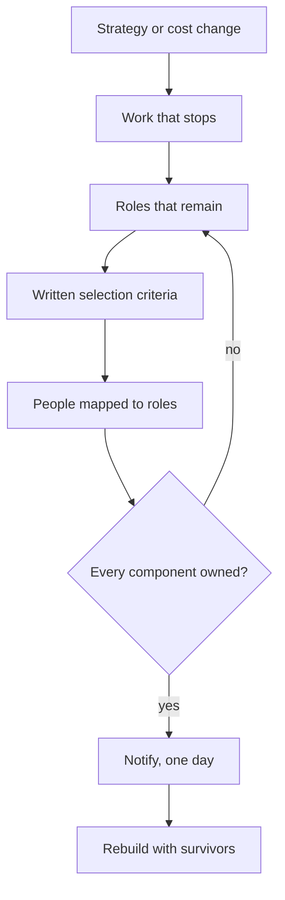
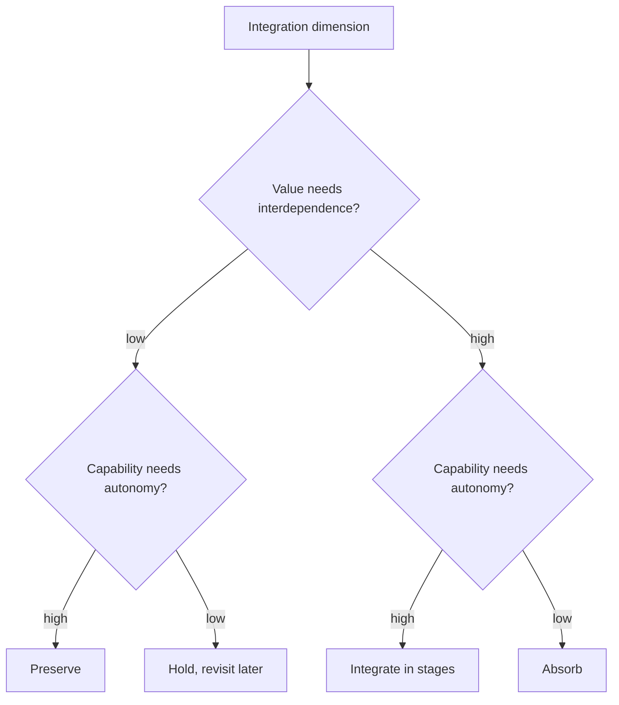
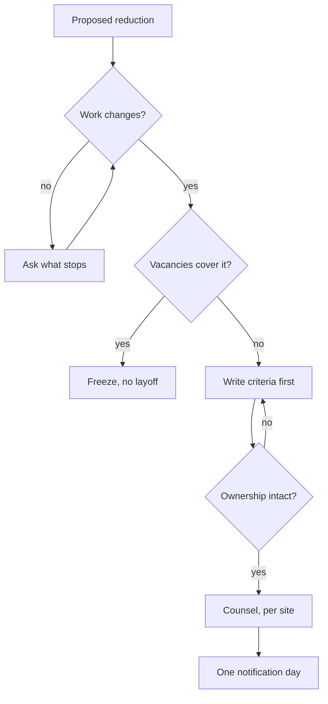

# Chapter 58 — Layoffs, Reductions, and Mergers and Acquisitions

A reduction in force and an acquisition look like opposites: one removes people, the other adds them.
For an engineering leader they are the same problem from two sides. Both change who owns which running
system faster than ownership normally changes, both are decided partly above the engineering
organization, and both are judged afterwards by the people who stayed. This chapter covers planning a
reduction responsibly (selection criteria, communication, continuity of ownership), leading the
organization that remains, and integrating an acquired engineering team and its technology, from either
side of the deal or in a merger of peers. The running
examples are two groups of Halvard Systems, the book's fictional 500-engineer
[comparison company](../../case-studies/northstar/halvard.md).

!!! note "Related chapters"
    [Chapter 9](../02-people-management/09-performance-management-and-underperformance.md) owns
    underperformance, a different process with different rules;
    [Chapter 36](../07-organization-design/36-reorganizations-evolution-and-succession.md)
    reorganizations; [Chapter 48](../11-vp-engineering/48-capacity-strategy-workforce-planning-and-governance.md)
    workforce planning; [Chapter 55](../12-cto-leadership/55-boards-due-diligence-and-executive-decision-making.md)
    acquisition due diligence. [Chapter 59](59-transformation-under-constraint-and-scaling-without-bureaucracy.md)
    covers transformation under a shrinking budget, the usual alternative to a reduction.

!!! note "Not legal advice"
    Employment law differs by country, state, and sometimes city, and changes over time. This chapter
    cites a few official sources to show the kinds of obligations that exist. It does not tell you what
    applies to you. Every reduction and every acquisition needs employment counsel for each jurisdiction
    involved, engaged before the plan is fixed.

## Why This Matters

At team scale, a reduction is the worst conversation a manager has, and an acquisition is a group of
strangers with a different build system.

At organization scale, both events move ownership. A reduction can remove the only person who has
changed a billing component in a year; an acquisition can add eleven services nobody has ever been paged
for. The director decides whether ownership moves on purpose or is lost by accident.

At executive scale, the decision is economic and the consequences are cultural. Whether a reduction or an
acquisition delivers depends on what the remaining people believe about how it was done. A reduction run
badly is paid for in departures for a year; an acquisition integrated badly loses the people it bought.

## Learning Objectives

After this chapter you will be able to:

- Plan a reduction by deciding which work stops before deciding which people leave, with written
  selection criteria that survive legal and fairness review.
- Check continuity of ownership for every production component before anyone is notified, and repair
  the gaps the check finds.
- Run notification day as one sequence in which affected people hear first, from their manager, in
  person or by video, before anything else changes.
- Lead the remaining organization through the following two quarters, measuring trust, attrition, and
  reliability rather than assuming them.
- Design the integration of an acquired engineering team by choosing how much autonomy to preserve,
  which enterprise rules apply on day one, and when to decide platform consolidation.

## The Mental Model

> **Mental model:** Decide the work before the people. A reduction or an integration is a change in
> which work the organization does and who owns it. Name the work that stops, starts, or moves; derive
> the roles from the work; fill the roles by criteria written down in advance; then check that every
> running system still has an owner. The people who stay will judge the whole sequence, and their
> judgment decides what it costs.

The order matters because the reverse is the default: under cost pressure the first artifact is usually
a spreadsheet of names, which leaves the same commitments with fewer people.

| Step | Question it answers | What goes wrong when it is skipped |
|---|---|---|
| Work that stops | What will we no longer do? | The same commitments with fewer people |
| Roles that remain | What does the remaining work need? | Cuts spread evenly, every team weakened |
| Written criteria | Why this person and not that one? | Selection by manager preference, legal exposure |
| Ownership check | Does every running system keep an owner? | The only expert leaves; the next incident finds out |
| One notification day | Who hears what, when, from whom? | Rumor, lost access before the conversation |
| Rebuild | Do survivors believe it was fair and is over? | Departures and silence for a year |

The second idea applies to acquisitions: **integration is a choice about autonomy, made per dimension**.
People, product, platform, and policy can each be integrated at a different speed. Forcing all four to
move on day one is the most common way to destroy what was bought.

## Deep Conceptual Explanation

### What the research says about reductions

The research on downsizing is large, mostly outside software, and mostly about consequences rather than
technique ([Datta et al., 2010](../../references/bibliography.md#datta2010downsizing) reviews it). Three
findings matter most for an engineering leader; all are **research findings**.

**Reductions predict voluntary departures.** Across organizations, downsizing predicts higher voluntary
turnover, partly through lower commitment
([Trevor and Nyberg, 2008](../../references/bibliography.md#trevor2008downsizing)). Plan for higher
attrition after a cut; the remedy is fairness and attachment, not a training budget.

**Survivors watch how the people who left were treated.** Survivors reacted worst when they identified
with those laid off and believed them poorly compensated
([Brockner et al., 1987](../../references/bibliography.md#brockner1987survivors)), and reported better
commitment when the reasons were explained clearly
([Brockner et al., 1990](../../references/bibliography.md#brockner1990explain)). Severance and
explanation are the main levers on the people staying.

**Insecurity and restructuring harm people.** Job insecurity harms attitudes and health
([Sverke et al., 2002](../../references/bibliography.md#sverke2002insecurity)), and communication and
fair procedure are among the factors that soften restructuring's harm to well-being
([de Jong et al., 2016](../../references/bibliography.md#dejong2016restructuring)). A long period of rumor
is insecurity imposed on everyone.

The research gives no tested recipe for a reduction in a software organization. The procedures below
are **this book's recommendation**.

### Knowledge loss is the engineering-specific risk

Software organizations hold much of their operational knowledge in a few people. About 65 percent of 133
popular open-source projects had a truck factor (the number of developers whose departure would leave
the project in serious trouble) of 2 or less, estimated from authorship in version-control history
([Avelino et al., 2016](../../references/bibliography.md#avelino2016truck)). A simple version of that
estimate, which this book uses below: treat the few people who made most of a component's changes as
its authors, and count how many must leave before the component has no remaining author. Knowledge lost when
developers leave can far exceed what is expected, and naming successors reduces it
([Rigby et al., 2016](../../references/bibliography.md#rigby2016turnover); see also
[Mockus, 2010](../../references/bibliography.md#mockus2010volatility)). These are **research findings**
in limited settings.

A reduction removes many people at once, so the ownership check is the only point at which knowledge
loss can be prevented rather than discovered.

### Selection criteria

A reduction needs a defensible answer to "why me?" for every affected person and "why not them?" for every
person who stays. Four families of criteria are common; US agency guidance on severance waivers lists
seniority, individual criteria such as performance, and eliminating a whole position or department
([EEOC, 2009](../../references/bibliography.md#eeoc2009waivers); **standard**, guidance without the
force of law). A severance waiver is the release of legal claims an employee signs in exchange for
severance pay.

| Criterion family | Strength | How it fails |
|---|---|---|
| Work eliminated (role-based) | Follows the strategy; easy to explain | Used as cover to remove individuals from roles that continue |
| Skills needed for remaining work | Keeps capability where the work is | Skills judged by impression, not by evidence |
| Documented performance | Keeps stronger performers | Ratings never calibrated, or written after the decision |
| Seniority or tenure | Simple and predictable | Ignores fit to the remaining work; may conflict with fairness goals |

This book recommends role-based selection first, skill fit second, and documented performance only where it
was recorded before the reduction was contemplated. Never use a reduction to remove people whose managers
never addressed performance; it damages both processes.

Whatever the criteria, HR and counsel must review the selection list for disparate effects on protected
groups before it is final. In the United States, for example, when a group of people is asked to waive
age-discrimination claims, the employer must disclose the ages and job titles of those selected and not
selected in the unit
([EEOC, 2009](../../references/bibliography.md#eeoc2009waivers)). The test is useful anywhere: if you
would be uncomfortable showing who was selected from which unit, the criteria are not doing the work.

### Fairness and ethics in selection

Legal review asks whether a list is defensible; fairness asks whether it is right. Run three checks
before the list is final (**this book's recommendation**):

- **Same rule, same way.** The criteria were written before names, and each was applied with the same
  evidence across the unit. A manager with a personal conflict about someone does not score that person.
- **Who carries the cut.** Look at who is selected among people with less power to object: those on
  leave, part-time or remote staff, recent returners, people whose visa depends on the job. A pattern
  there needs an explanation in the work, or the list changes.
- **No one selected for speaking up.** Check every selected name against recent complaints, incident
  reports, and concerns raised. If one matches, a second reviewer confirms the criteria alone explain it.

Some moves are wrong even when lawful: timing notice to dodge a bonus or a
[vesting](../../glossary.md#vesting) date (when granted equity becomes the employee's), pressing people
into "voluntary" resignation, or giving different severance to similar cases. If you would not explain a
choice to the survivors, do not make it.

### Notice and consultation obligations

Many jurisdictions regulate collective dismissals, and the engineering consequence is about sequence.
Two official sources show the range (**standard**, both):

| Regime | Trigger | Notice or consultation | Engineering consequence |
|---|---|---|---|
| US federal WARN Act ([US DOL, 2003](../../references/bibliography.md#dol2003warnemployer)) | Mass layoffs by employers of broadly 100 or more full-time workers, per site; smaller layoffs within 90 days can be aggregated | At least 60 days' written notice; many states add their own laws | Check aggregation with any other action in the company |
| EU collective redundancies directive ([Council of the EU, 1998](../../references/bibliography.md#eu1998collective)) | Thresholds such as 10 dismissals over 30 days in an establishment of 21 to 99 workers; applied through national law | Consult workers' representatives in good time, aiming at agreement; effective no earlier than 30 days after notifying the authority | The selection list is a proposal until consultation ends |

A global announcement on one day may be unlawful in some places and merely unkind in others.

### Integrating an acquired team

The evidence on acquisitions is sobering. On average, acquiring firms' performance does not improve with
acquisitions, and much of the variance is unexplained
([King et al., 2004](../../references/bibliography.md#king2004metaanalyses); **research finding**). For
technology acquisitions, three findings bear on engineering (**research findings**, from limited
samples):

- **Structural integration slows innovation early**, especially for acquired firms that have not yet
  launched products ([Puranam et al., 2006](../../references/bibliography.md#puranam2006organizing)).
- **Integration hurts the productivity of people who lose status**, as a study of inventors in acquired
  pharmaceutical firms found
  ([Paruchuri et al., 2006](../../references/bibliography.md#paruchuri2006integration); the transfer to
  software engineers is this book's inference).
- **Acquired leaders carry value**, both expected and unexpected
  ([Graebner, 2004](../../references/bibliography.md#graebner2004momentum);
  [Ranft and Lord, 2002](../../references/bibliography.md#ranft2002acquiring)).

Haspeslagh and Jemison are known for classifying integration by how much autonomy the acquired firm needs
and how much interdependence the deal's value needs
([Haspeslagh and Jemison, 1991](../../references/bibliography.md#haspeslagh1991managing); **expert
opinion**). This chapter applies that idea per dimension rather than per deal. Larson suggests running
the acquired stack as it is for about six months ([Larson, 2023](../../references/bibliography.md#larson2023ma);
**expert opinion**).

Conway's law adds the long-term constraint: an acquired team kept separate will keep a separate system,
so merging the systems later requires merging the communication first
([Conway, 1968](../../references/bibliography.md#conway1968committees);
[Chapter 33](../07-organization-design/33-conways-law-team-topologies-and-cognitive-load.md)).

Apply the tree four times: to people and structure, product, platform, and policy. A common answer
absorbs security and incident policy on day one, stages the product, preserves the structure and leader,
and holds the platform decision for about six months.

### When you are acquired, or merging with a peer

The rest of this chapter takes the acquirer's side. Two other positions need different moves (**this
book's recommendation**).

**On the acquired side.** Your team will learn about levels, reporting lines, and tools from you or from
rumor. On day one, tell them what you know, what you do not, and the date by which each open question
will be decided. Never promise what the acquirer has not committed in writing. Before close if you can,
write down who holds the knowledge of each running system, with on-call and incident history; it is
the evidence for which dimensions to preserve. Then ask to sit in calibration for your people.

**Keeping key engineers.** Retention bonuses (cash paid for staying to a date) and new equity buy time,
not commitment. What keeps engineers is the work: a named role in the integration, a level that matches
what they actually do, and a manager they trust. Offer retention money only to the few people the deal
thesis depends on, and pair each offer with a [stay interview](../../glossary.md#stay-interview) and a
written role.

**Merging with a peer.** When two comparable organizations combine, neither side's practice is the
default. Choose one leader per area on the area's needs, not on which company they came from, and
announce that rule before any names. Compare the two career ladders against real work samples before
mapping anyone, then map once, with an appeal path. Decide each dimension with the tree above, and
expect the losing side of every choice to feel acquired.

## Engineering Organization Example

Halvard's second product group, **Field Operations**, builds software for companies that schedule and
dispatch field technicians. Its vice president is Imani Okonkwo. It has 110 engineers and 14 manager
roles (one vacant) under three directors:

| Unit | Director | Managers | Engineers | Product |
|---|---|---|---|---|
| Dispatch | Mateo Rinaldi | 5 | 38 | The cloud product |
| Mobile Workforce | Ruth Halloran | 5 roles, one vacant | 40 | The technicians' mobile application |
| Classic Scheduler | Tobias Engel | 4 | 32 | On-premises; license revenue down for three years |

All figures are **illustrative**. Halvard's executive team decides to end new development on Classic
Scheduler, honor its support contracts for three more years, and move its customers to Dispatch. Finance's first proposal is a 15 percent cut across all three teams, about 17
engineers.

**Step 1: the work that stops.** Imani rejects the across-the-board version in writing: Dispatch will
absorb Classic's customers, so cutting it adds load where load is about to rise. No contractors staff
the group (an assumption), and the four open [requisitions](../../glossary.md#requisition) (approved,
unfilled roles) are kept for placing affected people. The work that stops is new feature development on
Classic Scheduler. The work that continues is:

| Remaining Classic work | Assumed FTE | Basis |
|---|---|---|
| Security patches and dependency updates | 2 | Last four quarters of patch history |
| Operating 3 [tier 1](../../glossary.md#tier-1) components (on-call, [Sev1 and Sev2](../../glossary.md#severity-sev1-sev2-sev3) response) | 4 | One on-call rotation, shared with the escalation engineers |
| Customer escalations (third-line support) | 3 | Escalation volume, last two quarters |
| Migration tooling to Dispatch (export, import, verification) | 5 | Migration estimate, four quarters |
| Total sustaining team | 14 | |

Classic therefore goes from 32 engineers to 14: 18 roles end. Four of the 18 people accept the open
roles in Dispatch and Mobile Workforce, and fourteen are separated. Classic's manager roles fall from four to two; one displaced manager takes Mobile
Workforce's vacant manager role and one is separated.

| Team | Engineers before | Engineers after | Manager roles after |
|---|---|---|---|
| Dispatch | 38 | 40 (two placed) | 5 |
| Mobile Workforce | 40 | 42 (two placed) | 5, all filled |
| Classic Scheduler | 32 | 14 | 2 |
| Field Operations | 110 | 96 | 12 |

**Step 2: written criteria.** Sustaining roles are filled by three criteria, in order. First, the skills the role
needs (database and upgrade experience for escalations, for example). Second, recent change or on-call
history on the components the role covers. Third, performance ratings from the last two review cycles.
Leah Marchetti, Field Operations' HR business partner, and employment counsel review the resulting list for
disparate effects before it is final.

**Step 3: the ownership check.** Classic owns 21 production components, three of them tier 1. For each,
the team lists every person with a change in the last 12 months and every on-call responder in the last
two quarters. Against the managers' first draft, five components would have had nobody remaining with
either, including the tier 1 license server. Two sustaining selections change, covering two of them.
The other three change less than once a quarter; three departing engineers accept a paid two-week
transition contract to record walkthroughs and update runbooks.

**Step 4: cost.** The 14 separated engineers are 6 at Engineer, 7 at Senior, and 1 at Staff level.

| Line | Arithmetic | Amount |
|---|---|---|
| Annual engineering cost removed (separations) | 6 × $170,000 + 7 × $215,000 + 1 × $270,000 | $2,795,000 |
| One-time cost (severance and transition), assumed 25 percent of that | 0.25 × $2,795,000 | $698,750 |
| Months of savings to recover the one-time cost | $698,750 ÷ ($2,795,000 ÷ 12) | 3.0 |

The manager's cost is excluded because the Halvard case does not price manager roles. The payback looks
fast; the attrition that follows is priced in the Enterprise Application section.

**Step 5: jurisdiction.** Eleven of the separated engineers work at two US sites and three at a site in an
EU member state, where four roles are affected. Counsel advises consulting employee representatives at the
EU site first, under national law and Halvard's policy, even though the numbers are below the
directive's thresholds. The timeline for the four EU roles moves five weeks later, and the plan says so.

## Decision Framework

Use this framework whenever a reduction is proposed, by you or to you.

| Question | If yes | If no |
|---|---|---|
| Is there a change in the work, not only a cost target? | Derive roles from the work that stops | Push back: ask which commitments end; a cost target alone produces a spread cut |
| Can the cost be met by not filling vacancies or ending contracts? | Do that first, with dates | Proceed, and say in the explanation why it was not enough |
| Are the criteria written and agreed before names are discussed? | Apply them | Stop until they are |
| Does every production component keep an owner with recent history? | Proceed | Change selections, or fund a paid transition, then recheck |
| Is consultation or notice required anywhere affected people work? | Sequence each jurisdiction separately | Still check with counsel; never assume |
| Can it be done in one round? | Plan one round and say it is the only one planned | Say plainly that more may follow; do not promise what you cannot keep |

For acquisitions, the decision is per dimension, using the tree in the Deep Conceptual Explanation, with two
fixed rules: security and incident policies apply on day one regardless of the autonomy chosen, and the
platform consolidation decision is made on a date set at close (the day the deal legally completes),
with an architecture decision record
([Chapter 28](../06-technical-leadership/28-architecture-decision-making-and-governance.md)).

## Trade-offs

**Speed against consultation.** A short interval between decision and notification limits rumor;
consultation, where required, lengthens it, and its power to change the outcome is the point.

**Deep cut once against smaller cuts repeatedly.** Two smaller cuts in a year teach everyone that the next
is coming, and the best people leave first; cutting deeper than needed harms people unnecessarily. State
the conditions that would trigger another round.

**Role-based selection against keeping the strongest people.** Eliminating a whole product's development
may remove strong engineers while weaker ones stay in continuing teams. Moving strong people into continuing
roles by displacing others ("bumping") keeps capability but is harder to explain and to defend. Open
vacancies, offered to affected people, are the cheapest middle path.

**Transition cost.** A reduction costs severance, legal fees, management time, lower output, and
attrition; an integration costs migration work, duplicated tooling, and senior engineers' time. Budget
both before the decision.

**Your own role and its limits.** A director may disagree with the reduction itself. Say so once, in
writing, before the decision, using
[Chapter 57](57-crises-executive-disagreement-and-resistance.md#decision-framework)'s commit-or-escalate
test. Once it is decided within the executive's authority, commit, and never tell your managers or the
affected people "they made me". If the plan breaches a written floor, such as selecting people because
they raised concerns, that is an escalation, not a commitment. The managers who deliver the news need
support too: rehearse the conversations with them the day before, keep their afternoon clear, and check
on them the following week. They are survivors as well.

## Failure Modes

**The spreadsheet cut.** A percentage applied to every team. It looks fair and is not: it weakens the teams
that will carry the strategy and keeps every commitment alive. Detect it when the plan has no list of work
that stops.

**The performance cleanup.** A reduction used to remove people whose performance was never addressed;
survivors conclude ratings are a layoff list. Detect it when names arrive before criteria.

**The silent expert.** The only person who can operate a component is on the list because nobody checked.
Detect it with the ownership check, or later with the first incident nobody can diagnose.

**Access before conversation.** People learn they are affected when their access stops working. Detect it
in the plan: revocation must follow each conversation.

**The rolling layoff.** Small cuts every few months, each below a notice threshold, which they can be
aggregated to cross anyway. Detect it when one group has two reduction plans within two quarters.

**The vanished leader.** After notification day the vice president goes quiet, and survivors read absence
as indifference. Detect it in the calendar: the next three weeks should be
[skip-levels](../../glossary.md#skip-level) and team meetings.

**Day-one absorption.** The acquired team is moved onto the acquirer's platform, ladder, tools, and
processes in the first month. Detect it when the integration plan has no dimension marked "preserve".

**Leveling as demotion.** The acquired company's most respected engineers land a level below where their
peers think they belong. Detect it by comparing each person's actual role (who reviewed whose code, who
led incidents) with the level assigned.

## Enterprise Application

In an organization of 50 to 150 engineers, the leader running a reduction usually knows most people by
name, which helps with explanation and makes everything else harder. Field Operations shows the day
itself and the second half of the work: leading the organization that remains (**illustrative**).

**Notification day at the US sites.**

| When | What | Who |
|---|---|---|
| Day before, afternoon | Managers briefed and rehearsed: names, criteria, severance terms, what they may and may not answer | Imani Okonkwo, Leah Marchetti, counsel |
| Day before, evening | Neutral 15-minute invitations for the next morning; nothing else changes | HR |
| Day 0, 08:30–10:30 | Individual conversations: own manager, HR present, in person or by video; written terms handed over | Managers, HR |
| After each conversation | That person's access changes, never before | IT, triggered by HR |
| Day 0, 11:00 | Group meeting: reason, work that stops, criteria, numbers, whether more rounds are planned | Imani with the three directors |
| Day 0, 11:30 | The survivors' note, then the CTO's short company note | Imani, Halvard's CTO |
| Days 1–10 | Team meetings, skip-levels with every team, final ownership map, Classic roadmap closed | Imani, directors, managers |

**What the manager says in the first two minutes** (illustrative; HR and counsel approve the wording for
each jurisdiction):

1. The news, first: "I have difficult news. Your role is one of those ending, and your last working day
   is [date]."
2. The reason, in one line: "The company has stopped new development on Classic Scheduler, and the roles
   that remain are the ones the sustaining work needs."
3. What happens next: "Leah will take you through severance, benefits, and references now. I am here for
   any question today or this week."

Then listen. If asked "why me?", state the criteria that applied to the role, never a comparison with a
named colleague. Three things not to say: "this is hard for me too", which turns the conversation toward
the manager; anything about performance when performance was not the stated criterion, which contradicts
the reason and creates legal exposure; and promises about future rounds or rehiring.

**The survivors' note** states the reason, the work that stops, the criteria, the numbers, how the
people leaving are supported, whether more rounds are planned, and what changes for each team. It names
no individual. In weeks 1 and 2 each team receives its updated ownership map and the list of commitments
that stopped, so the reduction is visibly a reduction in work.

**Weeks 3 to 13 (the first quarter after).** Field Operations records 5 voluntary departures, an
annualized [attrition](../../glossary.md#attrition-and-regretted-attrition) rate of about 21 percent
against Halvard's planning assumption of 12 percent (about 2.9 a quarter for 96 engineers). Three of the five are from the 14-person Classic sustaining team. Classic's
Sev1 and Sev2 incidents rise from 2 in the quarter before the reduction to 4, one of them a Sev1. A pulse
survey on whether people understand why the decision was made is 71 percent favorable in Dispatch and
Mobile Workforce, and 38 percent in Classic.

The pattern fits the research: departures concentrated where people identified most with those who left
and where insecurity was highest. Imani commits in writing that Classic's sustaining team has a
three-year mandate and a named role in the migration. Tobias Engel fills the three vacancies by internal
transfer from Dispatch. All four incidents get blameless reviews, with actions on the runbooks the
transition contracts produced.

**Weeks 14 to 26.** Departures fall to 3 (about 12.5 percent annualized), Classic's incidents return to
2, and its understanding score rises to 54 percent: one group over two quarters, not proof. Watch
attrition by team, incidents on components whose owners changed, and whether people believe the reasons.

**The cost the payback table missed.** Two extra departures in the first quarter cost about $215,000,
assuming replacement costs half a year of a Senior engineer's
[fully loaded cost](../../glossary.md#fully-loaded-cost), plus the lost output
while the roles were open. Small against $2.8 million a year; large against a leader's claim
that the reduction was "fully costed".

## CTO Perspective

The CTO's first job is to get the decision's size and shape right before it is a plan. Reductions are
proposed in money; the CTO converts money into work that stops. If the executive team cannot name the
work, the CTO says the reduction will be a spread cut and what that will break.

The CTO also owns three commitments only the executive level can keep. **The number of rounds**: if a
second round may be needed, say so to peers before the first; a broken promise of "only one" costs more
trust than the second round. **Consistency across groups**: two vice presidents with two reduction
philosophies invite survivors to compare them. **Legal sequencing**: counsel's site-by-site plan, not
the communications calendar, sets the dates.

For acquisitions, the CTO's leverage is before the price is agreed: the integration plan, with its cost,
belongs in the deal model, the financial model the acquirer uses to price the deal.

Finally, the CTO's own message on notification day should be short, state the reason and the work that
stops, and never be the first word anyone affected hears. That word belongs to their manager.

## Practical Playbook

Planning a reduction:

1. **Get the reason in writing** from the decision maker: the strategy change or cost target, the amount, and
   the date by which it must take effect.
2. **List the work that stops**, with the customers and commitments affected, after exhausting
   vacancies, contractors, and discretionary spending.
3. **Size the remaining work** in FTE, with the basis for each line, and derive the roles.
4. **Write the selection criteria** and have HR and counsel approve them before any names are discussed.
5. **Map people to roles** using the criteria; offer open roles to affected people first.
6. **Run the ownership check** on every production component; change selections or fund paid
   transitions, then recheck.
7. **Review for disparate effects** with HR and counsel, unit by unit.
8. **Sequence by jurisdiction** with counsel: consultation, notice periods, authority notifications.
9. **Prepare notification day**: managers rehearsed the day before, terms written, access revocation
   scheduled after each conversation.

Running notification day and after:

10. **Tell affected people first**, individually, by their own manager with HR present.
11. **Tell everyone else immediately after**: the group meeting, then the survivors' note.
12. **Publish the new ownership map** within a week, and hold skip-levels with every team within two.
13. **Measure for two quarters**: attrition by team, incidents on reassigned components, and a pulse on
    understanding and fairness, reported with the original business case.

Integrating an acquisition:

14. **Before close**, write the integration plan per dimension, cost the platform decision, and name who leads
    the acquired team after close.
15. **Day one**: identity, access review, secrets rotation, vulnerability scan, incident and security policies.
16. **First 90 days**: leveling with [calibration](../../glossary.md#calibration) that includes the acquired leader; ownership register entries;
    no platform migration.
17. **Month five or six**: the platform decision, recorded as an architecture decision with options and costs.

## Case Study

This case is fictional; Halvard and Corvane are invented. Halvard's third product group, **Insights**,
builds reporting and forecasting products. Its vice president is Henrik Sørlie, with 100 engineers under
two directors: Esther Castellanos (Reporting) and Kenji Iwasaki (Forecasting).

In the same year as the Field Operations reduction, Halvard acquires **Corvane**, a 34-engineer company with 4
managers whose product is a streaming event analytics engine. Its founder and chief technology officer is Dalia
Ferraz. The acquisition thesis has three assumptions: Corvane's engine can ingest event volumes from Halvard's
products within two quarters; Corvane's customers will stay through the transition; and the engine can be
embedded in Insights' reporting product within six months.

**Diligence findings that shaped the plan.** Corvane runs 11 production services on a different cloud provider
from Halvard, with its own pipeline and an on-call rotation of eight people. A truck-factor estimate from its
repositories, using the authorship count described earlier, finds 6 of the 11 services with a truck
factor of 1 or 2, concentrated in 7 engineers. Before signing, Halvard's CTO asks for the cost of moving
Corvane onto Halvard's deployment platform: 22 engineer-quarters (two per service), about $1.18 million
at the Senior cost, added to the deal's cost. All figures are **illustrative**.

**The integration design, by dimension.**

| Dimension | Choice | Reason |
|---|---|---|
| Structure and people | Preserve: Corvane becomes a third director-level unit, Streaming, led by Dalia Ferraz, reporting to Henrik Sørlie | Acquired leaders carry expected and unexpected value; status loss disrupts productivity |
| Product | Integrate in stages: one embedded feature in Reporting by month 6 | The thesis requires interdependence, but early structural integration slows new products |
| Platform | Hold: Corvane's stack runs as is; a decision record at month 5 | Practitioner advice to run the acquired stack for about six months; migration is costed and funded |
| Policy | Absorb selectively | Security and incident rules cannot wait; the rest are phased |

Halvard's six enterprise policies are applied on a schedule: Sev1 reviews, vulnerability service
levels, and the estimate rule from day one; an owning team per component in week one; the
[tier 1 operational minimums](../../glossary.md#tier-1-operational-minimums) by month 6; the auditable
pipeline by month 9.

**Leveling.** Corvane had flat titles. In month 2, calibration with Dalia Ferraz in the room maps its
engineers to 11 Engineer, 19 Senior, and 4 Staff, about $7.0 million a year. Two of the seven key
engineers had led incident response without a title that said so, and the first draft placed them at
Senior. Comparing each person's actual role to the ladder moved one to Staff; the other stayed at Senior
with a written development plan.

**Month 6 results.** Thirty-two of Corvane's 34 engineers remain; one of the two departures is a key
engineer, in month 4. The first embedded feature ships in month 5. The platform decision record migrates
the four most expensive Corvane services first and leaves the rest for a second decision a year later.

A preserve decision kept the people and the leader, and two platforms for at least a year longer, at a
cost visible in the deal model rather than discovered afterwards.

## Exercises

Worked solutions are in the [Chapter 58 solutions](../../solutions/ch58-solutions.md).

### Foundational

**F1.** Finance's first proposal for Field Operations was a 15 percent cut across Dispatch, Mobile Workforce,
and Classic Scheduler, about 17 engineers. Using the group's numbers in the Engineering Organization Example,
lay out what that proposal would cut in each team, which commitments would survive it, and what it would do to
the migration of Classic customers into Dispatch. Then write the two-paragraph reply Imani Okonkwo sent to
Finance explaining why the reduction should start from the work that stops.

**F2.** The ownership check found five Classic components that would have had no remaining owner with recent
change or on-call history. Design the check as a repeatable procedure another group could run: the data sources,
the query or listing for each component, the threshold for "covered", who reviews the result, and what happens
when a gap is found. State one way the check could be satisfied on paper while the knowledge is still lost.

**F3.** The chapter's notification-day timeline covers Field Operations' two US sites. Four affected roles sit
at the EU site, where Halvard consults employee representatives first and the timeline for those people moves
five weeks later. Write the plan for the EU site as a timed sequence, from the US notification day to the week
after consultation ends. Include what the EU site's engineers hear on the US day and from whom, how consultation
is run so that it can change the outcome, when individual conversations and access changes happen, and how
survivors at both sites are kept informed. Identify the single step whose failure would do the most damage to
trust, and explain why.

### Applied Leadership

**A1.** In the first quarter after the reduction, three of the five voluntary departures in Field Operations came
from the 14-person Classic sustaining team, and the team's understanding score was 38 percent. You are Tobias
Engel. Plan your next six weeks with the remaining eleven engineers: what you say, what you change, what you
measure, and what you ask Imani Okonkwo for. Explain which of the research findings in this chapter each action
is meant to address.

**A2.** Suppose (a scenario for the reader, not part of Halvard's record) that a month after notification day,
an engineer in Dispatch tells you privately that two of the separated Classic engineers were "obviously chosen
because they complained about the roadmap last year". You do not know whether this is true. Decide what you do
in the next 48 hours and in the next month, who you involve, and what you say to the engineer, considering
fairness, legal exposure, and survivors' trust.

**A3.** The Corvane leveling placed two key engineers at Senior in its first draft. Suppose instead that the
calibration had been run without Dalia Ferraz in the room and all seven key engineers had been placed at Senior
to "keep the ladder consistent". Trace the likely consequences over two quarters for those engineers, for
Corvane's on-call rotation, and for the thesis assumption about embedding the engine in Reporting. Then write
the calibration rule you would set for the next acquisition.

### Executive Decision-Making

**X1.** Suppose (a scenario for the reader, not part of Northstar's record) that in week 50 the board of
Northstar, the book's fictional 80-engineer company (see the
[overview](../../case-studies/northstar/index.md) and the
[quarter 4 briefing](../../case-studies/northstar/quarter-4-briefing.md)), asks management to model a
10 percent cut to engineering personnel cost for year 2. That is about $1.67 million of Finance's $16.73
million year-2 personnel draft, roughly nine engineering [seats](../../glossary.md#seat) at $185,000
each. You are Victor Lindqvist (CTO). The case's rule is 87 seats in all (80 engineers, 6 managers, and
the director), with backfills allowed and no net additions; the quality continuation and the workforce
plan are open quarter 4 decisions. Decide what you put in front of the board: whether a reduction is the
right tool, which work would stop, what the ownership check would have to cover, and what you would need to
believe to recommend it. Do not decide any of the open quarter 4 decisions; show how each would be affected.

**X2.** You are Halvard's CTO. A year after the Corvane close, Henrik Sørlie proposes a second acquisition, a
20-engineer company whose product overlaps with Forecasting, and plans to "absorb it fully in the first quarter
to get the savings early". Kenji Iwasaki's Forecasting group would lose about a third of its roadmap to the
acquired product. Decide what you require before you support the deal: the integration plan by dimension, the
treatment of Forecasting engineers whose work overlaps, the costs that must be in the deal model, and the
conditions under which you would oppose it.

## Reflection Questions

1. If your organization had to cut 15 percent of its cost next quarter, could you name the work that would stop
   today? If not, what does that say about how well your commitments match your capacity?
2. Which of your production components would lose its only knowledgeable person if one name disappeared
   tomorrow? Why has nobody fixed that already?
3. When you last saw a reduction from the inside, what did the way the people who left were treated teach the
   people who stayed?
4. Are your performance records honest enough that you would be willing to use them as a selection criterion,
   and show the results to counsel?
5. In the last acquisition you saw, which dimension was integrated fastest, and was that the dimension where
   speed created the most value or the one where it was easiest?

## Key Takeaways

- Decide the work before the people: list what stops, size what remains, derive the roles, and only then
  select.
- Write selection criteria before names are discussed; never use a reduction to fix unaddressed
  performance.
- Run the ownership check on every production component before notification; it is the only point at which
  knowledge loss can be prevented.
- Get counsel site by site, and let the legal sequence set the dates.
- Tell affected people first, individually, from their manager; never let lost access deliver the news.
- Treat survivors as the main audience of a reduction: explain the reasons clearly, treat the people who left
  well, and measure attrition, incidents, and trust by team for two quarters.
- Integrate an acquisition per dimension: absorb security and incident policy on day one, preserve the people
  and the leader, stage the product, and decide the platform on a date set at close.
- Put integration and attrition costs in the business case before the decision.

## References and Further Reading

- [Datta et al., 2010](../../references/bibliography.md#datta2010downsizing): a review of the causes and effects of downsizing.
- [Trevor and Nyberg, 2008](../../references/bibliography.md#trevor2008downsizing): downsizing and voluntary turnover, and the HR practices that moderate it.
- [Brockner et al., 1987](../../references/bibliography.md#brockner1987survivors) and
  [Brockner et al., 1990](../../references/bibliography.md#brockner1990explain): how survivors react to the treatment of those laid off and to explanations.
- [Sverke et al., 2002](../../references/bibliography.md#sverke2002insecurity): a meta-analysis of job insecurity's consequences.
- [de Jong et al., 2016](../../references/bibliography.md#dejong2016restructuring): restructuring and well-being, from longitudinal studies.
- [Avelino et al., 2016](../../references/bibliography.md#avelino2016truck),
  [Rigby et al., 2016](../../references/bibliography.md#rigby2016turnover), and
  [Mockus, 2010](../../references/bibliography.md#mockus2010volatility): knowledge concentration, turnover loss, and organizational change in software.
- [US DOL, 2003](../../references/bibliography.md#dol2003warnemployer): the Department of Labor's employer guide to the WARN Act.
- [Council of the EU, 1998](../../references/bibliography.md#eu1998collective): the EU collective redundancies directive.
- [EEOC, 2009](../../references/bibliography.md#eeoc2009waivers): US guidance on severance waivers, including group disclosure requirements.
- [King et al., 2004](../../references/bibliography.md#king2004metaanalyses): meta-analyses of post-acquisition performance.
- [Puranam et al., 2006](../../references/bibliography.md#puranam2006organizing): the coordination and autonomy dilemma in technology acquisitions.
- [Paruchuri et al., 2006](../../references/bibliography.md#paruchuri2006integration): integration and the productivity of acquired technical staff.
- [Graebner, 2004](../../references/bibliography.md#graebner2004momentum) and
  [Ranft and Lord, 2002](../../references/bibliography.md#ranft2002acquiring): case-based models of how acquired leaders and implementation choices shape value.
- [Haspeslagh and Jemison, 1991](../../references/bibliography.md#haspeslagh1991managing): the classic framework of integration approaches.
- [Larson, 2023](../../references/bibliography.md#larson2023ma): an engineering executive's view of acquisitions, including integration.
- [Conway, 1968](../../references/bibliography.md#conway1968committees): why merged systems follow merged communication.
