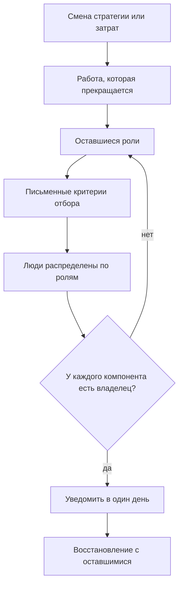
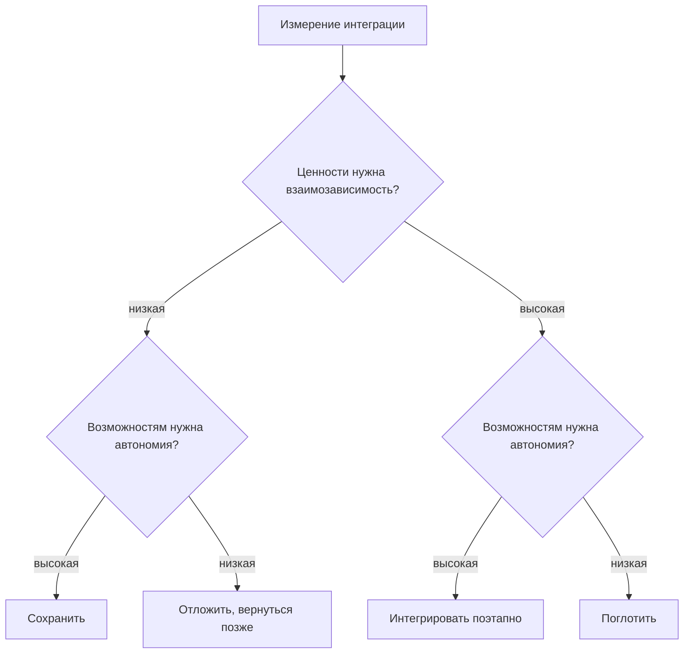
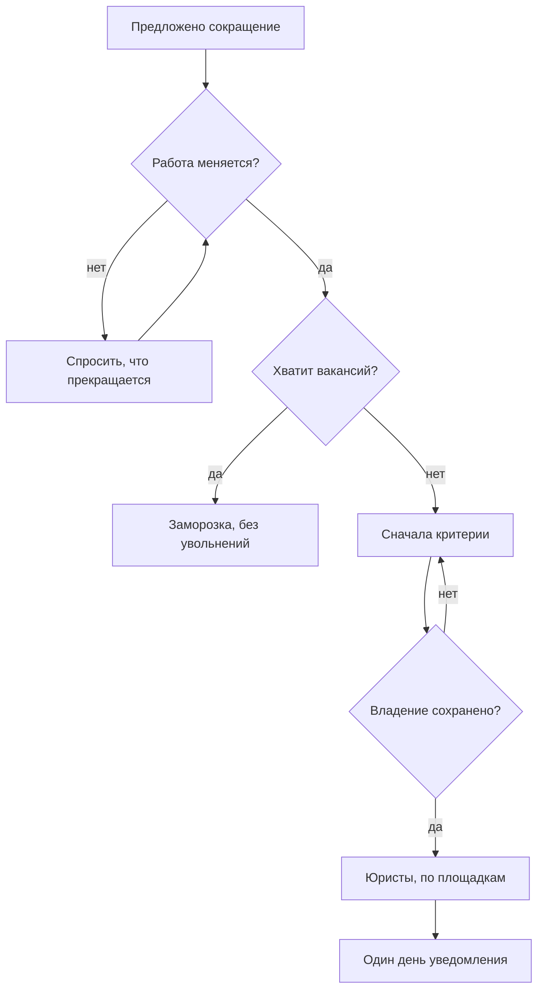

# Глава 58 — Увольнения, сокращения, слияния и поглощения { #chapter-58-layoffs-reductions-and-mergers-and-acquisitions }

Сокращение штата и поглощение выглядят противоположностями: одно убирает людей, другое добавляет. Для
руководителя разработки это одна и та же задача, увиденная с двух сторон. И то и другое меняет владельцев
работающих систем быстрее обычного; оба решения отчасти принимают выше инженерной организации; оба потом
оценивают те, кто остался. Эта глава о том, как ответственно спланировать сокращение (критерии отбора,
коммуникация, непрерывность владения), как вести оставшуюся организацию и как интегрировать поглощённую
инженерную команду и её технологии, на какой бы стороне сделки вы ни оказались, в том числе при слиянии
равных. Сквозные примеры — две группы Halvard Systems, вымышленной
[компании для сравнения](../../case-studies/northstar/halvard.md) с 500 инженерами.

!!! note "Связанные главы"
    [Глава 9](../02-people-management/09-performance-management-and-underperformance.md) отвечает за
    низкую результативность — это другой процесс с другими правилами;
    [глава 36](../07-organization-design/36-reorganizations-evolution-and-succession.md) — за
    реорганизации; [глава 48](../11-vp-engineering/48-capacity-strategy-workforce-planning-and-governance.md)
    — за планирование персонала; [глава 55](../12-cto-leadership/55-boards-due-diligence-and-executive-decision-making.md)
    — за due diligence (комплексную проверку) при поглощении. [Глава 59](59-transformation-under-constraint-and-scaling-without-bureaucracy.md)
    разбирает трансформацию при сокращающемся бюджете — обычную альтернативу сокращению штата.

!!! note "Не юридическая консультация"
    Трудовое право различается от страны к стране, от штата к штату, а иногда и от города к городу, и
    со временем меняется. Глава ссылается на несколько официальных источников, чтобы показать, какого
    рода обязанности существуют. Она не говорит, что применимо к вам. Для каждого сокращения и каждого
    поглощения нужен юрист по трудовому праву в каждой затронутой юрисдикции, и привлечь его нужно до
    того, как план зафиксирован.

## Почему это важно { #why-this-matters }

В команде сокращение — самый тяжёлый разговор, какой бывает у руководителя, а поглощение — группа
незнакомых людей с другой системой сборки.

В организации оба события перемещают владение. Сокращение может убрать единственного человека, который
за последний год менял компонент биллинга; поглощение может добавить одиннадцать сервисов, по которым
ещё ни разу никого не вызывали. От директора зависит, перейдёт ли владение намеренно или потеряется
случайно.

Для высшего руководства решение экономическое, а последствия — культурные. Принесёт ли сокращение или
поглощение ожидаемый результат, зависит от мнения оставшихся о том, как всё было сделано. За плохо
проведённое сокращение платят уходами в течение года, а при плохой интеграции поглощения уходят те самые
люди, которых купили.

## Цели главы { #learning-objectives }

После этой главы вы сможете:

- Планировать сокращение: сначала решать, какая работа прекращается, и только потом — кто уходит,
  опираясь на письменные критерии отбора, которые выдержат и юридическую проверку, и проверку на
  справедливость.
- Проверять непрерывность владения для каждого продакшен-компонента до того, как кого-либо уведомят, и
  устранять пробелы, которые найдёт проверка.
- Проводить день уведомления как единую последовательность, в которой затронутые люди узнают первыми,
  от своего руководителя, лично или по видео, до того как что-либо ещё изменится.
- Вести оставшуюся организацию в следующие два квартала, измеряя доверие, текучесть и надёжность, а не
  строя о них догадки.
- Проектировать интеграцию поглощённой инженерной команды: решать, сколько автономии сохранить, какие
  корпоративные правила действуют с первого дня и когда принимать решение о консолидации платформ.

## Ментальная модель { #the-mental-model }

> **Ментальная модель:** сначала работа, потом люди. Сокращение или интеграция меняют то, какую работу
> делает организация и кто ею владеет. Назовите работу, которая прекращается, начинается или переходит к
> другим; выведите роли из работы; заполните роли по критериям, записанным заранее; затем проверьте, что
> у каждой работающей системы остался владелец. Всю эту последовательность будут оценивать те, кто
> остался, и от их оценки зависит, во что она обойдётся.

Порядок важен, потому что по умолчанию всё происходит наоборот: под давлением затрат первым артефактом
обычно становится таблица с именами, а в итоге те же обязательства ложатся на меньшее число людей.

| Шаг | На какой вопрос отвечает | Что идёт не так, если его пропустить |
|---|---|---|
| Работа, которая прекращается | Чего мы больше не будем делать? | Те же обязательства на меньшем числе людей |
| Оставшиеся роли | Что нужно оставшейся работе? | Сокращение размазано равномерно, ослаблена каждая команда |
| Письменные критерии | Почему этот человек, а не тот? | Отбор по предпочтениям руководителя, юридические риски |
| Проверка владения | Сохраняет ли каждая работающая система владельца? | Уходит единственный эксперт; это выясняется на следующем инциденте |
| Один день уведомления | Кто, что, когда и от кого узнаёт? | Слухи, доступ отключён раньше разговора |
| Восстановление | Верят ли оставшиеся, что всё было честно и уже закончилось? | Уходы и молчание в течение года |

Вторая идея относится к поглощениям: **интеграция — это выбор степени автономии, который делают по
каждому измерению отдельно**. Людей, продукт, платформу и политики можно интегрировать с разной
скоростью. Заставить все четыре измерения сдвинуться в первый же день — самый распространённый способ
разрушить то, что купили.

## Подробный разбор { #deep-conceptual-explanation }

### Что исследования говорят о сокращениях { #what-the-research-says-about-reductions }

Исследований о сокращениях штата много, но большинство из них проведено вне разработки ПО и касается
последствий, а не методов проведения
([Datta et al., 2010](../../references/bibliography.md#datta2010downsizing) делают их обзор). Для
руководителя разработки важнее всего три вывода; все три — **научные результаты**.

**Сокращения предсказывают добровольные уходы.** В разных организациях сокращение штата предсказывает
более высокую добровольную текучесть, отчасти через снижение приверженности
([Trevor and Nyberg, 2008](../../references/bibliography.md#trevor2008downsizing)). Закладывайте в план
более высокую текучесть после сокращения. Помогают справедливость и привязанность людей к работе, а не
бюджет на обучение.

**Оставшиеся смотрят, как обошлись с ушедшими.** Хуже всего оставшиеся сотрудники (в исследованиях их
называют survivors) реагировали, когда отождествляли себя с уволенными и считали, что тем дали слишком
мало ([Brockner et al., 1987](../../references/bibliography.md#brockner1987survivors)). А когда причины
объясняли ясно, они сообщали о большей приверженности
([Brockner et al., 1990](../../references/bibliography.md#brockner1990explain)). Выходное пособие и
объяснение — главные рычаги влияния на тех, кто остаётся.

**Неуверенность и реструктуризация вредят людям.** Неуверенность в сохранении работы вредит отношению людей
к работе и к компании, а также их здоровью ([Sverke et al., 2002](../../references/bibliography.md#sverke2002insecurity)), а
коммуникация и справедливая процедура входят в число факторов, которые смягчают вред реструктуризации для
благополучия ([de Jong et al., 2016](../../references/bibliography.md#dejong2016restructuring)). Долгий
период слухов — это неуверенность, навязанная всем.

Проверенного рецепта сокращения в софтверной организации исследования не дают. Процедуры ниже —
**рекомендация книги**.

### Потеря знаний — риск, специфичный для разработки { #knowledge-loss-is-the-engineering-specific-risk }

В софтверных организациях значительная часть операционных знаний хранится в головах немногих людей.
Примерно у 65% из 133 популярных open-source-проектов truck factor (он же bus factor: число
разработчиков, уход которых создаст проекту серьёзные проблемы) был равен 2 или меньше; его оценивали
по авторству в истории системы контроля версий
([Avelino et al., 2016](../../references/bibliography.md#avelino2016truck)). Ниже книга пользуется
упрощённой версией этой оценки: авторами компонента считают тех немногих, кто внёс большую часть его
изменений, и смотрят, сколько из них должно уйти, чтобы у компонента не осталось ни одного автора. Потери
знаний при уходе разработчиков могут намного превышать ожидаемые, а назначение преемников их уменьшает
([Rigby et al., 2016](../../references/bibliography.md#rigby2016turnover); см. также
[Mockus, 2010](../../references/bibliography.md#mockus2010volatility)). Это **научные результаты**,
полученные в ограниченных условиях.

Сокращение убирает много людей сразу, поэтому проверка владения — единственный момент, когда потерю
знаний можно предотвратить, а не обнаружить постфактум.

### Критерии отбора { #selection-criteria }

Сокращению нужен обоснованный ответ на вопрос «почему я?» для каждого затронутого человека и на вопрос
«почему не они?» для каждого, кто остаётся. Распространены четыре семейства критериев. Руководство
американского ведомства EEOC (Equal Employment Opportunity Commission, Комиссия по равным возможностям
при трудоустройстве) об отказе от претензий в обмен на выходное пособие называет стаж, индивидуальные
критерии вроде результативности и упразднение целой должности или подразделения
([EEOC, 2009](../../references/bibliography.md#eeoc2009waivers); **стандарт**, руководство без силы
закона). Отказ от претензий (severance waiver) — документ, которым сотрудник в обмен на выходное пособие
отказывается от юридических претензий к работодателю.

| Семейство критериев | Сильная сторона | Как ломается |
|---|---|---|
| Упразднённая работа (по ролям) | Следует за стратегией; легко объяснить | Служит прикрытием, чтобы убрать отдельных людей с ролей, которые продолжают существовать |
| Навыки, нужные оставшейся работе | Сохраняет возможности там, где работа | Навыки оценивают по впечатлению, а не по свидетельствам |
| Задокументированная результативность | Сохраняет сильных исполнителей | Оценки никогда не калибровали или написали уже после решения |
| Стаж в компании или в должности | Просто и предсказуемо | Не учитывает соответствие оставшейся работе; может противоречить целям справедливости |

Книга рекомендует отбирать в первую очередь по ролям, во вторую — по соответствию навыков, а
задокументированную результативность использовать, только если её зафиксировали до того, как сокращение
начали обдумывать. Никогда не используйте сокращение, чтобы убрать людей, с чьей результативностью
руководители так и не поработали: это вредит обоим процессам.

Каким бы ни был набор критериев, прежде чем список отбора станет окончательным, HR и юристы должны
проверить его на несоразмерное влияние на защищённые группы (disparate effects). Например, в США, когда
группу людей просят отказаться от претензий о дискриминации по возрасту, работодатель обязан раскрыть
возраст и должности отобранных и не отобранных в подразделении
([EEOC, 2009](../../references/bibliography.md#eeoc2009waivers)). Этот тест полезен где угодно: если вам
было бы неловко показать, кого и из какого подразделения отобрали, критерии со своей задачей не
справляются.

### Справедливость и этика отбора { #fairness-and-ethics-in-selection }

Юридическая проверка отвечает на вопрос, можно ли защитить список, а проверка на справедливость —
правилен ли он. Прежде чем список станет окончательным, проведите три проверки (**рекомендация книги**):

- **Одно правило для всех.** Критерии записали до появления имён, и каждый применяли по всему
  подразделению, опираясь на одни и те же свидетельства. Руководитель, у которого с человеком личный
  конфликт, этого человека не оценивает.
- **На кого ложится сокращение.** Посмотрите, кого отбирают среди тех, у кого меньше возможностей
  возразить: людей в отпуске, сотрудников на неполной ставке и удалённых, недавно вернувшихся, тех, чья
  виза зависит от работы. Закономерность здесь должна объясняться самой работой, иначе список меняют.
- **Никого не отбирают за то, что он высказывался.** Сверьте каждое отобранное имя с недавними
  жалобами, сообщениями об инцидентах и высказанными опасениями. При совпадении второй проверяющий
  подтверждает, что выбор объясняют одни только критерии.

Некоторые действия неправильны, даже когда законны: подгонять момент уведомления, чтобы не выплачивать
бонус или не дать наступить дате [вестинга](../../glossary.md#vesting) (моменту, когда выделенные акции
становятся собственностью сотрудника); давить на людей, чтобы они уволились «добровольно»; давать разное
выходное пособие в похожих случаях. Если вы не стали бы объяснять какой-то выбор оставшимся, не делайте
его.

### Обязанности по уведомлению и консультациям { #notice-and-consultation-obligations }

Массовые увольнения регулируются во многих юрисдикциях, и для разработки отсюда прежде всего следует
вопрос о последовательности действий. Два официальных источника показывают, насколько разными бывают
требования (оба — **стандарт**):

| Режим | Когда применяется | Уведомление или консультации | Что это значит для разработки |
|---|---|---|---|
| Федеральный закон США WARN Act (о заблаговременном уведомлении работников о массовых увольнениях; [US DOL, 2003](../../references/bibliography.md#dol2003warnemployer)) | Массовые увольнения у работодателей, у которых, в общих чертах, 100 и более работников на полной ставке, по каждой площадке; меньшие увольнения в пределах 90 дней могут суммироваться | Письменное уведомление не менее чем за 60 дней; многие штаты добавляют собственные законы | Проверить суммирование с любыми другими действиями в компании |
| Директива ЕС о массовых увольнениях (collective redundancies directive; [Council of the EU, 1998](../../references/bibliography.md#eu1998collective)) | Пороги вроде 10 увольнений за 30 дней в организации с 21–99 работниками; применяется через национальное право | Своевременно консультироваться с представителями работников, стремясь к соглашению; увольнения вступают в силу не раньше чем через 30 дней после уведомления властей | Список отбора остаётся предложением, пока не закончатся консультации |

Глобальное объявление в один день в одних местах может оказаться незаконным, а в других — просто
нечутким.

### Интеграция поглощённой команды { #integrating-an-acquired-team }

Данные о поглощениях отрезвляют. В среднем результаты компаний-покупателей после поглощений не
улучшаются, а большая часть разброса остаётся необъяснённой
([King et al., 2004](../../references/bibliography.md#king2004metaanalyses); **научный результат**). Для
разработки в технологических поглощениях важны три вывода (**научные результаты**, на ограниченных
выборках):

- **Структурная интеграция поначалу замедляет инновации**, особенно у поглощённых компаний, которые ещё
  не выпустили продукты ([Puranam et al., 2006](../../references/bibliography.md#puranam2006organizing)).
- **Интеграция снижает продуктивность тех, кто теряет статус**: это показало исследование изобретателей
  в поглощённых фармацевтических компаниях
  ([Paruchuri et al., 2006](../../references/bibliography.md#paruchuri2006integration); перенос на
  инженеров-программистов — вывод книги).
- **Поглощённые руководители несут ценность**, как ожидаемую, так и неожиданную
  ([Graebner, 2004](../../references/bibliography.md#graebner2004momentum);
  [Ranft and Lord, 2002](../../references/bibliography.md#ranft2002acquiring)).

Haspeslagh и Jemison известны классификацией подходов к интеграции: сколько автономии нужно поглощённой
компании и сколько взаимозависимости нужно, чтобы сделка принесла ценность
([Haspeslagh and Jemison, 1991](../../references/bibliography.md#haspeslagh1991managing); **мнение
эксперта**). Эта глава применяет их идею не к сделке целиком, а к каждому измерению. Larson советует
около шести месяцев эксплуатировать стек поглощённой компании как есть
([Larson, 2023](../../references/bibliography.md#larson2023ma); **мнение эксперта**).

Закон Конвея добавляет долгосрочное ограничение: поглощённая команда, которую держат отдельно, сохранит
отдельную систему. Поэтому, чтобы потом объединить системы, сначала нужно объединить коммуникацию
([Conway, 1968](../../references/bibliography.md#conway1968committees);
[глава 33](../07-organization-design/33-conways-law-team-topologies-and-cognitive-load.md)).

Примените дерево четыре раза: к людям и структуре, к продукту, к платформе и к политикам. Типичный
ответ: политики безопасности и инцидентов поглощаются с первого дня, продукт интегрируется поэтапно,
структура и руководитель сохраняются, а решение о платформе откладывается примерно на шесть месяцев.

### Если поглощают вас или вы сливаетесь с равным { #when-you-are-acquired-or-merging-with-a-peer }

Остальная часть главы написана с позиции покупателя. Две другие позиции требуют других шагов
(**рекомендация книги**).

**На стороне поглощаемых.** Об уровнях, линиях подчинения и инструментах ваша команда узнает либо от вас,
либо из слухов. В первый день скажите, что вы знаете, чего не знаете и к какой дате будет решён каждый
открытый вопрос. Никогда не обещайте того, что покупатель не закрепил письменно. По возможности ещё до
закрытия сделки запишите, у кого хранятся знания о каждой работающей системе, вместе с историей
дежурств и инцидентов: это свидетельство того, какие измерения стоит сохранить. Затем попросите, чтобы
вас допустили к калибровке ваших людей.

**Удержание ключевых инженеров.** Бонусы за удержание (деньги, которые платят за то, что человек
останется до определённой даты) и новые акции покупают время, а не приверженность. Инженеров удерживает
работа: названная роль в интеграции, уровень, соответствующий тому, что человек действительно делает, и
руководитель, которому он доверяет. Предлагайте деньги за удержание только тем немногим, от кого зависит
тезис сделки, и дополняйте каждое такое предложение
[интервью об удержании](../../glossary.md#stay-interview) (stay interview) и письменным описанием роли.

**Слияние с равным.** Когда объединяются две сопоставимые организации, практика ни одной из сторон не
становится вариантом по умолчанию. Выбирайте одного руководителя на каждое направление по тому, что нужно
направлению, а не по тому, из какой компании человек пришёл, и объявите это правило до того, как
прозвучат имена. Прежде чем распределять людей по уровням, сравните две карьерные лестницы на реальных
примерах работы, затем распределите один раз и дайте возможность обжаловать результат. Каждое измерение
решайте по дереву выше и будьте готовы к тому, что в каждом выборе проигравшая сторона почувствует себя
поглощённой.

## Пример из инженерной организации { #engineering-organization-example }

Вторая продуктовая группа Halvard, **Field Operations**, делает ПО для компаний, которые планируют работу
выездных техников и направляют их на заявки. Её вице-президент — Imani Okonkwo. В группе 110 инженеров и
14 ролей руководителей (одна вакантна) под началом трёх директоров:

| Подразделение | Директор | Руководители | Инженеры | Продукт |
|---|---|---|---|---|
| Dispatch | Mateo Rinaldi | 5 | 38 | Облачный продукт |
| Mobile Workforce | Ruth Halloran | 5 ролей, одна вакантна | 40 | Мобильное приложение для техников |
| Classic Scheduler | Tobias Engel | 4 | 32 | On-premises; выручка от лицензий падает три года |

Все цифры — **иллюстрация**. Команда высшего руководства Halvard решает прекратить новую разработку
Classic Scheduler, выполнять его контракты поддержки ещё три года и перевести его клиентов на Dispatch.
Первое предложение финансов — сократить на 15% все три команды, примерно 17 инженеров.

**Шаг 1: работа, которая прекращается.** Imani письменно отклоняет вариант «под одну гребёнку»: Dispatch
примет клиентов Classic, поэтому сокращать его — значит добавлять нагрузку там, где она вот-вот вырастет.
Подрядчиков в группе нет (допущение), а четыре открытые [заявки на найм](../../glossary.md#requisition)
(утверждённые, но не заполненные роли) сохраняют, чтобы перевести на эти роли затронутых людей.
Прекращается разработка новых функций Classic Scheduler. Продолжается следующая работа:

| Оставшаяся работа по Classic | FTE (допущение) | Основание |
|---|---|---|
| Патчи безопасности и обновления зависимостей | 2 | История патчей за последние четыре квартала |
| Эксплуатация 3 компонентов [tier 1](../../glossary.md#tier-1) (дежурства, реагирование на [Sev1 и Sev2](../../glossary.md#severity-sev1-sev2-sev3)) | 4 | Один график дежурств, общий с инженерами по эскалациям |
| Эскалации клиентов (третья линия поддержки) | 3 | Объём эскалаций за последние два квартала |
| Инструменты миграции в Dispatch (экспорт, импорт, проверка) | 5 | Оценка миграции, четыре квартала |
| Итого команда поддержки | 14 | |

Поэтому Classic сокращается с 32 инженеров до 14: упраздняются 18 ролей. Четверо из этих 18 человек
переходят на открытые роли в Dispatch и Mobile Workforce, четырнадцать увольняют. Ролей руководителей в
Classic становится две вместо четырёх: один из руководителей, лишившихся роли, занимает вакантную роль
руководителя в Mobile Workforce, второго увольняют.

| Команда | Инженеров до | Инженеров после | Ролей руководителей после |
|---|---|---|---|
| Dispatch | 38 | 40 (двое переведены) | 5 |
| Mobile Workforce | 40 | 42 (двое переведены) | 5, все заполнены |
| Classic Scheduler | 32 | 14 | 2 |
| Field Operations | 110 | 96 | 12 |

**Шаг 2: письменные критерии.** Роли в команде поддержки заполняют по трём критериям в таком порядке.
Первый — навыки, нужные роли (например, для эскалаций — опыт работы с базами данных и обновлениями).
Второй — недавняя история изменений или дежурств по компонентам, которые покрывает роль. Третий — оценки
результативности за два последних цикла. Leah Marchetti, HR бизнес-партнёр Field Operations, и юрист по
трудовому праву проверяют получившийся список на несоразмерное влияние, прежде чем он станет
окончательным.

**Шаг 3: проверка владения.** Classic владеет 21 продакшен-компонентом, три из них — tier 1. Для каждого
команда перечисляет всех, кто вносил изменения за последние 12 месяцев, и всех, кто отвечал на дежурстве
за последние два квартала. В первом черновике руководителей у пяти компонентов, включая сервер лицензий
tier 1, не осталось бы никого ни с тем, ни с другим опытом. Отбор в команду поддержки меняют в двух
местах, и это закрывает два компонента из пяти. Остальные три меняются реже раза в квартал: три уходящих
инженера соглашаются на оплачиваемый двухнедельный контракт на передачу дел, чтобы записать пошаговые
разборы и обновить ранбуки (runbook).

**Шаг 4: стоимость.** Среди 14 увольняемых инженеров 6 на уровне Engineer, 7 — на уровне Senior и 1 — на
уровне Staff.

| Строка | Расчёт | Сумма |
|---|---|---|
| Снятые годовые затраты на инженеров (увольнения) | 6 × $170,000 + 7 × $215,000 + 1 × $270,000 | $2,795,000 |
| Разовые затраты (выходные пособия и передача дел), принятые равными 25 процентам от этой суммы | 0.25 × $2,795,000 | $698,750 |
| Месяцев экономии, чтобы окупить разовые затраты | $698,750 ÷ ($2,795,000 ÷ 12) | 3.0 |

Стоимость руководителя не учтена, потому что в материалах Halvard роли руководителей не оценены.
Окупаемость выглядит быстрой; во что обойдётся последующая текучесть, посчитано в разделе «Применение в
крупной организации».

**Шаг 5: юрисдикции.** Одиннадцать увольняемых инженеров работают на двух площадках в США, трое — на
площадке в одном из государств ЕС, где затронуты четыре роли. Юристы советуют, следуя национальному
законодательству и политике Halvard, сначала провести консультации с представителями сотрудников на
площадке в ЕС, хотя цифры ниже порогов директивы. Сроки для четырёх ролей в ЕС сдвигаются на пять недель,
и в плане это сказано прямо.

## Как принимать решение { #decision-framework }

Используйте эту схему всякий раз, когда предлагается сокращение, — предлагаете ли его вы или предлагают
вам.

| Вопрос | Если да | Если нет |
|---|---|---|
| Меняется ли работа, а не только целевые затраты? | Выводите роли из работы, которая прекращается | Возражайте: спросите, какие обязательства заканчиваются; одна лишь цель по затратам даёт равномерное сокращение |
| Можно ли уложиться в затраты, не заполняя вакансии или прекратив контракты? | Сначала сделайте это, с датами | Продолжайте и объясните, почему этого оказалось недостаточно |
| Записаны и согласованы ли критерии до обсуждения имён? | Применяйте их | Остановитесь, пока не будут |
| Сохраняет ли каждый продакшен-компонент владельца с недавней историей? | Продолжайте | Измените выбор или профинансируйте оплачиваемую передачу дел, затем проверьте снова |
| Нужны ли консультации или уведомление там, где работают затронутые люди? | Выстраивайте последовательность для каждой юрисдикции отдельно | Всё равно сверьтесь с юристами; никогда не исходите из допущений |
| Можно ли обойтись одним раундом? | Планируйте один раунд и скажите, что он единственный запланированный | Прямо скажите, что могут последовать новые; не обещайте того, чего не сможете выполнить |

Для поглощений решение принимают по каждому измерению с помощью дерева из раздела «Подробный разбор», с
двумя жёсткими правилами. Политики безопасности и инцидентов действуют с первого дня независимо от
выбранной степени автономии. А решение о консолидации платформ принимают в дату, назначенную при
закрытии сделки (в день, когда сделка юридически завершается), и оформляют записью архитектурного
решения ([глава 28](../06-technical-leadership/28-architecture-decision-making-and-governance.md)).

## Компромиссы { #trade-offs }

**Скорость против консультаций.** Короткий промежуток между решением и уведомлением ограничивает слухи.
Консультации, где они обязательны, этот промежуток удлиняют, но весь их смысл в том, что они могут
изменить исход.

**Одно глубокое сокращение против нескольких мелких.** Два небольших сокращения за год учат всех, что
будет и следующее, и лучшие люди уходят первыми; слишком глубокое сокращение без нужды вредит людям.
Назовите условия, при которых понадобится ещё один раунд.

**Отбор по ролям против сохранения самых сильных.** Если упразднить разработку целого продукта, могут
уйти сильные инженеры, а более слабые останутся в продолжающихся командах. Перевод сильных людей на
продолжающиеся роли за счёт вытеснения других (bumping) сохраняет возможности, но его труднее объяснить
и защитить. Самый дешёвый средний путь — открытые вакансии, предложенные затронутым людям.

**Стоимость перехода.** Сокращение обходится в выходные пособия, юридические расходы, время
руководителей, падение выпуска и текучесть; интеграция — в работу по миграции, дублирующиеся инструменты
и время senior-инженеров. Заложите в бюджет и то и другое до решения.

**Ваша роль и её пределы.** Директор может быть не согласен с самим сокращением. Скажите об этом один
раз, письменно и до решения, следуя тесту «поддержать или эскалировать» из
[главы 57](57-crises-executive-disagreement-and-resistance.md#decision-framework). Когда решение принято
в пределах полномочий высшего руководителя, поддержите его и никогда не говорите своим руководителям или
затронутым людям «меня заставили». Если план нарушает записанную планку, например людей отбирают за то,
что они высказывали опасения, — это повод для эскалации, а не для поддержки. Руководителям, которые
сообщают новость, тоже нужна поддержка: накануне отрепетируйте с ними разговоры, освободите им вторую
половину дня и поговорите с ними на следующей неделе. Они тоже из числа оставшихся.

## Типичные провалы { #failure-modes }

**Сокращение по таблице.** Один и тот же процент для каждой команды. Это выглядит справедливо, но по сути
несправедливо: такое сокращение ослабляет команды, которым предстоит реализовать стратегию, и оставляет в
силе все обязательства. Как заметить: в плане нет списка работ, которые прекращаются.

**Чистка по результативности.** Сокращение используют, чтобы убрать людей, с чьей результативностью никто
не работал, и оставшиеся делают вывод, что оценки — это список на увольнение. Как заметить: имена
появляются раньше критериев.

**Молчаливый эксперт.** Единственный человек, способный эксплуатировать компонент, попадает в список,
потому что никто этого не проверил. Как заметить: это покажет проверка владения, а позже — первый
инцидент, который никто не может диагностировать.

**Доступ раньше разговора.** Люди узнают, что попали под сокращение, когда у них перестаёт работать
доступ. Как заметить: посмотрите в план — отзыв доступа должен следовать за каждым разговором.

**Сокращение в рассрочку.** Небольшие сокращения раз в несколько месяцев, каждое ниже порога
уведомления, хотя при суммировании они всё равно могут его превысить. Как заметить: у одной группы два
плана сокращения в пределах двух кварталов.

**Исчезнувший руководитель.** После дня уведомления вице-президент замолкает, и оставшиеся воспринимают
его отсутствие как равнодушие. Как заметить: посмотрите в календарь — следующие три недели должны быть
заняты [встречами через уровень](../../glossary.md#skip-level) (skip-level) и встречами команд.

**Поглощение в первый день.** Поглощённую команду в первый же месяц переводят на платформу, карьерную
лестницу, инструменты и процессы покупателя. Как заметить: в плане интеграции нет ни одного измерения с
пометкой «сохранить».

**Уровень как понижение.** Самые уважаемые инженеры поглощённой компании получают уровень ниже того,
которого, по мнению коллег, заслуживают. Как заметить: сравните фактическую роль каждого человека (кто
чей код ревьюил, кто вёл инциденты) с присвоенным уровнем.

## Применение в крупной организации { #enterprise-application }

В организации из 50–150 инженеров руководитель, который проводит сокращение, обычно знает большинство
людей по имени. Объяснять от этого легче, а всё остальное — тяжелее. На примере Field Operations видны
сам день уведомления и вторая половина работы — руководство оставшейся организацией (**иллюстрация**).

**День уведомления на площадках в США.**

| Когда | Что | Кто |
|---|---|---|
| Накануне, днём | Брифинг и репетиция с руководителями: имена, критерии, условия выходного пособия, на что можно отвечать, а на что нет | Imani Okonkwo, Leah Marchetti, юристы |
| Накануне, вечером | Нейтральные 15-минутные приглашения на следующее утро; больше ничего не меняется | HR |
| День 0, 08:30–10:30 | Индивидуальные разговоры: свой руководитель, присутствует HR, лично или по видео; письменные условия передаются на руки | Руководители, HR |
| После каждого разговора | Доступ этого человека меняется, но никогда не раньше | ИТ, по сигналу от HR |
| День 0, 11:00 | Общая встреча: причина, работа, которая прекращается, критерии, цифры, планируются ли новые раунды | Imani с тремя директорами |
| День 0, 11:30 | Записка для оставшихся, затем короткая записка CTO для всей компании | Imani, CTO Halvard |
| Дни 1–10 | Встречи команд, встречи через уровень со всеми командами, итоговая карта владения, закрытие дорожной карты Classic | Imani, директора, руководители |

**Что руководитель говорит в первые две минуты** (иллюстрация; формулировки для каждой юрисдикции
утверждают HR и юристы):

1. Сначала новость: «У меня тяжёлая новость. Ваша роль — одна из упраздняемых, и ваш последний рабочий
   день — [дата]».
2. Причина, одной фразой: «Компания прекратила новую разработку Classic Scheduler, и остаются те роли,
   которые нужны для поддержки продукта».
3. Что дальше: «Сейчас Leah расскажет вам о выходном пособии, льготах и рекомендациях. Я готов ответить
   на любой вопрос сегодня или на этой неделе».

Затем слушайте. Если спросят «почему я?», назовите критерии, применённые к роли, но никогда не
сравнивайте человека с конкретным коллегой. Трёх вещей говорить не надо. «Мне тоже тяжело»: это переводит
разговор на руководителя. Ничего о результативности, если она не была заявленным критерием: это
противоречит названной причине и создаёт юридические риски. И никаких обещаний о будущих раундах или
повторном найме.

**Записка для оставшихся** называет причину, работу, которая прекращается, критерии, цифры, то, как
поддерживают уходящих, планируются ли новые раунды и что меняется для каждой команды. Ни одного имени в
ней нет. На неделях 1 и 2 каждая команда получает обновлённую карту владения и список прекращённых
обязательств, чтобы было видно: сокращение — это сокращение работы.

**Недели 3–13 (первый квартал после сокращения).** В Field Operations зафиксировано 5 добровольных
уходов, что в пересчёте на год даёт [текучесть](../../glossary.md#attrition-and-regretted-attrition)
около 21% при плановом допущении Halvard в 12% (около 2,9 ухода в квартал на 96 инженеров). Трое из пяти
ушедших — из команды поддержки Classic, в которой 14 человек. Число инцидентов Sev1 и Sev2 в Classic
выросло с 2 в квартале перед сокращением до 4, один из них — Sev1. В пульс-опросе о том, понимают ли
люди, почему было принято решение, положительно ответили 71% в Dispatch и Mobile Workforce и 38% в
Classic.

Картина соответствует исследованиям: уходы сосредоточились там, где люди сильнее всего отождествляли себя
с ушедшими и где неуверенность была выше всего. Imani письменно закрепляет за командой поддержки Classic
трёхлетний мандат и названную роль в миграции. Tobias Engel закрывает три вакансии внутренними переводами
из Dispatch. По всем четырём инцидентам проводят безобвинительные разборы, и корректирующие действия по
их итогам касаются ранбуков, подготовленных по контрактам на передачу дел.

**Недели 14–26.** Уходов становится 3 (около 12,5% в пересчёте на год), инцидентов в Classic снова 2, а
оценка понимания там поднимается до 54%. Это одна группа за два квартала, а не доказательство. Следите
за текучестью по командам, за инцидентами в компонентах, у которых сменились владельцы, и за тем, верят
ли люди в названные причины.

**Стоимость, которую пропустила таблица окупаемости.** Два лишних ухода в первом квартале обходятся
примерно в $215 000, если считать, что замена стоит половину годовой
[полной стоимости сотрудника](../../glossary.md#fully-loaded-cost) уровня Senior; к этому добавляется
потерянный выпуск, пока роли оставались незаполненными. Немного по сравнению с $2,8 млн в год; много по
сравнению с заявлением руководителя, что сокращение было «полностью просчитано».

## Взгляд CTO { #cto-perspective }

Первая задача CTO (технического директора) — добиться правильного размера и формы решения, пока оно ещё
не стало планом. Сокращения предлагают в деньгах; CTO переводит деньги в работу, которая прекращается.
Если команда высшего руководства не может назвать эту работу, CTO говорит, что сокращение получится
равномерным, и объясняет, что это сломает.

CTO также отвечает за три обязательства, которые может выполнить только высший уровень. **Число
раундов**: если может понадобиться второй раунд, скажите об этом коллегам до первого; нарушенное обещание
«только один» подрывает доверие сильнее, чем сам второй раунд. **Единообразие между группами**: два
вице-президента с двумя разными философиями сокращений подталкивают оставшихся к сравнениям.
**Юридическая последовательность**: даты задаёт план юристов по площадкам, а не календарь коммуникаций.

В поглощениях рычаг CTO действует до того, как согласована цена: план интеграции вместе с его стоимостью
должен войти в модель сделки, то есть в финансовую модель, по которой покупатель оценивает сделку.

Наконец, собственное сообщение CTO в день уведомления должно быть коротким, называть причину и работу,
которая прекращается, и ни для кого из затронутых не должно стать первым, что он услышит. Первое слово —
за их руководителем.

## Практический плейбук { #practical-playbook }

Планирование сокращения:

1. **Получите причину письменно** от того, кто принимает решение: смена стратегии или цель по затратам,
   сумма и дата, к которой сокращение должно вступить в силу.
2. **Перечислите работу, которая прекращается**, с затронутыми клиентами и обязательствами, после того
   как исчерпаны вакансии, подрядчики и дискреционные расходы.
3. **Оцените оставшуюся работу** в FTE, с основанием для каждой строки, и выведите из неё роли.
4. **Запишите критерии отбора** и получите одобрение HR и юристов до обсуждения любых имён.
5. **Распределите людей по ролям** по критериям; открытые роли сначала предложите затронутым людям.
6. **Проведите проверку владения** по каждому продакшен-компоненту; измените выбор или профинансируйте
   оплачиваемую передачу дел, затем проверьте снова.
7. **Проверьте список на несоразмерное влияние** вместе с HR и юристами, подразделение за
   подразделением.
8. **Выстройте последовательность по юрисдикциям** вместе с юристами: консультации, сроки уведомления,
   уведомления властей.
9. **Подготовьте день уведомления**: репетиция с руководителями накануне, письменные условия, отзыв
   доступа запланирован после каждого разговора.

День уведомления и после него:

10. **Сначала скажите затронутым людям**, каждому лично, устами его собственного руководителя в
    присутствии HR.
11. **Сразу после этого скажите всем остальным**: общая встреча, затем записка для оставшихся.
12. **Опубликуйте новую карту владения** в течение недели, а встречи через уровень со всеми командами
    проведите в течение двух.
13. **Измеряйте два квартала**: текучесть по командам, инциденты в переданных компонентах и пульс-опрос о
    понимании и справедливости; сопоставляйте отчёт с исходным бизнес-кейсом.

Интеграция поглощения:

14. **До закрытия сделки** напишите план интеграции по измерениям, оцените стоимость решения о платформе
    и назовите, кто возглавит поглощённую команду после закрытия.
15. **Первый день**: учётные записи, ревизия доступа, ротация секретов, сканирование уязвимостей,
    политики инцидентов и безопасности.
16. **Первые 90 дней**: определение уровней с [калибровкой](../../glossary.md#calibration), в которой
    участвует руководитель поглощённой команды; записи в реестре владения; никакой миграции платформы.
17. **Пятый или шестой месяц**: решение о платформе, оформленное как архитектурное решение с вариантами и
    стоимостью.

## Кейс { #case-study }

Этот кейс вымышлен; Halvard и Corvane придуманы. Третья продуктовая группа Halvard, **Insights**, делает
продукты для отчётности и прогнозирования. Её вице-президент — Henrik Sørlie; у него 100 инженеров под
началом двух директоров: Esther Castellanos (Reporting) и Kenji Iwasaki (Forecasting).

В том же году, что и сокращение в Field Operations, Halvard поглощает **Corvane** — компанию
с 34 инженерами и 4 руководителями, которая делает движок потоковой аналитики событий. Её основатель и CTO —
Dalia Ferraz. Тезис поглощения опирается на три допущения: движок Corvane в течение двух кварталов
сможет принимать объёмы событий от продуктов Halvard; клиенты Corvane останутся на время перехода;
движок удастся встроить в продукт отчётности Insights за шесть месяцев.

**Выводы due diligence, которые определили план.** Corvane эксплуатирует 11 продакшен-сервисов у другого
облачного провайдера, чем Halvard, со своим пайплайном и графиком дежурств из восьми человек. Оценка по
её репозиториям, сделанная описанным выше подсчётом авторства, показывает: у 6 из 11 сервисов truck
factor равен 1 или 2, а знания сосредоточены у 7 инженеров. До подписания CTO Halvard запрашивает
стоимость переноса Corvane на платформу развёртывания Halvard: 22 инженеро-квартала (по два на сервис),
около $1,18 млн по стоимости senior-инженера. Эту сумму добавляют к стоимости сделки. Все цифры —
**иллюстрация**.

**Проект интеграции по измерениям.**

| Измерение | Выбор | Причина |
|---|---|---|
| Структура и люди | Сохранить: Corvane становится третьим подразделением уровня директора, Streaming, во главе с Dalia Ferraz, с подчинением Henrik Sørlie | Поглощённые руководители несут ожидаемую и неожиданную ценность; потеря статуса подрывает продуктивность |
| Продукт | Интегрировать поэтапно: одна встроенная функция в Reporting к месяцу 6 | Тезис требует взаимозависимости, но ранняя структурная интеграция замедляет новые продукты |
| Платформа | Отложить: стек Corvane работает как есть; запись решения на месяце 5 | Совет практиков около шести месяцев эксплуатировать стек поглощённой компании как есть; миграция оценена и профинансирована |
| Политики | Поглотить выборочно | Правила безопасности и инцидентов не могут ждать; остальные вводятся поэтапно |

Шесть корпоративных политик Halvard вводятся по графику: разборы Sev1, сроки устранения уязвимостей и
правило об оценках — с первого дня; команда-владелец для каждого компонента — на первой неделе;
[операционные минимумы tier 1](../../glossary.md#tier-1-operational-minimums) — к месяцу 6; аудируемый
пайплайн — к месяцу 9.

**Уровни.** В Corvane должности были без уровней. На втором месяце калибровка в присутствии Dalia Ferraz
распределяет её инженеров так: 11 Engineer, 19 Senior и 4 Staff, около $7,0 млн в год. Двое из семи
ключевых инженеров вели реагирование на инциденты, хотя их должности этого не отражали, и первый
черновик поставил их на уровень Senior. После сравнения фактической роли каждого с карьерной лестницей
одного перевели на Staff, а второй остался на Senior с письменным планом развития.

**Итоги месяца 6.** Из 34 инженеров Corvane остались 32; один из двух ушедших — ключевой инженер, он ушёл
на четвёртом месяце. Первая встроенная функция выходит на пятом месяце. Согласно записи решения о
платформе, первыми мигрируют четыре самых дорогих сервиса Corvane, а остальные откладывают до второго
решения через год.

Решение «сохранить» удержало людей и руководителя, но сохранило и две платформы — как минимум ещё на год.
Цена этого была видна в модели сделки, а не обнаружилась потом.

## Упражнения { #exercises }

Разборы упражнений: [решения к главе 58](../../solutions/ch58-solutions.md).

### Базовый уровень { #foundational }

**F1.** Первое предложение финансов для Field Operations — сокращение на 15% в Dispatch, Mobile Workforce
и Classic Scheduler, примерно 17 инженеров. По цифрам группы из раздела «Пример из инженерной
организации» покажите, что это предложение сократило бы в каждой команде, какие обязательства пережили бы
его и что оно сделало бы с миграцией клиентов Classic в Dispatch. Затем напишите ответ из двух абзацев,
который Imani Okonkwo отправляет финансам, объясняя, почему сокращение должно начинаться с работы,
которая прекращается.

**F2.** Проверка владения нашла пять компонентов Classic, у которых не осталось бы владельца с недавней
историей изменений или дежурств. Спроектируйте проверку как воспроизводимую процедуру, которую могла бы
провести другая группа: источники данных, запрос или список по каждому компоненту, порог для статуса
«покрыт», кто проверяет результат и что происходит, когда найден пробел. Назовите один способ пройти
проверку на бумаге, при котором знания всё равно теряются.

**F3.** Хронология дня уведомления в главе охватывает две площадки Field Operations в США. Четыре
затронутые роли находятся на площадке в ЕС, где Halvard сначала консультируется с представителями
сотрудников, и сроки для этих людей сдвигаются на пять недель. Напишите план для площадки в ЕС как
последовательность с привязкой ко времени: от дня уведомления в США до недели после окончания
консультаций. Включите в план: что и от кого инженеры площадки в ЕС слышат в день уведомления в США; как
провести консультации, чтобы они могли изменить исход; когда проходят индивидуальные разговоры и
изменения доступа; как держать в курсе оставшихся на обеих площадках. Назовите шаг, провал которого
сильнее всего подорвёт доверие, и объясните почему.

### Прикладное лидерство { #applied-leadership }

**A1.** В первом квартале после сокращения трое из пяти добровольно ушедших в Field Operations были из
команды поддержки Classic в 14 человек, а оценка понимания в этой команде составила 38%. Вы — Tobias
Engel. Спланируйте следующие шесть недель с оставшимися одиннадцатью инженерами: что вы говорите, что
меняете, что измеряете и что просите у Imani Okonkwo. Объясните, на какой из научных результатов этой
главы нацелено каждое действие.

**A2.** Предположим (это сценарий для читателя, а не часть хроники Halvard), что через месяц после дня
уведомления инженер из Dispatch говорит вам наедине, что двоих уволенных инженеров Classic «явно выбрали
потому, что в прошлом году они жаловались на дорожную карту». Вы не знаете, правда ли это. Решите, что вы
делаете в ближайшие 48 часов и в ближайший месяц, кого привлекаете и что говорите инженеру, учитывая
справедливость, юридические риски и доверие оставшихся.

**A3.** При определении уровней в Corvane первый черновик поставил двух ключевых инженеров на уровень
Senior. Предположим, что калибровку провели без Dalia Ferraz и всех семерых ключевых инженеров поставили
на Senior, чтобы «сохранить единообразие лестницы». Проследите вероятные последствия за два квартала для
этих инженеров, для графика дежурств Corvane и для допущения тезиса о встраивании движка в Reporting.
Затем напишите правило калибровки, которое вы установили бы для следующего поглощения.

### Решения на уровне руководства { #executive-decision-making }

**X1.** Предположим (это сценарий для читателя, а не часть хроники Northstar), что на неделе 50 совет
директоров Northstar, вымышленной компании книги с 80 инженерами (см.
[обзор](../../case-studies/northstar/index.md) и
[брифинг квартала 4](../../case-studies/northstar/quarter-4-briefing.md)), просит менеджмент смоделировать
сокращение затрат на инженерный персонал на второй год на 10%. Это около $1,67 млн из подготовленного
финансами черновика затрат на персонал второго года в $16,73 млн, примерно девять инженерных
[мест](../../glossary.md#seat) по $185 000. Вы — Victor Lindqvist (CTO). Правило кейса — всего 87 мест
(80 инженеров, 6 руководителей и директор), замены разрешены, чистый прирост — нет; продолжение
программы качества и план по персоналу — открытые решения квартала 4. Решите, что вы представите совету:
подходит ли сокращение как инструмент, какая работа прекратилась бы, что должна была бы охватить
проверка владения и во что вам нужно было бы верить, чтобы его рекомендовать. Не принимайте ни одного из
открытых решений квартала 4; покажите, как сокращение повлияло бы на каждое из них.

**X2.** Вы — CTO Halvard. Через год после закрытия сделки с Corvane Henrik Sørlie предлагает второе
поглощение: компанию с 20 инженерами, чей продукт пересекается с Forecasting, и планирует «полностью
поглотить её в первом квартале, чтобы раньше получить экономию». Группа Forecasting под руководством
Kenji Iwasaki потеряла бы около трети своей дорожной карты в пользу поглощённого продукта. Решите, что
вы потребуете, прежде чем поддержать сделку: план интеграции по измерениям, как поступить с инженерами
Forecasting, чья работа пересекается с поглощённым продуктом, какие затраты должны войти в модель сделки
и при каких условиях вы выступите против неё.

## Вопросы для размышления { #reflection-questions }

1. Если бы вашей организации пришлось сократить затраты на 15% в следующем квартале, смогли бы вы уже
   сегодня назвать работу, которая прекратится? Если нет, что это говорит о том, насколько ваши
   обязательства соответствуют вашему ресурсу?
2. Какие из ваших продакшен-компонентов потеряли бы единственного знающего человека, если бы завтра
   исчезло одно имя? Почему этого до сих пор никто не исправил?
3. Вспомните последнее сокращение, которое вы видели изнутри. Чему оставшихся научило то, как обошлись с
   ушедшими?
4. Достаточно ли честны ваши записи о результативности, чтобы вы были готовы использовать их как
   критерий отбора и показать результаты юристам?
5. Какое измерение в последнем поглощении, которое вы видели, интегрировали быстрее всего? Было ли это
   измерение, где скорость создавала больше всего ценности, или то, где спешить было проще всего?

## Главное { #key-takeaways }

- Сначала работа, потом люди: перечислите, что прекращается, оцените, что остаётся, выведите роли и
  только потом отбирайте людей.
- Записывайте критерии отбора до обсуждения имён; никогда не используйте сокращение, чтобы решить
  проблему результативности, с которой никто не работал.
- Проведите проверку владения по каждому продакшен-компоненту до уведомления: это единственный момент,
  когда потерю знаний можно предотвратить.
- Привлекайте юристов по каждой площадке, и пусть даты задаёт юридическая последовательность.
- Сначала говорите затронутым людям, каждому лично, устами его руководителя; никогда не допускайте,
  чтобы новость сообщил отключённый доступ.
- Считайте оставшихся главной аудиторией сокращения: ясно объясняйте причины, достойно обходитесь с
  ушедшими и два квартала измеряйте текучесть, инциденты и доверие по командам.
- Интегрируйте поглощение по измерениям: политики безопасности и инцидентов поглощайте с первого дня,
  людей и руководителя сохраняйте, продукт интегрируйте поэтапно, а о платформе решайте в дату,
  назначенную при закрытии сделки.
- Закладывайте затраты на интеграцию и текучесть в бизнес-кейс до решения.

## Источники и что почитать { #references-and-further-reading }

- [Datta et al., 2010](../../references/bibliography.md#datta2010downsizing). Обзор причин и последствий
  сокращений штата.
- [Trevor and Nyberg, 2008](../../references/bibliography.md#trevor2008downsizing). Сокращения и
  добровольная текучесть, а также HR-практики, которые смягчают эту связь.
- [Brockner et al., 1987](../../references/bibliography.md#brockner1987survivors) и
  [Brockner et al., 1990](../../references/bibliography.md#brockner1990explain). Как оставшиеся реагируют
  на то, как обошлись с уволенными, и на объяснения.
- [Sverke et al., 2002](../../references/bibliography.md#sverke2002insecurity). Метаанализ последствий
  неуверенности в сохранении работы.
- [de Jong et al., 2016](../../references/bibliography.md#dejong2016restructuring). Реструктуризация и
  благополучие по данным лонгитюдных исследований.
- [Avelino et al., 2016](../../references/bibliography.md#avelino2016truck),
  [Rigby et al., 2016](../../references/bibliography.md#rigby2016turnover) и
  [Mockus, 2010](../../references/bibliography.md#mockus2010volatility). Концентрация знаний, потери от
  текучести и организационные изменения в разработке ПО.
- [US DOL, 2003](../../references/bibliography.md#dol2003warnemployer). Руководство Министерства труда
  США (Department of Labor) для работодателей по WARN Act.
- [Council of the EU, 1998](../../references/bibliography.md#eu1998collective). Директива ЕС о массовых
  увольнениях.
- [EEOC, 2009](../../references/bibliography.md#eeoc2009waivers). Американское руководство по отказу от
  претензий в обмен на выходное пособие, включая требования к раскрытию информации при групповых
  увольнениях.
- [King et al., 2004](../../references/bibliography.md#king2004metaanalyses). Метаанализы результатов
  компаний после поглощений.
- [Puranam et al., 2006](../../references/bibliography.md#puranam2006organizing). Дилемма координации и
  автономии в технологических поглощениях.
- [Paruchuri et al., 2006](../../references/bibliography.md#paruchuri2006integration). Интеграция и
  продуктивность технических специалистов поглощённой компании.
- [Graebner, 2004](../../references/bibliography.md#graebner2004momentum) и
  [Ranft and Lord, 2002](../../references/bibliography.md#ranft2002acquiring). Построенные на кейсах
  модели того, как поглощённые руководители и выбор способа внедрения влияют на ценность.
- [Haspeslagh and Jemison, 1991](../../references/bibliography.md#haspeslagh1991managing). Классическая
  схема подходов к интеграции.
- [Larson, 2023](../../references/bibliography.md#larson2023ma). Взгляд руководителя разработки высшего
  уровня на поглощения, включая интеграцию.
- [Conway, 1968](../../references/bibliography.md#conway1968committees). Почему объединённые системы
  следуют за объединённой коммуникацией.
