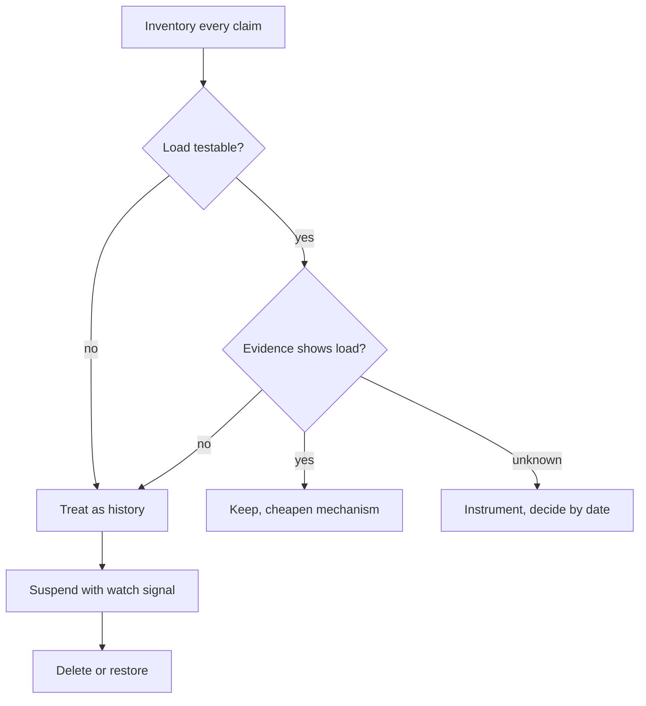
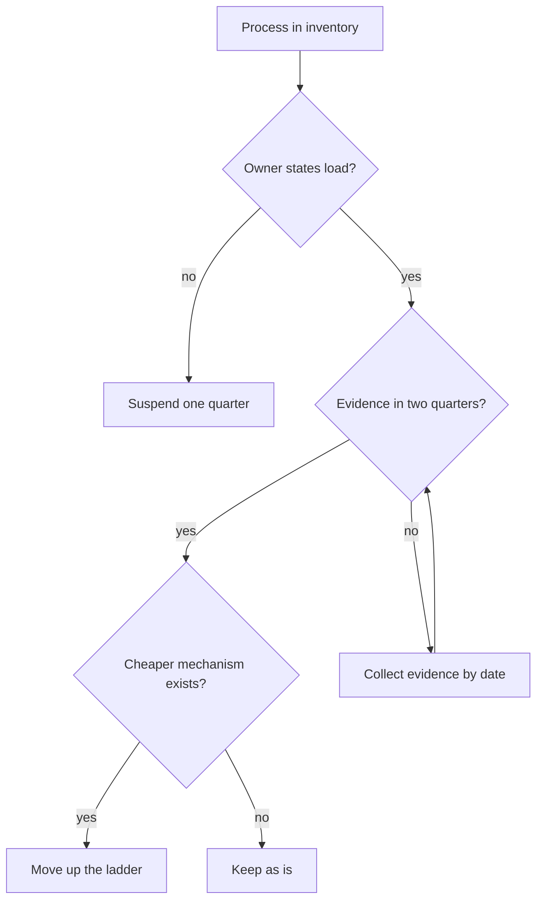

# Chapter 59 — Transformation Under Budget Constraint and Scaling Without Bureaucracy

Most transformations in this book were funded by a mandate. This chapter is about the ones that are
not: the budget is flat or falling, nobody will add people, and the work still has to change. Under
that constraint, every improvement is paid for by stopping something. The cheapest things to stop are
usually the processes, forums, rules, and management steps that once solved a problem and now mainly
persist. The chapter covers how to fund a transformation from inside a fixed budget, how to tell
process that carries load from process that only carries history, and how to remove management
overhead without removing the work it was quietly doing. Then it turns to growth: how to add process as
an organization scales without letting it pile up. The running examples are Northstar
Technologies and Halvard Systems, the fictional companies of the
[case study](../../case-studies/northstar/index.md).

!!! note "Related chapters"
    [Chapter 20](../05-engineering-quality/20-engineering-standards-and-their-governance.md) owns
    engineering standards, [Chapter 37](../08-management-operating-system/37-cadences-and-leadership-meetings.md)
    the meeting calendar, [Chapter 34](../07-organization-design/34-spans-layers-and-dependency-mapping.md)
    spans and layers, and [Chapter 58](58-layoffs-reductions-and-mergers.md) reductions in force.
    [Chapter 56](56-recovering-a-failing-engineering-organization.md) covers an organization that is
    failing rather than constrained; [Chapter 57](57-crises-executive-disagreement-and-resistance.md)
    covers the resistance that removing familiar process provokes.

## Why This Matters

At team scale, process is cheap to add and cheap to drop: a team that stops a ritual notices within a
sprint whether anything broke. Nobody needs a budget to do it.

At organization scale, process accumulates. Each incident leaves a rule, each reorganization a
forum, each audit a report. None is expensive alone, so none is priced, and together they can consume
more capacity than any single funded initiative.

At executive scale, a budget cut forces a choice between cutting work and cutting the capacity to do
it. Leaders who cut capacity across the board and keep every process get an organization that does the
same rituals with fewer people. Leaders who strip process indiscriminately remove controls that were
holding up reliability, security, or customer commitments. The executive skill is knowing which is
which before the cut, not after the incident.

## Learning Objectives

After this chapter you will be able to:

- Build a funding plan for a technical transformation under a flat or shrinking budget, ordering the
  sources by how safely they release capacity or cash.
- Inventory an organization's processes, forums, and rules and classify each by the load it carries,
  using evidence rather than opinion.
- Remove a forum, rule, approval step, or management role safely: name its loads, reassign them,
  suspend before deleting, and watch a stated signal.
- Distinguish capacity returned from cash saved, and explain to a finance executive why the two do not
  substitute for each other.
- Design how a growing organization adds process: a stated load and sunset for each new rule, a yearly
  process budget, and a short list of owned policies instead of many rules.
- Recognize the failure modes of constrained transformation, including the across-the-board cut,
  cost shifting, and the removal that takes a hidden load with it.

## The Mental Model

> **Mental model:** Under a fixed budget, transformation is reallocation, and the first place to look
> for funding is the organization's own standing claims on capacity. Every process, forum, rule, and
> management step is such a claim. Each one either carries load (it prevents a failure, makes a
> decision, or moves information that would otherwise not move) or carries history (it exists because
> it once did). Keep the first, cheapen it where you can, and remove the second deliberately, one
> reversible step at a time.

Two ideas sit inside this. First, **load is a claim that can be tested**. "This review catches
defects" is checkable: count what it caught and what got through. A process
whose owner cannot state its load in a testable sentence is a candidate for removal, not proof that
removal is safe.

Second, **removal is a change like any other**, and it fails the way changes fail: it breaks
something nobody knew depended on it. A process often carries a second, unstated load (a status
meeting that is also the only place two directors notice they are competing for the same engineers).
Safe removal finds those loads and moves them before the process goes.

The diagram has one asymmetric branch on purpose: "unknown" does not mean keep. It means collect the
evidence by a fixed date, and default to suspension if nobody does.

## Deep Conceptual Explanation

### Where money comes from when the budget is fixed

A flat budget is not a frozen one. Inflation, merit increases (yearly pay rises), and cloud growth make
it a shrinking real budget. A "flat" organization that changes nothing is already cutting, usually by
not backfilling (leaving a leaver's seat empty). A transformation under constraint needs a written
funding plan that names its sources. In falling order of safety, this book recommends:

| Source | What it releases | Typical lag | Main risk |
|---|---|---|---|
| Unplanned work recovered by prevention | Capacity | One to three quarters | Counted before it arrives |
| Work stopped outright (retired tools, duplicate systems, abandoned features) | Capacity and often cash | One to two quarters | Users who were not asked |
| Process cost removed (approvals, reports, forums that carry history) | Capacity, mostly | Weeks | Hidden loads removed with it |
| Spend consolidated (licenses, vendor contracts, cloud waste) | Cash | Contract renewal dates | Migration effort underestimated |
| Seats left unfilled as people leave | Cash | Months, by [attrition](../../glossary.md#attrition-and-regretted-attrition) | Work that leaves with the person |

The first row is the reinforcing loop of [Chapter 27](../05-engineering-quality/27-quality-transformation-at-enterprise-scale.md):
prevention reduces failures, which returns capacity, which funds more prevention. It is the only
source that grows, which is why constrained transformations should start there when they can. Its
weakness is lag: the first quarter of prevention is paid for by something else, usually roadmap scope,
and the return arrives later.

Two distinctions keep the plan honest. **Capacity is not cash.** Removing a weekly approval board
returns engineer hours, but the payroll is unchanged. A finance executive asked for a 10 percent cut
will not accept "we freed two [FTE](../../glossary.md#fte)" (full-time engineers) unless a
[seat](../../glossary.md#seat), a funded position, goes with it. Conversely, leaving seats unfilled
saves cash and destroys capacity, so it must be paired with work that stops. **In-year is not
run-rate.** A seat left empty in month six saves half its annual cost this year and all of it in the
[run-rate](../../glossary.md#run-rate), the cost of a full year at the new level. Agree with
finance which one the target measures before building the plan;
[Chapter 52](../12-cto-leadership/52-technology-investment-budgeting-and-financial-literacy.md) owns the
budget mechanics.

### Spend only on the constraint

Goldratt's *The Goal* is known for the argument that a system's output is set by its
[constraint](../../glossary.md#constraint), the one step that limits the whole, and that improving
anything else does not increase output
([Goldratt and Cox, 1984](../../references/bibliography.md#goldratt1984goal)). Without spare money,
every engineer-week spent elsewhere is an engineer-week not spent where it would show. This is
practitioner consensus rather than a research finding, but it is the most useful single filter for a
constrained plan: before funding any improvement, state which constraint it relieves.

A cut handled as a parameter (each team takes 10 percent) changes little except morale; a cut that
changes the rules (which approvals exist, which work stops) changes what the organization does. That is
this book's reading of Meadows, who ranks rules far above parameters as places to intervene in a system
([Meadows, 1999](../../references/bibliography.md#meadows1999leverage); **expert opinion**).

### Why process accumulates

Process is added for good reasons: a failure happened, an auditor asked, a new leader needed
visibility. It is rarely removed, for three reasons.

**People search for additions.** People default to adding and overlook useful subtractions, especially
when nothing prompts them to consider removing something. That is a **research finding** from eight
experiments by Adams and colleagues
([Adams et al., 2021](../../references/bibliography.md#adams2021subtractive)); their suggestion that it
explains red tape is untested. The practical lesson is cheap: ask "what could we remove?" at every
review.

**Nobody owns the total.** Each forum has an owner; nobody owns the sum of forums. Each rule has a
reason; nobody prices the rule set. Costs that are spread thin and paid in other people's hours do not
appear on any budget line.

**Removal looks like risk; addition looks like diligence.** After an incident, adding a review step is
visible and defensible. Removing one is a career risk if anything later goes wrong. Meanwhile an
approval step is a queue whose cost is paid in waiting, which no report shows; Reinertsen argues that
such queues are ignored because they are invisible
([Reinertsen, 2009](../../references/bibliography.md#reinertsen2009principles)).

### Process that carries load, process that carries history

Formal rules help or harm depending on their kind. Adler and Borys distinguish **enabling**
formalization, which helps people master their tasks, from **coercive** formalization, which tries to
compel effort and compliance ([Adler and Borys, 1996](../../references/bibliography.md#adler1996bureaucracy)).
This is a conceptual argument (**expert opinion**), not an empirical test. It explains a familiar
pattern: one organization can have a runbook engineers rely on and a checklist they tick without
reading. Sutton and Rao's *The Friction Project* is known for a related practitioner argument:
remove the friction that wastes effort, keep or add the friction that stops the wrong things
([Sutton and Rao, 2024](../../references/bibliography.md#sutton2024friction)).

This book turns those ideas into a load test with four questions:

| Question | Load-bearing answer | History answer |
|---|---|---|
| What failure, decision, or information flow does it serve? | A specific one, stated in a sentence | "Alignment", "visibility", "best practice" |
| What evidence shows it doing that in the last two quarters? | Catches, decisions, changed outcomes | None kept, or only attendance |
| What would we see if it stopped? | A named signal that would move | Nothing anyone can name |
| Is there a cheaper mechanism for the same load? | Maybe; then change the mechanism | Irrelevant; the load is gone |

Heavyweight change approval is the class of process with the most direct evidence against it. DORA's
research found approval by a change advisory board or senior manager associated with worse delivery
performance, and found no evidence that formal external review lowers
[change failure rates](../../glossary.md#change-failure-rate). It recommends peer review in the
development platform, automated testing and monitoring, and a coordinating role for the board
([DORA, change approval](../../references/bibliography.md#dora-cap-change-approval)). This is
**industry research**, survey-based and correlational. It does not prove that removing your board is
safe, but it shifts the burden of proof onto the board.

The load test extends Chapter 20's triage of standards to forums, approvals, reports, and roles. A
load-bearing process often has a cheaper mechanism, so "keep" rarely means "keep as is".

### Management overhead is mostly time, not salaries

Managers are not pure overhead, so the safer target is the time management consumes. Google's Project
Oxygen began from some engineers' hypothesis that managers do not matter. It concluded that teams with
highly effective managers achieved better results, were happier, and had lower turnover
([re:Work, great managers](../../references/bibliography.md#rework-great-managers);
[Garvin, 2013](../../references/bibliography.md#garvin2013google); **documented practice** from one
company, self-reported). Lee and Edmondson's review finds that little is known about organizations that
remove managers altogether ([Lee and Edmondson, 2017](../../references/bibliography.md#lee2017selfmanaging);
**expert opinion**). Gallup's survey research suggests that a manager's talent matters more than the
number of reports ([Harter, 2026](../../references/bibliography.md#harter2026span); **industry
research**).

Cut the time, then: status rounds, approval queues, reports compiled by hand, and decisions that climb
layers because boundaries are wrong. [Chapter 34](../07-organization-design/34-spans-layers-and-dependency-mapping.md)
owns the trade between spans, layers, and decision hops. Larson suggests six to eight engineers per
manager and four to six managers per manager of managers
([Larson, 2018](../../references/bibliography.md#larson2018sizing); **expert opinion**). Use it as a
range to explain deviations from, not a rule.

One structural trap matters under a shrinking budget. **Attrition shrinks teams, not management.** If
an organization loses engineers by not backfilling and keeps every team and manager, spans narrow and
the management share of cost rises while the budget falls. Removing management overhead safely is
mostly a matter of merging teams whose work has merged, and handling the manager's next role as a
people decision, not a line item.

### Adding process as you grow

Growth is when process piles up fastest. Every new team, site, or customer segment brings a reason to
add a rule, and a growing budget forces nobody to remove one. The answer is not to refuse process: a
300-engineer organization needs more shared rules than an 80-engineer one. The answer is to make each
addition carry its own exit and its own price. The four practices below are **this book's
recommendation**, built on the load test above; no research tests them as a package.

- **Write the load and the sunset in at birth.** A new mandatory rule, forum, or report states the
  failure, decision, or information flow it serves, the signal that would show it working, and a
  review date, normally a year out. At that date it is renewed on evidence or it lapses. Renewal is a
  decision someone makes, not a default.
- **Give process a budget.** Once a year, price the standing claims (forums, approvals, reports,
  mandatory rules) in FTE or [engineer-weeks](../../glossary.md#engineer-week-engineer-day-engineer-year)
  (1 FTE is 52 engineer-weeks a year) and set a ceiling as a share of capacity. A new claim that would
  break the ceiling retires an old one or wins an explicit increase. The exact number matters less than
  having someone own the total.
- **Limit who can make a rule mandatory.** Anyone may write guidance. Making it mandatory should take
  a named decider (a director for an area; the CTO or a principal engineer for the whole organization)
  and an entry in the [decision log](../../glossary.md#decision-log). A rule added the week after an
  incident gets the same treatment, with its review at the next quarterly review.
- **Scale through a few owned policies, not many rules.** Halvard Systems, at 500 engineers, runs on
  six enterprise policies, each owned by a principal engineer: one owning team per production
  component, the [tier 1 operational minimums](../../glossary.md#tier-1-operational-minimums), an
  auditable pipeline with rollback, vulnerability remediation service levels, a tracked review for
  every Sev1, and no customer date without an estimate and an owner. Each states an outcome and leaves
  the mechanism to the groups. A proposed company-wide rule must first say which policy it serves.

**A worked example (hypothetical).** A software company grows from 120 to 200 engineers in a year. At
the start, its CTO prices the standing claims: 11 forums, 4 approval steps, 6 recurring reports, and 18
mandatory rules cost about 9 FTE, or 7.5 percent of capacity. She sets the ceiling at 8 percent, so it
grows with headcount, to 16 FTE at 200 engineers. Teams propose new claims during the year:

| Proposal | Stated load and watch signal | Price a year | Decision |
|---|---|---|---|
| Design review before any new service | Stops duplicate services; duplicates found | 1.5 FTE | Adopted in month 1, with a 12-month sunset |
| Weekly release sync for 14 teams | Catches clashing releases; clashes found | 2.5 FTE | Cheaper mechanism: a shared release calendar, 0.3 FTE |
| Security sign-off on every merge request, after a leaked key | Stops secrets reaching code; secrets found | About 6 FTE | Rejected; an automated secret scan in the pipeline instead |

At its review at year end, the design review had found two duplicate services in its first quarter and
none after, because teams now searched the service catalog first. Its owner proposed turning it into
guidance, and the decider agreed. The company ended the year at 200 engineers with standing claims of
about 13 FTE (6.5 percent) and 21 mandatory rules, each with an owner. The ceiling stopped no useful
addition. It made every proposal name a price and look for a cheaper mechanism, and it made a lapse a
routine decision.

The test a year later is the same as for removal: can each mandatory rule's owner state its load and
show the evidence? If rules grow faster than owners who can answer, the organization is accumulating
history again.

## Engineering Organization Example

!!! info "Northstar so far"
    The example covers the director's first year, weeks 1 to 39. By quarter 3, Sev1 and Sev2
    incidents fell from 30 to 14 a quarter and service credits from $410,000 to $60,000, all with flat
    headcount. See the [timeline](../../case-studies/northstar/timeline.md). New to Northstar? Read
    [the year in brief](../../case-studies/northstar/year-in-brief.md), the
    [cast](../../case-studies/northstar/cast.md), and the
    [quarter 4 briefing](../../case-studies/northstar/quarter-4-briefing.md).

Northstar's year 1 is a transformation under flat headcount. Its rules, from the
[five constraints](../../glossary.md#the-five-constraints): 80 engineers and 87 seats in all,
backfills only, no rewrite of Core (the Java monolith), and $250,000 of discretionary tooling. Read as a
funding plan, the year shows each source in the table above. The figures are **illustrative**, from
[the year 1 record](../../case-studies/northstar/first-quarter.md).

**Prevention paid first, returned later.** Quarter 1 put 12 FTE into
[prevention](../../glossary.md#prevention-allocation), taken from roadmap capacity in the capacity
model agreed with the CTO and CPO in week 4. Quarter 3 put 8 FTE into prevention.
[Unplanned work](../../glossary.md#unplanned-work) fell, returning capacity:

| Quarter | Unplanned work | FTE (of 80) | Returned against baseline |
|---|---|---|---|
| Baseline | 34% | 27.2 | 0 |
| 1 | 31% | 24.8 | 2.4 |
| 2 | 28% | 22.4 | 4.8 |
| 3 | 25% | 20.0 | 7.2 |

Is the program self-funding, returning more capacity than it costs? In capacity, not yet; in money,
clearly:

| Quarter 3, annualized | FTE | Dollars a year |
|---|---|---|
| Capacity returned | 7.2 | about $1.33M |
| Prevention allocation | 8.0 | about $1.48M |
| Service credits avoided | not capacity | about $1.4M |

Assumptions: $185,000 per FTE-year; credits fell from $410,000 to $60,000 a quarter. The program is
still 0.8 FTE short in capacity, and payroll did not change. The money appeared in credits avoided,
which are money, not capacity.

**Work stopped.** Of the 1,900 manual regression cases, 450 were deleted outright, and the rest shrank
to about 600 run in one day a week by two [quality engineers](../../glossary.md#quality-engineer) who
had chosen that work:

| Manual regression | Person-days a year |
|---|---|
| Baseline pass | About 546 |
| By day 90: two people, one day a week | 104 (2 × 52) |
| Released | About 442 (about 1.9 engineer-years) |

Nobody's employment changed: the seven QA engineers moved into product teams, as the case's fifth
constraint requires of any plan that changes QA work.

**Process removed.** Of 52 standards, 21 were retired and 17 turned into guidance, leaving 14 mandatory
rules ([Chapter 20](../05-engineering-quality/20-engineering-standards-and-their-governance.md)). Of 65
open corrective actions, 42 were dropped with a reason. Closure rose from 32 percent to 78 by quarter 2.
Removal made the remaining obligations believable.

**Spend not yet consolidated.** Four CI systems cost about 1.5 FTE a year to run, against about 0.5 for
one. The choice of a single CI target is still open, so the 1.0 FTE is a future source, not a current
one.

**An addition that bought nothing.** Engineering Excellence Day, a recurring improvement day launched in
quarter 3, used 128 engineer-days and touched none of the priced debt, so the director stopped it
([Chapter 43](../09-engineering-directorship/43-leading-change-and-director-failure-patterns.md)).

## Decision Framework

Use this framework for each standing process, forum, rule, or role in an inventory. It is this book's
recommendation; the thresholds are judgment.

| Verdict | When | What to do | Watch signal |
|---|---|---|---|
| Keep | Load stated and evidenced; no cheaper mechanism | Record the load and the evidence next to the process | The evidence, reviewed yearly |
| Cheapen | Load real; mechanism expensive (manual where a check would do) | Change the mechanism first, then retire the old one | Same outcome measure before and after |
| Instrument | Load plausible, no evidence kept | Name the evidence, a collector, and a decision date | Default to suspension at the date |
| Suspend | No testable load, or evidence shows none | Stop for a stated period; announce the restore trigger | The signal its defenders say would move |
| Delete | Suspension period passed with no signal | Remove it from templates, calendars, and documents | None; it is gone |
| Decide | A trial or exemption reached its end with no decision | Put it on the decider's agenda now | The expiry date itself |

Order the inventory by cost, not by controversy: a rule that touches every merge request deserves the
first look, even if nobody complains about it.

## Trade-offs

**Capacity against cash.** Process removal returns time; finance usually wants money. Pairing the two
(remove the process, then leave a seat unfilled whose work the process consumed) meets the target
honestly. Claiming freed capacity as a saving does not.

**Speed of the cut against safety of the removal.** Suspending before deleting costs a quarter. Under
a deep, fast cut, there may not be a quarter. Then suspend the cheapest-to-restore items first and
delete only what has an obvious replacement mechanism.

**Fewer managers against weaker coaching.** Wider spans save management cost and lose time per
person, and manager quality matters. Merge teams where work has merged; do not widen spans to hit a
ratio.

**Central policy against local judgment.** A short list of enterprise policies saves every team from
reinventing controls, but each costs every team its evidence. Keep the policy and cut the evidence cost.

**Removing process against trust.** Some process exists because a stakeholder lost trust after a
failure. Removing it, even when it carries no load, spends trust. Tell that stakeholder first, with the
evidence and the watch signal.

## Failure Modes

**The across-the-board cut.** Every team takes the same percentage. It feels fair and avoids hard
choices, and it keeps every process while removing the people who run them. Early sign: a cut plan with
no list of work that stops.

**Counting returned capacity before it returns.** The plan books next year's unplanned-work reduction
as this year's funding. Early sign: prevention and its expected return appear in the same quarter.

**Cost shifting.** A central group meets its cut by retiring a service and leaving migration to the
teams that use it, uncounted. Early sign: the savings are stated in one group's budget and the effort
in nobody's.

**The hidden load.** A forum or report is removed and something else it did quietly stops: conflicts
between teams surface late, breaches go unseen. Early sign: nobody asked the attendees what else they
used it for.

**Removal by neglect.** Nobody decides to stop a rule; people stop following it while it stays on the
books, or a trial outlives its review date. Early sign: known, unremarked violations, or "one-quarter
trial" in a document more than a quarter old.

**Restoring by reflex.** The first incident after a removal brings the process back, without asking
whether it would have prevented that incident. Early sign: a restore decision with no reference to the
watch signal.

## Enterprise Application

An organization of 50 to 150 engineers usually has enough process to need an inventory and too few
people to staff a process office. The example is the 70-engineer platform organization of Halvard
Systems, the fictional 500-engineer company on the [Halvard page](../../case-studies/northstar/halvard.md),
in a year of budget cuts. The facts are **illustrative** and belong to this chapter. The outcome first:
the plan missed its in-year target and beat it at run-rate, so the first decision was which measure
counted.

**The setting.** Gwen Abernathy, VP of Platform, runs two directors: Developer Platform (5 managers, 38
engineers) and Infrastructure (4 managers, 32 engineers). The platform organization runs the service
catalog, pipelines, scanners, and paging, so most of the cost of evidencing Halvard's six enterprise
policies falls on it. The CTO cut its budget by 10 percent for the year, from about $18.0M to $16.2M: a
cut of $1.8M, stated in-year.

**The inventory.** Abernathy's directors priced the platform's own processes:

| Process | Cost a year | Load evidence | Verdict |
|---|---|---|---|
| Weekly infrastructure change advisory board (12 attendees) | About 1.7 FTE; median wait 3 working days | 41 of about 3,000 requests sent back, 6 for real clashes; all 19 change-caused Sev1 and Sev2 incidents had been approved | Peer review in the pipeline; an automated change calendar for clashes |
| Monthly policy compliance pack, compiled from four tools | About 0.4 FTE | Read by the VPs each month | Cheapen: generate from the tools |
| Quarterly tier 1 attestation spreadsheet (each team signs that its components meet the minimums) | Platform 20 days; owning teams 840 hours | Duplicates catalog and paging data | Cheapen: check automatically |
| Weekly platform leadership meeting, 13 people | 13 hours a week, about two-thirds status | Decisions in about one meeting in three | Written status; 30 minutes of decisions |

Assumptions: the $18.0M is 70 engineers at Halvard's average of $205,800 (about $14.4M) plus $3.6M of
cloud, licenses, and vendor support; an engineer-year is 1,840 working hours (230 days × 8).

**The funding plan.** The plan named work that stops before seats that go:

| Source | In-year saving | Run-rate saving |
|---|---|---|
| About 8 departures (12 percent of 70) left unfilled | $823,200 | $1,646,400 |
| Two artifact repositories and a log store moved to managed services | $315,000 | $420,000 |
| Legacy deployment tool retired, with its vendor support contract | $175,000 | $350,000 |
| **Total** | **$1,313,200** | **$2,416,400** |

Assumptions: departures spread evenly, so each seat is empty half the year (8 × $205,800 × 0.5);
licenses renew at the start of quarter 2; the legacy tool retires at mid-year.

The in-year total misses the $1.8M by $486,800; the exit run-rate exceeds it by $616,400. Abernathy
put the gap on page one and asked the CTO to measure the cut at exit run-rate. The CTO agreed, with the
run-rate reported quarterly.

The eight empty seats had to take work with them:

| Work that left with the seats | FTE |
|---|---|
| Legacy tool upkeep | 4 |
| Change board, compliance pack, and attestation compilation | about 2 |
| Operating the duplicate tools | about 1.5 |
| One deferred roadmap item | about 0.5 |

Retiring the legacy tool also ended a standing problem: its 23 services had no automated rollback and
sat under exemptions from the pipeline policy. Migrating them cost the product groups an estimated 46
engineer-weeks (2 each), which Abernathy listed as a cost of the plan rather than leaving it to surface
in their quarters.

**Management overhead.** With 62 engineers and 9 managers, spans would have fallen from about 7.8 to
6.9. When the legacy tool retired, its team (a manager and 6 engineers) merged into the CI and CD team,
taking managers to 8 and spans back to about 7.75. Its manager chose between the staff track and the
next manager vacancy. Finance asked whether one director could run all 8 managers. That span is above
Larson's four to six, and the two areas share little, so Abernathy kept both directors.

**What happened.** The board was suspended for quarter 2, watching change-caused incidents and clashes
caught by the calendar. Median wait fell from 3 working days to under 1. Incidents were 5 and then 4 a
quarter, against about 4.75 before: too small a difference to read either way. The calendar flagged 9
clashes, and the board was deleted.

One removal went wrong. The generated compliance dashboard showed vulnerability findings past their
service levels, but nobody looked at it. The monthly pack had also been the only meeting where VPs
looked at those findings together. Findings past their service level across Halvard rose from 12 to 31
in quarter 2. The policy's owner restored a monthly 20-minute review of breaches with each VP's
delegate. The pack's load had been the meeting, not the document.

## CTO Perspective

At executive scale the question changes from "which process can go" to "which claims on next year's
budget are written into it by default". Three moves belong to the CTO rather than the director:

- **Make process a budget line.** Ask for the year's standing claims on capacity (forums, rules,
  approvals, reports, management roles) priced in engineer-weeks, next to the investment asks, so that
  the board's question about flat headcount gets an answer that includes subtraction.
- **Price management in seats.** Where the seat count is fixed, every new manager or VP costs an
  engineering seat. Each added role should name the load it carries
  ([Chapter 47](../11-vp-engineering/47-the-vp-of-engineering.md) applies this to a VP).
- **Protect the policies, not their paperwork.** At Halvard, the CTO's six enterprise policies are the
  company's encoded lessons. Under a cut, a CTO should refuse to drop a policy and insist on cutting its
  evidence cost, and should own the cross-group view that catches cost shifting, because no single VP
  sees it.

The CTO also owns the tone of subtraction. Removal proposed only under budget pressure reads as cutting
corners; asked every planning cycle, "what will we stop?" becomes maintenance.

## Practical Playbook

1. **Agree the target's measure** with finance: in-year or run-rate, cash or capacity. Write it down.
2. **Name the constraint** the transformation must relieve, and refuse funding for work that does not
   touch it.
3. **List the funding sources** in the order of the table in this chapter, each with its lag, and
   never book a source before its lag has passed.
4. **Inventory every standing claim**: forums, rules, approval steps, recurring reports, templates,
   and management roles, each with an owner and a cost in hours a year.
5. **Run the load test** with each owner: the load in one sentence, two quarters of evidence, the
   signal that would move if it stopped.
6. **Ask the attendees** of every forum and the users of every report what else they use it for, to
   find hidden loads before removal.
7. **Classify** each item: keep, cheapen, instrument, suspend, delete, or decide.
8. **Suspend before deleting**, for a stated period with a watch signal and a restore trigger, and
   announce both.
9. **Pair cash with work**: for every seat left unfilled, name the work that stops with it.
10. **Count shifted costs**: any saving that creates work elsewhere carries that work as a line in the
    plan.
11. **Merge teams where work has merged** rather than widening spans to a ratio; treat each manager's
    next role as a people decision.
12. **Repeat yearly**, in good years too, and put "what will we stop?" on the planning agenda.
13. **When growing, admit new process with a price**: a stated load, a watch signal, a named decider,
    a sunset date, and room under the year's process ceiling.

## Case Study

These Northstar events are **illustrative** and fictional, from
[the year 1 record](../../case-studies/northstar/first-quarter.md#rules-and-processes-inventory). The
inventory is drafted in weeks 50 and 51, near the end of year 1, and its proposals are open.

**Why an inventory.** Victor Lindqvist (CTO) faces three funding questions for year 2. Samuel Osei, a
board member, asks whether flat headcount can carry the roadmap. Rajiv Menon (CFO) will fund the
[continuation](../../glossary.md#the-continuation) (the proposal to keep the quality program running in
year 2) and its $150,000 of tooling only with an offset inside the existing $4.2M cloud and tooling
budget. And Victor's own draft allocation assumes unplanned work falls to 22 percent in year 2. The
director drafted, for Victor, an inventory of the rules and standing processes created or inherited in
year 1, with the load each carries:

| Item | Origin | Load and evidence | Draft verdict |
|---|---|---|---|
| [Tier 1](../../glossary.md#tier-1) operational minimums | Quarter 1 | 3 of 15 components met all four at baseline, 13 of 15 in quarter 3 | Keep |
| Severity audit in the weekly operational review | Week 7 | Caught a payment delay rated too low; the board's incident count is only as good as the ratings | Keep |
| Pipeline check for unfinished migrations | Week 11 | Automated; added after a Billing Sev1 in week 9 that applied credit notes twice | Keep; already cheap |
| Rehearsal of tier 1 data migrations | Week 10 | Plausible load, but no record is kept of what rehearsals found | Instrument: record findings for a quarter, then decide |
| Exemption expiry at most two quarters | Quarter 1 | An exemption for an unowned Core module lapsed in week 39 with no consequence ([Chapter 60](../15-capstone/60-capstone-northstar.md#case-study)) | Load claimed, not carried: enforce or drop |
| Limit of three cross-team initiatives | Quarter 3, one-quarter trial | The trial's quarter has ended; nobody has ruled on continuing it | Decide: who rules on it |
| Ten-item pull request checklist | Before arrival | At baseline, 38 of 40 sampled requests had every box ticked, 11 of them falsely | History: retire, replacing the one useful item with a check |
| Four ways to build and deploy | Inherited | About 1.5 FTE a year against about 0.5 for one | Converge; the target decision is open |

**What the inventory shows.** Most of what year 1 added carries load, the expected result of a program
that added process only after failures and measured it. The items that do not are older (the
checklist), expired (the trial), or unenforced (the expiry rule). The checklist's real cost is that a
ticked box no longer means anything, which weakens every other attestation Northstar makes, including
its answers to customer security questionnaires.

**What the inventory does not do.** It does not find the $150,000 offset, which sits in cloud and
tooling spend. Nor does it answer Samuel Osei: the capacity it finds is about 1 FTE from build
consolidation, not yet available. The director's draft says so in its first paragraph. The main source
of year-2 capacity is still the unplanned work that prevention returns; process removal is a supplement.

**What is open.** Whether Victor uses the inventory, who decides on the initiative limit and the expiry
rule, and whether the checklist goes are all undecided at week 52.

## Exercises

Worked solutions are in the [Chapter 59 solutions](../../solutions/ch59-solutions.md).

### Foundational

**F1.** Northstar's ten-item pull request checklist is still in Core's merge request template. At
baseline, 38 of 40 sampled requests had every box ticked and 11 of those changed production code
without a test change while "tests added or updated" was ticked. Apply the four-question load test to
the checklist. Then decide what, if anything, replaces it, and state the watch signal you would use
during a suspension.

**F2.** Halvard's platform plan saves $1,313,200 in-year and $2,416,400 at exit run-rate against a
$1.8M in-year target. Rewrite the funding table as it would look if the CFO insisted on the in-year
measure. Identify at least two additional sources, price them, and say what each one costs in capacity
or risk.

**F3.** The Halvard change advisory board sent back 41 of about 3,000 requests in four quarters: 35
for missing form fields and 6 for clashing with another change. Explain why "41 of 3,000" is not by itself evidence that the
board carried no load, what other evidence you would want, and how the replacement design kept the load
that the evidence did show.

### Applied Leadership

**A1.** You are the Northstar director in week 51. Elena Sokolova (Payments and Integrations manager) argues that the rehearsal of tier 1
data migrations must stay mandatory without any instrumentation period, because the week 9 Billing Sev1
(a migration whose rollback failed) showed what an unrehearsed migration does. Write your reply: what you agree with, what you would still ask
her team to record, and how you would decide at the end of the period.

**A2.** At Halvard, the monthly compliance pack was replaced by a generated dashboard and breaches past
their service level rose from 12 to 31 in a quarter. Write the short review of this removal that Gwen
Abernathy (VP of Platform) should send to the other VPs: what load was missed, why the load test did not find it, and
what she changes in her removal process.

**A3.** Suppose that, in a hypothetical year 2 that is not part of Northstar's record, Northstar's budget is cut
by 5 percent instead of held flat. Finance's year-2 draft has $16.73M of personnel cost at 87 seats and
$4.2M of cloud and tooling; about 8 engineers a year left before the director arrived. Using the funding
sources table and this chapter's year-1 figures, draft the order in which you would look for the money
and name the source you would refuse to use first.

**A4.** At the hypothetical 200-engineer company in "Adding process as you grow", a director proposes,
after a Sev1 caused by a schema change, that every database schema change needs approval from the data
platform team. Write the rule as it should be proposed: its load in one sentence, the watch signal, its
price a year in FTE with your assumptions, the decider, and the sunset date and renewal test. Then name
the cheaper mechanism you would ask about first, and say what you would do if the proposal breaks the
process ceiling.

### Executive Decision-Making

**X1.** You are Victor Lindqvist in week 52. You have the director's inventory, the continuation
proposal with its $150,000 tooling ask, Rajiv Menon's demand for an offset inside the $4.2M, and Samuel
Osei's question from the board. Decide what you will tell the executive team about funding year 2 from
within, which of the inventory's open items you will rule on yourself and which you will leave to the
director, and what you will say to Samuel Osei.

**X2.** You are Halvard's CTO. Two other VPs, seeing the platform organization's results, propose to
cut their own process costs by abolishing the tracked review for every Sev1, one of the six enterprise
policies, on the grounds that most reviews find nothing new. Decide whether to allow it, what you would
allow instead, and how you would prevent each VP's process cut from becoming cost shifted onto the
platform organization.

## Reflection Questions

1. Which recurring process in your organization would you be afraid to propose removing, and is the
   fear about its load or about how removal would look?
2. When did you last remove something rather than add something, and who suggested it?
3. Which of your rules are followed only on paper, and what does that do to the ones that matter?
4. If your budget were cut by 10 percent next quarter, which work would stop? If you cannot name it,
   what would actually happen?
5. Which of your forums does a second job that its agenda does not mention?

## Key Takeaways

- Under a fixed budget, transformation is reallocation; start with the organization's own standing
  claims on capacity before asking for anything new.
- Order funding sources by safety and lag, starting with unplanned work that prevention returns, and
  never book a source before its lag has passed.
- Capacity is not cash and in-year is not run-rate; agree the target's measure with finance first.
- Treat every process as a claim that must state its load in a testable sentence, with evidence; keep
  the load-bearing ones and cheapen their mechanisms.
- People default to adding; ask "what could we remove?" explicitly and regularly.
- Remove reversibly: find hidden loads by asking users, suspend with a watch signal, then delete.
- Management overhead is mostly time in status, approvals, and manual reports; merge teams where work
  has merged rather than cutting managers to hit a ratio.
- Count shifted costs, and protect policies while cutting their paperwork.
- When growing, give every new rule a load, a sunset, and a price under a yearly process ceiling.

## References and Further Reading

- [Goldratt and Cox, 1984](../../references/bibliography.md#goldratt1984goal): the constraint
  argument.
- [Meadows, 1999](../../references/bibliography.md#meadows1999leverage): leverage points; why parameter
  changes rarely change behavior.
- [Reinertsen, 2009](../../references/bibliography.md#reinertsen2009principles): invisible queues in
  product development.
- [Adams et al., 2021](../../references/bibliography.md#adams2021subtractive): experimental evidence
  that people overlook subtractive changes.
- [Adler and Borys, 1996](../../references/bibliography.md#adler1996bureaucracy): enabling versus
  coercive formalization.
- [Sutton and Rao, 2024](../../references/bibliography.md#sutton2024friction): removing destructive
  friction and keeping useful friction.
- [DORA, change approval](../../references/bibliography.md#dora-cap-change-approval): research on
  heavyweight change approval and what to do instead.
- [re:Work, great managers](../../references/bibliography.md#rework-great-managers) and
  [Garvin, 2013](../../references/bibliography.md#garvin2013google): Project Oxygen and why managers
  matter.
- [Lee and Edmondson, 2017](../../references/bibliography.md#lee2017selfmanaging): what is and is not
  known about organizations without managers.
- [Harter, 2026](../../references/bibliography.md#harter2026span): survey research on span of control
  and manager talent.
- [Larson, 2018](../../references/bibliography.md#larson2018sizing): span guidelines for managers and
  managers of managers.
