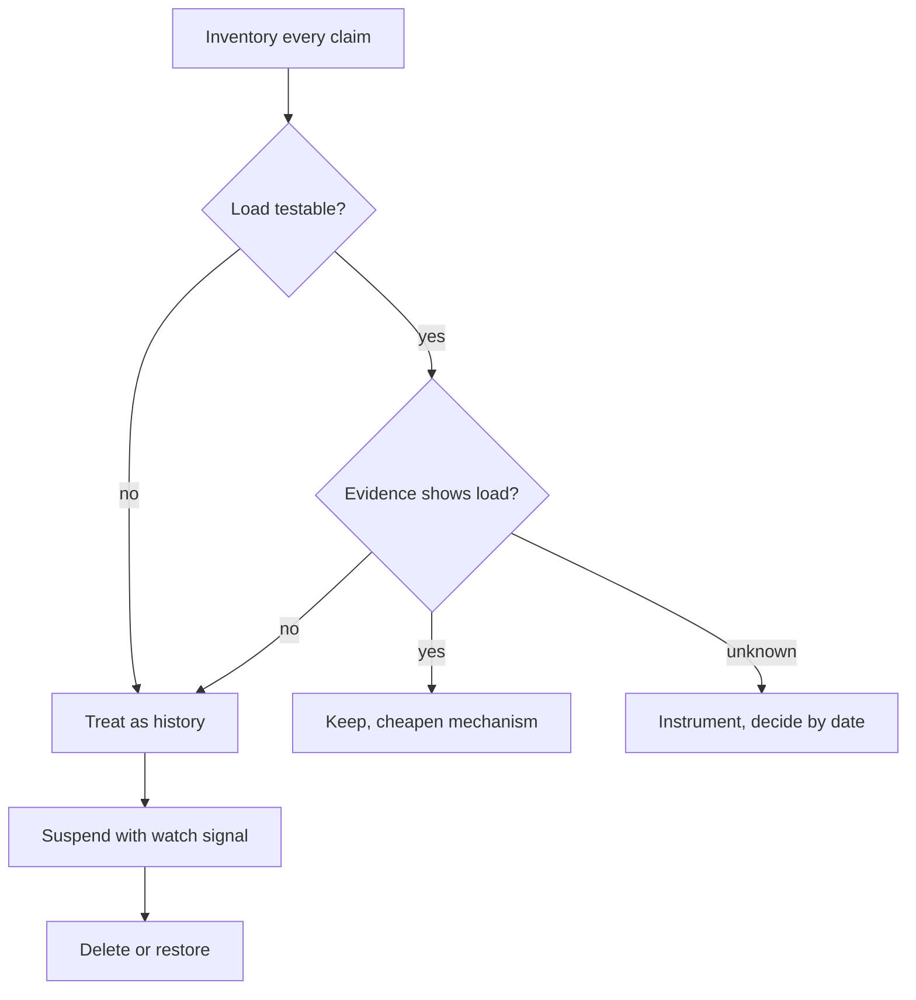
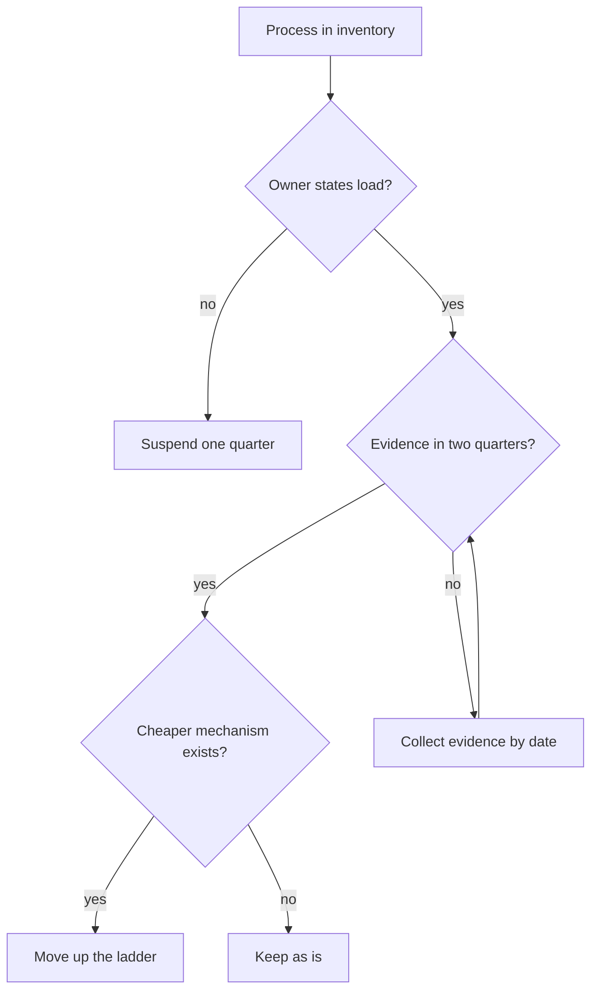

# Chapter 59 — Transformation Under Budget Constraint and Scaling Without Bureaucracy

!!! warning "Awaiting human review"
    This chapter has passed the book's automated validation and an editorial self-review, but not yet
    the human review in which each cited claim is checked against its source. Treat it as a reviewed
    draft. Corrections are welcome; see the repository's CONTRIBUTING file.

Most transformations in this book were funded by a mandate. This chapter is about the ones that are
not: the budget is flat or falling, nobody will add people, and the work still has to change. Under
that constraint, every improvement is paid for by stopping something, and the cheapest things to stop
are usually the processes, forums, rules, and management steps that once solved a problem and now
mainly persist. The chapter covers how to fund a technical transformation from inside a fixed budget,
how to tell process that carries load from process that only carries history, and how to remove
management overhead without removing the work it was quietly doing. Chapter 20 owns engineering
standards, Chapter 37 the meeting calendar, Chapter 34 spans and layers, and
[Chapter 58](58-layoffs-reductions-and-mergers.md) reductions in force; this chapter links to them
rather than repeating them. [Chapter 56](56-recovering-a-failing-engineering-organization.md) covers
the different problem of an organization that is failing, not merely constrained, and
[Chapter 57](57-crises-executive-disagreement-and-resistance.md) how to read the resistance that
removing familiar process provokes. The running examples are Northstar
Technologies and Halvard Systems, the fictional companies of the
[case study](../../case-studies/northstar/index.md).

## Why This Matters

At team scale, process is cheap to add and cheap to drop: a team that stops a ritual notices within a
sprint whether anything broke. Nobody needs a budget to do it.

At organization scale, process accumulates. Each incident leaves a rule, each reorganization a
forum, each audit a report. None of them is expensive alone, so none is ever priced, and together they
can consume more capacity than any single initiative the organization funds. When the budget stops
growing, that accumulated cost becomes the largest pool of money nobody is managing.

At executive scale, a budget cut forces a choice between cutting work and cutting the capacity to do
it. Leaders who cut capacity across the board and keep every process get an organization that does the
same rituals with fewer people. Leaders who strip process indiscriminately remove controls that were
holding up reliability, security, or customer commitments. The executive skill is knowing which is
which before the cut, not after the incident.

## Learning Objectives

After this chapter you will be able to:

- Build a funding plan for a technical transformation under a flat or shrinking budget, ordering the
  sources by how safely they release capacity or cash.
- Inventory an organization's processes, forums, and rules and classify each by the load it carries,
  using evidence rather than opinion.
- Remove a forum, rule, approval step, or management role safely: name its loads, reassign them,
  suspend before deleting, and watch a stated signal.
- Distinguish capacity returned from cash saved, and explain to a finance executive why the two do not
  substitute for each other.
- Recognize the failure modes of constrained transformation, including the across-the-board cut,
  cost shifting, and the removal that takes a hidden load with it.

## The Mental Model

> **Mental model:** Under a fixed budget, transformation is reallocation, and the first place to look
> for funding is the organization's own standing claims on capacity. Every process, forum, rule, and
> management step is such a claim. Each one either carries load (it prevents a failure, makes a
> decision, or moves information that would otherwise not move) or carries history (it exists because
> it once did). Keep the first, cheapen it where you can, and remove the second deliberately, one
> reversible step at a time.

Two ideas sit inside this. First, **load is a claim that can be tested**. "This review catches
defects" is checkable: count what it caught and what got through. "This meeting keeps people aligned"
is checkable too: suspend it and watch whether decisions stall or conflicts surface late. A process
whose owner cannot state its load in a testable sentence is a candidate for removal, not proof that
removal is safe.

Second, **removal is a change like any other**, and it fails the way changes fail: it breaks
something nobody knew depended on it. A process often carries a second, unstated load (a status
meeting that is also the only place two directors notice they are competing for the same engineers).
Safe removal finds those loads and moves them before the process goes.

The diagram has one asymmetric branch on purpose: "unknown" does not mean keep. It means collect the
evidence by a fixed date, and default to suspension if nobody does.

## Deep Conceptual Explanation

### Where money comes from when the budget is fixed

A flat budget is not a frozen one. Inflation, merit increases, and cloud usage growth make a flat
nominal budget a shrinking real one, so a "flat" organization that changes nothing is already
cutting something, usually by not backfilling and hoping. A transformation under constraint needs a
written funding plan that names its sources. In falling order of safety, this book recommends:

| Source | What it releases | Typical lag | Main risk |
|---|---|---|---|
| Unplanned work recovered by prevention | Capacity | One to three quarters | Counted before it arrives |
| Work stopped outright (retired tools, duplicate systems, abandoned features) | Capacity and often cash | One to two quarters | Users who were not asked |
| Process cost removed (approvals, reports, forums that carry history) | Capacity, mostly | Weeks | Hidden loads removed with it |
| Spend consolidated (licenses, vendor contracts, cloud waste) | Cash | Contract renewal dates | Migration effort underestimated |
| Seats left unfilled as people leave | Cash | Months, by attrition | Work that leaves with the person |

The first row is the reinforcing loop of [Chapter 27](../05-engineering-quality/27-quality-transformation-at-enterprise-scale.md):
prevention reduces failures, which returns capacity, which funds more prevention. It is the only
source that grows, which is why constrained transformations should start there when they can. Its
weakness is lag: the first quarter of prevention is paid for by something else, usually roadmap scope,
and the return arrives later.

Two distinctions keep the plan honest. **Capacity is not cash.** Removing a weekly approval board
returns engineer hours, but the payroll is unchanged; a finance executive asked for a 10 percent cut
will not accept "we freed two FTE" unless a seat goes with it. Conversely, leaving seats unfilled saves
cash and destroys capacity, so it must be paired with work that stops. **In-year is not run-rate.** A
seat left empty in month six saves half its annual cost this year and all of it next year. Agree with
finance which one the target measures before building the plan;
[Chapter 52](../12-cto-leadership/52-technology-investment-budgeting-and-financial-literacy.md) owns the
budget mechanics.

### Spend only on the constraint

Goldratt's *The Goal* is known for the argument that a system's output is set by its constraint, and
that improving anything else does not increase output
([Goldratt and Cox, 1984](../../references/bibliography.md#goldratt1984goal)). With money to spare, an
organization can afford improvements away from the constraint. Without it, every engineer-week spent
elsewhere is an engineer-week not spent where it would show. This is practitioner consensus rather
than a research finding, but it is the most useful single filter for a constrained plan: before
funding any improvement, state which constraint it relieves.

Meadows's essay on leverage points ranks places to intervene in a system and observes that most
attention goes to parameters, which rarely change behavior, while rules and information flows rank
far higher ([Meadows, 1999](../../references/bibliography.md#meadows1999leverage)). Applied here, in
this book's interpretation: a budget cut handled as a parameter (each team takes 10 percent) changes
little except morale; a cut handled by changing the rules (which approvals exist, which work is
stopped) changes what the organization does.

### Why process accumulates

Process is added for good reasons: a failure happened, an auditor asked, a new leader needed
visibility. It is rarely removed, for three reasons.

**People search for additions.** In eight experiments, Adams and colleagues found that people
systematically default to additive changes and overlook advantageous subtractive ones, especially
when nothing cues them to consider subtraction and when they are under higher cognitive load
([Adams et al., 2021](../../references/bibliography.md#adams2021subtractive)). The authors suggest this
may be one reason people struggle with overburdened schedules and institutional red tape. That link to
organizations is their suggestion, not a tested finding, but the experimental result is a **research
finding**, and its practical lesson is cheap: ask explicitly "what could we remove?" at every review,
because otherwise almost nobody will.

**Nobody owns the total.** Each forum has an owner; nobody owns the sum of forums. Each rule has a
reason; nobody prices the rule set. Costs that are spread thin and paid in other people's hours do not
appear on any budget line.

**Removal looks like risk; addition looks like diligence.** After an incident, adding a review step is
visible and defensible. Removing one, if anything later goes wrong, is a career risk. Reinertsen's book
on product development flow is widely known for arguing that development organizations ignore queues
because they are invisible ([Reinertsen, 2009](../../references/bibliography.md#reinertsen2009principles));
an approval step is a queue whose cost is paid in waiting, which no report shows.

### Process that carries load, process that carries history

Adler and Borys distinguish two kinds of formalization: **enabling** formalization helps employees
master their tasks, while **coercive** formalization is a means by which management tries to compel
effort and compliance; whether formalization helps or harms employees' attitudes depends on which kind
it is ([Adler and Borys, 1996](../../references/bibliography.md#adler1996bureaucracy)). This is a
conceptual argument from organizational research, not an empirical test, but it explains a familiar
pattern: the same organization can have a runbook engineers rely on and a checklist engineers tick
without reading. Sutton and Rao's *The Friction Project* is known for a related practitioner argument:
remove the friction that wastes effort, keep or add the friction that stops the wrong things
([Sutton and Rao, 2024](../../references/bibliography.md#sutton2024friction)).

This book turns those ideas into a load test. For each process, ask four questions:

| Question | Load-bearing answer | History answer |
|---|---|---|
| What failure, decision, or information flow does it serve? | A specific one, stated in a sentence | "Alignment", "visibility", "best practice" |
| What evidence shows it doing that in the last two quarters? | Catches, decisions, changed outcomes | None kept, or only attendance |
| What would we see if it stopped? | A named signal that would move | Nothing anyone can name |
| Is there a cheaper mechanism for the same load? | Maybe; then change the mechanism | Irrelevant; the load is gone |

The evidence on one class of process is unusually direct. DORA's research found heavyweight change
approval, by a change advisory board or a senior manager, to have a negative impact on software
delivery performance, and found no evidence that more formal external review is associated with lower
change failure rates; the guidance recommends peer review recorded in the development platform,
automated testing and monitoring, and a coordinating rather than approving role for the board
([DORA, change approval](../../references/bibliography.md#dora-cap-change-approval)). This is
**industry research**: survey-based and correlational. It does not prove that removing a board is safe
in your organization, but it shifts the burden of proof onto the board.

Chapter 20 owns the triage of engineering standards, including the enforcement ladder from defaults
down to exhortation ([Chapter 20](../05-engineering-quality/20-engineering-standards-and-their-governance.md)).
The load test generalizes it to everything else: forums, approvals, reports, templates, and roles. A
useful corollary from Chapter 20 applies throughout: a load-bearing process often has a cheaper
mechanism further up the ladder, so "keep" rarely means "keep as is".

### Management overhead is mostly time, not salaries

"Management overhead" invites a headcount answer: fewer managers, fewer layers. The evidence does not
support treating managers as pure overhead. Google's Project Oxygen began from the hypothesis, held by
some of its engineers, that managers do not matter, and concluded that teams with highly effective
managers achieved better results, were happier, and had lower turnover
([re:Work, great managers](../../references/bibliography.md#rework-great-managers);
[Garvin, 2013](../../references/bibliography.md#garvin2013google)). That is **documented practice** from
one company, self-reported. Lee and Edmondson's review of organizations that radically decentralize
authority describes scholarly understanding of such organizations as limited and proposes a research
agenda rather than a verdict ([Lee and Edmondson, 2017](../../references/bibliography.md#lee2017selfmanaging)).
Gallup reports that manager talent matters more than span of control, and that among remote and hybrid
managers, more direct reports were associated with lower engagement
([Harter, 2026](../../references/bibliography.md#harter2026span)); industry research, all occupations.

So the safer target is the time management consumes rather than the managers themselves: status
rounds, approval queues, reports compiled by hand, decisions that climb layers because boundaries are
wrong. [Chapter 34](../07-organization-design/34-spans-layers-and-dependency-mapping.md) owns the trade
between spans, layers, and decision hops; Larson's guideline of six to eight engineers per manager and
four to six managers per manager of managers
([Larson, 2018](../../references/bibliography.md#larson2018sizing)) is expert opinion, useful as a
range to explain deviations from, not a rule. At company scale, Rajan and Wulf found that large US firms
became flatter, with more positions reporting to the CEO and fewer levels below
([Rajan and Wulf, 2006](../../references/bibliography.md#rajan2006flattening)); that is a research
finding about senior hierarchies, not about engineering teams.

One structural trap matters under a shrinking budget. **Attrition shrinks teams, not management.** If
an organization loses engineers by not backfilling and keeps every team and manager, spans narrow and
the management share of cost rises while the budget falls. Removing management overhead safely is
mostly a matter of merging teams whose work has merged, and handling the manager's next role as a
people decision, not a line item.

## Engineering Organization Example

The figures are **illustrative**, from the Northstar canon (the
[first quarter](../../case-studies/northstar/first-quarter.md) page). Northstar's year 1 is a
transformation under flat headcount: 80 engineers, 87 seats in all, backfills only, no Core rewrite,
and $250,000 of discretionary tooling. Read as a funding plan, the year shows each source in the
table above.

**Prevention paid first, returned later.** Quarter 1 allocated 12 FTE to prevention, taken from
roadmap capacity under the week 4 capacity model; quarter 3 allocated 8 FTE to prevention and 4.5 to
platform work. The canon does not record quarter 2's allocation, so it is left out below. Unplanned
work returned capacity as it fell:

| Quarter | Unplanned work | FTE (of 80) | Returned against baseline |
|---|---|---|---|
| Baseline | 34% | 27.2 | 0 |
| 1 | 31% | 24.8 | 2.4 |
| 2 | 28% | 22.4 | 4.8 |
| 3 | 25% | 20.0 | 7.2 |

Check: 80 × 0.34 = 27.2; 80 × 0.25 = 20.0; 27.2 − 20.0 = 7.2. By quarter 3 the returned capacity (7.2
FTE, about $1.33M a year at $185,000) approaches the quarter 3 prevention allocation (8 FTE, $1.48M) but
does not pass it. When returned capacity passes the allocation, a program is self-funding in capacity
terms; at quarter 3 Northstar's is still 0.8 FTE short, so in capacity alone it is not yet self-funding,
the same verdict [Chapter 60](../15-capstone/60-capstone-northstar.md) reaches. Payroll did not change
either, so there is no cash saving in engineering. The money appeared elsewhere, in service credits
avoided, which fell from $410,000 a quarter to $60,000, about $1.4M a year at the quarter 3 rate
(($410,000 − $60,000) × 4). Credits are money, not capacity; the two answer different questions.

**Work stopped.** The manual regression pass cost about 546 QA person-days a year at baseline. By day
90 it was about 600 cases in one day, run weekly by the two quality engineers who chose it. Assuming
both spend the full day, that is 2 × 52 = 104 person-days, releasing about 442 person-days (about 1.9
engineer-years at 230 working days) without changing anyone's employment: the seven QA engineers moved
into product teams, as constraint 5 required. Of the 1,900 manual cases, 450 were deleted outright.

**Process removed.** Of 52 standards, 21 were retired and 17 turned into guidance, leaving 14 mandatory
rules; with the 5 tier 1 minimums, 19 checked obligations (Chapter 20). Of 65 open corrective actions, 42 were dropped with a reason and 14 kept with
manager owners; closure rose from 32 to 70 and then 78 percent. Removal made the remaining obligations
believable.

**Spend not yet consolidated.** Four CI systems cost about 1.5 FTE a year to run against about 0.5 for
one. The CI target is still open, with a decision planned for the week 78 gate, so the 1.0 FTE is a
future source, not a current one.

**An addition that bought nothing.** Engineering Excellence Day took 64, 41, and 23 engineer-days on
three Fridays, 128 in all (about 25.6 engineer-weeks, roughly $91,000 at $3,558 a week), and merged 71
items, none touching the priced debt register. It relieved no constraint. The director stopped it in
week 37 ([Chapter 43](../09-engineering-directorship/43-leading-change-and-director-failure-patterns.md)).

## Decision Framework

Use this framework for each standing process, forum, rule, or role in an inventory. It is this book's
recommendation; the thresholds are judgment.

| Verdict | When | What to do | Watch signal |
|---|---|---|---|
| Keep | Load stated and evidenced; no cheaper mechanism | Record the load and the evidence next to the process | The evidence, reviewed yearly |
| Cheapen | Load real; mechanism expensive (manual where a check would do) | Change the mechanism first, then retire the old one | Same outcome measure before and after |
| Instrument | Load plausible, no evidence kept | Name the evidence, a collector, and a decision date | Default to suspension at the date |
| Suspend | No testable load, or evidence shows none | Stop for a stated period; announce the restore trigger | The signal its defenders say would move |
| Delete | Suspension period passed with no signal | Remove it from templates, calendars, and documents | None; it is gone |
| Decide | A trial or exemption reached its end with no decision | Put it on the decider's agenda now | The expiry date itself |

Order the inventory by cost, not by controversy. A rule that touches every merge request or a forum
that holds fifteen people every week deserves the first look, even if nobody complains about it.

## Trade-offs

**Capacity against cash.** Process removal returns time; finance usually wants money. Pairing the two
(remove the process, then leave a seat unfilled whose work the process consumed) meets the target
honestly. Claiming freed capacity as a saving does not.

**Speed of the cut against safety of the removal.** Suspending before deleting costs a quarter. Under
a deep, fast cut, there may not be a quarter. Then suspend the cheapest-to-restore items first and
delete only what has an obvious replacement mechanism.

**Fewer managers against weaker coaching and later signals.** Wider spans save management cost and
lose time per person; the research on manager quality says that time matters. Merge teams where work
has merged; do not widen spans to hit a ratio.

**Central policy against local judgment.** A short list of enterprise policies saves every team from
reinventing controls; each policy also costs every team its evidence. Keep the policy, cut the evidence
cost, and resist adding a seventh policy as a substitute for fixing one.

**Stopping work against cost shifting.** Retiring a platform tool saves its owner money and costs its
users a migration. The organization only saves if the users' cost is smaller and is counted.

**Removing process against trust.** Some process exists because a stakeholder lost trust after a
failure. Removing it, even when it carries no load, spends trust. Tell that stakeholder first, with the
evidence and the watch signal.

## Failure Modes

**The across-the-board cut.** Every team takes the same percentage. It feels fair and avoids hard
choices, and it keeps every process while removing the people who run them. Early sign: a cut plan with
no list of work that stops.

**Counting returned capacity before it returns.** The plan books next year's unplanned-work reduction
as this year's funding. Early sign: prevention and its expected return appear in the same quarter.

**Cost shifting.** A central group meets its cut by retiring a service and leaving migration to the
teams that use it, uncounted. Early sign: the savings are stated in one group's budget and the effort
in nobody's.

**The hidden load.** A forum or report is removed and something else it did quietly stops: conflicts
between teams surface late, breaches go unseen. Early sign: nobody asked the attendees what else they
used it for.

**Removal by attrition of attention.** Nobody decides to stop a rule; people just stop following it,
while it stays on the books. Early sign: a rule whose violations are known and unremarked, like an
exemption that lapsed without renewal.

**The expired trial.** A temporary rule outlives its trial because the review date passed without a
decision. Early sign: "one-quarter trial" in a document more than a quarter old.

**Overhead moved, not removed.** An approval board is abolished and every change now needs a
director's sign-off by message. Early sign: the same wait time with a different approver.

**Restoring by reflex.** The first incident after a removal brings the process back, without asking
whether it would have prevented that incident. Early sign: a restore decision with no reference to the
watch signal.

## Enterprise Application

An organization of 50 to 150 engineers usually has enough process to need an inventory and too few
people to staff a process office. The platform organization of Halvard Systems, the fictional
500-engineer company of [Chapter 35](../07-organization-design/35-designing-organizations-at-four-scales.md),
is 70 engineers, and in the year after the planning year described in the canon it faced a budget cut.
The facts below are **illustrative** additions to the Halvard canon.

**The setting.** Gwen Abernathy, VP of Platform, runs two directors: Developer Platform (5 managers, 38
engineers) and Infrastructure (4 managers, 32 engineers). Arjun Mehta, the platform group's principal
engineer, owns two of Halvard's six enterprise policies, the tier 1 operational minimums and the
auditable pipeline with rollback; most of the cost of evidencing all six falls on the platform
organization, which runs the service catalog, pipelines, scanners, and paging. Under a company cost
program, the CTO cut the platform budget by 10 percent for the year: from about $18.0M (70 engineers at
the company average of $205,800, which is $102.9M ÷ 500, about $14.4M, plus $3.6M of internal cloud,
licenses, and vendor support) to $16.2M, a cut of $1.8M stated in-year.

**The inventory.** Abernathy's directors priced the platform's own processes, assuming 1,840 working
hours per engineer-year (230 days × 8 hours):

| Process | Cost a year | Load evidence | Verdict |
|---|---|---|---|
| Weekly infrastructure change advisory board: 12 attendees, 90 minutes, about 60 requests a week at 45 minutes of preparation each | 900 + 2,250 = 3,150 hours, about 1.7 FTE; median wait 3 working days | Of about 3,000 requests in four quarters, 41 sent back, 35 for missing form fields, 6 for clashing with another change on the same shared system; all 19 change-triggered Sev1 and Sev2 incidents in platform components had been approved | Replace approval with peer review in the pipeline; keep the clash detection as an automated change calendar |
| Monthly policy compliance pack, compiled by two engineers from four tools | 2 × 4 days × 12 = 96 days, about 0.4 FTE | Read by the VPs each month | Cheapen: generate from the tools |
| Quarterly tier 1 attestation spreadsheet, 210 components | Platform 20 days; owning teams 840 hours | Duplicates catalog and paging data | Cheapen: check automatically |
| Weekly platform leadership meeting, 13 people, 60 minutes | 13 hours a week, about 40 minutes of it status | Decisions recorded in about one meeting in three | Written status; 30 minutes of decisions |

**The funding plan.** The plan named work that stops before seats that go:

| Source | In-year saving | Run-rate saving | Assumption |
|---|---|---|---|
| About 8 departures (12 percent of 70) left unfilled | $823,200 | $1,646,400 | Departures spread evenly, so each seat is empty half the year: 8 × $205,800 × 0.5 |
| Two artifact repositories and a self-hosted log store consolidated onto managed services | $315,000 | $420,000 | Licenses renew at the start of quarter 2 |
| Legacy deployment tool retired; its vendor support contract ended | $175,000 | $350,000 | Retired at mid-year |
| **Total** | **$1,313,200** | **$2,416,400** | |

The in-year total misses the $1.8M by $486,800; the exit run-rate exceeds it by $616,400. Abernathy
put the gap on page one and asked the CTO to measure the cut at exit run-rate. The CTO agreed, with the
run-rate reported quarterly.

The eight empty seats had to take work with them: the legacy tool's upkeep (4 engineers), the change
board, compliance pack, and attestation compilation (about 2 FTE, mostly engineers' time), operating
the duplicate tools (about 1.5 FTE), and one deferred roadmap item (about 0.5). Retiring the legacy tool
also ended a standing problem: its 23 services had no automated rollback and sat under exemptions from
the pipeline policy. Migrating them cost the product groups an estimated 46 engineer-weeks (2 each),
which Abernathy listed as a cost of the plan rather than leaving it to surface in their quarters.
Corvane's onboarding in the same year ([Chapter 58](58-layoffs-reductions-and-mergers.md)) was funded in
the deal and staffed by Streaming's own engineers, with platform support counted inside the CI and CD
team's roadmap, so it does not compete with the eight empty seats.

**Management overhead.** With 62 engineers and 9 managers, spans would have fallen from about 7.8 to
6.9. When the legacy tool retired, the Deployment Tools team (a manager and 6 engineers) merged into
the CI and CD team, taking managers to 8 (62 ÷ 8 is about 7.75), and its manager chose between the
staff track and the next manager vacancy. Finance also asked whether one director could run all 8
managers; that span is above Larson's four to six, and the two directors' areas share little, so
Abernathy kept both and wrote a review trigger: revisit if either area falls below three managers.

**What happened.** The board was suspended for quarter 2 with two watch signals: change-triggered Sev1
and Sev2 incidents in platform components, and clashes caught by the calendar. Median wait fell from 3
working days to under 1; incidents were 5 in quarter 2 and 4 in quarter 3 against about 4.75 a quarter
before (19 in four quarters), a difference too small to read either way; the calendar flagged 9 clashes
in quarter 2. The board was then deleted. One removal went wrong. The generated compliance dashboard
showed vulnerability findings past their service levels, but the monthly pack had also been the only
meeting where VPs looked at them together, and nobody looked at the dashboard: findings past their
service level across Halvard rose from 12 to 31 in quarter 2. The policy's owner restored a monthly
20-minute review of breaches with each VP's delegate. The pack's load had been the meeting, not the
document.

## CTO Perspective

At executive scale the question changes from "which process can go" to "which claims on next year's
budget are written into it by default". You are Victor Lindqvist in quarter 4 of Northstar's first year.
The year-2 engineering budget draft holds personnel at 87 seats and cloud and tooling flat at $4.2M;
Rajiv Menon will consider the continuation's $150,000 of tooling only with an offset inside that $4.2M;
Samuel Osei will ask the board whether flat headcount can carry the roadmap. Each of those is a question
about funding from within.

Three moves belong to the CTO rather than the director:

- **Make process a budget line.** Ask for the year's standing claims on capacity (forums, rules,
  approvals, reports, management roles) priced in engineer-weeks, next to the investment asks, so that
  the board's question about flat headcount gets an answer that includes subtraction.
- **Price management in seats.** Under Northstar's 87-seat rule every new manager or VP costs an
  engineering seat: the year-2 options run from 80 engineers with 6 managers to 77 with 9, and a VP
  would take one more. That is the right frame for the open year-2 decisions (Chapters 35, 36, and 47);
  this chapter only adds that each added role should name the load it carries.
- **Protect the policies, not their paperwork.** At Halvard, the CTO's six enterprise policies are the
  company's encoded lessons. Under a cut, a CTO should refuse to drop a policy and insist on cutting its
  evidence cost, and should own the cross-group view that catches cost shifting, because no single VP
  sees it.

The CTO also owns the tone of subtraction. If removal is only ever proposed by people under budget
pressure, it reads as cutting corners. If the CTO asks "what will we stop?" at every planning cycle,
including in good years, removal becomes maintenance.

## Practical Playbook

1. **Agree the target's measure** with finance: in-year or run-rate, cash or capacity. Write it down.
2. **Name the constraint** the transformation must relieve, and refuse funding for work that does not
   touch it.
3. **List the funding sources** in the order of the table in this chapter, each with its lag, and
   never book a source before its lag has passed.
4. **Inventory every standing claim**: forums, rules, approval steps, recurring reports, templates,
   and management roles, each with an owner and a cost in hours a year.
5. **Run the load test** with each owner: the load in one sentence, two quarters of evidence, the
   signal that would move if it stopped.
6. **Ask the attendees** of every forum and the users of every report what else they use it for, to
   find hidden loads before removal.
7. **Classify** each item: keep, cheapen, instrument, suspend, delete, or decide.
8. **Suspend before deleting**, for a stated period with a watch signal and a restore trigger, and
   announce both.
9. **Pair cash with work**: for every seat left unfilled, name the work that stops with it.
10. **Count shifted costs**: any saving that creates work elsewhere carries that work as a line in the
    plan.
11. **Merge teams where work has merged** rather than widening spans to a ratio; treat each manager's
    next role as a people decision.
12. **Repeat yearly**, in good years too, and put "what will we stop?" on the planning agenda.

## Case Study

These Northstar events are **illustrative** and fictional. The canon is on the
[first quarter](../../case-studies/northstar/first-quarter.md) page; the inventory below is set in
weeks 50 and 51 of quarter 4, and its proposals are open.

**Why an inventory.** In weeks 46 to 48, Samuel Osei's question to Victor Lindqvist was whether flat
headcount can carry the roadmap. Victor's draft three-year allocation already assumes unplanned work
falls to 22 percent in year 2, and Rajiv Menon wants the continuation's $150,000 offset inside the
existing $4.2M. In weeks 50 and 51 the director drafted, for Victor, an inventory of the organization's
rules and standing processes created or inherited in year 1, with the load each carries. It covers
rules and processes rather than the meeting calendar, whose redesign (drafted week 22, reviewed week 24,
proposed for week 27) has no recorded outcome; Chapter 37 and Project 1 treat it.

| Item | Origin | Load and evidence | Draft verdict |
|---|---|---|---|
| Tier 1 operational minimums | Quarter 1 | 3 of 15 met all four at baseline, 13 of 15 in quarter 3; the incident and availability gains rest on them | Keep |
| Severity audit in the weekly operational review | Week 7 | Re-rated an under-rated payment delay in week 7; the board's incident headline is only as good as the ratings | Keep |
| Corrective actions with manager owners | Quarter 1 | Closure 32 percent, then 70, then 78 | Keep |
| Pipeline check for unfinished migrations | Week 11 | Automated; added after the week 9 Sev1 | Keep; already cheap |
| Rehearsal of tier 1 data migrations | Week 10 | Plausible load, but no record is kept of what rehearsals found | Instrument: record findings for a quarter, then decide |
| 14 mandatory standards with owners | Week 3 triage | Chapter 20's evidence | Keep; mechanism belongs to Chapter 20 |
| Exemption expiry at most two quarters | Quarter 1 | The core/permissions exemption lapsed in week 39 with no renewal and no consequence | Load claimed, not carried: enforce or drop |
| Limit of three cross-team initiatives | Quarter 3, one-quarter trial | The trial's quarter has ended; the week 34 forum's outcome is open | Decide: who rules on continuing it |
| Ten-item pull request checklist | Before arrival | Still in Core's merge request template; at baseline, 38 of 40 sampled requests had every box ticked, 11 of them falsely | History: retire, replacing the one useful item with a check |
| Four ways to build and deploy | Inherited | About 1.5 FTE a year against about 0.5 for one | Converge; target decision at week 78 |
| Engineering Excellence Day | Week 27 | No item touched the debt register | Already stopped, week 37 |

**What the inventory shows.** Most of what year 1 added carries load, which is the expected result of a
program that added process only after failures and measured it. The items that do not are older (the
checklist), expired (the trial), or unenforced (the expiry rule). Their direct cost is small; the
checklist's real cost is that a ticked box no longer means anything, which weakens every other
attestation Northstar relies on, including the customer security questionnaires Joon Park answers.
The large item is the build systems, where the decision is already scheduled.

**What the inventory does not do.** It does not find the $150,000 offset, which sits in cloud and
tooling spend that the inventory does not cover, and it does not answer Samuel Osei by itself: the
capacity it identifies is about 1 FTE from build consolidation, not yet available. The director's draft
says so in its first paragraph, which is the honest form of the answer: the main source of year-2
capacity is still the unplanned work that prevention returns, and process removal is a supplement.

**What is open.** Whether Victor uses the inventory in year-2 planning, who decides on the portfolio
limit and the expiry rule, and whether the checklist goes are all undecided at week 52.

## Exercises

Worked solutions are in the [Chapter 59 solutions](../../solutions/ch59-solutions.md).

### Foundational

**F1.** Northstar's ten-item pull request checklist is still in Core's merge request template. At
baseline, 38 of 40 sampled requests had every box ticked and 11 of those changed production code
without a test change while "tests added or updated" was ticked. Apply the four-question load test to
the checklist. Then decide what, if anything, replaces it, and state the watch signal you would use
during a suspension.

**F2.** Halvard's platform plan saves $1,313,200 in-year and $2,416,400 at exit run-rate against a
$1.8M in-year target. Rewrite the funding table as it would look if the CFO insisted on the in-year
measure. Identify at least two additional sources, price them, and say what each one costs in capacity
or risk.

**F3.** The Halvard change advisory board sent back 41 of about 3,000 requests in four quarters, 6 of
them for clashing with another change. Explain why "41 of 3,000" is not by itself evidence that the
board carried no load, what other evidence you would want, and how the replacement design kept the load
that the evidence did show.

### Applied Leadership

**A1.** You are the Northstar director in week 51. Elena Sokolova argues that the rehearsal of tier 1
data migrations must stay mandatory without any instrumentation period, because the week 9 Sev1 showed
what an unrehearsed migration does. Write your reply: what you agree with, what you would still ask
her team to record, and how you would decide at the end of the period.

**A2.** At Halvard, the monthly compliance pack was replaced by a generated dashboard and breaches past
their service level rose from 12 to 31 in a quarter. Write the short review of this removal that Gwen
Abernathy should send to the other VPs: what load was missed, why the load test did not find it, and
what she changes in her removal process.

**A3.** Suppose that, in a hypothetical year 2 that is not part of the canon, Northstar's budget is cut
by 5 percent instead of held flat. Using the funding sources table and Northstar's year-1 figures, draft
the order in which you would look for the money and name the source you would refuse to use first.

### Executive Decision-Making

**X1.** You are Victor Lindqvist in week 52. You have the director's inventory, the continuation
proposal with its $150,000 tooling ask, Rajiv Menon's demand for an offset inside the $4.2M, and Samuel
Osei's question from the board. Decide what you will tell the executive team about funding year 2 from
within, which of the inventory's open items you will rule on yourself and which you will leave to the
director, and what you will say to Samuel Osei.

**X2.** You are Halvard's CTO. Two other VPs, seeing the platform organization's results, propose to
cut their own process costs by abolishing the tracked review for every Sev1, one of the six enterprise
policies, on the grounds that most reviews find nothing new. Decide whether to allow it, what you would
allow instead, and how you would prevent each VP's process cut from becoming cost shifted onto the
platform organization.

## Reflection Questions

1. Which recurring process in your organization would you be afraid to propose removing, and is the
   fear about its load or about how removal would look?
2. When did you last remove something rather than add something, and who suggested it?
3. Which of your rules are followed only on paper, and what does that do to the ones that matter?
4. If your budget were cut by 10 percent next quarter, which work would stop? If you cannot name it,
   what would actually happen?
5. Which of your forums does a second job that its agenda does not mention?

## Key Takeaways

- Under a fixed budget, transformation is reallocation; start with the organization's own standing
  claims on capacity before asking for anything new.
- Order funding sources by safety and lag, starting with unplanned work that prevention returns, and
  never book a source before its lag has passed.
- Capacity is not cash and in-year is not run-rate; agree the target's measure with finance first.
- Treat every process as a claim that must state its load in a testable sentence, with evidence; keep
  the load-bearing ones and cheapen their mechanisms.
- People default to adding; ask "what could we remove?" explicitly and regularly.
- Remove reversibly: find hidden loads by asking users, suspend with a watch signal, then delete.
- Management overhead is mostly time in status, approvals, and manual reports; merge teams where work
  has merged rather than cutting managers to hit a ratio.
- Count shifted costs, and protect policies while cutting their paperwork.

## References and Further Reading

- [Goldratt and Cox, 1984](../../references/bibliography.md#goldratt1984goal): the constraint
  argument (idea level).
- [Meadows, 1999](../../references/bibliography.md#meadows1999leverage): leverage points; why parameter
  changes rarely change behavior.
- [Reinertsen, 2009](../../references/bibliography.md#reinertsen2009principles): invisible queues in
  product development (idea level).
- [Adams et al., 2021](../../references/bibliography.md#adams2021subtractive): experimental evidence
  that people overlook subtractive changes.
- [Adler and Borys, 1996](../../references/bibliography.md#adler1996bureaucracy): enabling versus
  coercive formalization.
- [Sutton and Rao, 2024](../../references/bibliography.md#sutton2024friction): removing destructive
  friction and keeping useful friction (idea level).
- [DORA, change approval](../../references/bibliography.md#dora-cap-change-approval): research on
  heavyweight change approval and what to do instead.
- [re:Work, great managers](../../references/bibliography.md#rework-great-managers) and
  [Garvin, 2013](../../references/bibliography.md#garvin2013google): Project Oxygen and why managers
  matter.
- [Lee and Edmondson, 2017](../../references/bibliography.md#lee2017selfmanaging): what is and is not
  known about self-managing organizations.
- [Harter, 2026](../../references/bibliography.md#harter2026span): span of control and manager talent.
- [Larson, 2018](../../references/bibliography.md#larson2018sizing): span guidelines for managers and
  managers of managers.
- [Rajan and Wulf, 2006](../../references/bibliography.md#rajan2006flattening): the flattening of
  corporate hierarchies.
