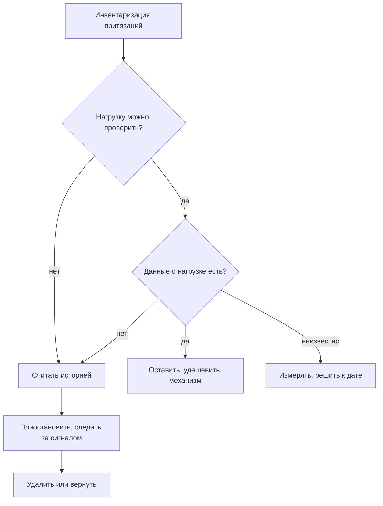
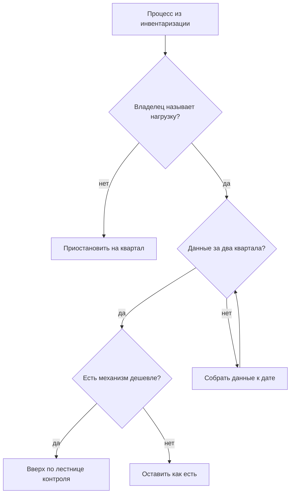

# Глава 59 — Трансформация при урезанном бюджете и масштабирование без бюрократии { #chapter-59-transformation-under-budget-constraint-and-scaling-without-bureaucracy }

Большинство трансформаций в этой книге финансировал мандат. Эта глава — о тех, у которых мандата нет:
бюджет не растёт или сокращается, людей никто не добавит, а работать всё равно нужно по-другому. В таких
условиях за каждое улучшение платят тем, что что-то прекращают. Дешевле всего обычно прекратить
процессы, форумы, правила и управленческие ступени, которые когда-то решали проблему, а теперь большей
частью просто продолжают существовать. Глава объясняет три вещи: как финансировать трансформацию, не
выходя за фиксированный бюджет; как отличить процесс, несущий нагрузку, от процесса, который несёт только
историю; как убрать управленческие накладные расходы и не потерять работу, которую они незаметно
выполняли. Затем речь пойдёт о росте: как добавлять процессы, когда организация масштабируется, и не
давать им копиться. Сквозные примеры — Northstar Technologies и Halvard Systems, вымышленные компании
[кейса](../../case-studies/northstar/index.md).

!!! note "Связанные главы"
    [Глава 20](../05-engineering-quality/20-engineering-standards-and-their-governance.md) отвечает за
    инженерные стандарты, [глава 37](../08-management-operating-system/37-cadences-and-leadership-meetings.md)
    — за календарь встреч, [глава 34](../07-organization-design/34-spans-layers-and-dependency-mapping.md)
    — за охват и уровни управления, [глава 58](58-layoffs-reductions-and-mergers.md) — за сокращения
    штата. [Глава 56](56-recovering-a-failing-engineering-organization.md) разбирает организацию, которая
    проваливается, а не живёт в стеснённых условиях;
    [глава 57](57-crises-executive-disagreement-and-resistance.md) — сопротивление, которое вызывает отмена
    привычных процессов.

## Почему это важно { #why-this-matters }

В команде процесс дёшево и добавить, и отменить: отказавшись от ритуала, команда за один спринт увидит,
сломалось ли что-нибудь. Бюджет для этого не нужен.

В организации процессы накапливаются. После каждого инцидента остаётся правило, после каждой
реорганизации — форум, после каждого аудита — отчёт. По отдельности всё это недорого, поэтому цену
ничему не назначают. А вместе они могут съедать больше ресурса, чем любая отдельная профинансированная
инициатива.

Для высшего руководства урезанный бюджет — это выбор: сокращать работу или ресурс, которым её делают.
Если резать ресурс равномерно по всем направлениям и сохранить все процессы, получится организация,
которая исполняет те же ритуалы меньшим числом людей. Если вычищать процессы без разбора, вместе с ними
уйдут механизмы контроля, на которых держались надёжность, безопасность или обязательства перед
клиентами. Мастерство руководителя — разобраться, где что, до сокращения, а не после инцидента.

## Цели главы { #learning-objectives }

После этой главы вы сможете:

- Составлять план финансирования технической трансформации при неизменном или сокращающемся бюджете и
  упорядочивать источники по тому, насколько безопасно они высвобождают ресурс или деньги.
- Проводить инвентаризацию процессов, форумов и правил организации и по данным, а не по мнениям,
  определять, какую нагрузку несёт каждый пункт.
- Безопасно убирать форум, правило, шаг согласования или управленческую роль: назвать нагрузки, передать
  их другим, приостановить пункт перед удалением и следить за заранее названным сигналом.
- Отличать возвращённый ресурс от сэкономленных денег и объяснять финансовому руководителю, почему одно
  не заменяет другое.
- Выстраивать порядок, по которому растущая организация добавляет процессы: у каждого нового правила
  названы нагрузка и срок действия (sunset), у процессов есть годовой бюджет, а вместо множества правил —
  короткий список политик с владельцами.
- Распознавать типичные провалы трансформации в стеснённых условиях, в том числе урезание всем поровну,
  перекладывание затрат и отмену, которая уносит с собой скрытую нагрузку.

## Ментальная модель { #the-mental-model }

> **Ментальная модель:** при фиксированном бюджете трансформация — это перераспределение, и искать
> финансирование сначала стоит в постоянных притязаниях самой организации на ресурс. Каждый процесс,
> форум, правило и управленческая ступень — такое притязание. Каждое из них либо несёт нагрузку
> (предотвращает сбой, принимает решение или передаёт информацию, которая иначе не дошла бы), либо несёт
> историю (существует, потому что когда-то несло нагрузку). Несущее нагрузку сохраняйте и, где можно,
> удешевляйте; несущее историю убирайте обдуманно, по одному обратимому шагу за раз.

В этой модели две идеи. Первая: **нагрузка — это утверждение, которое можно проверить**. «Это ревью
ловит дефекты» — проверяемое утверждение: посчитайте, что ревью поймало, а что прошло мимо. Если
владелец не может сформулировать нагрузку процесса проверяемым предложением, процесс — кандидат на
отмену. Но безопасность отмены это ещё не доказывает.

Вторая: **отмена — такое же изменение, как любое другое**, и проваливается она так же: ломает то, что от
процесса зависело, хотя никто об этом не знал. Часто процесс несёт вторую, никем не названную нагрузку
(статусная встреча оказывается ещё и единственным местом, где два директора замечают, что претендуют на
одних и тех же инженеров). Безопасная отмена находит такие нагрузки и переносит их, пока процесс ещё не
исчез.

Одна ветвь схемы намеренно асимметрична: «неизвестно» не значит «оставить». Это значит собрать данные к
фиксированной дате, а если никто этого не сделает, по умолчанию приостановить процесс.

## Подробный разбор { #deep-conceptual-explanation }

### Откуда берутся деньги, когда бюджет фиксирован { #where-money-comes-from-when-the-budget-is-fixed }

Неизменный бюджет — не замороженный. Из-за инфляции, повышений по результатам (merit increases,
ежегодный рост зарплат) и роста облачных расходов в реальном выражении он сокращается. Если «неизменная»
организация ничего не меняет, она уже сокращается — обычно за счёт того, что не нанимает на замену
(оставляет место ушедшего пустым). Трансформации в стеснённых условиях нужен письменный план
финансирования с названными источниками. Книга рекомендует такие, от самого безопасного к наименее
безопасному:

| Источник | Что высвобождает | Обычная задержка | Главный риск |
|---|---|---|---|
| Незапланированная работа, возвращённая профилактикой | Ресурс | От одного до трёх кварталов | Её засчитывают до того, как она вернулась |
| Работа, прекращённая полностью (выведенные из эксплуатации инструменты, дублирующие системы, заброшенные функции) | Ресурс, часто и деньги | От одного до двух кварталов | Пользователи, которых не спросили |
| Убранные затраты на процессы (согласования, отчёты, форумы, несущие историю) | В основном ресурс | Недели | Вместе с ними убирают скрытые нагрузки |
| Консолидированные расходы (лицензии, контракты с вендорами, лишние облачные затраты) | Деньги | Даты продления контрактов | Недооценённые затраты на миграцию |
| Места, не заполненные после ухода людей | Деньги | Месяцы, в темпе [текучести](../../glossary.md#attrition-and-regretted-attrition) | Работа, которая уходит вместе с человеком |

Первая строка — усиливающая петля из
[главы 27](../05-engineering-quality/27-quality-transformation-at-enterprise-scale.md): профилактика
сокращает сбои, это возвращает ресурс, а он финансирует новую профилактику. Это единственный источник,
который растёт, поэтому, если есть возможность, трансформацию в стеснённых условиях стоит начинать с
него. Его слабое место — задержка: первый квартал профилактики приходится оплачивать чем-то другим,
обычно объёмом дорожной карты, а отдача приходит позже.

Честность плана держится на двух различиях. **Ресурс — не деньги.** Отмена еженедельного комитета по
согласованию возвращает часы инженеров, но фонд оплаты труда не меняется. Если от финансового
руководителя ждут сокращения на 10%, он не примет «мы высвободили два [FTE](../../glossary.md#fte)»
(полные ставки инженеров), если вместе с ними не уходит [место](../../glossary.md#seat), то есть
профинансированная позиция. И наоборот: незаполненные места экономят деньги, но уничтожают ресурс,
поэтому их нужно связывать с работой, которая прекращается. **Эффект текущего года — не годовой темп.**
Место, оставленное пустым с шестого месяца, экономит в этом году половину своей годовой стоимости, а в
[годовом темпе (run-rate)](../../glossary.md#run-rate), то есть в стоимости полного года на новом
уровне, — всю. Прежде чем строить план, договоритесь с финансами, чем именно измеряется цель. Бюджетную
механику разбирает
[глава 52](../12-cto-leadership/52-technology-investment-budgeting-and-financial-literacy.md).

### Тратьте только на узкое место { #spend-only-on-the-constraint }

Книга Goldratt *The Goal* известна тезисом: выпуск системы определяется её
[ограничением](../../glossary.md#constraint), то есть одним шагом, который сдерживает всё целое, а
улучшение любого другого шага выпуск не увеличивает ([Goldratt and Cox, 1984](../../references/bibliography.md#goldratt1984goal)).
Когда лишних денег нет, каждая инженеро-неделя, потраченная в другом месте, — это инженеро-неделя, не
потраченная там, где она дала бы видимый эффект. Это консенсус практиков, а не научный результат, но для
плана в стеснённых условиях полезнее фильтра нет: прежде чем финансировать любое улучшение, назовите
ограничение, которое оно ослабляет.

Если урезание сводится к изменению параметра (каждая команда отдаёт 10%), меняется разве что моральный
дух. Если оно меняет правила (какие согласования существуют, какая работа прекращается), меняется то,
что делает организация. Так книга читает Meadows: как точки вмешательства в систему правила у неё стоят
гораздо выше параметров
([Meadows, 1999](../../references/bibliography.md#meadows1999leverage); **мнение эксперта**).

### Почему процессы накапливаются { #why-process-accumulates }

Процессы добавляют по веским причинам: случился сбой, попросил аудитор, новому руководителю
понадобилась прозрачность. Убирают их редко, и причин этому три.

**Люди ищут, что добавить.** По умолчанию люди добавляют и упускают полезные вычитания, особенно если
ничто не подталкивает их подумать, что можно убрать. Это **научный результат** восьми экспериментов
Adams и коллег ([Adams et al., 2021](../../references/bibliography.md#adams2021subtractive)). А вот их
предположение, что этим объясняется бюрократическая волокита, не проверено. Практический вывод дёшев:
на каждом обзоре спрашивайте «что мы могли бы убрать?».

**Суммой не владеет никто.** У каждого форума есть владелец, у суммы форумов его нет. У каждого правила
есть причина, но цену всего набора правил никто не считает. Затраты, размазанные тонким слоем и
оплаченные чужими часами, не попадают ни в одну строку бюджета.

**Отмена выглядит как риск, добавление — как добросовестность.** Шаг ревью, добавленный после
инцидента, заметен, и его легко защитить. Отменить шаг — значит рисковать карьерой, если потом что-то
пойдёт не так. Между тем шаг согласования — это очередь, за которую платят ожиданием, а ожидание не
видно ни в одном отчёте. По словам Reinertsen, такие очереди игнорируют именно потому, что их не видно
([Reinertsen, 2009](../../references/bibliography.md#reinertsen2009principles)).

### Процесс, который несёт нагрузку, и процесс, который несёт историю { #process-that-carries-load-process-that-carries-history }

Помогают формальные правила или вредят — зависит от их вида. Adler и Borys различают **поддерживающую**
(enabling) формализацию, которая помогает людям осваивать свою работу, и **принудительную** (coercive),
которой пытаются добиться от людей усилий и подчинения
([Adler and Borys, 1996](../../references/bibliography.md#adler1996bureaucracy)). Это концептуальный
довод (**мнение эксперта**), а не эмпирическая проверка. Но он объясняет знакомую картину: в одной и той
же организации уживаются ранбук (runbook), на который инженеры полагаются, и чек-лист, где галочки
ставят не читая. Книга Sutton и Rao *The Friction Project* известна близким доводом практиков:
убирайте трение, на которое уходят напрасные усилия, и сохраняйте или добавляйте то, которое не даёт
сделать неправильное ([Sutton and Rao, 2024](../../references/bibliography.md#sutton2024friction)).

Книга превращает эти идеи в проверку на нагрузку из четырёх вопросов:

| Вопрос | Ответ несущего процесса | Ответ процесса-истории |
|---|---|---|
| Какому сбою, решению или информационному потоку он служит? | Конкретному, названному одним предложением | «Согласованность», «прозрачность», «лучшая практика» |
| Какие данные показывают, что он делал это последние два квартала? | Пойманные проблемы, принятые решения, изменившиеся результаты | Никаких не хранится или только посещаемость |
| Что мы увидим, если он прекратится? | Названный сигнал, который сдвинется | Ничего, что кто-то может назвать |
| Есть ли более дешёвый механизм для той же нагрузки? | Возможно; тогда меняйте механизм | Неважно: нагрузки уже нет |

Прямых данных против тяжеловесного согласования изменений больше, чем против любого другого класса
процессов. Исследование DORA обнаружило, что согласование комитетом по изменениям (change advisory
board) или старшим руководителем связано с худшими показателями поставки. А данных о том, что
формальное внешнее ревью снижает
[долю неудачных изменений (change failure rate)](../../glossary.md#change-failure-rate), оно не нашло.
DORA рекомендует ревью коллегами на платформе разработки, автоматическое тестирование и мониторинг, а
комитету отводит координирующую роль
([DORA, change approval](../../references/bibliography.md#dora-cap-change-approval)). Это **отраслевое
исследование**: оно построено на опросах и показывает корреляции. Оно не доказывает, что отменить ваш
комитет безопасно, но перекладывает бремя доказательства на комитет.

Проверка на нагрузку распространяет сортировку стандартов из главы 20 на форумы, согласования, отчёты и
роли. У несущего процесса часто есть более дешёвый механизм, поэтому «оставить» редко значит «оставить
как есть».

### Управленческие накладные расходы — это в основном время, а не зарплаты { #management-overhead-is-mostly-time-not-salaries }

Руководители — не чистые накладные расходы, поэтому целиться безопаснее во время, которое уходит на
управление. Google Project Oxygen начался с гипотезы, которую разделяла часть инженеров: руководители
не важны. Вывод оказался обратным: команды с очень эффективными руководителями добивались лучших
результатов, были довольнее и реже теряли людей
([re:Work, great managers](../../references/bibliography.md#rework-great-managers);
[Garvin, 2013](../../references/bibliography.md#garvin2013google); **задокументированная практика**
одной компании, самоотчётные данные). Обзор Lee и Edmondson показывает, что об организациях, полностью
отказавшихся от руководителей, известно мало
([Lee and Edmondson, 2017](../../references/bibliography.md#lee2017selfmanaging); **мнение эксперта**).
Опросные исследования Gallup указывают, что талант руководителя важнее числа подчинённых
([Harter, 2026](../../references/bibliography.md#harter2026span); **отраслевое исследование**).

Значит, сокращать нужно время: круги статусов, очереди на согласование, отчёты, собранные вручную, и
решения, которые поднимаются по уровням из-за неверно проведённых границ. Как охват, уровни управления
и подъём решений наверх уравновешивают друг друга, разбирает
[глава 34](../07-organization-design/34-spans-layers-and-dependency-mapping.md). Larson предлагает от
шести до восьми инженеров на руководителя и от четырёх до шести руководителей на руководителя
руководителей ([Larson, 2018](../../references/bibliography.md#larson2018sizing); **мнение эксперта**).
Это не правило, а диапазон: отклонения от него нужно объяснять.

При сокращающемся бюджете важна одна структурная ловушка. **Текучесть сокращает команды, а не
управление.** Если организация теряет инженеров, не нанимая на замену, и сохраняет все команды и всех
руководителей, охват сужается, а доля управления в затратах растёт, хотя бюджет при этом падает. Чтобы
безопасно убрать управленческие накладные расходы, в основном нужно объединить команды, чья работа уже
слилась, и решать вопрос о следующей роли руководителя как кадровый, а не как строку бюджета.

### Как добавлять процессы по мере роста { #adding-process-as-you-grow }

Быстрее всего процессы накапливаются во время роста. Каждая новая команда, площадка или клиентский
сегмент дают повод добавить правило, а растущий бюджет никого не заставляет убрать старое. Отказываться
от процессов не нужно: организации из 300 инженеров нужно больше общих правил, чем организации из 80.
Нужно, чтобы у каждого нового процесса была цена и был предусмотрен выход. Четыре практики ниже —
**рекомендация книги**, выросшая из проверки на нагрузку; как единый набор их не проверяло ни одно
исследование.

- **Записывайте нагрузку и срок действия при создании.** Для нового обязательного правила, форума или
  отчёта называют сбой, решение или информационный поток, которому он служит; сигнал, который покажет,
  что он работает; дату пересмотра, обычно через год. В эту дату его либо продлевают на основании
  данных, либо он истекает. Продление — это чьё-то решение, а не то, что происходит по умолчанию.
- **Дайте процессам бюджет.** Раз в год оценивайте постоянные притязания (форумы, согласования, отчёты,
  обязательные правила) в FTE или
  [инженеро-неделях](../../glossary.md#engineer-week-engineer-day-engineer-year) (1 FTE — это
  52 инженеро-недели в год) и задавайте потолок как долю ресурса. Если новое притязание пробило бы
  потолок, оно проходит, только если упраздняют старое или явно поднимают потолок. Точное число не так
  важно, как то, что у суммы появляется владелец.
- **Ограничьте круг тех, кто может сделать правило обязательным.** Писать рекомендации может кто
  угодно. Чтобы сделать правило обязательным, нужен названный решающий (директор — для своего
  направления, CTO или principal-инженер — для всей организации) и запись в
  [журнале решений](../../glossary.md#decision-log). Правило, добавленное через неделю после инцидента,
  проходит тот же путь, а пересматривают его на ближайшем квартальном обзоре.
- **Масштабируйтесь через несколько политик с владельцами, а не через множество правил.** В Halvard
  Systems 500 инженеров, и живёт компания по шести корпоративным политикам; каждой владеет
  principal-инженер. Это одна команда-владелец на каждый продакшен-компонент,
  [операционные минимумы tier 1](../../glossary.md#tier-1-operational-minimums), аудируемый пайплайн с
  откатом, сроки устранения уязвимостей, отслеживаемый разбор каждого Sev1 и никаких дат для клиента
  без оценки и владельца. Каждая политика задаёт результат, а механизм оставляет группам. Тот, кто
  предлагает новое общекорпоративное правило, должен прежде всего назвать политику, которой оно
  служит.

**Разобранный пример (гипотетический).** Софтверная компания за год вырастает со 120 до 200 инженеров.
В начале года её CTO оценивает постоянные притязания: 11 форумов, 4 шага согласования, 6 регулярных
отчётов и 18 обязательных правил обходятся примерно в 9 FTE, то есть в 7,5% ресурса. Она устанавливает
потолок в 8%, так что он растёт вместе с численностью — до 16 FTE при 200 инженерах. В течение года
команды предлагают новые притязания:

| Предложение | Заявленная нагрузка и контрольный сигнал | Цена в год | Решение |
|---|---|---|---|
| Дизайн-ревью перед любым новым сервисом | Предотвращает дублирующие сервисы; найденные дубликаты | 1.5 FTE | Принято в месяц 1, со сроком действия 12 месяцев |
| Еженедельная синхронизация релизов для 14 команд | Ловит конфликтующие релизы; найденные конфликты | 2.5 FTE | Механизм дешевле: общий календарь релизов, 0.3 FTE |
| Утверждение службой безопасности каждого мерж-реквеста после утечки ключа | Не пускает секреты в код; найденные секреты | Около 6 FTE | Отклонено; вместо этого автоматическое сканирование на секреты в пайплайне |

На пересмотре в конце года выяснилось, что дизайн-ревью нашло два дублирующих сервиса в первом
квартале и ни одного потом: команды стали сначала заглядывать в каталог сервисов. Владелец предложил
превратить ревью в рекомендацию, и решающий согласился. Год компания закончила с 200 инженерами,
постоянными притязаниями примерно на 13 FTE (6,5%) и 21 обязательным правилом; у каждого правила есть
владелец. Потолок не остановил ни одного полезного добавления. Зато он заставил каждое предложение
назвать цену и поискать механизм подешевле, а истечение срока превратил в рутинное решение.

Через год проверка та же, что и при отмене: может ли владелец каждого обязательного правила назвать
его нагрузку и показать данные? Если правила множатся быстрее, чем появляются владельцы, способные
ответить, организация снова копит историю.

## Пример из инженерной организации { #engineering-organization-example }

!!! info "Northstar: что уже известно"
    Пример охватывает первый год директора, недели 1–39. К кварталу 3 число инцидентов Sev1 и Sev2
    снизилось с 30 до 14 в квартал, а сервисные кредиты — с $410 000 до $60 000, и всё это без роста
    численности. См. [хронологию](../../case-studies/northstar/timeline.md). Впервые читаете о
    Northstar? Прочитайте [«Год вкратце»](../../case-studies/northstar/year-in-brief.md),
    [действующих лиц](../../case-studies/northstar/cast.md) и
    [брифинг квартала 4](../../case-studies/northstar/quarter-4-briefing.md).

Год 1 в Northstar — трансформация без роста численности. Правила игры задают
[пять ограничений](../../glossary.md#the-five-constraints): 80 инженеров и всего 87 мест, найм только
на замену, никакого переписывания Core (монолита на Java) и $250 000 свободного бюджета на инструменты.
Если прочитать год как план финансирования, в нём найдутся все источники из таблицы выше. Цифры —
**иллюстрация**, они взяты из [хроники года 1](../../case-studies/northstar/first-quarter.md).

**Профилактику оплатили сначала, отдача пришла позже.** В квартале 1 на
[профилактику](../../glossary.md#prevention-allocation) выделили 12 FTE из ресурса дорожной карты: так
предусматривала модель ресурсов, согласованная с CTO и CPO на неделе 4. В квартале 3 на профилактику
пошло 8 FTE. [Незапланированной работы](../../glossary.md#unplanned-work) стало меньше, и это вернуло
ресурс:

| Квартал | Незапланированная работа | FTE (из 80) | Возвращено относительно исходного уровня |
|---|---|---|---|
| Исходный уровень | 34% | 27.2 | 0 |
| 1 | 31% | 24.8 | 2.4 |
| 2 | 28% | 22.4 | 4.8 |
| 3 | 25% | 20.0 | 7.2 |

Окупает ли программа сама себя, то есть возвращает ли больше ресурса, чем стоит? В ресурсе — пока нет,
в деньгах — безусловно:

| Квартал 3, в пересчёте на год | FTE | Долларов в год |
|---|---|---|
| Возвращённый ресурс | 7.2 | около $1.33M |
| Выделение на профилактику | 8.0 | около $1.48M |
| Предотвращённые сервисные кредиты | не ресурс | около $1.4M |

Допущения: $185 000 за FTE-год; кредиты снизились с $410 000 до $60 000 в квартал. В ресурсе программе
всё ещё не хватает 0,8 FTE, а фонд оплаты труда не изменился. Деньги появились в виде предотвращённых
кредитов, и это именно деньги, а не ресурс.

**Работа прекращена.** Из 1 900 ручных регрессионных тест-кейсов 450 удалили сразу, а остальные
сократили примерно до 600. Раз в неделю их за один день прогоняют два
[инженера по качеству](../../glossary.md#quality-engineer), которые сами выбрали эту работу:

| Ручное регрессионное тестирование | Человеко-дней в год |
|---|---|
| Исходный прогон | Около 546 |
| К Дню 90: два человека, один день в неделю | 104 (2 × 52) |
| Высвобождено | Около 442 (около 1.9 инженеро-года) |

Никто не лишился работы: семь QA-инженеров перешли в продуктовые команды. Этого пятое ограничение кейса
требует от любого плана, который меняет работу QA.

**Процессы убраны.** Из 52 стандартов 21 отменили, а 17 превратили в рекомендации; обязательными
остались 14 правил ([глава 20](../05-engineering-quality/20-engineering-standards-and-their-governance.md)).
Из 65 открытых корректирующих действий 42 сняли с указанием причины. Доля закрытых выросла с 32% до 78%
к кварталу 2. После отмены оставшимся обязательствам стало можно верить.

**Расходы ещё не консолидированы.** Эксплуатация четырёх систем CI обходится примерно в 1,5 FTE в год,
а одной — примерно в 0,5. Целевая система CI всё ещё не выбрана, поэтому разница в 1,0 FTE — источник
будущий, а не текущий.

**Добавление, которое ничего не дало.** Engineering Excellence Day, регулярный день улучшений,
запустили в квартале 3. Он израсходовал 128 инженеро-дней, но не затронул ни одного пункта оценённого
долга, и директор его прекратил
([глава 43](../09-engineering-directorship/43-leading-change-and-director-failure-patterns.md)).

## Как принимать решение { #decision-framework }

Применяйте эту схему к каждому постоянному процессу, форуму, правилу или роли из инвентаризации. Это
рекомендация книги; пороги — дело суждения.

| Вердикт | Когда | Что делать | Контрольный сигнал |
|---|---|---|---|
| Оставить | Нагрузка названа и подтверждена данными; более дешёвого механизма нет | Запишите нагрузку и данные рядом с процессом | Данные, пересмотр раз в год |
| Удешевить | Нагрузка реальна; механизм дорогой (вручную там, где хватило бы проверки) | Сначала смените механизм, затем выведите старый | Одна и та же метрика результата до и после |
| Оснастить измерениями | Нагрузка правдоподобна, данных не хранят | Назовите данные, того, кто их собирает, и дату решения | По умолчанию в эту дату — приостановка |
| Приостановить | Проверяемой нагрузки нет, или данные показывают, что её нет | Остановите на заданный срок; объявите условие восстановления | Сигнал, который, по словам защитников процесса, сдвинется |
| Удалить | Срок приостановки прошёл, сигнал не сдвинулся | Уберите из шаблонов, календарей и документов | Никакого: процесса больше нет |
| Решить | Пробный период или исключение закончились без решения | Поставьте вопрос в повестку решающего сейчас | Сама дата истечения |

Разбирайте инвентаризацию в порядке стоимости, а не спорности: правило, которое касается каждого
мерж-реквеста, заслуживает внимания первым, даже если на него никто не жалуется.

## Компромиссы { #trade-offs }

**Ресурс или деньги.** Отмена процессов возвращает время, а финансы обычно хотят денег. Если связать
одно с другим (убрать процесс, а затем оставить незаполненным место, чью работу этот процесс поглощал),
цель достигнута честно. Если же выдать высвобожденный ресурс за экономию — нет.

**Скорость урезания или безопасность отмены.** Приостановка перед удалением отнимает квартал. При
глубоком и быстром урезании этого квартала может не быть. Тогда сначала приостанавливайте то, что
дешевле всего вернуть, и удаляйте только то, чему есть очевидная замена.

**Меньше руководителей или слабее коучинг.** Более широкий охват экономит затраты на управление, но у
руководителя остаётся меньше времени на каждого человека, а от качества руководителя многое зависит.
Объединяйте команды там, где слилась работа; не расширяйте охват ради целевого соотношения.

**Центральная политика или местное суждение.** Короткий список корпоративных политик избавляет команды
от необходимости заново изобретать механизмы контроля. Но каждая политика заставляет каждую команду
собирать доказательства того, что она соблюдается. Сохраняйте политику, а стоимость доказательств
сокращайте.

**Отмена процессов или доверие.** Некоторые процессы существуют потому, что после сбоя стейкхолдер
утратил доверие. Отменяя такой процесс, вы расходуете доверие, даже если нагрузки он не несёт. Поэтому
сначала поговорите со стейкхолдером: покажите ему данные и контрольный сигнал.

## Типичные провалы { #failure-modes }

**Урезание всем поровну.** Каждая команда отдаёт один и тот же процент. Это выглядит справедливым и
избавляет от трудного выбора, но процессы остаются все, а людей, которые их исполняют, становится
меньше. Как заметить: в плане сокращения нет списка работы, которая прекращается.

**Ресурс засчитан до того, как вернулся.** План включает в финансирование этого года сокращение
незапланированной работы, которого ждут только в следующем. Как заметить: профилактика и ожидаемая от
неё отдача стоят в одном и том же квартале.

**Перекладывание затрат.** Центральная группа выполняет свою часть сокращения: выводит сервис из
эксплуатации, а миграцию оставляет командам-пользователям и нигде её не учитывает. Как заметить:
экономия указана в бюджете одной группы, а усилия не указаны ни в чьём.

**Скрытая нагрузка.** Форум или отчёт убирают, и вместе с ним исчезает то, что он незаметно делал:
конфликты между командами всплывают поздно, нарушения остаются незамеченными. Как заметить: никто не
спросил участников, для чего ещё они его использовали.

**Отмена через забвение.** Отменить правило никто не решает: его просто перестают соблюдать, а на
бумаге оно остаётся. Или пробный период переживает дату пересмотра. Как заметить: известные нарушения,
о которых никто не говорит, или «пробный период на квартал» в документе, которому больше квартала.

**Возврат на рефлексе.** После отмены случается первый инцидент, и процесс возвращают, не спросив,
предотвратил бы он этот инцидент. Как заметить: решение о возврате не ссылается на контрольный сигнал.

## Применение в крупной организации { #enterprise-application }

В организации из 50–150 инженеров процессов обычно уже столько, что нужна инвентаризация, а людей
слишком мало, чтобы держать отдельный офис по процессам. Возьмём платформенную организацию из
70 инженеров в Halvard Systems (вымышленная компания на 500 инженеров со
[страницы Halvard](../../case-studies/northstar/halvard.md)) в год урезания бюджета. Факты —
**иллюстрация** и относятся только к этой главе. Сначала итог: в текущем году план до цели не дотянул,
а в годовом темпе превзошёл её, поэтому первое решение было о том, какую меру считать.

**Исходные условия.** Gwen Abernathy, VP of Platform, руководит двумя директорами: по Developer
Platform (5 руководителей, 38 инженеров) и по Infrastructure (4 руководителя, 32 инженера).
Платформенная организация ведёт каталог сервисов, пайплайны, сканеры и систему вызова дежурных, поэтому
на неё ложится большая часть затрат на то, чтобы доказывать соблюдение шести корпоративных политик
Halvard. По решению CTO бюджет платформенной организации на год урезан на 10%, примерно с
$18,0 млн до $16,2 млн: сокращение на $1,8 млн, измеренное в текущем году.

**Инвентаризация.** Директора, подчинённые Abernathy, оценили процессы самой платформы:

| Процесс | Стоимость в год | Данные о нагрузке | Вердикт |
|---|---|---|---|
| Еженедельный комитет по изменениям инфраструктуры (12 участников) | Около 1.7 FTE; медианное ожидание 3 рабочих дня | 41 из примерно 3,000 запросов возвращён, 6 — из-за реальных конфликтов; все 19 инцидентов Sev1 и Sev2, вызванных изменениями, были согласованы | Ревью коллегами в пайплайне; автоматический календарь изменений для конфликтов |
| Ежемесячный пакет соответствия требованиям, собранный из четырёх инструментов | Около 0.4 FTE | Его каждый месяц читают VP | Удешевить: генерировать из инструментов |
| Квартальная таблица подтверждений tier 1 (каждая команда подписывает, что её компоненты соответствуют минимумам) | Платформа 20 дней; команды-владельцы 840 часов | Дублирует данные каталога и системы вызова дежурных | Удешевить: проверять автоматически |
| Еженедельная встреча руководства платформы, 13 человек | 13 часов в неделю, около двух третей — статусы | Решения примерно на одной встрече из трёх | Письменные статусы; 30 минут на решения |

Допущения: $18,0 млн — это 70 инженеров по средней для Halvard стоимости $205 800 (около $14,4 млн)
плюс $3,6 млн на облако, лицензии и поддержку вендоров; инженеро-год — 1 840 рабочих часов
(230 дней × 8).

**План финансирования.** Прекращаемую работу план называл раньше, чем места, которые освободятся:

| Источник | Экономия в текущем году | Экономия в годовом темпе |
|---|---|---|
| Около 8 уходов (12 процентов от 70) без замены | $823,200 | $1,646,400 |
| Два репозитория артефактов и хранилище логов переведены на управляемые сервисы | $315,000 | $420,000 |
| Legacy-инструмент развёртывания выведен из эксплуатации вместе с контрактом на поддержку вендора | $175,000 | $350,000 |
| **Итого** | **$1,313,200** | **$2,416,400** |

Допущения: уходы распределены равномерно, поэтому каждое место пустует половину года
(8 × $205 800 × 0,5); лицензии продлеваются в начале квартала 2; legacy-инструмент выводится из
эксплуатации в середине года.

В текущем году до $1,8 млн не хватает $486 800, зато годовой темп на выходе из года превышает цель на
$616 400. Abernathy вынесла этот разрыв на первую страницу и попросила CTO мерить сокращение годовым
темпом на выходе из года. CTO согласился при условии, что о годовом темпе будут отчитываться
ежеквартально.

Вместе с восемью пустыми местами должна была уйти и работа:

| Работа, ушедшая вместе с местами | FTE |
|---|---|
| Поддержка legacy-инструмента | 4 |
| Комитет по изменениям, пакет соответствия и сбор подтверждений | около 2 |
| Эксплуатация дублирующих инструментов | около 1.5 |
| Один отложенный пункт дорожной карты | около 0.5 |

Вывод legacy-инструмента заодно закрыл давнюю проблему: у 23 сервисов на нём не было автоматического
отката, и они работали по исключениям из политики пайплайна. По оценке, их миграция обошлась
продуктовым группам в 46 инженеро-недель (по 2 на сервис). Abernathy внесла эти затраты в план, а не
оставила их всплывать в кварталах этих групп.

**Управленческие накладные расходы.** При 62 инженерах и 9 руководителях охват снизился бы примерно с
7,8 до 6,9. Когда legacy-инструмент вывели из эксплуатации, его команда (руководитель и 6 инженеров)
влилась в команду CI и CD: руководителей стало 8, а охват вернулся примерно к 7,75. Руководитель этой
команды выбирал между staff-треком и следующей вакансией руководителя. Финансовая служба спросила,
может ли один директор вести всех 8 руководителей. Такой охват выше диапазона Larson (от четырёх до
шести), а у двух направлений мало общего, поэтому Abernathy сохранила обоих директоров.

**Что произошло.** На квартал 2 комитет приостановили и следили за инцидентами, вызванными
изменениями, и за конфликтами, которые ловил календарь. Медианное ожидание сократилось с 3 рабочих
дней до менее чем одного. Инцидентов было 5, а затем 4 в квартал, против примерно 4,75 раньше: разница
слишком мала, чтобы делать выводы в ту или другую сторону. Календарь отметил 9 конфликтов, и комитет
упразднили.

Одна отмена прошла неудачно. Сгенерированный дашборд соответствия требованиям показывал замечания по
уязвимостям с просроченным сроком устранения, но его никто не смотрел. А ежемесячный пакет был ещё и
поводом для единственной встречи, на которой VP вместе разбирали эти замечания. В квартале 2 число
просроченных замечаний по всей Halvard выросло с 12 до 31. Владелец политики вернул ежемесячный
20-минутный разбор нарушений с представителем от каждого VP. Нагрузку пакета несла встреча, а не
документ.

## Взгляд CTO { #cto-perspective }

На уровне высшего руководства вопрос «какой процесс можно убрать?» превращается в другой: «какие
притязания уже вписаны в бюджет следующего года по умолчанию?». Три шага делает CTO, а не директор:

- **Сделайте процессы строкой бюджета.** Пусть постоянные притязания года на ресурс (форумы, правила,
  согласования, отчёты, управленческие роли) приходят к вам с оценкой в инженеро-неделях, рядом с
  инвестиционными запросами. Тогда на вопрос совета директоров о численности без роста у вас будет
  ответ, в котором есть и вычитание.
- **Оценивайте управление в местах.** Когда число мест фиксировано, каждый новый руководитель или VP
  обходится в одно инженерное место. У каждой новой роли должна быть названа нагрузка, которую она несёт
  (к роли VP это применяет [глава 47](../11-vp-engineering/47-the-vp-of-engineering.md)).
- **Защищайте политики, а не их бумаги.** В Halvard шесть корпоративных политик CTO — это закреплённые
  уроки компании. При урезании CTO должен не отменять политику, а требовать, чтобы дешевле стали
  доказательства её соблюдения. Взгляд поверх групп, который замечает перекладывание затрат, тоже за
  CTO: ни один отдельный VP этого перекладывания не видит.

Тон для вычитаний тоже задаёт CTO. Отмена, которую предлагают только под давлением бюджета, выглядит
как попытка срезать углы. Если же вопрос «что мы прекратим?» задают в каждом цикле планирования,
отмена становится обычным обслуживанием.

## Практический плейбук { #practical-playbook }

1. **Согласуйте с финансами, чем измеряется цель:** текущим годом или годовым темпом, деньгами или
   ресурсом. Запишите договорённость.
2. **Назовите ограничение**, которое трансформация должна ослабить, и отказывайте в финансировании
   работе, которая его не затрагивает.
3. **Перечислите источники финансирования** в порядке таблицы из этой главы и у каждого укажите
   задержку. Никогда не засчитывайте источник раньше, чем пройдёт его задержка.
4. **Проведите инвентаризацию всех постоянных притязаний:** форумов, правил, шагов согласования,
   регулярных отчётов, шаблонов и управленческих ролей; у каждого — владелец и стоимость в часах в год.
5. **Проведите проверку на нагрузку** с каждым владельцем: нагрузка одним предложением, данные за два
   квартала, сигнал, который сдвинется, если процесс прекратится.
6. **Спросите участников** каждого форума и читателей каждого отчёта, для чего ещё они его используют,
   чтобы найти скрытые нагрузки до отмены.
7. **Классифицируйте** каждый пункт: оставить, удешевить, оснастить измерениями, приостановить,
   удалить или решить.
8. **Приостанавливайте перед удалением** на заданный срок, с контрольным сигналом и условием
   восстановления; объявите и то и другое.
9. **Связывайте деньги с работой:** для каждого незаполненного места назовите работу, которая
   прекращается вместе с ним.
10. **Учитывайте переложенные затраты:** если экономия создаёт работу в другом месте, эта работа идёт в
    план отдельной строкой.
11. **Объединяйте команды там, где слилась работа**, а не расширяйте охват до целевого соотношения;
    следующую роль каждого руководителя решайте как кадровый вопрос.
12. **Повторяйте ежегодно**, и в хорошие годы тоже; включите вопрос «что мы прекратим?» в повестку
    планирования.
13. **При росте допускайте новые процессы только с ценой:** заявленная нагрузка, контрольный сигнал,
    названный решающий, дата истечения и место под годовым потолком процессов.

## Кейс { #case-study }

Эти события в Northstar — **иллюстрация** и вымысел; они взяты из
[хроники года 1](../../case-studies/northstar/first-quarter.md#rules-and-processes-inventory).
Инвентаризацию готовят на неделях 50 и 51, ближе к концу года 1, и по её предложениям пока ничего не
решено.

**Зачем инвентаризация.** Перед Victor Lindqvist (CTO) стоят три вопроса о финансировании года 2.
Samuel Osei, член совета директоров, спрашивает, хватит ли на дорожную карту численности без роста.
Rajiv Menon (CFO, финансовый директор) профинансирует [продолжение](../../glossary.md#the-continuation)
(предложение сохранить программу качества в году 2) и его $150 000 на инструменты, только если
найдётся компенсирующая экономия внутри существующего бюджета на облако и инструменты в $4,2 млн. А в
собственном черновике распределения Victor исходит из того, что незапланированная работа в году 2
снизится до 22%. Директор подготовил для Victor инвентаризацию правил и постоянных процессов, которые
в году 1 были созданы или унаследованы, и для каждого пункта указал, какую нагрузку он несёт:

| Пункт | Происхождение | Нагрузка и данные | Черновой вердикт |
|---|---|---|---|
| Операционные минимумы [tier 1](../../glossary.md#tier-1) | Квартал 1 | На исходном уровне все четыре выполняли 3 из 15 компонентов, в квартале 3 — 13 из 15 | Оставить |
| Аудит серьёзности на еженедельном операционном разборе | Неделя 7 | Поймал задержку платежа с заниженной серьёзностью; число инцидентов, которое видит совет директоров, верно ровно настолько, насколько верны оценки | Оставить |
| Проверка незавершённых миграций в пайплайне | Неделя 11 | Автоматическая; добавлена после Sev1 в Billing на неделе 9, когда кредит-ноты применили дважды | Оставить; уже дешёвая |
| Репетиция миграций данных tier 1 | Неделя 10 | Нагрузка правдоподобна, но что находят репетиции, не записывают | Оснастить измерениями: квартал записывать находки, затем решить |
| Срок действия исключений не более двух кварталов | Квартал 1 | Исключение для бесхозного модуля Core истекло на неделе 39 без последствий ([глава 60](../15-capstone/60-capstone-northstar.md#case-study)) | Нагрузка заявлена, но на деле её нет: обеспечить соблюдение или отменить |
| Лимит в три межкомандные инициативы | Квартал 3, пробный период на квартал | Квартал пробного периода закончился; о продолжении никто не вынес решения | Решить: кто выносит решение |
| Чек-лист пул-реквеста из десяти пунктов | До прихода директора | На исходном уровне в 38 из 40 проверенных запросов были отмечены все пункты, в 11 из них ложно | История: упразднить, заменив единственный полезный пункт проверкой |
| Четыре способа собрать и развернуть | Унаследовано | Около 1.5 FTE в год против около 0.5 для одного | Сблизить; решение о целевой системе не принято |

**Что показывает инвентаризация.** Большая часть того, что добавил год 1, несёт нагрузку. Этого и
следовало ожидать от программы, которая добавляла процессы только после сбоев и измеряла их. Пункты без
нагрузки либо появились раньше (чек-лист), либо просрочены (пробный период), либо не соблюдаются
(правило о сроке исключений). Настоящая цена чек-листа в том, что галочка больше ничего не значит, а
это ослабляет и все остальные подтверждения, которые даёт Northstar, включая ответы на опросники
клиентов по безопасности.

**Чего инвентаризация не делает.** Она не находит компенсирующую экономию в $150 000: эти деньги лежат в
расходах на облако и инструменты. Не отвечает она и на вопрос Samuel Osei: найденный ею ресурс — около
1 FTE от консолидации сборки, и он пока недоступен. Черновик директора говорит об этом в первом же
абзаце. Главным источником ресурса на год 2 остаётся то, что профилактика возвращает из
незапланированной работы; отмена процессов — лишь дополнение.

**Что остаётся открытым.** Воспользуется ли Victor инвентаризацией, кто решит судьбу лимита инициатив и
правила о сроке исключений, уйдёт ли чек-лист — к неделе 52 ничего из этого не решено.

## Упражнения { #exercises }

Разборы упражнений: [решения к главе 59](../../solutions/ch59-solutions.md).

### Базовый уровень { #foundational }

**F1.** Чек-лист пул-реквеста Northstar из десяти пунктов всё ещё стоит в шаблоне мерж-реквеста
Core. На исходном уровне в 38 из 40 проверенных запросов были отмечены все пункты, и 11 из них меняли
продакшен-код без изменений в тестах, хотя пункт «тесты добавлены или обновлены» был отмечен. Примените
к чек-листу проверку на нагрузку из четырёх вопросов. Затем решите, чем его заменить, если заменять
вообще, и назовите контрольный сигнал, за которым вы следили бы во время приостановки.

**F2.** План платформы Halvard экономит $1 313 200 в текущем году и $2 416 400 в годовом темпе на выходе
из года при цели $1,8 млн в текущем году. Перепишите таблицу финансирования так, как она выглядела бы,
если бы CFO настоял на мере текущего года. Найдите хотя бы два дополнительных источника, оцените их и
скажите, во что каждый обойдётся в ресурсе или риске.

**F3.** Комитет по изменениям в Halvard за четыре квартала вернул 41 из примерно 3 000 запросов: 35 — из-за
незаполненных полей формы и 6 — из-за конфликта с другим изменением. Объясните, почему «41 из 3 000»
само по себе не доказывает, что комитет не нёс нагрузки. Какие ещё данные вы хотели бы увидеть? Как
новая схема сохранила ту нагрузку, которую данные всё-таки показали?

### Прикладное лидерство { #applied-leadership }

**A1.** Вы — директор Northstar, неделя 51. Elena Sokolova (руководитель Payments and Integrations)
настаивает, чтобы репетиция миграций данных tier 1 осталась обязательной без всякого периода
измерений: Sev1 в Billing на неделе 9 (миграция, откат которой не сработал) показал, к чему приводит
миграция без репетиции. Напишите ответ: с чем вы согласны, что всё же попросили бы её команду
записывать и как приняли бы решение в конце периода.

**A2.** В Halvard ежемесячный пакет соответствия требованиям заменили сгенерированным дашбордом, и число
нарушений с просроченным сроком устранения за квартал выросло с 12 до 31. Напишите короткий разбор этой
отмены, который Gwen Abernathy (VP of Platform) стоит разослать другим VP: какую нагрузку упустили,
почему проверка на нагрузку её не нашла и что Abernathy меняет в своём порядке отмены процессов.

**A3.** Допустим, в гипотетическом году 2 (в хронике Northstar его нет) бюджет Northstar урезан на 5%,
а не сохранён на прежнем уровне. В черновике финансов на год 2 заложено $16,73 млн затрат на персонал
при 87 местах и $4,2 млн на облако и инструменты; до прихода директора компанию покидали около
8 инженеров в год. Пользуясь таблицей источников финансирования и цифрами года 1 из этой главы,
набросайте порядок, в котором вы искали бы деньги, и назовите источник, от которого вы откажетесь
прежде всего.

**A4.** Возьмите гипотетическую компанию на 200 инженеров из раздела «Как добавлять процессы по мере
роста». После Sev1, вызванного изменением схемы базы данных, директор предлагает, чтобы каждое
изменение схемы утверждала команда платформы данных. Сформулируйте правило так, как его следует
предложить: нагрузка одним предложением, контрольный сигнал, цена в год в FTE с вашими допущениями,
решающий, дата истечения и проверка для продления. Затем назовите механизм подешевле, о котором вы
спросили бы в первую очередь, и скажите, что вы сделаете, если предложение пробьёт потолок процессов.

### Решения на уровне руководства { #executive-decision-making }

**X1.** Вы — Victor Lindqvist, неделя 52. У вас есть инвентаризация директора, предложение о
продолжении с запросом $150 000 на инструменты, требование Rajiv Menon найти компенсирующую экономию
внутри $4,2 млн и вопрос Samuel Osei от совета директоров. Решите, что вы скажете команде высшего
руководства о том, как финансировать год 2 изнутри; по каким открытым пунктам инвентаризации вы
вынесете решение сами, а какие оставите директору; что вы скажете Samuel Osei.

**X2.** Вы — CTO Halvard. Два других VP, увидев результаты платформенной организации, предлагают
сократить собственные затраты на процессы: отменить отслеживаемый разбор каждого Sev1 (одну из шести
корпоративных политик), поскольку большинство разборов, по их словам, ничего нового не находит.
Решите, разрешить ли это, что вы разрешили бы вместо этого и как не дать сокращению процессов у
каждого VP превратиться в затраты, переложенные на платформенную организацию.

## Вопросы для размышления { #reflection-questions }

1. Какой регулярный процесс в вашей организации вы побоялись бы предложить к отмене? Чего вы боитесь:
   потерять его нагрузку или того, как будет выглядеть отмена?
2. Когда вы в последний раз что-то убрали, а не добавили, и кто это предложил?
3. Какие из ваших правил соблюдаются только на бумаге? Как это сказывается на тех, что действительно
   важны?
4. Если бы ваш бюджет урезали на 10% в следующем квартале, какая работа прекратилась бы? Если вы не
   можете её назвать, что произошло бы на самом деле?
5. Какой из ваших форумов выполняет вторую работу, о которой молчит его повестка?

## Главное { #key-takeaways }

- При фиксированном бюджете трансформация — это перераспределение. Прежде чем просить что-то новое,
  начните с постоянных притязаний самой организации на ресурс.
- Упорядочивайте источники финансирования по безопасности и задержке, начиная с ресурса, который
  профилактика возвращает из незапланированной работы. Никогда не засчитывайте источник раньше, чем
  пройдёт его задержка.
- Ресурс — не деньги, а эффект текущего года — не годовой темп; сначала договоритесь с финансами, чем
  измеряется цель.
- Каждый процесс — притязание: его нагрузка должна быть названа проверяемым предложением и подкреплена
  данными. Несущие процессы сохраняйте, а их механизмы удешевляйте.
- По умолчанию люди добавляют; спрашивайте «что мы могли бы убрать?» явно и регулярно.
- Убирайте обратимо: расспросите пользователей о скрытых нагрузках, приостановите процесс, следя за
  контрольным сигналом, затем удаляйте.
- Управленческие накладные расходы — это в основном время на статусы, согласования и ручные отчёты;
  объединяйте команды там, где слилась работа, а не сокращайте руководителей ради целевого соотношения.
- Учитывайте переложенные затраты. Защищайте политики, сокращая бумажную работу вокруг них.
- При росте давайте каждому новому правилу нагрузку, срок действия и цену под годовым потолком
  процессов.

## Источники и что почитать { #references-and-further-reading }

- [Goldratt and Cox, 1984](../../references/bibliography.md#goldratt1984goal). Довод об ограничении.
- [Meadows, 1999](../../references/bibliography.md#meadows1999leverage). Точки рычага; почему изменение
  параметров редко меняет поведение.
- [Reinertsen, 2009](../../references/bibliography.md#reinertsen2009principles). Невидимые очереди в
  разработке продуктов.
- [Adams et al., 2021](../../references/bibliography.md#adams2021subtractive). Экспериментальные данные
  о том, что люди упускают изменения, которые что-то убирают.
- [Adler and Borys, 1996](../../references/bibliography.md#adler1996bureaucracy). Поддерживающая и
  принудительная формализация.
- [Sutton and Rao, 2024](../../references/bibliography.md#sutton2024friction). Как убирать разрушительное
  трение и сохранять полезное.
- [DORA, change approval](../../references/bibliography.md#dora-cap-change-approval). Исследование
  тяжеловесного согласования изменений и того, что делать вместо него.
- [re:Work, great managers](../../references/bibliography.md#rework-great-managers) и
  [Garvin, 2013](../../references/bibliography.md#garvin2013google). Project Oxygen и почему
  руководители важны.
- [Lee and Edmondson, 2017](../../references/bibliography.md#lee2017selfmanaging). Что известно и что
  неизвестно об организациях без руководителей.
- [Harter, 2026](../../references/bibliography.md#harter2026span). Опросное исследование охвата
  управления и таланта руководителя.
- [Larson, 2018](../../references/bibliography.md#larson2018sizing). Ориентиры по охвату для
  руководителей и руководителей руководителей.
