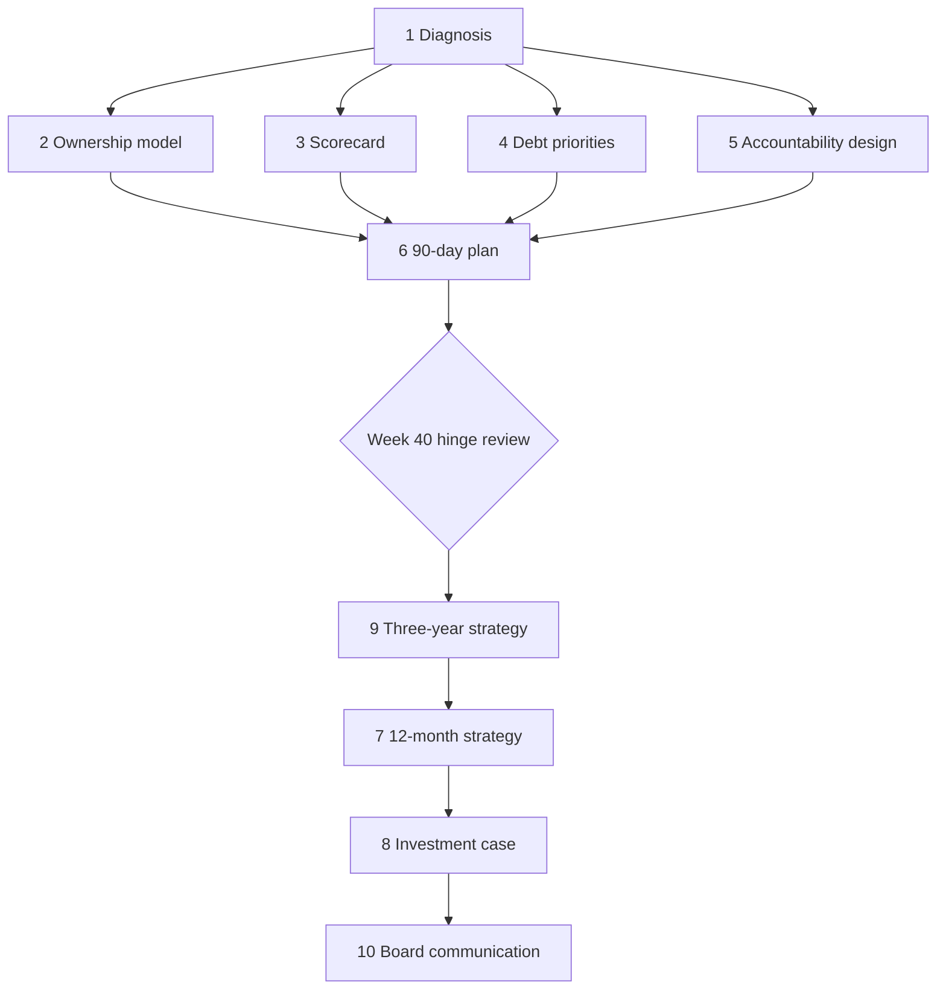
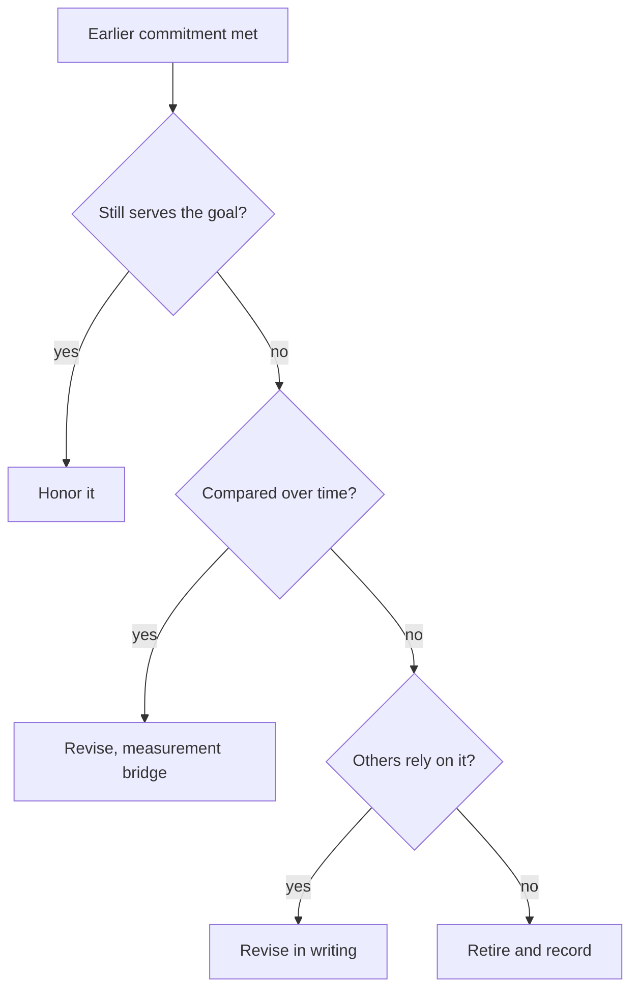

# Chapter 60 — Capstone: Transforming Northstar Technologies

The capstone asks you to do the whole job once, in order, at Northstar Technologies, the fictional
company of the [case study](../../case-studies/northstar/index.md). In ten stages you first act as its
new Engineering Director. You diagnose the organization, design its ownership model, scorecard, debt
priorities, and accountability, and write a 90-day plan. Then, in quarter 4 of the same year, you take
Victor Lindqvist's seat as CTO. From there you write the 12-month strategy, the investment case, the
three-year technology strategy, and the board communication.

Most stages reuse a chapter, a template, or a project, and this chapter does not repeat them. What it
adds is what no single project can show: how a definition chosen in week 2 decides what the board can be
told in week 50. The capstone is the largest piece of work in the book, about 75 to 100 hours. It suits a
study group or a development assignment spread over several weeks. The section "How to work through the
capstone" in the Practical Playbook gives the order, the hours, and the finish line.

## Why This Matters

At team scale, decisions are short-lived enough that you see their consequences while you still remember
making them. A sprint's working agreement is tested within two weeks.

At organization scale, a director's early documents outlive the context that produced them. A severity
definition written to solve a week-4 problem becomes an input to work done three quarters later, by
people who never saw the reasoning. Documents treated as finished when approved end up disagreeing.

At executive scale, the disagreements reach people who decide money. A board member asks whether a
measure means the same thing every quarter: a question about a choice made in the first month. The CTO
either has a record connecting week 50 to week 4, or reconstructs one under questioning.

## Learning Objectives

After this capstone you will be able to:

- Diagnose an 80-engineer organization from its data and interviews, and fix the counting rules that
  every later comparison will depend on.
- Produce an ownership model, a scorecard, debt priorities, an accountability design, and a 90-day plan
  that hand forward to each other without contradiction.
- Keep a commitment register and audit it honestly at a hinge point, judging earlier decisions by what
  was knowable then rather than by how they turned out.
- Extend the director's work into a 12-month strategy, an investment case, and a three-year technology
  strategy from the CTO's seat, reconciled to one capacity envelope.
- Communicate the result to a board so that each board member's question traces back to a recorded
  decision.

## The Mental Model

> **Mental model:** Every artifact you produce is a commitment to your later self and to everyone who
> will build on it. Later stages must honor each commitment or revise it in writing, with a measurement
> bridge (old and new definitions reported side by side) for anything that is compared over time. A transformation is coherent when its documents can be read in
> sequence without contradiction, and fragile when each was right only on the day it was approved.

Each stage consumes earlier outputs and constrains later ones. The diagram shows the dependencies; the
table names the threads that run through all ten.

| Thread | Born in | Tested in | What breaks if it is dropped |
|---|---|---|---|
| Counting rules (severity, tier 1 list, quarter length, change failure rate) | Stage 1 | Stages 3, 10 | Quarter-on-quarter claims to the board cannot be defended |
| Component ownership and exemptions | Stage 2 | Stages 7, 9 | A tier 1 module drifts ownerless while every document assumes someone has it |
| Prevention capacity | Stage 6 | Stages 7, 8, 9 | The program is cut by attrition, one request at a time |
| Priced debt and interest | Stage 4 | Stages 8, 9 | The investment case has no interest figures to value |
| Decision rights, including the CTO's | Stage 5 | Stages 9, 10 | Unrecorded rulings that a later strategy has to reverse |

Stage 9 comes before stage 7 in the diagram. In quarter 4, Victor drafts the three-year strategy in week
47 and tests it at a premortem in week 48. The 12-month strategy is that strategy's year-2 layer, so it
is written after it. A year-2 plan written without the three-year frame produces policies that decide
nothing, because nothing above them says what matters most.

## Deep Conceptual Explanation

### What integration adds to the projects

Each project fixes one moment and hands you the earlier choices, so integration failures are invisible
inside it. In the capstone nothing is handed to you that you did not produce. If your stage 1 change
failure rate breaks when releases go weekly, your stage 3 scorecard and stage 10 board page inherit the
problem. Rumelt argues that a strategy's actions must be coherent, each supporting the
others ([Rumelt, 2011](../../references/bibliography.md#rumelt2011good); **expert opinion**). The
capstone applies that test to a whole year of a leader's documents.

Two forces push a year of documents apart. The first is the
[capability trap](../../glossary.md#capability-trap): cutting improvement time to meet today's demand
erodes capability, and managers then blame effort
([Repenning and Sterman, 2001](../../references/bibliography.md#repenning2001nobody); **research
finding**, mostly outside software). At Northstar the prevention allocation falls from 12 FTE in
quarter 1 to 8 in quarter 3, and the continuation proposes 6 and then 5. Each step is defensible;
together they are the trap, unless each is tied to evidence that the capability holds. The second force is escalation of commitment, the tendency to keep funding a course one chose
oneself, the idea Staw is known for ([Staw, 1976](../../references/bibliography.md#staw1976knee);
**expert opinion**). In the CTO stages you judge the author of stage 6, who is you.

### Measurement continuity

A scorecard compares quarters. Comparison needs the definition, the population, and the period to stay
fixed, or to change with a measurement bridge. DORA's guide warns that setting its delivery metrics as
goals invites gaming ([DORA metrics guide](../../references/bibliography.md#dora-metrics-guide);
**industry research**; [Chapter 18](../04-execution/18-measuring-engineering-productivity.md)).

The capstone adds one obligation: a definition chosen in stage 1 is a promise about what stage 10 can
say. Northstar's record shows four places where that promise had to be managed:

| Measure | What changed | Rule used, and its effect |
|---|---|---|
| Severity | New definitions in week 3 re-rate the baseline from 7 Sev1 and 23 Sev2 to 9 and 21 | Report the total (30, unchanged) and keep both splits, so no one reads a re-rating as a change |
| Core change failure rate | Releases went from fortnightly to weekly in week 5 | Count weekly releases only: quarter 1 is 2 failed of 9 (22 percent). The baseline 31 percent came from the old cadence, so the two are compared only with this caveat |
| Tier 1 list | 15 components in year 1, 14 in year 2 | Year-1 comparisons keep the original 15; year 2 starts a new series |
| Quarter length | 90 days at baseline, 91 from quarter 1 | Availability allowances are computed for each period's own length, so a longer quarter does not look worse |

Without such rules in stage 1, you discover the need in stage 10, in front of the chair of the
[audit committee](../../glossary.md#audit-committee).

### Judging earlier stages without outcome bias

Between stage 6 and stage 7 you audit your director-stage work against quarters 1 to 3. The danger is
judging decisions by results. In Baron and Hershey's studies, people rated the same decision as better
thinking when its outcome was good, with the same information
([Baron and Hershey, 1988](../../references/bibliography.md#baron1988outcome);
**research finding**, with students judging medical decisions and gambles). The test case is a
migration check promised for week 7, after INC-427 (a baseline incident in which a Core release applied
credit notes twice). The check slipped, and in week 9 a Billing Sev1 repeated the failure. Whether
scheduling it for week 7 was a bad decision depends on what was known when it was promised.

The hinge therefore asks three questions of each commitment: reasonable on what was known then; kept,
revised, or dropped; and the lesson for the next commitment of its kind.

## Engineering Organization Example

!!! info "Northstar so far"
    The example runs from the baseline quarter to week 48. By quarter 3, Sev1 and Sev2 incidents fell
    from 30 to 14 a quarter and unplanned work from 34 to 25 percent; prevention took 8 FTE. Every
    quarter 4 decision is still open. See the [timeline](../../case-studies/northstar/timeline.md).
    New to Northstar? Read [the year in brief](../../case-studies/northstar/year-in-brief.md), the
    [cast](../../case-studies/northstar/cast.md), and the
    [quarter 4 briefing](../../case-studies/northstar/quarter-4-briefing.md).

One thread, followed through the stages, shows what integration means in numbers: the capacity
Northstar spends on prevention and the capacity it gets back. All figures are **illustrative** values
from the case. The terms come from earlier chapters:

| Term | Meaning here |
|---|---|
| [FTE](../../glossary.md#fte) and [FTE-quarter](../../glossary.md#fte-quarter) | Full-time engineers; one FTE-quarter costs $185,000 ÷ 4 = $46,250 |
| [Prevention allocation](../../glossary.md#prevention-allocation) | Capacity reserved for work that stops incidents recurring |
| [Unplanned work](../../glossary.md#unplanned-work) | Incidents, interruptions, and urgent fixes, as a share of capacity |
| Estate currency | Keeping Core's framework and libraries current; a line in Victor's draft ([Chapter 51](../12-cto-leadership/51-enterprise-technology-strategy.md#engineering-organization-example)) |
| [Horizon 2 and horizon 3](../../glossary.md#horizons) | Horizon 2 extends the business to new customers or markets; horizon 3 creates options for the future |
| The stress rule | Victor's rule from the week 48 premortem (a session imagining the plan has failed): an unplanned-work overrun comes out of horizon 2, never prevention or horizon 3 |
| Absorbing line | The allocation line that gives up capacity when the seat count drops |

| Moment | Document | Prevention | Unplanned work |
|---|---|---|---|
| Baseline quarter | Diagnosis (stage 1) | none funded | 34% of 80 = 27.2 FTE |
| Week 4 | 90-day plan (stage 6) | 12 FTE | 31% in quarter 1 |
| Weeks 27–39 | Quarter 3 plan | 8 FTE | 22% planned, 25% actual (20 FTE) |
| Week 45 | Continuation proposal | 6 FTE in quarters 5–6, 5 in quarters 7–8 | at most 18% by stage 3 |
| Week 47 | Three-year draft (stage 9) | 5.5 FTE in year 2 | 22% of 79 = 17.4 FTE |

**Does the continuation agree with the three-year draft?** Yes. The continuation's 6, 6, 5, and 5 FTE
average 5.5, exactly the draft's year-2 prevention line, though different authors wrote them two weeks
apart. This is the check the capstone requires at every hand-off.

**Is the program paying for itself yet?** In capacity alone, not quite; with service credits, clearly
([Chapter 59](../13-advanced-problems/59-transformation-under-constraint-and-scaling-without-bureaucracy.md#engineering-organization-example)
works the numbers). A stage 8 investment case needs both lines on the page.

**Does the year-2 envelope survive a bad quarter?** Victor's draft spreads 79 engineers across seven
lines:

| Line | Year 2 (FTE) |
|---|---|
| Unplanned work (22%) | 17.4 |
| Prevention | 5.5 |
| Platform | 4.5 |
| Estate currency | 2.0 |
| Product for today's customers | 37.6 |
| Horizon 2 | 10.0 |
| Horizon 3 | 2.0 |

If year 2 runs at quarter 3's actual 25 percent, unplanned work is 19.75 FTE, 2.35 over plan, and under
the stress rule horizon 2 falls from 10.0 to 7.65 FTE. So stage 7's commitments to Amara Okafor (CPO)
must already show horizon 2 as the shock absorber, or the first bad quarter looks like a broken promise.

**Which seat count?** The draft assumes 79 engineers, but the open decisions allow 77 to 80. Northstar
has 87 [seats](../../glossary.md#seat) (funded positions) in all, and every added manager or VP of
Engineering takes one that an engineer would otherwise fill:

| Option (week 44) | What changes | Engineers | With a VP |
|---|---|---|---|
| The proposal | Customer Experience split into web and mobile teams; 7 managers | 79 | 78 |
| Alternative B | Customer Experience kept whole; 6 managers | 80 | 79 |
| Alternative C | Orders also split; 8 managers | 78 | 77 |
| Alternative D | Two managers of managers, in place of a VP; 9 managers | 77 | not paired |

Sources: the [proposal](../../case-studies/northstar/first-quarter.md#the-year-2-organization-proposal-week-44)
and [Chapter 47](../11-vp-engineering/47-the-vp-of-engineering.md). The draft does not name its
absorbing line. Your submission must show the envelope at 80, 79, and 78 engineers, and name the line
that gives up capacity if the count falls to 77.

## Decision Framework

At every stage you will meet commitments made earlier, by you or by the case. Decide what to do with
each one explicitly. This flow is this book's recommendation.

A **measurement bridge** reports the old and new definitions side by side for at least one period. Northstar does
this for the tier 1 list: year-1 counts keep the original 15, and year-2 reports use 14. **Revise in
writing** means the change reaches the [decision log](../../glossary.md#decision-log) with its reason,
and the people who relied on the old version are told. **Retire and record** means the commitment is
removed on purpose rather than left to lapse. The core/permissions exemption in the case study is the
example of a lapse.

Use these checks on the whole portfolio before you call it done. Each is pass or fail.

| Check | Passes when |
|---|---|
| Traceability | Every number in stages 7 to 10 traces to a figure in the case, a definition written in stage 1 or 3, or a stated assumption |
| One envelope | Stages 7, 8, and 9 use the same capacity table for year 2, at 80, 79, and 78 engineers, and name the line that gives up capacity at 77 |
| Ownership closure | Every component appears exactly once in the stage 2 register, or has an exemption with an owner of its expiry |
| No silent revisions | Every commitment in the register is marked honored, bridged, revised in writing, or retired |
| Time rule | No stage uses a fact dated after its moment; assumptions are labeled as yours |
| Open stays open | The submission takes positions on quarter 4 decisions but records no outcome, and states how each position changes under the other outcomes |
| Capacity and cash apart | Every capacity figure is also priced, and reallocated capacity is never shown as new spending |

## Trade-offs

**Consistency against learning.** Honoring every early commitment learns nothing; revising freely
leaves nothing comparable. The measurement bridge buys both, at the price of reporting two numbers for a
quarter.

**Completeness against time.** The temptation is to write stages 1 to 6 thinly and the CTO stages at
length. The board stages are only as good as the definitions and owners beneath them. If you must cut,
cut length in the CTO stages, not rigor in the director stages.

**Reusing the case against reasoning from scratch.** Northstar's record is one worked answer. Copying it
scores on consistency and fails on judgment; departing from it without reasons fails on both.

**Precision against honesty about thin data.** Several of Northstar's measures rest on samples or a
probe in one region. Fewer measures stated with their weakness beat a page no one can defend.

## Failure Modes

**The stapled portfolio.** Ten artifacts, each sound, that disagree: the scorecard counts 15 tier 1
components and the strategy 14 without saying why. A measure that changes meaning while its trend line
continues is the same failure. Early sign: two documents give different figures for the same thing and
neither mentions the other.

**The orphan commitment.** An early promise that no later document mentions, so it lapses unnoticed, like
the core/permissions exemption in the case study. Early sign: a register entry with an expiry date and
no owner of the expiry.

**Hindsight leakage.** A director-stage artifact that uses facts from later in the story, such as the
week-40 corrected-order rate or the week-14 Orders knowledge table. It reads well and teaches nothing.
Early sign: a week-4 document that anticipates exactly what happened.

**The CTO doing the director's job.** In Victor's seat, rewriting the year-2 organization or the
continuation line by line instead of deciding the questions only the CTO can decide. Early sign: stage 7
is longer than the director's documents it reviews and contains no decision request.

**Outcome-graded hinge.** The week-40 review praises every decision that worked and condemns every one
that did not. Early sign: no decision is described as "reasonable, and it went badly" or "lucky".

## Enterprise Application

The capstone's method transfers to any organization of 50 to 150 engineers, without the fiction.

- **Keep a commitment register** beside the decision log: every definition, list, allocation,
  exemption, and owner assignment that later work relies on, with author, date, and review trigger.
  Fifty entries is plenty for a year.
- **Hold a hinge review twice a year,** before the planning cycle. Mark each register entry honored,
  bridged, revised in writing, revised silently, or orphaned. The last two are the findings.
- **Write counting rules in the first month.** They cost an afternoon then and a board meeting later.
- **Make one capacity table the source** for every planning document in a year.
- **Use the capstone as a development assignment** for a manager preparing for a director role: apply
  the ten stages to your own organization's last year and grade the hinge review on outcome bias.

## CTO Perspective

From the CTO's seat, the director's documents are inputs, and the CTO's job is to ask whether they add
up. Victor's quarter 4 desk holds eight documents, from the year-2 organization proposal to a draft
[risk register](../../glossary.md#risk-register) and his own three-year draft. Each was written by
someone competent; none was written to agree with the others, and their seat counts range from 77 to 80.

The CTO's distinctive contribution is the frame that makes them agree: the business choices Helena Marsh
(CEO) confirmed in week 46, the groups and policies of Victor's week-47 draft, and one year-2 envelope.
It also includes the CTO's own record. The case study shows Victor reversing an earlier remark of his own
in writing, which keeps the record credible.

A larger company turns threads into policy. Halvard Systems, the book's fictional 500-engineer
company ([Halvard](../../case-studies/northstar/halvard.md)), has six enterprise policies, each owned by
a principal engineer, because no single register could hold its threads.

## Practical Playbook

### How to work through the capstone

**Who it is for, and what "done" means.** Write the submission for a reader who can push back: a mentor,
your manager, or a study group that meets after each block of stages. Working alone, treat a future you
as the reader and set a review date. You are done when every stage meets its "good enough" criteria
below, the register carries a status for every entry, the two-page integration memo is written, and all
seven Decision Framework checks pass. To calibrate, use the
[grading aid](../../solutions/ch60-solutions.md#grading-aid-for-the-ten-stages), which gives excellent,
adequate, and weak answers for each stage, and the
[sample stage 1 page](../../solutions/ch60-solutions.md#sample-stage-1-trust-table-and-counting-rules).

**Prerequisites.** Read the [Northstar overview](../../case-studies/northstar/index.md), the
[cast](../../case-studies/northstar/cast.md), and the
[timeline](../../case-studies/northstar/timeline.md) first. The capstone reuses four projects:

| Project | Feeds | If you have not done it |
|---|---|---|
| [P3 quality plan](../../projects/p3-quality-transformation-plan.md) | Stages 1, 3, 6 | Do its core version first (about 10 to 12 hours) |
| [P5 scorecard](../../projects/p5-delivery-and-reliability-scorecard.md) | Stage 3 | Skip; stage 3 stays at one page |
| [P7 12-month strategy](../../projects/p7-twelve-month-engineering-strategy.md) | Stage 7 | Skip; stage 7 shrinks to the envelope and the fate of each register entry |
| [P8 investment proposal](../../projects/p8-cto-technology-investment-proposal.md) | Stage 8 | Do its core version, or price only three candidates |

**Short path.** If you cannot spend 75 to 100 hours, keep every stage but shrink it. Limit stages 2 and
4 to the ten most important entries, stage 9 to two pages (groups, policies, year-2 column), and stage 8
to three candidates. Keep stage 1's counting rules, the hinge review, and the memo at full depth; they
carry the integration. The short path takes about 45 to 55 hours.

**Working order.** The stage numbers follow the story's logic; the dates set the working order.

1. Stage 1, diagnosis (weeks 1 and 2). Write stage 6's first draft at the end of week 2: a one-page list
   of workstreams and decision requests, which the week-4 revision will fund.
2. Stages 2, 4, and 5 (weeks 3 to 5), in any order or in parallel.
3. Stage 3, scorecard (week 4), once stage 1's counting rules exist.
4. Stage 6 revised and agreed (week 4).
5. The hinge review (week 40).
6. Stage 9, then stage 7 (weeks 47 and 48), then stage 8 (to week 49), then stage 10 (to week 50).
7. The integration memo and the Decision Framework checks.

**Facts packet.** Each stage may use only the facts available at its moment. Four groups of pages:

| Group | Facts | Where | Open to |
|---|---|---|---|
| Director facts | Company, people, system, the five constraints; baseline measures and the three CSV files | [Overview](../../case-studies/northstar/index.md), [baseline](../../case-studies/northstar/baseline-data.md), [data files](../../case-studies/northstar/data/components.csv) | All stages, except the baseline sections listed below |
| Hinge facts | Quarters 1 to 3 in [the year 1 record](../../case-studies/northstar/first-quarter.md) (decisions, day 90, quarters 2 and 3), plus the baseline sections listed below | [Decisions](../../case-studies/northstar/first-quarter.md#decisions-that-hold-for-the-rest-of-the-book), [day 90](../../case-studies/northstar/first-quarter.md#day-90), [quarter 2](../../case-studies/northstar/first-quarter.md#quarter-2), [quarter 3](../../case-studies/northstar/first-quarter.md#quarter-3) | The hinge and stages 7 to 10 |
| CTO facts | Everything in quarter 4 up to week 48: the [quarter 4 briefing](../../case-studies/northstar/quarter-4-briefing.md) and the year 1 record's quarter 4 sections | [Calendar](../../case-studies/northstar/first-quarter.md#calendar-of-quarter-4), [proposal](../../case-studies/northstar/first-quarter.md#the-year-2-organization-proposal-week-44) | Stages 7 to 10 |
| Week 49 | The executive team meeting and the workforce plan draft | [Strategy](../../case-studies/northstar/first-quarter.md#three-year-technology-strategy-chapter-51), [calendar](../../case-studies/northstar/first-quarter.md#calendar-of-quarter-4) | Stages 8 and 10 only |

Nothing from week 50 on is recorded, so no stage may use it.

!!! warning "Baseline entries that stay closed until the hinge"
    The baseline page also records facts gathered later in the year. Stages 1 to 6 skip these entries:

    - staff engineers' time, weeks 12–13 ([people and management](../../case-studies/northstar/baseline-data.md#people-and-management));
    - the ledger knowledge map ([Billing on-call and ledger knowledge](../../case-studies/northstar/baseline-data.md#billing-on-call-and-ledger-knowledge));
    - the causes of dependency links ([cross-team dependencies](../../case-studies/northstar/baseline-data.md#cross-team-dependencies));
    - the recoded departures ([attrition](../../case-studies/northstar/baseline-data.md#levels-reviews-promotions-pay-and-attrition));
    - Orders knowledge, week 14 ([architecture and estate](../../case-studies/northstar/baseline-data.md#architecture-and-the-technology-estate)).

**Budget and finish line per stage.** Hours assume you reuse earlier projects where they exist.

| Stage | Hours | Deliverable | Good enough when |
|---|---|---|---|
| 1 Diagnosis | 8–10 | 3–4 pages | Each claim cites a baseline measure; the trust table marks which measures you will compare; counting rules survive a change in release cadence |
| 6 draft | 1–2 | 1 page | Lists workstreams and decision requests, with no allocations yet |
| 2 Ownership | 5–7 | Register of 24 rows plus 1 page | Every component appears once or has an exemption; every exemption has an ending decision, a week, and an owner of its expiry |
| 4 Debt | 5–7 | 10–15 priced entries plus 1 page | Each entry has interest in engineer-weeks, incidents, or dollars; each names the owner of the decision, not only of the code |
| 5 Accountability | 6–8 | 3–4 pages | Decision-rights map has a CTO lane; every standard and corrective action has an owner |
| 3 Scorecard | 4–6 | 1-page scorecard plus continuity rules | Baseline only, no targets; a continuity rule per row; unmeasured contract risks shown as rows |
| 6 revised | 6–8 | 3–4 pages plus capacity sheet | Every stage 2–5 commitment has a funded line; prevention has a step-down rule; the QA engineers' next roles are named |
| Hinge | 4–6 | Register annotations plus 2 pages | Every entry has a status; one "reasonable, went badly" and one "lucky" decision are named |
| 9 Three-year | 8–10 | 4–5 pages | Each policy traces to a stage 1 finding or stage 4 entry; year-2 column matches stage 7; options carry decision weeks |
| 7 12-month | 6–8 | 3 pages plus envelope table | Envelope at 80, 79, and 78, naming the line that gives up capacity at 77; a fate for every register entry |
| 8 Investment | 8–10 | 4 pages plus spreadsheet | Fits stage 7's envelope exactly; capacity and cash on separate lines; each candidate links to a stage 4 entry |
| 10 Board | 4–6 | 1 page plus 1 page of notes | Each board member's concern maps to an artifact; a measurement note states every measurement bridge; nothing about the meeting's outcome |
| Memo | 3–4 | 2 pages | Names the five threads, where each was honored or revised, and the one week-4 commitment you would change |

### Before you start: the time rule and the register

1. Respect the facts packet: stages 1 to 6 use the director facts only.
2. Open a commitment register with columns: entry, stage, date, author, what depends on it, review
   trigger, and status.
3. Where you need a fact the case does not give, write it as an assumption, labeled as yours, with the
   value at which your recommendation would change. Never add it as a Northstar fact.

### Stage 1: Diagnosis (weeks 1 and 2)

- **Produce:** the diagnosis and constraint statement of
  [Project 3](../../projects/p3-quality-transformation-plan.md) (deliverables 1 and 2), applying
  [Chapter 27](../05-engineering-quality/27-quality-transformation-at-enterprise-scale.md)'s days 1 to 15.
  If you have done Project 3, reuse it.
- **Add:** a trust table (each measure, how it is produced, its known weakness, whether you will compare
  it across quarters). Add counting rules for [severity](../../glossary.md#severity-sev1-sev2-sev3), the
  [tier 1](../../glossary.md#tier-1) population, period length, and the
  [change failure rate](../../glossary.md#change-failure-rate)'s denominator, written so they survive a
  change in release cadence.
- **Hand forward:** every counting rule enters the register; stages 3 and 10 will cite them.

### Stage 2: Ownership model (weeks 3 and 4)

- **Produce:** an ownership register for all 24 components in `components.csv`: owning team, tier, the
  four operational minimums, and an exemption for anything you cannot assign. Use the co-change and
  merge-request counts in the baseline's architecture section and
  [Chapters 19](../05-engineering-quality/19-defining-measuring-and-owning-quality.md),
  [20](../05-engineering-quality/20-engineering-standards-and-their-governance.md), and
  [31](../06-technical-leadership/31-service-boundaries-and-ownership.md). The
  [organizational design assessment](../../templates/organizational-design-assessment.md) structures it.
- **Add:** for each exemption, the decision that would end it, the week by which it must be made, and an
  owner of its expiry.
- **Hand forward:** the week-44 proposal and the continuation will be checked against this register.
  Do not restructure teams here; structure follows the boundaries you are only now drawing.

### Stage 3: Scorecard (week 4)

- **Produce:** the scorecard of Project 3's deliverable 3, using the
  [engineering quality scorecard](../../templates/engineering-quality-scorecard.md), published as a
  baseline with no targets
  ([Chapter 38](../08-management-operating-system/38-scorecards-quarterly-planning-and-capacity-allocation.md)).
- **Add:** a continuity rule per row (what happens if its definition, population, or source changes).
  Add a row for anything the contracts depend on that you cannot yet measure; at baseline that includes
  invoice correctness and the mobile path.
- **Hand forward:** stage 10 lifts four or five rows to the board.

### Stage 4: Debt priorities (weeks 3 and 4)

- **Produce:** a priced register of the top entries, using the
  [technical debt register](../../templates/technical-debt-register.md) and
  [Chapter 21](../05-engineering-quality/21-technical-debt.md). Start from the 143-item wiki list and the
  baseline's estate risks: the unsupported Core framework (120 to 180 engineer-days), the single Jenkins
  controller, the configuration server, and four CI systems at about 1.5 FTE a year.
- **Add:** [interest](../../glossary.md#technical-debt-principal-and-interest) in units stage 8 can
  reuse (engineer-weeks per quarter, incidents, dollars). For each entry, name the decision it needs and
  who owns that decision, not only who owns the code.
- **Hand forward:** entries return in quarter 4 as investment candidates and risks; unpriced ones force
  stage 8 to assume a figure.

### Stage 5: Accountability design (weeks 3 to 5)

- **Produce:** severity definitions, an
  [incident commander](../../glossary.md#incident-commander) pool, corrective actions with manager
  owners, owners for standards, mandates for the three staff engineers, and a
  [decision-rights](../../glossary.md#decision-rights) map. Draw on
  [Chapters 25](../05-engineering-quality/25-incidents-postmortems-and-change-failure-analysis.md),
  [29](../06-technical-leadership/29-staff-and-principal-engineers.md), and
  [39](../08-management-operating-system/39-reviews-decision-logs-escalation-and-executive-reporting.md),
  and the [incident review](../../templates/incident-review.md) and
  [architecture decision record](../../templates/architecture-decision-record.md) templates.
- **Add:** the CTO's lane on the decision-rights map. The baseline records that disputes reached Victor
  in conversation. Propose which technical decisions stay with him, which go through the director, and
  how either kind is recorded.
- **Hand forward:** stage 10 must answer Anders Holm (board chair), who asks whether the gains depend on
  a few people. This design, and the week-44 succession table in
  [Chapter 36](../07-organization-design/36-reorganizations-evolution-and-succession.md), answer it.

### Stage 6: The 90-day plan (draft week 2, revised and agreed week 4)

- **Produce:** Project 3's deliverables 4 to 6, using the
  [90-day quality plan](../../templates/ninety-day-quality-plan.md) and the
  [capacity planning model](../../templates/capacity-planning-model.md). Include workstreams with leads,
  the prevention allocation by team, the QA engineers' next roles, risks with pre-agreed responses, and
  decision requests to Victor and Amara.
- **Add:** in the week-4 revision, a funded line for each commitment from stages 2 to 5. Stage 5 items
  finishing in week 5 enter as funded intentions. Add a step-down rule for prevention: what evidence
  lets it fall, and to what. Later reductions then become decisions against a rule rather than
  attrition.
- **Hand forward:** the first entry in the prevention thread, which stage 7 will continue or end.

### The hinge: commitment audit (week 40)

Now read the hinge facts. For each register entry, and for the case's own week-4 decisions, write
whether it was reasonable on what was known then; its status by week 40 (honored, bridged, revised in
writing, revised silently, orphaned); and the lesson for the next commitment of its kind. Name at least one decision that was reasonable and went
badly, and one that went well partly by luck. Compare your stage 6 allocation with the case's, and say
which you would now defend.

### Stage 9: Three-year technology strategy (weeks 47 and 48)

From here on you sit in Victor's seat. Read the
[quarter 4 briefing](../../case-studies/northstar/quarter-4-briefing.md) before starting.

- **Produce:** your version of Victor's week-47 draft, using
  [Chapter 51](../12-cto-leadership/51-enterprise-technology-strategy.md). Sort capabilities into
  excellent, adequate, buy, and not doing; write three or four policies, an allocation for years 2 to 4,
  options with decision weeks, and a premortem.
- **Add:** a trace from each "excellent" capability and each policy back to a stage 1 finding or a stage
  4 entry. Draw the risk view from
  [Chapter 53](../12-cto-leadership/53-risk-governance-regulation-and-security-strategy.md) and the
  [risk register](../../templates/risk-register.md) template.
- **Facts:** the CTO facts. The week-49 meeting and the board's week-50 response are not available.
- **Hand forward:** the year-2 column, which stage 7 must match.

### Stage 7: 12-month strategy (week 48)

- **Produce:** the year-2 layer of the strategy, using Project 7's method and the
  [engineering strategy](../../templates/engineering-strategy.md) template.
- **Add:** a year-2 fate for every register entry (continue, end, hand to a policy owner). Add one
  envelope table at 80, 79, and 78 engineers, naming the line that gives up capacity if the count falls
  to 77. List the documents on your desk that must change to agree with it.
- **Facts:** the CTO facts, including the week-48 premortem with the stress rule and the people line.
  Quarter 4 results do not exist.
- **Assume:** the case leaves Victor's week-46 organization decision unrecorded. State as your assumption
  whether you decided it or deferred it, and show the envelope under the alternatives. Every later
  decision stays open.
- **Hand forward:** the envelope is stage 8's constraint and stage 10's capacity line.

### Stage 8: Investment case (weeks 47 to 49)

- **Produce:** the portfolio of [Project 8](../../projects/p8-cto-technology-investment-proposal.md),
  with the [technology investment business case](../../templates/technology-investment-business-case.md)
  for each candidate and
  [Chapter 45](../10-business-leadership/45-business-models-and-engineering-economics.md)'s
  [cost of delay](../../glossary.md#cost-of-delay).
- **Add:** for each candidate, the stage 4 register entry it came from and the interest figure it uses.
  Where stage 4 recorded none, state the assumption you now make and its break-even. Fit the package to
  stage 7's envelope exactly.
- **Facts:** the CTO facts and week 49, which widens Project 8's week-47 rule; note any figure that
  changes because of it.
- **Hand forward:** what the board's envelope must contain for the package to fit.

### Stage 10: Board communication (weeks 48 to 50)

- **Produce:** the engineering page of the year-2 board plan and your notes for the strategy discussion,
  using [Chapter 55](../12-cto-leadership/55-boards-due-diligence-and-executive-decision-making.md) and
  the [executive update](../../templates/executive-update.md) template.
- **Add:** a table mapping each board member's stated concern to the stage whose artifact answers it, and a
  measurement note stating every measurement bridge and continuity rule a board member would need.
- **Facts:** the CTO facts and week 49. The [board pack](../../glossary.md#board-pack) goes out at the
  end of week 49. Write nothing about the meeting's outcome.

### Assembling the submission

Hand your reader the ten artifacts, the register with its hinge annotations, and a two-page integration
memo. The memo names the five threads, where each was honored or revised, and the one early commitment
you would change, chosen on what was knowable in week 4. Then run the Decision Framework's checks.

## Case Study

These events are **illustrative** and fictional, from the
[baseline](../../case-studies/northstar/baseline-data.md) and
[the year 1 record](../../case-studies/northstar/first-quarter.md). The case follows two threads from the
director's first month to the CTO's quarter 4 desk. Neither has a recorded outcome.

**Thread one: core/permissions.** Core is Northstar's Java monolith, and core/permissions is one of its
modules. In the baseline quarter 38 merge requests changed it, 17 of them from Orders and none from
Platform Operations. In week 4 it was left undecided between those two teams, covered by a recorded
exemption. Both had a case on week-4 information. Orders made the most changes but carried a renewal
commitment. Platform Operations was taking auth-svc, next door, but none of its infrastructure engineers
had ever changed Core code.

In quarter 2 a permissions extraction was funded, and Priya Raman (Orders manager) said she would
accept the module after week 26. The
exemption reached its two-quarter maximum in week 39 and lapsed without renewal, because nobody had
been named to own its expiry. In week 44 the year-2 organization proposal moved core/permissions to
Orders, the first document to resolve the question. Victor's decision was due in week 46 and is not
recorded.

In capstone terms, the stage 2 choice was reasonable; what failed was the hand-forward. The exemption
was a commitment with a date and no owner of the date, so no later document was obliged to mention it.

**Thread two: [ADR-0001](../../glossary.md#adr-0001).** In week 14 Li Na Zhou (staff engineer, data and
integration) opened Northstar's first architecture decision record: how integrations should read posted
ledger data. There were three options:

| Option | Ready by |
|---|---|
| Read the tables | Week 19 |
| A versioned export contract (5 of Billing's 6 reserved engineer-weeks) | Week 19 |
| Ledger posting events | About week 24 |

She recommended the contract. Victor told Elena Sokolova (Payments and Integrations manager) in passing
to "read the tables now and clean it up later". Nobody's decision rights had been mapped. In week 19
the accounting integration went live with daily reconciliation, and no ledger read path was named.
ADR-0001 stayed open.

By week 41 the cost was visible: 29 of 46 nightly warehouse pipelines read Core tables directly, and
seven of quarter 3's 11 failed or partial loads traced to Core schema changes. In week 47 Victor's
three-year draft set the policy that money data moves by contract or events, never tables. The draft
states it as a reversal of his week-14 remark and proposes deciding ADR-0001 by week 60.

In capstone terms, the stage 5 decision-rights map is where this thread could have been caught: a map
with a CTO lane would have made the remark either a recorded decision or not a decision at all.
Victor's written reversal is the right repair, because it makes the record consistent before the board
sees the strategy.

**What the two threads share.** Both started with a reasonable choice and drifted because the
commitment had no owner for its next step. The case leaves both open; your submission takes a position
on each and says how it would change under the other outcome.

## Exercises

Worked solutions are in the [Chapter 60 solutions](../../solutions/ch60-solutions.md). The stages in the
Practical Playbook are the capstone's main work; these exercises practice the integration between them.
Scenarios marked hypothetical are for practice and are not part of Northstar's record.

### Foundational

**F1.** Using only the facts packet's director facts (the time rule for stages 1 to 6), write the first ten
entries of your commitment register: definitions, lists, rules, and allocations you will set in stages
1 to 3. For each, name the later stage that will rely on it. Then pick the three entries you judge most
likely to need revision within a year, and write their measurement bridges now.

**F2.** Using the facts packet, assign each fact to the earliest stage permitted to use it, and explain
one way a director-stage artifact would mislead if it used a fact too early: the Orders knowledge table
(week 14); the baseline co-change pairs; 7,800 corrected orders (week 40); the Bogotá cost of about
$110,000 per engineer (quarter 4); the week-3 security questionnaire asking for an SBOM (a software bill
of materials), recorded in the year 1 record; Finance's week-46 estimate for fiscal year 1; the
Billing ledger knowledge table; the week-44 proposal's document-store gap.

**F3.** The Engineering Organization Example shows that the continuation and the week-47 draft agree on
year 2 as a whole. Now reconcile quarters 5 and 6 alone, where the continuation asks for 6 FTE of
prevention against the draft's annual 5.5. Price each prevention level in dollars per quarter, and
decide which line of the draft must lend the extra 0.5 FTE and get it back in quarters 7 and 8. Explain
what Amara Okafor's condition that the allocation be fixed per stage does to that loan. Finish with two
sentences a board member could misread if shown only 12 and 5.5 FTE.

### Applied Leadership

**A1.** Hypothetical: in week 4 you assign core/permissions to Orders immediately instead of recording an
exemption. Using only week-4 facts, write the case for and against. Then, at the hinge, trace what this
choice would plausibly have changed by week 44 for the permissions extraction, Priya Raman's load, the
tier 1 count, and the year-2 organization proposal. Label each consequence as a judgment, not a fact of
the case.

**A2.** Margaret Lin, who chairs the audit committee, asks whether Northstar's measures mean the same
thing every quarter. Write the measurement note for the week-49 board pack, covering the Sev1 and Sev2
count, Core's change failure rate, tier 1 operational readiness, and contractual availability. For each,
state every definition or population change since baseline, the measurement bridge used, and what the reader should
and should not conclude from the trend.

**A3.** Take the five entries of the technical debt register example (TD-001 to TD-005) and the estate
risks in the baseline. For each, find where it stands in quarter 4: closed, reduced, or reappearing as a
risk, an open decision, or an investment candidate. For the Core framework migration, CI consolidation,
and ADR-0001, state the interest figure the case provides, or the assumption stage 8 must make, and what
the week-4 register should have recorded instead.

**A4.** Write the hinge review for five of Northstar's commitments: the week-3 severity definitions, the
tier 1 list of 15, the quarter 1 prevention allocation, the QA engineers' move into product teams, and
the absence of a decision-rights map. Classify each as honored, bridged, revised in writing, revised
silently, or orphaned. For the migration check that slipped before the week-9 Sev1, judge the decision
separately from its outcome, and say what information would have changed it.

### Executive Decision-Making

**X1.** You are Victor Lindqvist in week 48, after the premortem. The case leaves your week-46 decision on
the year-2 organization unrecorded: state as your own assumption whether you decided or deferred it, and
show the envelope under the alternatives. On your desk: the organization proposal at 79 engineers, the VP
question that would leave 78, the continuation at 6 and 5 FTE, your draft allocation at 79, and quarter
3's actual unplanned work of 25 percent. Build one year-2 envelope at 80, 79, and 78 engineers, apply
the stress rule, and name the line that gives up capacity if the count falls to 77. Say which documents must change and how you will tell their authors, and list what you
will deliberately not decide this week.

**X2.** You are Victor Lindqvist in week 48, finishing the engineering page for the week-49 board pack.
Board members have raised five concerns. Anders Holm (board chair) asks about dependence on a few people.
Natalie Brooks (investor board member) asks what a buyer's
[due diligence](../../glossary.md#due-diligence) would find. Samuel Osei (investor board member)
asks whether flat headcount carries the roadmap. Margaret Lin (audit committee chair) asks about
measurement consistency. David Ferrante (independent, former payments technology executive) asks about
the payment path, the availability miss, and Core's unsupported framework. Map each to the year-1
artifact that answers it, choose a reliability headline with your reasoning, and decide how to answer
David Ferrante's offer to review the architecture himself.

**X3.** Looking back from the CTO's seat, choose the one week-4 commitment you would change, using only what
was knowable in week 4. Hypothetically assume the change was made. Describe its effect on two later
stages, with numbers where the case supports them and labeled assumptions where it does not. Explain why
your choice is not simply the commitment that turned out worst.

## Reflection Questions

1. Which definitions in your own organization's scorecard would you be unable to defend, quarter by
   quarter, to an audit committee chair? Who chose them, and when?
2. Which of your commitments from six months ago has an expiry date and nobody responsible for it?
3. When you last reviewed a decision that went badly, did you separate what was knowable from what
   happened? What would you have concluded if the outcome had been good?
4. If you stepped into your manager's seat tomorrow, which of your own documents would you find
   inconsistent with each other?
5. Which unrecorded rulings by your executives are shaping engineering work right now?
6. Which of your plans have a step-down rule, and which will shrink by attrition?

## Key Takeaways

- Treat every artifact as a commitment to later work: honor it, bridge it, revise it in writing, or retire
  it on purpose. Never let it lapse.
- Write counting rules in the first month. What the board can be told in a year depends on them.
- Give every exemption an owner of its expiry, not only an expiry date.
- Price debt in interest units early, or the investment case will have to invent them later.
- Put the CTO's lane on the decision-rights map, so executive remarks become decisions or nothing.
- Tie each reduction of improvement capacity to evidence that the capability holds, or the program
  shrinks into the capability trap.
- Reconcile every year-2 document to one capacity envelope at every plausible seat count, from 77 to 80,
  and name the line that gives up capacity when a seat goes.
- Judge past decisions by what was knowable, not by how they turned out, and record both.
- In the CTO's seat, decide what only the CTO can decide, and reverse your own earlier positions in writing.

## References and Further Reading

- [Rumelt, 2011](../../references/bibliography.md#rumelt2011good): coherent action as the test of a
  strategy.
- [Repenning and Sterman, 2001](../../references/bibliography.md#repenning2001nobody): the capability
  trap in improvement programs.
- [Staw, 1976](../../references/bibliography.md#staw1976knee): escalation of commitment.
- [Baron and Hershey, 1988](../../references/bibliography.md#baron1988outcome): outcome bias.
- [DORA metrics guide](../../references/bibliography.md#dora-metrics-guide): delivery metrics and the
  warning against using them as goals.
- [Meadows, 2008](../../references/bibliography.md#meadows2008thinking): stocks, flows, and delays.
- [Forsgren et al., 2018](../../references/bibliography.md#forsgren2018accelerate): throughput and
  stability measures.
- [Beyer et al., 2016](../../references/bibliography.md#beyer2016sre): error budgets as allocation rules.
- [Skelton and Pais, 2019](../../references/bibliography.md#skelton2019team): team boundaries and
  cognitive load.
- [Berman and Knight, 2006](../../references/bibliography.md#berman2006financial): financial literacy for
  managers.
