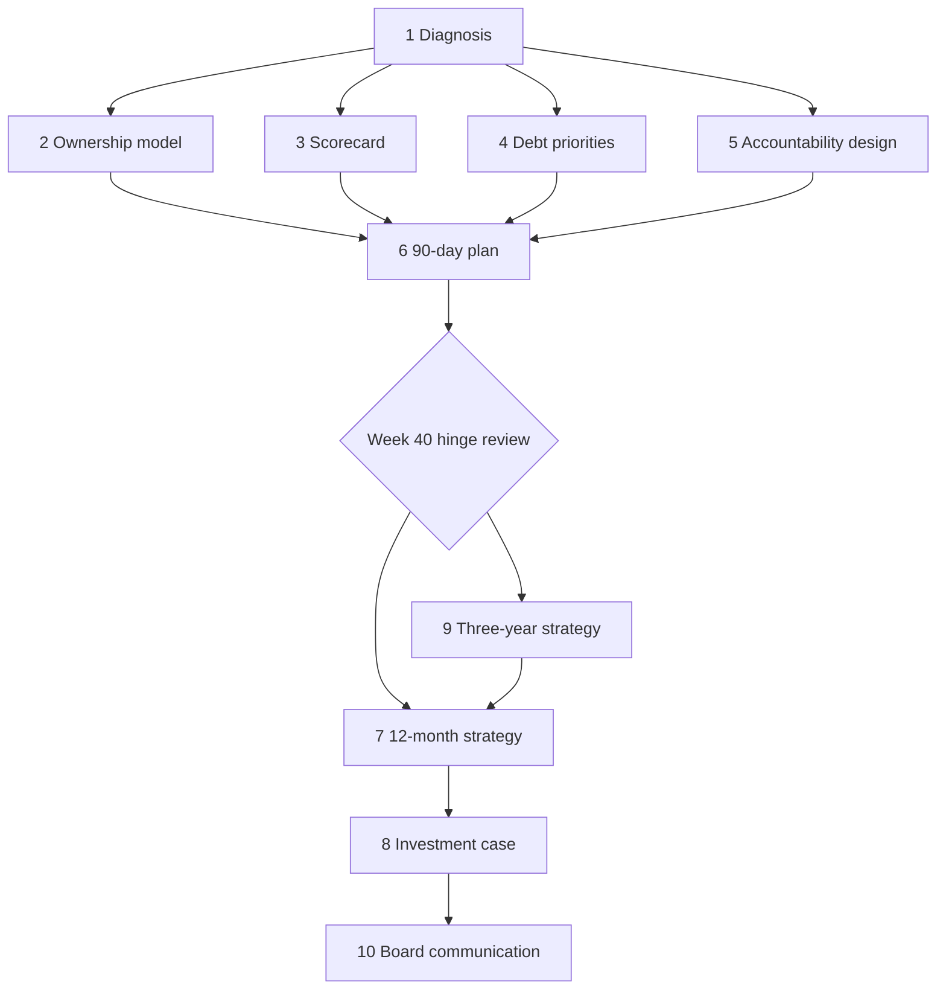
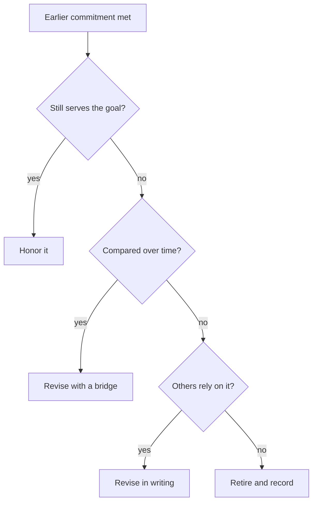

# Chapter 60 — Capstone: Transforming Northstar Technologies

!!! warning "Awaiting human review"
    This chapter has passed the book's automated validation and an editorial self-review, but not yet
    the human review in which each cited claim is checked against its source. Treat it as a reviewed
    draft. Corrections are welcome; see the repository's CONTRIBUTING file.

The capstone asks you to do the whole job once, in order, at Northstar Technologies, the fictional
company of the [case study](../../case-studies/northstar/index.md). In ten stages you diagnose the
organization, design its ownership model, scorecard, debt priorities, and accountability, and write a
90-day plan as its new Engineering Director; then, in quarter 4 of the same year, you take Victor
Lindqvist's seat as CTO and write the 12-month strategy, the investment case, the three-year technology
strategy, and the board communication. Most stages have a chapter, a template, or a project behind them,
and this chapter does not repeat them. What it adds is the thing no single project can show: how a
definition chosen in week 2 decides what the board can be told in week 50, and how an ownership gap left
open in week 4 is still on the CTO's desk in week 47.

## Why This Matters

At team scale, decisions are short-lived enough that you see their consequences while you still remember
making them. A sprint's working agreement is tested within two weeks.

At organization scale, a director's early documents outlive the context that produced them. A severity
definition, a tier 1 list, a prevention allocation, an exemption with an expiry date: each was written to
solve a week-4 problem, and each becomes an input to work that happens three quarters later, often by
people who never saw the original reasoning. A director who treats each document as finished when it is
approved produces a stack of good documents that disagree with each other.

At executive scale, the disagreements become visible to people who decide money. A board member who asks
whether a measure means the same thing every quarter, or whether the gains depend on a few people, is
asking about choices made by a director in the first month. The CTO answering that question either has
a record that connects week 50 back to week 4, or has to reconstruct one under questioning.

## Learning Objectives

After this capstone you will be able to:

- Diagnose an 80-engineer organization from its data and interviews, and fix the counting rules that
  every later comparison will depend on.
- Produce an ownership model, a scorecard, debt priorities, an accountability design, and a 90-day plan
  that hand forward to each other without contradiction.
- Keep a commitment register and audit it honestly at a hinge point, judging earlier decisions by what
  was knowable then rather than by how they turned out.
- Extend the director's work into a 12-month strategy, an investment case, and a three-year technology
  strategy from the CTO's seat, reconciled to one capacity envelope.
- Communicate the result to a board so that each director's question traces back to a recorded
  decision.

## The Mental Model

> **Mental model:** Every artifact you produce is a commitment to your later self and to everyone who
> will build on it. Later stages must honor each commitment or revise it in writing, with a bridge for
> anything that is compared over time. A transformation is coherent when its documents can be read in
> sequence without contradiction, and fragile when each was right only on the day it was approved.

The stages are not a checklist. Each one consumes the outputs of earlier stages and constrains later
ones. The diagram shows the main dependencies; the table under it names the threads that run through
all ten.

| Thread | Born in | Tested in | What breaks if it is dropped |
|---|---|---|---|
| Counting rules (severity, tier 1 list, quarter length, change failure rate) | Stage 1 | Stages 3, 10 | Quarter-on-quarter claims to the board cannot be defended |
| Component ownership and exemptions | Stage 2 | Stages 7, 9 | A tier 1 module drifts ownerless while every document assumes someone has it |
| Prevention capacity | Stage 6 | Stages 7, 8, 9 | The program is cut by attrition, one request at a time |
| Priced debt and interest | Stage 4 | Stages 8, 9 | The investment case has no interest figures to value |
| Decision rights, including the CTO's | Stage 5 | Stages 9, 10 | Unrecorded rulings that a later strategy has to reverse |

Stage 9 feeds stage 7 in the diagram because, in quarter 4, Victor Lindqvist drafts the three-year
strategy in week 47 and tests it at a premortem in week 48, and the 12-month strategy is its year-2
layer, so stage 7 is set in week 48. Writing the year-2 layer without the
three-year frame repeats the week-14 mistake that
[Project 7](../../projects/p7-twelve-month-engineering-strategy.md) asks you to evaluate: policies that
decide nothing because nothing above them says what matters most.

## Deep Conceptual Explanation

### What integration adds to the projects

The book's projects each fix one moment and one document:
[Project 3](../../projects/p3-quality-transformation-plan.md) is the week-2 quality plan,
[Project 5](../../projects/p5-delivery-and-reliability-scorecard.md) the week-26 scorecard,
[Project 4](../../projects/p4-redesign-an-80-engineer-organization.md) the week-44 organization,
[Project 7](../../projects/p7-twelve-month-engineering-strategy.md) and
[Project 8](../../projects/p8-cto-technology-investment-proposal.md) the quarter 4 strategy and
investment case. Each can be done well in isolation. Integration failures are invisible inside any one
of them, because each project's starting dataset quietly resolves the earlier choices for you: Project 5
hands you the severity definitions, Project 4 hands you the tier 1 list.

In the capstone nothing is handed to you that you did not produce. If your stage 1 diagnosis does not
define a change failure rate that survives the move to weekly releases, your stage 3 scorecard inherits
the problem, and your stage 10 board page inherits it again. Rumelt's account of strategy is known for
insisting that actions be coherent, each supporting the others, rather than a list of separately
reasonable initiatives ([Rumelt, 2011](../../references/bibliography.md#rumelt2011good); **expert
opinion**). The capstone applies that test to a whole year of a leader's documents.

### Commitments, delays, and the cost of reversal

Some commitments are cheap to reverse: a meeting length, a review format. Others become expensive
because people build on them. Meadows is known for showing how delays between action and consequence
make systems hard to steer, and why stocks change only through their flows
([Meadows, 2008](../../references/bibliography.md#meadows2008thinking); **expert opinion**). A
transformation's stocks (open debt, ownerless components, people who can safely change the ledger)
change slowly, so the commitments that govern their flows matter more than the ones that announce
targets.

Two research results frame the risk on each side. Repenning and Sterman's field studies of improvement
programs describe a capability trap: cutting improvement time to meet immediate throughput erodes
capability and forces still more reliance on working harder, and because the link between skipped
improvement and later shortfall is long and hard to see, managers tend to blame effort instead
([Repenning and Sterman, 2001](../../references/bibliography.md#repenning2001nobody); **research
finding**, from case studies and simulation models, mostly outside software). At Northstar the
prevention allocation is the improvement time. It falls from 12 FTE in quarter 1 to 8 in quarter 3, and
the continuation proposes 6 and then 5. Each step is defensible; together they are the trap's
mechanism unless each step is tied to evidence that the capability now holds without the capacity.

On the other side, escalation of commitment, the tendency to keep funding a course of action one chose
oneself, is the idea Staw's study is known for introducing
([Staw, 1976](../../references/bibliography.md#staw1976knee); credited at idea level, not read for this
book). The capstone's author is the person who wrote stage 6. When the CTO-seat stages arrive, the
temptation is to defend the director's plan rather than test it.

### Measurement continuity

A scorecard compares quarters. Comparison needs the definition, the population, and the period to stay
fixed, or to change with a bridge. Forsgren, Humble, and Kim are known for the delivery measures of
throughput and stability that most engineering scorecards now use
([Forsgren et al., 2018](../../references/bibliography.md#forsgren2018accelerate); **industry
research**, credited at idea level). DORA's current guide states that its research has repeatedly found
speed and stability are not trade-offs, warns that setting the metrics as goals increases the likelihood
that teams game them, and says the metrics are meant for applications or services, for improvement over
time rather than competition between teams
([DORA metrics guide](../../references/bibliography.md#dora-metrics-guide); **industry research**).
[Chapter 18](../04-execution/18-measuring-engineering-productivity.md) owns gaming in general.

The capstone adds one obligation: a definition chosen in stage 1 is a promise about what stage 10 can
say. Northstar's canon shows four places where the promise had to be managed: the baseline severity
ratings (7 Sev1 and 23 Sev2 as recorded, 9 and 21 under the week-3 definitions, with the total of 30
unchanged); Core's change failure rate (redefined with the weekly cadence, so quarter 1's 22 percent
counts 2 of 9 weekly releases and excludes the two fortnightly ones); the tier 1 list (15 components for
year-1 comparisons, 14 for year 2); and quarter length (90 days at baseline, 91 from quarter 1). Each was
handled with an explicit rule. A capstone that does not write such rules in stage 1 will discover the
need for them in stage 10, in front of a board member who chairs an audit committee.

### Judging earlier stages without outcome bias

Between stage 6 and stage 7 the capstone asks you to read what happened at Northstar in quarters 1 to 3
and audit your director-stage work against it. The danger is judging decisions by results. In Baron and
Hershey's studies, people who knew they had all the information the decision maker had still rated the
thinking as better and the decision maker as more competent when the outcome was favorable, and did so
while saying they should not
([Baron and Hershey, 1988](../../references/bibliography.md#baron1988outcome); **research finding**,
undergraduate subjects judging medical decisions and gambles, not executives). The week-9 Billing Sev1
is the test case: the migration check promised after INC-427 had slipped, so the outcome was bad, but
whether the decision to schedule it for week 7 was bad depends on what was known in week 3.

The capstone therefore separates three questions at the hinge: was the commitment reasonable on the
information then available; was it kept, revised in writing, revised silently, or dropped; and what
does the result teach about the next commitment of the same kind.

### From the director's seat to the CTO's

The second half moves you into Victor Lindqvist's seat in quarter 4. Victor stays CTO throughout the
book; you take his seat with the facts available then, and every quarter 4 decision recorded as open in
the canon stays open in the canon, though your submission takes positions on them. Three things change
with the seat.

**The audience.** The director reports to one person; the CTO answers to an executive team and,
once a quarter, a board. Berman and Knight are known for arguing that managers who read the financial
statements make better decisions and argue more effectively for them
([Berman and Knight, 2006](../../references/bibliography.md#berman2006financial); **expert opinion**).
[Chapter 52](../12-cto-leadership/52-technology-investment-budgeting-and-financial-literacy.md) owns the
statements; the capstone requires that every capacity figure in stages 7 to 10 also appear in dollars,
and that capacity and cash stay on separate lines.

**The horizon.** Stage 9 works in years 2 to 4. The error budget idea that the Google SRE book is known
for, a reliability target that converts into a budget governing how much change risk a team may take
([Beyer et al., 2016](../../references/bibliography.md#beyer2016sre); **documented practice**, credited
at idea level), is a useful bridge here: it turns the stage 3 measure into a rule for the stage 9
allocation instead of a number reported upward.

**The boundary.** The CTO inherits the director's commitments and also has commitments of their own,
some unrecorded. Skelton and Pais are known for matching team boundaries to the flow of change and for
limiting each team's cognitive load ([Skelton and Pais, 2019](../../references/bibliography.md#skelton2019team);
**expert opinion**). The same reasoning applies to the CTO's own lane: decisions the CTO makes in
passing, outside any record, land on teams as unplanned constraints.
[Chapter 50](../12-cto-leadership/50-what-a-cto-actually-does.md) measures that lane in Victor's calendar.

## Engineering Organization Example

One thread, followed through all ten stages, shows what integration means in numbers: the capacity
Northstar spends on prevention and the capacity it gets back. All figures are **illustrative** canon
values; one FTE-quarter costs $185,000 ÷ 4 = $46,250.

| Moment | Document | Prevention | Unplanned work | Source |
|---|---|---|---|---|
| Baseline quarter | Diagnosis (stage 1) | none funded | 34% of 80 = 27.2 FTE | baseline |
| Week 4 | 90-day plan (stage 6) | 12 FTE (11.55 from teams, 0.45 from staff engineers) | 31% in quarter 1 | first quarter |
| Weeks 27–39 | Quarter 3 plan | 8 FTE | 22% planned, 25% actual (20 FTE) | quarter 3 |
| Week 45 | Continuation proposal | 6 FTE in quarters 5–6, 5 in quarters 7–8 | target at most 18% by stage 3 | quarter 4 |
| Week 47 | Three-year draft (stage 9) | 5.5 FTE in year 2 | 22% of 79 = 17.4 FTE | Part XII facts |

Check the quarter 1 split: Billing 25% × 13 = 3.25; Orders 10% × 14 = 1.40; Payments and Integrations
10% × 12 = 1.20; Customer Experience 15% × 15 = 2.25; Data and Analytics 15% × 11 = 1.65; Platform
Operations 15% × 12 = 1.80. The sum is 11.55, plus 15% × 3 staff engineers = 0.45, total 12.0. Quarter 1
prevention cost 12 × $46,250 = $555,000 of capacity.

**Does the continuation agree with the three-year draft?** The continuation asks for 6 + 6 + 5 + 5 = 22
FTE-quarters in year 2, an average of 5.5 FTE, which is exactly the draft's year-2 prevention line. The
two documents agree. That agreement is the kind of check the capstone requires at every hand-off, and it
was not automatic: the documents were written two weeks apart by different authors.

**Is the program paying for itself yet?** From baseline to quarter 3, unplanned work fell from 27.2 to
20.0 FTE, returning 7.2 FTE, about 7.2 × $185,000 = $1.33M a year of capacity. Quarter 3 spent 8 FTE on
prevention. In capacity alone the program is not yet self-funding; with service credits (from $410,000
to $60,000 a quarter, $1.4M a year less) it is clearly ahead. A stage 8 investment case that shows only
the credits overstates the case to Greg Tanaka; one that shows only capacity understates it to Rajiv
Menon. Both lines belong on the page.

**Does the year-2 envelope survive a bad quarter?** The draft allocation on 79 engineers sums to 79.0:
unplanned 17.4, prevention 5.5, platform 4.5, estate currency 2.0, product for today's customers 37.6,
horizon 2 10.0, horizon 3 2.0. If year 2 runs at quarter 3's actual 25 percent instead of the planned 22,
unplanned work is 0.25 × 79 = 19.75 FTE, an overrun of 2.35. Under the stress rule Victor adds at the week 48
premortem, the overrun comes out of horizon 2, which falls from 10.0 to 7.65 FTE. The arithmetic is simple; the integration point is
that stage 7's year-2 commitments to Amara Okafor must already show that horizon 2 is the shock absorber,
or the first bad quarter will look like a broken promise.

**Which seat count?** The draft assumes 79 engineers (the week-44 organization proposal). Option B keeps
80; a VP taking a seat would leave 78; alternative D, or alternative C with a VP, would leave 77. The
draft does not say which line absorbs a lost seat. A capstone submission must, because stage 8's package
has to fit the same envelope at 80, 79, and 78, and must state which line absorbs a fourth seat if 77
becomes possible.

## Decision Framework

At every stage you will meet commitments made earlier, by you or by the canon. Decide what to do with
each one explicitly. This flow is this book's recommendation.

A **bridge** reports the old and new definitions side by side for at least one period, as the canon does
for the tier 1 list (year-1 counts keep the original 15, year-2 reports use 14). **Revise in writing**
means the change reaches the decision log with its reason and the people who relied on the old version
are told. **Retire and record** means the commitment is removed on purpose rather than left to lapse, as
the core/permissions exemption did at week 39.

Use these checks on the whole portfolio before you submit it. Each is pass or fail.

| Check | Passes when |
|---|---|
| Traceability | Every number in stages 7 to 10 traces to a canon figure, a definition written in stage 1 or 3, or a stated assumption |
| One envelope | Stages 7, 8, and 9 use the same capacity table for year 2, at 80, 79, and 78 engineers, and state which line absorbs a fourth seat at 77 |
| Ownership closure | Every component appears exactly once in the stage 2 register, or has an exemption with an owner of its expiry |
| No silent revisions | Every commitment in the register is marked honored, bridged, revised in writing, or retired |
| Time rule | No stage uses a fact dated after its moment; assumptions are labeled as yours |
| Open stays open | The submission takes positions on quarter 4 decisions but records no canon outcome, and states how each position changes under the other outcomes |
| Capacity and cash apart | Every capacity figure is also priced, and reallocated capacity is never shown as new spending |

## Trade-offs

**Consistency against learning.** A director who honors every early commitment learns nothing from the
year; one who revises freely leaves nothing comparable. The bridge rule buys both at the price of
reporting two numbers for a quarter, which executives find tedious and which is cheaper than an
indefensible trend.

**Completeness against time.** Ten artifacts plus a register and a hinge review is a large submission.
The temptation is to write stages 1 to 6 thinly and the CTO stages at length. The board stages are only
as good as the definitions and owners beneath them, so if you must cut, cut length in the CTO stages,
not rigor in the director stages.

**Reusing the canon against reasoning from scratch.** The canon is one worked answer. Copying it scores
on consistency and fails on judgment; departing from it without reasons fails on both. A submission that
reaches the canon's choices should show it reached them, and one that departs should say what it would
have cost.

**The director's plan against the CTO's view.** In the second half you are judging the first half's
author, who is you. Defending stage 6 because you wrote it is escalation; discarding it to look
independent is waste. Judge it on what it handed forward.

**Precision against honesty about thin data.** Several canon measures rest on samples, manual linking,
or a probe in one region. Stage 10 is tempted to present them as precise. The board is better served by
a smaller number of measures stated with their weakness than by a full page of figures no one can
defend.

## Failure Modes

**The stapled portfolio.** Ten artifacts, each sound, that disagree: the scorecard counts 15 tier 1
components and the strategy counts 14 without saying why; the investment case assumes 8 FTE of
prevention and the strategy 5.5. Early sign: two documents give different figures for the same thing
and neither mentions the other.

**Silent redefinition.** A measure changes meaning between quarters and the trend line continues
unbroken. Early sign: a quarter's improvement that coincides with a change in how the number is
produced.

**The orphan commitment.** An early promise that no later document mentions, so it lapses unnoticed.
Northstar's examples: the core/permissions exemption, which reached its two-quarter maximum at week 39
and lapsed without renewal, and document-store, which the week-44 organization proposal assigns to no
team although its transition plan requires every component in the register exactly once. Early sign: a
register entry with an expiry date and no owner of the expiry.

**Hindsight leakage.** A director-stage artifact that uses facts from later in the story, such as the
week-40 corrected-order rate or the week-14 Orders knowledge table. It reads well and teaches nothing.
Early sign: a week-4 document that anticipates exactly what happened.

**Recording outcomes that do not exist.** A CTO-stage artifact that states what the board decided in week
50, or what quarter 4's incident count was. The canon records neither. Early sign: a past-tense sentence
about anything after week 49.

**The CTO doing the director's job.** In Victor's seat, rewriting the year-2 organization or the
continuation line by line instead of deciding the questions only the CTO can decide. Early sign: stage 7
is longer than the director's documents it reviews and contains no decision request.

**Outcome-graded hinge.** The week-40 review praises every decision that worked and condemns every one that
did not. Early sign: no decision is described as "reasonable, and it went badly" or "lucky".

## Enterprise Application

The capstone's method transfers to any organization of 50 to 150 engineers, without the fiction.

- **Keep a commitment register** alongside the decision log: every definition, list, allocation,
  exemption, and owner assignment that later work will rely on, with its author, date, the documents
  that depend on it, and its review trigger. Fifty entries is plenty for a year.
- **Hold a hinge review twice a year,** before the planning cycle rather than after it. Read the register
  against what happened and mark each entry honored, bridged, revised in writing, revised silently, or
  orphaned. The last two are the findings.
- **Write counting rules in the first month.** Severity, the tier 1 population, period length, and any
  rate whose denominator depends on cadence. They cost an afternoon then and a board meeting later.
- **Make one capacity table the source** for every planning document in a year, so the strategy, the
  investment case, and the operating plan cannot drift apart.
- **Use the capstone as a development assignment.** For a manager being prepared for a director role, or
  a director for a VP role, the ten stages applied to your own organization's last year make a better
  exercise than any course. Have them present the hinge review to you, and grade it on outcome bias.

## CTO Perspective

From the CTO's seat, the director's documents are inputs, and the CTO's job is to ask whether they add
up. Victor Lindqvist's quarter 4 desk holds the year-2 organization proposal (week 44), the VP question
(due week 48), the quality continuation (week 45), Rajiv Menon's week-41 request for a workforce plan,
the board page with two competing headlines, a draft enterprise risk register, an AI position, and his
own three-year draft. Each was written by someone competent for a reason. None of them was written to
agree with the others, and the seat counts they assume range from 77 to 80 engineers (78 under the main proposal with a VP).

The CTO's distinctive contribution is the frame that makes them agree: the business choices Helena
Marsh confirmed in week 46, the four groups and four policies of the week-47 draft, and one year-2
envelope. It is also the CTO's own record. Victor's week-47 policy that money data moves by contract or
events, never tables, is a stated reversal of his own week-14 remark; a CTO who reverses himself in
writing keeps the record credible, and one who lets the old remark stand keeps two policies alive.

At Halvard Systems, the fictional 500-engineer company in
[Chapter 35](../07-organization-design/35-designing-organizations-at-four-scales.md), no CTO can follow
threads personally across four product groups and a platform organization. Halvard's answer in the
canon is six enterprise policies, each owned by a principal engineer: one owning team per production
component, tier 1 operational minimums, an auditable pipeline with rollback, vulnerability remediation
service levels, a tracked review for every Sev1, and no customer date without an estimate and an owner.
Read them as threads made permanent. Several match commitments Northstar's director made in
quarter 1; at Halvard's scale they had to become policy with owners, because no single register could hold
them.

## Practical Playbook

Work the stages in order. Each names its moment in the story, the facts you may use, what to produce,
what to reuse instead of redoing, and what it must hand forward. Plan the whole capstone as several weeks
of part-time work; the projects it draws on take 12 to 20 hours each, and here you reuse rather than
repeat them.

### Before you start: the time rule and the register

1. Stages 1 to 6 use only the [overview](../../case-studies/northstar/index.md), the
   [baseline](../../case-studies/northstar/baseline-data.md) facts that describe the baseline quarter,
   and the three CSV files. Some baseline entries are dated later (staff engineers' time in weeks 12–13,
   Orders knowledge in week 14, the Billing ledger knowledge map built at the start of quarter 2, dependency
   causes and recoded departures from early quarter 2); they are off limits until the hinge. Do not open the [first quarter](../../case-studies/northstar/first-quarter.md)
   page until then.
2. Open a commitment register with columns: entry, stage, date, author, what depends on it, review
   trigger, and status.
3. Where you need a fact the canon does not give, write it as an assumption, labeled as yours, with the
   value at which your recommendation would change. Never add it as a Northstar fact.

### Stage 1: Diagnosis (weeks 1 and 2)

- **Produce:** the diagnosis and constraint statement of [Project 3](../../projects/p3-quality-transformation-plan.md)
  (deliverables 1 and 2), applying [Chapter 27](../05-engineering-quality/27-quality-transformation-at-enterprise-scale.md)'s
  days 1 to 15 and [Chapter 40](../09-engineering-directorship/40-the-directors-job.md)'s signal sources.
  If you have done Project 3, reuse it. [Project 2](../../projects/p2-diagnose-a-low-performing-team.md),
  which applies [Chapter 56](../13-advanced-problems/56-recovering-a-failing-engineering-organization.md),
  gives a team-level version for Billing.
- **Add:** a trust table (each measure, how it is produced, its known weakness, whether you will compare
  it across quarters) and counting rules for severity, the tier 1 population, period length, and the
  change failure rate's denominator, written so they survive a change in release cadence.
- **Hand forward:** every counting rule enters the register; stage 3 and stage 10 will cite them.

### Stage 2: Ownership model (weeks 3 and 4)

- **Produce:** an ownership register for all 24 components in `components.csv`: owning team, tier, the
  four operational minimums, and an exemption with an expiry and an owner of the expiry for anything you
  cannot assign. Use the co-change and merge-request counts in the baseline's architecture section and
  [Chapters 19](../05-engineering-quality/19-defining-measuring-and-owning-quality.md),
  [20](../05-engineering-quality/20-engineering-standards-and-their-governance.md), and
  [31](../06-technical-leadership/31-service-boundaries-and-ownership.md); the
  [organizational design assessment](../../templates/organizational-design-assessment.md) structures it.
- **Add:** for each exemption, the decision that would end it and the week by which it must be made.
- **Hand forward:** the register is the one Project 4's week-44 proposal will be checked against, and the
  continuation's stage 2 exit criterion ("every component in the ownership register exactly once") will
  inspect. Do not restructure teams here; [Chapter 33](../07-organization-design/33-conways-law-team-topologies-and-cognitive-load.md)
  explains why structure follows the boundaries you are only now drawing.

### Stage 3: Scorecard (week 4)

- **Produce:** the scorecard of Project 3's deliverable 3, using the
  [engineering quality scorecard](../../templates/engineering-quality-scorecard.md), published as a
  baseline with no targets. [Chapter 38](../08-management-operating-system/38-scorecards-quarterly-planning-and-capacity-allocation.md)
  and [Chapter 24](../05-engineering-quality/24-reliability-slos-and-operational-readiness.md) cover
  pairs and SLOs.
- **Add:** a continuity rule per row (what happens to the row if its definition, population, or source
  changes) and a row for anything the contracts depend on that you cannot yet measure. At baseline that
  includes invoice correctness and the mobile path.
- **Hand forward:** [Project 5](../../projects/p5-delivery-and-reliability-scorecard.md) revisits the
  scorecard in week 26; your rows should still be recognizable there. Stage 10 lifts four or five rows to
  the board.

### Stage 4: Debt priorities (weeks 3 and 4)

- **Produce:** a priced register of the top entries using the
  [technical debt register](../../templates/technical-debt-register.md) and
  [Chapter 21](../05-engineering-quality/21-technical-debt.md), starting from the 143-item wiki list and
  the estate risks in the baseline (the unsupported Core framework at 120 to 180 engineer-days, the
  single Jenkins controller, the configuration server, four CI systems at about 1.5 FTE a year).
- **Add:** interest in units stage 8 can reuse (engineer-weeks per quarter, incidents, dollars), and for
  each entry the decision it needs and who owns that decision, not only who owns the code.
- **Hand forward:** several entries return in quarter 4 as investment candidates and risks. If an entry
  has no priced interest now, stage 8 will have to assume one.

### Stage 5: Accountability design (weeks 3 to 5)

- **Produce:** severity definitions, an incident-commander pool, corrective actions with manager owners,
  owners for standards, mandates for the three staff engineers, and a decision-rights map. Draw on
  [Chapters 11](../03-high-performing-teams/11-high-performance-trust-safety-and-accountability.md),
  [13](../03-high-performing-teams/13-decision-making-in-teams.md),
  [25](../05-engineering-quality/25-incidents-postmortems-and-change-failure-analysis.md),
  [29](../06-technical-leadership/29-staff-and-principal-engineers.md), and
  [39](../08-management-operating-system/39-reviews-decision-logs-escalation-and-executive-reporting.md),
  with the [incident review](../../templates/incident-review.md),
  [architecture decision record](../../templates/architecture-decision-record.md), and
  [Engineering Manager performance rubric](../../templates/engineering-manager-rubric.md).
- **Add:** the CTO's lane on the decision-rights map. The baseline records that disputes reached Victor
  Lindqvist in conversation and that his handover notes say he had "let the two of them sort it out".
  Propose which technical decisions stay with him, which go through the director, and how either kind
  is recorded.
- **Hand forward:** stage 10's question from Anders Holm, whether the gains depend on a few people, is
  answered by this design and the succession cover it builds.
  [Project 6](../../projects/p6-manager-development-and-succession.md) builds the succession table at
  week 26; [Chapter 36](../07-organization-design/36-reorganizations-evolution-and-succession.md)'s week-44
  table is the one stage 10 will cite.

### Stage 6: The 90-day plan (draft submitted week 2, revised and agreed week 4)

- **Produce:** Project 3's deliverables 4 to 6 using the
  [90-day quality plan](../../templates/ninety-day-quality-plan.md) and the
  [capacity planning model](../../templates/capacity-planning-model.md): workstreams with leads, the
  prevention allocation by team, the QA engineers' next roles, risks with pre-agreed responses, decision
  requests to Victor Lindqvist and Amara Okafor.
- **Add:** in the week-4 revision, a funded line for each commitment from stages 2 to 5 (stage 5 items
  finishing in week 5 enter as funded intentions), and a step-down rule for prevention
  (what evidence lets it fall, and to what), so that later reductions are decisions against a rule
  rather than attrition.
- **Hand forward:** the plan is the first entry in the prevention thread and the document stage 7 will
  either continue or end.

### The hinge: commitment audit (week 40)

Now read the [first quarter](../../case-studies/northstar/first-quarter.md) page through quarter 3
results. For each register entry, and for the canon's own week-4 decisions, write: reasonable on what
was known then (yes, no, unclear); status by week 40 (honored, bridged, revised in writing, revised
silently, orphaned); lesson for the next commitment of its kind. Name at least one decision that was
reasonable and went badly, and one that went well partly by luck. Compare your stage 6 allocation with
the canon's and say which you would now defend.

### Stage 7: 12-month strategy (week 48, Victor Lindqvist's seat)

- **Produce:** the year-2 layer of the strategy, using Project 7's method and the
  [engineering strategy](../../templates/engineering-strategy.md) template. Project 7 has the director
  draft it for Victor; here you own it.
- **Add:** a year-2 fate for every register entry (continue, end, hand to a policy owner), one envelope
  table at 80, 79, and 78 engineers (with the line that absorbs a fourth seat at 77), and a list of the documents on your desk that must change to agree
  with it.
- **Facts:** dated week 48 or earlier, including the week 48 premortem (the stress rule and the people
  line). The week 49 executive team meeting is not available, and quarter 4 results do not exist.
- **Assume:** the canon leaves your own week-46 organization decision unrecorded. State as your assumption
  whether you decided it or deferred it, and show the envelope under the alternatives. Every later
  decision stays open.
- **Hand forward:** the envelope is stage 8's constraint and stage 10's capacity line.

### Stage 8: Investment case (weeks 47 to 49)

- **Produce:** the portfolio of [Project 8](../../projects/p8-cto-technology-investment-proposal.md),
  with the [technology investment business case](../../templates/technology-investment-business-case.md)
  for each candidate and [Chapter 45](../10-business-leadership/45-business-models-and-engineering-economics.md)'s
  cost of delay.
- **Add:** for each candidate, the stage 4 register entry it came from and the interest figure it uses;
  where stage 4 recorded none, the assumption you now make and its break-even. Fit the package to stage
  7's envelope exactly.
- **Facts:** dated week 49 or earlier, including the week 48 premortem and the week 49 executive team
  meeting. This deliberately widens Project 8's week-47 rule; note any figure that changes because of it.
- **Hand forward:** what the board's envelope must contain for the package to be possible.

### Stage 9: Three-year technology strategy (weeks 47 and 48)

- **Produce:** your version of Victor's week-47 draft under
  [Chapter 51](../12-cto-leadership/51-enterprise-technology-strategy.md): capabilities sorted into
  excellent, adequate, buy, and not doing; three or four policies; an allocation for years 2 to 4; options
  with decision weeks; a premortem.
- **Add:** a trace from each "excellent" capability and each policy back to a stage 1 finding or a stage 4
  entry, and the year-2 column reconciled to stage 7. Draw the risk view from
  [Chapter 53](../12-cto-leadership/53-risk-governance-regulation-and-security-strategy.md) and the
  [risk register](../../templates/risk-register.md).
- **Facts:** dated week 48 or earlier; the week 49 executive team meeting and the board's week 50
  response are not available.
- **Hand forward:** the strategy is Victor's board agenda item in week 50, for discussion.

### Stage 10: Board communication (weeks 48 to 50)

- **Produce:** the engineering page of the year-2 board plan and your notes for the strategy discussion,
  using [Chapter 55](../12-cto-leadership/55-boards-due-diligence-and-executive-decision-making.md) and the
  [executive update](../../templates/executive-update.md).
- **Add:** a table mapping each director's stated concern to the stage whose artifact answers it, and a
  measurement note stating every bridge and continuity rule a board member would need.
- **Facts:** the board pack goes out at the end of week 49. Write nothing about the meeting's outcome.

### Assembling the submission

Submit the ten artifacts, the register with its hinge annotations, and a two-page integration memo: the
five threads, where each was honored or revised, and the one early commitment you would change, chosen on
what was knowable in week 4. Then run the Decision Framework's checks.

## Case Study

These events are **illustrative** and fictional; all are recorded on the
[baseline](../../case-studies/northstar/baseline-data.md) and
[first quarter](../../case-studies/northstar/first-quarter.md) pages. The case follows two threads from
the director's first month to the CTO's quarter 4 desk. Neither has a recorded outcome.

**Thread one: core/permissions.** In the baseline quarter 38 merge requests changed core/permissions:
Orders 17, Customer Experience 9, Billing 8, Payments and Integrations 4, Platform Operations none. In
week 4 the director assigned owners to core/customer (Orders) and core/scheduler (Billing), but left
core/permissions undecided between Orders and Platform Operations; a recorded exemption covered it in
quarter 1. Both candidates had a case on week-4 information: Orders made the most changes but carried a
renewal commitment; Platform Operations was taking auth-svc, next door, but none of its infrastructure
engineers had ever changed Core code.

In quarter 2 a permissions extraction led by Ines Carvalho was funded; Priya Raman said she would accept
the module after week 26; Tom Becker saw it next to auth-svc but could not support Core Java. The
exemption reached its two-quarter maximum at the end of quarter 3 (week 39) and lapsed without renewal.
Nobody had been named to own its expiry. In week 44 the year-2 organization proposal moved
core/permissions to Orders, Priya's condition being met, which made it the first document to resolve
the question. Victor's decision was due in week 46 and is not recorded.

In capstone terms, the stage 2 choice was reasonable; what failed was the hand-forward. The exemption
was a commitment with a date and no owner of the date, so no later document was obliged to mention it.

**Thread two: ADR-0001.** In week 14 Li Na Zhou opened Northstar's first decision record: how
integrations should read posted ledger data. The options were reading the tables (ready by week 19), a
versioned export contract (5 of Billing's 6 reserved engineer-weeks, also ready by week 19), or ledger
posting events (about week 24). She recommended the contract. Victor Lindqvist told Elena Sokolova in
passing to "read the tables now and clean it up later". Nobody's decision rights had been mapped. In week
19 the accounting integration went live with daily reconciliation, and no ledger read path was named;
ADR-0001 stayed open.

By week 41 Farah Haddad's inventory showed 29 of 46 nightly warehouse pipelines reading Core tables
directly, and 7 of quarter 3's 11 failed or partial loads traced to Core schema changes. In week 47
Victor's three-year draft set the policy that money data moves by contract or events, never tables,
stated as a reversal of his week-14 remark, and proposed that ADR-0001 be decided by week 60. The
ledger posting events option in his draft depends on it.

In capstone terms, the stage 5 decision-rights map is where this thread could have been caught: a
map with a CTO lane would have made the week-14 remark either a recorded decision or not a decision.
Victor's written reversal 33 weeks later is the repair, and it is the right one: it makes the record
consistent again before the board sees the strategy.

**What the two threads share.** Both started with a reasonable choice under uncertainty. Both drifted
because the commitment had no owner for its next step. Both resurfaced in quarter 4 on the CTO's desk,
where they now appear in the documents the board will read. The canon leaves both decisions open; your
submission must take a position on each and say how it would change under the other outcome.

## Exercises

Worked solutions are in the [Chapter 60 solutions](../../solutions/ch60-solutions.md). The stages in the
Practical Playbook are the capstone's main work; these exercises practice the integration between them.
Scenarios marked hypothetical are for the reader and are not part of the Northstar canon.

### Foundational

**F1.** Using only the baseline facts and the overview page (the time rule for stages 1 to 6), write the
first ten entries of your commitment register: definitions, lists, rules, and allocations you will set in
stages 1 to 3. For each, name the later stage that will rely on it. Then pick the three entries you judge
most likely to need revision within a year, and write their bridge rules now.

**F2.** Assign each fact to the earliest stage permitted to use it, and explain one way a director-stage
artifact would mislead if it used a fact too early: the Orders knowledge table (week 14); the baseline
co-change pairs; 7,800 corrected orders (week 40); the Bogotá cost of about $110,000 per engineer; the
week-3 security questionnaire asking for an SBOM; Finance's week-46 estimate for fiscal year 1; the Billing
ledger knowledge table; the week-44 proposal's document-store gap.

**F3.** The Engineering Organization Example shows that the continuation and the week-47 draft agree on
year 2 as a whole. Now reconcile quarters 5 and 6 alone, where the continuation asks for 6 FTE of
prevention against the draft's annual 5.5. Price each prevention level in dollars per quarter, decide which
line of the draft must lend the extra 0.5 FTE and get it back in quarters 7 and 8, and explain what Amara
Okafor's condition that the allocation be fixed per stage does to that loan. Finish with two sentences a
board member could misread if shown only 12 and 5.5 FTE.

### Applied Leadership

**A1.** Hypothetical: in week 4 you assign core/permissions to Orders immediately instead of recording an
exemption. Using only week-4 facts, write the case for and against. Then, at the hinge, trace what this
choice would plausibly have changed by week 44 for the permissions extraction, Priya Raman's load, the
tier 1 count, and the year-2 organization proposal, labeling each consequence as a judgment rather than a
canon fact.

**A2.** Margaret Lin, who chairs the audit committee, asks whether Northstar's measures mean the same thing
every quarter. Write the measurement note for the week-49 board pack, covering the Sev1 and Sev2 count,
Core's change failure rate, tier 1 operational readiness, and contractual availability. For each, state
every definition or population change since baseline, the bridge used, and what the reader should and
should not conclude from the trend.

**A3.** Take the five entries of the technical debt register example (TD-001 to TD-005) and the estate
risks in the baseline. For each, find where it stands in quarter 4: closed, reduced, or reappearing as a
risk, an open decision, or an investment candidate. For the Core framework migration, CI consolidation,
and ADR-0001, state the interest figure the canon provides, or the assumption stage 8 must make, and
what the week-4 register should have recorded instead.

**A4.** Write the hinge review for five canon commitments: the week-3 severity definitions, the tier 1 list
of 15, the quarter 1 prevention allocation, the QA engineers' move into product teams, and the absence of a
decision-rights map. Classify each as honored, bridged, revised in writing, revised silently, or orphaned.
For the migration check that slipped before the week-9 Sev1, judge the decision separately from its
outcome, and say what information would have changed it.

### Executive Decision-Making

**X1.** You are Victor Lindqvist in week 48, after the premortem. The canon leaves your week-46 decision on
the year-2 organization unrecorded: state as your own assumption whether you decided or deferred it, and
show the envelope under the alternatives. On your desk: the organization proposal at 79 engineers, the VP
question that would leave 78, the continuation at 6 and 5
FTE, your draft allocation at 79, and quarter 3's actual unplanned work of 25 percent. Build one year-2
envelope at 80, 79, and 78 engineers, apply the stress rule from the premortem, say which documents must change and how you will
tell their authors, and list what you will deliberately not decide this week.

**X2.** You are Victor Lindqvist in week 48, finishing the engineering page for the week-49 board pack.
Directors have raised five concerns: Anders Holm, dependence on a few people; Natalie Brooks, what a buyer's
diligence would find; Samuel Osei, whether flat headcount carries the roadmap; Margaret Lin, measurement
consistency; David Ferrante, the payment path, the availability miss, and Core's unsupported framework.
Map each to the year-1 artifact that answers it, choose a reliability headline with your reasoning, and
decide how to answer David Ferrante's offer to review the architecture himself.

**X3.** Looking back from the CTO's seat, choose the one week-4 commitment you would change, using only what
was knowable in week 4. Hypothetically assume the change was made. Describe its effect on two later stages,
with numbers where the canon supports them and labeled assumptions where it does not, and explain why your
choice is not simply the commitment that turned out worst.

## Reflection Questions

1. Which definitions in your own organization's scorecard would you be unable to defend, quarter by
   quarter, to an audit committee chair? Who chose them, and when?
2. Which of your commitments from six months ago has an expiry date and nobody responsible for it?
3. When you last reviewed a decision that went badly, did you separate what was knowable from what
   happened? What would you have concluded if the outcome had been good?
4. If you stepped into your manager's seat tomorrow, which of your own documents would you find
   inconsistent with each other?
5. Which unrecorded rulings by your executives are shaping engineering work right now?
6. Which of your plans have a step-down rule, and which will shrink by attrition?

## Key Takeaways

- Treat every artifact as a commitment to later work: honor it, bridge it, revise it in writing, or retire
  it on purpose. Never let it lapse.
- Write counting rules in the first month. What the board can be told in a year depends on them.
- Give every exemption an owner of its expiry, not only an expiry date.
- Price debt in interest units early, or the investment case will have to invent them later.
- Put the CTO's lane on the decision-rights map, so executive remarks become decisions or nothing.
- Tie each reduction of improvement capacity to evidence that the capability holds, or the program
  shrinks into the capability trap.
- Reconcile every year-2 document to one capacity envelope at every plausible seat count, from 77 to 80.
- Judge past decisions by what was knowable, not by how they turned out, and record both.
- In the CTO's seat, decide what only the CTO can decide, and reverse your own earlier positions in writing.

## References and Further Reading

- [Rumelt, 2011](../../references/bibliography.md#rumelt2011good): coherent action as the test of a
  strategy (idea level).
- [Meadows, 2008](../../references/bibliography.md#meadows2008thinking): stocks, flows, and delays
  (idea level).
- [Repenning and Sterman, 2001](../../references/bibliography.md#repenning2001nobody): the capability
  trap in improvement programs; field studies and models.
- [Staw, 1976](../../references/bibliography.md#staw1976knee): escalation of commitment (idea level).
- [Baron and Hershey, 1988](../../references/bibliography.md#baron1988outcome): outcome bias in judging
  decisions.
- [Forsgren et al., 2018](../../references/bibliography.md#forsgren2018accelerate): throughput and
  stability measures (idea level).
- [DORA metrics guide](../../references/bibliography.md#dora-metrics-guide): current delivery metric
  definitions and the warning against using them as goals.
- [Beyer et al., 2016](../../references/bibliography.md#beyer2016sre): error budgets linking reliability
  targets to change decisions (idea level).
- [Skelton and Pais, 2019](../../references/bibliography.md#skelton2019team): team boundaries and
  cognitive load (idea level).
- [Berman and Knight, 2006](../../references/bibliography.md#berman2006financial): financial literacy for
  managers (idea level).
