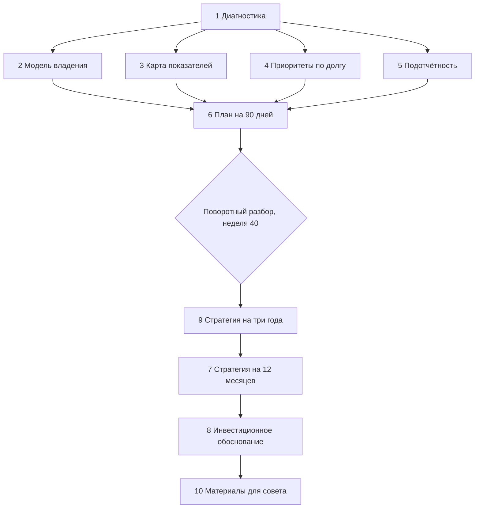
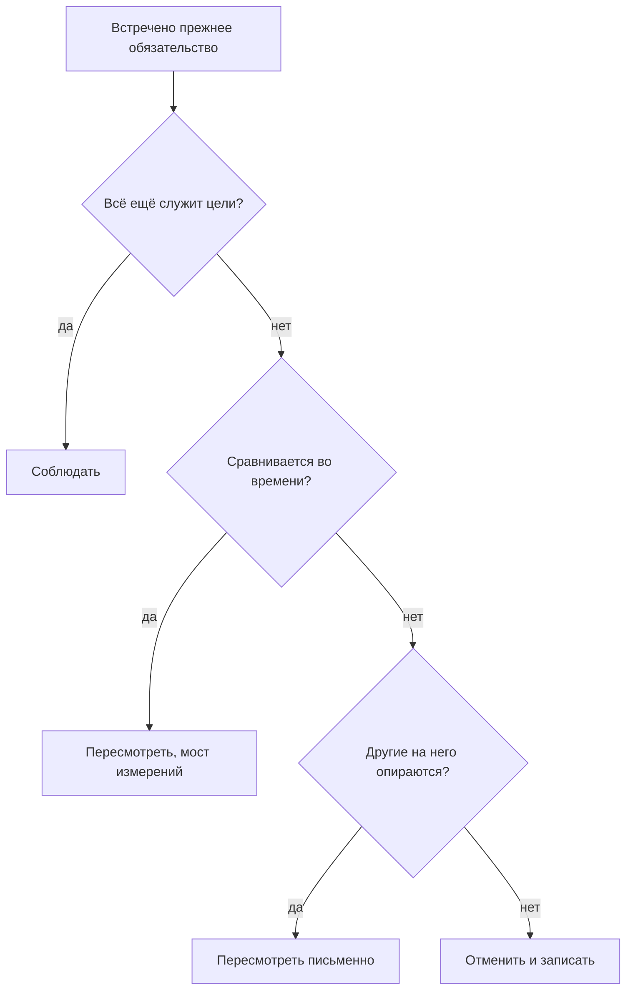

# Глава 60 — Итоговый проект: трансформация Northstar Technologies { #chapter-60-capstone-transforming-northstar-technologies }

В итоговом проекте вы один раз проходите всю работу целиком и по порядку — в Northstar Technologies,
вымышленной компании из [кейса](../../case-studies/northstar/index.md). Этапов десять. Сначала вы —
новый директор по разработке: диагностируете организацию, проектируете модель владения, карту
показателей (scorecard), приоритеты по техническому долгу и систему подотчётности, пишете план на
90 дней. Затем, в квартале 4 того же года, вы занимаете место Victor Lindqvist, CTO (технического
директора). С этого места вы пишете стратегию на 12 месяцев, инвестиционное обоснование, трёхлетнюю
технологическую стратегию и материалы для совета директоров.

Большинство этапов опирается на главу, шаблон или проект, и эта глава их не повторяет. Она добавляет
то, чего не может показать ни один отдельный проект: как определение, выбранное на неделе 2,
предопределяет, что можно будет сказать совету директоров на неделе 50. Итоговый проект — самая
большая работа в книге, около 75–100 часов. Он подходит для учебной группы или для задания на
развитие, рассчитанного на несколько недель. Порядок работы, часы и критерий завершения приведены в
разделе «Как проходить итоговый проект» практического плейбука.

## Почему это важно { #why-this-matters }

В команде решения живут недолго, и их последствия видны, пока вы ещё помните, как их принимали.
Рабочее соглашение на спринт проверяется за две недели.

В организации ранние документы директора переживают контекст, в котором были написаны. Определение
серьёзности, написанное ради проблемы недели 4, через три квартала становится входными данными для
людей, которые ни разу не видели, как его выводили. Документы, которые после утверждения считают
законченными, со временем начинают противоречить друг другу.

На уровне высшего руководства эти противоречия доходят до тех, кто распоряжается деньгами. Член совета
директоров спрашивает, означает ли показатель одно и то же каждый квартал, а по сути это вопрос о
выборе, сделанном в первый месяц. Либо у CTO есть записи, связывающие неделю 50 с неделей 4, либо ему
приходится восстанавливать связь на ходу, отвечая на вопросы.

## Цели главы { #learning-objectives }

Пройдя итоговый проект, вы сможете:

- Диагностировать организацию из 80 инженеров по её данным и интервью и закрепить правила подсчёта, от
  которых будут зависеть все дальнейшие сравнения.
- Подготовить модель владения, карту показателей, приоритеты по долгу, схему подотчётности и план на
  90 дней так, чтобы они передавали результаты друг другу без противоречий.
- Вести реестр обязательств и честно проверить его в поворотной точке (hinge), оценивая прежние решения
  по тому, что было известно тогда, а не по тому, чем они обернулись.
- Продолжить работу директора с места CTO: написать стратегию на 12 месяцев, инвестиционное обоснование
  и трёхлетнюю технологическую стратегию, сведённые к одним рамкам ресурса.
- Донести результат до совета директоров так, чтобы вопрос каждого его члена прослеживался до
  записанного решения.

## Ментальная модель { #the-mental-model }

> **Ментальная модель:** каждый ваш артефакт — обязательство перед вами в будущем и перед всеми, кто
> будет на нём строить. Последующие этапы должны либо соблюдать каждое обязательство, либо письменно его
> пересматривать, а всё, что сравнивается во времени, — пересматривать с мостом измерений (measurement
> bridge: старое и новое определения показывают рядом). Трансформация связна, если её документы можно
> прочитать подряд без противоречий, и хрупка, если каждый был верен только в день утверждения.

Каждый этап использует результаты предыдущих и ограничивает последующие. Схема показывает зависимости,
а таблица называет нити, которые проходят через все десять этапов.

| Нить | Возникает на | Проверяется на | Что ломается, если её бросить |
|---|---|---|---|
| Правила подсчёта (серьёзность, список tier 1, длина квартала, доля неудачных изменений) | Этап 1 | Этапы 3, 10 | Утверждения для совета о динамике от квартала к кварталу невозможно защитить |
| Владение компонентами и исключения | Этап 2 | Этапы 7, 9 | Модуль tier 1 незаметно остаётся без владельца, а все документы исходят из того, что владелец есть |
| Ресурс на профилактику | Этап 6 | Этапы 7, 8, 9 | Программу урезают измором, по одному запросу за раз |
| Оценённый долг и проценты | Этап 4 | Этапы 8, 9 | Инвестиционному обоснованию нечем оценить проценты |
| Права на решения, включая права CTO | Этап 5 | Этапы 9, 10 | Незаписанные вердикты, которые более поздней стратегии приходится отменять |

Обратите внимание: на схеме этап 9 идёт раньше этапа 7. В квартале 4 Victor пишет черновик трёхлетней
стратегии на неделе 47, а на неделе 48 проверяет его на премортеме. Стратегия на 12 месяцев — слой
года 2 той же стратегии, поэтому её пишут после. Если писать план на год 2 без трёхлетней рамки,
получатся политики, которые ничего не решают: над ними нет ничего, что говорило бы, что важнее всего.

## Подробный разбор { #deep-conceptual-explanation }

### Что интеграция добавляет к проектам { #what-integration-adds-to-the-projects }

Каждый проект фиксирует один момент и выдаёт вам прежние решения готовыми, поэтому сбоев интеграции
внутри него не видно. В итоговом проекте у вас нет ничего, кроме того, что вы сделали сами. Если ваш
расчёт доли неудачных изменений с этапа 1 ломается, когда релизы становятся еженедельными, проблема по
наследству переходит к карте показателей этапа 3 и к странице для совета на этапе 10. Rumelt
утверждает, что действия, из которых состоит стратегия, должны быть согласованными, то есть
поддерживать друг друга ([Rumelt, 2011](../../references/bibliography.md#rumelt2011good); **мнение
эксперта**). Итоговый проект применяет эту проверку к документам руководителя за целый год.

За год документы растаскивают в разные стороны две силы. Первая —
[ловушка возможностей](../../glossary.md#capability-trap): если урезать время на улучшения ради
сегодняшнего спроса, возможности деградируют, а руководители потом списывают это на недостаток усилий
([Repenning and Sterman, 2001](../../references/bibliography.md#repenning2001nobody); **научный
результат**, в основном за пределами разработки ПО). В Northstar выделение на профилактику снижается с
12 FTE в квартале 1 до 8 в квартале 3, а продолжение предлагает 6, а затем 5. Каждый шаг можно
обосновать, но вместе они и есть ловушка, если не привязать каждый к данным о том, что возможности
сохраняются. Вторая сила — эскалация приверженности (escalation of commitment), склонность продолжать
финансировать курс, выбранный самим; этой идеей известен Staw
([Staw, 1976](../../references/bibliography.md#staw1976knee); **мнение эксперта**). А на этапах CTO
автор этапа 6, которого вы оцениваете, — это вы сами.

### Непрерывность измерений { #measurement-continuity }

Карта показателей сравнивает кварталы. Чтобы сравнение имело смысл, определение, совокупность и период
должны оставаться прежними или меняться с мостом измерений. Руководство DORA предупреждает: если
превратить её метрики поставки в цели, это провоцирует подгонку
([DORA metrics guide](../../references/bibliography.md#dora-metrics-guide); **отраслевое исследование**;
[глава 18](../04-execution/18-measuring-engineering-productivity.md)).

Итоговый проект добавляет одно обязательство: определение, выбранное на этапе 1, — это обещание о том,
что можно будет сказать на этапе 10. В хронике Northstar есть четыре места, где этим обещанием
приходилось управлять:

| Показатель | Что изменилось | Применённое правило и его эффект |
|---|---|---|
| Серьёзность | Новые определения на неделе 3 переоценивают исходный уровень с 7 Sev1 и 23 Sev2 до 9 и 21 | Сообщать сумму (30, без изменений) и хранить обе разбивки, чтобы никто не принял переоценку за изменение |
| Доля неудачных изменений Core | На неделе 5 релизы стали еженедельными вместо двухнедельных | Считать только еженедельные релизы: квартал 1 — 2 неудачных из 9 (22 процента). Исходные 31 процент получены при старом ритме, поэтому их сравнивают только с этой оговоркой |
| Список tier 1 | 15 компонентов в году 1, 14 в году 2 | Сравнения внутри года 1 сохраняют исходные 15; год 2 начинает новый ряд |
| Длина квартала | 90 дней в исходном квартале, 91 с квартала 1 | Допуски по доступности рассчитываются по собственной длине каждого периода, чтобы более длинный квартал не выглядел хуже |

Если не завести такие правила на этапе 1, нужда в них обнаружится на этапе 10 — перед председателем
[комитета по аудиту](../../glossary.md#audit-committee).

### Как судить о прежних этапах без ошибки оценки по результату { #judging-earlier-stages-without-outcome-bias }

Между этапами 6 и 7 вы проверяете свою директорскую работу по итогам кварталов 1–3. Опасность здесь —
судить о решениях по результатам. В исследованиях Baron и Hershey люди, располагая одной и той же
информацией, считали одно и то же решение более продуманным, если его исход был хорошим
([Baron and Hershey, 1988](../../references/bibliography.md#baron1988outcome); **научный результат**,
на студентах, оценивавших медицинские решения и азартные игры). Это ошибка оценки по результату
(outcome bias). Пробный камень — проверка миграций, обещанная к неделе 7 после INC-427 (инцидента
исходного квартала, в котором релиз Core дважды применил кредит-ноты). Срок проверки сдвинулся, и на
неделе 9 Sev1 в Billing повторил тот же сбой. Плохим ли было решение назначить проверку на неделю 7,
зависит от того, что было известно в момент обещания.

Поэтому в поворотной точке о каждом обязательстве задают три вопроса. Было ли оно разумным при том, что
было известно тогда? Соблюдено оно, пересмотрено или брошено? Какой урок оно даёт для следующего
обязательства такого рода?

## Пример из инженерной организации { #engineering-organization-example }

!!! info "Northstar: что уже известно"
    Пример охватывает период от исходного квартала до недели 48. К кварталу 3 число инцидентов Sev1 и
    Sev2 снизилось с 30 до 14 в квартал, а доля незапланированной работы — с 34 до 25%; на профилактику
    ушло 8 FTE. Все решения квартала 4 пока открыты. См.
    [хронологию](../../case-studies/northstar/timeline.md). Впервые читаете о Northstar? Прочитайте
    [«Год вкратце»](../../case-studies/northstar/year-in-brief.md),
    [действующих лиц](../../case-studies/northstar/cast.md) и
    [брифинг квартала 4](../../case-studies/northstar/quarter-4-briefing.md).

Что значит интеграция в цифрах, показывает одна нить, прослеженная через этапы: ресурс, который
Northstar тратит на профилактику, и ресурс, который она получает обратно. Все цифры — **иллюстрация**,
значения взяты из кейса. Термины знакомы по прежним главам:

| Термин | Значение здесь |
|---|---|
| [FTE](../../glossary.md#fte) и [FTE-квартал](../../glossary.md#fte-quarter) | Полные ставки инженеров; один FTE-квартал стоит $185,000 ÷ 4 = $46,250 |
| [Выделение на профилактику](../../glossary.md#prevention-allocation) | Ресурс, зарезервированный под работу, которая не даёт инцидентам повторяться |
| [Незапланированная работа](../../glossary.md#unplanned-work) | Инциденты, прерывания и срочные исправления как доля ресурса |
| Актуальность ландшафта | Поддержание фреймворка и библиотек Core в актуальном состоянии; строка в черновике Victor ([глава 51](../12-cto-leadership/51-enterprise-technology-strategy.md#engineering-organization-example)) |
| [Горизонт 2 и горизонт 3](../../glossary.md#horizons) | Горизонт 2 расширяет бизнес на новых клиентов или рынки; горизонт 3 создаёт опционы на будущее |
| Правило на случай стресса | Правило Victor из премортема недели 48 (сессии, на которой представляют, что план уже провалился): перерасход на незапланированную работу покрывается из горизонта 2 и никогда — из профилактики или горизонта 3 |
| Строка-амортизатор | Строка распределения, которая отдаёт ресурс, когда число мест сокращается |

| Момент | Документ | Профилактика | Незапланированная работа |
|---|---|---|---|
| Исходный квартал | Диагностика (этап 1) | не финансировалась | 34% от 80 = 27.2 FTE |
| Неделя 4 | План на 90 дней (этап 6) | 12 FTE | 31% в квартале 1 |
| Недели 27–39 | План квартала 3 | 8 FTE | 22% по плану, 25% фактически (20 FTE) |
| Неделя 45 | Предложение о продолжении | 6 FTE в кварталах 5–6, 5 в кварталах 7–8 | не более 18% к этапу 3 продолжения |
| Неделя 47 | Трёхлетний черновик (этап 9) | 5.5 FTE в году 2 | 22% от 79 = 17.4 FTE |

**Согласуется ли продолжение с трёхлетним черновиком?** Да. Продолжение закладывает 6, 6, 5 и 5 FTE, в
среднем 5,5 — ровно столько, сколько стоит в строке профилактики года 2 в черновике, хотя документы
писали разные авторы с разницей в две недели. Именно такой проверки итоговый проект требует при каждой
передаче.

**Окупает ли себя программа?** Если считать только ресурс, пока не совсем; с учётом сервисных кредитов —
безусловно (расчёт приведён в
[главе 59](../13-advanced-problems/59-transformation-under-constraint-and-scaling-without-bureaucracy.md#engineering-organization-example)).
В инвестиционном обосновании на этапе 8 должны стоять обе строки.

**Выдержат ли рамки года 2 плохой квартал?** Черновик Victor распределяет 79 инженеров по семи строкам:

| Строка | Год 2 (FTE) |
|---|---|
| Незапланированная работа (22%) | 17.4 |
| Профилактика | 5.5 |
| Платформа | 4.5 |
| Актуальность ландшафта | 2.0 |
| Продукт для нынешних клиентов | 37.6 |
| Горизонт 2 | 10.0 |
| Горизонт 3 | 2.0 |

Если год 2 пойдёт с фактическими 25% квартала 3, незапланированная работа составит 19,75 FTE, на 2,35
больше плана, и по правилу на случай стресса горизонт 2 сократится с 10,0 до 7,65 FTE. Поэтому уже в
обязательствах этапа 7 перед Amara Okafor (CPO) горизонт 2 должен быть показан как амортизатор. Иначе
первый же плохой квартал будет выглядеть как нарушенное обещание.

**Сколько мест?** Черновик исходит из 79 инженеров, но открытые решения допускают от 77 до 80. Всего у
Northstar 87 [мест](../../glossary.md#seat) (профинансированных позиций), и каждый добавленный
руководитель или VP of Engineering занимает место, которое иначе занял бы инженер:

| Вариант (неделя 44) | Что меняется | Инженеров | С VP |
|---|---|---|---|
| Предложение | Customer Experience делится на веб- и мобильную команды; 7 руководителей | 79 | 78 |
| Альтернатива B | Customer Experience остаётся целой; 6 руководителей | 80 | 79 |
| Альтернатива C | Orders тоже делится; 8 руководителей | 78 | 77 |
| Альтернатива D | Два руководителя руководителей вместо VP; 9 руководителей | 77 | не сочетается |

Источники:
[предложение](../../case-studies/northstar/first-quarter.md#the-year-2-organization-proposal-week-44) и
[глава 47](../11-vp-engineering/47-the-vp-of-engineering.md). Черновик не называет строку-амортизатор.
В своей работе покажите рамки при 80, 79 и 78 инженерах и назовите строку, которая отдаёт ресурс, если
число упадёт до 77.

## Как принимать решение { #decision-framework }

На каждом этапе вам будут встречаться обязательства, взятые раньше — вами или в кейсе. По каждому явно
решите, что с ним делать. Схема ниже — рекомендация книги.

**Мост измерений** показывает старое и новое определения рядом хотя бы за один период. Так Northstar
поступает со списком tier 1: в подсчётах года 1 остаются исходные 15 компонентов, а в отчётах года 2 — 14.
**Пересмотреть письменно** — значит внести изменение вместе с причиной в
[журнал решений](../../glossary.md#decision-log) и сообщить об этом тем, кто опирался на прежнюю
версию. **Отменить и записать** — значит снять обязательство намеренно, а не дать ему истечь.
Исключение для core/permissions в кейсе — пример того, как обязательство просто истекает.

Прежде чем считать работу законченной, прогоните весь портфель через проверки из таблицы. Каждая либо
пройдена, либо нет.

| Проверка | Пройдена, если |
|---|---|
| Прослеживаемость | Каждое число на этапах 7–10 прослеживается до цифры из кейса, до определения, записанного на этапе 1 или 3, или до явного допущения |
| Одни рамки | Этапы 7, 8 и 9 используют одну и ту же таблицу ресурса на год 2 при 80, 79 и 78 инженерах и называют строку, которая отдаёт ресурс при 77 |
| Замкнутость владения | Каждый компонент встречается в реестре этапа 2 ровно один раз или имеет исключение с владельцем его истечения |
| Никаких тихих пересмотров | Каждое обязательство в реестре помечено как соблюдённое, связанное мостом, пересмотренное письменно или отменённое |
| Правило времени | Ни один этап не использует факт, датированный позже своего момента; допущения помечены как ваши |
| Открытое остаётся открытым | Работа занимает позиции по решениям квартала 4, но не записывает никаких исходов и показывает, как меняется каждая позиция при других исходах |
| Ресурс и деньги отдельно | Каждая цифра ресурса тоже оценена в деньгах, а перераспределённый ресурс никогда не показан как новые расходы |

## Компромиссы { #trade-offs }

**Последовательность или обучение.** Если соблюдать каждое раннее обязательство, вы ничему не
научитесь; если свободно всё пересматривать, сравнивать будет нечего. Мост измерений даёт и то и
другое, а цена этому — квартал, за который приходится
показывать два числа.

**Полнота или время.** Велик соблазн написать этапы 1–6 скупо, а этапы CTO — развёрнуто. Но этапы
для совета хороши ровно настолько, насколько хороши определения и владельцы, на которых они стоят. Если
приходится сокращать, сокращайте объём этапов CTO, а не строгость этапов директора.

**Опора на кейс или рассуждение с нуля.** Хроника Northstar — один разобранный ответ. Скопировав его,
вы получите баллы за согласованность, но провалитесь на суждении; отойдя от него без причин, провалитесь
и там, и там.

**Точность или честность насчёт скудных данных.** Ряд показателей Northstar опирается на выборки или на
пробу в одном регионе. Лучше несколько показателей, названных вместе с их слабостями, чем страница,
которую никто не сможет защитить.

## Типичные провалы { #failure-modes }

**Портфель, сшитый степлером.** Десять артефактов, каждый по отдельности разумен, а вместе они
противоречат друг другу: карта показателей считает 15 компонентов tier 1, а стратегия — 14, и ни один
документ не объясняет почему. Сюда же относится показатель, который меняет смысл, а линия его тренда
при этом продолжается. Как заметить: два документа дают разные цифры для одного и того же, и ни один не
упоминает другой.

**Обязательство-сирота.** Раннее обещание не упоминает ни один последующий документ, и оно незаметно
истекает, как исключение для core/permissions в кейсе. Как заметить: запись в реестре с датой
истечения, но без владельца этого истечения.

**Утечка знания задним числом.** Артефакт этапа директора опирается на факты из более поздней части
истории, например на долю исправленных заказов (неделя 40) или на таблицу знаний по Orders
(неделя 14). Такой документ хорошо читается, но ничему не учит. Как заметить: документ недели 4 в
точности предвидит то, что произошло.

**CTO делает работу директора.** Сидя на месте Victor, вы построчно переписываете организацию года 2
или продолжение, вместо того чтобы решать вопросы, которые может решить только CTO. Как заметить:
этап 7 длиннее рассматриваемых в нём документов директора и не содержит ни одного запроса на решение.

**Поворотный разбор с оценкой по результату.** Разбор недели 40 хвалит каждое решение, которое
сработало, и осуждает каждое, которое не сработало. Как заметить: ни одно решение не описано как
«разумное, но обернулось плохо» или «повезло».

## Применение в крупной организации { #enterprise-application }

Метод итогового проекта переносится на любую реальную организацию из 50–150 инженеров.

- **Ведите реестр обязательств** рядом с журналом решений. Вносите в него каждое определение, список,
  распределение, исключение и назначение владельца, на которые опирается дальнейшая работа, — с
  автором, датой и условием пересмотра. За год вполне хватит пятидесяти записей.
- **Проводите разбор в поворотной точке дважды в год,** перед циклом планирования. Помечайте каждую
  запись реестра: соблюдено, связано мостом, пересмотрено письменно, пересмотрено тихо или осиротело.
  Записи с двумя последними статусами и есть замечания аудита.
- **Записывайте правила подсчёта в первый месяц.** Тогда они обходятся в полдня работы, а позже — в
  заседание совета директоров.
- **Сделайте одну таблицу ресурса единым источником** для всех документов планирования в течение года.
- **Используйте итоговый проект как задание на развитие** для руководителя, который готовится к роли
  директора: примените десять этапов к прошлому году своей организации и проверьте поворотный разбор на
  ошибку оценки по результату.

## Взгляд CTO { #cto-perspective }

С места CTO документы директора — входные данные, а работа CTO — спросить, сходятся ли они. На столе у
Victor в квартале 4 лежат восемь документов, от предложения по организации на год 2 до черновика
[реестра рисков](../../glossary.md#risk-register) и его собственного трёхлетнего черновика. Каждый
написан компетентным человеком, но ни один не писали с оглядкой на остальные, и число мест в них
колеблется от 77 до 80.

Особый вклад CTO — рамка, которая их согласует: бизнес-выборы, которые Helena Marsh (CEO, генеральный
директор) подтвердила на неделе 46, группы и политики из черновика Victor недели 47 и одни рамки
ресурса на год 2. Сюда же относятся собственные записи CTO: в кейсе Victor письменно отменяет свою
прежнюю реплику, и это сохраняет доверие к записям.

В крупной компании нити превращаются в политики. В Halvard Systems, вымышленной компании книги на
500 инженеров ([Halvard](../../case-studies/northstar/halvard.md)), шесть корпоративных политик, и
каждой владеет principal-инженер, потому что ни один реестр не вместил бы всех нитей компании.

## Практический плейбук { #practical-playbook }

### Как проходить итоговый проект { #how-to-work-through-the-capstone }

**Для кого эта работа и что значит «готово».** Пишите для читателя, который может возразить: ментора,
своего руководителя или учебной группы, которая собирается после каждого блока этапов. Если работаете
в одиночку, считайте читателем себя в будущем и назначьте дату проверки. Работа готова, когда выполнены
четыре условия: каждый этап отвечает своему критерию «Достаточно, если» из таблицы ниже; у каждой
записи реестра есть статус; двухстраничная записка об интеграции написана; все семь проверок из раздела
«Как принимать решение» пройдены. Для калибровки используйте
[пособие по оценке](../../solutions/ch60-solutions.md#grading-aid-for-the-ten-stages), где для каждого
этапа даны отличный, приемлемый и слабый ответы, и
[образец страницы этапа 1](../../solutions/ch60-solutions.md#sample-stage-1-trust-table-and-counting-rules).

**Что прочитать заранее.** Сначала прочитайте [обзор Northstar](../../case-studies/northstar/index.md),
[действующих лиц](../../case-studies/northstar/cast.md) и
[хронологию](../../case-studies/northstar/timeline.md). Итоговый проект опирается на четыре проекта:

| Проект | Питает | Если вы его не делали |
|---|---|---|
| [P3: план качества](../../projects/p3-quality-transformation-plan.md) | Этапы 1, 3, 6 | Сначала выполните его базовую версию (около 10–12 часов) |
| [P5: карта показателей](../../projects/p5-delivery-and-reliability-scorecard.md) | Этап 3 | Пропустите; этап 3 остаётся на одной странице |
| [P7: стратегия на 12 месяцев](../../projects/p7-twelve-month-engineering-strategy.md) | Этап 7 | Пропустите; этап 7 сводится к рамкам ресурса и судьбе каждой записи реестра |
| [P8: инвестиционное предложение](../../projects/p8-cto-technology-investment-proposal.md) | Этап 8 | Выполните его базовую версию или оцените только трёх кандидатов |

**Короткий путь.** Если 75–100 часов у вас нет, сохраните все этапы, но сожмите их. Ограничьте этапы 2
и 4 десятью самыми важными записями, этап 9 — двумя страницами (группы, политики, колонка года 2), а
этап 8 — тремя кандидатами. Правила подсчёта этапа 1, поворотный разбор и записку делайте в полном
объёме: на них держится интеграция. Короткий путь занимает около 45–55 часов.

**Порядок работы.** Номера этапов отражают логику истории, а порядок работы определяют даты.

1. Этап 1, диагностика (недели 1 и 2). В конце недели 2 напишите первый черновик этапа 6:
   одностраничный список направлений работ и запросов на решения, которые будут профинансированы при
   пересмотре на неделе 4.
2. Этапы 2, 4 и 5 (недели 3–5), в любом порядке или параллельно.
3. Этап 3, карта показателей (неделя 4): беритесь за него, когда правила подсчёта этапа 1 уже готовы.
4. Этап 6: пересмотр и согласование (неделя 4).
5. Поворотный разбор (неделя 40).
6. Этап 9, затем этап 7 (недели 47 и 48), затем этап 8 (до недели 49), затем этап 10 (до недели 50).
7. Записка об интеграции и проверки из раздела «Как принимать решение».

**Пакет фактов.** Каждый этап может использовать только факты, доступные на его момент. Страницы кейса
делятся на четыре группы:

| Группа | Факты | Где | Доступны |
|---|---|---|---|
| Факты директора | Компания, люди, система, пять ограничений; исходные показатели и три CSV-файла | [Обзор](../../case-studies/northstar/index.md), [исходные данные](../../case-studies/northstar/baseline-data.md), [файлы данных](../../case-studies/northstar/data/components.csv) | Всем этапам, кроме разделов исходных данных, перечисленных ниже |
| Факты поворотной точки | Кварталы 1–3 в [хронике года 1](../../case-studies/northstar/first-quarter.md) (решения, День 90, кварталы 2 и 3), а также разделы исходных данных, перечисленные ниже | [Решения](../../case-studies/northstar/first-quarter.md#decisions-that-hold-for-the-rest-of-the-book), [День 90](../../case-studies/northstar/first-quarter.md#day-90), [квартал 2](../../case-studies/northstar/first-quarter.md#quarter-2), [квартал 3](../../case-studies/northstar/first-quarter.md#quarter-3) | Поворотному разбору и этапам 7–10 |
| Факты CTO | Всё в квартале 4 до недели 48: [брифинг квартала 4](../../case-studies/northstar/quarter-4-briefing.md) и разделы хроники года 1 о квартале 4 | [Календарь](../../case-studies/northstar/first-quarter.md#calendar-of-quarter-4), [предложение](../../case-studies/northstar/first-quarter.md#the-year-2-organization-proposal-week-44) | Этапам 7–10 |
| Неделя 49 | Встреча команды высшего руководства и черновик плана по персоналу | [Стратегия](../../case-studies/northstar/first-quarter.md#three-year-technology-strategy-chapter-51), [календарь](../../case-studies/northstar/first-quarter.md#calendar-of-quarter-4) | Только этапам 8 и 10 |

Всё, что происходит начиная с недели 50, не записано, поэтому ни один этап не может это использовать.

!!! warning "Записи исходных данных, закрытые до поворотной точки"
    На странице исходных данных есть и факты, собранные позже в течение года. На этапах 1–6 пропустите
    эти записи:

    - время staff-инженеров, недели 12–13 ([люди и управление](../../case-studies/northstar/baseline-data.md#people-and-management));
    - карта знаний о ledger ([дежурства Billing и знания о ledger](../../case-studies/northstar/baseline-data.md#billing-on-call-and-ledger-knowledge));
    - причины связей зависимости ([межкомандные зависимости](../../case-studies/northstar/baseline-data.md#cross-team-dependencies));
    - перекодированные уходы ([текучесть](../../case-studies/northstar/baseline-data.md#levels-reviews-promotions-pay-and-attrition));
    - знания по Orders, неделя 14 ([архитектура и технологический ландшафт](../../case-studies/northstar/baseline-data.md#architecture-and-the-technology-estate)).

**Бюджет времени и критерий завершения для каждого этапа.** Часы рассчитаны на то, что вы повторно
используете уже выполненные проекты там, где они есть.

| Этап | Часы | Что сдать | Достаточно, если |
|---|---|---|---|
| 1 Диагностика | 8–10 | 3–4 страницы | Каждое утверждение ссылается на исходный показатель; таблица доверия отмечает, какие показатели вы будете сравнивать; правила подсчёта переживают смену ритма релизов |
| 6 (черновик) | 1–2 | 1 страница | Перечислены направления работ и запросы на решения, распределений ещё нет |
| 2 Владение | 5–7 | Реестр из 24 строк плюс 1 страница | Каждый компонент встречается один раз или имеет исключение; у каждого исключения есть решение, которое его закроет, неделя и владелец истечения |
| 4 Долг | 5–7 | 10–15 оценённых записей плюс 1 страница | У каждой записи есть проценты в инженеро-неделях, инцидентах или долларах; каждая называет владельца решения, а не только кода |
| 5 Подотчётность | 6–8 | 3–4 страницы | В карте прав на решения есть дорожка CTO; у каждого стандарта и корректирующего действия есть владелец |
| 3 Карта показателей | 4–6 | Карта показателей на 1 страницу плюс правила непрерывности | Только исходный уровень, без целей; правило непрерывности для каждой строки; неизмеряемые договорные риски показаны отдельными строками |
| 6 (пересмотр) | 6–8 | 3–4 страницы плюс лист ресурсов | У каждого обязательства этапов 2–5 есть профинансированная строка; у профилактики есть правило снижения; названы следующие роли QA-инженеров |
| Поворотная точка | 4–6 | Пометки в реестре плюс 2 страницы | У каждой записи есть статус; названо одно решение «разумное, но обернулось плохо» и одно «повезло» |
| 9 Стратегия на три года | 8–10 | 4–5 страниц | Каждая политика прослеживается до вывода этапа 1 или записи этапа 4; колонка года 2 совпадает с этапом 7; у опционов есть недели решений |
| 7 Стратегия на 12 месяцев | 6–8 | 3 страницы плюс таблица рамок | Рамки при 80, 79 и 78 с названной строкой, которая отдаёт ресурс при 77; судьба каждой записи реестра |
| 8 Инвестиции | 8–10 | 4 страницы плюс электронная таблица | Точно укладывается в рамки этапа 7; ресурс и деньги в отдельных строках; каждый кандидат связан с записью этапа 4 |
| 10 Совет директоров | 4–6 | 1 страница плюс 1 страница заметок | Вопрос каждого члена совета сопоставлен с артефактом; примечание об измерениях описывает каждый мост измерений; ничего об итогах заседания |
| Записка | 3–4 | 2 страницы | Названы пять нитей, где каждая была соблюдена или пересмотрена, и то обязательство недели 4, которое вы изменили бы |

### Перед началом: правило времени и реестр { #before-you-start-the-time-rule-and-the-register }

1. Соблюдайте пакет фактов: на этапах 1–6 используйте только факты директора.
2. Заведите реестр обязательств с колонками: запись, этап, дата, автор, что от неё зависит, условие
   пересмотра и статус.
3. Если вам нужен факт, которого в кейсе нет, запишите его как своё допущение и укажите значение, при
   котором ваша рекомендация изменилась бы. Никогда не выдавайте его за факт о Northstar.

### Этап 1: диагностика (недели 1 и 2) { #stage-1-diagnosis-weeks-1-and-2 }

- **Подготовьте:** диагноз и формулировку ограничения, то есть результаты 1 и 2
  [проекта 3](../../projects/p3-quality-transformation-plan.md), следуя плану дней 1–15 из
  [главы 27](../05-engineering-quality/27-quality-transformation-at-enterprise-scale.md). Если проект 3
  у вас уже выполнен, возьмите его.
- **Добавьте:** таблицу доверия: для каждого показателя — как он получается, его известная слабость и
  будете ли вы сравнивать его между кварталами. Добавьте правила подсчёта для
  [серьёзности](../../glossary.md#severity-sev1-sev2-sev3), совокупности [tier 1](../../glossary.md#tier-1),
  длины периода и знаменателя [доли неудачных изменений](../../glossary.md#change-failure-rate);
  сформулируйте их так, чтобы они пережили смену ритма релизов.
- **Что передаётся дальше:** каждое правило подсчёта попадает в реестр; на эти правила будут ссылаться
  этапы 3 и 10.

### Этап 2: модель владения (недели 3 и 4) { #stage-2-ownership-model-weeks-3-and-4 }

- **Подготовьте:** реестр владения для всех 24 компонентов из `components.csv`: команда-владелец,
  уровень критичности (tier), четыре операционных минимума и исключение для каждого компонента, которому
  вы не можете назначить владельца. Используйте данные о совместных изменениях и числе мерж-реквестов из
  раздела об архитектуре в исходных данных, а также
  [главы 19](../05-engineering-quality/19-defining-measuring-and-owning-quality.md),
  [20](../05-engineering-quality/20-engineering-standards-and-their-governance.md) и
  [31](../06-technical-leadership/31-service-boundaries-and-ownership.md). Структуру возьмите из шаблона
  [оценки организационного дизайна](../../templates/organizational-design-assessment.md).
- **Добавьте:** для каждого исключения — решение, которое его закроет, неделю, к которой это решение
  нужно принять, и владельца истечения.
- **Что передаётся дальше:** с этим реестром будут сверять предложение недели 44 и продолжение. Не
  перестраивайте здесь команды: структура следует за границами, которые вы только сейчас проводите.

### Этап 3: карта показателей (неделя 4) { #stage-3-scorecard-week-4 }

- **Подготовьте:** карту показателей (результат 3 проекта 3) по шаблону
  [карты показателей инженерного качества](../../templates/engineering-quality-scorecard.md); опубликуйте
  её как исходный уровень, без целей
  ([глава 38](../08-management-operating-system/38-scorecards-quarterly-planning-and-capacity-allocation.md)).
- **Добавьте:** правило непрерывности для каждой строки (что происходит, если меняется её определение,
  совокупность или источник). Добавьте строку для всего, от чего зависят контракты, но что вы пока не
  можете измерить; на исходном уровне сюда входят корректность счетов и мобильный путь.
- **Что передаётся дальше:** этап 10 вынесет четыре-пять строк на уровень совета директоров.

### Этап 4: приоритеты по долгу (недели 3 и 4) { #stage-4-debt-priorities-weeks-3-and-4 }

- **Подготовьте:** оценённый реестр главных записей по шаблону
  [реестра технического долга](../../templates/technical-debt-register.md) и
  [главе 21](../05-engineering-quality/21-technical-debt.md). Начните со списка из 143 пунктов в вики и
  рисков технологического ландшафта из исходных данных: неподдерживаемый фреймворк Core
  (120–180 инженеро-дней), единственный контроллер Jenkins, сервер конфигурации и четыре системы CI, на
  которые уходит примерно 1,5 FTE в год.
- **Добавьте:** [проценты](../../glossary.md#technical-debt-principal-and-interest) в единицах, которые
  сможет повторно использовать этап 8 (инженеро-недели в квартал, инциденты, доллары). Для каждой записи
  назовите решение, которое ей нужно, и того, кто владеет этим решением, а не только кодом.
- **Что передаётся дальше:** записи вернутся в квартале 4 как кандидаты на инвестиции и риски;
  неоценённые записи заставят этап 8 брать цифру из допущения.

### Этап 5: схема подотчётности (недели 3–5) { #stage-5-accountability-design-weeks-3-to-5 }

- **Подготовьте:** определения серьёзности, пул
  [координаторов инцидентов](../../glossary.md#incident-commander), корректирующие действия с
  владельцами-руководителями, владельцев стандартов, мандаты для трёх staff-инженеров и карту
  [прав на решения](../../glossary.md#decision-rights). Опирайтесь на
  [главы 25](../05-engineering-quality/25-incidents-postmortems-and-change-failure-analysis.md),
  [29](../06-technical-leadership/29-staff-and-principal-engineers.md) и
  [39](../08-management-operating-system/39-reviews-decision-logs-escalation-and-executive-reporting.md),
  а также на шаблоны [разбора инцидента](../../templates/incident-review.md) и
  [записи архитектурного решения](../../templates/architecture-decision-record.md).
- **Добавьте:** дорожку CTO на карте прав на решения. В исходных данных записано, что споры доходили до
  Victor в разговорах. Предложите, какие технические решения остаются за ним, какие идут через директора
  и как фиксируются и те и другие.
- **Что передаётся дальше:** на этапе 10 вам нужно ответить Anders Holm (председателю совета
  директоров) на вопрос, не зависят ли достижения от нескольких человек. Ответ дают эта схема и таблица
  преемственности недели 44 из
  [главы 36](../07-organization-design/36-reorganizations-evolution-and-succession.md).

### Этап 6: план на 90 дней (черновик — неделя 2, пересмотр и согласование — неделя 4) { #stage-6-the-90-day-plan-draft-week-2-revised-and-agreed-week-4 }

- **Подготовьте:** результаты 4–6 проекта 3 по шаблонам
  [90-дневного плана трансформации качества](../../templates/ninety-day-quality-plan.md) и
  [модели планирования ресурсов](../../templates/capacity-planning-model.md). Включите направления работ
  с ответственными, выделение на профилактику по командам, следующие роли QA-инженеров, риски с заранее
  согласованными ответами и запросы на решения к Victor и Amara.
- **Добавьте:** в пересмотре недели 4 — профинансированную строку для каждого обязательства этапов 2–5.
  Пункты этапа 5, которые завершаются на неделе 5, включите как профинансированные намерения. Добавьте
  правило снижения для профилактики: какие данные позволяют её сократить и до какого уровня. Тогда
  последующие сокращения станут решениями по правилу, а не уступками измору.
- **Что передаётся дальше:** первая запись в нити профилактики, которую этап 7 продолжит или завершит.

### Поворотная точка: аудит обязательств (неделя 40) { #the-hinge-commitment-audit-week-40 }

Теперь прочитайте факты поворотной точки. Для каждой записи реестра, а также для решений, которые в
самом кейсе приняты на неделе 4, напишите: было ли решение разумным при том, что было известно тогда;
каков его статус к неделе 40 (соблюдено, связано мостом, пересмотрено письменно, пересмотрено тихо,
осиротело); какой урок оно даёт для следующего обязательства такого рода. Назовите хотя бы одно
решение, которое было разумным и обернулось плохо, и одно, которое сработало отчасти благодаря везению.
Сравните своё распределение на этапе 6 с распределением кейса и скажите, какое из них вы стали бы
защищать теперь.

### Этап 9: трёхлетняя технологическая стратегия (недели 47 и 48) { #stage-9-three-year-technology-strategy-weeks-47-and-48 }

С этого момента вы на месте Victor. Прежде чем начать, прочитайте
[брифинг квартала 4](../../case-studies/northstar/quarter-4-briefing.md).

- **Подготовьте:** свою версию черновика Victor недели 47 по
  [главе 51](../12-cto-leadership/51-enterprise-technology-strategy.md). Распределите возможности по
  группам «отлично», «достаточно», «покупать» и «не делать»; напишите три-четыре политики, распределение
  на годы 2–4, опционы с неделями решений и премортем.
- **Добавьте:** для каждой возможности из группы «отлично» и каждой политики покажите, к какому выводу
  этапа 1 или записи этапа 4 они восходят. Взгляд на риски постройте по
  [главе 53](../12-cto-leadership/53-risk-governance-regulation-and-security-strategy.md) и шаблону
  [реестра рисков](../../templates/risk-register.md).
- **Факты:** факты CTO. Встреча недели 49 и ответ совета директоров на неделе 50 недоступны.
- **Что передаётся дальше:** колонка года 2, с которой должен совпасть этап 7.

### Этап 7: стратегия на 12 месяцев (неделя 48) { #stage-7-12-month-strategy-week-48 }

- **Подготовьте:** слой года 2 той же стратегии по методу проекта 7 и шаблону
  [инженерной стратегии](../../templates/engineering-strategy.md).
- **Добавьте:** для каждой записи реестра — её судьбу в году 2 (продолжить, завершить, передать
  владельцу политики). Добавьте одну таблицу рамок ресурса при 80, 79 и 78 инженерах и назовите строку,
  которая отдаёт ресурс, если число упадёт до 77. Перечислите документы на вашем столе, которые должны
  измениться, чтобы согласоваться с этой таблицей.
- **Факты:** факты CTO, включая премортем недели 48 с правилом на случай стресса и строкой о людях.
  Результатов квартала 4 ещё нет.
- **Допущение:** кейс не записывает решение Victor по организации на неделе 46. Как своё допущение
  укажите, приняли вы это решение или отложили его, и покажите рамки при альтернативах. Все более поздние
  решения остаются открытыми.
- **Что передаётся дальше:** рамки становятся ограничением для этапа 8 и строкой ресурса для этапа 10.

### Этап 8: инвестиционное обоснование (недели 47–49) { #stage-8-investment-case-weeks-47-to-49 }

- **Подготовьте:** портфель
  [проекта 8](../../projects/p8-cto-technology-investment-proposal.md): для каждого кандидата —
  [бизнес-кейс инвестиций в технологии](../../templates/technology-investment-business-case.md) и
  оценку по
  [главе 45](../10-business-leadership/45-business-models-and-engineering-economics.md), то есть
  [стоимость задержки (cost of delay)](../../glossary.md#cost-of-delay).
- **Добавьте:** для каждого кандидата — запись реестра этапа 4, из которой он вырос, и цифру процентов,
  которую он использует. Если на этапе 4 цифру не записали, укажите допущение, которое делаете теперь, и
  его точку безубыточности. Подгоните пакет точно под рамки этапа 7.
- **Факты:** факты CTO и неделя 49, которая расширяет правило недели 47 из проекта 8. Отметьте каждую
  цифру, которая из-за этого меняется.
- **Что передаётся дальше:** требование к рамкам, которые утверждает совет директоров: что они должны
  вмещать, чтобы пакет в них уложился.

### Этап 10: коммуникация с советом директоров (недели 48–50) { #stage-10-board-communication-weeks-48-to-50 }

- **Подготовьте:** страницу о разработке в плане года 2 для совета директоров и свои заметки к
  обсуждению стратегии по
  [главе 55](../12-cto-leadership/55-boards-due-diligence-and-executive-decision-making.md) и шаблону
  [отчёта для руководства](../../templates/executive-update.md).
- **Добавьте:** таблицу, где заявленный вопрос каждого члена совета сопоставлен с этапом, чей артефакт
  на него отвечает. Добавьте примечание об измерениях: каждый мост измерений и каждое правило
  непрерывности, которые понадобятся члену совета.
- **Факты:** факты CTO и неделя 49. [Пакет для совета директоров](../../glossary.md#board-pack)
  рассылают в конце недели 49. Ничего не пишите об итогах заседания.

### Как собрать работу { #assembling-the-submission }

Передайте читателю десять артефактов, реестр с пометками поворотной точки и двухстраничную записку об
интеграции. В записке назовите пять нитей и для каждой укажите, где она была соблюдена или пересмотрена,
а также одно раннее обязательство, которое вы изменили бы, исходя из того, что было известно на
неделе 4. Затем пройдите проверки из раздела «Как принимать решение».

## Кейс { #case-study }

Эти события — **иллюстрация** и вымысел; они взяты из
[исходных данных](../../case-studies/northstar/baseline-data.md) и
[хроники года 1](../../case-studies/northstar/first-quarter.md). Кейс прослеживает две нити от первого
месяца директора до стола CTO в квартале 4. Ни у одной нет записанного итога.

**Нить первая: core/permissions.** Core — монолит Northstar на Java, а core/permissions — один из его
модулей. В исходном квартале модуль меняли 38 мерж-реквестов: 17 из них от Orders и ни одного от
Platform Operations. На неделе 4 выбор между этими двумя командами оставили открытым, прикрыв модуль
записанным исключением. У обеих команд были доводы, основанные на том, что было известно на неделе 4.
Orders вносила больше всего изменений, но несла обязательство по продлению. Platform Operations брала
на себя соседний auth-svc, но ни один из её инфраструктурных инженеров никогда не менял код Core.

В квартале 2 профинансировали выделение permissions, и Priya Raman (руководитель Orders) сказала, что
примет модуль после недели 26. На неделе 39 исключение достигло предельного срока в два квартала и
истекло без продления: владельца его истечения никто не назначил. На неделе 44 предложение по
организации на год 2 передало core/permissions команде Orders: это был первый документ, который решил
вопрос. Решение Victor ожидалось на неделе 46, но не записано.

С точки зрения итогового проекта выбор на этапе 2 был разумным, а провалилась передача дальше.
Исключение было обязательством с датой, но без владельца даты, поэтому ни один последующий документ не
был обязан о нём упоминать.

**Нить вторая: [ADR-0001](../../glossary.md#adr-0001).** На неделе 14 Li Na Zhou (staff-инженер,
данные и интеграции) открыла первую в Northstar запись архитектурного решения: как интеграциям читать
проведённые данные ledger. Вариантов было три:

| Вариант | Готов к |
|---|---|
| Читать таблицы | Неделя 19 |
| Версионированный контракт экспорта (5 из 6 зарезервированных инженеро-недель Billing) | Неделя 19 |
| События проводок ledger | Примерно неделя 24 |

Она рекомендовала контракт. Victor мимоходом сказал Elena Sokolova (руководитель Payments and
Integrations): «Читайте таблицы сейчас, а порядок наведёте потом». Прав на решения никто не описал. На
неделе 19 интеграция с бухгалтерской системой заработала с ежедневной сверкой, а путь чтения ledger так
и не назвали. ADR-0001 осталась открытой.

К неделе 41 цена стала видна: 29 из 46 ночных пайплайнов хранилища данных читали таблицы Core напрямую,
и семь из 11 неудачных или частичных загрузок квартала 3 объяснялись изменениями схемы Core. На
неделе 47 трёхлетний черновик Victor ввёл политику: денежные данные передаются по контракту или через
события, никогда через таблицы. Черновик прямо называет это отменой реплики Victor недели 14 и
предлагает решить ADR-0001 к неделе 60.

С точки зрения итогового проекта поймать эту нить можно было на карте прав на решения этапа 5: карта с
дорожкой CTO превратила бы реплику либо в записанное решение, либо вообще не в решение. Письменная
отмена, которую сделал Victor, — правильный способ всё починить: записи становятся согласованными до
того, как совет директоров увидит стратегию.

**Что общего у двух нитей.** Обе начались с разумного выбора, а потом поплыли: у следующего шага
обязательства не было владельца. Кейс оставляет обе нити открытыми. В своей работе займите позицию по
каждой и скажите, как она изменилась бы при другом исходе.

## Упражнения { #exercises }

Разборы упражнений: [решения к главе 60](../../solutions/ch60-solutions.md). Основная работа итогового
проекта — этапы из практического плейбука; эти упражнения тренируют интеграцию между ними. Сценарии с
пометкой «гипотетически» предназначены для практики и не входят в хронику Northstar.

### Базовый уровень { #foundational }

**F1.** Пользуясь только фактами директора из пакета фактов (правило времени для этапов 1–6), напишите
первые десять записей своего реестра обязательств: определения, списки, правила и распределения, которые
вы зададите на этапах 1–3. Для каждой назовите более поздний этап, который будет на неё опираться. Затем
выберите три записи, которые, по-вашему, вероятнее всего придётся пересмотреть в течение года, и
напишите для них мосты измерений уже сейчас.

**F2.** Пользуясь пакетом фактов, определите для каждого факта ниже самый ранний этап, которому
разрешено его использовать. Затем на одном примере объясните, как артефакт этапа директора ввёл бы в
заблуждение, если бы использовал факт слишком рано. Факты: таблица знаний по Orders (неделя 14); пары
совместных изменений из исходных данных; 7 800 исправленных заказов (неделя 40); стоимость инженера в
Боготе около $110 000 (квартал 4); опросник по безопасности недели 3 с запросом SBOM (перечня
компонентов ПО), записанный в хронике года 1; оценка финансов за финансовый год 1, сделанная на
неделе 46; таблица знаний о ledger в Billing; пробел в хранилище документов из предложения недели 44.

**F3.** Пример из инженерной организации показывает, что продолжение и черновик недели 47 согласуются по
году 2 в целом. Теперь сведите отдельно кварталы 5 и 6, где продолжение просит 6 FTE на профилактику
против годовых 5,5 в черновике. Оцените каждый уровень профилактики в долларах за квартал и решите,
какая строка черновика должна на время отдать дополнительные 0,5 FTE, а в кварталах 7 и 8 получить их
обратно. Объясните, как на этот заём влияет условие Amara Okafor о том, что выделение фиксируется на
каждый этап продолжения. В конце напишите два предложения, которые член совета директоров может понять
неправильно, если ему покажут только 12 и 5,5 FTE.

### Прикладное лидерство { #applied-leadership }

**A1.** Гипотетически: на неделе 4 вы сразу отдаёте core/permissions команде Orders, а не записываете
исключение. Пользуясь только фактами недели 4, изложите доводы за и против. Затем, уже в поворотной
точке, проследите, что этот выбор правдоподобно изменил бы к неделе 44: в выделении permissions, в
нагрузке на Priya Raman, в числе компонентов tier 1 и в предложении по организации на год 2. Пометьте
каждое следствие как суждение, а не как факт кейса.

**A2.** Margaret Lin, председатель комитета по аудиту, спрашивает, означают ли показатели Northstar одно
и то же каждый квартал. Напишите примечание об измерениях в пакет для совета директоров недели 49. Оно
охватывает число Sev1 и Sev2, долю неудачных изменений Core, операционную готовность tier 1 и
договорную доступность. Для каждого показателя укажите все изменения определения или совокупности с
исходного квартала, использованный мост измерений и то, какие выводы читатель должен и не должен делать
из тренда.

**A3.** Возьмите пять записей из примера реестра технического долга (от TD-001 до TD-005) и риски
технологического ландшафта из исходных данных. Для каждой записи и каждого риска определите, где они
оказались в квартале 4: закрыты, сокращены или вернулись как риск, открытое решение или кандидат на
инвестиции. Для миграции фреймворка Core, консолидации CI и ADR-0001 укажите цифру процентов, которую
даёт кейс, или допущение, которое должен сделать этап 8, и что вместо этого следовало записать в реестре
недели 4.

**A4.** Напишите поворотный разбор для пяти обязательств Northstar: определения серьёзности недели 3,
список tier 1 из 15 компонентов, выделение на профилактику в квартале 1, переход QA-инженеров в
продуктовые команды и отсутствие карты прав на решения. Классифицируйте каждое как соблюдённое,
связанное мостом, пересмотренное письменно, пересмотренное тихо или осиротевшее. Отдельно разберите
проверку миграций, срок которой сдвинулся перед Sev1 недели 9: оцените решение независимо от исхода и
скажите, какая информация изменила бы это решение.

### Решения на уровне руководства { #executive-decision-making }

**X1.** Вы — Victor Lindqvist, неделя 48, премортем позади. Кейс не записывает ваше решение недели 46
по организации года 2: как своё допущение укажите, приняли вы это решение или отложили его, и покажите
рамки при альтернативах. На вашем столе: предложение по организации на 79 инженеров; вопрос о VP (если
создать это место, инженеров останется 78); продолжение с 6 и 5 FTE; ваш черновик распределения на 79;
фактическая доля незапланированной работы в квартале 3 — 25%. Постройте одни рамки ресурса на год 2 при
80, 79 и 78 инженерах, примените правило на случай стресса и назовите строку, которая отдаёт ресурс,
если число упадёт до 77. Скажите, какие документы должны измениться и как вы сообщите об этом их
авторам. Перечислите, что вы намеренно не станете решать на этой неделе.

**X2.** Вы — Victor Lindqvist, неделя 48. Вы заканчиваете страницу о разработке для пакета, который
совет директоров получит на неделе 49. Члены совета подняли пять вопросов. Anders Holm (председатель
совета директоров) спрашивает о зависимости от нескольких человек. Natalie Brooks (член совета от
инвестора) спрашивает, что нашла бы [due diligence](../../glossary.md#due-diligence) (комплексная
проверка) покупателя. Samuel Osei (член совета от инвестора) спрашивает, хватит ли на дорожную карту
численности без роста. Margaret Lin (председатель комитета по аудиту) спрашивает о согласованности
измерений. David Ferrante (независимый директор, бывший технологический руководитель в платёжной
компании) спрашивает о пути оплаты, недоборе доступности и неподдерживаемом фреймворке Core.
Сопоставьте каждый вопрос с артефактом года 1, который на него отвечает. Выберите главный вывод о
надёжности и обоснуйте выбор. Решите, как ответить на предложение David Ferrante самому провести ревью
архитектуры.

**X3.** Оглядываясь назад с места CTO, выберите одно обязательство недели 4, которое вы изменили бы,
опираясь только на то, что было известно на неделе 4. Допустите (гипотетически), что изменение было
сделано. Опишите его влияние на два более поздних этапа: с числами там, где кейс их даёт, и с
помеченными допущениями там, где не даёт. Объясните, почему ваш выбор — не просто то обязательство,
которое обернулось хуже всех.

## Вопросы для размышления { #reflection-questions }

1. Какие определения в карте показателей вашей организации вы не смогли бы защитить перед председателем
   комитета по аудиту квартал за кварталом? Кто их выбрал и когда?
2. У какого из ваших обязательств полугодовой давности есть дата истечения, но нет никого, кто за неё
   отвечает?
3. Когда вы в последний раз разбирали решение, которое обернулось плохо, отделили ли вы то, что можно
   было знать, от того, что произошло? К какому выводу вы пришли бы, если бы исход был хорошим?
4. Если бы завтра вы заняли место своего руководителя, какие из ваших собственных документов не
   согласовались бы между собой?
5. Какие незаписанные вердикты ваших руководителей определяют работу разработки прямо сейчас?
6. В каких из ваших планов есть правило снижения, а какие будут урезаться измором?

## Главное { #key-takeaways }

- Считайте каждый артефакт обязательством перед дальнейшей работой: соблюдайте его, связывайте мостом,
  пересматривайте письменно или отменяйте намеренно. Никогда не давайте ему истечь само собой.
- Записывайте правила подсчёта в первый месяц. От них зависит, что через год можно будет сказать совету
  директоров.
- Давайте каждому исключению владельца его истечения, а не только дату истечения.
- Оценивайте проценты по долгу рано, иначе потом их придётся выдумывать в инвестиционном обосновании.
- Добавьте дорожку CTO на карту прав на решения, чтобы реплики высшего руководства становились либо
  решениями, либо ничем.
- Привязывайте каждое сокращение ресурса на улучшения к данным о том, что возможности сохраняются, иначе
  программа скатится в ловушку возможностей.
- Сводите каждый документ года 2 к одним рамкам ресурса при каждом правдоподобном числе мест, от 77 до
  80, и называйте строку, которая отдаёт ресурс, когда уходит место.
- Судите о прошлых решениях по тому, что было известно, а не по тому, чем они обернулись, и записывайте
  и то и другое.
- На месте CTO решайте то, что может решить только CTO, и отменяйте собственные прежние позиции
  письменно.

## Источники и что почитать { #references-and-further-reading }

- [Rumelt, 2011](../../references/bibliography.md#rumelt2011good). Согласованность действий как проверка
  стратегии.
- [Repenning and Sterman, 2001](../../references/bibliography.md#repenning2001nobody). Ловушка
  возможностей в программах улучшений.
- [Staw, 1976](../../references/bibliography.md#staw1976knee). Эскалация приверженности.
- [Baron and Hershey, 1988](../../references/bibliography.md#baron1988outcome). Ошибка оценки по
  результату.
- [DORA metrics guide](../../references/bibliography.md#dora-metrics-guide). Метрики поставки и
  предупреждение против того, чтобы делать их целями.
- [Meadows, 2008](../../references/bibliography.md#meadows2008thinking). Запасы, потоки и задержки.
- [Forsgren et al., 2018](../../references/bibliography.md#forsgren2018accelerate). Показатели
  пропускной способности и стабильности.
- [Beyer et al., 2016](../../references/bibliography.md#beyer2016sre). Бюджеты ошибок как правила
  распределения.
- [Skelton and Pais, 2019](../../references/bibliography.md#skelton2019team). Границы команд и
  когнитивная нагрузка.
- [Berman and Knight, 2006](../../references/bibliography.md#berman2006financial). Финансовая
  грамотность для руководителей.
