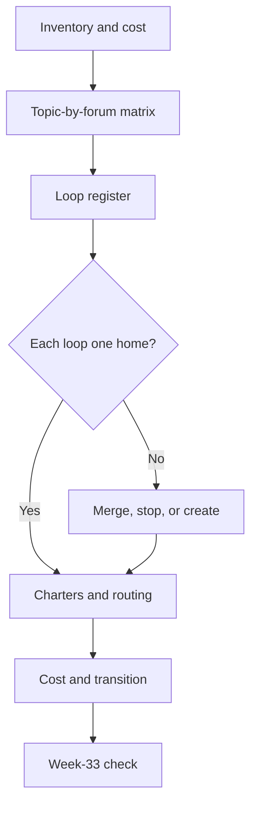

# Project 1: Build an Engineering Management Operating System

It is week 22, late in quarter 2 of your first year as Engineering Director at Northstar Technologies,
the fictional company of the [case study](../case-studies/northstar/index.md). Quarter 3 starts in week
27. Your calendar has filled the way calendars do: one review, one sync, one check-in at a time, each
added for a good reason and none removed. Your job in this project is to design the operating system
you will run in quarter 3: the forums, the written artifacts, the horizons, and the routing rules
between them, with its cost, its transition, and the evidence that will tell you in six weeks whether
it works. The six managers review your draft in week 24.

The project applies [Chapter 37](../parts/08-management-operating-system/37-cadences-and-leadership-meetings.md),
with [Chapter 38](../parts/08-management-operating-system/38-scorecards-quarterly-planning-and-capacity-allocation.md)
for the quarterly cycle and [Chapter 39](../parts/08-management-operating-system/39-reviews-decision-logs-escalation-and-executive-reporting.md)
for reviews, the decision log, escalation, and executive reporting. It takes about 12 to 16 hours.

## Problem Statement

In quarter 1 the director replaced six weekly team status meetings with one operational review. By
week 20 the system had grown back. Reconstructed from weeks 14 to 19, the director's recurring forums
cost about 16.3 hours a week (at the rate from week 16, when skip-levels began), and about 25 of a
47-hour week went to meetings of some kind. Hours are the smaller problem. In six managers' meetings
the notes record 38 agenda items and 5 decisions, two of them reopened later in the product sync; the
status round took about 42 of the 60 minutes. The operational review, booked for 30 minutes, has
averaged 75 since severity audit and error budgets were added to it, and 16 people sit in it, most of
them on-call leads, who are engineers.

Worse, some jobs have no home at all. Cross-team decisions (ADR-0001, the core/permissions owner)
appeared in three forums and were resolved in none. Platform requests appeared in three and were
resolved in none. The technology risk register appeared nowhere. The calibrated promotion cycle due
at the start of quarter 3 had been discussed only in one-on-ones.

Your task is to design the quarter 3 operating system so that every loop the organization needs has
exactly one home, every forum has one job, decisions are made where they are recorded, and the cost
to the director, the managers, and the engineers is known.

[Chapter 37](../parts/08-management-operating-system/37-cadences-and-leadership-meetings.md#case-study)
tells one version: the director's week-22 redesign (a hard 45-minute operational review, a 75-minute
weekly leadership team meeting replacing the managers' meeting and the product sync, a monthly business
review, a quarterly talent review), at about 14.0 recurring hours a week, with three objections from
managers. That redesign is one worked answer, not the answer. You may arrive at it, improve it, or
reject it. Whatever you propose, you must evaluate it honestly, including the three objections.

## Scenario and Constraints

**Your position.** Engineering Director, with nine direct reports: six engineering managers and three
staff engineers. You design the operating system and own the forums you chair. Victor Lindqvist (CTO)
decides anything that changes what he receives or attends. Amara Okafor (CPO) must agree to any change
in how product and engineering trade roadmap decisions. Each manager owns their team's own rhythm
(planning, retrospectives, operations reviews).

**Timing.** You draft in week 22, the managers review in week 24, the system starts in week 27, and you
review it after six weeks (week 33) and at the quarterly reset.

**The time rule.** Use only facts dated week 22 or earlier. The quarter 2 results reported in week 26,
the outcome of bulk ordering (due at the end of week 26), and everything that happens in quarter 3 are
off limits.

**Constraints.** These are binding.

1. **Director's load.** No more than 16 hours a week of recurring forums, counting one-on-ones and
   skip-levels, so that unplanned work and the director's strategy time have room.
2. **No growth by accretion.** Every new recurring forum names the forum it replaces or the agenda it
   joins.
3. **One-on-ones stay.** Weekly one-on-ones with the six managers continue (their length may change).
   Skip-levels continue at no less than their quarter 2 rate.
4. **Open decisions stay open.** ADR-0001, the core/permissions owner, the tax-svc decision, the CI
   consolidation target, and the error budget policy are not decided by your design. It gives each a
   forum, a decider's slot, and a "needed by" date.
5. **Every forum works for remote and Bogotá participants by default.** Sixteen engineers work in
   Bogotá and twelve are fully remote; every manager and staff engineer works in Minneapolis.
6. **Victor's touchpoints** (a weekly one-on-one and the quarterly reset) change only if he agrees.
   You may propose a change and must say what it costs below him.

## Starting Dataset

Use these sources:

- [Northstar overview](../case-studies/northstar/index.md), [baseline data](../case-studies/northstar/baseline-data.md)
  (in particular "Management system before the director" and "Locations and working arrangements"),
  and [the first quarter](../case-studies/northstar/first-quarter.md), including the quarter 2 facts
  dated week 22 or earlier.
- Chapter 37's reconstruction of the quarter 2 calendar and its topic-by-forum matrix, Chapter 39's
  decision log (DL-01 to DL-10) and escalation path, and Chapter 40's measured firsthand time.

**Project data: the quarter 2 forum inventory.** [`p1-quarter2-forums.csv`](data/p1-quarter2-forums.csv)
lists each recurring forum with its cadence, booked and actual length, attendees, the director's hours
per week, and the job it claims. It is **derived from the canon**, not new: Chapter 37's table, with
attendee counts for the quality reviews from Chapter 39. Check: the director's column sums to 16.31,
which Chapter 37 rounds to 16.3.

**Facts your submission must use.**

| Area | Facts |
|---|---|
| Cost | 16.3 recurring hours a week from week 16; about 25 of a 47-hour week in meetings, including 9.5 hours of unscheduled meetings and incident reviews; operational review at 1.25 × 16 = 20 person-hours a week |
| Managers' load | A typical manager attends about 4.1 recurring hours of leadership forums a week; Priya Raman about 5.4, Marcus Oyelaran about 4.6 |
| Decisions | 38 items and 5 decisions in six managers' meetings, two reopened; organization decision log opened week 14 with DL-01 to DL-10, four open and three of those without a named decider; escalation path published week 15 (five working days for the parties, then a joint written case decided by the director within five working days) |
| Topic matrix | Renewal status in six forums, resolved in the renewal check-in; incident follow-ups in four, resolved in the operational review; platform requests in three, resolved nowhere; cross-team decisions in three, resolved nowhere; technology risk register in none; promotion calibration in one-on-ones only |
| Signal | Firsthand time 4.7 percent of the director's hours in weeks 14 and 15; individual skip-levels four a week from week 16; no group skip-levels yet; Mateo Arango Ríos's week-17 conversation was the director's first with a mobile engineer |
| Commitments | Accounting integration live since week 19; bulk ordering due at the end of week 26; quarterly planning for quarter 3 in weeks 25 and 26 (Chapter 38) |
| People | All executives, managers, and staff engineers in Minneapolis; anchor days Tuesday to Thursday; Bogotá is zero or one hour from Minneapolis |
| Platform | Two-person interrupt rotation; other teams' requests down from 20 to 14 points of Platform Operations' capacity and environment waits from about 6 days to 2 by week 18 |
| Reporting | No written report to Victor Lindqvist since the day-90 report; error budgets in reporting mode, with Victor as arbiter |
| Coming in quarter 3 | The first calibrated promotion cycle at the start of quarter 3; the core/permissions exemption, recorded in quarter 1, reaches its two-quarter maximum at the end of quarter 3 (week 39) |

**Facts you do not have.** Whether bulk ordering ships on time; whether the managers will accept a
written pre-read; how much Bogotá engineers hear of decisions today (nobody has asked); the managers'
own preparation time for each forum (estimate it and say so); and whether Victor Lindqvist wants a
written report, and how often. Treat each as an input with a branch.

## Required Deliverables

One design document of no more than about 10 pages, plus a spreadsheet.

1. **Diagnosis of the quarter 2 system.** The inventory recomputed from the CSV: director hours,
   attendee-hours per week, and a typical manager's hours. The topic-by-forum matrix extended with any
   loop Chapter 37's matrix does not list, and a register of every loop the organization needs, each
   marked homed, duplicated, or missing.
2. **The quarter 3 design.** For each forum: a one-paragraph charter with its one job, inputs,
   outputs, attendees, length, cadence, owner, and an end or review date. Show every quarter 2 forum's
   fate: stop, replace with writing, merge, cut attendees, or keep.
3. **The leadership team meeting.** Agenda, pre-read format and deadline, how a decision item arrives
   framed, how it is recorded in the decision log, the closing routine, and how the staff engineers
   and remote participants take part.
4. **Routing rules.** What moves between forums and when: exceptions upward, decisions and
   commitments downward, the fast path for decisions with a cost of delay measured in days, and how
   platform demand and escalations travel without a new meeting.
5. **Cost.** The director's recurring hours, attendee-hours, a typical manager's hours, Priya Raman's
   and Marcus Oyelaran's, and preparation time, before and after, each computed two ways.
6. **Transition and evaluation.** What stops in week 27 and how it is announced; the measures you will
   read in week 33 (decisions per meeting, reopened decisions, recurring hours, loops resolved), how
   each could mislead, and the trigger for changing the design.
7. **Evaluation of Chapter 37's redesign** as a submission, including a written answer to Elena
   Sokolova's, Tom Becker's, and Daniel Cho's objections.
8. **Two short notes:** one page to the managers for the week-24 review, and half a page to Victor
   Lindqvist proposing any change to what he receives.

## Step-by-Step Instructions

1. **Rebuild the inventory** from the CSV. Recompute the director's total, then attendee-hours per
   forum (hours × attendees), and the hours a typical manager spends. Write down each assumption
   (a month as four weeks, a quarter as 13).
2. **Extend the topic-by-forum matrix.** Start from Chapter 37's six rows. Add the loops it does not
   list: the decision log's open entries and their "needed by" dates, executive reporting, manager
   development and assessment (Chapter 41), the error budget policy, standards exemptions that expire,
   the quarterly capacity plan, and the operating system itself. Mark where each appears and where it is
   resolved.
3. **List the loops by horizon** using Chapter 37's horizon table: how fast the signal moves and how
   fast you can act. Each loop gets exactly one home.
4. **Apply the audit diagram** to each quarter 2 forum: one job named, changes anything, job done
   elsewhere, attendees match the job.
5. **Write the charters.** One paragraph each. If a forum cannot name what would break within two weeks
   of stopping, it is a candidate for writing.
6. **Design the leadership team meeting** with Chapter 37's five design choices. Decide who is a member
   and who attends by invitation, and why.
7. **Write the routing rules,** including how a decision item reaches the meeting without the meeting
   deciding who holds the decision right (Chapter 13 owns decision rights).
8. **Cost the design,** for the director and for everyone else. A design that saves the director two
   hours and adds three to each manager is not a saving.
9. **Answer the three objections** and the constraint on Bogotá. Show what changes in your design
   because of each, or why nothing does.
10. **Plan the transition and the check:** what is announced, by whom, what stops, and what you will
    count in week 33.
11. **Check every total twice,** by forum and by person.

The diagram is the order of reasoning. Forums come out of loops, not the other way round: a design
that starts from a list of meetings to keep usually keeps all of them.

## Explicit Trade-offs

| Trade-off | The tension at Northstar |
|---|---|
| Fewer forums against narrower attendance | Merging the managers' meeting and the product sync saves the director an hour; it also invites every manager, staff engineer, and product manager into one room |
| Writing against conversation | A written pre-read carries each team's unshared facts and removes the 42-minute status round; it costs each manager about 20 minutes a week, and weak writers are underheard |
| Predictability against responsiveness | A weekly decision forum makes a cross-team decision wait up to a week; ADR-0001's "needed by" was the middle of week 14, the week it was opened |
| Ending the renewal check-in | Bulk ordering is due at the end of week 26; ending the check-in on schedule saves 4.5 attendee-hours a week, and ending it before the feature ships removes its only resolving forum |
| Delegating the release working group | The director saves 0.75 hours and loses direct signal on the constraint the transformation was built around |
| Monthly versus weekly for platform demand | A monthly business review is cheap; Platform Operations' requests move in days |
| A shorter operational review | Hard 45 minutes saves engineers' hours; severity audit and error budgets, added to the review in quarter 1 and quarter 2, need time somewhere |
| The director's hours against the managers' | Every hour moved from listening to writing lands on a manager; Chapter 37 finds the managers' load does not fall |

## Acceptance Criteria

A submission is accepted only if all of these hold.

1. The quarter 2 director total is recomputed to 16.3 hours a week (from week 16), and attendee-hours
   are computed for every forum.
2. Every loop in the extended matrix has exactly one home in the design, and every forum has exactly
   one named job.
3. The director's recurring load in the design is 16 hours a week or less, computed line by line,
   including one-on-ones and skip-levels.
4. Every new forum names what it replaces or which agenda it joins.
5. None of the five open decisions is decided by the design; each has a forum, a decider's slot, and a
   "needed by" date.
6. The renewal check-in has a stated end rule that works whether or not bulk ordering ships in week
   26.
7. A typical manager's hours and Priya Raman's are computed before and after.
8. The design states how Bogotá and remote participants take part in every forum they attend, and how
   decisions reach engineers who attend none.
9. The week-33 measures are named, each with how it could mislead.
10. No fact is invented about the canon; assumptions are labeled as assumptions.

## Evaluation Rubric

Weights total 100. A strong pass is 75 or more with no criterion weak.

| Criterion | Weight | Excellent | Adequate | Weak |
|---|---|---|---|---|
| Diagnosis | 15 | Inventory recomputed two ways; attendee-hours shown; matrix extended with the loops Chapter 37 omits; each loop marked homed, duplicated, or missing | Inventory and Chapter 37's matrix reproduced correctly | Hours listed without attendee cost; no matrix; diagnosis is "too many meetings" |
| Loop coverage and forum design | 20 | Every loop one home; every forum one job with a charter, inputs, outputs, owner, and an end date; each quarter 2 forum's fate stated | Most loops homed; charters present for new forums | Forums renamed rather than redesigned; loops still split across forums or homeless |
| Leadership team meeting | 15 | Status in writing with a deadline; framed decision items with decider and "needed by"; staff engineers and product as contributors with defined roles; closing routine and log entry | Pre-read and decision log present | A weekly meeting with an agenda; nothing that would make it decide |
| Cost and arithmetic | 15 | Director, attendee, and manager hours before and after, with preparation, each checked twice; named people computed | Director hours correct; managers' load mentioned | Director hours only, or totals that do not add |
| Routing and escalation | 10 | Exceptions up, commitments down, a fast path with a rule, platform demand routed without a new meeting, escalation ending in the log | Routing rules for decisions and escalation | No routing; forums are islands |
| Stakeholders and objections | 15 | All three objections answered with a design change or a reason; Bogotá and remote participants considered forum by forum; Victor's preparation cascade addressed | Objections acknowledged with brief answers | Objections ignored, or answered by restating the design |
| Transition and measurement | 10 | What stops and when, announced with reasons; week-33 measures with how each misleads; a trigger for redesign; the quarterly audit placed | Review date and some measures | "We will see how it goes" |

## Solution

The worked solution, with the inventory recomputed and an evaluation of Chapter 37's redesign, is in
[Project 1 solution](solutions/p1-solution.md).
