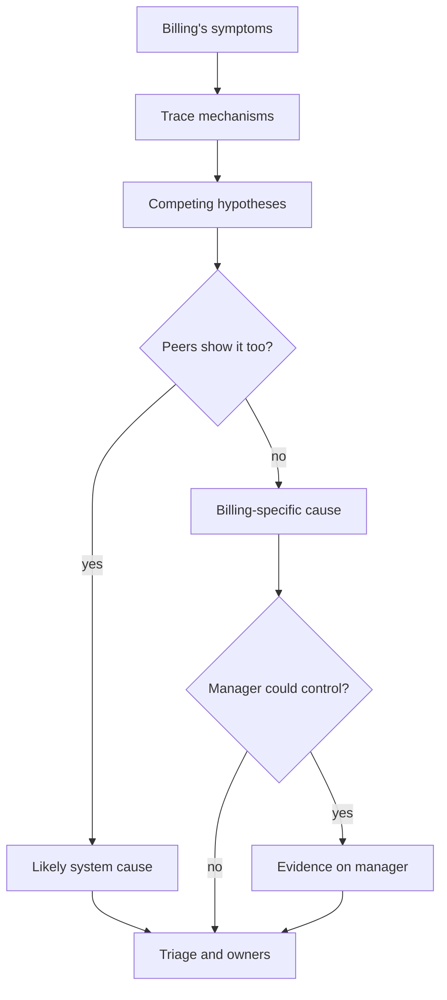

# Project 2: Diagnose a Low-Performing Engineering Team

!!! warning "Awaiting human review"
    This project has passed the book's automated validation and an editorial self-review, but not yet
    the human review in which each cited claim is checked against its source. Treat it as a reviewed
    draft. Corrections are welcome; see the repository's CONTRIBUTING file.

It is weeks 1 to 3 of your first year as Engineering Director at Northstar Technologies, the fictional
company of the [case study](../case-studies/northstar/index.md). Every number you have looked at points
to the same team. Billing, 13 engineers under Marcus Oyelaran, had the most Sev1 and Sev2 incidents last
quarter, the highest change failure rate, the most escaped defects, the highest unplanned share among
the product teams, and delivered none of its three committed roadmap items. Victor Lindqvist (CTO)
asks you, at the end of week 3, what is wrong with Billing and what you are going to do about it. Your
job in this project is to answer him with a diagnosis you can defend: what is causing the low
performance, how sure you are, what you will do first, and what you will not conclude yet.

The project applies [Chapter 56](../parts/13-advanced-problems/56-recovering-a-failing-engineering-organization.md)
(triage and the keep, coach, move, or replace decision), with
[Chapter 9](../parts/02-people-management/09-performance-management-and-underperformance.md) for the four
causes of low performance, [Chapter 16](../parts/04-execution/16-flow-lead-time-dependencies-and-unplanned-work.md)
for unplanned work and dependencies, [Chapter 25](../parts/05-engineering-quality/25-incidents-postmortems-and-change-failure-analysis.md)
for reading incident data, and [Chapter 40](../parts/09-engineering-directorship/40-the-directors-job.md)
for gathering signal as a director. It takes about 10 to 15 hours.

## Problem Statement

"Low-performing" is a conclusion people reach from a table. Billing's row in that table is bad on every
column, and three explanations are available to anyone who looks at it. The team is weak. The manager
is weak. Or the team is working inside a system that would produce these numbers whoever was in it.
Each explanation leads to a different action, and acting on the wrong one makes things worse: replacing
a manager whose team is failing because of the release train removes the person who knows the ledger's
history, while fixing the release train under a manager who cannot lead leaves the team without
direction.

Your task is to diagnose Billing's low performance from the baseline evidence and a set of interviews,
separating symptoms from causes and the system from the people; to test competing explanations against
evidence that could disconfirm them; to sort what you find into what must happen this week, what goes
into the quarter's plan, and what waits; and to make a provisional, evidence-based reading of the
manager with the evidence you will collect before you decide.

## Scenario and Constraints

**Your position.** Engineering Director. Marcus Oyelaran reports to you. You report to Victor Lindqvist.
Kwame Mensah (staff engineer, infrastructure and reliability) is helping you classify incidents. You
have not yet set the quarter's capacity model; it is agreed with Victor and Amara Okafor in week 4.

**The time rule.** Use facts dated week 3 or earlier. You may use every fact on the
[baseline data](../case-studies/northstar/baseline-data.md) page, including the ones the director
reconstructed later in the year (the paging-tool reconstruction, the ledger knowledge map, the recoded
exit data, the classification of dependency links by cause), on the assumption that you could obtain
them from the same sources in weeks 1 to 3. Those facts were reconstructed after week 3 in the canon:
[Chapter 3](../parts/01-foundations/03-managerial-leverage-and-systems-thinking.md) records that
Northstar did not track on-call load, so the paging counts were rebuilt afterwards from the paging
tool's history. Obtaining them in weeks 1 to 3 is this project's assumption, not a canon event; at
arrival the canon gives only the qualitative signal that three people carry most of Billing's pages.
You may not use anything that happens in week 4 or later:
the capacity model, the prevention allocation, the week 4 ownership changes, the QA transition, the
week 9 incident, or any later result.

**Constraints.** These are binding.

1. **Flat headcount.** Backfills are allowed, net additions are not. You cannot add engineers to Billing
   from outside the 80.
2. **The renewal commitments keep their dates.** Bulk ordering (Orders and two Customer Experience web
   engineers) and the accounting-system integration (Payments and Integrations, 4 engineers) are not
   to be staffed from Billing in a way that delays them.
3. **No rewrite of Core.** Proposals that depend on rebuilding invoicing or the ledger are out.
4. **No per-engineer judgments.** Diagnose the team, the system, and the manager. Do not rate or rank
   individual engineers. You may name the ledger engineers and Tamsin Achterberg where the canon does,
   for knowledge and load, not for performance.
5. **Provisional on people.** Any conclusion about Marcus Oyelaran is a reading with the evidence you
   will collect, not a decision. Chapter 56's rule applies: no replacement in the first 30 days except
   for integrity or harm.
6. **No new canon.** Do not invent Northstar facts. The project-only data below is marked as such; any
   other assumption must be labeled as an assumption.

## Starting Dataset

Use these sources:

- [Baseline data](../case-studies/northstar/baseline-data.md): Billing's row, the incidents section, the
  management and people tables, the planning and delivery tables, the dependency causes, and the
  architecture and tests tables. [The Northstar overview](../case-studies/northstar/index.md) for the
  constraints and the team table.
- [`teams.csv`](../case-studies/northstar/data/teams.csv),
  [`components.csv`](../case-studies/northstar/data/components.csv), and
  [`incidents-last-quarter.csv`](../case-studies/northstar/data/incidents-last-quarter.csv).
- **Billing evidence file** (derived from canon): [`p2-billing-evidence.csv`](data/p2-billing-evidence.csv)
  gathers every Billing fact the canon records, with how each number was produced and its known
  weakness. It is **derived from the canon**, not new.
- **Billing sprint record** (mostly project-only): [`p2-billing-sprints.csv`](data/p2-billing-sprints.csv)
  gives the last six sprints. The incidents are canon, and the canon fixes the goal-met total (1 of 6)
  and scope changes in all 6; which sprint met its goal, and the item counts, are **project-only
  data**, invented for this exercise and not part of the canon.

**Project-only data: interview notes, weeks 2 and 3.** These notes are invented for this project. They
are consistent with the canon but are not canon; no other chapter relies on them. Engineers are
identified by role only.

| Interviewee | Note |
|---|---|
| Marcus Oyelaran, Billing manager | "Most of my week is release coordination and incident follow-up. I know the ledger is fragile. Nobody has time to design anything. When a train breaks invoicing, the review spends an hour on whose change it was." |
| A ledger engineer | "Half the pages need nothing from us. We asked for the alerts to be fixed, and each serious incident added another alert instead." |
| A second ledger engineer | "If I'm away, period close is a problem. One of us knows the rounding rules properly." |
| Tamsin Achterberg | "I can handle credit notes. Nobody has walked me through period close or a live migration." |
| A Billing engineer (not on the ledger rotation) | "The sprint goal changes every few days. We stopped treating it as real." |
| A Billing engineer (not on the ledger rotation) | "Keeping the tax table current takes one of us more than half our time. It's all by hand." |
| The billing and payments product manager | "I don't know what Billing can commit to. We committed three items last quarter and shipped none." |
| Priya Raman, Orders manager | "Billing blames our changes. We can't tell which of our changes touch invoicing until the train fails." |
| Sofia Alvarez, VP Customer Success | "Invoice errors are the worst calls. Customers' accountants find them, sometimes weeks later." |

**Facts your submission must use.**

| Area | Facts |
|---|---|
| Stability | 8 Sev1 and Sev2 incidents (2 Sev1); 5 via the Core release train, 2 via database migrations, 1 latent defect; 5 first detected by customers; 6 recurrences of the organization's 11; 4,480 of the organization's 9,558 restoration minutes |
| Delivery | 8 deployments a month, 21-day median lead time, 34 percent change failure rate, all mainly through the fortnightly Core train; 0 of 3 committed items delivered; Sprint Goal met in 1 of 6, scope changed in all 6 |
| Capacity | Unplanned work 41 percent: failure recovery 24, requests from other teams 7, toolchain and environments 6, expedited 4 points; tax-svc upkeep about 0.6 FTE by one engineer |
| People and knowledge | 180 pages, 126 first handled by three ledger engineers, 54 of 64 after-hours pages by them, 61 needing no action; ledger knowledge by area; 2 departures in 12 months; the ledger engineer who left; Tamsin Achterberg's coverage |
| Management | Marcus's time: people 15, delivery 55, technical 15, other 15 percent; technical direction "decided during incidents"; annual reviews on roadmap delivery only |
| System | One shared Core schema; migrations tested against an empty schema; no reconciliation; core/scheduler unowned and co-changed with invoicing; no record of which team's change triggered a Core release incident |
| Comparison | Orders, also on the Core train: 29 percent change failure rate, 7 incidents, 36 percent unplanned, 1 of 4 committed items delivered. Payments and Integrations, off the train: 21 percent, 6 incidents, 33 percent unplanned |

**Facts you do not have.** Billing's escaped defects by earliest point of detection (the canon gives
that table only for the organization); the content of Billing's last incident reviews beyond the
incident file's summaries; any engineering survey (none in the two years before arrival); Marcus
Oyelaran's own view of his development needs beyond the interview note; whether the ledger engineers
are actively looking for jobs. Treat each as a data gap with an action, not a value.

## Required Deliverables

One diagnostic report of no more than about 8 pages, plus your spreadsheet.

1. **Evidence inventory.** Every source you used, how its numbers were produced, how far you trust it,
   and which conclusions depend on it.
2. **Symptoms and mechanisms.** Billing's symptoms traced to mechanisms, as a causal diagram or table,
   with the loops of Chapter 56 (capability, trust, people) marked where they appear.
3. **Competing explanations.** At least three hypotheses (for example: the system, the team's skills,
   the manager), each with the evidence that supports it, the evidence that would disconfirm it, and
   how you would get that evidence by week 13.
4. **Comparison with peers.** Billing against Orders (same train) and Payments and Integrations (off the
   train), used to separate what the system causes from what is specific to Billing. No ranking table.
5. **The one-page diagnosis** you would give Victor Lindqvist: what is wrong, how sure you are, and the
   strongest loop.
6. **Triage.** Billing's findings sorted into act this week, plan this quarter, early win, and defer,
   with an owner, a cost in engineer-weeks where it applies, and a reason for each.
7. **A provisional reading of the manager.** Marcus Oyelaran against Chapter 9's four causes applied to
   his work, the evidence you will collect by day 90, and what would move the reading in each direction.
8. **Communication.** What you say to Marcus first, to the Billing team, to Priya Raman, and to Victor,
   and in what order.
9. **Measures for the quarter.** No more than six measures that would tell you by week 13 whether the
   diagnosis was right, each with its definition and its gaming risk.

## Step-by-Step Instructions

1. **Read the data's production method before the data.** Mark each Billing number as system-counted,
   hand-joined, sampled, or self-reported.
2. **Recompute Billing's incident facts from the incident file.** Triggers, detection, recurrences,
   restoration minutes, and how much of each falls on the ledger and invoicing modules.
3. **Draw the mechanisms.** Start from each symptom and ask what produces it. Look for loops: a cause
   that is also an effect.
4. **Write competing hypotheses before you choose one.** For each, write the evidence that would prove
   it wrong.
5. **Use the peers as a control.** Where Orders looks like Billing, suspect the train and the schema.
   Where Billing differs from Orders, look at what is specific to Billing.
6. **Separate the manager from the system** using Chapter 9's evidence table. Ask what Marcus could and
   could not control.
7. **Triage.** Apply Chapter 56's questions: irreversible harm, the constraint, cheap and visible, or
   defer.
8. **Write the diagnosis, then cut it to one page.**
9. **Check every number twice,** from counts and from the canon's reported figures.

The diagram is the order of reasoning. The peer comparison comes before any conclusion about people.

## Explicit Trade-offs

| Trade-off | The tension at Billing |
|---|---|
| Speed against evidence | Victor wants an answer at week 3; three weeks of data and nine interviews are thin. A provisional diagnosis with stated confidence is the honest product |
| System against people | The system explains most of Billing's numbers; a diagnosis that says only "system" misses the knowledge concentration and the absent technical direction |
| Protecting the ledger engineers against delivery | Taking them off first response or pairing them costs Billing capacity when it already delivered nothing last quarter |
| Fixing Billing against fixing the train | Billing's worst failures arrive through the Core train and the shared schema, which Billing does not own; fixing Billing alone treats the symptom |
| Candor with Marcus against his standing with the team | Telling him the reading is provisional is fair; telling the team before him is not |
| Billing against Orders | Some of Billing's incidents start with Orders' changes; a diagnosis that blames Orders deepens the friction the canon records |

## Acceptance Criteria

A submission is accepted only if all of these hold.

1. Every Billing number used is traced to the canon or to the marked project-only data, with its
   production method and weakness stated.
2. Billing's incident facts are recomputed from the incident file and match the canon.
3. At least three competing hypotheses are stated, each with disconfirming evidence and a way to get it.
4. Orders and Payments and Integrations are used as comparisons, and the conclusions say which findings
   the comparison attributes to the system.
5. The ledger engineers' load and knowledge concentration appear in the triage, with a placement
   justified by Chapter 56's questions.
6. The reading of Marcus Oyelaran is provisional, uses the four causes, names evidence to collect by day
   90, and states what would change it.
7. No individual engineer is rated or ranked, and no fact about the canon is invented.
8. The measures for the quarter are no more than six, each defined, each with its gaming risk.

## Evaluation Rubric

Weights total 100. A strong pass is 75 or more with no criterion weak.

| Criterion | Weight | Excellent | Adequate | Weak |
|---|---|---|---|---|
| Evidence handling | 15 | Every source rated for how it was produced; conclusions tied to their evidence; gaps named with an action | Sources listed and mostly qualified | Hand-joined and sampled numbers treated as fact |
| Mechanisms | 20 | Symptoms traced to mechanisms; the loops identified; the train, schema, and ownership gaps distinguished from Billing's own practices | Main mechanisms identified | Symptoms listed as causes ("Billing has too many incidents because quality is low") |
| Competing hypotheses | 15 | Three or more, each with disconfirming evidence; the peer comparison used as a control | Hypotheses stated with support only | One explanation, assumed |
| Triage | 15 | The people loop placed first with an owner; costs in engineer-weeks; a written "defer" list | Sensible actions without priorities or costs | A long undifferentiated action list, or no action in weeks 1 to 4 |
| Reading of the manager | 15 | Four causes applied; what he controls separated from what he does not; evidence and dates for day 90 | A balanced view without dates | Replace or exonerate on the numbers alone |
| Communication | 10 | Order and content right: Marcus first, the team, Priya without blame, Victor with confidence stated | Messages present | Victor told before Marcus, or blame on Orders |
| Measures | 10 | Six or fewer, defined, paired against gaming, testing the diagnosis | Measures present | Per-engineer measures or targets on incident counts |

## Solution

The worked solution, with Billing's incident facts recomputed and the competing hypotheses tested, is in
[Project 2 solution](solutions/p2-solution.md).
