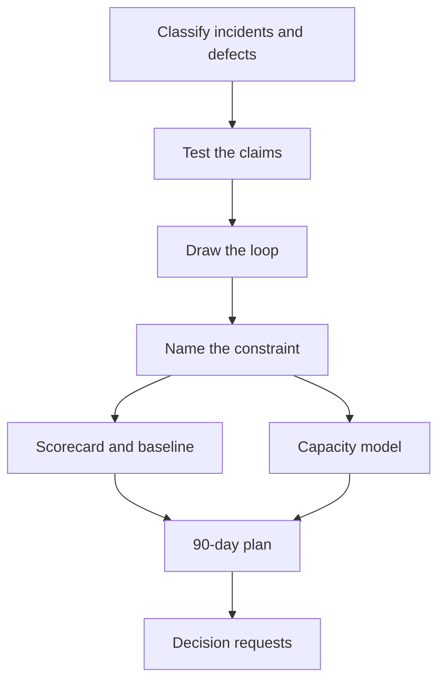

# Project 3: Create an Engineering Quality Transformation Plan

You are the new Engineering Director at Northstar Technologies, the fictional company of the
[case study](../case-studies/northstar/index.md). It is your first week. Nothing in the
transformation has happened yet. Your job is to produce the documents a director needs before
quarter 1 begins: a diagnosis, a named [constraint](../glossary.md#constraint), a
[scorecard](../glossary.md#scorecard), a capacity model, and a 90-day plan that the CTO and the Chief
Product Officer (CPO) could agree to.

The project applies [Chapter 27](../parts/05-engineering-quality/27-quality-transformation-at-enterprise-scale.md)
and draws on the practice chapters behind it, Chapters 19 to 26. After that reading, the full project
takes about 25 to 32 hours.

!!! note "Core version (about 10 to 12 hours)"
    Do parts 1, 2, and 3 only: the diagnosis, the constraint statement, and the scorecard. Apply
    acceptance criteria 2, 3, 4, 5, and 10, and score the rubric rows Diagnosis from data, Constraint
    and alternatives, and Scorecard design (50 of the 100 points; rescale to 100).

## Problem Statement

Northstar's quality has declined to the point where customers, finance, and the executive team have
noticed. Last quarter there were 30 [Sev1 and Sev2](../glossary.md#severity-sev1-sev2-sev3) incidents,
and customers found almost half of them first. Availability on the contractual paths was 99.62
percent against a 99.9 percent commitment, and the company paid $410,000 in
[service credits](../glossary.md#service-credits). About a third of engineering capacity went to
[unplanned work](../glossary.md#unplanned-work). Two renewals worth $9M in annual recurring revenue
([ARR](../glossary.md#arr)) name reliability as the customer's concern.

The CTO, Victor Lindqvist, has given you the mandate in one sentence: halve the number of Sev1 and
Sev2 incidents and meet the 99.9 percent commitment within twelve months, with no net growth in
headcount, and without dropping the two customer commitments that the renewals depend on.

Every manager has an explanation, and the explanations conflict. You have data, but it was produced
unevenly, and part of the work is deciding what to trust. Your task is to turn the data into a plan
that reduces the inflow of new defects before it spends effort on old ones, that is funded honestly,
and that will survive the first bad week.

The book tells one version of what happened next, on the
[first quarter](../case-studies/northstar/first-quarter.md) page and in Chapter 27's case study. That
story is one worked answer, not the answer. Do not read the first-quarter page until you have
submitted. A plan that reaches a different constraint, a different allocation, or a different
sequence can score as well or better if the data supports it.

## Scenario and Constraints

**Your position.** Engineering Director, reporting to Victor Lindqvist (CTO). Six engineering
managers and three staff engineers report to you. You have authority over team allocations, the
engineering management cadence, component ownership, and the role of the QA engineers. You do not
have authority over the roadmap (Amara Okafor, CPO) or the budget (Rajiv Menon, CFO).

**Timing.** You submit the plan at the end of your second week. Assume the diagnosis described in
Chapter 27's playbook (days 1 to 15) has been done and its results are the baseline data. Quarter 1 is
13 weeks.

**Constraints.** These are binding. A plan that breaks one fails the acceptance criteria.

1. Headcount is flat at 80 engineers. Backfills are allowed; net additions are not.
2. The two renewal commitments keep their dates in the first two quarters: bulk ordering (Orders,
   with 5 Orders engineers and 2 Customer Experience web engineers, due at the end of quarter 2, week
   26) and the accounting-system integration (Payments and Integrations, 4 engineers, due in week 19).
   Neither is due in quarter 1.
3. No rewrite of Core will be funded.
4. Discretionary tooling spend is capped at $250,000 for the year without a business case; anything
   beyond that needs Rajiv Menon's approval.
5. The seven QA engineers are employees with years of product knowledge. Any plan that changes their
   work has to say what they do next.

**Stakeholders.** Helena Marsh (CEO) wants the renewals and an end to outage calls. Victor Lindqvist
wants reliability without asking the board for headcount. Amara Okafor wants the roadmap she
committed to customers; she is skeptical of quality programs. Rajiv Menon wants flat operating
expense and the service credits to stop. Sofia Alvarez (Customer Success) wants fewer escalations
and honest status during incidents.

## Starting Dataset

Use these sources:

- [Northstar overview](../case-studies/northstar/index.md): company, people, system, constraints.
- [Baseline data](../case-studies/northstar/baseline-data.md): the measured state in the quarter
  before you arrive, including the extended baseline by topic.
- [`incidents-last-quarter.csv`](../case-studies/northstar/data/incidents-last-quarter.csv): all 30
  Sev1 and Sev2 incidents with trigger, detection, restoration time, and recurrence.
- [`components.csv`](../case-studies/northstar/data/components.csv): 24 components with owner,
  ownership status, proposed tier, runbook, alerts, and on-call.
- [`teams.csv`](../case-studies/northstar/data/teams.csv): six teams and the staff engineers, with
  delivery and stability measures.

**The time rule.** Use the [Northstar overview](../case-studies/northstar/index.md), the
[baseline data](../case-studies/northstar/baseline-data.md), the [cast](../case-studies/northstar/cast.md),
and the "Before week 1" row of the [timeline](../case-studies/northstar/timeline.md). You may use
facts the baseline page says were reconstructed later (such as Billing's on-call pages), because your
first two weeks of diagnosis could have produced them. You may not use any fact about events after
your arrival. That rules out the [first-quarter page](../case-studies/northstar/first-quarter.md)
(except the renewal commitments in constraint 2), the rest of the timeline, and the extended-baseline
rows dated by a later week or quarter: the recoded attrition reasons, staff engineers' time in weeks
12 and 13, design reviews by Ines Carvalho (staff engineer) in weeks 7 to 12, and the week 14 Orders
knowledge map.

**Facts your submission must use.** Each must appear, with its number, where it supports a decision:

| Area | Facts |
|---|---|
| Incidents | 30 Sev1 and Sev2 (7 and 23); triggers from the incident file; 14 detected by customers, 11 by monitoring, 5 by engineers; median detection 108 minutes when a customer reported, 6 when monitoring did; 11 recurrences; median restoration 3 hours 10 minutes overall, 4 hours 50 minutes for release-train incidents |
| Defects | 212 [escaped defects](../glossary.md#escaped-defect), 81 regressions; the five detection-point classes (57, 49, 41, 38, 27) |
| Delivery | [Core](../glossary.md#core), the monolith: 2 releases a month, 19-day [lead time](../glossary.md#lead-time), 31 percent [change failure rate](../glossary.md#change-failure-rate); services: 3 deployments a week, 3 days, 18 percent; pipeline 74 minutes; main branch red 22 percent of working hours; 9 percent of runs fail for unrelated reasons; about 140 flaky tests |
| Ownership and readiness | 8 of 24 components disputed, shared, or orphaned; 8 with no on-call; 15 proposed [tier 1](../glossary.md#tier-1), of which 3 meet all four [operational minimums](../glossary.md#tier-1-operational-minimums) |
| Follow-through | 96 corrective actions in two quarters, 31 closed |
| Capacity and money | 80 engineers at $185,000; unplanned work 34 percent (27.2 engineer-years); unplanned work by category; service credits $410,000 a quarter; manual regression about 2.4 engineer-years |
| Commitments | 7 of 17 committed roadmap items delivered; the two renewal commitments and their staffing |

**Project-only data: claims to test.** In your first week you hear these explanations. Two come from
the case (Chapter 27). The other four are **invented for this project only**, and no chapter relies on
them. Your diagnosis must test each against the
data and say whether it holds, partly holds, or fails.

| Who | Claim | Status |
|---|---|---|
| Marcus Oyelaran, Billing manager | "Our incidents come from unclear requirements." | From the case |
| Tom Becker, Platform Operations manager | "We need more manual testing, not less." | From the case |
| Priya Raman, Orders manager | "Most of our incidents start in the shared modules other teams change." | Project-only |
| Elena Sokolova, Payments and Integrations manager | "Our problems are mostly the partner banks." | Project-only |
| Sofia Alvarez, Customer Success | "Customers tell us before engineering knows." | Project-only |
| Amara Okafor, CPO | "A quality program will cost us the renewals." | Project-only |

## Required Deliverables

Submit one document of no more than about 12 pages, plus any spreadsheet you used. It has six parts.

1. **Diagnosis (2 to 3 pages).** The incidents classified by trigger, detection source, and
   recurrence; the escaped defects by detection point; the pipeline picture; the ownership inventory
   for tier 1; the six claims tested; and one diagram of the reinforcing loop as it runs at Northstar,
   with the specific numbers that feed each link.
2. **Constraint statement (half a page).** The one mechanism you will attack first, with at least
   three independent pieces of evidence, and the two or three candidates you rejected and why. Name
   the parallel workstreams.
3. **Scorecard (one table).** Six to ten measures. For each: definition precise enough that two people
   would compute the same number, source, baseline, direction, paired measure, and how it would be
   gamed and audited. State what you will and will not set targets on in quarter 1.
4. **Capacity model (one table and half a page).** Four quarters: unplanned work, prevention, feature
   capacity, change from baseline. A planned and a [cautious case](../glossary.md#planned-case-and-cautious-case). The quarter 1 prevention
   allocation by team, with the arithmetic shown so that it sums to your total. The cost of
   prevention in dollars and what it buys.
5. **90-day plan.** Use the [90-day quality plan template](../templates/ninety-day-quality-plan.md):
   page one summary, workstreams with named leads and day-90 goals, the timeline, what you will stop,
   and risks with pre-agreed responses. Include the plan for the seven QA engineers.
6. **Decision requests (half a page).** What you need from Victor Lindqvist and Amara Okafor, with
   dates, and what you will report to them at day 30, 60, and 90.

## Step-by-Step Instructions

1. **Read the data before the chapters' conclusions.** Open the three CSV files in a spreadsheet.
   Classify the 30 incidents yourself by trigger, detection, and recurrence, and by component. Do not
   copy the baseline page's summary tables: reproduce them from the file and note any difference.
2. **Find where the damage concentrates.** For each trigger class compute count, share, restoration
   minutes, and customer-detected count. Repeat by component group (Core modules, services,
   frontends, pipeline). Note which view makes the strongest case and why the two views differ.
3. **Classify the inflow.** Use the escaped-defect classes to say which part of inflow is a testing
   problem, which is a release-process problem, which is a requirements problem, and which no test
   would catch. [Chapter 22](../parts/05-engineering-quality/22-testing-strategy-and-test-architecture.md)
   explains what each class implies.
4. **Measure the pipeline and the inventory.** From the baseline page and the components file, build
   the tier 1 readiness table (owner, runbook, complete alerts, on-call) and the delivery picture for
   Core against services ([Chapter 23](../parts/05-engineering-quality/23-code-review-ci-cd-and-release-engineering.md),
   [Chapter 24](../parts/05-engineering-quality/24-reliability-slos-and-operational-readiness.md)).
5. **Test the six claims.** For each, write the data that supports or contradicts it in two or three
   sentences. A claim that partly holds is the most useful kind: say which part.
6. **Draw the loop.** Use Chapter 27's stocks, flows, and reinforcing loop, with Northstar's numbers on
   each link. If your diagram has no number on a link, say what measurement would supply it.
7. **Name the constraint.** Apply Chapter 27's decision diagram. Write the case for your choice and
   the case against it, then decide. Chapter 3's constraint thinking applies: the constraint is where
   most of the damage enters, not the place with the most visible problems.
8. **Design the scorecard.** Start from the mandate (Sev1 and Sev2 count, availability) and work back
   to the mechanism measures you expect to move within weeks. Apply the four design rules in Chapter
   27 and the gaming discussion in [Chapter 18](../parts/04-execution/18-measuring-engineering-productivity.md).
   Use the [scorecard template](../templates/engineering-quality-scorecard.md).
9. **Build the capacity model.** Start from 80 [FTE](../glossary.md#fte) (full-time equivalent
   engineers) and 27.2 FTE of unplanned work. Choose a
   [prevention allocation](../glossary.md#prevention-allocation) per quarter and a projected unplanned-work path. State every assumption. Allocate
   quarter 1 by team, remembering where the renewal staffing sits. Compute the cautious case.
10. **Write the plan.** Sequence workstreams so that inflow reduction starts in days 30 to 60. Give each
    workstream a lead who has the capability and the time. Say what you will stop doing to fund it.
11. **Plan for the people.** The QA engineers, the three staff engineers without a mandate, the
    Billing engineers carrying most on-call pages, and the managers who believe quality belongs to QA.
    For each, what changes, when they hear it, and from whom.
12. **Pre-commit to the bad weeks.** Write down what you will do when severity gets reclassified, when
    a renewal commitment slips, and when a Sev1 lands and the CEO asks who did it
    ([Chapter 25](../parts/05-engineering-quality/25-incidents-postmortems-and-change-failure-analysis.md)).
13. **Check your numbers twice.** Recompute every total by a second route (for example, capacity by
    percentage and by team sums; incident shares from the CSV and from the baseline table).

The diagram is the dependency order of the work, not a schedule. The scorecard and the capacity model
both depend on the constraint, and the plan depends on both.

## Explicit Trade-offs

Your submission must take a position on each of these and state what it gives up.

| Trade-off | The tension |
|---|---|
| Size of the prevention allocation | A larger allocation shortens the decline and deepens the quarter 1 feature dip. Northstar has $9M of renewals at stake; a smaller allocation is safer for the roadmap and slower for the mandate |
| Constraint first or detection first | Reducing release-train failures cuts inflow; alerting on tier 1 paths cuts customer detection and restoration time faster and more cheaply. You can lead with one and run the other in parallel, but not both at full weight |
| Uniform or targeted allocation | A uniform percentage is simple and looks fair; allocation by inflow and commitments is more effective and harder to explain to the team that gets the larger share |
| Central working group or team ownership | A release working group moves the train faster than six teams coordinating; it risks becoming the place where quality lives. Say how work is handed back |
| When to announce the QA change | Early announcement creates anxiety before you have answers; late announcement creates rumors and erodes trust. Choose your week and defend it |
| Gates or flow | After a bad release the reflex is another approval step. Each manual gate adds waiting and batch size. Decide which risks you handle with automated checks and which with human review |
| Transparency of team scorecards | Wide publication adds accountability and pressure to game. Decide who sees team-level numbers |
| Severity definitions now or later | Written, impact-based definitions make the baseline honest and may raise the count; delaying them makes early progress look better and less trustworthy |

## Acceptance Criteria

A submission is accepted only if all of these hold. They are pass or fail; quality is judged by the
rubric.

1. All five constraints are respected, and the plan says how for each.
2. Every number in the submission traces to the starting dataset or to a stated assumption, and no
   fact from after your arrival is used (the time rule).
3. The incident classification reproduces the trigger counts in the CSV (19 change-induced, 6
   dependency, 4 latent, 1 undetermined), or explains any difference.
4. One constraint is named, with at least three independent pieces of evidence and at least two
   rejected alternatives.
5. The scorecard has six to ten measures; each has a definition, source, baseline, paired measure, and
   a stated gaming risk with an audit. No measure depends only on human classification without an
   audit.
6. The capacity model sums to 80 FTE in every quarter, includes a cautious case, and the quarter 1
   team allocation sums to the stated total.
7. The renewal staffing (5 Orders, 2 Customer Experience web, 4 Payments and Integrations engineers)
   is shown as protected in quarter 1 capacity.
8. Every workstream has one named lead, a day-90 goal, and a measure.
9. The plan states what will be stopped, and what each QA engineer will do next.
10. All six claims are tested against data.

## Evaluation Rubric

Weights total 100. A strong pass is 75 or more with no criterion weak.

| Criterion | Weight | Excellent | Adequate | Weak |
|---|---|---|---|---|
| Diagnosis from data | 20 | Classifies from the CSV, not the summary; shows trigger, detection, recurrence, and restoration minutes; tests all six claims and finds the partial truths; the loop diagram carries numbers | Uses the baseline summary correctly; tests most claims; loop drawn without numbers | Restates the overview's bullet points; claims accepted or dismissed by assertion |
| Constraint and alternatives | 15 | One mechanism, three or more independent lines of evidence, honest case against, rejected alternatives with data; parallel workstreams justified by cost and speed | Constraint named with evidence; alternatives mentioned briefly | Several "top priorities"; or a constraint chosen by intuition (more testing, a rewrite, a tool) |
| Scorecard design | 15 | Paired measures; system-generated sources preferred; severity audited; many-event measures marked as early evidence; no targets before a baseline quarter; distribution measures included | Sensible measures with pairs and sources; gaming addressed generally | Line coverage, bugs closed, or incident count alone; targets set on day one; no gaming analysis |
| Capacity model and funding | 20 | Four quarters, planned and cautious, every assumption stated, team allocation by inflow and commitments with sums shown, dollar cost and return, dip disclosed to the CPO before the quarter | Planned case with stated assumptions and a dip; team split present | No model, or prevention assumed free ("absorb it"), or a uniform cut without arithmetic |
| Plan sequencing and ownership | 15 | Inflow reduction starts by day 30 to 60; leads have capability and time; staff engineers given mandates; hand-back for central work; stop list funds the plan | Reasonable sequence and owners; stop list thin | Backlog drained first; a quality sprint as the strategy; owners are "all teams" |
| People and stakeholders | 10 | QA engineers each have a credible role and a date to hear it; manager accountability for the system, not blame; CPO, CFO, and CEO each get the trade in their own terms | QA plan present; stakeholders addressed | QA "automated away" or unmentioned; the plan names culprits |
| Honesty about uncertainty | 5 | Says what one quarter of incident counts can and cannot show; cautious case and triggers for changing course | Some uncertainty acknowledged | Promises a number ("zero Sev1", "halved by Q2") with no confidence |

## Solution

The worked solution, with the numbers recomputed and a weak submission for comparison, is in
[Project 3 solution](solutions/p3-solution.md).
